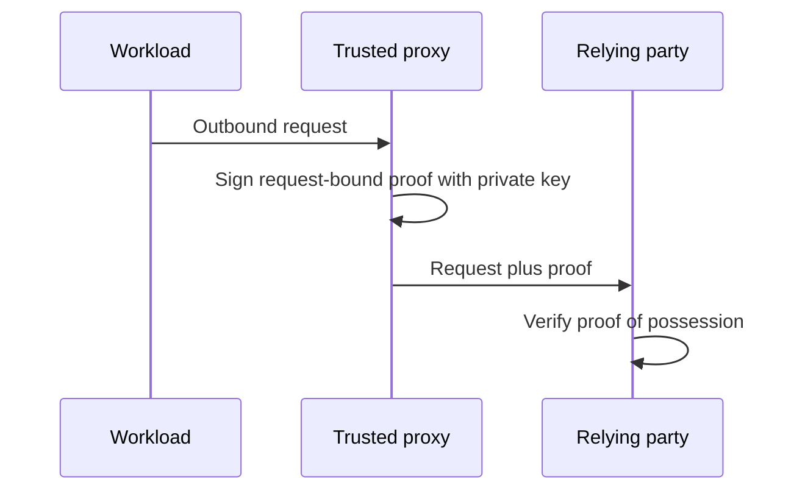
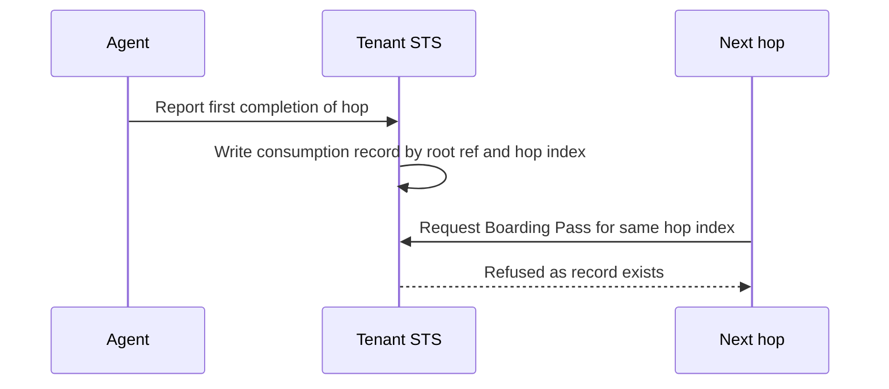
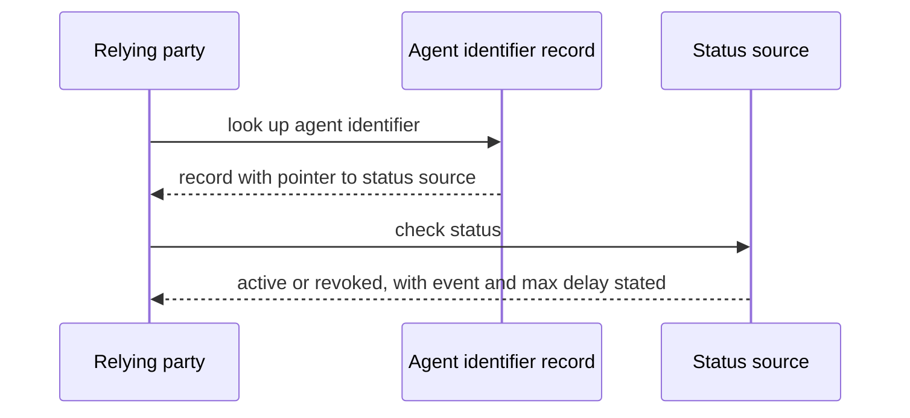

# WIMSE Daily Report (2026-11-24)

Generated at: 2026-11-24T09:57:35+00:00

<!-- insights:start -->
## Briefing

> WIMSE chairs escalated their AI-content warning: Justin Richer says most list posts are likely AI-generated and moderation will be imposed unless posters self-moderate. A second post offers runnable test fixtures for P5/P6. No draft text changed in this run.

_Updated 2026-11-24T09:58:36+00:00. Machine-drafted from the sources linked below, which stay authoritative._

### A contributor posts 28 runnable P5/P6 test fixtures and flags one row for the next draft revision

`mail` · `new-proposal` · first seen 2026-11-24 · [P5/P6 fixtures, runnable (was: P5/P6 as test procedures, not scores)](https://mailarchive.ietf.org/arch/msg/wimse/L4HmjlvtNsj-7THXgfOc-PVm4J0/)

Xinghua Zhao answers Marc's invitation of 23 November with a repository of 28 transcript rows, 12 for P5 and 16 for P6. They run with no implementation, using three scripts, and two implementations that share no code agree on every row. The P5 rows depend on the shape of the status request alone, and hashing the identifier does not stop the provider from linking. P6 splits the report into two legs: the event to the operator's own record, which the operator declares, and that record to the first refusal, which a third party can measure. Several row pairs differ by one second to tell inclusive from exclusive reading of "at or before". Row P6-11 is flagged for -01. A refusal four minutes after the event still grades as having no stated bound while the text says "without undue delay". The post does not name the draft. P5, P6, Section 3.6 and Table 1 come from the post itself.

**Use cases**

- Implementers of revocation or status services can run the transcripts to see how their status-request shape grades on the P5 and P6 procedures.
- Draft authors can use the one-second-apart row pairs to decide whether "at or before" is inclusive in the text.

### WIMSE chairs warn that list moderation will follow if AI-generated posting does not stop

`mail` · `discussion` · first seen 2026-11-24 · [Guidelines for AI-Assisted Contributions to the WIMSE WG](https://mailarchive.ietf.org/arch/msg/wimse/GzYGxOfvaAnmNfJipbtGtNGirXw/)

Justin Richer restated the chairs' 3 November guidance on AI-assisted contributions. Nearly a month on, he says behaviour has not changed. He cites an analysis of the list archives suggesting most postings are almost certainly AI-generated, and calls the list noisy and hard to follow. He asks posters to self-moderate and keep everything readable by humans. Otherwise external moderation will be imposed. The original guidance allows AI for spelling, grammar and as a sounding board. It requires that participants can explain and defend what they post, and it warns that posting privileges may be restricted. Flemming replied in agreement.

**Use cases**

- A contributor who drafts list replies or reviews with an AI agent should read and vouch for every message before posting, or risk restricted posting rights.
- Authors of WIMSE-related individual drafts should expect closer chair scrutiny of automated or high-volume submissions.

### Practices -09 says a trusted proxy can hold keys and perform proof of possession for a workload

`draft-revision` · `substantive` · first seen 2026-11-23 · [draft-ietf-wimse-workload-identity-practices-09: Workload Identity Practices](https://author-tools.ietf.org/iddiff?url1=draft-ietf-wimse-workload-identity-practices-08&url2=draft-ietf-wimse-workload-identity-practices-09)

Section 5.6 now says the workload, or a trusted infrastructure component acting for it, SHOULD perform proof of possession. Section 4.5 drops the word sidecar in favour of proxy. It adds that a proxy can generate request-bound proofs for outbound requests without exposing private keys to the application. Section 5.1.5 treats access to signing capabilities as a security boundary. Untrusted input MUST NOT influence authorization of signing operations. The text warns that a compromised workload may still misuse its authorized signing capability. The draft's own history lists only the proof-of-possession clarification and the sidecar/proxy wording. The rest is wording and a new acknowledgement.

**Use cases**

- A service mesh proxy that attaches HTTP-level proofs to outbound calls without exposing keys to the app.
- A workload identity agent that signs on behalf of workloads and restricts which signing requests it accepts.

### Connected-flight -07 adds a consumption record, issuer-key rules and replay/redirection bounds

`draft-revision` · `substantive` · first seen 2026-11-23 · [draft-seymour-wimse-connected-flight-07: Zero Trust Fabric Layer Agent-to-Agent Chained Trust on a Connected Flight](https://author-tools.ietf.org/iddiff?url1=draft-seymour-wimse-connected-flight-06&url2=draft-seymour-wimse-connected-flight-07)

The draft gives each tenant's STS a consumption record for the hops it issues Boarding Passes for. The record is keyed to the Root Token reference and hop index and written atomically at the first completion attempt. It limits each hop to one completion and is kept until Ticket expiry plus clock skew. Ticket issuance now requires a verified Passport and the principal's authorization of the frozen call. Issuer keys for Passport, Ticket, Boarding Pass and Visa MUST be distinct and held in hardware-backed storage away from any agent runtime. Issuer standing is anchored in the home tenant, and a shared registry is consulted only at tenant boundaries. A new section 4.4 lists time, scope, boundary and count bounds. The draft states that it does not eliminate replay or prompt injection.

**Use cases**

- A multi-agent orchestrator that must stop a delegated hop from being completed twice.
- Cross-tenant agent chains where a Visa is issued only at the boundary.

**Related in other tracks**

- `oauth-wg` / `draft-ietf-oauth-identity-chaining`: The draft compares its model with OAuth Token Exchange and chained delegation across domains.

### The AER-1 attribution profile now fixes one JSON string-escaping rule so commitments hash identically across languages

`mail` · `substantive` · first seen 2026-11-23 · [New draft: an attribution profile for AER-1 receipts (draft-zambo-aer1-attribution-profile-00)](https://mailarchive.ietf.org/arch/msg/wimse/HZixEiDAKLcIwtmTd1GtIBDUpaA/)

The author reports a new revision of draft-zambo-aer1-attribution-profile (the message says -01, though the subject says -00). Review found that Section 4 fixed member order, whitespace and no-normalization but not string escaping, so a non-ASCII caller_scope such as café gives different bytes and digests in Python's escaped form versus JavaScript's literal UTF-8. Section 4 now inherits the escaping rule of Section 7.1 of the base AER-1 draft. A new Appendix B gives a positive known-answer vector: the commitment, its canonical bytes, the digest, and a public JWK with the signature.

**Use cases**

- An implementer producing AER-1 attestation commitments in both Python and JavaScript services who needs identical digests for non-ASCII scope values.
- A verifier checking signatures over commitments that wants a known-answer vector to test its canonicalization.

### Practices -09 was published in response to a Last Call review by Shankar

`mail` · `substantive` · first seen 2026-11-23 · [Last Call: &lt;draft-ietf-wimse-workload-identity-practices-08.txt&gt; (Workload Identity Practices) to Informational RFC](https://mailarchive.ietf.org/arch/msg/wimse/jBuYevn84xvICGd9DZpufi18Jqk/)

Arndt says the feedback was incorporated and -09 published. Shankar had suggested three changes: allow a trusted infrastructure component to perform proof of possession (5.6), make signing capability a security boundary (5.1.5), and describe proxies that manage keys in service meshes (4.5). The -09 text carries these ideas, with the examples reworded to say proxy instead of sidecar. The IESG Last Call was for -08 as an Informational RFC with comments due 2026-11-13.

### Proposed neutral AIMS Section 6 text lets an agent identifier point to an independent status source

`mail` · `new-proposal` · first seen 2026-11-23 · [AIMS question: checking agent status from outside the trust domain](https://mailarchive.ietf.org/arch/msg/wimse/nBwuYsuknbHoBGnOD5aKr3_2XkQ/)

Jaromir sent draft text for Section 6 of AIMS. An identifier may point to a status source run by someone other than the issuer. Each source must state which events remove standing, when the clock starts and the maximum delay. Services needing fresh answers may refuse the agent if no status arrives in time. The pointer and fetch mechanism are left to other documents. Sriram's quoted reply says -03 of draft-shankarlingam-oauth-agent-dns-link adds a Change of Issuer section. A DNS record alone cannot show whether the domain owner made a change. The message is truncated, so it is incomplete.

**Use cases**

- A service outside an agent's trust domain that checks whether the agent is still allowed to act.

**Related in other tracks**

- `oauth-wg` / `draft-ietf-oauth-status-list`: Both address checking revocation or status of an issued identity, but the material does not link them.

### A thread on draft-molas-agent-principal-refs-00 compares public agent registries on latency, freshness and round trips

`mail` · `discussion` · first seen 2026-11-23 · [draft-molas-agent-principal-refs-00 - public registry as a case?](https://mailarchive.ietf.org/arch/msg/wimse/ZAgrZUWeAxNKGcuivc7yvPs8Vbc/)

Dick Brooks argues that a trust registry must meet three requirements: average response under 500 ms, current real-time status from SCITT ledger content, and one network round trip. He says locally stored data trades accuracy for speed. Jaromir (AIBSN) replies that the lookup returns status at request time, took 38 ms on average over 100 European lookups, and needs one HTTPS GET. He says the local-copy option in Section 7.6 of draft-zly-aibsn-agent-status is a proposal next to the live lookup, and will be clarified in -01. Dick adds that SAG-CTR uses a failover cache flushed every N minutes. These are self-reported measurements, and the material is truncated.

**Use cases**

- A relying party choosing between live status lookups and a locally cached status list for agent identities.
- An implementer of a trust registry weighing cache flush intervals against stale revocation data.

**Related in other tracks**

- `oauth-wg` / `draft-ietf-oauth-status-list`: A cached status list with changes fed to relying parties is the same trade-off, though the thread does not cite it.

### The WIMSE chairs say most list posts look AI-generated and warn of moderation

`mail` · `discussion` · first seen 2026-11-23 · [Guidelines for AI-Assisted Contributions to the WIMSE WG](https://mailarchive.ietf.org/arch/msg/wimse/dN51wJq1zrDjrnew-6nFdwcG05Y/)

Justin followed up on the chairs' 3 November guidance. The chairs say behaviour has not changed. An analysis of the archive found most posts almost certainly AI-generated. They ask posters to self-moderate. Otherwise external moderation will be imposed, which they have not used before. The earlier message allowed AI for grammar, wording and as a sounding board. It said participants must be able to explain and defend their content, and it warned of restricted posting privileges.

### The author of an agent status registry draft revises it after review against the criteria P1 to P6

`mail` · `discussion` · first seen 2026-11-23 · [draft-molas-agent-principal-refs-00 - public registry as a case?](https://mailarchive.ietf.org/arch/msg/wimse/duEtkdULynR6lQuyV712JCcq7J4/)

Jaromir posted -01 of draft-zly-aibsn-agent-status. For P6, refund and dispute delays are now counted from the event as the payment processor records it, and Section 7.3 proposes a 15-minute maximum pull interval. Refusing when status cannot be read is left to the relying party. For P4, Section 7.9 logs every release of owner data, with refusals, for 3 years. P6 stays marked not met today. Marc plans to list the draft in Appendix A of his draft-molas-agent-principal-refs -01.

**Use cases**

- Relying parties that must refuse an agent whose status changed, with a stated maximum delay.

### Two authors agree to draft mechanism-neutral AIMS Section 6 text letting an identifier point to a status source with a stated revocation delay

`mail` · `discussion` · first seen 2026-11-23 · [AIMS question: checking agent status from outside the trust domain](https://mailarchive.ietf.org/arch/msg/wimse/f2ezo_l0SvWfdPyhGlDUa2mplLg/)

Sriram Shankarlingam and Jaromir (AIBSN) agree to propose neutral wording for AIMS Section 6: an identifier can point to a status source, and each source states the event its delay is measured from and the maximum delay before a relying party refuses, as in Marc's P6. No field or registry is to be named. Sriram also reports -03 of draft-shankarlingam-oauth-agent-dns-link with a Change of Issuer section: the domain owner updates client_id (and iss) in the link record, receivers use the new values from the next uncached lookup, so old-client tokens stop being accepted within the cache lifetime. The record cannot show whether the owner made the change. Policy keyed on agent name plus client identifier, and logging of the client identifier at each verification, limit the impact. Earlier quoted text describes draft-zly-aibsn-agent-status with an optional status_source entry. The material is truncated.

**Use cases**

- An AIMS editor deciding how Section 6 should refer to external agent status sources.
- A receiver that resolves an agent name through DNS and must handle the operator moving to a new OAuth client or issuer.
- A deployer who needs evidence of agent revocation held outside the operator's trust domain.

**Related in other tracks**

- `oauth-wg` / `draft-ietf-oauth-status-list`: Also a way to publish revocation status for a credential or identifier, though the thread does not mention it.

### The author of draft-li-rttp-iqa-addressing points to three gaps in AIMS and offers their own draft's vectors as existing work

`mail` · `discussion` · first seen 2026-11-23 · [AIMS: three underserved areas, with existing work](https://mailarchive.ietf.org/arch/msg/wimse/hMKTKADxtaotoIMByw6e570Tjq4/)

The author names three areas they see as underserved in the AIMS draft: a vocabulary for policy outcomes (Section 10.4), freshness when the verifier is offline (Section 9.2.3 limitations), and offline-verifiable evidence artifacts for Sections 11 and 13. For each they cite sections of their own draft: a closed five-value refusal set with priority order, an in-band lease with a cached-lease offline mode, and a 128-octet attestation envelope with a byte-exact test vector. They state they are not asking AIMS to adopt or reference anything, only pointing to existing work and public conformance vectors. No response is in the material.

### Triage of the candidate queue

- **high** `Diff active WG draft: draft-ietf-wimse-arch-09`: Arch issue #139 on AI intermediaries and per-agent identity was commented on and closed this week.
- **high** `Diff active WG draft: draft-ietf-wimse-http-signature-09`: Digest shows closed s2s-protocol issues on http-signature: test vectors, nonce note, editorial comments, and a broken workload-creds reference.
- **high** `Diff active WG draft: draft-ietf-wimse-workload-creds-03`: The IPR poll to its authors started today, which suggests the draft is moving toward publication.
- **high** `Diff active WG draft: draft-ietf-wimse-workload-identity-practices-09`: -09 adds normative-looking changes on proxy proof of possession and signing boundaries after Last Call.
- **high** `Review related draft: draft-miao-wimse-http-signature-test-vectors-00`: New draft with 29 vectors and 3 observations on spec ambiguity in draft-ietf-wimse-http-signature.
- **high** `Review related draft: draft-nandakumar-wimse-wpt-message-binding-00`: Announced today and already drawing questions on authority hashing behind gateways and registry profiles.
- **high** `Review related draft: draft-seymour-wimse-connected-flight-07`: -07 defines a consumption record, key requirements and replay bounds.
- **low** `Diff active WG draft: draft-ietf-wimse-aims-01`: The status-source Section 6 proposal is only on the list so far, with no draft text.
- **low** `Review related draft: draft-hulea-wimse-agent-mandate-01`: Only appears as a column in a side-by-side comparison; no change discussed.
- **low** `Review related draft: draft-thaha-wimse-agent-evidence-binding-03`: Its authors engaged in two threads today, but only through short comments, with no new text in this material.

<!-- insights:end -->

## Snapshot

- Active WG drafts: 8
- Related drafts: 24
- Mailing-list posts scanned: 40
- Tracked GitHub repos: 6

## Active WG Drafts

| Draft | Date | Title |
| --- | --- | --- |
| draft-ietf-wimse-workload-identity-practices-09 | 2026-11-23 | Workload Identity Practices |
| draft-ietf-wimse-http-signature-09 | 2026-11-20 | WIMSE Workload-to-Workload Authentication with HTTP Signatures |
| draft-ietf-wimse-arch-09 | 2026-11-16 | Workload Identity in a Multi System Environment (WIMSE) Architecture |
| draft-ietf-wimse-aims-01 | 2026-11-02 | AI Identity Management System |
| draft-ietf-wimse-workload-creds-03 | 2026-10-30 | WIMSE Workload Credentials |
| draft-ietf-wimse-mutual-tls-03 | 2026-10-24 | Workload Authentication Using Mutual TLS |
| draft-ietf-wimse-identifier-04 | 2026-10-23 | Workload Identifier |
| draft-ietf-wimse-wpt-02 | 2026-08-27 | WIMSE Workload Proof Token |

## Recent Related Drafts

| Draft | Date | Title |
| --- | --- | --- |
| draft-seymour-wimse-connected-flight-07 | 2026-11-23 | Zero Trust Fabric Layer Agent-to-Agent Chained Trust on a Connected Flight |
| draft-munoz-wimse-authorization-evidence-02 | 2026-11-20 | Signed Authorization-Evidence Records for AI Agent Actions Using WIMSE Workload Identity |
| draft-miao-wimse-http-signature-test-vectors-00 | 2026-11-18 | Test Vectors for the WIMSE HTTP Message Signatures Protocol |
| draft-chandra-wimse-partition-tolerant-renewal-00 | 2026-11-17 | Extend-Only, Threshold-Attested Authority Renewal for Partitioned Agent Meshes |
| draft-nandakumar-wimse-delegator-bound-chains-00 | 2026-11-16 | Delegator-Bound Delegation Chains for AI Agents |
| draft-nandakumar-wimse-wpt-message-binding-00 | 2026-11-16 | Message Binding for Workload Proof Tokens |
| draft-hulea-wimse-agent-mandate-01 | 2026-11-01 | Verifiable Mandates for Agents Acting Across Administrative Domains |
| draft-thaha-wimse-agent-evidence-binding-03 | 2026-11-01 | Evidence Binding for AI Agent Credentials |
| draft-reddy-wimse-oauth-dialog-binding-00 | 2026-10-30 | Binding Agent Dialogs to WIMSE and OAuth Credentials |
| draft-sweeney-wimse-credential-delegation-02 | 2026-10-30 | Credential Delegation Protocol for AI Agents in Multi-System Environments |

## Mailing List Topics

- No mailing-list topics extracted.

## Recent GitHub Activity

| Repository | Latest Commit |
| --- | --- |
| ietf-wg-wimse/draft-ietf-wimse-arch | 2026-11-23T17:29:20Z |
| ietf-wg-wimse/draft-ietf-wimse-workload-identity-practices | 2026-11-23T12:49:10Z |
| ietf-wg-wimse/draft-ietf-wimse-s2s-protocol | 2026-11-20T22:45:12Z |
| ietf-wg-wimse/draft-ietf-wimse-identifier | 2026-10-23T15:16:50Z |
| ietf-wg-wimse/ietf-wg-wimse.github.io | 2026-10-07T19:43:41Z |
| ietf-wg-wimse/admin | 2024-03-17T22:59:45Z |

## Top Deep-Dive Candidates

- [7] Diff active WG draft: draft-ietf-wimse-aims-01
- [7] Diff active WG draft: draft-ietf-wimse-http-signature-09
- [7] Diff active WG draft: draft-ietf-wimse-mutual-tls-03
- [7] Diff active WG draft: draft-ietf-wimse-workload-creds-03
- [6] Review related draft: draft-asor-wimse-agent-delegation-chain-03
- [6] Review related draft: draft-chandra-wimse-partition-tolerant-renewal-00
- [6] Review related draft: draft-durga-wimse-ctx-isolation-00
- [6] Review related draft: draft-hulea-wimse-agent-mandate-01
- [6] Review related draft: draft-jackson-wimse-evaluation-05
- [6] Review related draft: draft-lee-wimse-local-tool-call-proof-01

