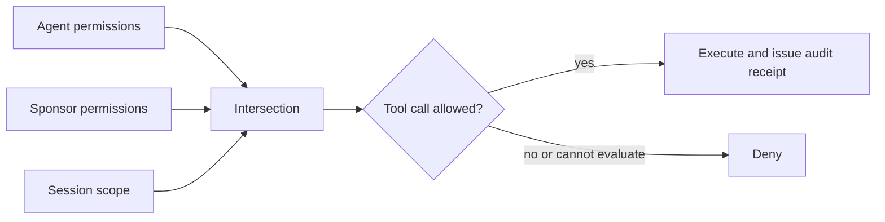
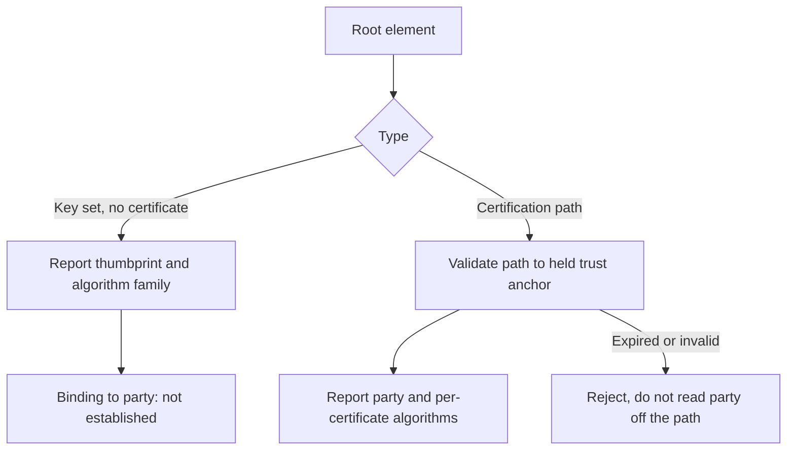
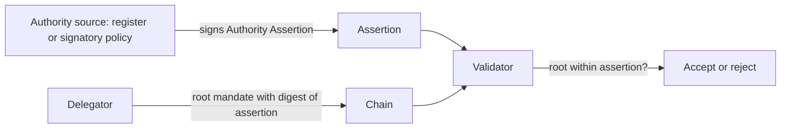

# WIMSE Daily Report (2026-11-25)

Generated at: 2026-11-25T21:44:14+00:00

<!-- insights:start -->
## Briefing

> No WG draft changed in this run; the week was mailing-list activity. The most notable item is a question on whether WIMSE should cover evidence that a delegator was entitled to delegate (Authority Assertion in draft-hulea-wimse-agent-mandate).

_Updated 2026-11-25T21:45:21+00:00. Machine-drafted from the sources linked below, which stay authoritative._

### The -02 of the post-quantum agent identity draft tightens wording on the binding gap and requirements, mostly from reviewer feedback

`mail` · `substantive` · first seen 2026-11-25 · [draft-uppalapati-wimse-pq-agent-identity-02](https://mailarchive.ietf.org/arch/msg/wimse/3i0MQcsfIoDWvsFQ5K5NerhWLGo/)

Venkata Karunakar Uppalapati announces -02, calling it a small revision. Section 3 adopts Rafael Asor's wording: offline-held binding evidence can be inspected, an online verifier may obtain current evidence from an authenticated source, but network access alone establishes nothing. A claim about the availability and privacy cost of offline verification is removed. Section 3 also notes that the root-key part of the recording gap now has a home in Section 6.4 of draft-asor-wimse-agent-delegation-chain and in draft-gilda-audit-agent-audit-record, while the binding gap at verification time remains without one. PQ-R4 is narrowed to migration order, with the completion date left to PQ-R2 and PQ-R7(e). PQ-R7 now states the independence test: an unannounced break of one family does not propagate to the other. draft-niyikiza-oauth-attenuating-agent-tokens is added to the survey, since its Section 9.11 requires an algorithm allowlist but gives no rule for dropping quantum-vulnerable algorithms. Section 8.2 records that a separated ML-DSA component does not verify as an RFC 9964 signature, and citations now use RFC 10073 for composite ML-DSA. The message does not give the diff itself.

**Use cases**

- A team planning a post-quantum migration for agent credentials that wants the draft's requirements (PQ-R2, PQ-R4, PQ-R5, PQ-R7) as a checklist.
- An implementer of hybrid or composite ML-DSA signatures in JOSE who needs to know that a split ML-DSA component will not verify on its own.

**Related in other tracks**

- `oauth-wg` / `draft-ietf-oauth-rfc8725bis`: Both deal with JOSE and JWT algorithm handling. The PQ draft asks for an algorithm allowlist and a rule for retiring quantum-vulnerable algorithms.

### A new individual draft proposes per-tool-call authorization for AI agents, using the intersection of agent, sponsor and session permissions

`mail` · `new-proposal` · first seen 2026-11-25 · [New draft: draft-pandey-agent-identity-00 — Session-Scoped Authorization for AI Agents](https://mailarchive.ietf.org/arch/msg/wimse/iB-0pc72P_IaEPpeRgpmBYrHfhA/)

Karmendra Pandey announced draft-pandey-agent-identity-00. Each agent is its own principal bound to a human sponsor through a delegation chain. Authorization is evaluated at every tool call, with effective permissions as the intersection of the agent's, the sponsor's and the session scope. Unevaluable actions are denied, irreversible action classes need sponsor approval, and each call yields a tamper-evident audit receipt. The draft defines no new protocol and requests no IANA actions. Review is requested on the intersection rule, fail-closed behaviour and reuse of the receipt.

**Use cases**

- An MCP or tool gateway that must decide per call what an agent acting for a user may do.
- Producing audit receipts for each agent action to support later dispute or review.

**Related in other tracks**

- `oauth-wg` / `draft-ietf-oauth-transaction-tokens`: Both carry per-call context for downstream authorization decisions, though the mail does not reference it.

### A thread drafts neutral AIMS Section 6 text on external agent status sources and argues a status answer must not stand in for authorization

`mail` · `discussion` · first seen 2026-11-25 · [AIMS question: checking agent status from outside the trust domain](https://mailarchive.ietf.org/arch/msg/wimse/HTjzLGpYvTrpvHAq8msB7YqKrvU/)

The thread drafts a Section 6 for AIMS: an agent identifier can point to a status source run by someone other than the issuer, and each source states which events remove standing, when the clock starts and the maximum lag. Jiahui Miao suggests changing wording from whether the agent is allowed to act to whether its standing is still in effect, leaving authorization to the relying party as in AIMS Section 10.4. Miao also asks that a refusal on a stale answer record the event and maximum delay applied, not only status-stale. Ben Le describes draft-le-agent-passport-01, which records status-stale instead of revocation and gives a refusal bound of t0 + B + min(L, M, R + T). The thread is truncated in the source, so later messages are not covered.

**Use cases**

- A relying party outside the issuer's domain deciding whether to trust an agent's current standing.
- Keeping refusal records that can be rechecked later in a dispute.

### Test vectors say a bare key set must never be reported as binding the root key to a party; only a validated certification path can

`mail` · `discussion` · first seen 2026-11-25 · [Trust-anchor provenance (draft-asor-wimse-agent-delegation-chain-02, Section 6.4)](https://mailarchive.ietf.org/arch/msg/wimse/iGTW6JAv6Nt81CwR7734xbaR3p8/)

Sankalp Gilda describes a third test vector, R25, in the agent-evidence-vectors repository. It is R13 with the root element changed to a key set holding one P-256 key and no certificate. A verifier must report the key's RFC 7638 thumbprint and algorithm family, and must report the key-to-party binding as not established. R13 (Ed25519 key set) now reports the same. A verifier that reports the binding as established disagrees with the vectors, and one that omits the binding is read as reporting none, not as a pass. The same rule goes into proposed text for the next revision of draft-gilda-audit-agent-audit-record. The remaining case is a root element with a certification path naming the party. There the verifier validates the path to a trust anchor it already holds, and reports the party and each certificate's signature algorithm, as Section 6.4 asks. An expired-certificate vector will accompany it. Holding the anchor is configuration and no topology is mandated. Gilda also announces vectors R3, R4 and R19 for receipt-time checks (PQ-R7(c)), in v0.38.0: R3 and R4 are malformed, R19 is the well-formed boundary case.

**Use cases**

- A verifier implementer checking its handling of audit-record root elements against the published vectors before claiming conformance.
- A relying party that receives delegation-chain evidence with a bare key set and must decide whether it may treat the key as belonging to a named party.

### The author of draft-hulea-wimse-agent-mandate asks whether WIMSE should cover proof that a delegator was entitled to delegate

`mail` · `discussion` · first seen 2026-11-25 · [Evidence that the delegator could delegate: interest in WIMSE?](https://mailarchive.ietf.org/arch/msg/wimse/zeMYPRXMTA5bRnWssKMeJj7XJNA/)

Claudiu Hulea notes that delegation chain drafts show no hop exceeds its parent, and draft-nandakumar-wimse-delegator-bound-chains adds that each hop was granted by the parent's holder. The root still rests on a trust anchor, which shows who signed it, not that the delegator could grant its contents. draft-hulea-wimse-agent-mandate-01 proposes an Authority Assertion: a statement signed by a source the relying party trusts (for example a company register or signatory policy) of what the delegator may grant. The root mandate references it by digest and the Validator checks the root stays within it. He asks whether this is a WIMSE gap, possibly for the AIMS gaps section, or belongs elsewhere, and requests review of Section 9.4 before -02.

**Use cases**

- A bank in another domain accepting a treasury agent's payment mandate without holding the company's onboarding file.
- A relying party that wants to verify a root delegation stays within what the issuing officer could commit.

### A reviewer reports two problems in the test vectors of draft-miao-wimse-http-signature-test-vectors-00

`mail` · `editorial` · first seen 2026-11-25 · [New draft: draft-miao-wimse-http-signature-test-vectors-00 — test vectors for the S2S HTTP signature scheme](https://mailarchive.ietf.org/arch/msg/wimse/GOtEcnOvKzbtEDMONGFUnEvYyQ4/)

The reviewer verified the five keys and vector P-01 against -00. P-01's signature only matches when the workload-identity-token line in the signature base is the full WIT-A, but the draft prints a placeholder, which contradicts the statement that it is retained verbatim, and the token is in Section 3 rather than 2. For N-04, P-03 covers content-digest rather than the body, so with header and Signature unchanged the signature still verifies and only the digest comparison fails.

### A list post links articles on trust management; it has no technical content for WIMSE

`mail` · `routine` · first seen 2026-11-25 · [This article from CVS and McDonald's should be required reading for everyone in the WIMSE WG](https://mailarchive.ietf.org/arch/msg/wimse/_ItM-_16fMjc8z5oTPkwS4lpgwM/)

The message shares two external articles and says identity management is moving toward trust management. It contains no proposal, draft reference or technical argument.

### In short, the PQ agent identity draft -02 adds cross-references and records a JOSE WG answer on composite signatures; no new requirements are visible

`draft-revision` · `substantive` · first seen 2026-11-24 · [draft-uppalapati-wimse-pq-agent-identity-02: Post-Quantum Requirements for Software and AI Agent Identity](https://author-tools.ietf.org/iddiff?url1=draft-uppalapati-wimse-pq-agent-identity-01&url2=draft-uppalapati-wimse-pq-agent-identity-02)

The diff is truncated, so only part is visible. It adds a reference to draft-niyikiza-oauth-attenuating-agent-tokens and a paragraph noting that its Section 9.11 algorithm allowlist is the enforcement PQ-R5 asks for, while it says nothing about post-quantum algorithms. The online-verification text now points to Section 8 of draft-asor-wimse-agent-delegation-chain, and to its Section 6.4 with draft-gilda-audit-agent-audit-record for retaining the root key path. The composite signature question put to JOSE is now reported as answered: the ML-DSA component does not verify standalone as an RFC 9964 signature, only the traditional component is at issue, and the WG declined to add a statement. A requirement on independent protection families gains a test (an unannounced break of one must not propagate), and the trust-anchor requirement now says it covers order only, with the date left to PQ-R2 and PQ-R7(e). References were updated, including RFC 10073 replacing the LAMPS composite draft.

**Use cases**

- Reviewers tracking how post-quantum migration requirements for delegation chains are scoped across WIMSE-related drafts.
- Authors of delegation or audit-record drafts deciding how to cite a requirement for retained, later-verifiable records.

### A contributor posts 28 runnable P5/P6 test fixtures and flags one row for the next draft revision

`mail` · `new-proposal` · first seen 2026-11-24 · [P5/P6 fixtures, runnable (was: P5/P6 as test procedures, not scores)](https://mailarchive.ietf.org/arch/msg/wimse/L4HmjlvtNsj-7THXgfOc-PVm4J0/)

Xinghua Zhao answers Marc's invitation of 23 November with a repository of 28 transcript rows, 12 for P5 and 16 for P6. They run with no implementation, using three scripts, and two implementations that share no code agree on every row. The P5 rows depend on the shape of the status request alone, and hashing the identifier does not stop the provider from linking. P6 splits the report into two legs: the event to the operator's own record, which the operator declares, and that record to the first refusal, which a third party can measure. Several row pairs differ by one second to tell inclusive from exclusive reading of "at or before". Row P6-11 is flagged for -01. A refusal four minutes after the event still grades as having no stated bound while the text says "without undue delay". The post does not name the draft. P5, P6, Section 3.6 and Table 1 come from the post itself.

**Use cases**

- Implementers of revocation or status services can run the transcripts to see how their status-request shape grades on the P5 and P6 procedures.
- Draft authors can use the one-second-apart row pairs to decide whether "at or before" is inclusive in the text.

### In short, a thread on AIMS Section 6 converges on neutral text for external agent status sources, and a new draft offers a staleness rule and a delay formula

`mail` · `discussion` · first seen 2026-11-24 · [AIMS question: checking agent status from outside the trust domain](https://mailarchive.ietf.org/arch/msg/wimse/5vf-1uga0E9j1jx8XIW1PDxm4YM/)

The message is truncated. Ben Le supports the neutral Section 6 text proposed in the thread, under which an agent identifier can point to a status source outside the issuer's trust domain, and each source states when its clock starts and its maximum lag. He adds two points from draft-le-agent-passport -01. A relying party that cannot get a fresh answer should record status-stale and must not record status-revoked on a stale or superseded answer alone. The refusal time after standing is withdrawn at t0 is t0 + B + min(L, M, R + T), where B is the evidence issuer's acceptance window, L the receipt lifetime, M the relying party's maximum evidence age, R the refresh interval and T the status list's time-to-live. He also discloses IPR #7669 against that draft. The quoted earlier messages show draft-zly-aibsn-agent-status adding an optional status_source entry, and draft-shankarlingam-oauth-agent-dns-link -03 adding a Change of Issuer section.

**Use cases**

- A service outside an agent's issuing domain that must decide whether to accept the agent and needs to tell revocation from an unreachable status source.
- Editors drafting AIMS Section 6 who want a bounded, stated delay for status answers.

**Related in other tracks**

- `oauth-wg` / `draft-ietf-oauth-status-list`: The delay formula includes the status list's time-to-live as the term T.

### WIMSE chairs warn that list moderation will follow if AI-generated posting does not stop

`mail` · `discussion` · first seen 2026-11-24 · [Guidelines for AI-Assisted Contributions to the WIMSE WG](https://mailarchive.ietf.org/arch/msg/wimse/GzYGxOfvaAnmNfJipbtGtNGirXw/)

Justin Richer restated the chairs' 3 November guidance on AI-assisted contributions. Nearly a month on, he says behaviour has not changed. He cites an analysis of the list archives suggesting most postings are almost certainly AI-generated, and calls the list noisy and hard to follow. He asks posters to self-moderate and keep everything readable by humans. Otherwise external moderation will be imposed. The original guidance allows AI for spelling, grammar and as a sounding board. It requires that participants can explain and defend what they post, and it warns that posting privileges may be restricted. Flemming replied in agreement.

**Use cases**

- A contributor who drafts list replies or reviews with an AI agent should read and vouch for every message before posting, or risk restricted posting rights.
- Authors of WIMSE-related individual drafts should expect closer chair scrutiny of automated or high-volume submissions.

### In short, two small website commits: an IETF 127 entry and an SEO title fix

`repo-activity` · `routine` · first seen 2026-11-24 · [2 new commit(s) in ietf-wg-wimse/ietf-wg-wimse.github.io](https://github.com/ietf-wg-wimse/ietf-wg-wimse.github.io)

The material lists only two commit messages: adding IETF 127 and tweaking the long list display, and fixing the title in SEO headers. No diffs are given, so nothing more can be said.

### Triage of the candidate queue

- **high** `Diff active WG draft: draft-ietf-wimse-aims-01`: Active thread drafting AIMS Section 6 on external status sources and a gaps section request.
- **high** `Diff active WG draft: draft-ietf-wimse-arch-09`: Arch issue #139 on AI intermediaries and per-agent identity was commented on and closed this week.
- **high** `Diff active WG draft: draft-ietf-wimse-http-signature-09`: Digest shows closed s2s-protocol issues on http-signature: test vectors, nonce note, editorial comments, and a broken workload-creds reference.
- **high** `Diff active WG draft: draft-ietf-wimse-workload-identity-practices-09`: -09 adds normative-looking changes on proxy proof of possession and signing boundaries after Last Call.
- **high** `Review related draft: draft-hulea-wimse-agent-mandate-01`: Author asked the list whether the Authority Assertion is a WIMSE gap and requested review of Section 9.4 before -02.
- **high** `Review related draft: draft-miao-wimse-http-signature-test-vectors-00`: A reviewer found the P-01 placeholder does not reproduce the signature and N-04 misdescribes what fails.
- **high** `Review related draft: draft-seymour-wimse-connected-flight-07`: -07 defines a consumption record, key requirements and replay bounds.
- **high** `Review related draft: draft-uppalapati-wimse-pq-agent-identity-02`: The -02 was announced on the list with requirement rewording (PQ-R4, PQ-R7), a new survey entry and a Section 8.2 finding on ML-DSA.

<!-- insights:end -->

## Snapshot

- Active WG drafts: 8
- Related drafts: 24
- Mailing-list posts scanned: 40
- Tracked GitHub repos: 6

## Active WG Drafts

| Draft | Date | Title |
| --- | --- | --- |
| draft-ietf-wimse-workload-identity-practices-09 | 2026-11-23 | Workload Identity Practices |
| draft-ietf-wimse-http-signature-09 | 2026-11-20 | WIMSE Workload-to-Workload Authentication with HTTP Signatures |
| draft-ietf-wimse-arch-09 | 2026-11-16 | Workload Identity in a Multi System Environment (WIMSE) Architecture |
| draft-ietf-wimse-aims-01 | 2026-11-02 | AI Identity Management System |
| draft-ietf-wimse-workload-creds-03 | 2026-10-30 | WIMSE Workload Credentials |
| draft-ietf-wimse-mutual-tls-03 | 2026-10-24 | Workload Authentication Using Mutual TLS |
| draft-ietf-wimse-identifier-04 | 2026-10-23 | Workload Identifier |
| draft-ietf-wimse-wpt-02 | 2026-08-27 | WIMSE Workload Proof Token |

## Recent Related Drafts

| Draft | Date | Title |
| --- | --- | --- |
| draft-uppalapati-wimse-pq-agent-identity-02 | 2026-11-24 | Post-Quantum Requirements for Software and AI Agent Identity |
| draft-seymour-wimse-connected-flight-07 | 2026-11-23 | Zero Trust Fabric Layer Agent-to-Agent Chained Trust on a Connected Flight |
| draft-munoz-wimse-authorization-evidence-02 | 2026-11-20 | Signed Authorization-Evidence Records for AI Agent Actions Using WIMSE Workload Identity |
| draft-miao-wimse-http-signature-test-vectors-00 | 2026-11-18 | Test Vectors for the WIMSE HTTP Message Signatures Protocol |
| draft-chandra-wimse-partition-tolerant-renewal-00 | 2026-11-17 | Extend-Only, Threshold-Attested Authority Renewal for Partitioned Agent Meshes |
| draft-nandakumar-wimse-delegator-bound-chains-00 | 2026-11-16 | Delegator-Bound Delegation Chains for AI Agents |
| draft-nandakumar-wimse-wpt-message-binding-00 | 2026-11-16 | Message Binding for Workload Proof Tokens |
| draft-hulea-wimse-agent-mandate-01 | 2026-11-01 | Verifiable Mandates for Agents Acting Across Administrative Domains |
| draft-thaha-wimse-agent-evidence-binding-03 | 2026-11-01 | Evidence Binding for AI Agent Credentials |
| draft-reddy-wimse-oauth-dialog-binding-00 | 2026-10-30 | Binding Agent Dialogs to WIMSE and OAuth Credentials |

## Mailing List Topics

- ai-agent: 1
- http-signature: 1

## Recent GitHub Activity

| Repository | Latest Commit |
| --- | --- |
| ietf-wg-wimse/ietf-wg-wimse.github.io | 2026-11-24T18:45:55Z |
| ietf-wg-wimse/draft-ietf-wimse-arch | 2026-11-23T17:29:20Z |
| ietf-wg-wimse/draft-ietf-wimse-workload-identity-practices | 2026-11-23T12:49:10Z |
| ietf-wg-wimse/draft-ietf-wimse-s2s-protocol | 2026-11-20T22:45:12Z |
| ietf-wg-wimse/draft-ietf-wimse-identifier | 2026-10-23T15:16:50Z |
| ietf-wg-wimse/admin | 2024-03-17T22:59:45Z |

## Top Deep-Dive Candidates

- [7] Diff active WG draft: draft-ietf-wimse-aims-01
- [7] Diff active WG draft: draft-ietf-wimse-http-signature-09
- [7] Diff active WG draft: draft-ietf-wimse-mutual-tls-03
- [7] Diff active WG draft: draft-ietf-wimse-workload-creds-03
- [6] Review related draft: draft-asor-wimse-agent-delegation-chain-03
- [6] Review related draft: draft-chandra-wimse-partition-tolerant-renewal-00
- [6] Review related draft: draft-durga-wimse-ctx-isolation-00
- [6] Review related draft: draft-hulea-wimse-agent-mandate-01
- [6] Review related draft: draft-jackson-wimse-evaluation-05
- [6] Review related draft: draft-lee-wimse-local-tool-call-proof-01

