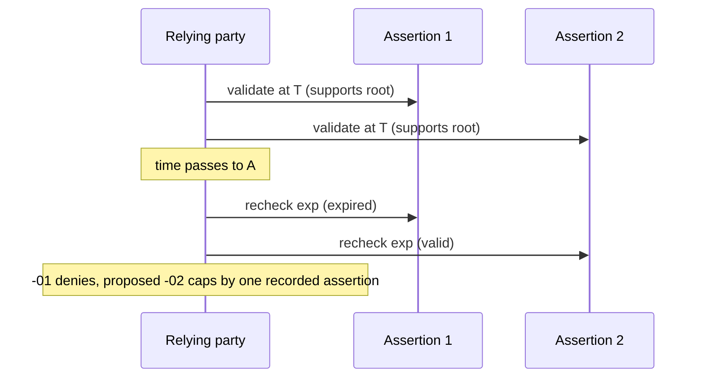
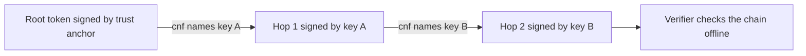

# WIMSE Daily Report (2026-11-27)

Generated at: 2026-11-27T08:39:00+00:00

<!-- insights:start -->
## Briefing

> The most substantive thread is on draft-hulea-wimse-agent-mandate -01: the authors confirmed that rechecking every supporting assertion at authorization time wrongly denies requests, and floated two fixes for -02. The rest is new-proposal chatter around AIMS and agent drafts, plus a test-vector citation.

_Updated 2026-11-27T08:40:07+00:00. Machine-drafted from the sources linked below, which stay authoritative._

### The agent-mandate author agrees -01 wrongly denies issuance when one of two supporting assertions has expired, and proposes fixes for -02

`mail` · `substantive` · first seen 2026-11-27 · [Evidence that the delegator could delegate: interest in WIMSE? (3 new messages)](https://mailarchive.ietf.org/arch/msg/wimse/8hHUzcL31rVs0JMWeXFeVnQDZMY/)

Songbo Bu showed that in -01, if two assertions both establish the same root at validation time T and one has expired by authorization time A, Section 10.2 rechecks every supporting assertion and denies issuance. Claudiu Hulea confirmed this is unintended, because Section 9.4 treats the references as alternatives. He offered two fixes: the relying party records one supporting assertion and caps the token by that assertion only, or the text keeps "every" and says the alternatives hold only at T. Earlier in the thread, Hulea said a monthly sum_max cannot be expressed in powers (Section 5), and proposed either a per-root sum_max ceiling or an explicit open issue. For indeterminate results, he proposed a separate member for alternatives, and James He supported that. He also verified James's 17 test vectors at c8795e4, and the cases showed no mismatch with -01.

**Use cases**

- An implementer of a mandate verifier needs to know whether one expired assertion should fail issuance when another still supports the root.
- A bank or relying party accepting delegated payment mandates needs to know that cumulative limits are not provable from an authority assertion.

### draft-le-agent-passport-01 is posted, and a reviewer asks how it could cap a delegation presented to several relying parties

`mail` · `new-proposal` · first seen 2026-11-27 · [draft-le-agent-passport-01 posted](https://mailarchive.ietf.org/arch/msg/wimse/8_N7JGge-dQG_tgO1Osw9Wn3Tz0/)

Ben Le announced -01 of draft-le-agent-passport. Changes listed: revocation fails closed without fresh status, with a stated bound on reliance on a withdrawn principal; a cumulative limit counted by exactly one relying party, with grants requestable as a RAR authorization_details type; transport and intermediary rules covering @authority; root receipts that can record how the person approved, including a WebAuthn assertion; and a requirements table and comparison with other attenuation formats. A public verifier is available under Apache-2.0. Errol Seymour asked, in a reply, how a limit shared across relying parties could be handled, since an agent presenting the same delegation at several relying parties has no total cap. He asked whether a shared issuer, side counter or aggregate limit is planned. No answer is in the material.

**Use cases**

- Cross-organization agent delegation where one agent presents the same grant to several services and spend limits matter.
- Deployments that need revocation to fail closed when status data is unavailable.

**Related in other tracks**

- `oauth-wg` / `draft-ietf-oauth-transaction-tokens`: Not referenced in the thread; transaction tokens are another way to carry delegated context, but the material does not link them.

### A proposal to add a note to AIMS separating organizational decisions from authorization checks draws two evidence-format drafts

`mail` · `discussion` · first seen 2026-11-27 · [AIMS: organizational decision provenance and authorization evidence for AI agents (3 new messages)](https://mailarchive.ietf.org/arch/msg/wimse/4r7ynK3IbERO43TVdprfg7WNj4I/)

David Luna asked whether draft-ietf-wimse-aims-01 should carry a short, non-normative note distinguishing a technical authorization decision, the organizational Decision behind an action, and evidence of execution and outcome. He suggested an integrity-protected reference to the Decision, without private details in the token. Brennan Zambo agreed and pointed to draft-zambo-aer1, an execution receipt format with an outcome vocabulary and hash-linked receipts. Iman Schrock preferred keeping the decision at the application layer and adding a note to AIMS §10 that the receiving service must check the evidence covers the actual beneficiary and amount, referencing draft-schrock-ep-authorization-evidence-chain-08. No text change to AIMS has been made.

**Use cases**

- Teams building AI agents that make payments need an audit trail that shows who approved an action, not just that a token was valid.
- Authors of AIMS authorization considerations deciding how much evidence handling to define in the draft.

### The author of the HTTP signature test vectors published a citable v4 set with a DOI and an MD5 for checking the bytes

`mail` · `routine` · first seen 2026-11-27 · [Test vectors for the WIMSE HTTP signature profile — v4 set, citation and integrity pointers](https://mailarchive.ietf.org/arch/msg/wimse/4zdhTHqRCYNQMwcP7BwlBQxIGro/)

Jiahui Miao announced test vectors v4 for the HTTP Message Signature profile in draft-ietf-wimse-http-signature: 29 verdict vectors (6 positive, 23 negative) plus 3 observation items, archived at Zenodo with a DOI and CC-BY-4.0 licence. The message gives the MD5 of the publication file and asks implementers to report results by set version, draft baseline and implementation. v3 and v4 results are not interchangeable, since v4 adds N-09b and implementer-feedback fixes. The same content is in draft-miao-wimse-http-signature-test-vectors-00. This is a release notice and does not change the profile.

**Use cases**

- An implementer of the WIMSE HTTP signature profile can run the vectors and report divergences against a fixed, checkable set.

### draft-le-agent-passport-01 is posted. Revocation now fails closed and cumulative limits are counted by one RP

`mail` · `substantive` · first seen 2026-11-26 · [draft-le-agent-passport-01 posted](https://mailarchive.ietf.org/arch/msg/wimse/LcmaHpAV4z6s0htiS4XbWYKaQFU/)

The announcement lists the main changes in -01. Revocation fails closed when no fresh status is available, with a stated bound on how long a withdrawn principal can still be relied on. A cumulative limit is counted by exactly one RP, and grants can be requested as a RAR authorization_details type. Transport and intermediary rules are added, with @authority always covered. A root receipt can record how the person approved the delegation, including a WebAuthn assertion. The draft also adds a table mapping it to cross-organisation delegation requirements and a comparison with other attenuation formats. A public relying-party verifier under Apache-2.0 covers the IETF 127 hackathon scenarios.

**Use cases**

- An RP that accepts agent passports must decide what to do when the status list cannot be fetched.
- A deployer wants to request agent grants through RAR authorization_details.

### A new draft makes each hop of an agent delegation chain signed by the previous agent's key. The le-agent-passport author says it should be the default

`mail` · `new-proposal` · first seen 2026-11-26 · [New draft: Delegator-Bound Delegation Chains for AI Agents:](https://mailarchive.ietf.org/arch/msg/wimse/ixBxKlbk-bJEce-E5Lja4BM3MUQ/)

Suhas Nandakumar and Cullen posted draft-nandakumar-wimse-delegator-bound-chains, which extends the Delegation Tokens of draft-asor-wimse-agent-delegation-chain. Each token is signed with the key the previous token names in cnf, and its iss is the previous token's client_id. Only the root rests on a trust anchor. A del_bind claim in the root enables this for the whole chain, and later hops cannot turn it off. The draft also adds a per-chain pseudonym for the person, cycle detection, audience attenuation and context binding. Ben Le replies that draft-le-agent-passport makes delegator binding the only mode, with each child receipt signed by the holder key of the passport whose thumbprint is in cnf.jkt. He leans towards a default in the Delegation Tokens draft rather than an extension, and says the same key signs the next receipt and the request.

**Use cases**

- Agents in different organisations delegate directly to each other with no server to vouch for each step.
- A verifier checks offline that each hop was actually granted by the agent before it.

### In short, the draft-le-agent-passport author described -01 choices on shared limits, intermediaries and SCITT proofs; a SCITT contributor offered help

`mail` · `discussion` · first seen 2026-11-26 · [Agenda slot request for IETF 127 — draft-le-agent-passport-00 (3 new messages)](https://mailarchive.ietf.org/arch/msg/wimse/Ja6hVA-v5-DY_Ywz67N_QvOFCdI/)

Ben Le replied that -01 is posted. A receipt with dlg_limits must name exactly one RP in aud, and that RP is the only counter. Shaibi and Shameer's after-the-fact detection is seen as complementary for limits spread across RPs. "@authority" stays covered, but an RP may declare, as local configuration, the authorities it accepts as its own. An intermediary that rewrites covered components must verify the signature itself and pass its decision over an authenticated channel, or not forward the passport. A SCITT Receipt is the preferred option for the inclusion-proof claim. Dick Brooks offered help on SCITT Receipts and cited RFC 9943 Section 5.1.1 on registration policies, then corrected Ben's description of him: he is not an author of RFC 9943.

**Use cases**

- An RP behind a gateway or TLS terminator needs to know which authority values to accept when verifying an HTTP message signature.
- A deployer of delegated agent credentials with spending limits must know that dlg_limits is counted by a single named RP.

### In short, a proposed AIMS Section 6 text on agent status sources now says 'standing is still in effect' and records stale refusals as stale, not revoked

`mail` · `discussion` · first seen 2026-11-26 · [AIMS question: checking agent status from outside the trust domain (2 new messages)](https://mailarchive.ietf.org/arch/msg/wimse/NADlHkNCwidP76JvmbnOdW8WKMA/)

Jaromir Zly posted proposed neutral text for AIMS Section 6 incorporating feedback. A status source may be run by the issuer, operator or an independent party, so an outside service can check whether the agent's standing is still in effect without relying on the issuer alone. Whether the agent may perform an action remains the relying party's own decision (Section 10.4), a point Jiahui Miao pushed for. Each source should state which events remove standing, when the clock starts, and the maximum delay. A relying party that refuses on a stale or missing answer should record a stale status, not a revocation, and keep the event and maximum delay it applied. No field or registry is named. He also posted -02 of draft-zly-aibsn-agent-status to match, and asked the editors to treat the text as a proposal.

**Use cases**

- A service verifying an agent from another trust domain wants to check agent status without trusting only the issuer.
- A relying party that refuses on a stale status answer needs a record that distinguishes stale from revoked and can be re-checked in a dispute.

### The author of draft-le-agent-passport replies to reviewers on shared limits, intermediaries and inclusion proofs, pointing to -01

`mail` · `discussion` · first seen 2026-11-26 · [Agenda slot request for IETF 127 — draft-le-agent-passport-00](https://mailarchive.ietf.org/arch/msg/wimse/bBK4Zonj2Il52zHhr2XXrTVKajk/)

The thread starts with a request for an IETF 127 slot for draft-le-agent-passport-00 and includes reviews from Errol Seymour and from the draft-thaha-scitt-agent-execution-evidence authors. The latest reply says -01 is posted. A receipt with dlg_limits must name exactly one RP in aud, and that RP is the only counter. For intermediaries, @authority stays covered, but an RP may declare a locally configured set of authorities it accepts as its own. An intermediary that rewrites covered components must either verify the signature itself and pass its decision over an authenticated channel, or not forward the passport. The author agrees to a SCITT Receipt for inclusion proofs and to being cited for grants and attenuation. The message body is truncated, so the rest of the original request is not visible.

**Use cases**

- A relying party behind a gateway that rewrites the host needs to know which authorities it may accept as its own.
- A deployer that must cap cumulative spend by an agent has to choose a single RP to count it.

### Jiahui Miao proposes separate, test-first rejection criteria for workload-instance binding, drawn from the WIMSE HTTP signature test vectors

`mail` · `discussion` · first seen 2026-11-26 · [Workload-instance binding needs rejection criteria, not just identity formats](https://mailarchive.ietf.org/arch/msg/wimse/qYxPk16KTdlQ5KyD4r3-fBxL8Ms/)

Citing the R9(f) gap in draft-cea-list-vaultys-oauth-agent-deleg-reqs-gaps-00, the author notes that DPoP and mTLS prove key possession but not that the workload instance the authority was delegated to is using the key. From the 29 vectors in draft-miao-wimse-http-signature-test-vectors-00, 23 of them negative, three criteria are proposed. Instance mismatch is a rejection class distinct from signature invalidity. The binding check runs against the presented instance identity, not the key that produced the proof. A proof that verifies but names the wrong instance is a negative case. The author says these are criteria and test material, not a binding specification, and asks whether the list wants this as a separable work item.

**Use cases**

- A WIMSE HTTP signature verifier needs negative tests for a valid signature presented by the wrong workload instance.
- Authors of agent delegation specifications need rejection criteria for instance binding.

### In short, the agent-mandate author conceded -01 cannot express a monthly cap and floated two -02 fixes; a reviewer shared -01 test vectors

`mail` · `discussion` · first seen 2026-11-26 · [Evidence that the delegator could delegate: interest in WIMSE? (3 new messages)](https://mailarchive.ietf.org/arch/msg/wimse/rDtWoia19UrbD0j_SIvqASgb8aA/)

James asked whether a EUR 50,000 monthly limit can be expressed in an Authority Assertion, since Section 5 bars stateful constraints in powers, and whether an RP reading only alternatives may proceed on an indeterminate result. Claudiu answered that the monthly limit is not expressible: the Section 9.4 check proves only a per-payment ceiling, and a cumulative limit would need a ledger, while -01 keys accounting by root mandate (Section 9.5). For -02 he offers either admitting sum_max in powers as a per-root ceiling, or keeping the exclusion and stating that only stateless ceilings are proved. On alternatives, he says Section 10.1 requires treating indeterminate as denial unless policy permits it, but agrees the result is a trap and suggests either stating in 9.6 that the RP reads outcome first, or moving alternatives into a separate member. James then confirmed both -01 digests match, published -01 vectors (cases 0 to 4, 15, 16), and preferred the separate member plus a per-root sum_max ceiling, if the text says the cumulative limit stays open.

**Use cases**

- A bank accepting agent-initiated payments needs to know whether a delegator's authority covers cumulative limits or only per-payment ceilings.
- An RP implementer must decide how to handle indeterminate validation results without accidentally treating alternatives as an approval.
- Someone building an interoperable validator can check against the published -01 test vectors.

### In short, the agent-mandate author published the -01 Validation Profile and Trust Anchor Set with digests and noted how expected test results changed

`mail` · `routine` · first seen 2026-11-26 · [draft-hulea-wimse-agent-mandate-00: evidence that the delegator was entitled to delegate](https://mailarchive.ietf.org/arch/msg/wimse/PJeRBN1XEMhLQZKsdarAj9c1kyU/)

Claudiu sent James the Validation Profile (profil.json, https://bank.example/profiles/agents/3) and Trust Anchor Set (ancore.json, https://bank.example/anchors/7) for -01, with digests to check before signing; the keys are unchanged and the -00 profile digest is superseded. Case 4 can now be written: a root referencing two Authority Assertions, one established and one not presented, is valid with an authority_not_presented diagnostic. For cases 1 to 3, expected results change per the -01 Changes from -00: anchors is a new member of the Validation Result, references carry only dig, errors and diagnostics have defined forms, and alternatives is empty when the outcome is invalid.

### Triage of the candidate queue

- **high** `Diff active WG draft: draft-ietf-wimse-arch-09`: Arch issue #139 on AI intermediaries and per-agent identity was commented on and closed this week.
- **high** `Diff active WG draft: draft-ietf-wimse-http-signature-09`: Digest shows closed s2s-protocol issues on http-signature: test vectors, nonce note, editorial comments, and a broken workload-creds reference.
- **high** `Diff active WG draft: draft-ietf-wimse-workload-identity-practices-09`: -09 adds normative-looking changes on proxy proof of possession and signing boundaries after Last Call.
- **high** `Review related draft: draft-hulea-wimse-agent-mandate-01`: Active thread confirms a Section 10.2 expiry-recheck flaw and proposes -02 changes.
- **high** `Review related draft: draft-nandakumar-wimse-delegator-bound-chains-00`: Announced on the list this run, with direct feedback from the le-agent-passport author on defaults and key reuse.
- **high** `Review related draft: draft-seymour-wimse-connected-flight-07`: -07 defines a consumption record, key requirements and replay bounds.
- **high** `Review related draft: draft-uppalapati-wimse-pq-agent-identity-02`: The -02 was announced on the list with requirement rewording (PQ-R4, PQ-R7), a new survey entry and a Section 8.2 finding on ML-DSA.

<!-- insights:end -->

## Snapshot

- Active WG drafts: 8
- Related drafts: 24
- Mailing-list posts scanned: 40
- Tracked GitHub repos: 6

## Active WG Drafts

| Draft | Date | Title |
| --- | --- | --- |
| draft-ietf-wimse-workload-identity-practices-09 | 2026-11-23 | Workload Identity Practices |
| draft-ietf-wimse-http-signature-09 | 2026-11-20 | WIMSE Workload-to-Workload Authentication with HTTP Signatures |
| draft-ietf-wimse-arch-09 | 2026-11-16 | Workload Identity in a Multi System Environment (WIMSE) Architecture |
| draft-ietf-wimse-aims-01 | 2026-11-02 | AI Identity Management System |
| draft-ietf-wimse-workload-creds-03 | 2026-10-30 | WIMSE Workload Credentials |
| draft-ietf-wimse-mutual-tls-03 | 2026-10-24 | Workload Authentication Using Mutual TLS |
| draft-ietf-wimse-identifier-04 | 2026-10-23 | Workload Identifier |
| draft-ietf-wimse-wpt-02 | 2026-08-27 | WIMSE Workload Proof Token |

## Recent Related Drafts

| Draft | Date | Title |
| --- | --- | --- |
| draft-uppalapati-wimse-pq-agent-identity-02 | 2026-11-24 | Post-Quantum Requirements for Software and AI Agent Identity |
| draft-seymour-wimse-connected-flight-07 | 2026-11-23 | Zero Trust Fabric Layer Agent-to-Agent Chained Trust on a Connected Flight |
| draft-munoz-wimse-authorization-evidence-02 | 2026-11-20 | Signed Authorization-Evidence Records for AI Agent Actions Using WIMSE Workload Identity |
| draft-miao-wimse-http-signature-test-vectors-00 | 2026-11-18 | Test Vectors for the WIMSE HTTP Message Signatures Protocol |
| draft-chandra-wimse-partition-tolerant-renewal-00 | 2026-11-17 | Extend-Only, Threshold-Attested Authority Renewal for Partitioned Agent Meshes |
| draft-nandakumar-wimse-delegator-bound-chains-00 | 2026-11-16 | Delegator-Bound Delegation Chains for AI Agents |
| draft-nandakumar-wimse-wpt-message-binding-00 | 2026-11-16 | Message Binding for Workload Proof Tokens |
| draft-hulea-wimse-agent-mandate-01 | 2026-11-01 | Verifiable Mandates for Agents Acting Across Administrative Domains |
| draft-thaha-wimse-agent-evidence-binding-03 | 2026-11-01 | Evidence Binding for AI Agent Credentials |
| draft-reddy-wimse-oauth-dialog-binding-00 | 2026-10-30 | Binding Agent Dialogs to WIMSE and OAuth Credentials |

## Mailing List Topics

- ai-agent: 5
- http-signature: 2

## Recent GitHub Activity

| Repository | Latest Commit |
| --- | --- |
| ietf-wg-wimse/ietf-wg-wimse.github.io | 2026-11-24T18:45:55Z |
| ietf-wg-wimse/draft-ietf-wimse-arch | 2026-11-23T17:29:20Z |
| ietf-wg-wimse/draft-ietf-wimse-workload-identity-practices | 2026-11-23T12:49:10Z |
| ietf-wg-wimse/draft-ietf-wimse-s2s-protocol | 2026-11-20T22:45:12Z |
| ietf-wg-wimse/draft-ietf-wimse-identifier | 2026-10-23T15:16:50Z |
| ietf-wg-wimse/admin | 2024-03-17T22:59:45Z |

## Top Deep-Dive Candidates

- [10] Investigate mailing-list trend: ai-agent
- [7] Diff active WG draft: draft-ietf-wimse-aims-01
- [7] Diff active WG draft: draft-ietf-wimse-http-signature-09
- [7] Diff active WG draft: draft-ietf-wimse-mutual-tls-03
- [7] Diff active WG draft: draft-ietf-wimse-workload-creds-03
- [6] Review related draft: draft-asor-wimse-agent-delegation-chain-03
- [6] Review related draft: draft-chandra-wimse-partition-tolerant-renewal-00
- [6] Review related draft: draft-durga-wimse-ctx-isolation-00
- [6] Review related draft: draft-hulea-wimse-agent-mandate-01
- [6] Review related draft: draft-jackson-wimse-evaluation-05

