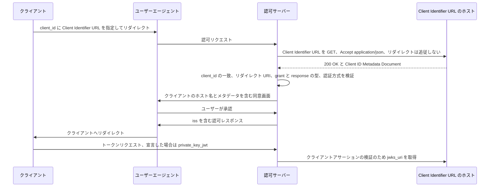

# Deep Dive: draft-ietf-oauth-client-id-metadata-document-03

> 一言で言うと: OAuth クライアントが HTTPS の URL を client_id として使い、認可サーバーが事前登録の代わりにその URL からクライアントのメタデータ文書を取得する仕組みである。

## 概要

OAuth 2.0 のクライアントは、通常、利用する認可サーバーごとに事前登録が必要である。両者に関係がない場合は手動登録が不可能であり、Dynamic Client Registration [RFC7591] も実用的でないことがあり、登録データの管理と掃除の負担が残る（Section 1）。本ドラフトは、クライアントが自分の登録情報を Client Identifier URL で公開し、その URL を client_id とする（Section 3）。認可サーバーはその URL から JSON 文書である Client ID Metadata Document を取得する（Section 4、6）。文書内の client_id は取得元の URL と一致しなければならないため、URL は識別子であると同時にメタデータの置き場所でもある。ドラフトは、この方式が安定した公開 Web サイトを持つクライアントに向き、開発中や短命なクライアントにはあまり向かないとしている（Section 1）。リビジョン 03 は OAuth ワーキンググループの Standards Track 作業項目である。

## 仕組み

1. クライアントは、Client Identifier URL を client_id としてユーザーを認可サーバーへ送る。URL は https でなければならず、`/` 以外のパスを持ち、userinfo、ドットセグメント、フラグメントを含んではならない（Section 3）。
2. 認可サーバーは文書を自動的に取得することが推奨される（SHOULD）。`Accept: application/json` を送ることが推奨され（SHOULD）、200 OK のみを受け入れなければならず（MUST）、リダイレクトを追従してはならない（MUST NOT）（Section 6）。
3. サーバーは、文書の client_id が URL と単純な文字列比較で一致することを確認する（Section 4）。また、リダイレクト URI が登録済みのものと完全一致することも確認する。ただしポート番号についてはループバックの例外がある（Section 4.2）。
4. サーバーは、文書の grant_types と response_types を自身が対応するものと突き合わせて共通部分を求めなければならず（MUST）、どちらかが空であれば invalid_client で拒否しなければならない（MUST）（Section 6）。
5. サーバーはクライアント認証方式を決定する。token_endpoint_auth_method も token_endpoint_auth_methods_supported も存在しない場合は none と見なさなければならない（Section 5）。
6. サーバーは同意画面に client_id のホスト名を表示することが推奨される。ロゴを表示する場合は、事前取得して自身で配信しなければならない（Section 10.6、10.9）。
7. 認可レスポンスには iss を含めなければならない（Section 7）。
8. クライアントが private_key_jwt を宣言し、サーバーがそれに対応する場合、サーバーはメタデータ文書の鍵を用いて [RFC7523] の Section 2.2 に従うクライアント認証を要求しなければならない（Section 5）。

## ユースケース

- 安定した公開 Web サイトを持つクライアントが、事前の関係がない多数の認可サーバーと通信する際に、各所に登録する代わりに 1 つのメタデータ文書を公開する（Section 1）。
- 企業の ID プロバイダーが特定のクライアントを受け入れるため Client Identifier URL を事前登録し、登録時に文書を取得してクライアント認証を設定する（Section 9.2）。
- CIMD のクライアントと自身が登録したクライアントの両方に対応する認可サーバーが、自ら生成する client_id を `https://` で始まらないようにする（Section 9.1）。
- 開発者が localhost 上で、redirect_uris を制限する認可サーバーに対して開発し、安定した Client Identifier URL を発行する CIMD Service を使う（Section 10.13、Appendix A）。
- 機密クライアントが jwks_uri を公開して `["private_key_jwt"]` を宣言する。あるいは `["none", "private_key_jwt"]` を宣言し、対応状況の異なるサーバーに対応する（Section 5.1）。

## なぜ今重要か

- **きっかけ**: -03 が公開された 2026 年 11 月 2 日に、ドラフトの GitHub リポジトリで 11 件の issue がクローズされ、PR #99「Add Client Authentication section」がマージされた。11 月 8 日には issue #131 が立てられた。この issue は、Section 6 の response_types の共通部分の規則により、クライアントクレデンシャルのようなトークンエンドポイントだけを使うグラントのクライアントが拒否されると指摘している。issue はまだオープンで、返信もない。
- **資料上の根拠**: リビジョン 03 は 2026 年 11 月 2 日付である。Client Authentication はセキュリティ上の考慮事項から独立した Section 5 に移り、内容も拡充された。あわせて、取得失敗時のエラー処理（Section 6.1）、grant_types と response_types の共通部分の規則（Section 6）、iss パラメーターの必須化（Section 7）、複数の新しいセキュリティ上の考慮事項（Section 10）が加わった。OAuth のメーリングリストでは、-03 の公開通知に対する現時点で唯一の返信（2026 年 11 月 9 日）が、さらなる変更を提案している。
- **期待される影響**: URL 形式の client_id を受け入れる認可サーバーの実装者は、認証のデフォルト、取得とキャッシュの挙動、エラー応答、ロゴの扱いを見直す必要がある。クライアントは URL を正規化し、文書を安定させ、リクエストに依存する内容を含めないようにする必要がある。

## 変更点

- 仕様・文書の変更の要約: 改版履歴と差分から、次の実質的な変更が読み取れる。
  - Client Identifier URL のパスを `/` にすることは認められなくなり、クライアントは URL を正規化することが推奨され（SHOULD）、サーバーは正規化してはならない（MUST NOT）（Section 3）。
  - ループバックのリダイレクト URI は、[RFC9700] に従いポート番号の完全一致の対象外となった（Section 4.2）。
  - 認証情報の制限が token_endpoint_auth_methods_supported にも及び、jwks と jwks_uri の併用が禁止され、software_statement の内容にも適用される（Section 4.1、4.3）。
  - 新設の Section 4.4 が機能的 URI と情報提供的 URI を区別し、サーバーは client_uri が client_id や redirect_uris と同一オリジンであることを要求してはならない（MUST NOT）。
  - 新設の Section 4.5 が、信頼できない外部入力から文書の内容を導くことを禁止する。
  - Client Authentication がセキュリティ上の考慮事項から Section 5 に移った。token_endpoint_auth_methods_supported が優先され、token_endpoint_auth_method は推奨されず（NOT RECOMMENDED）、RFC7591 の既定値 client_secret_basic を適用してはならない（MUST NOT）。
  - サーバーは文書の grant_types と response_types を自身が対応するものと突き合わせて共通部分を求めなければならず（MUST）、どちらかが空なら invalid_client で拒否しなければならない（MUST）。取得時には `Accept: application/json` を送ることが推奨される（SHOULD）（Section 6。理由は Section 10.7.1）。
  - 文書取得の失敗は一時的な失敗と恒久的な失敗に分けられ、リフレッシュトークンへの影響と HTTP 503 の選択肢が定められた（Section 6.1）。
  - キャッシュ: -02 では、サーバーはキャッシュ期間の上限と下限を独自に定めてもよい（MAY）とされていた。-03 では、レスポンスの指示にかかわらず実効的な最大期間を適用することが推奨され（SHOULD）、指示がない場合は最小期間を適用することも推奨される（SHOULD）。Expires ヘッダーには従わなくてよく、再取得のレート制限も認められる（MAY）（Section 6.2）。
  - 認可レスポンスには iss を含めなければならない（Section 7）。
  - ロゴの事前取得と自前での配信が MUST になった（Section 10.9）。
  - 新しいセキュリティ上の考慮事項として、発行者識別子との URL 混同（Section 10.1）、クライアントの提示（Section 10.10）、リソース単位で範囲を限定した永続的な認可状態（Section 10.12）が加わった。
  - client_id_expires_at のようなプロパティに関する TBD の注記は削除された。
- 互換性・移行上の懸念: Section 1 から 4.3 までの番号は変わらないが、Section 5 以降はすべて番号が変わった（たとえば Client Information Discovery は Section 5 から Section 6 へ、Client Authentication は Section 8.2 から Section 5 へ移った）。そのため、これらの節を -02 の番号で参照している箇所は古くなる。認証関連のプロパティを両方とも省略した文書は、RFC7591 では client_secret_basic が想定されるのに対し、今後はパブリッククライアントとして扱われる。認可レスポンスで iss を要求していなかったサーバー、logo_uri を直接参照していたサーバーは変更が必要である。`/` を有効なパスとして扱っていたサーバーや、client_uri に同一オリジンを要求していたサーバーも変更が必要である。token_endpoint_auth_method は代替として引き続き使えるが推奨されない（Section 5）。

## 技術分析

- 脅威モデルへの含意:
  - 文書はクライアントが管理するため、内容はすべてクライアントの主張である。クライアントは名前やロゴによって、より著名なクライアントを装うことができる（Section 10.10）。ドラフトは、client_id のホスト名の表示と、任意のドメイン信頼ヒューリスティクスを提案している（Section 10.6、10.8）。
  - 攻撃者が選んだ URL の取得は SSRF の危険を生む。サーバーは、特殊用途アドレス [RFC6890] に解決される URL を取得してはならず（MUST NOT）、開発向けに限ったループバックの例外がある（Section 10.7）。レスポンスの読み取り量は制限することが推奨され（SHOULD）、推奨される上限は 5 キロバイトである（Section 10.11）。
  - ドラフトによれば、サーバー自身の発行者識別子や他の信頼する識別子と同じ URL はトークン混同を招くため、サーバーはそれを拒否することが推奨される（Section 10.1）。
  - 過去の認可判断を永続化または再利用する仕組みは、少なくとも Client Identifier URL とリソースの組で範囲を限定しなければならない（MUST）（Section 10.12）。
  - リクエストに依存する文書は、誰が問い合わせているかを漏らしたり、相手ごとに異なる内容を見せたりし得る。Section 4.5 がこれを禁止し、Section 11.1 が説明している。
- プロトコルフローへの含意:
  - 200 OK のみが成功と見なされ、リダイレクトは追従されない（Section 6）。文書を取得できない、または文書が不正であるためにリクエストが失敗した場合、サーバーはユーザーエージェントをクライアントへリダイレクトしてはならない（MUST NOT）（Section 6.1）。
  - client_id の不一致による恒久的な失敗では、未失効のリフレッシュトークンを直ちに失効させることが推奨される（SHOULD）。一時的な失敗では、信頼の無効化やキャッシュ済みメタデータの破棄を行わないことが推奨される（Section 6.1）。
  - サーバーメタデータでは、client_id_metadata_document_supported という真偽値で対応を示す（Section 8）。
  - クライアント認証は jwks または jwks_uri による公開鍵のみに依存する。JWT に関する指針は [RFC8725] と、rfc7523bis の `typ` 値 `client-authentication+jwt` を参照している（Section 5）。
- 相互運用上の懸念:
  - 比較は単純な文字列比較であるため、`https://example.com/client` と `https://example.com:443/client` は別のクライアントになる（Section 3）。
  - [OpenID.RPMetadataChoices] を実装しないサーバーも、token_endpoint_auth_methods_supported の存在を認識しなければならない（Section 5）。
  - `["none", "private_key_jwt"]` を宣言したクライアントは、private_key_jwt に対応しないサーバーではパブリッククライアントになる。対応するサーバーで none を使うと invalid_client で拒否されることがある（Section 5.1）。
  - キャッシュ期間は一部がサーバーのポリシーに委ねられ、Expires ヘッダーには従わなくてよい（Section 6.2）。そのため、同じ文書でもサーバーによって見え方が異なり得る。

## 未解決の論点

- Section 5 は、文書が jwks または jwks_uri を含まなければならず、含まない場合は認可リクエストが invalid_client を返すと述べている。この文は JWT ベースの認証方式の段落にあり、改版履歴では private_key_jwt を使う場合の要件とされている。この文は、鍵を持たずに private_key_jwt を宣言した文書の扱いを問う issue #100 を解決するため、PR #99 のレビューコメント（2026 年 10 月 28 日）で「When using `private_key_jwt` for client auth」という形で提案されたものである。`["none", "private_key_jwt"]` を宣言し、実際にはパブリッククライアントとして使われる文書も「使う場合」に含まれるかは書かれていない。ただし、Section 5.1 の例にはいずれも jwks_uri が含まれている。
- Section 5 には、認可エンドポイントでの invalid_client を裏付ける文が基となる仕様にない（OAuth 2.1 の issue 266）という編集上の注記がある。そのためエラーの対応付けは未確定である。
- Section 6 は、grant_types または response_types の共通部分が空なら拒否するとしているが、文書がこれらを省略した場合の扱いは述べていない。RFC 7591 の Section 2 では、grant_types を省略すると `authorization_code`、response_types を省略すると `code` が既定値になる。Section 5 は token_endpoint_auth_method について RFC 7591 の既定値を明示的に退けているが、Section 6 はこの 2 つについて何も述べていない。issue #131 は RFC 7591 の既定値が適用されると見なしたうえで、その場合この規則が、認可エンドポイントを持たないサーバーでトークンエンドポイントだけを使うクライアントを拒否してしまうことを示している。ワーキンググループはまだ応答していない。
- Section 6.1 は、取得に失敗した場合に認可リクエストを中止することを SHOULD としており、Section 10.6 も取得に失敗して client_id の URL しか表示できない同意画面を想定している。文書を取得できない、または文書が不正であるためにリクエストが失敗した場合、サーバーはユーザーエージェントをクライアントへリダイレクトしてはならず（MUST NOT）、ユーザーにエラーを知らせることが推奨される（SHOULD）。invalid_client、または一時的な失敗であれば HTTP 503 を返さなければならない（MUST）のは、トークンエンドポイントとプッシュ型認可リクエストのエンドポイントだけである。これは、認可エンドポイントではクライアントへリダイレクトせず、トークンエンドポイントと PAR エンドポイントでは定められたエラーを返すよう求めた issue #85 と一致する。したがって、2 つの文は矛盾していない。
- Section 8 は client_id_metadata_document_supported を OPTIONAL としながら、メタデータを公開するサーバーはこれを含めなければならない（MUST）としている。OAuth のメーリングリストへの返信は、この真偽値では「事前登録済みの URL のみ対応」を表せないことも指摘し、client_id_metadata_document_registration_types_supported というリストを提案している（Section 9.2）。
- 同じ返信は、Section 6 に取得前の検証手順を設けることと、クエリ成分を SHOULD NOT から MUST NOT に改めること（Section 3）も提案している。これはまだオープンの issue #112 を受けたものである。いずれも一参加者の提案であり、2026 年 11 月 11 日時点でスレッドにほかの返信はないため、ワーキンググループの支持は確認できない。
- Section 6.2 は、実効的なキャッシュ期間の最大値と最小値をサーバーに委ねており、推奨値を示していない。

## 実験

- [ ] Lab 1: CIMD を取得するテスト用認可サーバーを立て、プロパティを 1 つずつ変えた文書（client_id の不一致、301 リダイレクト、500、5 キロバイト超の本文、パスが `/` だけの URL）を配信し、Section 4、6、6.1 に照らして各ケースのエラーを記録する。
- [ ] Lab 2: 認証関連のプロパティがない文書、token_endpoint_auth_method のみの文書、両方を矛盾した値で持つ文書、`["none", "private_key_jwt"]` と jwks_uri を持つ文書を公開する。サーバーが推定する認証方式と、none のクライアントにクライアントアサーションを送った場合に invalid_client になるかを確認する（Section 5）。
- [ ] Lab 3: logo_uri を持ち、別オリジンの client_uri を持つ文書を追加し、サーバーがロゴを自身のホストから配信して画像を検証し、client_uri に同一オリジンを要求しないことを確認する（Section 4.4、10.9）。

## 出典

- <https://datatracker.ietf.org/doc/draft-ietf-oauth-client-id-metadata-document/03/>
- <https://www.ietf.org/archive/id/draft-ietf-oauth-client-id-metadata-document-03.txt>
- <https://author-tools.ietf.org/iddiff?url1=draft-ietf-oauth-client-id-metadata-document-02&url2=draft-ietf-oauth-client-id-metadata-document-03>
- <https://mailarchive.ietf.org/arch/msg/oauth/VGYXFHqx9gft63TPdmVtAUaYkLU/>
- <https://github.com/oauth-wg/draft-ietf-oauth-client-id-metadata-document/pull/99>
- <https://github.com/oauth-wg/draft-ietf-oauth-client-id-metadata-document/issues/85>
- <https://github.com/oauth-wg/draft-ietf-oauth-client-id-metadata-document/issues/100>
- <https://github.com/oauth-wg/draft-ietf-oauth-client-id-metadata-document/issues/112>
- <https://github.com/oauth-wg/draft-ietf-oauth-client-id-metadata-document/issues/131>
- <https://www.rfc-editor.org/rfc/rfc7591#section-2>
