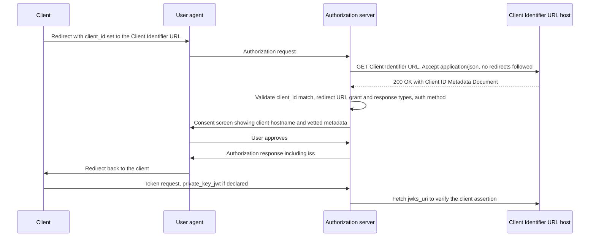

# Deep Dive: draft-ietf-oauth-client-id-metadata-document-03

> In one line: an OAuth client uses an HTTPS URL as its client_id, and the authorization server fetches the client's metadata document from that URL instead of requiring prior registration.

## What this is

An OAuth 2.0 client normally has to register with each authorization server before use. Manual registration is impossible when the two parties have no relationship, and Dynamic Client Registration [RFC7591] can be impractical and leaves registration data to manage and clean up (Section 1). This draft lets the client publish its own registration information at a Client Identifier URL, which is the client_id (Section 3). The authorization server fetches the Client ID Metadata Document, a JSON document, from that URL (Sections 4 and 6). The document's client_id must match the URL it was fetched from, so the URL is both the identity and the place where the metadata lives. The draft says the approach suits clients with a stable, public web presence and suits development-time or short-lived clients less well (Section 1). Revision 03 is a Standards Track work item of the OAuth working group.

## How it works

1. The client sends the user to the authorization server with the Client Identifier URL as client_id. The URL must be https, have a path other than `/`, and carry no userinfo, dot segments or fragment (Section 3).
2. The authorization server SHOULD fetch the document automatically, SHOULD send `Accept: application/json`, MUST accept only 200 OK, and MUST NOT follow redirects (Section 6).
3. The server checks that the document's client_id equals the URL by simple string comparison (Section 4), and that the redirect URI exactly matches a registered one, with a loopback exception for ports (Section 4.2).
4. The server intersects the document's grant_types and response_types with what it supports, and rejects with invalid_client if either intersection is empty (Section 6).
5. The server determines the client authentication method. If neither token_endpoint_auth_method nor token_endpoint_auth_methods_supported is present, it MUST assume none (Section 5).
6. The server SHOULD show the client_id hostname on the consent screen, and it MUST prefetch and re-serve any logo it displays (Sections 10.6 and 10.9).
7. The authorization response MUST include iss (Section 7).
8. If the client declared private_key_jwt and the server supports it, the server MUST require client authentication per Section 2.2 of [RFC7523] using a key from the metadata document (Section 5).

## Use cases

- A Model Context Protocol-style or similar client talks to many authorization servers it has never met, and publishes one metadata document instead of registering at each. The draft does not mention MCP, so this is only an example of the pattern in Section 1.
- An enterprise identity provider pre-registers a Client Identifier URL to onboard a specific client, fetching the document at registration time and setting up client authentication (Section 9.2).
- An authorization server that supports both CIMD clients and clients it registered itself keeps its generated client_id values from starting with `https://` (Section 9.1).
- A developer works on localhost against an authorization server that restricts redirect_uris, and uses a CIMD Service that provisions a stable Client Identifier URL (Section 10.13, Appendix A).
- A confidential client publishes a jwks_uri and advertises `["private_key_jwt"]`, or advertises `["none", "private_key_jwt"]` to serve servers with different capabilities (Section 5.1).

## Why This Matters Now

- **Trigger**: 11 issues closed and a new response_types issue (#131) this week, with PRs adding a Client Authentication section (from `subject.json`). The issue and PR details are not in the staged material.
- **Source evidence**: Revision 03 is dated 2 November 2026. It adds a Client Authentication section (Section 5), error handling for failed fetches (Section 6.1), the grant_types and response_types intersection rule (Section 6), a mandatory iss parameter (Section 7) and several new security considerations (Section 10). The mail thread on the -03 announcement already proposes further changes.
- **Expected impact**: Implementers of authorization servers that accept URL client_ids need to revisit authentication defaults, fetch and cache behaviour, error responses and logo handling. Clients need to normalize their URLs and keep their documents stable and free of request-dependent content.

## What Changed

- Spec/document change summary: the revision history and the diff show these substantive changes.
  - The Client Identifier URL path may no longer be `/`, and clients SHOULD normalize the URL while the server MUST NOT (Section 3).
  - Loopback redirect URIs are exempt from exact port matching, per [RFC9700] (Section 4.2).
  - Credential restrictions now cover token_endpoint_auth_methods_supported, forbid jwks together with jwks_uri, and apply to software_statement content (Sections 4.1 and 4.3).
  - New Section 4.4 separates functional URIs from informative URIs, and the server MUST NOT require client_uri to share an origin with client_id or redirect_uris.
  - New Section 4.5 forbids deriving document contents from untrusted external input.
  - Client Authentication moved out of Security Considerations into Section 5. token_endpoint_auth_methods_supported is preferred, token_endpoint_auth_method is NOT RECOMMENDED, and the RFC7591 default of client_secret_basic MUST NOT be applied.
  - Discovery failures are split into transient and terminal, with refresh-token consequences and an HTTP 503 option (Section 6.1).
  - Cache guidance gains maximum and minimum effective durations and permits rate limiting (Section 6.2).
  - The authorization response MUST include iss (Section 7).
  - Logo prefetching and re-serving became MUST (Section 10.9).
  - New security sections cover URL confusion with issuer identifiers (Section 10.1), client presentation (Section 10.10) and resource-scoped persisted authorization state (Section 10.12).
  - The TBD note about a client_id_expires_at property was removed.
- Compatibility or migration concerns: the section numbering changed throughout, so any reference to -02 section numbers is stale. A document that omits both authentication properties is now treated as a public client, where RFC7591 would imply client_secret_basic. A server that did not previously require iss in the authorization response, or that linked logo_uri directly, must change. Servers that treated `/` as a valid path, or that required client_uri to be same-origin, must change too. token_endpoint_auth_method still works as a fallback but is NOT RECOMMENDED (Section 5).

## Technical Analysis

- Threat model implications:
  - The client controls the document, so everything in it is an assertion by the client. A client can impersonate a better-known one through its name or logo (Section 10.10), and the draft suggests showing the client_id hostname and optional domain-trust heuristics (Sections 10.6 and 10.8).
  - Fetching attacker-chosen URLs creates SSRF exposure. The server MUST NOT fetch URLs that resolve to special-use addresses [RFC6890], with a narrow loopback exception for development (Section 10.7). It SHOULD read at most about 5 kilobytes (Section 10.11).
  - The draft says a URL equal to the server's own issuer or to another trusted identifier can cause token confusion, so the server SHOULD reject it (Section 10.1).
  - Persisted consent MUST be scoped to the pair of URL and resource (Section 10.12).
  - Request-dependent documents can leak who is asking or show different content to different parties, which Section 4.5 forbids and Section 11.1 explains.
- Protocol flow implications:
  - Only 200 OK counts, redirects are not followed, and failures never redirect the user agent back to the client (Section 6.1).
  - A terminal failure from a client_id mismatch SHOULD invalidate outstanding refresh tokens. A transient failure SHOULD NOT invalidate trust or discard cached metadata (Section 6.1).
  - Server metadata advertises support with the client_id_metadata_document_supported boolean (Section 8).
  - Client authentication relies on public keys only, via jwks or jwks_uri, and the JWT guidance points to [RFC8725] and a `typ` of `client-authentication+jwt` from rfc7523bis (Section 5).
- Interop concerns:
  - Comparison is by simple string, so `https://example.com/client` and `https://example.com:443/client` are different clients (Section 3).
  - Servers that do not implement [OpenID.RPMetadataChoices] must still recognise token_endpoint_auth_methods_supported (Section 5).
  - A client listing `["none", "private_key_jwt"]` is a public client at servers without private_key_jwt and may be rejected with invalid_client at servers that support it if it uses none (Section 5.1).
  - Cache lifetime is partly server policy, and the Expires header need not be honoured (Section 6.2). Two servers can therefore see different views of the same document.

## Open Questions

- Section 5 says the document MUST include jwks or jwks_uri and that the authorization request must return invalid_client otherwise. It sits in the JWT-based authentication paragraph, and the revision history says the requirement applies when using private_key_jwt. Whether it applies to a document that lists `["none", "private_key_jwt"]` is not explicit, although the Section 5.1 example includes a jwks_uri.
- Section 5 carries an editorial note that invalid_client at the authorization endpoint lacks supporting text in the underlying specification (OAuth 2.1 issue 266). The error mapping is therefore unsettled.
- Section 6 requires rejecting when the grant_types or response_types intersection is empty, but does not say what applies when the document omits these fields. This is not stated and should be confirmed.
- Section 6.1 says the server SHOULD abort when a fetch fails, then later says it MUST return invalid_client or 503 at the token and pushed authorization request endpoints. How these two statements fit together for the authorization endpoint is not spelled out.
- Section 8 calls client_id_metadata_document_supported OPTIONAL while saying servers that publish metadata MUST include it. The mail thread also notes it cannot express "supported only for pre-registered URLs" and proposes a client_id_metadata_document_registration_types_supported list (Section 9.2, mail).
- The mail thread proposes a pre-fetch validation step in Section 6 and changing the query component from SHOULD NOT to MUST NOT (Section 3). These are proposals from one participant, not WG consensus.
- Section 6.2 leaves the maximum and minimum effective cache durations to the server without recommended values.

## Experiments

- [ ] Lab 1: stand up a test authorization server that fetches a CIMD, then serve documents that vary one property each (mismatched client_id, a 301 redirect, a 500, a body over 5 kilobytes, a URL ending in `/`) and record which error each produces against Sections 4, 6 and 6.1.
- [ ] Lab 2: publish documents with no auth properties, with only token_endpoint_auth_method, with both properties inconsistent, and with `["none", "private_key_jwt"]` plus a jwks_uri. Check the authentication method the server infers and whether a client assertion sent to a none client gets invalid_client (Section 5).
- [ ] Lab 3: add a document with a logo_uri and a client_uri on another origin, and confirm the server re-serves the logo from its own host, validates the image and does not require same-origin for client_uri (Sections 4.4 and 10.9).

## Sources

- <https://datatracker.ietf.org/doc/draft-ietf-oauth-client-id-metadata-document/03/>
- <https://mailarchive.ietf.org/arch/msg/oauth/VGYXFHqx9gft63TPdmVtAUaYkLU/>
- <https://github.com/oauth-wg/draft-ietf-oauth-client-id-metadata-document/issues/112>
