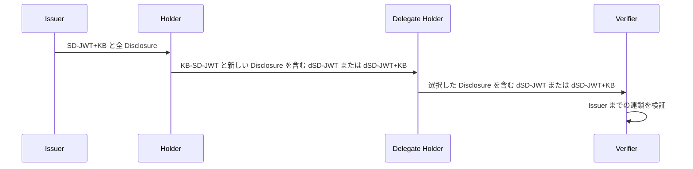

# Deep Dive: draft-ietf-oauth-delegate-sd-jwt

> 一言で言うと: Delegate SD-JWT は SD-JWT (RFC 9901) を拡張し、Key Binding JWT 自体を SD-JWT にできるようにすることで、Holder が Delegate Holder に以後の提示を委任でき、Verifier が連鎖をたどって元の Issuer に結び付けられるようにする。

## 仕組みの概要

SD-JWT では、Holder は Verifier に見せる claim を選び、`cnf` 鍵の所持を証明できる。しかし提示を受け取った側は、自分が受領者であることを証明できず、トランザクションデータを絞り込むこともできない (Section 1)。この draft は委任を扱う。たとえばユーザーに代わって購入する AI エージェントのような Delegate Holder に、Holder が後の提示を任せたい場合である。仕組みは新しい Key Binding SD-JWT (KB-SD-JWT) である。KB-SD-JWT は KB-JWT の代わりとなり、選択的開示可能な claim を持てる Delegate Payload に署名し、連鎖の次の要素に対する Issuer 署名 JWT として働く (Section 1、4)。最後に通常の KB-JWT を付けると、Delegate Holder は最後の Delegate Payload に記された鍵の所持を証明できる (Section 4.2)。結果は dSD-JWT と呼ばれ、末尾に KB-JWT が付くものは dSD-JWT+KB と呼ばれる。本文書は採択後の最初の Working Group 版である -00 である (Appendix C)。

## 動作

1. Issuer は SD-JWT とその Disclosure を Holder に発行する (Section 3)。
2. Holder は KB-SD-JWT を作成する。これは Issuer の SD-JWT の `cnf` claim の鍵で署名され、`delegate_payload` 配列に Delegate Payload を Array Disclosure として持ち、`sd_hash` または `issuer_jwt_hash` で直前のトークンに結び付けられる (Section 5.1.3、5.1.4)。
3. Holder は SD-JWT、KB-SD-JWT、選択した Disclosure を Delegate Holder に渡す。Compact Serialization では要素を空の要素 (`~~`) でつなぐ (Section 5.1.1)。
4. Delegate Holder は別の KB-SD-JWT でさらに委任するか、提示する。dSD-JWT+KB は、最後の Delegate Payload の `cnf` claim の鍵で署名した KB-JWT で終わる (Section 4.2、5.1.1)。
5. Verifier は文字列を分割し、最初の SD-JWT を Issuer の鍵で検証し、各 KB-SD-JWT を直前の `cnf` 鍵を使って SD-JWT+KB として検証する。ハッシュによる結び付きと `typ` を確認し、Key Binding が必要な場合は最後の KB-JWT を検証する (Section 6)。

## ユースケース

- ユーザーが AI エージェントに、履行条件の制約付きで購入を行う権限を委任する。エージェントは、他のどの販売者が履行可能だったかを明かさずに、販売者へ授権されていることを証明できる (Section 1)。
- ユーザー操作が署名ごとに必要な鍵を持つ Holder が、`delegate_payload` に複数の値を入れることで、1 回の署名から複数の委任を作る (Section 5.1.4)。
- ウォレットが `delegate` というトランザクションデータ種別を使い、OpenID4VP で委任を行う (Section 7.1)。
- Issuer または Holder が、Issuer 署名 JWT または KB-SD-JWT+KB に制約を示す claim を入れて、以後の委任を制限する (Section 8.2)。
- Delegate Holder が、追加の KB-SD-JWT により dSD-JWT+KB を別のエージェントへ再委任する (Section 1.1)。

## なぜ今重要か

- **きっかけ**: `subject.json` は「PR #15 restructures where security claims live in the KB-SD-JWT and defines their delegation semantics.」と述べている。この pull request は用意された資料に含まれないため、ここでは確認していない。draft は -00 の有効な WG 文書である (Datatracker の状態: Active、I-D Exists、WG Document)。
- **根拠となる資料**: Section 1 は AI エージェントを例示し、概要は「Agentic systems に特に適用できる」と述べている。Appendix C は draft-gco-oauth-delegate-sd-jwt からの採択を記録している。
- **想定される影響**: SD-JWT のウォレット、Verifier、エージェント基盤の実装者は、空の要素を含む連鎖トークンと新しい `typ` 値を解析する必要が出る可能性がある。形式はまだ変わり得るため、初期実装は非互換の変更を想定すべきである。

## 変更点

- 仕様・文書の変更の要約: `diff.txt` は用意されていないため、利用できるのは文書履歴のみである。-00 は draft-gco-oauth-delegate-sd-jwt から採択された「Initial Working Group Draft」である。採択前の -01 では編集上の修正と、`kb+sd-jwt+kb` から `kb-sd-jwt+kb` への変更が行われた (Appendix C)。この draft は dSD-JWT と dSD-JWT+KB の形式、`delegate_payload` claim、`issuer_jwt_hash` claim、`kb+sd-jwt` と `kb-sd-jwt+kb` の種別、検証手順、OpenID4VP のトランザクションデータ種別を定義する。
- 互換性・移行上の懸念: この draft は RFC 9901 に基づき、KB-JWT の解析方法を変える。以前の `kb+sd-jwt+kb` という名前に依存していた実装は `kb-sd-jwt+kb` へ移行する必要がある。RFC 9901 の解析器は `~~` を受け付けない可能性があり、その場合 dSD-JWT は失敗する。Verifier が委任トークンを受け付けることをどう示すかは、draft に記載がない。

## 技術的分析

- 脅威モデルへの影響: Section 8.1 は、Verifier がすべての KB-SD-JWT と、直前のトークンへの結び付きを検証することを求める。そうしないと、Holder の `cnf` 鍵が再利用された場合に、悪意のある Delegate Holder が連鎖の部品を取り違えられるためである。Section 8 は、委任する Holder は Issuer として振る舞うため、Issuer の考慮事項が適用されると述べる。Section 8.2 は、委任の制限を可視の claim として追加してよい (MAY) と述べるだけである。Delegate Payload が前のトークンの許可範囲を狭める方向にしか変えられないという規則は、draft にない。Section 8.3 は、個人の Holder には失効が難しいと述べ、短い `exp` と制約 claim を提案している。
- プロトコルフローへの影響: `sd_hash` は Disclosure を含む直前のトークンに結び付く。`sd_hash` を省略した場合、`issuer_jwt_hash` は Issuer 署名 JWT または KB-SD-JWT+KB のみを対象とするため、Delegate Holder は以前の Disclosure を省略できる (Section 4.1、5.1.4)。検証は Section 6 に従い、各要素について RFC 9901 Section 7.1 を再利用する。Section 7.1 の OpenID4VP バインディングでは、`transaction_data` に `format`、`delegate_payload_disclosure`、`delegate_disclosures` を含める。
- 相互運用上の懸念: Compact 形式では、要素の間に正確に空の要素が必要であり、末尾の `~` が dSD-JWT と dSD-JWT+KB を区別する (Section 5.1.1)。`typ` の規則は最終トークンとそれ以外で異なる (Section 5.1.4、6)。JSON Serialization では `kb_jwt` ヘッダーパラメーターが変わり、ダイジェストは等価な Compact 形式に対して計算される (Section 5.1.2)。「Section 4.3.1」や「Section 7.3」など、RFC 9901 を指すと思われる相互参照が、その旨を明記せずに現れる。

## 未解決の問題

- Section 5.1.4 は `delegate_payload` を配列として定義するが、用語「Delegate Payload」は Disclosure の中の JSON オブジェクトを指す。配列の要素と Disclosure のダイジェストがどう対応するかを示す例は draft にない (Section 2.2、5.1.3、5.1.4)。
- Section 5.1.4 は、Issuer 署名 JWT のペイロードの claim は `_sd_alg` を除きすべて Delegate Payload に移ると述べる。委任側の `iss`、`exp`、`nbf`、`cnf` が前のトークンのものとどう関係するかは、draft に記載がない。
- 委任が親より狭くなければならないという規則はなく、Section 8.2 は制限を任意の可視 claim に任せている。Verifier がそれをどう評価するかは定義されていない。
- Section 8.1 は「in both directions」と述べる。もう一方の方向が何かは draft に記載がない。
- Section 6 の手順 3 は、最終でない各 KB-SD-JWT の `typ` が `kb-sd-jwt+kb` でなければならないとし、手順 1 は `kb+sd-jwt` を最終のものにのみ許す。最終トークンが `kb-sd-jwt+kb` である dSD-JWT で Key Binding の扱いがどう異なるかは、具体例が必要である (Section 6、手順 5)。
- Section 7.1 は、KB-JWT の `delegate_payload` claim にダイジェストを入れ、`_sd_alg` は「どのハッシュアルゴリズムでもよい」と述べる。文言が不明瞭であり、Section 5.1.4 との関係も示されていない。
- Privacy Considerations (Section 9) は RFC 9901 を指すだけである。鍵と Disclosure の連鎖による紐付け可能性は議論されていない。謝辞は TODO である (Appendix B)。
- IANA (Appendix A) が JWT claim として登録を要求するのは `issuer_jwt_hash` のみである。`delegate_payload` は要求に含まれない。
- draft には完全なトークンの例がない。

## 実験

- [ ] Lab 1: RFC 9901 の SD-JWT から 1 段の委任を持つ dSD-JWT を作り、標準の RFC 9901 解析器が拒否すること、Section 6 のプロトタイプ Verifier が受理することを確認する。
- [ ] Lab 2: 同じ委任を `sd_hash` 版と `issuer_jwt_hash` 版で作り、前の SD-JWT から Disclosure を 1 つ除いたとき、どちらが検証に通るかを確認する。
- [ ] Lab 3: 1 つの Holder `cnf` 鍵を 2 つの委任で再利用し、KB-SD-JWT を連鎖の間で入れ替えて、Section 8.1 の検査が不一致を検出するかを試す。

## 出典

- [draft-ietf-oauth-delegate-sd-jwt-00](https://datatracker.ietf.org/doc/draft-ietf-oauth-delegate-sd-jwt/00/)
