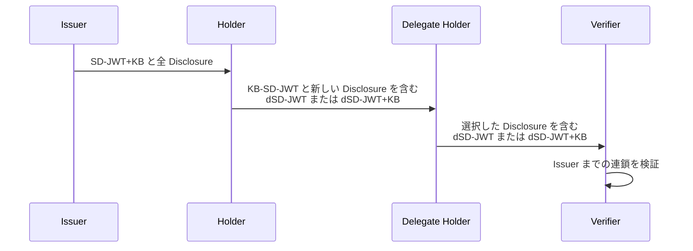

# Deep Dive: draft-ietf-oauth-delegate-sd-jwt

> 一言で言うと: Delegate SD-JWT は SD-JWT (RFC 9901) を拡張し、Key Binding JWT 自体を SD-JWT にできるようにする。これにより Holder は以後の提示を Delegate Holder に委任でき、Verifier は連鎖をたどって元の Issuer まで結び付けられる。

## 概要

SD-JWT では、Holder は Verifier に見せる claim を選び、`cnf` 鍵の所持を証明できる。Verifier は SD-JWT を転送し、さらに絞り込むことはできるが、元の SD-JWT+KB の提示を自分が受け取ったことは証明できず、トランザクションデータの一部を絞り込むこともできない (Section 1)。この draft は委任を扱う。たとえばユーザーに代わって購入する AI エージェントのような Delegate Holder に、Holder が後の提示を任せたい場合である。仕組みの中心は新しい Key Binding SD-JWT (KB-SD-JWT) である。KB-SD-JWT は KB-JWT の代わりになり、選択的開示可能な claim を持てる Delegate Payload に署名し、連鎖の次の段では Issuer 署名 JWT の役割を果たす (Section 1、4)。最後に通常の KB-JWT を付けると、Delegate Holder は最後の Delegate Payload に記された鍵の所持を証明できる (Section 4.2)。この構造を dSD-JWT と呼び、末尾に KB-JWT が付くものを dSD-JWT+KB と呼ぶ。対象は採択後最初の Working Group 版である -00 (2026 年 10 月 26 日) である (Appendix C)。

## 仕組み

1. Issuer は SD-JWT とその Disclosure を Holder に発行する (Section 3)。
2. Holder は KB-SD-JWT を作る。KB-SD-JWT は Issuer の SD-JWT の `cnf` claim の鍵で署名され (Section 4.3、6)、`delegate_payload` 配列に Delegate Payload を持ち、`sd_hash` または `issuer_jwt_hash` で直前のトークンに結び付けられる (Section 5.1.4)。`delegate_payload` の要素が複数ある場合はすべて Array Disclosure に置き換えなければならず (MUST)、Delegate Payload Disclosure は `[salt, JSON Object Payload]` を base64url エンコードしたものである (Section 5.1.3、5.1.4)。
3. Holder は SD-JWT、KB-SD-JWT、選択した Disclosure を Delegate Holder に渡す。Compact Serialization では、分割した文字列の各 SD-JWT または KB-SD-JWT と次の KB-SD-JWT の間に空の要素がちょうど 1 つなければならず (MUST)、これが `~~` として現れる (Section 5.1.1)。
4. Delegate Holder は別の KB-SD-JWT でさらに委任するか、提示する。dSD-JWT+KB は、最後の Delegate Payload の `cnf` claim の鍵で署名した KB-JWT で終わる (Section 4.2、5.1.1)。
5. Verifier は文字列を分割し、最初の SD-JWT を Issuer の鍵で検証し、各 KB-SD-JWT を直前の `cnf` 鍵を使って SD-JWT+KB として検証する。ハッシュによる結び付きと `typ` を確認し、Key Binding が必要な場合は最後の KB-JWT を検証する (Section 6)。

## ユースケース

- ユーザーが AI エージェントに、履行条件の制約付きで購入する権限を委任する。エージェントは、他にどの販売者が履行できたかを明かさずに、授権されていることを販売者に証明できる (Section 1)。
- 署名のたびにユーザー操作が必要な鍵を持つ Holder が、`delegate_payload` に複数の値を入れ、1 回の署名で複数の委任を作る (Section 5.1.4)。
- ウォレットが `delegate` というトランザクションデータ種別を使い、OpenID4VP で委任する (Section 7.1)。
- Issuer または Holder が、Issuer 署名 JWT または KB-SD-JWT+KB に制約を表す claim を入れ、以後の委任を制限する (Section 8.2)。
- Delegate Holder が、追加の KB-SD-JWT で dSD-JWT+KB をさらに委任する (Section 1.1)。

## なぜ今重要か

- **きっかけ**: draft のリポジトリの [PR #15](https://github.com/oauth-wg/oauth-delegate-sd-jwt/pull/15)。2026-11-10 に第一著者が作成し、2026-11-18 時点で open である。Issue #3 と #10 を解決するもので、`cnf`、`exp`、`nbf` などのセキュリティ claim を `delegate_payload` からベースの KB-SD-JWT ペイロードへ移し、`delegate_payload` の全要素がそれらの claim を共有するとし、「Security Claim Semantics」節を追加する。この節は、`exp` と `nbf` は連鎖に沿って狭まらなければならない (MUST) こと、KB-SD-JWT の `aud` と `nonce` は最終 Verifier ではなくその委任の段に対するものであることを定める。「Verification by a Delegate Holder」節も追加する。マージされれば、セキュリティ claim を Delegate Payload に置く -00 の記述 (Section 2.2、4.2、5.1.3、5.1.4、6) が変わる。draft は -00 の有効な WG 文書である (Datatracker の状態: Active、I-D Exists、WG Document)。
- **根拠となる資料**: Section 1 は AI エージェントを例に挙げ、Abstract は「particular applicability to Agentic systems」と述べている。Appendix C は draft-gco-oauth-delegate-sd-jwt からの採択を記録している。
- **想定される影響**: SD-JWT のウォレット、Verifier、エージェント基盤の実装者は、空の要素を含む連鎖トークンと新しい `typ` 値を解析する必要が出る可能性がある。PR #15 や他の open な PR (#9 は OpenID4VP のトランザクションデータ種別、#14 は具体例) を見ると形式はまだ変わっており、初期実装は非互換な変更を見込んでおくべきである。

## 変更点

- 仕様・文書の変更の要約: -00 は draft-gco-oauth-delegate-sd-jwt から採択された「Initial Working Group Draft」である。Appendix C には、採択前の -01 で編集上の修正と `kb+sd-jwt+kb` から `kb-sd-jwt+kb` への名称変更が行われたとある。draft のリポジトリにあるタグは draft-gco-oauth-delegate-sd-jwt-00 (2026-03-06) と draft-ietf-oauth-delegate-sd-jwt-00 (2026-10-22) だけなので、以下の変更はこの 2 つのタグの間で見たものであり、個人 draft の -01 と WG の -00 のどちらで入ったかは区別していない。Compact Serialization では、連鎖した KB-SD-JWT 同士の間も含め、すべての KB-SD-JWT の前に空の要素がちょうど 1 つ必要になった (`~` ではなく `~~`) (Section 5.1.1)。JSON Serialization のダイジェストは、等価な Compact Serialization に対して計算する (Section 5.1.2)。最後の Delegate KB-JWT の `sd_hash` は REQUIRED になった (Section 5.1.3)。dSD-JWT の最後の KB-SD-JWT の `typ` は `kb+sd-jwt` または `kb-sd-jwt+kb` となり、どちらの登録メディアタイプとも一致しなかった `kb-sd-jwt` を置き換えた (Section 6、手順 4)。Key Binding が必要な場合、Key Binding のない dSD-JWT は拒否される (Section 6、手順 5)。`delegate_disclosures` は選択的開示可能な claim の Disclosure を持つようになった (Section 7.1)。この draft は dSD-JWT と dSD-JWT+KB の形式、`delegate_payload` claim、`issuer_jwt_hash` claim、`kb+sd-jwt` と `kb-sd-jwt+kb` の種別、検証手順、OpenID4VP のトランザクションデータ種別を定義する。
- 互換性・移行上の懸念: この draft は RFC 9901 に基づき、KB-JWT の解析方法を変える。以前の `kb+sd-jwt+kb` という名前に依存していた実装は `kb-sd-jwt+kb` へ移行する必要がある。RFC 9901 Section 4 の ABNF では Disclosure は 1 文字以上の base64url であり、SD-JWT+KB は 1 つの JWT で終わるので、dSD-JWT はこの文法に合わず、文法どおりの RFC 9901 解析器は受け付けない。この点は draft 自体には書かれていない。Verifier が委任トークンを受け付けることをどう示すかも、draft には記載がない。

## 技術分析

- 脅威モデルへの影響: Section 8.1 は、Verifier がすべての KB-SD-JWT と直前のトークンへの結び付きを検証することが極めて重要 (critical) だと述べる。そうしないと、Holder の `cnf` 鍵が再利用された場合に、悪意のある Delegate Holder が連鎖の部品を取り違えられるためである。検査を必須にしているのは Section 6 で、どの手順が失敗しても処理を中止しなければならない (MUST)。Section 8 は、委任する Holder は Issuer として振る舞うため、Issuer の考慮事項がすべて適用されると述べる。Section 8.2 は、委任の制限を可視の claim として入れてよい (MAY) と述べるだけである。Delegate Payload は前のトークンが許した範囲を狭めることしかできない、という規則は draft にない。Section 8.3 は、個人の Holder には失効が難しく、短い `exp` と制約 claim でこの問題を緩和できると述べる。
- プロトコルフローへの影響: `sd_hash` は Disclosure を含めて直前のトークンに結び付く。Holder が Delegate Holder に以前の Disclosure の省略を許したい場合は、`sd_hash` を省き、Issuer 署名 JWT または KB-SD-JWT+KB のみを対象とする `issuer_jwt_hash` を入れなければならない (MUST) (Section 4.1、5.1.4)。検証は Section 6 に従い、各段で RFC 9901 Section 7.1 を再利用する。Section 7.1 の OpenID4VP バインディングでは、`transaction_data` に `format`、`delegate_payload_disclosure`、OPTIONAL の `delegate_disclosures` を含める。
- 相互運用上の懸念: Compact 形式では各 KB-SD-JWT の前に空の要素がちょうど 1 つ必要であり、末尾の `~` が dSD-JWT と dSD-JWT+KB を区別する (Section 5.1.1)。`typ` の規則は最後のトークンとそれ以外で異なる (Section 5.1.4、6)。JSON Serialization では `kb_jwt` ヘッダーパラメーターが変わり、ダイジェストは等価な Compact 形式に対して計算する (Section 5.1.2)。-00 のテキストでは「Section 4.3.1」(Section 5.1.4、6) と「Section 7.3」(Section 6、手順 5) に「of [RFC9901]」が付いていない。draft 自体には Section 4.3.1 も 7.3 もなく、draft-ietf-oauth-delegate-sd-jwt-00 タグの Markdown ソースではそれぞれ `[@!RFC9901, Section 4.3.1]`、`[@!RFC9901, Section 7.3]` と書かれている。指しているのは RFC 9901 の Section 4.3.1 (Binding to an SD-JWT) と Section 7.3 (Verification by the Verifier) だが、テキストだけを読むと draft 内の参照と取り違えやすい。

## 未解決の問題

- Section 5.1.4 は `delegate_payload` を配列として定義する一方、用語「Delegate Payload」は Disclosure の中の JSON オブジェクトを指す。配列の要素と Disclosure のダイジェストがどう対応するかを示す例は draft にない (Section 2.2、5.1.3、5.1.4)。Issue #5 が例の追加を求めており、PR #14 が例を提案している。
- Section 5.1.4 は、Issuer 署名 JWT のペイロードにある claim は `_sd_alg` を除きすべて Delegate Payload に置くとしている。委任側の `iss`、`exp`、`nbf`、`cnf` が前のトークンのものとどう関係するかは、-00 には書かれていない。PR #15 はこれらの claim をベースの KB-SD-JWT ペイロードへ移し、意味を定義する。
- -00 には、委任が親より狭くなければならないという規則がなく、Section 8.2 は制限を任意の可視 claim に任せている。Verifier がそれをどう評価するかも定義されていない。Issue #8 がこの点を指摘しており、PR #15 が狭めることを求めるのは `exp` と `nbf` だけである。
- Section 8.1 は「in both directions」と述べるが、もう一方の方向が何かは書かれていない。
- dSD-JWT は、`cnf` を持つ `typ` `kb-sd-jwt+kb` の KB-SD-JWT で、KB-JWT なしに終わってもよい (Section 6、手順 1 と 4)。手順 5 がこれを拒否するのは、Verifier が Key Binding を必要とする場合だけである。このようなトークンが次の Delegate Holder 向けなのか Verifier 向けなのかは、draft に書かれていない。
- Section 7.1 は、KB-JWT の `delegate_payload` claim にダイジェストを入れ、「_sd_alg may use any hash algorithm specified for hashing the transaction_data」と述べる。`sd_hash` と `issuer_jwt_hash` は直前のトークンのハッシュアルゴリズムを使うとする Section 5.1.4 との関係は示されていない。
- Privacy Considerations (Section 9) は RFC 9901 Section 10 を指すだけである。鍵と Disclosure の連鎖による紐付け可能性は議論されていない。謝辞は TODO のままである (Appendix B)。
- IANA (Appendix A) が JWT claim として登録を求めるのは `issuer_jwt_hash` だけで、`delegate_payload` は含まれない。
- draft には完全なトークンの例がない。

## 実験

- [ ] Lab 1: RFC 9901 の SD-JWT から 1 段の委任を持つ dSD-JWT を作り、標準の RFC 9901 解析器が拒否すること、Section 6 のプロトタイプ Verifier が受理することを確認する。
- [ ] Lab 2: 同じ委任を `sd_hash` 版と `issuer_jwt_hash` 版で作り、前の SD-JWT から Disclosure を 1 つ除いたとき、どちらが検証に通るかを確認する。
- [ ] Lab 3: 1 つの Holder `cnf` 鍵を 2 つの委任で再利用し、KB-SD-JWT を連鎖の間で入れ替えて、Section 8.1 の検査が不一致を検出するかを試す。

## 出典

- [draft-ietf-oauth-delegate-sd-jwt-00](https://datatracker.ietf.org/doc/draft-ietf-oauth-delegate-sd-jwt/00/)
- [RFC 9901: Selective Disclosure for JSON Web Tokens](https://www.rfc-editor.org/info/rfc9901)
- [oauth-wg/oauth-delegate-sd-jwt](https://github.com/oauth-wg/oauth-delegate-sd-jwt) (draft のリポジトリ)
- [PR #15: Move security claims to base KB-SD-JWT payload and define claim semantics](https://github.com/oauth-wg/oauth-delegate-sd-jwt/pull/15)
- [Issue #8: Place requirements, or clarify that constraints can only narrow across the chain](https://github.com/oauth-wg/oauth-delegate-sd-jwt/issues/8)
- [draft-gco-oauth-delegate-sd-jwt-00 と draft-ietf-oauth-delegate-sd-jwt-00 の差分](https://github.com/oauth-wg/oauth-delegate-sd-jwt/compare/draft-gco-oauth-delegate-sd-jwt-00...draft-ietf-oauth-delegate-sd-jwt-00)
