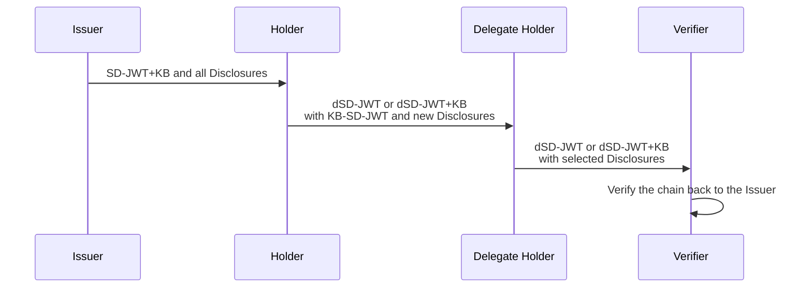

# Deep Dive: draft-ietf-oauth-delegate-sd-jwt

> In one line: Delegate SD-JWT extends SD-JWT (RFC 9901) so that the Key Binding JWT can itself be an SD-JWT, which lets a Holder delegate further presentation to a Delegate Holder and lets the Verifier link the chain back to the original Issuer.

## What this is

In SD-JWT, a Holder can hide claims from a Verifier and prove possession of the `cnf` key. A Verifier can forward and further down-scope an SD-JWT, but it cannot prove it was the recipient of the original SD-JWT+KB presentation and cannot down-scope parts of the transaction data (Section 1). This draft addresses delegation: a Holder wants a Delegate Holder, for example an AI agent buying something on the user's behalf, to present the credential later. The mechanism is a new Key Binding SD-JWT (KB-SD-JWT). It replaces the KB-JWT, signs over a Delegate Payload that can carry its own selectively disclosable claims, and acts as the Issuer-signed JWT for the next link in the chain (Sections 1, 4). A final plain KB-JWT can be added so the Delegate Holder proves possession of the key named in the last Delegate Payload (Section 4.2). The result is called a dSD-JWT, or a dSD-JWT+KB when it ends in a KB-JWT. This is revision -00 (26 October 2026), the first Working Group version after adoption (Appendix C).

## How it works

1. The Issuer issues an SD-JWT with its Disclosures to the Holder (Section 3).
2. The Holder creates a KB-SD-JWT. It is signed with the key from the Issuer SD-JWT's `cnf` claim (Sections 4.3, 6), its `delegate_payload` array holds the Delegate Payload, and it is bound to the preceding token by `sd_hash` or `issuer_jwt_hash` (Section 5.1.4). The elements of `delegate_payload` MUST be replaced with Array Disclosures when there is more than one, and the Delegate Payload Disclosure is the base64url encoding of `[salt, JSON Object Payload]` (Sections 5.1.3, 5.1.4).
3. The Holder passes the SD-JWT, the KB-SD-JWT and selected Disclosures to the Delegate Holder. In the Compact Serialization the split string MUST have exactly one empty component between each SD-JWT or KB-SD-JWT and the following KB-SD-JWT, which shows up as `~~` (Section 5.1.1).
4. The Delegate Holder may delegate again with another KB-SD-JWT, or present. A dSD-JWT+KB ends in a KB-JWT signed with the key in the last Delegate Payload's `cnf` claim (Sections 4.2, 5.1.1).
5. The Verifier splits the string, validates the first SD-JWT with the Issuer key, validates each KB-SD-JWT as an SD-JWT+KB using the previous `cnf` key, checks the hash links and `typ` values, and verifies the final KB-JWT when Key Binding is required (Section 6).

## Use cases

- A user delegates to an AI agent the ability to make a purchase with constraints on fulfillment, and the agent proves to a merchant it was authorized without revealing which other merchants could have fulfilled it (Section 1).
- A Holder signs once with a key that needs a user action per signature and produces several delegations, by putting several values in `delegate_payload` (Section 5.1.4).
- A wallet performs delegation over OpenID4VP by using a `delegate` transaction data type (Section 7.1).
- An Issuer or Holder limits further delegation by placing constraint claims in the Issuer-signed JWT or in a KB-SD-JWT+KB (Section 8.2).
- A Delegate Holder delegates a dSD-JWT+KB further through additional KB-SD-JWTs (Section 1.1).

## Why This Matters Now

- **Trigger**: [PR #15](https://github.com/oauth-wg/oauth-delegate-sd-jwt/pull/15) in the draft's repository, opened on 2026-11-10 by the first author and still open on 2026-11-18. It fixes issues #3 and #10: it moves `cnf`, `exp`, `nbf` and the other security claims out of `delegate_payload` into the base KB-SD-JWT payload, says that all `delegate_payload` elements share those claims, and adds a "Security Claim Semantics" section. That section says `exp` and `nbf` MUST narrow along the chain and that `aud` and `nonce` on a KB-SD-JWT apply to the delegation step, not to the final Verifier. It also adds "Verification by a Delegate Holder". If it merges, the parts of -00 that put security claims in the Delegate Payload (Sections 2.2, 4.2, 5.1.3, 5.1.4, 6) change. The draft is an active WG document at -00 (datatracker states: Active, I-D Exists, WG Document).
- **Source evidence**: Section 1 names AI agents as the example use case, and the abstract says the draft has "particular applicability to Agentic systems". Appendix C records adoption from draft-gco-oauth-delegate-sd-jwt.
- **Expected impact**: Implementers of SD-JWT wallets, verifiers and agent frameworks may need to parse chained tokens with empty components and new `typ` values. PR #15 and the other open pull requests (#9 on the OpenID4VP transaction data type, #14 with a worked example) show the format is still changing, so early implementations should expect breakage.

## What Changed

- Spec/document change summary: Revision -00 is the "Initial Working Group Draft", adopted from draft-gco-oauth-delegate-sd-jwt. Appendix C lists a pre-adoption -01 with editorial fixes and the rename of `kb+sd-jwt+kb` to `kb-sd-jwt+kb`. The draft's repository tags only draft-gco-oauth-delegate-sd-jwt-00 (2026-03-06) and draft-ietf-oauth-delegate-sd-jwt-00 (2026-10-22), so the changes below are measured between those two tags and are not split between the individual -01 and the WG -00. The Compact Serialization now requires exactly one empty component before every KB-SD-JWT, also between chained KB-SD-JWTs (`~~` instead of `~`) (Section 5.1.1). JSON Serialization digests are computed over the equivalent Compact Serialization (Section 5.1.2). `sd_hash` in the final Delegate KB-JWT is now REQUIRED (Section 5.1.3). The final KB-SD-JWT of a dSD-JWT may be `kb+sd-jwt` or `kb-sd-jwt+kb`, replacing `kb-sd-jwt`, which matched neither registered media type (Section 6, step 4). A dSD-JWT without Key Binding is rejected when Key Binding is required (Section 6, step 5). `delegate_disclosures` now carries the Disclosures of the selectively disclosable claims (Section 7.1). The draft defines the dSD-JWT and dSD-JWT+KB formats, the `delegate_payload` claim, the `issuer_jwt_hash` claim, the `kb+sd-jwt` and `kb-sd-jwt+kb` types, a verification procedure and an OpenID4VP transaction data type.
- Compatibility or migration concerns: The draft rests on RFC 9901 and changes how a KB-JWT is parsed. Implementers who relied on the earlier `kb+sd-jwt+kb` name need to move to `kb-sd-jwt+kb`. A dSD-JWT does not match the RFC 9901 Section 4 ABNF, where a Disclosure is at least one base64url character and an SD-JWT+KB ends in a single JWT, so an RFC 9901 parser that follows the grammar will not accept it. The draft itself does not discuss this. The draft does not say how a Verifier signals that it accepts delegated tokens.

## Technical Analysis

- Threat model implications: Section 8.1 calls it critical that the Verifier checks every KB-SD-JWT and its binding to the preceding token, because a malicious Delegate Holder could otherwise mismatch chain parts if the Holder `cnf` key is reused. Section 6 makes the checks mandatory: if any step fails, processing MUST be aborted. Section 8 says a delegating Holder acts as an Issuer, so issuer considerations apply to it. Section 8.2 only says delegation limits MAY be added as visible claims. The draft does not say that a Delegate Payload may only narrow what the previous token allowed. Section 8.3 says revocation is hard for individual Holders and that a short `exp` and constraint claims limit the problem.
- Protocol flow implications: `sd_hash` binds the previous token including its Disclosures. If the Holder wants the Delegate Holder to be able to omit earlier Disclosures, it MUST omit `sd_hash` and include `issuer_jwt_hash`, which covers only the Issuer-signed JWT or KB-SD-JWT+KB (Sections 4.1, 5.1.4). Verification follows Section 6 and reuses RFC 9901 Section 7.1 for each link. The OpenID4VP binding in Section 7.1 carries `format`, `delegate_payload_disclosure` and the OPTIONAL `delegate_disclosures` in `transaction_data`.
- Interop concerns: The compact form needs exactly one empty component before each KB-SD-JWT, and a trailing `~` distinguishes a dSD-JWT from a dSD-JWT+KB (Section 5.1.1). The `typ` rules differ for final and non-final tokens (Sections 5.1.4, 6). The JSON Serialization changes the `kb_jwt` header parameter, with digests computed over the equivalent compact form (Section 5.1.2). In the -00 text, "Section 4.3.1" (Sections 5.1.4, 6) and "Section 7.3" (Section 6, step 5) are printed without "of [RFC9901]". The draft has no Section 4.3.1 or 7.3 of its own, and the Markdown source at the draft-ietf-oauth-delegate-sd-jwt-00 tag writes them as `[@!RFC9901, Section 4.3.1]` and `[@!RFC9901, Section 7.3]`. They point to RFC 9901 Section 4.3.1 (Binding to an SD-JWT) and Section 7.3 (Verification by the Verifier), but a reader of the text alone can take them as internal references.

## Open Questions

- Section 5.1.4 defines `delegate_payload` as an array, while the term "Delegate Payload" is the object inside a Disclosure. The draft does not show an example of how the array elements and the Disclosure digests line up (Sections 2.2, 5.1.3, 5.1.4). Issue #5 asks for examples, and PR #14 proposes one.
- Section 5.1.4 says all claims of the Issuer-signed JWT payload except `_sd_alg` move into the Delegate Payload. The -00 text does not say how `iss`, `exp`, `nbf` or `cnf` of the delegate relate to those of the earlier token. PR #15 would move these claims into the base KB-SD-JWT payload and define their meaning.
- No rule in -00 makes a delegation narrower than its parent, and Section 8.2 leaves limits to optional visible claims. How a Verifier evaluates them is not defined. Issue #8 raises this, and PR #15 would add narrowing only for `exp` and `nbf`.
- Section 8.1 says "in both directions". The draft does not say what the second direction is.
- A dSD-JWT may end in a KB-SD-JWT with `typ` `kb-sd-jwt+kb`, which carries a `cnf`, without a KB-JWT (Section 6, steps 1 and 4). Step 5 rejects it only when the Verifier requires Key Binding. The draft does not say whether such a token is meant for a further Delegate Holder or for a Verifier.
- Section 7.1 says the KB-JWT carries a digest in the `delegate_payload` claim and that "_sd_alg may use any hash algorithm specified for hashing the transaction_data". How this fits with Section 5.1.4, where `sd_hash` and `issuer_jwt_hash` use the hash algorithm of the preceding token, is not stated.
- The Privacy Considerations (Section 9) only point to RFC 9901 Section 10. Linkability caused by the chain of keys and Disclosures is not discussed. Acknowledgments are marked TODO (Appendix B).
- IANA (Appendix A) requests only `issuer_jwt_hash` as a JWT claim. `delegate_payload` is not in the request.
- The draft gives no examples of a complete token.

## Experiments

- [x] Lab 1: Build a dSD-JWT with one delegation from an RFC 9901 SD-JWT, then check that a standard RFC 9901 parser rejects it and that a prototype Section 6 verifier accepts it.
- [x] Lab 2: Make the same delegation once with `sd_hash` and once with `issuer_jwt_hash`, then drop a Disclosure from the earlier SD-JWT and see which variant still verifies.
- [x] Lab 3: Reuse one Holder `cnf` key for two delegations, swap the KB-SD-JWT between chains, and test whether the Section 8.1 checks catch the mismatch.

## Sources

- [draft-ietf-oauth-delegate-sd-jwt-00](https://datatracker.ietf.org/doc/draft-ietf-oauth-delegate-sd-jwt/00/)
- [RFC 9901: Selective Disclosure for JSON Web Tokens](https://www.rfc-editor.org/info/rfc9901)
- [oauth-wg/oauth-delegate-sd-jwt](https://github.com/oauth-wg/oauth-delegate-sd-jwt), the draft's repository
- [PR #15: Move security claims to base KB-SD-JWT payload and define claim semantics](https://github.com/oauth-wg/oauth-delegate-sd-jwt/pull/15)
- [Issue #8: Place requirements, or clarify that constraints can only narrow across the chain](https://github.com/oauth-wg/oauth-delegate-sd-jwt/issues/8)
- [Changes between draft-gco-oauth-delegate-sd-jwt-00 and draft-ietf-oauth-delegate-sd-jwt-00](https://github.com/oauth-wg/oauth-delegate-sd-jwt/compare/draft-gco-oauth-delegate-sd-jwt-00...draft-ietf-oauth-delegate-sd-jwt-00)
