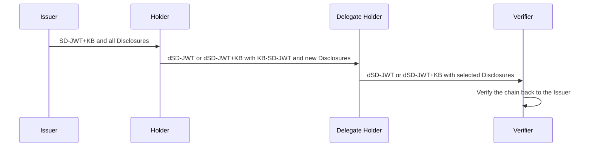

# Deep Dive: draft-ietf-oauth-delegate-sd-jwt

> In one line: Delegate SD-JWT extends SD-JWT (RFC 9901) so that the Key Binding JWT can itself be an SD-JWT, which lets a Holder delegate further presentation to a Delegate Holder and lets the Verifier link the chain back to the original Issuer.

## What this is

In SD-JWT, a Holder can hide claims from a Verifier and prove possession of the `cnf` key, but a party that receives a presentation cannot prove it was the recipient and cannot down-scope transaction data (Section 1). This draft addresses delegation: a Holder wants a Delegate Holder, for example an AI agent buying something on the user's behalf, to present the credential later. The mechanism is a new Key Binding SD-JWT (KB-SD-JWT). It replaces the KB-JWT, signs over a Delegate Payload that can carry its own selectively disclosable claims, and acts as the Issuer-signed JWT for the next link in the chain (Sections 1, 4). A final plain KB-JWT can be added so the Delegate Holder proves possession of the key named in the last Delegate Payload (Section 4.2). The result is called a dSD-JWT, or a dSD-JWT+KB when it ends in a KB-JWT. This is revision -00, the first Working Group version after adoption (Appendix C).

## How it works

1. The Issuer issues an SD-JWT with its Disclosures to the Holder (Section 3).
2. The Holder creates a KB-SD-JWT. It is signed with the key from the Issuer SD-JWT's `cnf` claim, its `delegate_payload` array holds the Delegate Payload as an Array Disclosure, and it is bound to the preceding token by `sd_hash` or `issuer_jwt_hash` (Sections 5.1.3, 5.1.4).
3. The Holder passes the SD-JWT, the KB-SD-JWT and selected Disclosures to the Delegate Holder. Compact Serialization joins the components with an empty component, written `~~` (Section 5.1.1).
4. The Delegate Holder may delegate again with another KB-SD-JWT, or present. A dSD-JWT+KB ends in a KB-JWT signed with the key in the last Delegate Payload's `cnf` claim (Sections 4.2, 5.1.1).
5. The Verifier splits the string, validates the first SD-JWT with the Issuer key, validates each KB-SD-JWT as an SD-JWT+KB using the previous `cnf` key, checks the hash links and `typ` values, and verifies the final KB-JWT when Key Binding is required (Section 6).

## Use cases

- A user delegates to an AI agent the ability to make a purchase with constraints on fulfillment, and the agent proves to a merchant it was authorized without revealing which other merchants could have fulfilled it (Section 1).
- A Holder signs once with a key that needs a user action per signature and produces several delegations, by putting several values in `delegate_payload` (Section 5.1.4).
- A wallet performs delegation over OpenID4VP by using a `delegate` transaction data type (Section 7.1).
- An Issuer or Holder limits further delegation by placing constraint claims in the Issuer-signed JWT or in a KB-SD-JWT+KB (Section 8.2).
- A Delegate Holder re-delegates a dSD-JWT+KB to another agent through further KB-SD-JWTs (Section 1.1).

## Why This Matters Now

- **Trigger**: `subject.json` says "PR #15 restructures where security claims live in the KB-SD-JWT and defines their delegation semantics." That pull request is not in the staged material, so it is not checked here. The draft is an active WG document at -00 (datatracker states: Active, I-D Exists, WG Document).
- **Source evidence**: Section 1 names AI agents as the example use case, and the abstract says the draft has "particular applicability to Agentic systems". Appendix C records adoption from draft-gco-oauth-delegate-sd-jwt.
- **Expected impact**: Implementers of SD-JWT wallets, verifiers and agent frameworks may need to parse chained tokens with empty components and new `typ` values. The format is still changing, so early implementations should expect breakage.

## What Changed

- Spec/document change summary: No `diff.txt` is staged, so only the document history is available. Revision -00 is the "Initial Working Group Draft", adopted from draft-gco-oauth-delegate-sd-jwt. Before adoption, -01 made editorial fixes and changed `kb+sd-jwt+kb` to `kb-sd-jwt+kb` (Appendix C). The draft defines the dSD-JWT and dSD-JWT+KB formats, the `delegate_payload` claim, the `issuer_jwt_hash` claim, the `kb+sd-jwt` and `kb-sd-jwt+kb` types, a verification procedure and an OpenID4VP transaction data type.
- Compatibility or migration concerns: The draft rests on RFC 9901 and changes how a KB-JWT is parsed. Implementers who relied on the earlier `kb+sd-jwt+kb` name need to move to `kb-sd-jwt+kb`. An RFC 9901 parser may not accept `~~`, so a dSD-JWT would fail there. The draft does not say how a Verifier signals that it accepts delegated tokens.

## Technical Analysis

- Threat model implications: Section 8.1 requires the Verifier to check every KB-SD-JWT and its binding to the preceding token, because a malicious Delegate Holder could otherwise mismatch chain parts if the Holder `cnf` key is reused. Section 8 says a delegating Holder acts as an Issuer, so issuer considerations apply to it. Section 8.2 only says delegation limits MAY be added as visible claims. The draft does not say that a Delegate Payload may only narrow what the previous token allowed. Section 8.3 says revocation is hard for individual Holders and suggests short `exp` and constraint claims.
- Protocol flow implications: `sd_hash` binds the previous token including its Disclosures. If `sd_hash` is omitted, `issuer_jwt_hash` covers only the Issuer-signed JWT or KB-SD-JWT+KB, so the Delegate Holder may omit earlier Disclosures (Sections 4.1, 5.1.4). Verification follows Section 6 and reuses RFC 9901 Section 7.1 for each link. The OpenID4VP binding in Section 7.1 carries `format`, `delegate_payload_disclosure` and `delegate_disclosures` in `transaction_data`.
- Interop concerns: The compact form needs an exact empty component between parts, and a trailing `~` distinguishes a dSD-JWT from a dSD-JWT+KB (Section 5.1.1). The `typ` rules differ for final and non-final tokens (Sections 5.1.4, 6). The JSON Serialization changes the `kb_jwt` header parameter, with digests computed over the equivalent compact form (Section 5.1.2). Several cross references appear to point into RFC 9901 without saying so, for example "Section 4.3.1" and "Section 7.3".

## Open Questions

- Section 5.1.4 defines `delegate_payload` as an array, while the term "Delegate Payload" is the object inside a Disclosure. The draft does not show an example of how the array elements and the Disclosure digests line up (Sections 2.2, 5.1.3, 5.1.4).
- Section 5.1.4 says all claims of the Issuer-signed JWT payload except `_sd_alg` move into the Delegate Payload. The draft does not say how `iss`, `exp`, `nbf` or `cnf` of the delegate relate to those of the earlier token.
- No rule makes a delegation narrower than its parent, and Section 8.2 leaves limits to optional visible claims. How a Verifier evaluates them is not defined.
- Section 8.1 says "in both directions". The draft does not say what the second direction is.
- Section 6 step 3 says each non-final KB-SD-JWT must have `typ` `kb-sd-jwt+kb`, while step 1 allows `kb+sd-jwt` only for the final one. How the dSD-JWT final token with `kb-sd-jwt+kb` differs in key binding handling needs a worked example (Section 6, step 5).
- Section 7.1 says the KB-JWT carries a digest in the `delegate_payload` claim and that `_sd_alg` "may use any hash algorithm". The wording is unclear, and how it fits with Section 5.1.4 is not stated.
- The Privacy Considerations (Section 9) only point to RFC 9901. Linkability caused by the chain of keys and Disclosures is not discussed. Acknowledgments are marked TODO (Appendix B).
- IANA (Appendix A) requests only `issuer_jwt_hash` as a JWT claim. `delegate_payload` is not in the request.
- The draft gives no examples of a complete token.

## Experiments

- [ ] Lab 1: Build a dSD-JWT with one delegation from an RFC 9901 SD-JWT, then check that a standard RFC 9901 parser rejects it and that a prototype Section 6 verifier accepts it.
- [ ] Lab 2: Make the same delegation once with `sd_hash` and once with `issuer_jwt_hash`, then drop a Disclosure from the earlier SD-JWT and see which variant still verifies.
- [ ] Lab 3: Reuse one Holder `cnf` key for two delegations, swap the KB-SD-JWT between chains, and test whether the Section 8.1 checks catch the mismatch.

## Sources

- [draft-ietf-oauth-delegate-sd-jwt-00](https://datatracker.ietf.org/doc/draft-ietf-oauth-delegate-sd-jwt/00/)
