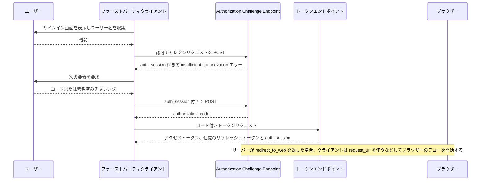

# Deep Dive: draft-ietf-oauth-first-party-apps

> 一言で言うと: OAuth 2.0 for First-Party Applications (-04) は Authorization Challenge Endpoint を追加し、ファーストパーティのネイティブアプリが自らサインインの対話を行って認可コードを受け取り、通常のトークンエンドポイントで引き換えられるようにする。ブラウザーへのリダイレクトはフォールバックとしてのみ使う。

## 概要

リダイレクト型の OAuth はユーザーをネイティブアプリからブラウザーへ移し、また戻すため、ユーザーの操作の流れが途切れ、タスクの完了を妨げることがあるとドラフトは述べている (Section 1)。このドラフトは認可サーバーに新しい HTTP エンドポイントである Authorization Challenge Endpoint を追加する (Section 4.1)。クライアントはユーザーから集めた情報を POST し、サーバーは認可コードか、続行を指示するエラーのどちらかを返す。プロンプト、チャレンジ、手順の順序はドラフトが意図的に定義せず、各デプロイメントに委ねている (Section 1.2)。またこの仕様はプロファイル化されることを前提としている。対象はファーストパーティアプリケーション、すなわち認可サーバーと同一の主体が管理し、ユーザーも同一の主体と理解しているアプリに限られる (Section 1.1、9.1)。さらにトークンレスポンスとリソースサーバーのエラー処理を拡張し、サーバーが再認証を求められるようにしている (Section 6、7)。

## 仕組み

1. クライアントはユーザー名などの初期情報を集め、`response_type=code` を付けて Authorization Challenge Endpoint に POST する。サーバーがクライアントを別の方法で識別できない限り `client_id` も必要である (Section 5.1)。
2. 情報が不十分な場合、サーバーはエラーを返さなければならない。`insufficient_authorization` はクライアントが追加の手順を取るべきことを意味し、レスポンスは HTTP 403 でなければならない (Section 5.2.2.1)。レスポンスには `auth_session` と認可サーバー独自の値を含められる (Section 5.2.2)。
3. クライアントは保持している `auth_session` を必ず含めてリクエストを繰り返す。中間リクエストは別の形式でもよく、独自のエンドポイントへ送ってもよい (Section 5.3)。
4. 条件を満たすと、サーバーは HTTP 200 で `authorization_code` を返す (Section 5.2.1)。
5. クライアントはトークンエンドポイントでコードを引き換える。認可リクエストに `redirect_uri` がないため、送信しない (Section 6)。
6. サーバーが直接の対話を望む場合、`redirect_to_web` を HTTP 403 で返し、Pushed Authorization Request の `request_uri` を付けてもよい。付いていない場合、クライアントは PKCE を使った通常の認可コードフローを開始する (Section 5.2.2.1.1)。
7. 以降、トークンエンドポイントは有効なリフレッシュトークンに対しても `insufficient_authorization` を返せる (Section 6.2)。リソースサーバーは [RFC9470] のステップアップエラーを返すことができ、クライアントはチャレンジエンドポイントで応答する (Section 7)。

## ユースケース

- 銀行などのサービスが、自社のモバイルアプリでアプリを離れずにパスキーでサインインさせる (Appendix A.1)。
- ファーストパーティアプリがメールまたは SMS の確認コードを求め、`auth_session` でやり取りをつなぐ (Appendix A.4、A.5)。
- 1 週間後にリフレッシュトークンが拒否されたアプリが、再ログインではなく OTP の入力を求める (Appendix A.6、B.4)。
- リソースサーバーがより高い `acr` レベルを要求し、アプリがその場でステップアップを完了する (Appendix A.7)。
- アプリがメールアドレスと電話番号を集め、アカウントをその場で作成する登録フローを構成する (Appendix A.8)。

## なぜ今重要か

- **Trigger**: Datatracker はリビジョン 04 の状態を "Active"、"I-D Exists"、"WG Consensus: Waiting for Write-Up" としている。`subject.json` に他の理由はない (`ai_note` は空である)。
- **Source evidence**: Appendix D は -04 を "Editorial clarifications and improvements" と "Updated HTTP response codes for consistency" としている。差分を見ると、レスポンスコードの変更は実質的に規範的である。`insufficient_authorization` と `redirect_to_web` は 403 でなければならなくなった。
- **Expected impact**: これらのエラーに 401 や 400 を返す -03 の例に従った実装は変更が必要になる。作業部会が write-up 待ちの状態を公開に近いと見ているかどうかは、資料には書かれていない。

## 変更点

`diff.txt` に基づく -03 から -04 への変更:

- Section 5.2.2.1: `insufficient_authorization` と `redirect_to_web` は HTTP 403 (Forbidden) で返さなければならない。Section 5.2.2 の一般規則は、個別のエラーコードが別途定めない限り HTTP 400 のままである。
- Section 5.2.2.1.1: `request_uri` を含む `redirect_to_web` の例を追加し、[RFC9700] のベストプラクティス（[RFC9207] の `iss` レスポンスパラメーターを含む）に従うべきとする SHOULD を追加した。両 RFC は参考文献として追加された。
- Section 5.3.1: ユーザーがアプリからログアウトしたとき、クライアントは `auth_session` を破棄すべきである (SHOULD)。
- Appendix B: `otp_required` の例は 401 ではなく 403 を使い、401 を指定していた文は削除された。
- Section 5.1: リクエスト例に `response_type=code` が加わった。
- Section 10.1: IANA の仕様参照先が Section 5.3.1 になり、Section 10.2 は Section 8 を指すようになった。以前は Section 5.4 と Section 4.1 を参照していた。
- Section 5.2.2: JSON の参照が [RFC8259] になり、[RFC7159] の参照は削除された。
- 参考文献: cross-device-security は -16、attestation-based-client-auth は -09 に更新された。
- 残りは文言と編集上の修正、および謝辞への 2 名 (Filip Skokan、Joseph Heenan) の追加である。

互換性: 2 つのエラーコードに 400 や 401 を返していたデプロイメントは -04 に適合しない。そのような実装が実際に存在したかどうかは資料に書かれていない。

## 技術分析

**脅威モデル。** Section 9 はドラフトが認めるリスクを列挙している。

- フィッシング: 悪意のあるアプリがクライアントになりすませる。またユーザーは認証情報を入力する場所がもう一つ増えることを学ばなければならない (Section 9.2)。サーバーは任意の段階でリダイレクト型フローを要求してよい (MAY)。
- 新しいエンドポイントでのクレデンシャルスタッフィングとブルートフォース: 実装者はブラウザーのフローと同様の対策を検討し (SHOULD)、可能なら Attestation API を使い、`auth_session` ごとにレート制限を行うべきである (Section 9.3)。
- クライアントのなりすまし: モバイルやデスクトップのアプリはパブリッククライアントであるため、ドラフトは Attestation を勧めている (Section 9.4)。トークンエンドポイントでクライアント認証を要求するなら、チャレンジエンドポイントでも必須となる (Section 4.1)。
- "first-partyness" の検証は MUST だが (Section 5)、方法は範囲外である (Section 9.1)。
- トークンの窃取: トークンは送信者制約を付けるべきであり (SHOULD)、DPoP を使う場合、クライアントはチャレンジリクエストに DPoP ヘッダーを付けて認可コードを束縛すべきである (SHOULD)。サーバーは以降のすべてのリクエストとトークンリクエストで同じ鍵を強制する (Section 9.5.1)。
- `auth_session` の乗っ取り: 値はデバイスに束縛すべきで (SHOULD)、たとえば DPoP 鍵に結び付ける (Section 5.3.1、9.6.1)。乱数の場合は少なくとも 256 ビットのエントロピーが必要で、有効期間はサーバーが決める (Section 9.6.2)。

**プロトコルフロー。** 設計は既存のトークンエンドポイントを再利用し、新しいエンドポイントは認可コードだけを発行する (Appendix C)。ドラフトは 2 つの理由を挙げる。既存の OAuth サーバーへの変更を減らすこと、リダイレクト型フローの構造に近づけることである。要素ごとのグラントタイプと、トークンの直接返却は退けている。

**相互運用への影響。**

- クライアントとサーバーの対話は意図的に未規定であると明記されており、共通のプロファイルがなければ独立した実装同士は相互運用できない (Section 1.2、Appendix B)。
- `response_mode=query` のようにブラウザー以外では意味を持たない拡張パラメーターの扱いは規定されていない (Section 4.1)。
- 認可サーバー独自のエラーコードとカスタム値は明示的に範囲外である (Section 5.2.2)。
- ブラウザーベースのアプリでの利用は推奨されない (NOT RECOMMENDED) (Section 9.8)。

## 未解決の論点

- Section 5.2.2.1 は `invalid_session` にステータスコードを定めていないため、Section 5.2.2 により 400 が既定となる。ドラフトはこれが意図かどうかを述べていない。
- Section 6.2 はトークンエンドポイントで HTTP 403 を示す一方、エラー形式は [RFC6749] の Section 5.2 を参照している。ドラフトは、このエンドポイントでの [RFC6749] のエラー処理との関係を述べていない。
- Section 10.1 は `auth_session` の使用場所を "token response" のみで登録しているが、チャレンジエンドポイントのエラーレスポンス (Section 5.2.2、6.2) とリクエスト (Section 5.1) にも現れる。登録がこれらを含むべきかは議論されていない。
- 参考文献に `[IANA.JWT] "*** BROKEN REFERENCE ***"` が残り、用語の節には "TODO: Replace RFC6749 references with OAuth 2.1" が残っている (Section 2.1)。
- Section 9.1 は first-partyness の検証を求めるが、具体的な方法を示していない。選択肢として Attestation とクライアント認証を挙げるだけである。
- Section 7 はクライアントが `acr_values`、`max_age`、`scope` をチャレンジエンドポイントへ送るとするが、Section 5.1 は `acr_values` と `max_age` をパラメーターとして挙げていない。これらは Section 4.1 の拡張の規則で渡されることになる。
- ドラフトはプロファイル化されることを想定している (Section 1.2) が、資料にはプロファイルは示されていない。

## 実験

- [ ] Appendix B のユーザー名と OTP のプロファイルで最小のチャレンジエンドポイントを立て、クライアントライブラリーが 403 の `insufficient_authorization` に続く 200 の `authorization_code` を処理できることを確認する。
- [ ] DPoP を追加し、最初のチャレンジリクエストでヘッダーを送った後、2 回目のリクエストとトークンリクエストで鍵を切り替え、サーバーが両方を拒否することを確認する (Section 9.5.1、9.6.1)。
- [ ] 最初のリクエストに `code_challenge` がある場合とない場合で `redirect_to_web` を `request_uri` 付きと無しで返し、PKCE のチャレンジが送られていないときにサーバーが `request_uri` を返さないことを確認する (Section 5.2.2.1.1)。

## 出典

- [IETF Datatracker の draft-ietf-oauth-first-party-apps-04](https://datatracker.ietf.org/doc/draft-ietf-oauth-first-party-apps/04/)
- [ドラフトに記載されたソースリポジトリ](https://github.com/oauth-wg/oauth-first-party-apps)
