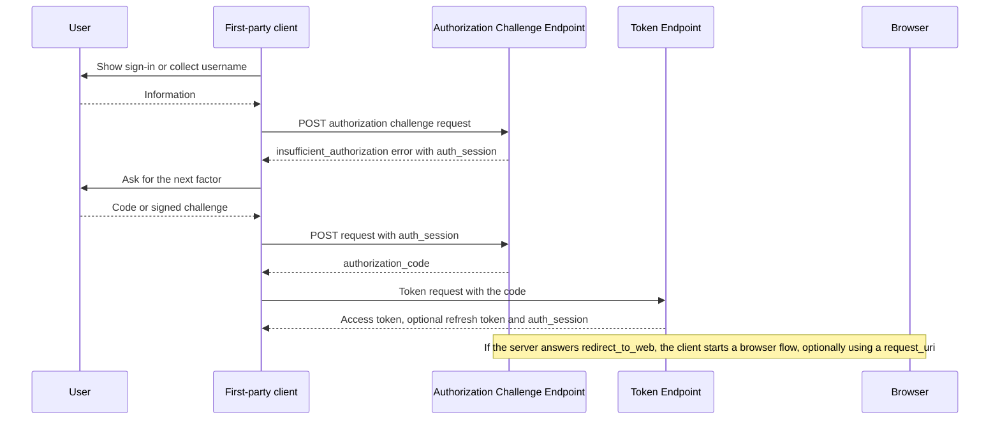

# Deep Dive: draft-ietf-oauth-first-party-apps

> In one line: OAuth 2.0 for First-Party Applications (-04) adds an Authorization Challenge Endpoint so a first-party native app can run the sign-in dialogue itself, receive an authorization code, and redeem it at the normal token endpoint, with a redirect to the browser only as a fallback.

## What this is

Redirect-based OAuth sends the user from a native app to a browser and back, which the draft says can disrupt the user journey and prevent task completion (Section 1). This draft adds a new HTTP endpoint at the authorization server, the Authorization Challenge Endpoint (Section 4.1). The client POSTs what it has collected from the user, and the server answers with either an authorization code or an error that tells the client to continue. The draft deliberately does not define the prompts, challenges or step sequences, which are left to each deployment (Section 1.2), and says the specification is meant to be profiled. It is limited to first-party applications, meaning apps controlled by the same entity as the authorization server and understood by users as the same entity (Section 1.1, 9.1). The draft also extends the token response and the resource server error handling so the server can ask for re-authentication (Section 6, 7).

## How it works

1. The client collects initial information such as a username and POSTs it to the Authorization Challenge Endpoint with `response_type=code`, plus `client_id` unless the server can identify the client otherwise (Section 5.1).
2. If the information is not enough, the server must return an error. `insufficient_authorization` means the client should take more steps, and the response must use HTTP 403 (Section 5.2.2.1). It may carry an `auth_session` and AS-defined custom values (Section 5.2.2).
3. The client repeats requests, always including the `auth_session` it holds. Intermediate requests may be in a different format or go to proprietary endpoints (Section 5.3).
4. When satisfied, the server returns HTTP 200 with `authorization_code` (Section 5.2.1).
5. The client redeems the code at the token endpoint. No `redirect_uri` is sent because none was in the authorization request (Section 6).
6. If the server wants direct interaction, it returns `redirect_to_web` with HTTP 403, optionally with a `request_uri` as defined in Section 2.2 of [RFC9126]. It MUST NOT return one if the first request carried no PKCE `code_challenge`. Without a `request_uri`, the client starts a normal authorization code flow with PKCE (Section 5.2.2.1.1).
7. Later, the token endpoint can answer even a valid refresh token with `insufficient_authorization` (Section 6.2), and a resource server can send an [RFC9470] step-up error that the client answers at the challenge endpoint (Section 7).

## Use cases

- A bank signs users into its own mobile app with a passkey without leaving the app. This is an illustration: Appendix A.1 describes the passkey flow, and Section 9.1 uses a bank's own app as its example of a first-party application.
- A first-party app asks for an email or SMS confirmation code and keeps the exchange together with `auth_session` (Appendix A.4, A.5).
- An app whose refresh token is rejected a week later prompts for an OTP instead of a full re-login (Appendix A.6, B.4).
- A resource server demands a higher `acr` level and the app completes step-up in place (Appendix A.7).
- An app builds a registration flow that collects an email address and a phone number and creates the account on the fly (Appendix A.8).

## Why This Matters Now

- **Trigger**: The Datatracker lists revision 04 with the states "Active", "I-D Exists" and "WG Consensus: Waiting for Write-Up". WG Last Call on -03 ran from 25 June to 13 July 2026, -04 was posted on 1 July 2026 during it, and the WG state moved from "In WG Last Call" to "Waiting for Write-Up" on 15 July 2026. A document shepherd was assigned on 26 August 2026.
- **Source evidence**: Appendix D lists -04 as "Editorial clarifications and improvements" and "Updated HTTP response codes for consistency". The response-code change is normative: Section 5.2.2.1 now says the server MUST respond with 403 for `insufficient_authorization` and `redirect_to_web`. The editor's WGLC reply of 1 July 2026 gives the reason: an example used 401 without the `WWW-Authenticate` header that 401 requires, so the codes were changed to 403.
- **Expected impact**: In -03 the normative default for both codes was 400 (Section 5.2.2), the Appendix B.3 example used 401, and the token endpoint examples (Section 6.2, Appendix B.4) already used 403. Implementations that followed the 400 default or the 401 example need to change. The next step is the shepherd write-up. The IESG state is still "I-D Exists", so the draft has not been sent to the IESG.

## What Changed

Changes from -03 to -04:

- Section 5.2.2.1: `insufficient_authorization` and `redirect_to_web` MUST be returned with HTTP 403 (Forbidden). The general rule in Section 5.2.2 stays HTTP 400 unless a particular error code says otherwise.
- Section 5.2.2.1.1: a new `redirect_to_web` example with a `request_uri`, and a new SHOULD to follow [RFC9700] best practices including the `iss` response parameter of [RFC9207]. Both RFCs are added as informative references.
- Section 5.3.1: clients SHOULD discard the `auth_session` when the user logs out.
- Appendix B: the B.3 `insufficient_authorization` example with `otp_required` now uses 403 instead of 401, and the B.2 sentence that set 401 for `otp_required` was removed.
- Section 5.1: the request example now shows `response_type=code`.
- Section 10.1: the IANA specification pointer is now Section 5.3.1, and Section 10.2 now points to Section 8. The earlier text referred to Section 5.4 and Section 4.1.
- Section 5.2.2: JSON is now cited as [RFC8259]. The [RFC7159] reference was removed.
- References: cross-device-security moves to -16 and attestation-based-client-auth to -09.
- The remaining changes are wording and editorial fixes, plus two acknowledgments (Filip Skokan, Joseph Heenan).

Compatibility: deployments that returned 400 or 401 for the two error codes would not conform to -04. The WGLC thread does not mention any deployment that did so.

## Technical Analysis

**Threat model.** Section 9 lists the risks the draft acknowledges:

- Phishing: a malicious app can impersonate the client, and users must learn a second place where credentials are entered (Section 9.2). The server MAY force a redirect-based flow at any stage.
- Credential stuffing and brute force at the new endpoint: implementers SHOULD apply controls like those on browser flows, use attestation APIs when possible, and rate-limit per `auth_session` (Section 9.3).
- Client impersonation: mobile and desktop apps are typically public clients, so implementers SHOULD consider measures such as OS attestation APIs (Section 9.4). If client authentication is required at the token endpoint, it MUST also be required at the challenge endpoint (Section 4.1).
- Verifying "first-partyness" is a MUST (Section 5) but the mechanism is left out of scope (Section 9.1).
- Token theft: tokens SHOULD be sender-constrained, and with DPoP the client SHOULD bind the authorization code by sending the DPoP header on the challenge request, with the server enforcing the same key on every later request and the token request (Section 9.5.1).
- `auth_session` hijacking: the value SHOULD be bound to the device, for example to the DPoP key (Section 5.3.1, 9.6.1). The server MUST make it unique to the session, and a random value SHOULD have at least 256 bits of entropy (Section 5.3.1). Its lifetime is up to the server (Section 9.6.2).

**Protocol flow.** The design reuses the existing token endpoint and only issues authorization codes at the new endpoint (Appendix C). The draft gives two reasons: fewer changes to existing OAuth servers, and a closer match to the redirect-based flow. It rejects per-factor grant types and returning tokens directly.

**Interop implications.**

- The draft states that the client-server interaction is intentionally unspecified, so two independent implementations will not interoperate without a shared profile (Section 1.2, Appendix B).
- Extension parameters that have no meaning outside a browser, such as `response_mode=query`, are handled in an unspecified way (Section 4.1).
- The AS-defined error codes and custom values are explicitly out of scope (Section 5.2.2).
- Browser-based apps are NOT RECOMMENDED (Section 9.8).

## Open Questions

- Section 5.2.2.1 gives no status code for `invalid_session`, so Section 5.2.2 defaults to 400 for it. The draft does not say whether that is intended.
- Section 6.2 sets no status code for `insufficient_authorization` at the token endpoint. Its example uses 403, while Section 5.2 of [RFC6749], which it cites for the error format, defaults to 400. The new MUST in Section 5.2.2.1 covers only the challenge endpoint.
- Section 10.1 registers `auth_session` with usage location "token response" only, although it also appears in challenge endpoint error responses (Section 5.2.2), token endpoint error responses (Section 6.2) and challenge requests (Section 5.1). Whether the registration should cover these is not discussed.
- The references list contains `[IANA.JWT] "*** BROKEN REFERENCE ***"`, and the terminology section still contains "TODO: Replace RFC6749 references with OAuth 2.1" (Section 2.1).
- Section 9.1 requires verifying first-partyness but gives no concrete mechanism. The draft only suggests attestation and client authentication as options.
- Section 7 says the client sends `acr_values`, `max_age` and `scope` to the challenge endpoint, while Section 5.1 does not list `acr_values` or `max_age` as parameters. They are OpenID Connect parameters and arrive through the extension rule: Section 4.1 names OpenID Connect as an extension the endpoint MUST accept, and Section 5.1 accepts "parameters from any extensions". Section 7 itself attributes them to [OpenID].
- The draft says it is intended to be profiled (Section 1.2), but it names no profile beyond the illustrative username and OTP profile in Appendix B.

## Experiments

- [ ] Stand up a minimal challenge endpoint with the Appendix B username and OTP profile, and confirm that a client library handles a 403 `insufficient_authorization` response followed by a 200 `authorization_code`.
- [ ] Add DPoP: send the header on the first challenge request, then switch the key on the second request and on the token request, and check that the server rejects both (Section 9.5.1, 9.6.1).
- [ ] Return `redirect_to_web` with and without a `request_uri`, with and without a `code_challenge` in the first request, and check that the server never returns a `request_uri` when no PKCE challenge was sent (Section 5.2.2.1.1).

## Sources

- [draft-ietf-oauth-first-party-apps-04 on the IETF Datatracker](https://datatracker.ietf.org/doc/draft-ietf-oauth-first-party-apps/04/)
- [Source repository named in the draft](https://github.com/oauth-wg/oauth-first-party-apps)
- [draft-ietf-oauth-first-party-apps-04 text](https://www.ietf.org/archive/id/draft-ietf-oauth-first-party-apps-04.txt)
- [Diff between revisions 03 and 04](https://author-tools.ietf.org/iddiff?url1=draft-ietf-oauth-first-party-apps-03&url2=draft-ietf-oauth-first-party-apps-04)
- [OAuth list: WG Last Call on -03](https://mailarchive.ietf.org/arch/msg/oauth/u3CJ_cyoMRU0Dmwa-k2rqxkHQls/)
- [OAuth list: editor's reply announcing -04 and the 403 change](https://mailarchive.ietf.org/arch/msg/oauth/myGNJ8YQOxqrDaTgRZxSmYAoZSw/)
- [Datatracker history](https://datatracker.ietf.org/doc/draft-ietf-oauth-first-party-apps/history/)
