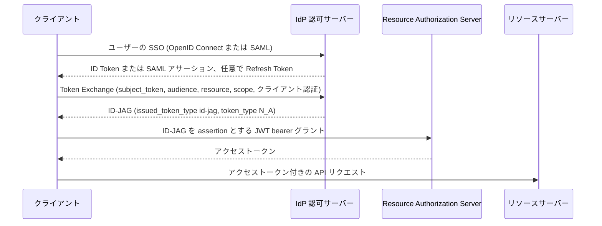

# ディープダイブ: Identity Assertion JWT Authorization Grant (ID-JAG), draft-ietf-oauth-identity-assertion-authz-grant-06

> 一言で言うと: クライアントは OAuth Token Exchange を使って、SSO で同じ IdP をすでに信頼している Resource Authorization Server 向けに IdP が署名した短命なグラント (ID-JAG) を取得し、それを JWT Bearer グラントで引き換えてアクセストークンを得る。ユーザーを同意のためのリダイレクトに通す必要はない。

## 概要

あるアプリケーションが別のアプリケーションにあるユーザーのデータを必要とするとき、通常は対話的な OAuth フローを開始するが、両アプリケーションが SSO に使っている IdP はそのフローを一切見ることがない (Section 1)。本ドラフトは Cross-App Access (XAA) を定義し、その代わりに共有の IdP がアクセスを仲介する。クライアントは自身の Identity Assertion (OpenID Connect の ID Token または SAML 2.0 アサーション)、あるいは任意で IdP の Refresh Token を、Token Exchange (RFC 8693) を使って IdP のトークンエンドポイントに提示する。IdP は Identity Assertion JWT Authorization Grant (ID-JAG) を返す。これは `typ` が `oauth-id-jag+jwt` で、audience が Resource Authorization Server である JWT である (Section 3)。クライアントはこれを Resource Authorization Server で RFC 7523 の JWT bearer グラントとして引き換える。アクセストークンの発行者は引き続き Resource Authorization Server であり、何を許可するかについては自身のローカルポリシーを適用する (Section 1)。本ドラフトは Identity Chaining ドラフトのプロファイルであり、OAuth ワーキンググループの Standards Track の WG 文書である (datatracker 上の状態: Active, I-D Exists, WG Document)。

## 仕組み

1. ユーザーは OpenID Connect または SAML を使って IdP でクライアントにサインインし、クライアントは Identity Assertion と、任意で Refresh Token を取得する (Section 4.2)。
2. クライアントは IdP に Token Exchange リクエストを送る。リクエストには `requested_token_type=urn:ietf:params:oauth:token-type:id-jag`、ちょうど 1 つの `audience` (Resource Authorization Server)、推奨される `resource`、任意の `scope` または `authorization_details`、そして subject token を含める (Section 4.3)。
3. IdP はクライアントを認証し、subject token を検証し、ポリシーを確認しなければならない (MUST)。そのうえで署名済みの ID-JAG をレスポンスの `access_token` フィールドに入れて返す (Section 4.3.3、4.3.4)。
4. クライアントは ID-JAG を Resource Authorization Server のトークンエンドポイントに `urn:ietf:params:oauth:grant-type:jwt-bearer` (DPoP に束縛された ID-JAG の場合は `jwt-dpop`) として送信する。通常は登録済みのクレデンシャルで認証するが、送信者制約付きの ID-JAG はクライアント認証なしで引き換えてもよい (Section 4.4)。
5. Resource Authorization Server は `typ`、`iss`、署名、`aud`、`client_id`、テナント、`cnf`、およびリソース、スコープ、認可詳細を検証し、そのうえでアクセストークンを発行する (Section 4.4.1)。
6. クライアントはアクセストークンを使ってリソースサーバーを呼び出す。リソースサーバーが信頼するのは Resource Authorization Server だけであり、IdP は信頼しない (Section 2.1)。

## ユースケース

- エンタープライズの SaaS 間連携: ある SaaS アプリケーションが、対話的な同意フローなしにユーザーのためにサードパーティ SaaS の API へのアクセストークンを取得する。どのクライアントがどのアプリケーションに到達できるかはエンタープライズの IdP が決める (Appendix A.1)。
- カスタマーアイデンティティ (CIAM): ファーストパーティの顧客向けアプリケーションが、サインイン中の顧客のためにサードパーティ開発者の SaaS コンポーネントを呼び出す。CIAM プラットフォームが IdP の役割を担う (Appendix A.2)。
- メールおよびカレンダーのクライアント: IdP にも Resource Authorization Server にも事前登録された OAuth クライアントを持たないクライアントが、Client ID Metadata Document で自身を識別し、たとえば private_key_jwt を使って秘密鍵で認証する (Appendix A.3)。
- 外部ツールを呼び出す AI エージェント: エージェントは Protected Resource Metadata を通じてツールの認可サーバーを発見し、`id-jag` グラントプロファイルの有無を確認し、まずサイレントな ID-JAG の経路を試し、利用できない場合は対話的な認可コードフローにフォールバックする (Appendix A.4)。
- SAML ベースの SSO 環境: SSO に SAML を使うクライアントは、アサーションを IdP の Refresh Token に交換し、そのトークンを subject token として使って ID-JAG を取得する (Section 4.5)。

## 今これが重要な理由

- **きっかけ**: トリアージ後の OAuth WG のディープダイブ候補の筆頭であり、そのメモ (`tracks/oauth-wg/data/normalized/candidates.json` 内) は広範な規範的変更を挙げている。本文を比較すると、それらの変更の大半 (IdP でのクライアント認証、単一の audience、mTLS による束縛、新しいメタデータ) は -05 で入ったものである。-06 で変わったのは、subject token の検証失敗時の IdP のエラーコードである。
- **根拠となる資料**: OAuth メーリングリストでのアナウンスによると、差分は大きく見えるが、多くの新しい実装からのフィードバックに基づいて文言を厳密にしたものがほとんどであり、フローと全体の設計は変わっていない。アナウンスが挙げているのは、IdP がクライアントを認証すること、単一の audience、subject token の検証失敗で `invalid_grant` に代えて `invalid_request` を使うこと、Resource Authorization Server でのクライアント認証に代わる鍵束縛された ID-JAG、2 つ目の束縛方式としての mTLS、`id_jag_signing_alg_values_supported`、そして新設の Privacy Considerations セクションである。
- **想定される影響**: Token Exchange の IdP 側の実装者は、エラー処理とクライアント認証を見直す必要がある。Resource Authorization Server の実装者は、クライアント認証の代替手段、`cnf` の扱い、テナントの確認、リソース管轄の確認を見直す必要がある。本ドラフトの有効期限は 2027 年 5 月 4 日であり (Status of This Memo)、著者は残る未解決の論点を IETF 127 で議論するとしている。

## 変更点

- 仕様/文書の変更の概要: -05 から -06 への差分 (<https://author-tools.ietf.org/iddiff?url1=draft-ietf-oauth-identity-assertion-authz-grant-05&url2=draft-ietf-oauth-identity-assertion-authz-grant-06>) には実質的な編集が 2 つある。検証に失敗した subject token に対する IdP のエラーが、"as required by Section 2.2.2 of RFC 8693" として `invalid_grant` から `invalid_request` に変わり、クライアントは新しい subject token を取得して再試行できると明記された (Section 4.3.4.3)。また、クライアントまたはエンドユーザーが対象に対して認可されていない場合に `invalid_target` ではなく `access_denied` を使う理由が説明された。クライアントが、禁止された対象と認識されない対象を区別できるようにするためである。差分の残りは日付、バージョン文字列、Document History の行である。
- -06 の Document History には -05 の項目として多数の事項が並んでいる。-04 と -05 の本文を比べると、`invalid_client` を伴う IdP でのクライアント認証の規則と単一 audience の規則 (Section 4.3.3)、mTLS による束縛 (Section 9.11.2)、`id_jag_signing_alg_values_supported` (Section 7.1)、Privacy Considerations (Section 10) は -04 になく -05 にある。-06 は欠けていた履歴の行を追加しただけである。-05 は 2026 年 10 月 30 日に、-06 は 2026 年 10 月 31 日に 80 ページで公開された (Datatracker の履歴。出典にリンクあり)。spec-notes.md では各変更をどの版で入ったかに振り分けている。
- Section 4.3.3 は、クライアント認証のないリクエストを IdP が `invalid_client` で拒否することを求めている。Section 4.4 は、クライアント認証も送信者制約付き ID-JAG もないリクエストを Resource Authorization Server が `invalid_client` で拒否することを求めている。
- Section 3 は、IdP と Resource Authorization Server の両方について RS256 を実装必須とし、Resource Authorization Server は ES256 もサポートすべきである (SHOULD) としている。Section 7.1 は、`id_jag_signing_alg_values_supported` が存在する場合は RS256 を含まなければならない (MUST) としている。
- 互換性や移行上の懸念: 不正な subject token に対して `invalid_grant` を返す IdP はもはや -06 に適合せず、Token Exchange の段階で `invalid_grant` をもとに再試行ロジックを組んでいるクライアントは `invalid_request` を扱う必要があるかもしれない。Resource Authorization Server では ID-JAG の検証失敗のコードは依然として `invalid_grant` であるため (Section 4.4.3)、同じクライアントが 2 つのエンドポイントを区別しなければならない。アナウンスは Token Exchange の段階の実装者にエラー処理の確認を求めている。IdP でクライアントが未認証であることに依存している環境や、複数の `audience` を送る環境も、もはや適合しない。

## 技術分析

- 脅威モデルへの影響:
  - subject token は価値が高い (Section 9.2): 1 つの subject token を多数の Resource Authorization Server 向けの ID-JAG に交換できるため、ドラフトは、クライアント認証だけに頼らないこと、クライアントの鍵を別の保護ドメインに置くこと、送信者制約と Refresh Token のローテーションを検討することを求めている。
  - メタデータとディスカバリーへの攻撃 (Section 9.5、9.6): RFC 8414 の issuer の確認や RFC 9728 の resource の確認を省いたクライアントは、攻撃者の認可サーバーに誘導されうる。その認可サーバーは ID-JAG とクライアントのクレデンシャルを中継する。ドラフトは issuer の確認を主たる防御と位置づけ、さらに 3 つの緩和策を挙げている。ID-JAG 内の `resource` の値、IdP による管轄の確認、送信者制約である。
  - トークンの取り違え (Section 4.3.3): IdP は subject token が表明された種別のものであり、その目的のために発行されたことを確認し、Identity Assertion として提示されたアクセストークン、ID-JAG、クライアントアサーションを拒否し、別のトークン種別を示す `typ` を拒否しなければならない。ID Token には明示的な `typ` がないため、ドラフトは環境ごとの方法で ID Token を識別することを認めている。
  - audience の束縛: Resource Authorization Server は `aud` が自身の issuer (文字列または要素 1 つの配列) であることを確認し、`client_id` を認証済みのクライアントと照合しなければならない (Section 4.4.1)。
  - アイデンティティの信頼 (Section 9.8): `sub_id.issuer` によって ID-JAG の発行者への信頼を確立してはならず、`email` や `aud_sub` でユーザーを解決する Resource Authorization Server は、発行者側テナントの管理者に依存していることになる。
  - 情報の開示 (Section 9.9、10): ID-JAG はクライアントから見えるため、ペアワイズの `sub`、`sub_id`、`aud_sub` はクライアントに開示され、Resource Authorization Server をまたいで紐付けられうる。エラーの説明は、たとえばライセンスの状況を明かすべきではない (SHOULD NOT)。
- プロトコルフローへの影響:
  - Token Exchange レスポンスの特殊な点: グラントは `access_token` に入り、`token_type` は `N_A` である (Section 4.3.4)。
  - リソースの扱い: クレーム内の `resource` は単一の文字列、または重複のない文字列からなる空でない配列であり、Simple String Comparison で比較される (Section 3.1、4.3)。IdP はその一部だけを許可してもよいが、許可した各識別子は送られたとおりに正確にコピーしなければならない。
  - Resource Authorization Server での Refresh Token: Resource Authorization Server は Refresh Token を返すべきではなく (SHOULD NOT)、サーバーが `exp` を制限するか `jti` を追跡しない限り、クライアントは ID-JAG を有効期限まで再提出してよい (Section 4.4.4)。
  - 送信者制約 (Section 9.11): DPoP は `cnf` に `jkt` を入れ、`jwt-dpop` グラントタイプを必要とする。mTLS は `cnf` に `x5t#S256` を入れる。IdP は両方に束縛すべきではない (SHOULD NOT)。レスポンスには束縛が行われたかどうかが示されないため、クライアントは ID-JAG に期待した `cnf` があるかを確認すべきである (SHOULD)。これによりサイレントなダウングレードを防ぐ。
  - クライアント認証の代替手段: Resource Authorization Server はクライアント認証を要求すべきである (SHOULD) が、未認証のクライアントからの送信者制約付き ID-JAG を受け入れてもよく、その場合は `cnf` の証明が `client_id` の確認の代わりとなる (Section 4.4、4.4.1、9.1)。
  - テナンシー (クレームは Section 3、規則は Section 6.1、6.2、6.4、拒否は Section 4.4.1): 2 つの別々のクレームがある。OpenID Enterprise が定義する `tenant` は発行者側のテナントを示す。マルチテナントの発行者はこれを含めなければならず、Resource Authorization Server は `iss` と `tenant` の組を信頼しなければならない。本ドラフトが登録する `aud_tenant` は Resource Authorization Server 側のテナントを示し、`aud` + `aud_tenant` + `aud_sub` はそこで一意でなければならない。受信側のテナントを一意に決定できない場合、Resource Authorization Server は ID-JAG を `invalid_grant` で拒否しなければならない。
- 相互運用上の懸念:
  - Client ID の対応付け (Section 5.1): IdP は Resource Authorization Server におけるクライアントの識別子を帯域外の記録によって把握していなければならない。あるいはクライアントが共通の名前空間として Client ID Metadata Document を使うこともできる。
  - Subject 識別子の対応付け (Section 5.2): `sub` は Resource Authorization Server 向けに選ばれるため、クライアント自身の ID Token 内の `sub` とは異なりうる。あるエンドユーザーとある Resource Authorization Server の組については、どのクライアントが要求しても同じ `sub` を使わなければならない。
  - SAML NameID (Section 3.2): フォーマットが `saml-nameid` の `sub_id` は、transient な NameID を禁止し、Resource Authorization Server が使うすべてのメンバー (`sp_name_qualifier` を含む) の比較を求め、`<Subject>` の外にある属性でユーザーを解決する環境はカバーしない。
  - 鍵の発見: IdP は RFC 8414 に従って配置したメタデータの `jwks_uri` で署名鍵を公開すべきであり (SHOULD)、Resource Authorization Server には OpenID Discovery へのフォールバックが認められている (Section 7.1)。
  - 他のドラフトへの依存: Identity Chaining ドラフト (引用されているのは version 17) と DPoP グラントのドラフト (引用されているのは version 02) は Work in Progress であるため、それらの変更が本プロファイルに影響しうる。

## 未解決の論点

- Section 9.3 には、認証のステップアップ時に往復を 1 回減らすために認可リクエストで ID-JAG を要求することについて、まだ "TBD" が残っている。`insufficient_user_authentication` が subject token に関する新しい `invalid_request` の規則とどう関わるかについて、ドラフトは何も述べていない。
- Section 4.3.3 と Section 9.10 は `actor_token` と `act` クレームに規範的な処理を定めておらず、将来の拡張で定義されうると述べるだけである。受け取った `act` クレームを Resource Authorization Server がどう扱うべきかをドラフトは述べていない。
- アナウンスは IETF 127 に向けた「残る未解決の論点」を列挙していない。ワーキンググループのリポジトリにある未解決の issue は、リソースの扱い ([#141](https://github.com/oauth-wg/oauth-identity-assertion-authz-grant/issues/141), [#142](https://github.com/oauth-wg/oauth-identity-assertion-authz-grant/issues/142))、アクセストークンの有効期間 ([#145](https://github.com/oauth-wg/oauth-identity-assertion-authz-grant/issues/145))、マルチテナンシー ([#109](https://github.com/oauth-wg/oauth-identity-assertion-authz-grant/issues/109), [#129](https://github.com/oauth-wg/oauth-identity-assertion-authz-grant/issues/129))、DPoP の nonce ([#106](https://github.com/oauth-wg/oauth-identity-assertion-authz-grant/issues/106))、そしてゲートウェイ構成と Section 4.3.3 の audience 確認との衝突 ([#114](https://github.com/oauth-wg/oauth-identity-assertion-authz-grant/issues/114)) を扱っている。
- Section 4.3.4.3 は、期限切れまたは失効した Refresh Token の subject token に対して `invalid_request` を返すとしている。これは、`subject_token` が無効な場合には常に `invalid_request` を要求する RFC 8693 Section 2.2.2 と一致する。RFC 6749 Section 5.2 は無効な Refresh Token に `invalid_grant` を使うが、それは refresh グラントの場合に限られる。ここでは Refresh Token は Token Exchange の `subject_token` として届くため、RFC 8693 が適用される。直接トークンのリフレッシュも行うクライアントは、そちらでは `invalid_grant`、Token Exchange では `invalid_request` を想定しなければならない。
- Section 4.3.3 は IdP によるリソース管轄の確認を SHOULD としているが、Section 9.5 はその確認を防御の 1 つとして前提にしている。また Section 4.3.3 は、Resource Authorization Server がどのリソースを管轄しているかを IdP がどう知るかは範囲外としている。
- Section 4.4.4 は新しいアクセストークンのために ID-JAG を再利用することを認めているが、1 回限りの使用は `jti` による Resource Authorization Server のポリシーに委ねている。ドラフトは共通の規則を定めていないため、サーバーごとに挙動が異なりうる。
- Section 7.2 は Resource Authorization Server が `authorization_grant_profiles_supported` を広告することを認めているが、Section 9.7 は発行者の許可リストを開示することを禁じている。そのため、任意の保護されたディスカバリーの仕組みを除けば、ある発行者が受け入れられるかどうかをクライアントが事前に知る標準的な方法はない。
- Section 4.3.4.3 は IdP のプロファイル済みコードとして `invalid_request`、`access_denied`、`invalid_target` を挙げているが、Section 4.3.3 は `invalid_client` も要求している。Section 4.4.3 は "the following two codes" をプロファイルするとしているが、Section 4.4、4.4.1 は `invalid_client` も使っている。完全なエラー表が求められているのかどうかは不明である。

## 実験

- [ ] Lab 1: ID-JAG の Token Exchange を受け付けるテスト用の IdP トークンエンドポイントを立て、不正なリクエストを 5 つ送り、そのレスポンスを -06 の規定および既存ライブラリの返す値と比較する。クライアント認証なし (`invalid_client`, Section 4.3.3)、2 つの `audience` 値 (`invalid_request`, Section 4.3.3)、`subject_token` としてのアクセストークン (Section 4.3.3 は受け入れを禁じているがコードを指定していない。subject token の検証失敗を `invalid_request` でプロファイルしている Section 4.3.4.3 から `invalid_request` と推定する)、期限切れの ID Token (`invalid_request`, Section 4.3.4.3)、`aud` が別のクライアントである ID Token (audience 不一致による `invalid_request`, Section 4.3.4.3) の 5 つである。
- [ ] Lab 2: 有効な ID-JAG を 1 つ用意し、Section 4.4.1 が `invalid_grant` で失敗しなければならないとする改変 (Section 4.4.3) を加えて Resource Authorization Server に提示する。誤った `typ`、このサーバーを示さない `aud`、認証済みクライアントと一致しない `client_id`、サーバーが管轄しない `resource`、マルチテナントの発行者からの `tenant` の欠落、検証に通らない `cnf` の束縛である。次に、サーバーが権利を与えていないエンドユーザー向けの未改変の ID-JAG と、すべてのリソースがローカルポリシーで拒否される ID-JAG を提示する。どちらも `access_denied` を返すはずである (Section 4.4.1、4.4.3)。2 つのコードを取り違えるサーバーがあれば記録する。
- [ ] Lab 3: DPoP に束縛された ID-JAG と mTLS に束縛された ID-JAG を要求し、それぞれを Resource Authorization Server で引き換える。対応する鍵または証明書があれば成功し、DPoP の場合は `jwt-dpop` グラントタイプを使う (Section 4.4、9.11.1.2.1)。異なる鍵または証明書では `invalid_grant` で失敗する (Section 9.11.1.2.1、9.11.2.2)。DPoP 証明もクライアント証明書もない場合も `invalid_grant` で失敗する (Section 9.11.1.2.2、9.11.2.2)。最後に、束縛されていない ID-JAG をクライアント認証なしで引き換える。これは `invalid_client` となるが、送信者制約付きの ID-JAG であればクライアント認証なしでも受け入れられうる (Section 4.4)。

## 出典

- <https://datatracker.ietf.org/doc/draft-ietf-oauth-identity-assertion-authz-grant/06/>
- <https://mailarchive.ietf.org/arch/msg/oauth/-3eHjZkoYNz0qDpviERKkheVDbI/>
- <https://mailarchive.ietf.org/arch/msg/oauth/h4Zk-3zySe6CD3fuxoaHst4scH8/>
- <https://mailarchive.ietf.org/arch/msg/oauth/0cWcjyFw5Dg4iOH5Zf02P5sVTrg/>
- <https://github.com/oauth-wg/oauth-identity-assertion-authz-grant>
- <https://github.com/oauth-wg/oauth-identity-assertion-authz-grant/issues>
- <https://datatracker.ietf.org/doc/draft-ietf-oauth-identity-assertion-authz-grant/history/>
- <https://www.ietf.org/archive/id/draft-ietf-oauth-identity-assertion-authz-grant-04.txt>
- <https://www.ietf.org/archive/id/draft-ietf-oauth-identity-assertion-authz-grant-05.txt>
- <https://author-tools.ietf.org/iddiff?url1=draft-ietf-oauth-identity-assertion-authz-grant-05&url2=draft-ietf-oauth-identity-assertion-authz-grant-06>
- <https://www.rfc-editor.org/rfc/rfc8693#section-2.2.2>
- <https://www.rfc-editor.org/rfc/rfc6749#section-5.2>
