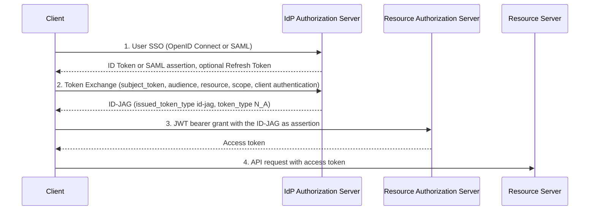

# Deep Dive: Identity Assertion JWT Authorization Grant (ID-JAG), draft-ietf-oauth-identity-assertion-authz-grant-06

> In one line: a client uses OAuth Token Exchange to get a short-lived, IdP-signed grant (the ID-JAG) for a Resource Authorization Server that already trusts the same IdP for SSO, then redeems it with the JWT Bearer grant for an access token without sending the user through a consent redirect.

## What this is

When one application needs a user's data at another application, it normally starts an interactive OAuth flow that the IdP both apps use for SSO never sees (Section 1). This draft defines Cross-App Access (XAA), where the shared IdP brokers that access instead. The client presents its Identity Assertion (an OpenID Connect ID Token or SAML 2.0 assertion) or, optionally, an IdP Refresh Token to the IdP's token endpoint using Token Exchange (RFC 8693). The IdP returns an Identity Assertion JWT Authorization Grant (ID-JAG): a JWT with `typ` `oauth-id-jag+jwt` whose audience is the Resource Authorization Server (Section 3). The client redeems it at the Resource Authorization Server as an RFC 7523 JWT bearer grant. The Resource Authorization Server stays the issuer of access tokens and applies its own local policy to what it grants (Section 1). The draft is a profile of the Identity Chaining draft and is a Standards Track WG document in the OAuth working group (datatracker states: Active, I-D Exists, WG Document).

## How it works

1. The user signs in to the Client at the IdP using OpenID Connect or SAML; the Client gets an Identity Assertion and optionally a Refresh Token (Section 4.2).
2. The Client sends a Token Exchange request to the IdP with `requested_token_type=urn:ietf:params:oauth:token-type:id-jag`, exactly one `audience` (the Resource Authorization Server), a recommended `resource`, optional `scope` or `authorization_details`, and the subject token (Section 4.3).
3. The IdP MUST authenticate the Client, validate the subject token, check policy, and return a signed ID-JAG in the `access_token` field of the response (Sections 4.3.3 and 4.3.4).
4. The Client posts the ID-JAG to the Resource Authorization Server's token endpoint as `urn:ietf:params:oauth:grant-type:jwt-bearer` (or `jwt-dpop` for a DPoP-bound ID-JAG), authenticating with its registered credentials (Section 4.4).
5. The Resource Authorization Server validates `typ`, `iss`, signature, `aud`, `client_id`, tenant, `cnf`, and the resource, scope and authorization details, and then issues an access token (Section 4.4.1).
6. The Client calls the Resource Server with the access token. The Resource Server trusts only the Resource Authorization Server, not the IdP (Section 2.1).

## Use cases

- Enterprise SaaS-to-SaaS integration: a SaaS app obtains an access token to a third-party SaaS API for a user without an interactive consent flow, with the enterprise IdP deciding which client may reach which application (Appendix A.1).
- Customer identity (CIAM): a first-party customer application invokes third-party developer SaaS components for the signed-in customer, with the CIAM platform acting as the IdP (Appendix A.2).
- Email and calendaring clients: a client with no pre-registered OAuth client at the IdP or the Resource Authorization Server identifies itself with a Client ID Metadata Document and authenticates with a private key, for example using private_key_jwt (Appendix A.3).
- AI agent calling external tools: the agent discovers the tool's authorization server through Protected Resource Metadata, checks for the `id-jag` grant profile, tries the silent ID-JAG path first, and otherwise falls back to an interactive authorization code flow (Appendix A.4).
- SAML-based SSO deployments: a client that uses SAML for SSO swaps its assertion for an IdP Refresh Token, then uses that token as the subject token to get ID-JAGs (Section 4.5).

## Why This Matters Now

- **Trigger**: revision -06 adds new normative behaviour (client authentication at the IdP, `invalid_request`, mTLS binding, new metadata) and a large rewrite, per `subject.json`.
- **Source evidence**: the announcement on the OAuth list says the diff looks big but mostly tightens wording based on feedback from many new implementations, and that the flow and overall design have not changed. It calls out the IdP authenticating the Client, a single audience, `invalid_request` replacing `invalid_grant` for failed subject tokens, key-bound ID-JAGs replacing client authentication at the Resource Authorization Server, mTLS as a second binding option, `id_jag_signing_alg_values_supported`, and a new Privacy Considerations section.
- **Expected impact**: implementers of the IdP side of Token Exchange need to re-check error handling and client authentication. Resource Authorization Server implementers need to re-check the client-authentication alternative, the `cnf` handling, tenant checks and resource governance checks. The draft expires on 4 May 2027 (Status of This Memo), and the author says remaining open issues are to be discussed at IETF 127.

## What Changed

- Spec/document change summary: the staged `diff.txt` (-05 to -06, marked truncated) shows two substantive edits. The IdP error for a subject token that fails validation changes from `invalid_grant` to `invalid_request`, "as required by Section 2.2.2 of RFC 8693", and the Client is told it can get a new subject token and retry (Section 4.3.4.3). The draft also explains why `access_denied` is used instead of `invalid_target` when the Client or End-User is not authorized for the target: so that the Client can tell a forbidden target from an unrecognized one. The rest of that diff is dates, version strings and Document History lines.
- The Document History in -06 lists a long set of items under -05 (client authentication at the IdP, single audience and `invalid_target`, resource comparison and governance, mTLS binding, subject token storage guidance, key discovery and `id_jag_signing_alg_values_supported`, key-bound ID-JAG in place of client authentication at the Resource Authorization Server, tenant context check, Privacy Considerations, the Client ID Metadata Document use case). The -05 to -06 diff adds some of those history lines (client authentication at the IdP, key-bound ID-JAG replacing client authentication, tenant check, Privacy Considerations, the Client ID Metadata Document use case, metadata located per RFC 8414), which suggests the body text may already have carried them in -05 and only the history list was completed. The material does not settle this, so a reviewer should compare the -05 text. The author's announcement and the earlier insight note describe the combined -04 to -06 change.
- Section 4.3.3 requires the IdP to reject a request without client authentication with `invalid_client`. Section 4.4 requires the Resource Authorization Server to reject a request with neither client authentication nor a sender-constrained ID-JAG with `invalid_client`.
- Section 3 makes RS256 mandatory to implement for both the IdP and the Resource Authorization Server, and says Resource Authorization Servers SHOULD also support ES256. Section 7.1 says that if `id_jag_signing_alg_values_supported` is present it MUST include RS256.
- Compatibility or migration concerns: an IdP that returns `invalid_grant` for a bad subject token is no longer conformant with -06 and clients that key retry logic on `invalid_grant` at the Token Exchange step may need to handle `invalid_request`. At the Resource Authorization Server, `invalid_grant` is still the code for ID-JAG validation failures (Section 4.4.3), so the same client must distinguish the two endpoints. The announcement asks implementers of the Token Exchange step to check their error handling. Deployments that rely on a client being unauthenticated at the IdP, or that send more than one `audience`, are no longer conformant.

## Technical Analysis

- Threat model implications:
  - Subject tokens are high-value (Section 9.2): one subject token can be exchanged for ID-JAGs to many Resource Authorization Servers, so the draft says deployments should not rely on client authentication alone, should keep client keys in a separate protection domain, and should consider sender-constraining and rotating Refresh Tokens.
  - Metadata and discovery attacks (Sections 9.5 and 9.6): a client that skips the RFC 8414 issuer check, or the RFC 9728 resource check, can be steered to an attacker's authorization server, which then relays the ID-JAG and the client's credentials. The draft names the issuer check as the primary defence and lists three further mitigations: the `resource` value in the ID-JAG, the IdP governance check, and sender-constraining.
  - Token confusion (Section 4.3.3): the IdP must confirm the subject token is of the stated type and was issued for that purpose, reject access tokens, ID-JAGs and client assertions presented as Identity Assertions, and reject a `typ` that names another token type. Because ID Tokens have no explicit `typ`, the draft allows deployment-specific ways to identify them.
  - Audience binding: the Resource Authorization Server must check that `aud` is its own issuer (a string or a one-element array) and must check `client_id` against the authenticated client (Section 4.4.1).
  - Identity trust (Section 9.8): `sub_id.issuer` must never establish trust in the ID-JAG issuer, and a Resource Authorization Server that resolves users by `email` or `aud_sub` is relying on the issuer tenant's administrators.
  - Disclosure (Sections 9.9 and 10): the ID-JAG is visible to the Client, so a pairwise `sub`, `sub_id` or `aud_sub` is disclosed to it and can be linked across Resource Authorization Servers. Error descriptions SHOULD NOT reveal, for example, license status.
- Protocol flow implications:
  - Token Exchange response quirks: the grant is returned in `access_token` with `token_type` `N_A` (Section 4.3.4).
  - Resource handling: `resource` is a single string or a non-empty array of unique strings in the claim and is compared with Simple String Comparison (Sections 3.1 and 4.3). The IdP may grant a subset but must copy each granted identifier exactly as sent.
  - Refresh tokens at the Resource Authorization Server: the Resource Authorization Server SHOULD NOT return one, and clients may resubmit the ID-JAG until it expires unless the server limits `exp` or tracks `jti` (Section 4.4.4).
  - Sender constraining (Section 9.11): DPoP puts `jkt` in `cnf` and requires the `jwt-dpop` grant type; mTLS puts `x5t#S256` in `cnf`. An IdP SHOULD NOT bind to both. Clients SHOULD inspect the ID-JAG for the expected `cnf` because the response does not say whether binding happened, which guards against silent downgrade.
  - Client authentication alternatives: the Resource Authorization Server SHOULD require client authentication, but a sender-constrained ID-JAG from an unauthenticated client may be accepted, and then the `cnf` proof takes the place of the `client_id` check (Sections 4.4, 4.4.1 and 9.1).
  - Tenancy (Sections 6 and 4.4.1): a multi-tenant issuer must put `tenant` in the ID-JAG, and the Resource Authorization Server must reject the ID-JAG with `invalid_grant` if it cannot determine the recipient tenant unambiguously.
- Interop concerns:
  - Client ID mapping (Section 5.1): the IdP must know the client's identifier at the Resource Authorization Server by an out-of-band record, or clients can use Client ID Metadata Documents as a shared namespace.
  - Subject identifier mapping (Section 5.2): `sub` is chosen for the Resource Authorization Server, so it can differ from the `sub` in the Client's own ID Token. The same `sub` must be used for a given End-User and Resource Authorization Server regardless of which Client asks.
  - SAML NameID (Section 3.2): `sub_id` with format `saml-nameid` forbids transient NameIDs, requires comparing every member the Resource Authorization Server uses (including `sp_name_qualifier`), and does not cover deployments that resolve users by an attribute outside `<Subject>`.
  - Key discovery: the IdP SHOULD publish its signing key at `jwks_uri` in metadata located per RFC 8414, with an OpenID Discovery fallback allowed for the Resource Authorization Server (Section 7.1).
  - Dependencies on other drafts: the Identity Chaining draft (version 17 is cited) and the DPoP grant draft (version 02 is cited) are Work in Progress, so changes in them can affect this profile.

## Open Questions

- Section 9.3 still contains a "TBD" about requesting the ID-JAG in the authorization request when stepping up authentication, to save a round trip. The draft says nothing on how `insufficient_user_authentication` interacts with the new `invalid_request` rule for the subject token.
- Section 4.3.3 and Section 9.10 leave `actor_token` and the `act` claim without normative processing, and say only that future extensions may define them. The draft does not say how a Resource Authorization Server should treat an `act` claim it receives.
- The announcement mentions "remaining open issues" to be discussed at IETF 127 but the staged material does not list them.
- Section 4.3.4.3 says an expired or revoked Refresh Token subject token yields `invalid_request`. The draft cites RFC 8693 Section 2.2.2 for this but the staged material does not include that RFC, so how it fits with `invalid_grant` for refresh grants in RFC 6749 is not checked here.
- Section 4.3.3 makes the IdP resource-governance check a SHOULD while Section 9.5 relies on that check as one defence. Section 4.3.3 also says how the IdP learns which resources a Resource Authorization Server governs is out of scope.
- Section 4.4.4 allows reuse of an ID-JAG for new access tokens but leaves one-time use to Resource Authorization Server policy via `jti`. The draft does not give a shared rule, so behaviour may differ between servers.
- Section 7.2 lets a Resource Authorization Server advertise `authorization_grant_profiles_supported` but Section 9.7 forbids it from disclosing issuer allow lists, so a client has no standard way to learn in advance whether a given issuer will be accepted beyond the optional protected discovery mechanism.
- Section 4.3.4.3 lists `invalid_request`, `access_denied` and `invalid_target` as profiled IdP codes, while Section 4.3.3 also requires `invalid_client`. Section 4.4.3 says it profiles "the following two codes" yet Sections 4.4 and 4.4.1 also use `invalid_client`. Whether a complete error table is wanted is unclear.

## Experiments

- [ ] Lab 1: Stand up a test IdP token endpoint that accepts the ID-JAG Token Exchange and send it five bad requests, then compare the responses with what -06 specifies and with what existing libraries return: no client authentication (`invalid_client`, Section 4.3.3); two `audience` values (`invalid_request`, Section 4.3.3); an access token as `subject_token` (Section 4.3.3 forbids accepting it, and Section 4.3.4.3 profiles subject-token validation failures as `invalid_request`); an expired ID Token (`invalid_request`, Section 4.3.4.3); and an ID Token whose `aud` is a different client (`invalid_request` for an audience mismatch, Section 4.3.4.3).
- [ ] Lab 2: Take one valid ID-JAG and present it to a Resource Authorization Server with mutations that Section 4.4.1 says must fail with `invalid_grant` (Section 4.4.3): wrong `typ`, `aud` that does not identify this server, a `client_id` that does not match the authenticated client, a `resource` the server does not govern, a missing `tenant` from a multi-tenant issuer, and a `cnf` binding that does not verify. Then present an unmodified ID-JAG for an End-User the server does not entitle, and one whose resources are all rejected by local policy; both should return `access_denied` (Sections 4.4.1 and 4.4.3). Record any server that mixes up the two codes.
- [ ] Lab 3: Request a DPoP-bound ID-JAG and an mTLS-bound ID-JAG, then redeem each with a matching key, a different key, and no proof, with and without client authentication. Confirm the `jwt-dpop` grant type is used for DPoP, that a client can detect a missing `cnf`, and that mismatches fail with `invalid_grant`.

## Sources

- <https://datatracker.ietf.org/doc/draft-ietf-oauth-identity-assertion-authz-grant/06/>
- <https://mailarchive.ietf.org/arch/msg/oauth/-3eHjZkoYNz0qDpviERKkheVDbI/>
- <https://mailarchive.ietf.org/arch/msg/oauth/h4Zk-3zySe6CD3fuxoaHst4scH8/>
- <https://mailarchive.ietf.org/arch/msg/oauth/0cWcjyFw5Dg4iOH5Zf02P5sVTrg/>
- <https://github.com/oauth-wg/oauth-identity-assertion-authz-grant>
