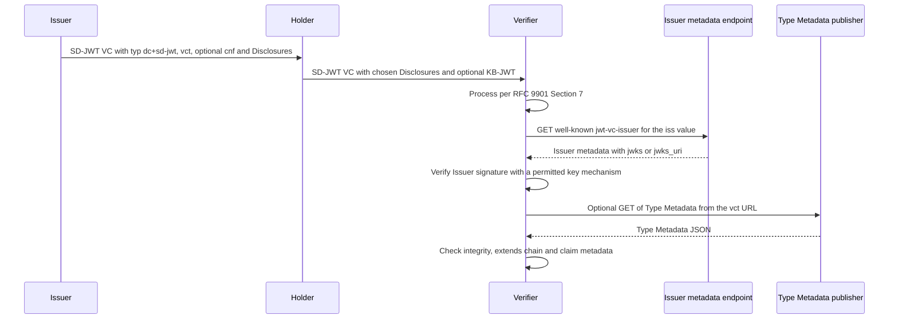

# Deep Dive: draft-ietf-oauth-sd-jwt-vc

> 一言で言うと: SD-JWT VC は SD-JWT (RFC 9901) を資格情報フォーマットとして具体化し、型識別子 (`vct`)、発行者鍵を見つける二つの方法、および表示と claim の規則を持つ任意の Type Metadata を加える。

## 概要

SD-JWT (RFC 9901) は JWT に選択的開示を与えるが、資格情報がどの claim を持ち何を意味するかは定めない (Section 1.2)。このドラフトは、SD-JWT VC と呼ぶ Verifiable Digital Credential についてその空白を埋める。`application/dc+sd-jwt` メディアタイプと `typ` ヘッダー値 `dc+sd-jwt` (Section 2.1、2.2.1)、および新しい claim である `vct` (資格情報の型) と `aka_vcts` (追加の型) を定義する (Section 2.2.2.1、2.2.2.2)。発行者鍵の探索方式として、well-known URI 上の JWT VC Issuer Metadata と、インラインの `x5c` 証明書の二つも定義する (Section 2.5、4)。さらに、`vct` から見つかる JSON 文書で、表示、レンダリング、claim の規則を持つ Type Metadata を定義する (Section 5)。これらの文書は信頼できない資格情報に含まれる URL から取得されるため、ドラフトの大きな部分は HTTP 取得と SSRF (server-side request forgery) の規則である (Section 3、7.1)。

## 仕組み

1. Issuer は、ヘッダーの `typ` を `dc+sd-jwt` とし、ペイロードに `vct` claim を持つ SD-JWT に署名する。`iss`、`exp`、`cnf`、`vct` など、ドラフトが隠すことを禁じるもの以外の claim は選択的に開示できる (Section 2.2.1、2.2.2.3)。
2. Holder は、選んだ Disclosure だけを付けて SD-JWT を提示する。Key Binding が必要な場合は KB-JWT (Key Binding JWT) も付け、KB-JWT は `cnf` claim に対して検証される (Section 2.3.2、2.4)。
3. 受信者は RFC 9901 Section 7 のとおりに SD-JWT を処理する。RFC 9901 Section 7.1 の 2.c の Issuer 検査は、その Issuer に対してポリシーが許可する鍵探索方式によって満たされる (Section 2.4)。
4. `iss` が HTTPS URL の場合、受信者はホストとパスの間に `/.well-known/jwt-vc-issuer` を挿入した URI からメタデータを取得し、`jwks` または `jwks_uri` から鍵を得られる。返された `issuer` は `iss` と同一でなければならない (Section 4、4.1、4.3)。
5. あるいは、保護ヘッダーに `x5c` がある場合は終端証明書の鍵を用い、証明書チェーンをその Issuer に許可された信頼アンカーに対して検証する (Section 2.5)。
6. その後、Holder または Verifier は Type Metadata を処理してもよい (MAY)。処理する場合は `extends` をたどり、`#integrity` 値を検証し、ペイロードを claim metadata (`path`、`mandatory`、`sd`) に対して検証し、失敗すれば資格情報を拒否する (Section 5.3、5.4、5.6、5.7、6)。

## ユースケース

- 政府が本人確認用の資格情報を発行する。ウォレットは、EUDI Wallet (European Digital Identity Wallet) の Architecture and Reference Framework に基づく Appendix A.1 の例のように、年齢と国籍の claim だけを Verifier に提示する。
- サービスに組み込まれた Verifier が、Issuer を信頼するか判断する。Verifier はその Issuer に対するポリシーに従い、JWT VC Issuer Metadata と `x5c` のどちらを使うかを選ぶ (Section 2.5、7.3)。
- 標準化団体やコミュニティが資格情報の型を公開し、各国の型がそれを拡張する。Verifier は `vct`、`aka_vcts`、`extends` で型を照合し、それとは別に Issuer の認可を確認する (Section 2.2.2.2、5.4、7.7)。
- ウォレットが Type Metadata に基づいて資格情報を描画する。ロゴ、背景画像、または `{{svg_id}}` プレースホルダーを持つ SVG テンプレートを使い、値のエスケープと SVG のサンドボックス化が必要である (Section 5.5.1、7.10)。
- 運用者が `iss` と `vct` の URL を解決するサービスを運用し、SSRF を避けるためにリダイレクト、サイズ、時間、内部アドレスの規則を必要とする (Section 3、7.1)。

## 今なぜ重要か

- **きっかけ**: ART-ART の telechat レビューが Ready を返し、ドラフトは公開に向かっている (`subject.json`)。そこに挙がる Datatracker の状態には "IESG Evaluation" と "Submitted to IESG for Publication" が含まれる。
- **根拠となる資料**: メーリングリストには、Christian Amsüss による -23 のレビュー結果 Ready があり、以前に指摘された問題はすべて対処されたとしている。同時に、-23 に対する Mike Bishop の DISCUSS と Mahesh Jethanandani のコメント付き No Objection もある (`mail.txt`)。したがって、一つのディレクトレートのレビューが Ready でも IESG の審査が終わったわけではない。
- **想定される影響**: このドラフトはウォレットの資格情報に使われる Standards Track の形式であり、Type Metadata と取得規則は、資格情報のメタデータを取得するすべての実装に影響する。DISCUSS の結果として `Updates: RFC 7800` の関係が付くか Section 2.2.2.3 の文言が変わる場合、`sub` も `iss` も持たない鍵束縛資格情報の扱いの記述が変わる。どの結論になるかは資料に示されていない。

## 変更点

- 仕様・文書の変更の概要: -23 には、規範的な本文の変更は見当たらない (`diff.txt`)。有効期限を 2027 年 5 月 4 日、文書日付を 2026 年 10 月 31 日に更新している。Figure 7、8、10、26 と Appendix A.1 の例の署名を再生成している。Figure 8、26、27 の KB-JWT の `iat` と `sd_hash` も変わる。編集上の修正は、Section 5.5.1.1 の `text_color` の文言修正、Section 9.3 の "in by [RFC8615]" から "in [RFC8615]" への修正、OWASP の URL から余分な末尾スラッシュの削除である。謝辞に Su-hyeon Forten Lee が加わり、-23 の履歴は "some minor fixes" のみである。差分には、文書履歴の空行の追加と削除もあるが、その文面は変わらない。
- 未解決のバロット項目の背景として、文書履歴によれば、-22 は Ketan Talaulikar の IESG バロットコメントに対応して RFC 7800 の `sub`/`iss` からの逸脱を記述し、-21 は資格情報を拒否する claim metadata の失敗を限定し、-20 は `aka_vcts` の指針と `x5c`/`iss` の明確化を加え、-19 は HTTP 取得の一般的な節を加えた。
- 互換性・移行上の懸念: -23 にプロトコル上の懸念は見当たらない。-22 から写したテストベクターは、署名と `iat`/`sd_hash` が異なる。新しい例の署名が検証に成功するかは、ここでは確認していない。-19 の履歴によれば、`typ` として `vc+sd-jwt` を受け入れる移行期間の注記は削除されており、現行の本文は `dc+sd-jwt` のみを挙げている。

## 技術分析

- 脅威モデルへの含意: `iss`、`vct`、`jwks_uri`、`extends`、`uri` の値は信頼できない入力に由来する。そのため Consumer は、リダイレクト先を含むすべての URL を内部アドレスや大域的に到達可能でないアドレスに対して検証し、時間とサイズを制限しなければならない (Section 3、7.1)。型と Issuer の claim は Issuer 自身と同程度にしか信頼できず、`extends` も `aka_vcts` も型の発行権限を意味しない (Section 2.2.2.2、7.7)。Type Metadata は、その Publisher の信頼の範囲でのみ信頼される (Section 7.8)。表示テキストと SVG テンプレートは、インジェクションとアクティブコンテンツの攻撃面である (Section 5.5.1.2.2、7.6、7.10)。data URI も信頼できない入力である (Section 7.9)。Verifier は、ある `iss` に対して攻撃者が検証方式を選べないようにしなければならない (Section 7.3)。`extends` の循環は検出しなければならない (Section 7.4)。プライバシー上のリスクには、Holder 固有の `iss` による phone-home、`cnf` での遠隔鍵取得、選択的に開示できない `vct` と `aka_vcts`、メタデータ取得による追跡がある (Section 8.2、8.3、8.4)。
- プロトコルフローへの含意: 検証は RFC 9901 の処理に、ポリシーが許可する鍵方式を加えたものである (Section 2.4、2.5)。Type Metadata の処理は、ポリシーやエコシステム規則が求めない限り任意であり、求められた場合は取得または検証に失敗すれば拒否となる (Section 5.7)。整合性に基づくキャッシュは無期限にできるが、そうでなければ RFC 9111 の HTTP キャッシュが適用される (Section 3、5.3.4、6)。claim metadata は、開示されていない配列位置も含め、発行されたペイロードに対して評価され、Verifier は開示可能な claim の不在を必須 claim の欠落と見なしてはならない (Section 5.6)。
- 相互運用上の懸念: 一つの資格情報に HTTPS の `iss` と `x5c` の両方が現れることがあり、Section 2.5 は、方式がポリシーで許可されていること、および `iss` が証明書と一致する必要はないことしか述べない。Section 7.3 は、`iss` と鍵の関係を保つことを求める。拡張する型は `sd` と `mandatory` を厳しくできるが緩められず (Section 5.6.5.1)、`display` は統合されず置き換えられる (Section 5.5.2、5.6.5)。`#integrity` は W3C SRI の文字列構文を使うが、検証手順は独自で、CORS に依存しない (Section 6)。IANA の節には、まだ文書参照のプレースホルダーが残っている (Section 9)。

## 未解決の問題

- Section 2.2.2.3 は、`cnf` を持つ JWT に `sub` または `iss` を要求する RFC 7800 の規定を、このドラフトが「明示的に上書きする (explicitly overrides)」と述べているが、`Updates:` ヘッダーは示されていない。Mike Bishop の DISCUSS がこれを問うており、Mahesh Jethanandani が支持している。解決が `Updates` の関係になるのか文言の変更になるのかは示されていない。
- Section 7.1 は、プライベートアドレス範囲と Consumer 内部のホストを無条件に禁止している。バロットのコメントは、閉じた環境や企業環境のために、設定された許可リストを認めるべきかを問うている。ドラフトにはその記述がない。
- `x5c` と HTTPS の `iss` が両方ある場合、Section 2.5 と Section 7.3 は食い違う可能性があり、ドラフトは「ポリシーに従って許可された」以上にどの方式を適用するかを述べていない。また、バロットのコメントは、`x5c` の検証を RFC 7515 Section 4.1.6 経由で RFC 5280 に結び付けるよう求めている。これらの点は、ドラフトではなくメールに由来する。
- Section 4.2 と Section 5.3.1 はメタデータに `application/json` を用いる。バロットのコメントは、専用のメディアタイプを勧めている。Section 4.3 では、`issuer` の検査がリダイレクトを経ても適用されることを明記してもよい。
- Section 5.5.1.2.1 は SVG テンプレートの選択に MUST を使っており、コメントは、これを相互運用の要件ではないとしている。Section 5.5.1.2.2 には、SVG の構造に対する規範的な参照が必要である。Section 7.6 の MUST は、試験しにくいとコメントされている。
- 取り込んだメールではバロットのメッセージが途中で切れているため、ここで扱っていない Mahesh Jethanandani と Mike Bishop のコメントがほかにある可能性がある。

## 実験

- [ ] Lab 1: HTTPS の `iss` と `x5c` ヘッダーの両方を持つ SD-JWT VC を受け取る Verifier を作り、三つのポリシー (メタデータのみ、`x5c` のみ、両方許可) で動かす。使われる鍵と拒否される条件を記録し、Section 2.5 と Section 7.3 の挙動を確かめる。
- [ ] Lab 2: テスト用の `iss`、`jwks_uri`、`vct`、ロゴの URL を、ループバック、リンクローカル、プライベートアドレス、内部に解決される DNS 名、および内部または `http` の URL に終わるリダイレクトチェーンに向ける。Section 3 と Section 7.1 に従う Consumer がそれぞれを拒否することを確認する。
- [ ] Lab 3: `extends`、`extends#integrity`、claim metadata を持つ Type Metadata のチェーンを作り、子が `sd` や `mandatory` を緩めようとする場合と循環する場合を用意する。該当する Disclosure の有無で提示を行い、Section 5.6、5.6.5.1、7.4 が求める拒否と、不在は必須 claim の欠落の証拠にならないという規則を確認する。

## 出典

- <https://datatracker.ietf.org/doc/draft-ietf-oauth-sd-jwt-vc/23/>
- <https://mailarchive.ietf.org/arch/msg/oauth/rShUO7YVi2WyKSxydiyWt5eonUc/>
- <https://mailarchive.ietf.org/arch/msg/oauth/5yaIITzC7JvwuRt94lpF7u4P72E/>
- <https://mailarchive.ietf.org/arch/msg/oauth/d49b8f7_xsSOXCgDit-a1p9-yvg/>
- <https://mailarchive.ietf.org/arch/msg/oauth/DNuSXwlB4yGxuTGQigaG7tcZf7A/>
