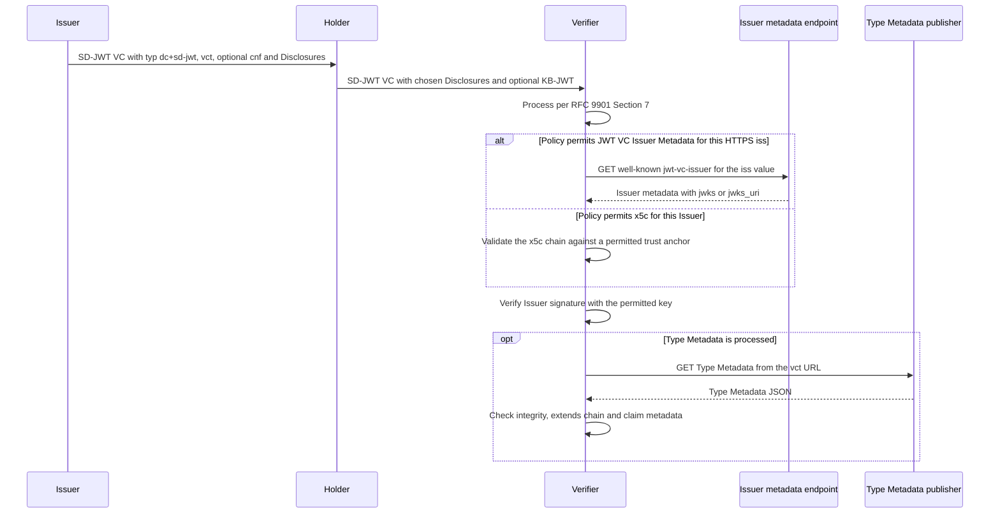

# Deep Dive: draft-ietf-oauth-sd-jwt-vc

> 一言で言うと: SD-JWT VC は SD-JWT (RFC 9901) を資格情報フォーマットとして具体化し、型識別子 (`vct`)、発行者鍵を見つける二つの方法、および表示と claim の規則を持つ任意の Type Metadata を加える。

## 概要

SD-JWT (RFC 9901) は JWT に選択的開示を与えるが、資格情報がどの claim を持ち何を意味するかは定めない (Section 1.2)。このドラフトは、SD-JWT VC と呼ぶ Verifiable Digital Credential についてその空白を埋める。`application/dc+sd-jwt` メディアタイプと `typ` ヘッダー値 `dc+sd-jwt` (Section 2.1、2.2.1)、および新しい claim である `vct` (資格情報の型) と `aka_vcts` (追加の型) を定義する (Section 2.2.2.1、2.2.2.2)。発行者鍵の探索方式として、well-known URI 上の JWT VC Issuer Metadata と、インラインの `x5c` 証明書の二つも定義する (Section 2.5、4)。さらに、`vct` から見つかる JSON 文書で、表示、レンダリング、claim の規則を持つ Type Metadata を定義する (Section 5)。これらの文書は信頼できない資格情報に含まれる URL から取得されるため、ドラフトの大きな部分は HTTP 取得と SSRF (server-side request forgery) の規則である (Section 3、7.1)。

## 仕組み

1. Issuer は、ヘッダーの `typ` を `dc+sd-jwt` とし、ペイロードに `vct` claim を持つ SD-JWT に署名する。Issuer は、ドラフトが隠すことを禁じる claim (`iss`、`nbf`、`exp`、`cnf`、`vct`、`vct#integrity`、`aka_vcts`、`status`) 以外なら、どの claim も選択的に開示できるようにしてよい (Section 2.2.1、2.2.2.3)。
2. Holder は、選んだ Disclosure だけを付けて SD-JWT を提示する。Key Binding が必要な場合は KB-JWT (Key Binding JWT) も付け、KB-JWT は `cnf` claim の鍵で検証される (Section 2.2.2.3、2.4。例は Section 2.3.2)。
3. 受信者は RFC 9901 Section 7 のとおりに SD-JWT を処理する。RFC 9901 Section 7.1 の 2.c の Issuer 検査は、その Issuer に対してポリシーが許可する鍵探索方式によって満たされる (Section 2.4)。
4. `iss` が HTTPS URL で、ポリシーがこの方式を許可している場合、受信者はホストとパスの間に `/.well-known/jwt-vc-issuer` を挿入した URI からメタデータを取得し、`jwks` または `jwks_uri` から鍵を得られる。返された `issuer` は `iss` と同一でなければならない (Section 4、4.1、4.3)。
5. あるいは、保護ヘッダーに `x5c` があり、ポリシーがそれを許可している場合は、エンドエンティティ証明書の鍵を用い、証明書チェーンを RFC 7515 Section 4.1.6 と RFC 5280 に従って、その Issuer に許可された信頼アンカーに対して検証する。このとき Issuer は証明書のサブジェクトであり、`iss` はこの方式では認証されない (Section 2.5)。
6. その後、Holder または Verifier は Type Metadata を処理してもよい (MAY)。処理する場合は `extends` をたどり、`#integrity` 値を検証し、ペイロードを claim metadata (`path`、`mandatory`、`sd`) に対して検証する (Section 5.3、5.4、5.6、5.7)。claim metadata の検証に失敗した場合と `extends` が循環する場合は資格情報を拒否する (Section 5.7、7.4)。`#integrity` 値が一致しない文書は拒否する (Section 6)。Type Metadata の取得や処理に失敗したときに資格情報まで拒否するのは、ポリシーやエコシステムの規則が Type Metadata を必要とする場合だけである (Section 5.7)。

## ユースケース

- 政府が本人確認用の資格情報を発行する。ウォレットは、Appendix A.1 の例のように、国籍と 18 歳以上であることだけを Verifier に提示する。この例は EUDI Wallet (European Digital Identity Wallet) の Architecture and Reference Framework にある PID (Person Identification Data) の考え方を借りているが、それに完全に準拠することは意図していない。
- サービスに組み込まれた Verifier が、Issuer を信頼するか判断する。Verifier はその Issuer に対するポリシーに従い、JWT VC Issuer Metadata と `x5c` のどちらを使うかを選ぶ (Section 2.5、7.3)。
- 標準化団体やコミュニティが資格情報の型を公開し、各国の型がそれを拡張する。Verifier は `vct`、`aka_vcts`、`extends` で型を照合し、それとは別に Issuer の認可を確認する (Section 2.2.2.2、5.4、7.7)。
- ウォレットが Type Metadata に基づいて資格情報を描画する。ロゴ、背景画像、または `{{svg_id}}` プレースホルダーを持つ SVG テンプレートを使い、値をエスケープし、SVG 内のコードを実行してはならず、コードの実行を確実に防げない場合は SVG の表示をサンドボックス化しなければならない (Section 5.5.1、7.10)。
- 運用者が `iss` と `vct` の URL を解決するサービスを運用し、SSRF を避けるためにリダイレクト、サイズ、時間、内部アドレスの規則を必要とする (Section 3、7.1)。

## 今なぜ重要か

- **きっかけ**: ドラフトは -26 (2026 年 11 月 6 日) まで進んだ。-23 に対する IESG バロットへの回答として、11 月 5 日に -24 と -25 が投稿され、翌日に -26 が出た。Datatracker (2026 年 11 月 15 日に確認) では、IESG の状態が IESG Evaluation::AD Followup、action holder が Deb Cooley で、telechat の日付は設定されていない。バロットの要約は "Has a DISCUSS. Has enough positions to pass once DISCUSS positions are resolved." である。Ionuț Mihalcea による SECDIR の telechat レビューは 2026 年 11 月 8 日に Ready を返した。
- **根拠となる資料**: RFC 7800 の上書きに対する Mike Bishop の DISCUSS (11 月 2 日) は解消された。-24 の後の 11 月 5 日に、立場が No Objection に変わっている。残っている DISCUSS は Éric Vyncke のもの (11 月 5 日、-23 に対して記録) である。型の照合に関する Section 2.2.2.2 の SHOULD と、status の確認に関する Section 2.4 の SHOULD について、なぜ SHOULD なのかを問い、SHOULD を外してよい場合の指針を求めている。-25 は両方に対応し (「変更点」を参照)、-26 は RFC 6890 に関する彼のコメントを取り込んだ。それでも 2026 年 11 月 15 日の時点で、バロットのページでは彼の立場は Discuss のままである。
- **想定される影響**: このドラフトはウォレットの資格情報に使われる Standards Track の形式であり、Type Metadata と取得規則は、資格情報のメタデータを取得するすべての実装に影響する。RFC 7800 の問題は、プロファイル固有の例外ではなく `Updates: 7800` の関係で決着した。更新の対象は "key-bound SD-JWT VCs, SD-JWTs, and JWTs" である (Section 2.2.2.3.1)。公開されれば、SD-JWT VC に限らず、`cnf` を使うすべての JWT について RFC 7800 が変わる。

## 変更点

- -24 (2026 年 11 月 5 日): ヘッダーに `Updates: 7800 (if approved)` が付き、要旨に、RFC 7800 を更新して "to allow for the Confirmation Claim (cnf) to be used regardless of the presence or absence of other claims" とする一文が加わった。上書きの記述は新しい Section 2.2.2.3.1 "Confirmation Claim Independence" に移り、"updates [RFC7800] to nullify that requirement" と述べるようになった。Section 2.5 は、`x5c` のチェーンを "according to Section 4.1.6 of [RFC7515] and [RFC5280]" に検証するとし、"a certificate in the x5c header parameter is not a trust anchor merely because it is included there" と述べ、`x5c` の下では `iss` は認証されないとした。受信者は証明書に結び付いていない `iss` を拒否してよく (MAY)、Issuer はそうした結び付きのない `iss` を含めるべきでない (SHOULD NOT)。新しい段落は "The recipient's policy determines which mechanism applies to an Issuer; the SD-JWT VC does not" と述べ、受信者は、ポリシーが結び付け (たとえば Subject Alternative Name や設定済みの対応表で)、その結び付きを検証した場合を除き、別の方式の入力を Issuer の識別に使ってはならない (MUST NOT)。Section 7.3 は Issuer を "as identified by the key discovery and validation mechanism in use" と言い直し、MUST の対象を "for any given iss value" から "for any given Issuer" に変え、方式は自分の入力しか認証しないという段落を加えた。Section 4 には、`iss` のスキームとホストを小文字にすることを推奨する (RECOMMENDED) 一文が加わった。キーワードの修正として、Section 5.5.1.2.1 の "Consuming applications MUST use" が "use" になり、Section 7.6 の導入文の MUST がなくなり (箇条書きの MUST は残る)、Section 2.2 と 2.2.2.5 の "MAY have" と Section 5.3.3 の MAY が "can" になった。RFC 5280 と [W3C.SVG] (Section 5.5.1.2.2 で引用) が規範的な参照になった。Appendix A.1 の例のデータは差し替えられた。
- -25 (2026 年 11 月 5 日): Section 2.2.2.2 の "a Holder or Verifier SHOULD treat an SD-JWT VC as being of a given type" が "treats" になった。Section 2.4 は status の確認を SHOULD のまま残し、"A Verifier that does not check the status cannot detect that the Verifiable Digital Credential has been revoked or suspended and accepts that risk according to its policy." を加えた。Appendix A.1 の例が拡充された。履歴の記載は "working on Éric Vyncke's Discuss" である。
- -26 (2026 年 11 月 6 日): Section 7.1 は、RFC 6890 の代わりに IANA の IPv4 と IPv6 の Special-Purpose Address Registries を (参考文献として) 引くようになり、RFC 6890 は規範的な参照から外れた。Section 2.2.2.2 から重複した一文 ("Holders and Verifiers can treat the SD-JWT VC as a credential of these types.") が削除された。日付以外の本文の変更はほかにない。
- 互換性・移行上の懸念: -24 は、両方の方式に対応する受信者の動作を変える。使っていない方式の入力 (`x5c` の下での `iss`、JWT VC Issuer Metadata の下での `x5c` ヘッダー) は、ポリシーが結び付けない限り Issuer を識別しない。テストベクターは -26 から取る。例は -24 と -25 で変わっており、-26 の例は -25 と同じである。このノートでは -26 の例を再検証していない。-19 の履歴によれば、`typ` として `vc+sd-jwt` を受け入れる移行期間の注記は削除されたので、現在の本文は `dc+sd-jwt` だけを挙げる。

## 技術分析

- 脅威モデルへの含意: `iss`、`vct`、`jwks_uri`、`extends`、`uri` の値は信頼できない入力に由来する。そのため Consumer は、リダイレクト先を含むすべての URL を内部アドレスや大域的に到達可能でないアドレスに対して検証し、時間とサイズを制限しなければならない (Section 3、7.1)。型と Issuer の claim は Issuer 自身と同程度にしか信頼できず、`extends` も `aka_vcts` も型の発行権限を意味しない (Section 2.2.2.2、7.7)。Type Metadata は、その Publisher の信頼の範囲でのみ信頼される (Section 7.8)。表示テキストと SVG テンプレートは、インジェクションとアクティブコンテンツの攻撃面である (Section 5.5.1.2.2、7.6、7.10)。data URI も信頼できない入力である (Section 7.9)。Verifier は、ある Issuer に対して攻撃者が検証方式に影響を与えられないようにしなければならず、各方式は自分の入力しか認証しない (Section 7.3)。`extends` の循環は検出しなければならない (Section 7.4)。プライバシー上のリスクには、Holder 固有の `iss` による phone-home、`cnf` での遠隔鍵取得、選択的に開示できない `vct` と `aka_vcts`、メタデータ取得による追跡がある (Section 8.2、8.3、8.4)。
- プロトコルフローへの含意: 検証は RFC 9901 の処理に、ポリシーが許可する鍵方式を加えたものである (Section 2.4、2.5)。Type Metadata の処理は、ポリシーやエコシステム規則が求めない限り任意であり、求められた場合は取得または検証に失敗すれば拒否となる (Section 5.7)。整合性に基づくキャッシュは無期限にできるが、そうでなければ RFC 9111 の HTTP キャッシュが適用される (Section 3、5.3.4、6)。claim metadata は、開示されていない配列位置も含め、発行されたペイロードに対して評価され、Verifier は開示可能な claim の不在を必須 claim の欠落と見なしてはならない (Section 5.6)。
- 相互運用上の懸念: 一つの資格情報に HTTPS の `iss` と `x5c` の両方が現れることがある。-24 以降の Section 2.5 は、方式を選ぶのは資格情報ではなく受信者のポリシーであること、Issuer は使っている方式が識別するものであること、別の方式の入力は、ポリシーが結び付けてその結び付きを検証した場合を除き Issuer の識別に使ってはならない (MUST NOT) ことを述べる。`x5c` に入っているというだけで証明書が信頼アンカーになることはない。Section 7.3 は Issuer と鍵の関係を「重要 (critical)」とするにとどまり、BCP 14 の要件ではない。MUST になっているのは、ある Issuer について攻撃者が検証方式に影響を与えられないことの方である。拡張する型が変えられるのは、`sd` を `allowed` (または省略) から `always` か `never` にすることと、`mandatory` を false から true にすることだけである (Section 5.6.5.1)。また、`display` は統合されず置き換えられる (Section 5.5.2、5.6.5)。`#integrity` は W3C SRI の文字列構文を使うが、検証手順は独自で、CORS に依存しない (Section 6)。IANA の節には、まだ文書参照のプレースホルダーが残っている (Section 9)。

## 未解決の問題

- -24 で解決: RFC 7800 の上書き。ドラフトは `Updates: 7800 (if approved)` と Section 2.2.2.3.1 を持つようになり、Mahesh Jethanandani が最初に挙げた選択肢 (`Updates:` の関係) が採られた。Mike Bishop は 2026 年 11 月 5 日に DISCUSS を解消した。2026 年 11 月 15 日の時点で、Datatracker の文書ページにはまだ Updates の関係が表示されていない。
- -24 で解決: Mahesh Jethanandani が挙げ、Roman Danyliw が支持した `x5c` と `iss` の問題。Section 2.5 は、方式を選ぶのは Verifier のポリシーだと明記し、チェーンの検証に RFC 5280 を引き、`x5c` に入っているだけの証明書は信頼アンカーではないと述べるようになった。スキームとホストの大文字小文字に関する Mike Bishop のコメントには Section 4 の小文字化の推奨 (RECOMMENDED) で、Section 5.5.1.2.1 (MUST を削除)、Section 5.5.1.2.2 (規範的な [W3C.SVG] の参照)、Section 7.6 の導入文 (MUST を削除) に関するコメントにもそれぞれ対応している。
- バロットに残っているもの: Section 2.2.2.2 と 2.4 の SHOULD に対する Éric Vyncke の DISCUSS。-25 は前者を "treats" に変え、後者は SHOULD のまま、status を確認しない Verifier が負うリスクの一文を加えた。これで DISCUSS が解消されるかはまだ分からない。2026 年 11 月 15 日の時点で、彼の立場は Discuss のままである。
- -26 でも未解決: Section 7.1 は、プライベートアドレス範囲と Consumer 内部のホストを禁じたままで、閉じた環境向けの許可リストのように、ローカルのポリシーが認めた宛先の例外はない (Mahesh Jethanandani のコメント)。
- -26 でも未解決: `extends` のチェーンの深さにも、一つの資格情報が引き起こす取得の総数にも上限がない。Section 3 は取得ごとに制限をかけ、Section 7.4 は循環を検出するが、循環しない長いチェーンはどちらの検査も通る (Mahesh Jethanandani のコメント)。Operational Considerations の節もまだなく、shepherd write-up の最終更新は 2026 年 5 月 17 日のままである。
- -26 でも未解決: Section 4.2 と 5.3.1 は、メタデータに専用のメディアタイプではなく `application/json` を使ったままである。Section 4.3 も、リダイレクトの経路にかかわらず `issuer` が `iss` と等しくなければならないとは述べていない (Mike Bishop のコメント。DISCUSS には含まれない)。

## 実験

- [ ] Lab 1: HTTPS の `iss` と `x5c` ヘッダーの両方を持つ SD-JWT VC を受け取る Verifier を作り、三つのポリシー (メタデータのみ、`x5c` のみ、両方許可) で動かす。使われる鍵と拒否される条件を記録し、Section 2.5 と Section 7.3 の挙動を確かめる。
- [ ] Lab 2: テスト用の `iss`、`jwks_uri`、`vct`、ロゴの URL を、ループバック、リンクローカル、プライベートアドレス、内部に解決される DNS 名、および内部または `http` の URL に終わるリダイレクトチェーンに向ける。Section 3 と Section 7.1 に従う Consumer がそれぞれを拒否することを確認する。
- [ ] Lab 3: `extends`、`extends#integrity`、claim metadata を持つ Type Metadata のチェーンを作り、子が `sd` や `mandatory` を緩めようとする場合と循環する場合を用意する。該当する Disclosure の有無で提示を行い、Section 5.6、5.6.5.1、7.4 が求める拒否と、不在は必須 claim の欠落の証拠にならないという規則を確認する。

## 出典

- <https://datatracker.ietf.org/doc/draft-ietf-oauth-sd-jwt-vc/26/>
- <https://datatracker.ietf.org/doc/draft-ietf-oauth-sd-jwt-vc/ballot/>
- <https://author-tools.ietf.org/iddiff?url1=draft-ietf-oauth-sd-jwt-vc-23&url2=draft-ietf-oauth-sd-jwt-vc-26>
- <https://datatracker.ietf.org/doc/draft-ietf-oauth-sd-jwt-vc/23/>
- <https://mailarchive.ietf.org/arch/msg/oauth/rShUO7YVi2WyKSxydiyWt5eonUc/>
- <https://mailarchive.ietf.org/arch/msg/oauth/5yaIITzC7JvwuRt94lpF7u4P72E/>
- <https://mailarchive.ietf.org/arch/msg/oauth/d49b8f7_xsSOXCgDit-a1p9-yvg/>
- <https://mailarchive.ietf.org/arch/msg/oauth/DNuSXwlB4yGxuTGQigaG7tcZf7A/>
