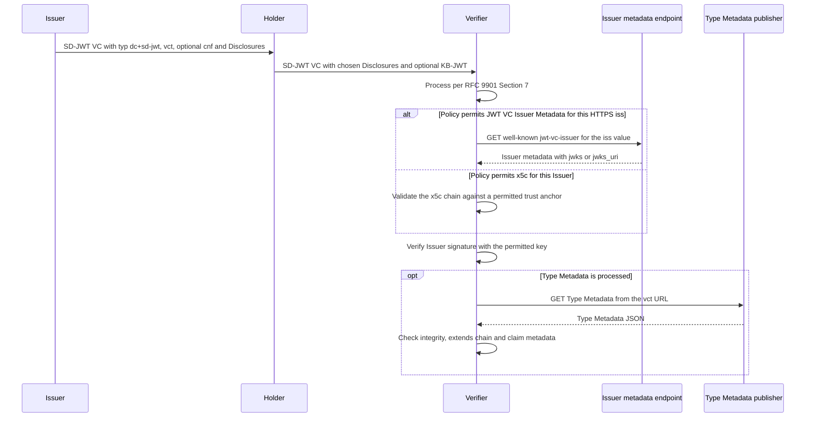

# Deep Dive: draft-ietf-oauth-sd-jwt-vc

> In one line: SD-JWT VC profiles SD-JWT (RFC 9901) as a credential format by adding a type identifier (`vct`), two ways to find the Issuer's key, and optional Type Metadata for display and claim rules.

## What this is

SD-JWT (RFC 9901) gives JWTs selective disclosure but does not say which claims a credential carries or what they mean (Section 1.2). This draft fills that gap for Verifiable Digital Credentials, which it calls SD-JWT VCs. It defines the `application/dc+sd-jwt` media type and the `dc+sd-jwt` `typ` header value (Sections 2.1 and 2.2.1), and new claims `vct` (the credential type) and `aka_vcts` (further types) (Sections 2.2.2.1 and 2.2.2.2). It also defines two Issuer key discovery mechanisms, JWT VC Issuer Metadata under a well-known URI and inline `x5c` certificates (Sections 2.5 and 4). Finally it defines Type Metadata, a JSON document found through `vct` that carries display, rendering and claim rules (Section 5). Because these documents are fetched from URLs taken from untrusted credentials, a large part of the draft is HTTP retrieval and SSRF (server-side request forgery) rules (Sections 3 and 7.1).

## How it works

1. The Issuer signs an SD-JWT whose header has `typ` set to `dc+sd-jwt` and whose payload has a `vct` claim. The Issuer may make any claim selectively disclosable except the ones the draft forbids hiding: `iss`, `nbf`, `exp`, `cnf`, `vct`, `vct#integrity`, `aka_vcts` and `status` (Sections 2.2.1 and 2.2.2.3).
2. The Holder presents the SD-JWT with only the Disclosures it chooses, and a KB-JWT (Key Binding JWT) when Key Binding is required. The KB-JWT is checked against the `cnf` claim (Sections 2.2.2.3 and 2.4; Section 2.3.2 has the example).
3. The recipient processes the SD-JWT as RFC 9901 Section 7 describes. The Issuer check in RFC 9901 Section 7.1 point 2.c is satisfied by a key discovery mechanism that policy permits for that Issuer (Section 2.4).
4. When `iss` is an HTTPS URL and policy permits this mechanism, the recipient can fetch the metadata from the well-known URI `/.well-known/jwt-vc-issuer` inserted between host and path, and take the keys from `jwks` or `jwks_uri`. The returned `issuer` must equal `iss` (Sections 4, 4.1 and 4.3).
5. Alternatively, when the protected header has `x5c` and policy permits it, the end-entity certificate's key is used and the chain is validated per RFC 7515 Section 4.1.6 and RFC 5280 against a trust anchor permitted for the Issuer. The Issuer is then the certificate subject, and an `iss` is not authenticated by this mechanism (Section 2.5).
6. A Holder or Verifier MAY then process Type Metadata. If it does, it follows `extends`, verifies any `#integrity` values, and validates the payload against the claim metadata (`path`, `mandatory`, `sd`) (Sections 5.3, 5.4, 5.6 and 5.7). A failed claim metadata check or a circular `extends` chain rejects the credential (Sections 5.7 and 7.4), a document whose `#integrity` value does not match is rejected (Section 6), and a failure to retrieve or process Type Metadata rejects the credential only when policy or ecosystem rules require Type Metadata (Section 5.7).

## Use cases

- A government issues a person identification credential. A wallet presents only an age claim and the nationality to a Verifier, as in the Appendix A.1 example. That example discloses only the nationality and the fact that the person is over 18, and leans on the PID (Person Identification Data) concept of the EUDI Wallet (European Digital Identity Wallet) Architecture and Reference Framework without intending to fully comply with it.
- A Verifier built into a service must decide whether to trust an Issuer. It selects between JWT VC Issuer Metadata and `x5c` according to its policy for that Issuer (Sections 2.5 and 7.3).
- A credential type is published by a standards body or community and is extended by national types. Verifiers use `vct`, `aka_vcts` and `extends` to match types, and still check Issuer authorization separately (Sections 2.2.2.2, 5.4 and 7.7).
- A wallet renders a credential from Type Metadata, using a logo, a background image or an SVG template with `{{svg_id}}` placeholders, must escape values, must not execute code in the SVG, and must sandbox the SVG display if code execution cannot be reliably prevented (Sections 5.5.1 and 7.10).
- An operator runs a service that resolves `iss` and `vct` URLs and needs the redirect, size, time and internal-address rules to avoid SSRF (Sections 3 and 7.1).

## Why This Matters Now

- **Trigger**: The draft is at -26 (6 November 2026). -24 and -25 were both posted on 5 November in answer to the IESG ballot on -23, and -26 followed a day later. On Datatracker (checked 15 November 2026) the IESG state is IESG Evaluation::AD Followup with Deb Cooley as action holder, no telechat date is set, and the ballot summary reads "Has a DISCUSS. Has enough positions to pass once DISCUSS positions are resolved." The SECDIR telechat review by Ionuț Mihalcea returned Ready on 8 November 2026.
- **Source evidence**: Mike Bishop's DISCUSS on the RFC 7800 override (2 November) is cleared: on 5 November, after -24, his position changed to No Objection. The DISCUSS that remains is Éric Vyncke's (5 November, recorded against -23). It asks why Section 2.2.2.2 uses SHOULD for type matching and Section 2.4 uses SHOULD for the status check, and asks for guidance on when the SHOULD may be bypassed. -25 answered both points (see What Changed) and -26 took his comment on RFC 6890, but on 15 November 2026 the ballot page still records his position as Discuss.
- **Expected impact**: The draft is a Standards Track format used for wallet credentials, and its Type Metadata and retrieval rules affect any implementation that fetches credential metadata. The RFC 7800 question is settled by an `Updates: 7800` relationship rather than a profile-specific exception, and the update covers "key-bound SD-JWT VCs, SD-JWTs, and JWTs" (Section 2.2.2.3.1). Once published, it changes RFC 7800 for every JWT that uses `cnf`, not only for SD-JWT VCs.

## What Changed

- -24 (5 November 2026): The header gains `Updates: 7800 (if approved)` and the abstract a sentence saying the draft updates RFC 7800 "to allow for the Confirmation Claim (cnf) to be used regardless of the presence or absence of other claims". The override moves into a new Section 2.2.2.3.1 "Confirmation Claim Independence", which now "updates [RFC7800] to nullify that requirement". Section 2.5 validates the `x5c` chain "according to Section 4.1.6 of [RFC7515] and [RFC5280]", says "a certificate in the x5c header parameter is not a trust anchor merely because it is included there", and says an `iss` is not authenticated under `x5c`: a recipient MAY reject an `iss` not bound to the end-entity certificate, and Issuers SHOULD NOT include an `iss` without such a binding. A new paragraph says "The recipient's policy determines which mechanism applies to an Issuer; the SD-JWT VC does not", and a recipient MUST NOT treat inputs of another mechanism as identifying the Issuer unless its policy binds them (for example through a Subject Alternative Name or a configured mapping) and it has verified that binding. Section 7.3 now speaks of the Issuer "as identified by the key discovery and validation mechanism in use", its MUST applies "for any given Issuer" instead of "for any given iss value", and a new paragraph says a mechanism authenticates only its own inputs. Section 4 adds that lowercasing the scheme and host of `iss` is RECOMMENDED. Keyword fixes: "Consuming applications MUST use" becomes "use" in Section 5.5.1.2.1, the MUST in the lead-in of Section 7.6 is gone (its bullets keep theirs), and "MAY have" becomes "can have" in Sections 2.2 and 2.2.2.5, as does MAY in Section 5.3.3. RFC 5280 and [W3C.SVG] (cited in Section 5.5.1.2.2) become normative references. The Appendix A.1 example data is replaced.
- -25 (5 November 2026): Section 2.2.2.2 changes "a Holder or Verifier SHOULD treat an SD-JWT VC as being of a given type" to "treats". Section 2.4 keeps the status check at SHOULD and adds "A Verifier that does not check the status cannot detect that the Verifiable Digital Credential has been revoked or suspended and accepts that risk according to its policy." The Appendix A.1 examples are extended. The history entry reads "working on Éric Vyncke's Discuss".
- -26 (6 November 2026): Section 7.1 cites the IANA IPv4 and IPv6 Special-Purpose Address Registries (as informative references) instead of RFC 6890, which leaves the normative references. Section 2.2.2.2 loses a duplicate sentence ("Holders and Verifiers can treat the SD-JWT VC as a credential of these types."). Apart from the dates, nothing else in the text changes.
- Compatibility or migration concerns: -24 changes what a recipient that supports both mechanisms does: inputs of the mechanism not in use (an `iss` under `x5c`, an `x5c` header under JWT VC Issuer Metadata) do not identify the Issuer unless policy binds them. Take test vectors from -26: the examples changed in -24 and -25, and -26 has the same examples as -25. The -26 examples were not re-verified for these notes. The history of -19 shows that the transitional note about accepting `vc+sd-jwt` as `typ` was removed, so the current text names only `dc+sd-jwt`.

## Technical Analysis

- Threat model implications: `iss`, `vct`, `jwks_uri`, `extends` and `uri` values come from untrusted input, so the Consumer must validate every URL, including each redirect target, against internal and non-globally-reachable addresses, and bound time and size (Sections 3 and 7.1). Type and Issuer claims are only as trustworthy as the Issuer: neither `extends` nor `aka_vcts` implies authorization to issue a type (Sections 2.2.2.2 and 7.7). Type Metadata is trusted only as far as its Publisher is (Section 7.8). Display text and SVG templates are attack surfaces for injection and active content (Sections 5.5.1.2.2, 7.6 and 7.10), and data URIs are untrusted input (Section 7.9). Verifiers must ensure an attacker cannot influence the type of verification process for a given Issuer, and a mechanism authenticates only its own inputs (Section 7.3). `extends` cycles must be detected (Section 7.4). Privacy risks include a Holder-specific `iss` used for phone-home, remote key retrieval in `cnf`, the non-selectively-disclosable `vct` and `aka_vcts`, and tracking through metadata fetches (Sections 8.2, 8.3 and 8.4).
- Protocol flow implications: Verification is RFC 9901 processing plus a policy-permitted key mechanism (Sections 2.4 and 2.5). Type Metadata processing is optional unless policy or ecosystem rules require it, and then failure to retrieve or validate means rejection (Section 5.7). Integrity-keyed caching can be indefinite, otherwise HTTP caching under RFC 9111 applies (Sections 3, 5.3.4 and 6). Claim metadata is evaluated against the issued payload including undisclosed array positions, and a Verifier MUST NOT read the absence of a disclosable claim as a missing mandatory claim (Section 5.6).
- Interop concerns: Both an HTTPS `iss` and `x5c` can appear in one credential. Since -24, Section 2.5 says that the recipient's policy, not the credential, selects the mechanism, that the Issuer is the one identified by the mechanism in use, and that inputs of another mechanism MUST NOT be treated as identifying the Issuer unless policy binds them and the binding has been verified. A certificate in `x5c` is not a trust anchor merely because it is there. Section 7.3 still calls the Issuer-to-key relationship "critical" rather than stating a BCP 14 requirement; its MUST is that an attacker cannot influence the type of verification process for a given Issuer. An extending type may change `sd` only from `allowed` (or omitted) to `always` or `never`, and `mandatory` only from false to true (Section 5.6.5.1), while `display` is replaced rather than merged (Sections 5.5.2 and 5.6.5). `#integrity` uses the W3C SRI string syntax but its own verification procedure, with no CORS dependence (Section 6). The IANA sections still contain placeholder document references (Section 9).

## Open Questions

- Resolved in -24: the RFC 7800 override. The draft now carries `Updates: 7800 (if approved)` and Section 2.2.2.3.1, so the option Mahesh Jethanandani named first (an `Updates:` relationship) was taken. Mike Bishop cleared his DISCUSS on 5 November 2026. On 15 November 2026 the Datatracker document page does not list an Updates relation yet.
- Resolved in -24: the `x5c` and `iss` question that Mahesh Jethanandani raised and Roman Danyliw supported. Section 2.5 now says Verifier policy selects the mechanism, cites RFC 5280 for chain validation, and says a certificate in `x5c` is not a trust anchor merely because it is included. Mike Bishop's comment on case-insensitive scheme and host is answered by the RECOMMENDED lowercasing in Section 4, and his comments on Section 5.5.1.2.1 (MUST removed), Section 5.5.1.2.2 (normative [W3C.SVG] reference) and the lead-in of Section 7.6 (MUST removed) are answered too.
- Still on the ballot: Éric Vyncke's DISCUSS on the SHOULDs in Sections 2.2.2.2 and 2.4. -25 replaced the first with "treats" and kept the second at SHOULD with a sentence on the risk a Verifier accepts by not checking status. Whether that clears the DISCUSS is not shown yet; on 15 November 2026 his position is still Discuss.
- Still open in -26: Section 7.1 still forbids private-use ranges and Consumer-internal hosts with no exception for destinations that local policy permits, such as an allow-list for closed deployments (Mahesh Jethanandani's comment).
- Still open in -26: nothing caps the depth of an `extends` chain or the total retrievals one credential can trigger. Section 3 bounds each retrieval and Section 7.4 catches cycles, but a long non-circular chain passes both (Mahesh Jethanandani's comment). There is still no Operational Considerations section, and the shepherd write-up was last changed on 17 May 2026.
- Still open in -26: Sections 4.2 and 5.3.1 still use `application/json` rather than a dedicated media type for metadata, and Section 4.3 still does not say that the `issuer` must equal `iss` regardless of any redirect chain (Mike Bishop's comments, not part of his DISCUSS).

## Experiments

- [ ] Lab 1: Build a verifier that takes an SD-JWT VC with both an HTTPS `iss` and an `x5c` header and runs it under three policies (metadata only, `x5c` only, both permitted). Record which keys are used and when it rejects, to see how Section 2.5 and Section 7.3 behave.
- [ ] Lab 2: Point a test `iss`, `jwks_uri`, `vct` and logo URL at loopback, link-local and private addresses, at a DNS name that resolves internally, and at a redirect chain that ends on an internal or `http` URL. Check that a Consumer following Section 3 and Section 7.1 refuses each one.
- [ ] Lab 3: Create a Type Metadata chain with `extends`, `extends#integrity` and claim metadata where the child tries to loosen `sd` or `mandatory`, plus a cycle. Present credentials with and without the relevant Disclosures and check the rejections required by Sections 5.6, 5.6.5.1 and 7.4 and the rule that absence is not proof of a missing mandatory claim.

## Sources

- <https://datatracker.ietf.org/doc/draft-ietf-oauth-sd-jwt-vc/26/>
- <https://datatracker.ietf.org/doc/draft-ietf-oauth-sd-jwt-vc/ballot/>
- <https://author-tools.ietf.org/iddiff?url1=draft-ietf-oauth-sd-jwt-vc-23&url2=draft-ietf-oauth-sd-jwt-vc-26>
- <https://datatracker.ietf.org/doc/draft-ietf-oauth-sd-jwt-vc/23/>
- <https://mailarchive.ietf.org/arch/msg/oauth/rShUO7YVi2WyKSxydiyWt5eonUc/>
- <https://mailarchive.ietf.org/arch/msg/oauth/5yaIITzC7JvwuRt94lpF7u4P72E/>
- <https://mailarchive.ietf.org/arch/msg/oauth/d49b8f7_xsSOXCgDit-a1p9-yvg/>
- <https://mailarchive.ietf.org/arch/msg/oauth/DNuSXwlB4yGxuTGQigaG7tcZf7A/>
