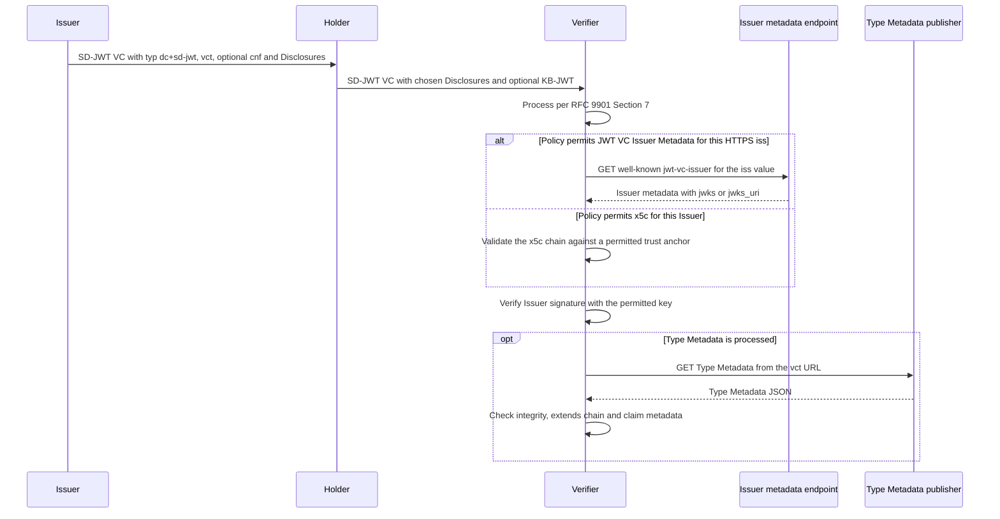

# Deep Dive: draft-ietf-oauth-sd-jwt-vc

> In one line: SD-JWT VC profiles SD-JWT (RFC 9901) as a credential format by adding a type identifier (`vct`), two ways to find the Issuer's key, and optional Type Metadata for display and claim rules.

## What this is

SD-JWT (RFC 9901) gives JWTs selective disclosure but does not say which claims a credential carries or what they mean (Section 1.2). This draft fills that gap for Verifiable Digital Credentials, which it calls SD-JWT VCs. It defines the `application/dc+sd-jwt` media type and the `dc+sd-jwt` `typ` header value (Sections 2.1 and 2.2.1), and new claims `vct` (the credential type) and `aka_vcts` (further types) (Sections 2.2.2.1 and 2.2.2.2). It also defines two Issuer key discovery mechanisms, JWT VC Issuer Metadata under a well-known URI and inline `x5c` certificates (Sections 2.5 and 4). Finally it defines Type Metadata, a JSON document found through `vct` that carries display, rendering and claim rules (Section 5). Because these documents are fetched from URLs taken from untrusted credentials, a large part of the draft is HTTP retrieval and SSRF (server-side request forgery) rules (Sections 3 and 7.1).

## How it works

1. The Issuer signs an SD-JWT whose header has `typ` set to `dc+sd-jwt` and whose payload has a `vct` claim. The Issuer may make any claim selectively disclosable except the ones the draft forbids hiding: `iss`, `nbf`, `exp`, `cnf`, `vct`, `vct#integrity`, `aka_vcts` and `status` (Sections 2.2.1 and 2.2.2.3).
2. The Holder presents the SD-JWT with only the Disclosures it chooses, and a KB-JWT (Key Binding JWT) when Key Binding is required. The KB-JWT is checked against the `cnf` claim (Sections 2.2.2.3 and 2.4; Section 2.3.2 has the example).
3. The recipient processes the SD-JWT as RFC 9901 Section 7 describes. The Issuer check in RFC 9901 Section 7.1 point 2.c is satisfied by a key discovery mechanism that policy permits for that Issuer (Section 2.4).
4. When `iss` is an HTTPS URL, the recipient can fetch the metadata from the well-known URI `/.well-known/jwt-vc-issuer` inserted between host and path, and take the keys from `jwks` or `jwks_uri`. The returned `issuer` must equal `iss` (Sections 4, 4.1 and 4.3).
5. Alternatively, when the protected header has `x5c`, the end-entity certificate's key is used and the chain is validated against a trust anchor permitted for the Issuer (Section 2.5).
6. A Holder or Verifier MAY then process Type Metadata. If it does, it follows `extends`, verifies any `#integrity` values, and validates the payload against the claim metadata (`path`, `mandatory`, `sd`) (Sections 5.3, 5.4, 5.6 and 5.7). A failed claim metadata check or a circular `extends` chain rejects the credential (Sections 5.7 and 7.4), a document whose `#integrity` value does not match is rejected (Section 6), and a failure to retrieve or process Type Metadata rejects the credential only when policy or ecosystem rules require Type Metadata (Section 5.7).

## Use cases

- A government issues a person identification credential. A wallet presents only an age claim and the nationality to a Verifier, as in the Appendix A.1 example. That example discloses only the nationality and the fact that the person is over 18, and leans on the PID (Person Identification Data) concept of the EUDI Wallet (European Digital Identity Wallet) Architecture and Reference Framework without intending to fully comply with it.
- A Verifier built into a service must decide whether to trust an Issuer. It selects between JWT VC Issuer Metadata and `x5c` according to its policy for that Issuer (Sections 2.5 and 7.3).
- A credential type is published by a standards body or community and is extended by national types. Verifiers use `vct`, `aka_vcts` and `extends` to match types, and still check Issuer authorization separately (Sections 2.2.2.2, 5.4 and 7.7).
- A wallet renders a credential from Type Metadata, using a logo, a background image or an SVG template with `{{svg_id}}` placeholders, must escape values, must not execute code in the SVG, and must sandbox the SVG display if code execution cannot be reliably prevented (Sections 5.5.1 and 7.10).
- An operator runs a service that resolves `iss` and `vct` URLs and needs the redirect, size, time and internal-address rules to avoid SSRF (Sections 3 and 7.1).

## Why This Matters Now

- **Trigger**: The ARTART telechat review of -23 returned Ready on 3 November 2026, so the draft is moving toward publication (`subject.json`). On Datatracker the IESG state is IESG Evaluation, the WG state is Submitted to IESG for Publication, and the draft is on the 5 November 2026 telechat agenda.
- **Source evidence**: Christian Amsüss's review says the draft has addressed all the issues he raised in his Last Call review. On the same ballot Mike Bishop holds a DISCUSS (2 November 2026), and Mahesh Jethanandani (2 November) and Roman Danyliw (3 November) are No Objection with comments that support it. As of 4 November 2026 the DISCUSS is not cleared and the ballot needs one more Yes or No Objection to pass (Datatracker ballot page). So Ready from one directorate review does not mean the IESG is finished.
- **Expected impact**: The draft is a Standards Track format used for wallet credentials, and its Type Metadata and retrieval rules affect any implementation that fetches credential metadata. If the DISCUSS leads to an `Updates: RFC 7800` relationship or a rewording of Section 2.2.2.3, it changes how key-bound credentials without `sub` or `iss` are described. Which outcome will be chosen is not shown in the material.

## What Changed

- Spec/document change summary: Revision -23 contains no visible change to normative text (`diff.txt`). It refreshes the expiry date to 4 May 2027 and the draft date to 31 October 2026. It regenerates the example signatures in Figures 7, 8, 10 and 26 and the Appendix A.1 examples. The KB-JWT `iat` and `sd_hash` values in Figures 8, 26 and 27 change too. Editorial fixes are a `text_color` wording fix in Section 5.5.1.1, "in by [RFC8615]" becoming "in [RFC8615]" in Section 9.3, and a stray trailing slash removed from the OWASP URL. Su-hyeon Forten Lee is added to the acknowledgements, and the history lists only "some minor fixes" for -23.
- Earlier revisions give the context for the open ballot items. Per the document history, -22 answered IESG ballot comments from Ketan Talaulikar and stated the RFC 7800 `sub`/`iss` departure, -21 limited which claim metadata failures reject a credential, -20 added `aka_vcts` guidance and the `x5c`/`iss` clarification, and -19 added the general HTTP retrieval section.
- Compatibility or migration concerns: None at protocol level are visible in -23. Test vectors copied from -22 differ in signatures and `iat`/`sd_hash`. The regenerated examples were checked against the -23 text: the Issuer signatures in Figures 7, 8, 10, 24 and 26 verify with the `doc-signer-05-25-2022` key of Figure 14, the KB-JWTs in Figures 8 and 26 verify with the `cnf` key, and the `sd_hash` values match. The history of -19 shows that the transitional note about accepting `vc+sd-jwt` as `typ` was removed, so the current text names only `dc+sd-jwt`.

## Technical Analysis

- Threat model implications: `iss`, `vct`, `jwks_uri`, `extends` and `uri` values come from untrusted input, so the Consumer must validate every URL, including each redirect target, against internal and non-globally-reachable addresses, and bound time and size (Sections 3 and 7.1). Type and Issuer claims are only as trustworthy as the Issuer: neither `extends` nor `aka_vcts` implies authorization to issue a type (Sections 2.2.2.2 and 7.7). Type Metadata is trusted only as far as its Publisher is (Section 7.8). Display text and SVG templates are attack surfaces for injection and active content (Sections 5.5.1.2.2, 7.6 and 7.10), and data URIs are untrusted input (Section 7.9). Verifiers must ensure an attacker cannot choose the verification mechanism for a given `iss` (Section 7.3). `extends` cycles must be detected (Section 7.4). Privacy risks include a Holder-specific `iss` used for phone-home, remote key retrieval in `cnf`, the non-selectively-disclosable `vct` and `aka_vcts`, and tracking through metadata fetches (Sections 8.2, 8.3 and 8.4).
- Protocol flow implications: Verification is RFC 9901 processing plus a policy-permitted key mechanism (Sections 2.4 and 2.5). Type Metadata processing is optional unless policy or ecosystem rules require it, and then failure to retrieve or validate means rejection (Section 5.7). Integrity-keyed caching can be indefinite, otherwise HTTP caching under RFC 9111 applies (Sections 3, 5.3.4 and 6). Claim metadata is evaluated against the issued payload including undisclosed array positions, and a Verifier MUST NOT read the absence of a disclosable claim as a missing mandatory claim (Section 5.6).
- Interop concerns: Both an HTTPS `iss` and `x5c` can appear in one credential, and Section 2.5 says only that the mechanism must be permitted by policy and that `iss` need not match the certificate. Section 7.3 says that ecosystem-specific rules must maintain the `iss`-to-key relationship (stated as "critical", not as a BCP 14 requirement); its MUST is that an attacker cannot influence the type of verification process. An extending type may change `sd` only from `allowed` (or omitted) to `always` or `never`, and `mandatory` only from false to true (Section 5.6.5.1), while `display` is replaced rather than merged (Sections 5.5.2 and 5.6.5). `#integrity` uses the W3C SRI string syntax but its own verification procedure, with no CORS dependence (Section 6). The IANA sections still contain placeholder document references (Section 9).

## Open Questions

- Section 2.2.2.3 says the draft "explicitly overrides" the RFC 7800 Section 3 rule "At least one of the "sub" and "iss" claims MUST be present in the JWT", but the header has no `Updates:` line and Datatracker lists no Updates relation. RFC 9901 makes no such departure; it only uses `cnf` as RFC 7800 defines it. Mike Bishop's DISCUSS asks for this to be fixed, and Mahesh Jethanandani and Roman Danyliw support it. Mahesh Jethanandani names the options: an `Updates:` relationship, or wording that makes this a profile-specific exception. Which one the authors choose is not known yet.
- Section 7.1 names private-use ranges and Consumer-internal hosts as forbidden unconditionally. Mahesh Jethanandani's comment says this blocks enterprise and closed deployments and suggests allowing destinations that local policy explicitly permits, such as an allow-list, while keeping the default prohibition. The draft does not say so.
- Mahesh Jethanandani's comment says Section 2.5 (`iss` need not match the certificate) and Section 7.3 (it is critical that the `iss`-to-key relationship is maintained) conflict for `x5c`, and that the draft does not say which mechanism applies when both an HTTPS `iss` and `x5c` are present. He suggests stating that Verifier policy for the Issuer selects the mechanism, not the credential's contents, and Roman Danyliw supports this point. He also asks for an RFC 5280 reference for the chain validation, which RFC 7515 Section 4.1.6 already requires ("The recipient MUST validate the certificate chain according to RFC 5280"), and for a statement that certificates in `x5c` are never trust anchors. He traces these points to Last Call feedback from Nas Til.
- Sections 4.2 and 5.3.1 use `application/json` for metadata. Mike Bishop's comment suggests a distinct media type so the server can say what role the object plays. He also suggests that Section 4.3 say explicitly that the `issuer` rule holds regardless of any redirect chain, and notes that Section 4 calls `iss` a case-sensitive URL although its scheme, host and port are case-insensitive. These are comments, not part of the DISCUSS.
- Mike Bishop's comment says the MUST for choosing among SVG templates in Section 5.5.1.2.1 is not an interoperability requirement, that Section 5.5.1.2.2 needs a normative reference to SVG structure, and that the MUST in Section 7.6 is hard to test.
- Mahesh Jethanandani's comment notes that nothing bounds the total retrievals one credential can trigger: Section 3 bounds each retrieval and Section 7.4 catches cycles, but a long non-circular `extends` chain, with the images and templates it references, passes both. He suggests capping the chain depth, and possibly the total retrievals per credential, and treating a breach as a Type Metadata processing failure (Sections 3 and 5.4). He also suggests an Operational Considerations section and asks for the shepherd write-up, written for -16, to be refreshed before approval.

## Experiments

- [ ] Lab 1: Build a verifier that takes an SD-JWT VC with both an HTTPS `iss` and an `x5c` header and runs it under three policies (metadata only, `x5c` only, both permitted). Record which keys are used and when it rejects, to see how Section 2.5 and Section 7.3 behave.
- [ ] Lab 2: Point a test `iss`, `jwks_uri`, `vct` and logo URL at loopback, link-local and private addresses, at a DNS name that resolves internally, and at a redirect chain that ends on an internal or `http` URL. Check that a Consumer following Section 3 and Section 7.1 refuses each one.
- [ ] Lab 3: Create a Type Metadata chain with `extends`, `extends#integrity` and claim metadata where the child tries to loosen `sd` or `mandatory`, plus a cycle. Present credentials with and without the relevant Disclosures and check the rejections required by Sections 5.6, 5.6.5.1 and 7.4 and the rule that absence is not proof of a missing mandatory claim.

## Sources

- <https://datatracker.ietf.org/doc/draft-ietf-oauth-sd-jwt-vc/23/>
- <https://mailarchive.ietf.org/arch/msg/oauth/rShUO7YVi2WyKSxydiyWt5eonUc/>
- <https://mailarchive.ietf.org/arch/msg/oauth/5yaIITzC7JvwuRt94lpF7u4P72E/>
- <https://mailarchive.ietf.org/arch/msg/oauth/d49b8f7_xsSOXCgDit-a1p9-yvg/>
- <https://mailarchive.ietf.org/arch/msg/oauth/DNuSXwlB4yGxuTGQigaG7tcZf7A/>
