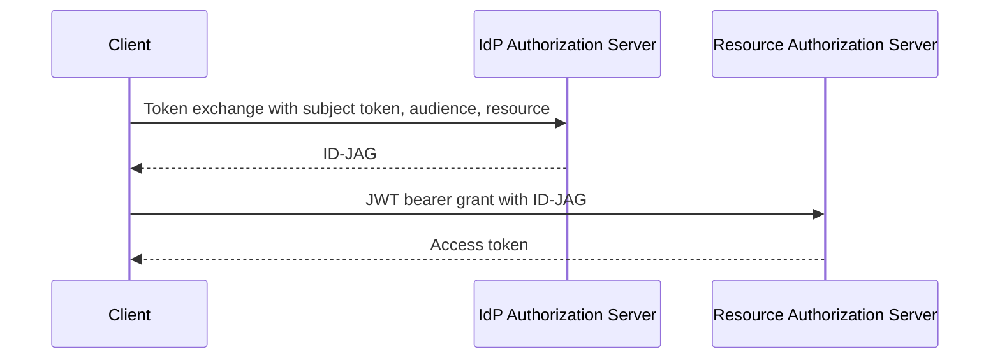
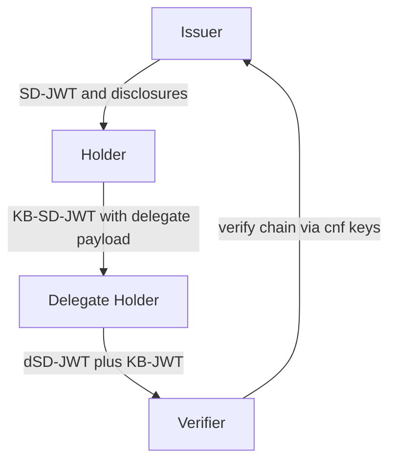

# OAuth WG Daily Report - 2026-11-01

- generated_at_utc: `2026-11-01T10:10:32+00:00`
- snapshot_date: `2026-11-01`

<!-- insights:start -->
## Briefing

> The biggest movement is the ID-JAG draft jumping to -06 with new normative rules (client authentication at the IdP, invalid_request for bad subject tokens, mTLS binding), alongside a substantially reworked Deferred Token Response -01 and the first WG-named Delegate SD-JWT draft. OAuth 2.1 -17 and SD-JWT VC -23 are mostly editorial or restructuring.

_Updated 2026-11-01T10:12:31+00:00. Machine-drafted from the sources linked below, which stay authoritative._

### In short, Deferred Token Response -01 adds interaction-aware completion modes and a 'substrate invariants' section, and moves to new editors

`draft-revision` · `substantive` · first seen 2026-11-01 · [draft-ietf-oauth-deferred-token-response-01: Deferred Token Response](https://author-tools.ietf.org/iddiff?url1=draft-ietf-oauth-deferred-token-response-00&url2=draft-ietf-oauth-deferred-token-response-01)

The draft (diff truncated) now has new editors (Itaú, Alibaba) and lives under oauth-wg. It adds a Section 4 of substrate guarantees (no authorization expansion, continuation only via the token endpoint, sender-constraint continuity, immutable originating request, opaque deferral_code, polling always authoritative) and obligations for higher-layer profiles. completion_mode gains a second value, deferred_interactive, and the deferred response can signal interaction_required, interaction_pending or authorization_pending. Servers that don't support the parameter MUST NOT reject the request because of it, and supporting servers MUST publish deferred_token_response_supported=true. New sections cover generating deferral codes, a registered error entry, and three new use cases (AI agent with browser access, regulatory compliance, explicit consent).

**Use cases**

- An AS that needs a human approval or step-up before issuing a token to an agent can return a deferral_code and let the client poll instead of blocking.
- A client that can send the user to a URI can opt in with deferred_interactive and handle interaction_required.
- Profile authors extending DTR must keep polling available and not relax the no-expansion guarantees.

**Related in other tracks**

- `openid` / `openid/OpenID4VCI`: Both define deferred or pending completion of a credential or token request, though the material does not link them directly.

### In short, ID-JAG -06 keeps the flow but tightens many rules, including mandatory client authentication at the IdP and mTLS as a binding option

`draft-revision` · `substantive` · first seen 2026-11-01 · [draft-ietf-oauth-identity-assertion-authz-grant-06: Identity Assertion JWT Authorization Grant](https://author-tools.ietf.org/iddiff?url1=draft-ietf-oauth-identity-assertion-authz-grant-04&url2=draft-ietf-oauth-identity-assertion-authz-grant-06)

Compared with -04, the diff (truncated) adds: RS256 mandatory to implement for IdP and Resource AS, ES256 SHOULD for the Resource AS; sub is the identifier selected for the audience Resource AS; stricter resource handling (string or non-empty array, Simple String Comparison, resource now RECOMMENDED in the token exchange); a single audience value; IdP MUST authenticate the client and reject otherwise with invalid_client; the subject token must be of the stated type and issued for that purpose; detailed SAML NameID rules (no transient NameIDs, pairwise scoping); Cache-Control: no-store in the example; plus new sections on subject token storage, metadata validation, DPoP and mTLS key binding, and privacy. The mailing-list announcement adds that invalid_request replaces invalid_grant for failed subject tokens, key-bound ID-JAGs can replace client authentication at the Resource AS, and id_jag_signing_alg_values_supported metadata is new.

**Use cases**

- An IdP implementing the token exchange step needs to change error handling from invalid_grant to invalid_request and enforce client authentication.
- A SAML-based SaaS Resource AS mapping users via NameID must reject transient NameIDs and use the SP-scoped value.
- Deployments wanting certificate-bound ID-JAGs can use mTLS instead of DPoP.

**Related in other tracks**

- `openid` / `openid/connect`: The ID-JAG reuses ID Token style claims and the draft discusses scope semantics versus OpenID Connect scopes.

### In short, the editor announces ID-JAG -06 and flags the behaviour changes implementers should check

`mail` · `substantive` · first seen 2026-11-01 · [draft-ietf-oauth-identity-assertion-authz-grant-06](https://mailarchive.ietf.org/arch/msg/oauth/-3eHjZkoYNz0qDpviERKkheVDbI/)

The announcement says -05 and -06 bring implementation feedback back into the spec and that flow and design are unchanged. It lists clarifications (resource and audience comparison, sub selection, SAML NameID, refresh token as subject token, error codes) and new items: IdP client authentication, single audience, invalid_request instead of invalid_grant for bad subject tokens, key-bound ID-JAG in place of client authentication at the Resource AS, mTLS binding, id_jag_signing_alg_values_supported, and Privacy Considerations. Open issues are expected at IETF 127.

**Use cases**

- IdP and library maintainers should re-check Token Exchange error handling against the new invalid_request behaviour.

### In short, Delegate SD-JWT -00 lets a SD-JWT holder hand a presentation on to a delegate by making the key-binding JWT itself an SD-JWT

`new-draft` · `new-proposal` · first seen 2026-11-01 · [draft-ietf-oauth-delegate-sd-jwt-00: Delegate SD-JWT](https://datatracker.ietf.org/doc/draft-ietf-oauth-delegate-sd-jwt/00/)

The first WG-named revision (authors from Google and SPRIND) extends RFC 9901 so a KB-JWT can be a KB-SD-JWT carrying a selectively disclosable delegate payload, optionally with its own key binding and further chaining. Compact serialization uses a double tilde between chain elements; new typ values kb+sd-jwt and kb-sd-jwt+kb are defined; sd_hash or issuer_jwt_hash links each link to its predecessor; and verification walks the chain using each cnf key. The stated motivation is letting an AI agent prove authority to buy from a merchant without revealing other eligible merchants. The text is truncated, so the security and IANA sections were not seen.

**Use cases**

- A user wallet delegating a purchase mandate to an AI agent that then presents to a merchant.
- A verifier needing to validate a multi-hop chain back to the original issuer while preserving data minimisation.

**Related in other tracks**

- `ietf-wimse` / `draft-asor-wimse-agent-delegation-chain`: Another offline delegation chain design for agents, discussed on the list alongside similar formats.
- `ietf-wimse` / `draft-hulea-wimse-agent-mandate`: Verifiable agent mandates that overlap in purpose with delegated SD-JWT chains.
- `openid` / `openid/OpenID4VP`: The draft has a section on delegation using OpenID4VP presentation.

### In short, Attenuating Authorization Tokens -02 adds chain verification and test vectors, and a reply asks the competing formats to share subsumption rules

`mail` · `new-proposal` · first seen 2026-11-01 · [New version: Attenuating Authorization Tokens (draft-niyikiza-oauth-attenuating-agent-tokens-02)](https://mailarchive.ietf.org/arch/msg/oauth/yYnrgM51pZuvm6s8z1lmcv5tHEU/)

The author says -02 specifies chain verification step by step with 229 public test vectors, three new implementations, and a section comparing AATs with transaction tokens, identity chaining, WIMSE AIMS, Macaroons, UCAN and others. A reply from the author of a credential delegation draft says cumulative budgets and sub-root revocation need a server in the path, and notes three offline attenuation formats (AATs, asor, hulea) with differing rules and reused claim names. They ask for one subsumption rule per constraint type across them.

**Use cases**

- Agent frameworks that issue narrower sub-tokens to sub-agents offline and want interoperable verification.
- Verifiers that would otherwise implement the same constraint comparison separately for each format.

**Related in other tracks**

- `ietf-wimse` / `draft-sweeney-wimse-credential-delegation`: Reply author's server-side companion design.
- `ietf-wimse` / `draft-asor-wimse-agent-delegation-chain`: Named as a competing offline attenuation format reusing chain claim names.
- `ietf-wimse` / `draft-hulea-wimse-agent-mandate`: Named as the third offline attenuation format.

### In short, the OAuth 2.1 editor announces -17 and asks for list feedback on four open issues before IETF 127

`mail` · `discussion` · first seen 2026-11-01 · [OAuth 2.1 draft 17: draft-ietf-oauth-v2-1-17](https://mailarchive.ietf.org/arch/msg/oauth/4L4EamXpvnEXs13ZL8dnPPj-YRc/)

The open issues are: #274, a conflict over access token characters versus HTTP header characters, proposed to be closed via PR #273 by restricting to token68; #266, adding invalid_client to authorization responses because the IANA registry already lists it; #265, consistency of 'apps' versus 'applications'; and #215, adopting a separate draft that adds a 'resource' token response parameter for reference.

**Use cases**

- Implementers who issue access tokens with characters outside token68 should watch #273, which would narrow the allowed set.

### In short, a contributor asks for 15 minutes in the IETF 127 joint WIMSE/OAuth session on authenticated versus authorized agent delegation

`mail` · `discussion` · first seen 2026-11-01 · [Agenda request for IETF 127: "Authenticated Is Not Authorized: Delegated Authority Across Workload and Agent Boundaries" (joint WIMSE/OAuth session)](https://mailarchive.ietf.org/arch/msg/oauth/Ci_tGG-8lSZPMLOh20ZfJ7XDQP4/)

The request is a discussion slot with no new draft. It cites open WIMSE architecture PR #140, and an AuthZEN decision on Oct 8 not to define a trust-anchored context.agent field, with policies instead reasoning over validated token claims (client_id, act) and a separate OAuth mapping profile planned. It also cites A2A-to-MCP authority-boundary test cases and ties the topic to the OAuth 'Complex Delegation' work item.

**Related in other tracks**

- `ietf-wimse` / `draft-ietf-wimse-arch`: The request cites a pending architecture PR on identity requirements for AI intermediaries.
- `openid` / `openid/authzen`: The request describes an AuthZEN WG decision on trust-anchored agent context.

### In short, feedback on an invoicing-agent mandate draft points its author toward Delegate SD-JWT and Deferred Token Response

`mail` · `discussion` · first seen 2026-11-01 · [Feedback request: SD-JWT VC as mandates for invoicing agents (5 new messages)](https://mailarchive.ietf.org/arch/msg/oauth/DHy1-FaJmTYBotN-qztpTA9VnMY/)

The author of an invoice agent mandates draft asked about audience use, attenuated delegation and overlap with RAR or Token Exchange. Reviewers said the audience handling is vague, that attenuation rules need detail, that the parent-disclosure privacy issue could block adoption, and that reuse protection should rely on a stricter one-time mechanism. The author plans to rebuild delegation on Delegate SD-JWT for -01 and to consider DTR for human approval. A reply notes DTR will publish a -01 with substantial changes.

**Use cases**

- Teams building agent mandates on SD-JWT VC can align with Delegate SD-JWT rather than inventing a new chain format.

**Related in other tracks**

- `ietf-wimse` / `draft-hulea-wimse-agent-mandate`: Another mandate-style design for agents, though the thread does not mention it.

### In short, a delegation-draft author proposes that every cumulative spend key declare whether it is delegate-tallied or single-writer exact

`mail` · `discussion` · first seen 2026-11-01 · [Issuance ceremony walkthrough — thirteen requirements, one ordinary Tuesday](https://mailarchive.ietf.org/arch/msg/oauth/IDo5i8W0qxEgmmAZB5ITc0k0apw/)

The post describes a delegate carrying a running tally of spend that verifiers cross-check and resolve toward denial. It distinguishes two modes, delegate-tally-with-distrust and single-writer-exact, and states that composed chains must declare the mode and no hop may enforce a bound under an undeclared mode. It then walks thirteen requirements under each mode, noting expiry is structural in mode one and local verifiability needs restating in mode two. The encoding is deferred to a later revision. The message is truncated after requirement nine.

**Related in other tracks**

- `ietf-wimse` / `draft-sweeney-wimse-credential-delegation`: The related thread on this list discusses a server in the call path to enforce cumulative budgets.

### In short, review of the AMR values draft continues, with calls to separate 'sna' from the proposed 'bg' value

`mail` · `discussion` · first seen 2026-11-01 · [Review of draft-skyfire-oauth-amr-values](https://mailarchive.ietf.org/arch/msg/oauth/IS0jLWoohK789pk78DCfEndMEA0/)

Reviewers argue the proposed 'bg' value overlaps with 'sna' and is too broad, covering network verification, device recognition and location checks. Another suggests device identifier and geolocation as independent values and proposes an optional amr_details companion claim to express relationships between methods. The draft's authors replied that the editor's draft now describes the overlap between bg and sna. No decision is shown in the thread.

### In short, the question of user consent for issuing ID-JAGs was closed with a pointer to Deferred Token Response

`mail` · `discussion` · first seen 2026-11-01 · [Should we enable users to consent to issuing ID-JAGs?](https://mailarchive.ietf.org/arch/msg/oauth/MDAs2JISpkI8GPkxxqSeiwHFmd4/)

A participant had opened an issue arguing that issuing an ID-JAG conveys identity across organisational boundaries and might need user consent in consumer scenarios. The thread notes the issue was closed because Deferred Token Response would probably suffice if needed. The draft itself is not changed.

**Use cases**

- Consumer-facing IdPs that want a consent step before issuing an ID-JAG could look at DTR rather than expecting a built-in mechanism.

### In short, SD-JWT VC -23 is a small clean-up release with no protocol change

`draft-revision` · `editorial` · first seen 2026-11-01 · [draft-ietf-oauth-sd-jwt-vc-23: SD-JWT-based Verifiable Digital Credentials (SD-JWT VC)](https://author-tools.ietf.org/iddiff?url1=draft-ietf-oauth-sd-jwt-vc-22&url2=draft-ietf-oauth-sd-jwt-vc-23)

The diff shows regenerated example signatures and iat/sd_hash values in the examples, a refreshed expiry date, and a few typo and reference fixes (an RFC 8615 sentence, a trailing slash in an OWASP URL, a text_color wording fix). A contributor was added to the acknowledgments, and the document history says only 'some minor fixes'. No normative text changed in the visible portion of the diff.

### Also changed, not explained

- [oauth-wg/oauth-v2-1#273: Restrict access token values to the token68 syntax](https://github.com/oauth-wg/oauth-v2-1/pull/273)
- [oauth-wg/draft-ietf-oauth-client-id-metadata-document#120: add language around concurrent first time discovery behavior](https://github.com/oauth-wg/draft-ietf-oauth-client-id-metadata-document/pull/120)
- [oauth-wg/draft-ietf-oauth-client-id-metadata-document#118: suggest authorization servers document a maximum Client Identifier URL length](https://github.com/oauth-wg/draft-ietf-oauth-client-id-metadata-document/pull/118)
- [oauth-wg/draft-ietf-oauth-client-id-metadata-document#125: Add paragraph for clients normalizing their Client Identifier URLs](https://github.com/oauth-wg/draft-ietf-oauth-client-id-metadata-document/pull/125)
- [oauth-wg/draft-ietf-oauth-client-id-metadata-document#124: Rename section to 'Client Identifier URL Confusion Attacks'](https://github.com/oauth-wg/draft-ietf-oauth-client-id-metadata-document/pull/124)
- [oauth-wg/draft-ietf-oauth-client-id-metadata-document#115: Update transient failure handling and caching guidelines](https://github.com/oauth-wg/draft-ietf-oauth-client-id-metadata-document/pull/115)
- [oauth-wg/draft-ietf-oauth-client-id-metadata-document#116: Clarify exception of loopback redirect URLs](https://github.com/oauth-wg/draft-ietf-oauth-client-id-metadata-document/pull/116)
- [oauth-wg/draft-ietf-oauth-client-id-metadata-document#123: Fix the mix-up reference in the Authorization Response section](https://github.com/oauth-wg/draft-ietf-oauth-client-id-metadata-document/pull/123)
- [oauth-wg/oauth-sd-jwt-vc#449: Update document history with minor fixes](https://github.com/oauth-wg/oauth-sd-jwt-vc/pull/449)
- [oauth-wg/oauth-sd-jwt-vc#448: Fix a broken reference URL and two editorial nits](https://github.com/oauth-wg/oauth-sd-jwt-vc/pull/448)
- [oauth-wg/oauth-v2-1#282: Change refresh token risk assessment requirement to MUST](https://github.com/oauth-wg/oauth-v2-1/pull/282)
- [oauth-wg/oauth-identity-assertion-authz-grant#158: Fix the client authentication target in the Token Exchange section](https://github.com/oauth-wg/oauth-identity-assertion-authz-grant/pull/158)
- [oauth-wg/oauth-v2-1#276: Clarify resource owner interaction in client impersonation mitigation](https://github.com/oauth-wg/oauth-v2-1/pull/276)
- [oauth-wg/oauth-v2-1#271: Reference RFC 10017 for choosing a CORS policy](https://github.com/oauth-wg/oauth-v2-1/pull/271)
- [oauth-wg/oauth-v2-1#277: Add -17 contributors to the acknowledgements](https://github.com/oauth-wg/oauth-v2-1/pull/277)
- [oauth-wg/oauth-v2-1#272: Clean up URL vs URI terminology and form-urlencoded references](https://github.com/oauth-wg/oauth-v2-1/pull/272)
- [oauth-wg/oauth-v2-1#270: Align with the HTTP WG editorial style guide](https://github.com/oauth-wg/oauth-v2-1/pull/270)
- [oauth-wg/oauth-v2-1#269: Note that access token privileges are not the only factor in access control](https://github.com/oauth-wg/oauth-v2-1/pull/269)
- [oauth-wg/oauth-v2-1#275: Add examples of refresh token issuance policies](https://github.com/oauth-wg/oauth-v2-1/pull/275)
- [oauth-wg/oauth-identity-assertion-authz-grant#157: Draft 06](https://github.com/oauth-wg/oauth-identity-assertion-authz-grant/pull/157)

### Triage of the candidate queue

- **high** `draft-ietf-oauth-deferred-token-response`: -01 restructures the draft with substrate invariants, a new deferred_interactive mode and new editors; also cited as the answer to ID-JAG consent.
- **high** `draft-ietf-oauth-delegate-sd-jwt`: New WG draft defining a delegation chain format for agents; being used as a base by others.
- **high** `draft-ietf-oauth-identity-assertion-authz-grant`: -06 adds new normative behaviour (client auth at IdP, invalid_request, mTLS binding, new metadata) and a large rewrite.
- **low** `draft-ietf-oauth-sd-jwt-vc`: -23 is only minor editorial fixes and regenerated examples.

<!-- insights:end -->

## Top Priorities

| Rank | Draft | Score | Updated | Key State | Repo |
|---|---|---:|---|---|---|
| 1 | `draft-ietf-oauth-sd-jwt-vc` | 125 | 2026-10-31T18:37:09Z | Active, Expert Reviews OK | `oauth-sd-jwt-vc` |
| 2 | `draft-ietf-oauth-identity-assertion-authz-grant` | 90 | 2026-10-31T00:32:39Z | Active, I-D Exists | `oauth-identity-assertion-authz-grant` |
| 3 | `draft-ietf-oauth-deferred-token-response` | 83 | 2026-10-31T16:12:16Z | Active, I-D Exists | `oauth-deferred-token-response` |
| 4 | `draft-ietf-oauth-v2-1` | 83 | 2026-10-31T04:16:32Z | Active, I-D Exists | `oauth-v2-1` |
| 5 | `draft-ietf-oauth-delegate-sd-jwt` | 83 | 2026-10-30T12:38:29Z | Active, I-D Exists | `oauth-delegate-sd-jwt` |
| 6 | `draft-ietf-oauth-rfc7523bis` | 73 | 2026-10-19T18:01:59Z | Active, RFC-Ed-Ack | `draft-ietf-oauth-rfc7523bis` |
| 7 | `draft-ietf-oauth-rfc8725bis` | 65 | 2026-08-31T18:37:20Z | Active, No IANA Actions | `draft-ietf-oauth-rfc8725bis` |
| 8 | `draft-ietf-oauth-identity-chaining` | 65 | 2026-08-21T20:25:31Z | Active, RFC-Ed-Ack | `oauth-identity-chaining` |
| 9 | `draft-ietf-oauth-status-list` | 65 | 2026-08-13T20:11:32Z | Active, RFC-Ed-Ack | `draft-ietf-oauth-status-list` |
| 10 | `draft-ietf-oauth-client-id-metadata-document` | 65 | 2026-07-06T19:55:37Z | Active, I-D Exists | `draft-ietf-oauth-client-id-metadata-document` |

## Active Drafts

| Draft | Rev | Updated | States |
|---|---:|---|---|
| `draft-ietf-oauth-sd-jwt-vc` | 23 | 2026-10-31T18:37:09Z | Active, Expert Reviews OK, Version Changed - Review Needed |
| `draft-ietf-oauth-deferred-token-response` | 01 | 2026-10-31T16:12:16Z | Active, I-D Exists, WG Document |
| `draft-ietf-oauth-v2-1` | 17 | 2026-10-31T04:16:32Z | Active, I-D Exists, WG Document |
| `draft-ietf-oauth-identity-assertion-authz-grant` | 06 | 2026-10-31T00:32:39Z | Active, I-D Exists, WG Document |
| `draft-ietf-oauth-delegate-sd-jwt` | 00 | 2026-10-30T12:38:29Z | Active, I-D Exists, WG Document |
| `draft-ietf-oauth-rfc7523bis` | 11 | 2026-10-19T18:01:59Z | Active, RFC-Ed-Ack, Expert Reviews OK |
| `draft-ietf-oauth-attestation-based-client-auth` | 12 | 2026-10-18T17:33:02Z | Active, I-D Exists, WG Consensus: Waiting for Write-Up |
| `draft-ietf-oauth-rfc8725bis` | 10 | 2026-08-31T18:37:20Z | Active, No IANA Actions, IANA OK - No Actions Needed |
| `draft-ietf-oauth-first-party-apps` | 04 | 2026-08-26T14:40:16Z | Active, I-D Exists, WG Consensus: Waiting for Write-Up |
| `draft-ietf-oauth-rar-metadata-remediation` | 00 | 2026-08-23T20:29:29Z | Active, I-D Exists, WG Document |
| `draft-ietf-oauth-identity-chaining` | 17 | 2026-08-21T20:25:31Z | Active, RFC-Ed-Ack, Expert Reviews OK |
| `draft-ietf-oauth-transaction-tokens` | 11 | 2026-08-21T11:57:16Z | Active, I-D Exists, WG Consensus: Waiting for Write-Up |
| `draft-ietf-oauth-status-list` | 21 | 2026-08-13T20:11:32Z | Active, RFC-Ed-Ack, Expert Reviews OK |
| `draft-ietf-oauth-client-id-metadata-document` | 02 | 2026-07-06T19:55:37Z | Active, I-D Exists, WG Document |
| `draft-ietf-oauth-refresh-token-expiration` | 03 | 2026-07-06T17:53:06Z | Active, I-D Exists, WG Document |

## Repo Watch

| Repo | Pushed | Open Issues |
|---|---|---:|
| `oauth-wg/oauth-sd-jwt-vc` | 2026-11-01T00:37:52Z | 0 |
| `oauth-wg/oauth-delegate-sd-jwt` | 2026-11-01T00:29:57Z | 11 |
| `oauth-wg/oauth-transaction-tokens` | 2026-11-01T00:20:49Z | 2 |
| `oauth-wg/oauth-v2-1` | 2026-11-01T00:16:01Z | 12 |
| `oauth-wg/oauth-deferred-token-response` | 2026-11-01T00:08:01Z | 22 |
| `oauth-wg/oauth-identity-assertion-authz-grant` | 2026-11-01T00:03:15Z | 32 |
| `oauth-wg/draft-ietf-oauth-client-id-metadata-document` | 2026-11-01T00:00:41Z | 46 |
| `oauth-wg/oauth-spiffe-client-authentication` | 2026-10-15T00:13:49Z | 16 |
| `oauth-wg/draft-ietf-oauth-attestation-based-client-auth` | 2026-10-13T06:13:11Z | 0 |
| `oauth-wg/oauth-selective-disclosure-jwt` | 2026-10-04T13:50:37Z | 0 |
| `oauth-wg/oauth-cross-device-security` | 2026-08-27T14:45:11Z | 0 |
| `oauth-wg/oauth-browser-based-apps` | 2026-08-27T14:43:00Z | 0 |

## Recent Pull Requests

- `oauth-wg/oauth-v2-1#273` Restrict access token values to the token68 syntax (2026-11-01T01:01:19Z)
- `oauth-wg/draft-ietf-oauth-client-id-metadata-document#120` add language around concurrent first time discovery behavior (2026-10-31T22:36:25Z)
- `oauth-wg/draft-ietf-oauth-client-id-metadata-document#118` suggest authorization servers document a maximum Client Identifier URL length (2026-10-31T22:32:55Z)
- `oauth-wg/draft-ietf-oauth-client-id-metadata-document#67` Add `software_version` to identify metadata changes (2026-10-31T21:41:52Z)
- `oauth-wg/draft-ietf-oauth-client-id-metadata-document#99` Add Client Authentication section (2026-10-31T21:31:08Z)
- `oauth-wg/draft-ietf-oauth-client-id-metadata-document#125` Add paragraph for clients normalizing their Client Identifier URLs (2026-10-31T21:14:24Z)
- `oauth-wg/draft-ietf-oauth-client-id-metadata-document#111` Switch to the default XML2RFC styling to improve readability (2026-10-31T21:14:22Z)
- `oauth-wg/draft-ietf-oauth-client-id-metadata-document#110` Require iss parameter on authorization responses (2026-10-31T21:14:19Z)
- `oauth-wg/draft-ietf-oauth-client-id-metadata-document#124` Rename section to 'Client Identifier URL Confusion Attacks' (2026-10-31T21:14:16Z)
- `oauth-wg/draft-ietf-oauth-client-id-metadata-document#115` Update transient failure handling and caching guidelines (2026-10-31T21:14:05Z)

## Recent Issues

- `oauth-wg/oauth-transaction-tokens#373` Implementation report: an existing act-as lane vs the Transaction-Token shape — opaque-credential vs signed-JWT, and an actor claim that already survives refresh (2026-10-31T23:06:57Z)
- `oauth-wg/draft-ietf-oauth-client-id-metadata-document#108` Address refresh token/long-lived grant behavior relative to Client ID Metadata Document re-fetching (2026-10-31T22:30:53Z)
- `oauth-wg/draft-ietf-oauth-client-id-metadata-document#71` Define AS behavior when CIMD contains unsupported metadata values (2026-10-31T21:47:22Z)
- `oauth-wg/draft-ietf-oauth-client-id-metadata-document#69` Concerns on Client Identifier allowing Query Strings (2026-10-31T21:45:21Z)
- `oauth-wg/draft-ietf-oauth-client-id-metadata-document#30` Client metadata retrieval can be abused to make server issued requests (2026-10-31T21:43:55Z)
- `oauth-wg/draft-ietf-oauth-client-id-metadata-document#78` Can AS optionally provide `iss` when fetching client_id? (2026-10-31T21:36:12Z)
- `oauth-wg/draft-ietf-oauth-client-id-metadata-document#117` Recommend authorization servers document a maximum Client Identifier URL length they accept (2026-10-31T21:23:44Z)
- `oauth-wg/draft-ietf-oauth-client-id-metadata-document#112` Add Security Consideration section for Fetching Client Metadata (2026-10-31T21:21:18Z)
- `oauth-wg/draft-ietf-oauth-client-id-metadata-document#114` Add RECOMMENDATION to use a path component of `oauth-client-metadata.json` (2026-10-31T21:19:09Z)
- `oauth-wg/draft-ietf-oauth-client-id-metadata-document#127` Align with updates to RFC 8725 (the JWT BCP) (2026-10-31T21:18:30Z)

## Organization Events

- `2026-10-30T21:01:47Z` DeleteEvent `oauth-wg/oauth-identity-assertion-authz-grant` 
- `2026-10-30T20:57:15Z` PushEvent `oauth-wg/oauth-identity-assertion-authz-grant` 
- `2026-10-29T23:04:43Z` PushEvent `oauth-wg/oauth-identity-assertion-authz-grant` 
- `2026-10-30T20:54:36Z` PushEvent `oauth-wg/oauth-identity-assertion-authz-grant` 
- `2026-10-30T05:55:22Z` CreateEvent `oauth-wg/oauth-identity-assertion-authz-grant` 
- `2026-10-30T05:36:18Z` PushEvent `oauth-wg/oauth-identity-assertion-authz-grant` 
- `2026-10-29T21:42:22Z` PushEvent `oauth-wg/oauth-identity-assertion-authz-grant` 
- `2026-10-29T21:38:07Z` DeleteEvent `oauth-wg/oauth-identity-assertion-authz-grant` 
- `2026-10-30T20:59:15Z` PushEvent `oauth-wg/oauth-identity-assertion-authz-grant` 
- `2026-10-30T04:51:44Z` CreateEvent `oauth-wg/oauth-identity-assertion-authz-grant` 
- `2026-10-30T20:40:37Z` PushEvent `oauth-wg/oauth-identity-assertion-authz-grant` 
- `2026-10-29T21:38:28Z` PushEvent `oauth-wg/oauth-identity-assertion-authz-grant` 
- `2026-10-30T20:32:49Z` DeleteEvent `oauth-wg/oauth-identity-assertion-authz-grant` 
- `2026-10-30T20:32:11Z` PushEvent `oauth-wg/oauth-identity-assertion-authz-grant` 
- `2026-10-30T04:32:30Z` PushEvent `oauth-wg/oauth-identity-assertion-authz-grant` 
- `2026-10-30T19:14:28Z` PushEvent `oauth-wg/oauth-identity-assertion-authz-grant` 
- `2026-10-30T19:07:36Z` PushEvent `oauth-wg/oauth-identity-assertion-authz-grant` 
- `2026-10-30T14:27:57Z` PushEvent `oauth-wg/oauth-identity-assertion-authz-grant` 
- `2026-10-29T20:12:33Z` PushEvent `oauth-wg/oauth-identity-assertion-authz-grant` 
- `2026-10-29T20:09:19Z` PushEvent `oauth-wg/oauth-identity-assertion-authz-grant` 

## Mailarchive Signals

- weekly_digest_count: `0`
- [OAUTH-WG] Agenda request for IETF 127: "Authenticated Is Not Authorized: Delegated Authority Across Workload and Agent Boundaries" (joint WIMSE/OAuth session) - https://mailarchive.ietf.org/arch/msg/oauth/Ci_tGG-8lSZPMLOh20ZfJ7XDQP4/
- [OAUTH-WG] Re: Review of draft-skyfire-oauth-amr-values - https://mailarchive.ietf.org/arch/msg/oauth/IS0jLWoohK789pk78DCfEndMEA0/
- [OAUTH-WG] I-D Action: draft-ietf-oauth-sd-jwt-vc-23.txt - https://mailarchive.ietf.org/arch/msg/oauth/DNuSXwlB4yGxuTGQigaG7tcZf7A/
- [OAUTH-WG] I-D Action: draft-ietf-oauth-deferred-token-response-01.txt - https://mailarchive.ietf.org/arch/msg/oauth/RasPW5i89zBhFtTeXcwgxmHMD-E/
- [OAUTH-WG] Re: Issuance ceremony walkthrough — thirteen requirements, one ordinary Tuesday - https://mailarchive.ietf.org/arch/msg/oauth/IDo5i8W0qxEgmmAZB5ITc0k0apw/
- [OAUTH-WG] Interest in Contributing to OAuth Agent Delegation and Authorization Security - https://mailarchive.ietf.org/arch/msg/oauth/BjF_dwq7lhDLYi6gDms38n2KM80/
- [OAUTH-WG] OAuth 2.1 draft 17: draft-ietf-oauth-v2-1-17 - https://mailarchive.ietf.org/arch/msg/oauth/4L4EamXpvnEXs13ZL8dnPPj-YRc/
- [OAUTH-WG] I-D Action: draft-ietf-oauth-v2-1-17.txt - https://mailarchive.ietf.org/arch/msg/oauth/q7W4U2zdpGm0Oh8sAQGEVijEtGE/

## Next Actions

1. Evaluate the top 3 items in `Top Priorities` as weekly deep-dive candidates.
2. Separately track comment deadlines for `In Last Call` / `In WG Last Call` drafts.
3. For repos with a sudden spike in activity, create a scaffold in `deep-dives/` to capture key discussion points.
