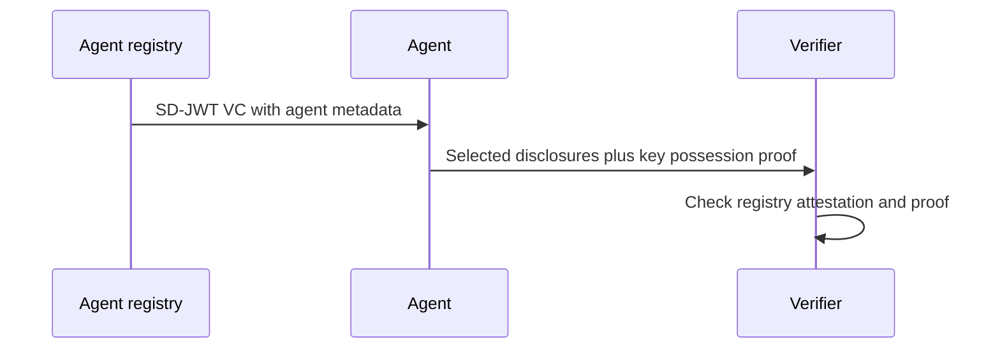
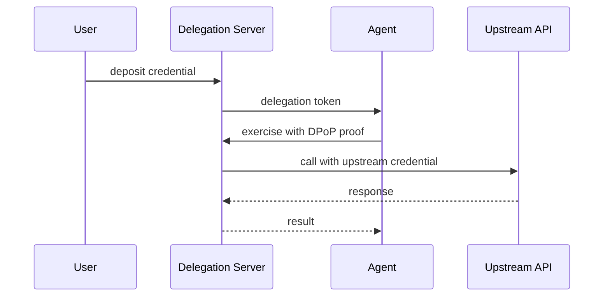
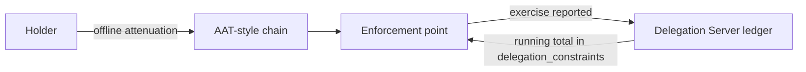
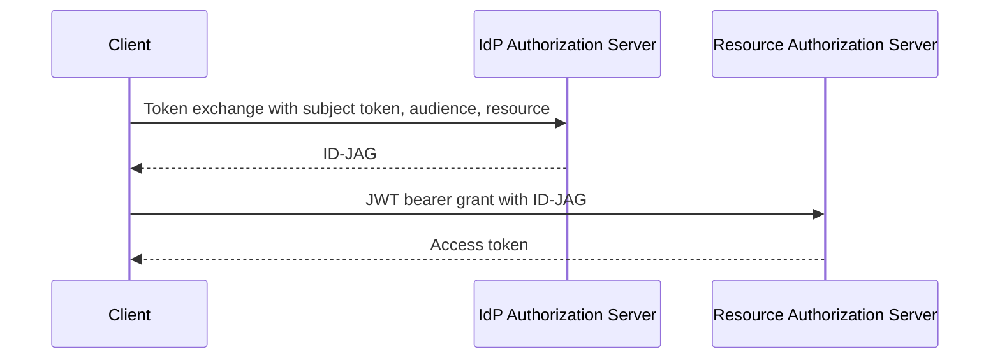

# OAuth WG Daily Report - 2026-11-02

- generated_at_utc: `2026-11-02T15:59:44+00:00`
- snapshot_date: `2026-11-02`

<!-- insights:start -->
## Briefing

> The main activity is a cluster of agent-delegation threads. Sweeney and Niyikiza agreed on how offline attenuation (AAT) and a Delegation Server (DS) divide the work, and still disagree on one hop in del_max_depth. Nothing changed in a core OAuth WG draft today.

_Updated 2026-11-02T16:03:18+00:00. Machine-drafted from the sources linked below, which stay authoritative._

### In short, a new individual draft encodes AI agent metadata as an SD-JWT VC so each verifier sees only what it is allowed to

`mail` · `new-proposal` · first seen 2026-11-02 · [Agent SD-Card (draft-nandakumar-agent-sd-card-00)](https://mailarchive.ietf.org/arch/msg/oauth/EN-CEPT0fCmAvHElXbqyTeiQO9M/)

Suhas Nandakumar announced draft-nandakumar-agent-sd-card-00, which replaces draft-nandakumar-agent-sd-jwt. It says existing agent metadata documents (MCP tool lists, PAP discovery documents, A2A Agent Cards) expose everything to everyone, are weakly or not authenticated, and do not prove the presenter is the agent described. SD-Card encodes the metadata as an SD-JWT VC issued by an agent registry. The agent discloses to each verifier only what that verifier is authorized to see and proves key possession. The draft defines a protocol-independent core plus bindings for MCP, PAP and A2A. The author asks for feedback and collaborators. The mail gives no wire-format detail.

**Use cases**

- An agent registry issuing signed agent descriptions that expose different fields to different counterparties
- A verifier that needs to confirm the party presenting an A2A Agent Card holds the key for the agent described

### Sweeney posted -02 of the Credential Delegation draft, adding cumulative bounds, a chain-verifiable profile and a revocation section

`mail` · `new-proposal` · first seen 2026-11-02 · [draft-sweeney-wimse-credential-delegation-02](https://mailarchive.ietf.org/arch/msg/oauth/pY7YK9NUnlAfWvpf-PhiQ_n53qE/)

In draft-sweeney-wimse-credential-delegation, a Delegation Server holds credentials a user deposits, and agents exercise them by proxy under a delegation token, so the agent never holds the upstream credential. The -02 changes are: a sub-delegation exchange in which client_id and act.sub both name the receiving agent (act is attribution only, never authority), rank order carried in the token, and a delegation_constraints claim with max_lifetime and max_subtree, where the DS is the single writer of the running total. For tokens verified away from the DS, it adopts the asor agent_delegation format unchanged. Section 7 says revoked_count is invalidation, not closure, that exchanged and offline tokens are only partially revoked until expiry, and that a 1-hour token cap bounds admission after revocation. The author asks for review of the cumulative-bound design, the revocation framing and the depth boundary, and notes that the SDK now requires a request-bound DPoP proof.

**Use cases**

- A platform lets agents call third-party APIs on a user's behalf without handing the agents the user's upstream credentials.
- A multi-agent system needs a hard cap on the total lifetime or the number of sub-delegations in a subtree.
- A resource server that verifies tokens away from the DS needs to know how long a revoked token may still be admitted.

**Related in other tracks**

- `ietf-wimse` / `draft-sweeney-wimse-credential-delegation`: This is the draft announced.
- `ietf-wimse` / `draft-asor-wimse-agent-delegation-chain`: Section 5.5 adopts its agent_delegation format unchanged.
- `ietf-wimse` / `draft-ietf-wimse-aims`: The author wants to align the revocation wording with the revocation-admission bound discussion on the AIMS thread.

### An independent implementer reports building verifiers for AAT and asor chains and finds ten points where AAT -02 allows more than one conforming behaviour

`mail` · `discussion` · first seen 2026-11-02 · [Implementation report: attenuating delegation chains for agents (draft-niyikiza-oauth-attenuating-agent-tokens, draft-asor-wimse-agent-delegation-chain)](https://mailarchive.ietf.org/arch/msg/oauth/S713sBvE-oFuIiBYAAE-hrlTWhQ/)

Azat Davliatshin posted draft-davliatshin-oauth-attenuation-chains-report-00, an individual implementation report in the shape of RFC 7942, not a proposal. A TypeScript verifier written from the text agrees with all 229 AAT vectors and the 35 attenu-guard vectors for asor-02. A ProVerif model of both chain structures checks the properties Neil Madden raised and isolates one difference: which key verifies a link below the root. The report records 25 observations on AAT -01 (19 decided by -02), ten points where -02 still leaves more than one conforming behaviour, and seven on asor-02, mainly that Section 6 names no key for a link below the root. The author asks the draft authors for corrections.

**Use cases**

- An implementer writing an AAT verifier can use the ten underdetermined points to find where interoperability may fail.
- The draft authors can use the ProVerif model to compare the guarantees of the two chain structures.

**Related in other tracks**

- `ietf-wimse` / `draft-asor-wimse-agent-delegation-chain`: One of the two drafts the report implements and models.

### In short, the KYAPay token draft is changing how recipients check audience, and a reviewer says the host-versus-domain check for tdm is still too loose

`mail` · `discussion` · first seen 2026-11-02 · [Review of draft-skyfire-oauth-using-kyapay-tokens-01](https://mailarchive.ietf.org/arch/msg/oauth/eeKxYLJ6nzp3P6b1Lb4uo2WKsTg/)

The thread reviews draft-skyfire-oauth-using-kyapay-tokens-01. Bhasker Allam's original review (21 Oct) flagged that the bearer JWT is signed but not encrypted and carries personal and payment data, that bot managers are told to admit such requests without challenge, that intermediaries cannot learn the aud set, and that the token does not say which account it is for. Ankit Agarwal (Skyfire) says PR #59 goes further: in the KYAPay Token draft, aud now identifies the identities the issuer holds for the Target and tsi becomes REQUIRED. Onboarded recipients check aud and tsi, others check tdm, which he corrects to the Target's domain, not host. Carlos Martínez (BeeL) objects that with path-based tenants, tdm app.beel.es/api would pass for anything under beel.es, and asks for host plus path-prefix matching or a note that the path is informational. Ankit says issue #66 and PR #59 track this. The material is truncated.

**Use cases**

- A Target that hosts tenants under paths of one host and must decide how strictly to check tdm
- A CDN or bot manager that sits in front of a Target and has no onboarding relationship with the token issuer

### Two authors agree that AATs and a Delegation Server split by who holds state, but still differ by one hop on del_max_depth

`mail` · `discussion` · first seen 2026-11-02 · [AAT -02 announcement](https://mailarchive.ietf.org/arch/msg/oauth/thOF4kh9bZ3EyW2Q8TPA19sgBU8/)

This thread follows the AAT -02 announcement. Sweeney replies that chain-wide budgets such as max_lifetime and max_subtree need a single writer of the running total, which is the DS ledger carried as delegation_constraints. This layers on top of an AAT-style chain and does not replace it. On revocation, an enforcement point that refuses any chain containing a revoked token works only as far as it has current revocation state. For tokens verified away from the DS, revocation is partial until expiry, so Sweeney asks the companion document for AAT Section 9.8 to state a freshness bound. On del_max_depth, a leaf at del_depth equal to the root maximum is accepted by AAT (vector J.10.f) and rejected by asor -03. Sweeney leans toward the Asor semantics but cares more that the vectors are reconciled. Niyikiza proposes comparing constraint types across the three drafts before IETF 127. The message is truncated, so the rest of the -02 announcement is not covered.

**Use cases**

- A verifier implementing both AAT and asor chains has to decide whether a leaf at the maximum depth is valid.
- A deployment that needs cumulative spend or fan-out limits across several enforcement points needs a DS-style single writer, which offline attenuation cannot provide.
- An enforcement point that relies on chain inspection for revocation needs to know how fresh its revocation data has to be.

**Related in other tracks**

- `ietf-wimse` / `draft-asor-wimse-agent-delegation-chain`: Its del_max_depth semantics differ by one hop from AAT, and Cred -02 adopts its format.
- `ietf-wimse` / `draft-sweeney-wimse-credential-delegation`: The DS-side draft discussed in this thread.
- `ietf-wimse` / `draft-hulea-wimse-agent-mandate`: Named as the third offline attenuation format with typed constraints.

### In short, a second draft named AAuth proposes an OAuth grant flow for AI agents, and the author of the other AAuth draft objects to the name clash

`mail` · `discussion` · first seen 2026-11-02 · [New I-D on AAuth - a new OAuth grant flow for AI Agents](https://mailarchive.ietf.org/arch/msg/oauth/tpSpJCZZOQMvlE_EC0q4DNsz0R4/)

Jonathan Rosenberg announced draft-rosenberg-oauth-aauth-02, written with Pat White. It follows an OAuth interim meeting on AI agent authorization flows, where interest was raised in solving the problem with an OAuth extension (a new grant flow) rather than a new protocol. The draft has an overview of operation and a section comparing it with Dick Hardt's draft. In reply, Dick says that comparison covers draft-hardt-oauth-aauth-protocol -11 (now -12) but not draft-hardt-aauth-r3. In his description, R3 handles resource-authored approval text: the resource token carries r3_uri and r3_s256, only the PS and AS can fetch the document, and the agent is treated as adversarial and never sees it. Per-call proposals bind an approval to the call's actual parameters, single use. He also says two protocols called AAuth will confuse people, and mentions a community at aauth.dev and a proposed AAuth WG at the OpenID Foundation. No decision was reached.

**Use cases**

- Deciding whether agent authorization should be an OAuth grant extension or a separate protocol
- Binding a human approval to the exact parameters of an agent's call while hiding the resource's context from the agent

### A pull request adds a worked, reproducible dSD-JWT example with a generator script to the delegate-sd-jwt draft

`pull-request` · `editorial` · first seen 2026-11-02 · [oauth-wg/oauth-delegate-sd-jwt#14: doc(examples)-Add worked dSD-JWT example with generator](https://github.com/oauth-wg/oauth-delegate-sd-jwt/pull/14)

The PR adds an Examples subsection at the end of Formats, with one delegation (SD-JWT ~~ KB-SD-JWT+KB ~~ KB-SD-JWT) shown at three stages: issuance, delegation, and presentation to two Verifiers. It shows typ as kb-sd-jwt+kb, sd_hash covering the SD-JWT including its disclosure, _sd_alg staying in the KB-SD-JWT payload, and cnf in the Delegate Payload. Each terminal KB-SD-JWT's sd_hash covers the preceding element as serialized for that Verifier, so a chain built for one Verifier does not verify at another. A generator, examples/generate.py, self-verifies and uses deterministic ECDSA, so output is reproducible byte for byte. The PR body is truncated in the source.

### In short, Deferred Token Response -01 adds interaction-aware completion modes and a 'substrate invariants' section, and moves to new editors

`draft-revision` · `substantive` · first seen 2026-11-01 · [draft-ietf-oauth-deferred-token-response-01: Deferred Token Response](https://author-tools.ietf.org/iddiff?url1=draft-ietf-oauth-deferred-token-response-00&url2=draft-ietf-oauth-deferred-token-response-01)

The draft (diff truncated) now has new editors (Itaú, Alibaba) and lives under oauth-wg. It adds a Section 4 of substrate guarantees (no authorization expansion, continuation only via the token endpoint, sender-constraint continuity, immutable originating request, opaque deferral_code, polling always authoritative) and obligations for higher-layer profiles. completion_mode gains a second value, deferred_interactive, and the deferred response can signal interaction_required, interaction_pending or authorization_pending. Servers that don't support the parameter MUST NOT reject the request because of it, and supporting servers MUST publish deferred_token_response_supported=true. New sections cover generating deferral codes, a registered error entry, and three new use cases (AI agent with browser access, regulatory compliance, explicit consent).

**Use cases**

- An AS that needs a human approval or step-up before issuing a token to an agent can return a deferral_code and let the client poll instead of blocking.
- A client that can send the user to a URI can opt in with deferred_interactive and handle interaction_required.
- Profile authors extending DTR must keep polling available and not relax the no-expansion guarantees.

**Related in other tracks**

- `openid` / `openid/OpenID4VCI`: Both define deferred or pending completion of a credential or token request, though the material does not link them directly.

### In short, ID-JAG -06 keeps the flow but tightens many rules, including mandatory client authentication at the IdP and mTLS as a binding option

`draft-revision` · `substantive` · first seen 2026-11-01 · [draft-ietf-oauth-identity-assertion-authz-grant-06: Identity Assertion JWT Authorization Grant](https://author-tools.ietf.org/iddiff?url1=draft-ietf-oauth-identity-assertion-authz-grant-04&url2=draft-ietf-oauth-identity-assertion-authz-grant-06)

Compared with -04, the diff (truncated) adds: RS256 mandatory to implement for IdP and Resource AS, ES256 SHOULD for the Resource AS; sub is the identifier selected for the audience Resource AS; stricter resource handling (string or non-empty array, Simple String Comparison, resource now RECOMMENDED in the token exchange); a single audience value; IdP MUST authenticate the client and reject otherwise with invalid_client; the subject token must be of the stated type and issued for that purpose; detailed SAML NameID rules (no transient NameIDs, pairwise scoping); Cache-Control: no-store in the example; plus new sections on subject token storage, metadata validation, DPoP and mTLS key binding, and privacy. The mailing-list announcement adds that invalid_request replaces invalid_grant for failed subject tokens, key-bound ID-JAGs can replace client authentication at the Resource AS, and id_jag_signing_alg_values_supported metadata is new.

**Use cases**

- An IdP implementing the token exchange step needs to change error handling from invalid_grant to invalid_request and enforce client authentication.
- A SAML-based SaaS Resource AS mapping users via NameID must reject transient NameIDs and use the SP-scoped value.
- Deployments wanting certificate-bound ID-JAGs can use mTLS instead of DPoP.

**Related in other tracks**

- `openid` / `openid/connect`: The ID-JAG reuses ID Token style claims and the draft discusses scope semantics versus OpenID Connect scopes.

### In short, the editor announces ID-JAG -06 and flags the behaviour changes implementers should check

`mail` · `substantive` · first seen 2026-11-01 · [draft-ietf-oauth-identity-assertion-authz-grant-06](https://mailarchive.ietf.org/arch/msg/oauth/-3eHjZkoYNz0qDpviERKkheVDbI/)

The announcement says -05 and -06 bring implementation feedback back into the spec and that flow and design are unchanged. It lists clarifications (resource and audience comparison, sub selection, SAML NameID, refresh token as subject token, error codes) and new items: IdP client authentication, single audience, invalid_request instead of invalid_grant for bad subject tokens, key-bound ID-JAG in place of client authentication at the Resource AS, mTLS binding, id_jag_signing_alg_values_supported, and Privacy Considerations. Open issues are expected at IETF 127.

**Use cases**

- IdP and library maintainers should re-check Token Exchange error handling against the new invalid_request behaviour.

### PR adds a section on JWT-SVID replay and guidance on the jti claim

`pull-request` · `substantive` · first seen 2026-11-01 · [oauth-wg/oauth-spiffe-client-authentication#57: Enhance JWT-SVID replay detection guidance](https://github.com/oauth-wg/oauth-spiffe-client-authentication/pull/57)

The PR adds a section on replay of JWT-SVIDs and guidance on the jti parameter (issue #20). The body does not say whether the guidance is normative or what the recommended handling is.

**Use cases**

- An authorization server accepting JWT-SVIDs as client assertions that must decide how to detect replays.

### PR registers spiffe_jwt, spiffe_x509 and spiffe_wit as token endpoint auth methods

`pull-request` · `substantive` · first seen 2026-11-01 · [oauth-wg/oauth-spiffe-client-authentication#60: Refactor section headings and register authentication methods](https://github.com/oauth-wg/oauth-spiffe-client-authentication/pull/60)

The PR adds spiffe_jwt, spiffe_x509 and spiffe_wit to the OAuth Token Endpoint Authentication Methods registry and updates section headings (issue #48). The body's note on heading renames is garbled and conflicts with PR #61's X509-SVID naming, so the final form is unclear.

**Use cases**

- A client registering or advertising a SPIFFE-based token_endpoint_auth_method value.
- An AS implementer adding recognised SPIFFE method identifiers.

### Triage of the candidate queue

- **high** `draft-ietf-oauth-deferred-token-response`: -01 restructures the draft with substrate invariants, a new deferred_interactive mode and new editors; also cited as the answer to ID-JAG consent.
- **high** `draft-ietf-oauth-identity-assertion-authz-grant`: -06 adds new normative behaviour (client auth at IdP, invalid_request, mTLS binding, new metadata) and a large rewrite.
- **high** `draft-ietf-oauth-spiffe-client-auth`: A batch of PRs (#57-#68) changes replay guidance, auth method registration, and multi-method metadata.
- **high** `draft-ietf-oauth-v2-1`: Seven new issues and 31 closed, several tagged ietf-127, including MUST vs SHOULD in §3.2.3 and invalid_client.
- **low** `draft-ietf-oauth-delegate-sd-jwt`: PR #14 adds a worked example and generator, so implementers can check their output against it.
- **low** `draft-ietf-oauth-sd-jwt-vc`: -23 is only minor editorial fixes and regenerated examples.
- **low** `draft-ietf-oauth-transaction-tokens`: Only a new implementation-report issue (#373) with one comment; no text change.

<!-- insights:end -->

## Top Priorities

| Rank | Draft | Score | Updated | Key State | Repo |
|---|---|---:|---|---|---|
| 1 | `draft-ietf-oauth-sd-jwt-vc` | 125 | 2026-10-31T18:37:09Z | Active, Expert Reviews OK | `oauth-sd-jwt-vc` |
| 2 | `draft-ietf-oauth-identity-assertion-authz-grant` | 90 | 2026-10-31T00:32:39Z | Active, I-D Exists | `oauth-identity-assertion-authz-grant` |
| 3 | `draft-ietf-oauth-deferred-token-response` | 83 | 2026-10-31T16:12:16Z | Active, I-D Exists | `oauth-deferred-token-response` |
| 4 | `draft-ietf-oauth-v2-1` | 83 | 2026-10-31T04:16:32Z | Active, I-D Exists | `oauth-v2-1` |
| 5 | `draft-ietf-oauth-delegate-sd-jwt` | 83 | 2026-10-30T12:38:29Z | Active, I-D Exists | `oauth-delegate-sd-jwt` |
| 6 | `draft-ietf-oauth-rfc7523bis` | 73 | 2026-10-19T18:01:59Z | Active, RFC-Ed-Ack | `draft-ietf-oauth-rfc7523bis` |
| 7 | `draft-ietf-oauth-rfc8725bis` | 65 | 2026-08-31T18:37:20Z | Active, No IANA Actions | `draft-ietf-oauth-rfc8725bis` |
| 8 | `draft-ietf-oauth-identity-chaining` | 65 | 2026-08-21T20:25:31Z | Active, RFC-Ed-Ack | `oauth-identity-chaining` |
| 9 | `draft-ietf-oauth-status-list` | 65 | 2026-08-13T20:11:32Z | Active, RFC-Ed-Ack | `draft-ietf-oauth-status-list` |
| 10 | `draft-ietf-oauth-client-id-metadata-document` | 65 | 2026-07-06T19:55:37Z | Active, I-D Exists | `draft-ietf-oauth-client-id-metadata-document` |

## Active Drafts

| Draft | Rev | Updated | States |
|---|---:|---|---|
| `draft-ietf-oauth-sd-jwt-vc` | 23 | 2026-10-31T18:37:09Z | Active, Expert Reviews OK, Version Changed - Review Needed |
| `draft-ietf-oauth-deferred-token-response` | 01 | 2026-10-31T16:12:16Z | Active, I-D Exists, WG Document |
| `draft-ietf-oauth-v2-1` | 17 | 2026-10-31T04:16:32Z | Active, I-D Exists, WG Document |
| `draft-ietf-oauth-identity-assertion-authz-grant` | 06 | 2026-10-31T00:32:39Z | Active, I-D Exists, WG Document |
| `draft-ietf-oauth-delegate-sd-jwt` | 00 | 2026-10-30T12:38:29Z | Active, I-D Exists, WG Document |
| `draft-ietf-oauth-rfc7523bis` | 11 | 2026-10-19T18:01:59Z | Active, RFC-Ed-Ack, Expert Reviews OK |
| `draft-ietf-oauth-attestation-based-client-auth` | 12 | 2026-10-18T17:33:02Z | Active, I-D Exists, WG Consensus: Waiting for Write-Up |
| `draft-ietf-oauth-rfc8725bis` | 10 | 2026-08-31T18:37:20Z | Active, No IANA Actions, IANA OK - No Actions Needed |
| `draft-ietf-oauth-first-party-apps` | 04 | 2026-08-26T14:40:16Z | Active, I-D Exists, WG Consensus: Waiting for Write-Up |
| `draft-ietf-oauth-rar-metadata-remediation` | 00 | 2026-08-23T20:29:29Z | Active, I-D Exists, WG Document |
| `draft-ietf-oauth-identity-chaining` | 17 | 2026-08-21T20:25:31Z | Active, RFC-Ed-Ack, Expert Reviews OK |
| `draft-ietf-oauth-transaction-tokens` | 11 | 2026-08-21T11:57:16Z | Active, I-D Exists, WG Consensus: Waiting for Write-Up |
| `draft-ietf-oauth-status-list` | 21 | 2026-08-13T20:11:32Z | Active, RFC-Ed-Ack, Expert Reviews OK |
| `draft-ietf-oauth-client-id-metadata-document` | 02 | 2026-07-06T19:55:37Z | Active, I-D Exists, WG Document |
| `draft-ietf-oauth-refresh-token-expiration` | 03 | 2026-07-06T17:53:06Z | Active, I-D Exists, WG Document |

## Repo Watch

| Repo | Pushed | Open Issues |
|---|---|---:|
| `oauth-wg/oauth-spiffe-client-authentication` | 2026-11-02T15:57:13Z | 11 |
| `oauth-wg/draft-ietf-oauth-client-id-metadata-document` | 2026-11-01T21:57:19Z | 46 |
| `oauth-wg/oauth-sd-jwt-vc` | 2026-11-01T00:37:52Z | 0 |
| `oauth-wg/oauth-delegate-sd-jwt` | 2026-11-01T00:29:57Z | 12 |
| `oauth-wg/oauth-transaction-tokens` | 2026-11-01T00:20:49Z | 2 |
| `oauth-wg/oauth-v2-1` | 2026-11-01T00:16:01Z | 12 |
| `oauth-wg/oauth-deferred-token-response` | 2026-11-01T00:08:01Z | 23 |
| `oauth-wg/oauth-identity-assertion-authz-grant` | 2026-11-01T00:03:15Z | 32 |
| `oauth-wg/draft-ietf-oauth-attestation-based-client-auth` | 2026-10-13T06:13:11Z | 0 |
| `oauth-wg/oauth-selective-disclosure-jwt` | 2026-10-04T13:50:37Z | 0 |
| `oauth-wg/oauth-cross-device-security` | 2026-08-27T14:45:11Z | 0 |
| `oauth-wg/oauth-browser-based-apps` | 2026-08-27T14:43:00Z | 0 |

## Recent Pull Requests

- `oauth-wg/oauth-spiffe-client-authentication#66` Refactor client_id usage and examples in draft (2026-11-02T15:56:47Z)
- `oauth-wg/oauth-spiffe-client-authentication#65` Update trust model and bundle endpoint configuration (2026-11-02T15:38:03Z)
- `oauth-wg/oauth-spiffe-client-authentication#68` Address Nits (2026-11-02T13:28:36Z)
- `oauth-wg/oauth-spiffe-client-authentication#64` Update client certificate validation rules (2026-11-02T13:11:35Z)
- `oauth-wg/oauth-spiffe-client-authentication#63` Enhance metadata and interoperability for SPIFFE client auth (2026-11-02T11:47:06Z)
- `oauth-wg/oauth-spiffe-client-authentication#62` Update X.509-SVID client authentication details (2026-11-02T10:00:12Z)
- `oauth-wg/oauth-spiffe-client-authentication#61` Refine terminology and consistency for SVIDs (2026-11-02T09:51:01Z)
- `oauth-wg/oauth-spiffe-client-authentication#60` Refactor section headings and register authentication methods (2026-11-02T09:44:47Z)
- `oauth-wg/oauth-spiffe-client-authentication#59` Update X.509-SVID authentication and server certificate details (2026-11-02T09:43:12Z)
- `oauth-wg/oauth-spiffe-client-authentication#58` Update SPIFFE bundle endpoint authentication details (2026-11-02T09:30:26Z)

## Recent Issues

- `oauth-wg/oauth-spiffe-client-authentication#48` Do we need IANA registrations for spiffe_jwt, spiffe_wit and spiffe_x509? (2026-11-02T13:30:22Z)
- `oauth-wg/oauth-spiffe-client-authentication#45` X.509 vs X509 (2026-11-02T13:30:11Z)
- `oauth-wg/oauth-spiffe-client-authentication#27` We need to clarify/defined what we mean by webpki (2026-11-02T13:29:44Z)
- `oauth-wg/oauth-spiffe-client-authentication#22` SPIFFE Federation spiffe-TLS variant (2026-11-02T13:29:28Z)
- `oauth-wg/oauth-spiffe-client-authentication#49` Should we describe the use of token_endpoint_auth_methods_supported for client metadata? (2026-11-02T11:47:00Z)
- `oauth-wg/oauth-spiffe-client-authentication#26` When using X.509, allow for a webPKI server certificate (2026-11-02T09:43:26Z)
- `oauth-wg/oauth-spiffe-client-authentication#20` Add mention of client assertion reuse (2026-11-02T09:14:39Z)
- `oauth-wg/oauth-spiffe-client-authentication#11` Cover "Certificate-Bound Access Tokens" part of RFC 8705 (2026-11-02T09:11:11Z)
- `oauth-wg/oauth-delegate-sd-jwt#5` Add Examples (2026-11-02T06:49:50Z)
- `oauth-wg/oauth-deferred-token-response#80` Clarify whether `deferred_interactive` alone permits deferral (2026-11-02T04:45:17Z)

## Organization Events

- `2026-11-02T15:38:02Z` PullRequestEvent `oauth-wg/oauth-spiffe-client-authentication` merged
- `2026-10-30T20:54:07Z` PushEvent `oauth-wg/oauth-identity-assertion-authz-grant` 
- `2026-10-30T21:19:44Z` PushEvent `oauth-wg/oauth-identity-assertion-authz-grant` 
- `2026-10-30T20:40:40Z` DeleteEvent `oauth-wg/oauth-identity-assertion-authz-grant` 
- `2026-10-31T20:29:58Z` PushEvent `oauth-wg/draft-ietf-oauth-client-id-metadata-document` 
- `2026-10-30T21:03:30Z` PushEvent `oauth-wg/oauth-identity-assertion-authz-grant` 
- `2026-10-31T20:24:44Z` CreateEvent `oauth-wg/draft-ietf-oauth-client-id-metadata-document` 
- `2026-10-30T20:56:20Z` PushEvent `oauth-wg/oauth-identity-assertion-authz-grant` 
- `2026-11-01T00:00:41Z` PushEvent `oauth-wg/draft-ietf-oauth-client-id-metadata-document` 
- `2026-10-30T20:36:15Z` PushEvent `oauth-wg/oauth-identity-assertion-authz-grant` 
- `2026-11-01T00:16:02Z` PushEvent `oauth-wg/oauth-v2-1` 
- `2026-11-01T00:08:02Z` PushEvent `oauth-wg/oauth-deferred-token-response` 
- `2026-10-31T20:29:21Z` PushEvent `oauth-wg/draft-ietf-oauth-client-id-metadata-document` 
- `2026-11-02T13:29:43Z` IssueCommentEvent `oauth-wg/oauth-spiffe-client-authentication` We need to clarify/defined what we mean by webpki
- `2026-11-02T13:30:22Z` IssueCommentEvent `oauth-wg/oauth-spiffe-client-authentication` Do we need IANA registrations for spiffe_jwt, spiffe_wit and spiffe_x509?
- `2026-10-31T20:14:18Z` PushEvent `oauth-wg/draft-ietf-oauth-client-id-metadata-document` 
- `2026-11-02T13:29:28Z` IssueCommentEvent `oauth-wg/oauth-spiffe-client-authentication` SPIFFE Federation spiffe-TLS variant
- `2026-11-02T13:30:10Z` IssueCommentEvent `oauth-wg/oauth-spiffe-client-authentication` X.509 vs X509
- `2026-11-02T13:30:23Z` IssuesEvent `oauth-wg/oauth-spiffe-client-authentication` Do we need IANA registrations for spiffe_jwt, spiffe_wit and spiffe_x509?
- `2026-11-02T13:29:44Z` IssuesEvent `oauth-wg/oauth-spiffe-client-authentication` We need to clarify/defined what we mean by webpki

## Mailarchive Signals

- weekly_digest_count: `1`
- [OAUTH-WG] Re: AAT -02 announcement - https://mailarchive.ietf.org/arch/msg/oauth/thOF4kh9bZ3EyW2Q8TPA19sgBU8/
- [OAUTH-WG] [WIMSE] draft-sweeney-wimse-credential-delegation-02 - https://mailarchive.ietf.org/arch/msg/oauth/pY7YK9NUnlAfWvpf-PhiQ_n53qE/
- [OAUTH-WG] Implementation report: attenuating delegation chains for agents (draft-niyikiza-oauth-attenuating-agent-tokens, draft-asor-wimse-agent-delegation-chain) - https://mailarchive.ietf.org/arch/msg/oauth/S713sBvE-oFuIiBYAAE-hrlTWhQ/
- [OAUTH-WG] Re：I-D Action: draft-ietf-oauth-deferred-token-response-01.txt - https://mailarchive.ietf.org/arch/msg/oauth/qJg4VJiCReF2OX0bdC95q0xXAVw/
- [OAUTH-WG] Agent SD-Card (draft-nandakumar-agent-sd-card-00) - https://mailarchive.ietf.org/arch/msg/oauth/EN-CEPT0fCmAvHElXbqyTeiQO9M/
- [OAUTH-WG] Re: Review of draft-skyfire-oauth-using-kyapay-tokens-01 - https://mailarchive.ietf.org/arch/msg/oauth/eeKxYLJ6nzp3P6b1Lb4uo2WKsTg/
- [OAUTH-WG] Re: New I-D on AAuth - a new OAuth grant flow for AI Agents - https://mailarchive.ietf.org/arch/msg/oauth/tpSpJCZZOQMvlE_EC0q4DNsz0R4/
- [OAUTH-WG] Re: New I-D on AAuth - a new OAuth grant flow for AI Agents - https://mailarchive.ietf.org/arch/msg/oauth/JVPELSKXNkSfFl8ghAjmH4SI5og/

## Next Actions

1. Evaluate the top 3 items in `Top Priorities` as weekly deep-dive candidates.
2. Separately track comment deadlines for `In Last Call` / `In WG Last Call` drafts.
3. For repos with a sudden spike in activity, create a scaffold in `deep-dives/` to capture key discussion points.
