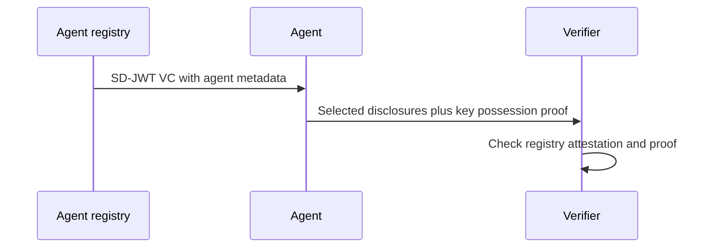
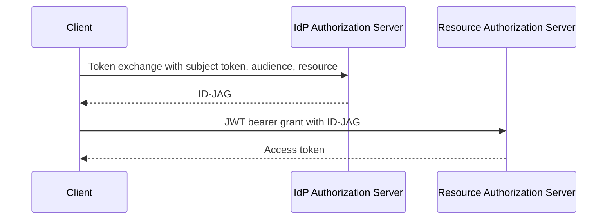
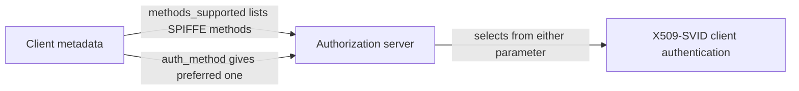
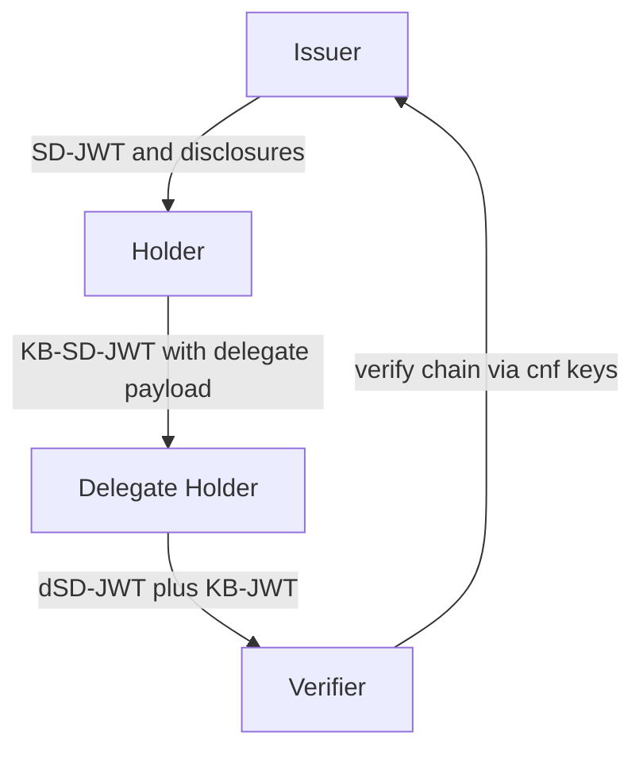

# OAuth WG Daily Report - 2026-11-02

- generated_at_utc: `2026-11-02T06:10:54+00:00`
- snapshot_date: `2026-11-02`

<!-- insights:start -->
## Briefing

> A new individual draft, draft-nandakumar-agent-sd-card-00, proposes SD-JWT VC agent metadata. The other two items are agent-auth discussion: the KYAPay token review is still open, and a second, competing "AAuth" draft raises a name clash. No WG-adopted draft moved.

_Updated 2026-11-02T06:12:16+00:00. Machine-drafted from the sources linked below, which stay authoritative._

### In short, a new individual draft encodes AI agent metadata as an SD-JWT VC so each verifier sees only what it is allowed to

`mail` · `new-proposal` · first seen 2026-11-02 · [Agent SD-Card (draft-nandakumar-agent-sd-card-00)](https://mailarchive.ietf.org/arch/msg/oauth/EN-CEPT0fCmAvHElXbqyTeiQO9M/)

Suhas Nandakumar announced draft-nandakumar-agent-sd-card-00, which replaces draft-nandakumar-agent-sd-jwt. It says existing agent metadata documents (MCP tool lists, PAP discovery documents, A2A Agent Cards) expose everything to everyone, are weakly or not authenticated, and do not prove the presenter is the agent described. SD-Card encodes the metadata as an SD-JWT VC issued by an agent registry. The agent discloses to each verifier only what that verifier is authorized to see and proves key possession. The draft defines a protocol-independent core plus bindings for MCP, PAP and A2A. The author asks for feedback and collaborators. The mail gives no wire-format detail.

**Use cases**

- An agent registry issuing signed agent descriptions that expose different fields to different counterparties
- A verifier that needs to confirm the party presenting an A2A Agent Card holds the key for the agent described

### In short, the KYAPay token draft is changing how recipients check audience, and a reviewer says the host-versus-domain check for tdm is still too loose

`mail` · `discussion` · first seen 2026-11-02 · [Review of draft-skyfire-oauth-using-kyapay-tokens-01](https://mailarchive.ietf.org/arch/msg/oauth/eeKxYLJ6nzp3P6b1Lb4uo2WKsTg/)

The thread reviews draft-skyfire-oauth-using-kyapay-tokens-01. Bhasker Allam's original review (21 Oct) flagged that the bearer JWT is signed but not encrypted and carries personal and payment data, that bot managers are told to admit such requests without challenge, that intermediaries cannot learn the aud set, and that the token does not say which account it is for. Ankit Agarwal (Skyfire) says PR #59 goes further: in the KYAPay Token draft, aud now identifies the identities the issuer holds for the Target and tsi becomes REQUIRED. Onboarded recipients check aud and tsi, others check tdm, which he corrects to the Target's domain, not host. Carlos Martínez (BeeL) objects that with path-based tenants, tdm app.beel.es/api would pass for anything under beel.es, and asks for host plus path-prefix matching or a note that the path is informational. Ankit says issue #66 and PR #59 track this. The material is truncated.

**Use cases**

- A Target that hosts tenants under paths of one host and must decide how strictly to check tdm
- A CDN or bot manager that sits in front of a Target and has no onboarding relationship with the token issuer

### In short, a second draft named AAuth proposes an OAuth grant flow for AI agents, and the author of the other AAuth draft objects to the name clash

`mail` · `discussion` · first seen 2026-11-02 · [New I-D on AAuth - a new OAuth grant flow for AI Agents](https://mailarchive.ietf.org/arch/msg/oauth/tpSpJCZZOQMvlE_EC0q4DNsz0R4/)

Jonathan Rosenberg announced draft-rosenberg-oauth-aauth-02, written with Pat White. It follows an OAuth interim meeting on AI agent authorization flows, where interest was raised in solving the problem with an OAuth extension (a new grant flow) rather than a new protocol. The draft has an overview of operation and a section comparing it with Dick Hardt's draft. In reply, Dick says that comparison covers draft-hardt-oauth-aauth-protocol -11 (now -12) but not draft-hardt-aauth-r3. In his description, R3 handles resource-authored approval text: the resource token carries r3_uri and r3_s256, only the PS and AS can fetch the document, and the agent is treated as adversarial and never sees it. Per-call proposals bind an approval to the call's actual parameters, single use. He also says two protocols called AAuth will confuse people, and mentions a community at aauth.dev and a proposed AAuth WG at the OpenID Foundation. No decision was reached.

**Use cases**

- Deciding whether agent authorization should be an OAuth grant extension or a separate protocol
- Binding a human approval to the exact parameters of an agent's call while hiding the resource's context from the agent

### In short, Deferred Token Response -01 adds interaction-aware completion modes and a 'substrate invariants' section, and moves to new editors

`draft-revision` · `substantive` · first seen 2026-11-01 · [draft-ietf-oauth-deferred-token-response-01: Deferred Token Response](https://author-tools.ietf.org/iddiff?url1=draft-ietf-oauth-deferred-token-response-00&url2=draft-ietf-oauth-deferred-token-response-01)

The draft (diff truncated) now has new editors (Itaú, Alibaba) and lives under oauth-wg. It adds a Section 4 of substrate guarantees (no authorization expansion, continuation only via the token endpoint, sender-constraint continuity, immutable originating request, opaque deferral_code, polling always authoritative) and obligations for higher-layer profiles. completion_mode gains a second value, deferred_interactive, and the deferred response can signal interaction_required, interaction_pending or authorization_pending. Servers that don't support the parameter MUST NOT reject the request because of it, and supporting servers MUST publish deferred_token_response_supported=true. New sections cover generating deferral codes, a registered error entry, and three new use cases (AI agent with browser access, regulatory compliance, explicit consent).

**Use cases**

- An AS that needs a human approval or step-up before issuing a token to an agent can return a deferral_code and let the client poll instead of blocking.
- A client that can send the user to a URI can opt in with deferred_interactive and handle interaction_required.
- Profile authors extending DTR must keep polling available and not relax the no-expansion guarantees.

**Related in other tracks**

- `openid` / `openid/OpenID4VCI`: Both define deferred or pending completion of a credential or token request, though the material does not link them directly.

### In short, ID-JAG -06 keeps the flow but tightens many rules, including mandatory client authentication at the IdP and mTLS as a binding option

`draft-revision` · `substantive` · first seen 2026-11-01 · [draft-ietf-oauth-identity-assertion-authz-grant-06: Identity Assertion JWT Authorization Grant](https://author-tools.ietf.org/iddiff?url1=draft-ietf-oauth-identity-assertion-authz-grant-04&url2=draft-ietf-oauth-identity-assertion-authz-grant-06)

Compared with -04, the diff (truncated) adds: RS256 mandatory to implement for IdP and Resource AS, ES256 SHOULD for the Resource AS; sub is the identifier selected for the audience Resource AS; stricter resource handling (string or non-empty array, Simple String Comparison, resource now RECOMMENDED in the token exchange); a single audience value; IdP MUST authenticate the client and reject otherwise with invalid_client; the subject token must be of the stated type and issued for that purpose; detailed SAML NameID rules (no transient NameIDs, pairwise scoping); Cache-Control: no-store in the example; plus new sections on subject token storage, metadata validation, DPoP and mTLS key binding, and privacy. The mailing-list announcement adds that invalid_request replaces invalid_grant for failed subject tokens, key-bound ID-JAGs can replace client authentication at the Resource AS, and id_jag_signing_alg_values_supported metadata is new.

**Use cases**

- An IdP implementing the token exchange step needs to change error handling from invalid_grant to invalid_request and enforce client authentication.
- A SAML-based SaaS Resource AS mapping users via NameID must reject transient NameIDs and use the SP-scoped value.
- Deployments wanting certificate-bound ID-JAGs can use mTLS instead of DPoP.

**Related in other tracks**

- `openid` / `openid/connect`: The ID-JAG reuses ID Token style claims and the draft discusses scope semantics versus OpenID Connect scopes.

### In short, the editor announces ID-JAG -06 and flags the behaviour changes implementers should check

`mail` · `substantive` · first seen 2026-11-01 · [draft-ietf-oauth-identity-assertion-authz-grant-06](https://mailarchive.ietf.org/arch/msg/oauth/-3eHjZkoYNz0qDpviERKkheVDbI/)

The announcement says -05 and -06 bring implementation feedback back into the spec and that flow and design are unchanged. It lists clarifications (resource and audience comparison, sub selection, SAML NameID, refresh token as subject token, error codes) and new items: IdP client authentication, single audience, invalid_request instead of invalid_grant for bad subject tokens, key-bound ID-JAG in place of client authentication at the Resource AS, mTLS binding, id_jag_signing_alg_values_supported, and Privacy Considerations. Open issues are expected at IETF 127.

**Use cases**

- IdP and library maintainers should re-check Token Exchange error handling against the new invalid_request behaviour.

### PR adds a section on JWT-SVID replay and guidance on the jti claim

`pull-request` · `substantive` · first seen 2026-11-01 · [oauth-wg/oauth-spiffe-client-authentication#57: Enhance JWT-SVID replay detection guidance](https://github.com/oauth-wg/oauth-spiffe-client-authentication/pull/57)

The PR adds a section on replay of JWT-SVIDs and guidance on the jti parameter (issue #20). The body does not say whether the guidance is normative or what the recommended handling is.

**Use cases**

- An authorization server accepting JWT-SVIDs as client assertions that must decide how to detect replays.

### PR registers spiffe_jwt, spiffe_x509 and spiffe_wit as token endpoint auth methods

`pull-request` · `substantive` · first seen 2026-11-01 · [oauth-wg/oauth-spiffe-client-authentication#60: Refactor section headings and register authentication methods](https://github.com/oauth-wg/oauth-spiffe-client-authentication/pull/60)

The PR adds spiffe_jwt, spiffe_x509 and spiffe_wit to the OAuth Token Endpoint Authentication Methods registry and updates section headings (issue #48). The body's note on heading renames is garbled and conflicts with PR #61's X509-SVID naming, so the final form is unclear.

**Use cases**

- A client registering or advertising a SPIFFE-based token_endpoint_auth_method value.
- An AS implementer adding recognised SPIFFE method identifiers.

### PR lets clients list several SPIFFE auth methods via token_endpoint_auth_methods_supported

`pull-request` · `substantive` · first seen 2026-11-01 · [oauth-wg/oauth-spiffe-client-authentication#63: Enhance metadata and interoperability for SPIFFE client auth](https://github.com/oauth-wg/oauth-spiffe-client-authentication/pull/63)

RFC 7591's token_endpoint_auth_method holds one value, so clients cannot declare multiple SPIFFE methods. The PR uses the multi-valued token_endpoint_auth_methods_supported parameter from OpenID Connect RP Metadata Choices, already in the IANA registry and so usable by Client ID Metadata Documents. Clients list methods there and SHOULD also send token_endpoint_auth_method with a preferred one, so RFC 7591-only servers do not default to client_secret_basic. The AS selects X509-SVID authentication from either parameter. No new parameters are defined; the reference is informative.

**Use cases**

- A workload using a CIMD that supports both X509-SVID and JWT-SVID client authentication.
- An AS that implements only RFC 7591 and must avoid falling back to client_secret_basic.

**Related in other tracks**

- `openid` / `openid/connect`: The multi-valued parameter comes from OpenID Connect RP Metadata Choices.

### In short, Delegate SD-JWT -00 lets a SD-JWT holder hand a presentation on to a delegate by making the key-binding JWT itself an SD-JWT

`new-draft` · `new-proposal` · first seen 2026-11-01 · [draft-ietf-oauth-delegate-sd-jwt-00: Delegate SD-JWT](https://datatracker.ietf.org/doc/draft-ietf-oauth-delegate-sd-jwt/00/)

The first WG-named revision (authors from Google and SPRIND) extends RFC 9901 so a KB-JWT can be a KB-SD-JWT carrying a selectively disclosable delegate payload, optionally with its own key binding and further chaining. Compact serialization uses a double tilde between chain elements; new typ values kb+sd-jwt and kb-sd-jwt+kb are defined; sd_hash or issuer_jwt_hash links each link to its predecessor; and verification walks the chain using each cnf key. The stated motivation is letting an AI agent prove authority to buy from a merchant without revealing other eligible merchants. The text is truncated, so the security and IANA sections were not seen.

**Use cases**

- A user wallet delegating a purchase mandate to an AI agent that then presents to a merchant.
- A verifier needing to validate a multi-hop chain back to the original issuer while preserving data minimisation.

**Related in other tracks**

- `ietf-wimse` / `draft-asor-wimse-agent-delegation-chain`: Another offline delegation chain design for agents, discussed on the list alongside similar formats.
- `ietf-wimse` / `draft-hulea-wimse-agent-mandate`: Verifiable agent mandates that overlap in purpose with delegated SD-JWT chains.
- `openid` / `openid/OpenID4VP`: The draft has a section on delegation using OpenID4VP presentation.

### Two AI-agent authorization proposals: a Mission-to-OAuth mapping, and a new AAuth grant-flow draft

`mail` · `new-proposal` · first seen 2026-11-01 · [New I-D on AAuth - a new OAuth grant flow for AI Agents (2 new messages)](https://mailarchive.ietf.org/arch/msg/oauth/JVPELSKXNkSfFl8ghAjmH4SI5og/)

One message maps the Mission-bound authorization drafts onto existing OAuth mechanisms (attestation-based client auth, PAR/RAR, DTR, status lists, token exchange, identity chaining, ID-JAG, transaction tokens, DPoP/mTLS). The stated rule is to profile an existing OAuth mechanism rather than invent a Mission-specific one, keeping the companion drafts thin. A second message announces draft-rosenberg-oauth-aauth-02, which realises AAuth as an OAuth grant flow instead of a new protocol, includes a comparison with Dick Hardt's AAuth document, and asks whether the community is interested.

**Use cases**

- An AS vendor deciding whether agent authorization should be a new OAuth grant or a profile of PAR/RAR plus deferred responses.
- A team building long-running agent tasks that wants approved-work boundaries expressed with existing OAuth building blocks.

**Related in other tracks**

- `ietf-wimse` / `draft-ietf-wimse-aims`: The mail cites AIMS as a similar compositional approach that assembles existing standards.
- `openid` / `openid/sharedsignals`: Shared Signals Framework is listed as a substrate for Mission lifecycle signals.
- `openid` / `openid/authzen`: AuthZEN Authorization API is listed for runtime oversight.

### In short, Attenuating Authorization Tokens -02 adds chain verification and test vectors, and a reply asks the competing formats to share subsumption rules

`mail` · `new-proposal` · first seen 2026-11-01 · [New version: Attenuating Authorization Tokens (draft-niyikiza-oauth-attenuating-agent-tokens-02)](https://mailarchive.ietf.org/arch/msg/oauth/yYnrgM51pZuvm6s8z1lmcv5tHEU/)

The author says -02 specifies chain verification step by step with 229 public test vectors, three new implementations, and a section comparing AATs with transaction tokens, identity chaining, WIMSE AIMS, Macaroons, UCAN and others. A reply from the author of a credential delegation draft says cumulative budgets and sub-root revocation need a server in the path, and notes three offline attenuation formats (AATs, asor, hulea) with differing rules and reused claim names. They ask for one subsumption rule per constraint type across them.

**Use cases**

- Agent frameworks that issue narrower sub-tokens to sub-agents offline and want interoperable verification.
- Verifiers that would otherwise implement the same constraint comparison separately for each format.

**Related in other tracks**

- `ietf-wimse` / `draft-sweeney-wimse-credential-delegation`: Reply author's server-side companion design.
- `ietf-wimse` / `draft-asor-wimse-agent-delegation-chain`: Named as a competing offline attenuation format reusing chain claim names.
- `ietf-wimse` / `draft-hulea-wimse-agent-mandate`: Named as the third offline attenuation format.

### Triage of the candidate queue

- **high** `draft-ietf-oauth-deferred-token-response`: -01 restructures the draft with substrate invariants, a new deferred_interactive mode and new editors; also cited as the answer to ID-JAG consent.
- **high** `draft-ietf-oauth-delegate-sd-jwt`: New WG draft defining a delegation chain format for agents; being used as a base by others.
- **high** `draft-ietf-oauth-identity-assertion-authz-grant`: -06 adds new normative behaviour (client auth at IdP, invalid_request, mTLS binding, new metadata) and a large rewrite.
- **high** `draft-ietf-oauth-spiffe-client-auth`: A batch of PRs (#57-#68) changes replay guidance, auth method registration, and multi-method metadata.
- **high** `draft-ietf-oauth-v2-1`: Seven new issues and 31 closed, several tagged ietf-127, including MUST vs SHOULD in §3.2.3 and invalid_client.
- **low** `draft-ietf-oauth-sd-jwt-vc`: -23 is only minor editorial fixes and regenerated examples.
- **low** `draft-ietf-oauth-transaction-tokens`: Only a new implementation-report issue (#373) with one comment; no text change.

<!-- insights:end -->

## Top Priorities

| Rank | Draft | Score | Updated | Key State | Repo |
|---|---|---:|---|---|---|
| 1 | `draft-ietf-oauth-sd-jwt-vc` | 125 | 2026-10-31T18:37:09Z | Active, Expert Reviews OK | `oauth-sd-jwt-vc` |
| 2 | `draft-ietf-oauth-identity-assertion-authz-grant` | 90 | 2026-10-31T00:32:39Z | Active, I-D Exists | `oauth-identity-assertion-authz-grant` |
| 3 | `draft-ietf-oauth-deferred-token-response` | 83 | 2026-10-31T16:12:16Z | Active, I-D Exists | `oauth-deferred-token-response` |
| 4 | `draft-ietf-oauth-v2-1` | 83 | 2026-10-31T04:16:32Z | Active, I-D Exists | `oauth-v2-1` |
| 5 | `draft-ietf-oauth-delegate-sd-jwt` | 83 | 2026-10-30T12:38:29Z | Active, I-D Exists | `oauth-delegate-sd-jwt` |
| 6 | `draft-ietf-oauth-rfc7523bis` | 73 | 2026-10-19T18:01:59Z | Active, RFC-Ed-Ack | `draft-ietf-oauth-rfc7523bis` |
| 7 | `draft-ietf-oauth-rfc8725bis` | 65 | 2026-08-31T18:37:20Z | Active, No IANA Actions | `draft-ietf-oauth-rfc8725bis` |
| 8 | `draft-ietf-oauth-identity-chaining` | 65 | 2026-08-21T20:25:31Z | Active, RFC-Ed-Ack | `oauth-identity-chaining` |
| 9 | `draft-ietf-oauth-status-list` | 65 | 2026-08-13T20:11:32Z | Active, RFC-Ed-Ack | `draft-ietf-oauth-status-list` |
| 10 | `draft-ietf-oauth-client-id-metadata-document` | 65 | 2026-07-06T19:55:37Z | Active, I-D Exists | `draft-ietf-oauth-client-id-metadata-document` |

## Active Drafts

| Draft | Rev | Updated | States |
|---|---:|---|---|
| `draft-ietf-oauth-sd-jwt-vc` | 23 | 2026-10-31T18:37:09Z | Active, Expert Reviews OK, Version Changed - Review Needed |
| `draft-ietf-oauth-deferred-token-response` | 01 | 2026-10-31T16:12:16Z | Active, I-D Exists, WG Document |
| `draft-ietf-oauth-v2-1` | 17 | 2026-10-31T04:16:32Z | Active, I-D Exists, WG Document |
| `draft-ietf-oauth-identity-assertion-authz-grant` | 06 | 2026-10-31T00:32:39Z | Active, I-D Exists, WG Document |
| `draft-ietf-oauth-delegate-sd-jwt` | 00 | 2026-10-30T12:38:29Z | Active, I-D Exists, WG Document |
| `draft-ietf-oauth-rfc7523bis` | 11 | 2026-10-19T18:01:59Z | Active, RFC-Ed-Ack, Expert Reviews OK |
| `draft-ietf-oauth-attestation-based-client-auth` | 12 | 2026-10-18T17:33:02Z | Active, I-D Exists, WG Consensus: Waiting for Write-Up |
| `draft-ietf-oauth-rfc8725bis` | 10 | 2026-08-31T18:37:20Z | Active, No IANA Actions, IANA OK - No Actions Needed |
| `draft-ietf-oauth-first-party-apps` | 04 | 2026-08-26T14:40:16Z | Active, I-D Exists, WG Consensus: Waiting for Write-Up |
| `draft-ietf-oauth-rar-metadata-remediation` | 00 | 2026-08-23T20:29:29Z | Active, I-D Exists, WG Document |
| `draft-ietf-oauth-identity-chaining` | 17 | 2026-08-21T20:25:31Z | Active, RFC-Ed-Ack, Expert Reviews OK |
| `draft-ietf-oauth-transaction-tokens` | 11 | 2026-08-21T11:57:16Z | Active, I-D Exists, WG Consensus: Waiting for Write-Up |
| `draft-ietf-oauth-status-list` | 21 | 2026-08-13T20:11:32Z | Active, RFC-Ed-Ack, Expert Reviews OK |
| `draft-ietf-oauth-client-id-metadata-document` | 02 | 2026-07-06T19:55:37Z | Active, I-D Exists, WG Document |
| `draft-ietf-oauth-refresh-token-expiration` | 03 | 2026-07-06T17:53:06Z | Active, I-D Exists, WG Document |

## Repo Watch

| Repo | Pushed | Open Issues |
|---|---|---:|
| `oauth-wg/draft-ietf-oauth-client-id-metadata-document` | 2026-11-01T21:57:19Z | 46 |
| `oauth-wg/oauth-spiffe-client-authentication` | 2026-11-01T19:58:52Z | 29 |
| `oauth-wg/oauth-sd-jwt-vc` | 2026-11-01T00:37:52Z | 0 |
| `oauth-wg/oauth-delegate-sd-jwt` | 2026-11-01T00:29:57Z | 11 |
| `oauth-wg/oauth-transaction-tokens` | 2026-11-01T00:20:49Z | 2 |
| `oauth-wg/oauth-v2-1` | 2026-11-01T00:16:01Z | 12 |
| `oauth-wg/oauth-deferred-token-response` | 2026-11-01T00:08:01Z | 23 |
| `oauth-wg/oauth-identity-assertion-authz-grant` | 2026-11-01T00:03:15Z | 32 |
| `oauth-wg/draft-ietf-oauth-attestation-based-client-auth` | 2026-10-13T06:13:11Z | 0 |
| `oauth-wg/oauth-selective-disclosure-jwt` | 2026-10-04T13:50:37Z | 0 |
| `oauth-wg/oauth-cross-device-security` | 2026-08-27T14:45:11Z | 0 |
| `oauth-wg/oauth-browser-based-apps` | 2026-08-27T14:43:00Z | 0 |

## Recent Pull Requests

- `oauth-wg/draft-ietf-oauth-client-id-metadata-document#99` Add Client Authentication section (2026-11-01T22:16:15Z)
- `oauth-wg/oauth-spiffe-client-authentication#68` Address Nits (2026-11-01T19:58:31Z)
- `oauth-wg/oauth-spiffe-client-authentication#66` Refactor client_id usage and examples in draft (2026-11-01T19:54:30Z)
- `oauth-wg/oauth-spiffe-client-authentication#57` Enhance JWT-SVID replay detection guidance (2026-11-01T18:59:02Z)
- `oauth-wg/oauth-spiffe-client-authentication#65` Update trust model and bundle endpoint configuration (2026-11-01T17:50:32Z)
- `oauth-wg/oauth-spiffe-client-authentication#64` Update client certificate validation rules (2026-11-01T17:18:39Z)
- `oauth-wg/oauth-spiffe-client-authentication#63` Enhance metadata and interoperability for SPIFFE client auth (2026-11-01T17:05:07Z)
- `oauth-wg/oauth-spiffe-client-authentication#62` Update X.509-SVID client authentication details (2026-11-01T16:25:49Z)
- `oauth-wg/oauth-spiffe-client-authentication#61` Refine terminology and consistency for SVIDs (2026-11-01T16:16:11Z)
- `oauth-wg/oauth-spiffe-client-authentication#60` Refactor section headings and register authentication methods (2026-11-01T15:55:03Z)

## Recent Issues

- `oauth-wg/oauth-deferred-token-response#80` Clarify whether `deferred_interactive` alone permits deferral (2026-11-02T04:45:17Z)
- `oauth-wg/draft-ietf-oauth-client-id-metadata-document#69` Concerns on Client Identifier allowing Query Strings (2026-11-01T18:58:13Z)
- `oauth-wg/oauth-spiffe-client-authentication#67` Nits (2026-11-01T18:47:44Z)
- `oauth-wg/oauth-spiffe-client-authentication#52` Should X.509 validation include all the leaf checks from the SPIFFE X.509 specification? (2026-11-01T17:19:33Z)
- `oauth-wg/oauth-transaction-tokens#373` Implementation report: an existing act-as lane vs the Transaction-Token shape — opaque-credential vs signed-JWT, and an actor claim that already survives refresh (2026-10-31T23:06:57Z)
- `oauth-wg/draft-ietf-oauth-client-id-metadata-document#108` Address refresh token/long-lived grant behavior relative to Client ID Metadata Document re-fetching (2026-10-31T22:30:53Z)
- `oauth-wg/draft-ietf-oauth-client-id-metadata-document#71` Define AS behavior when CIMD contains unsupported metadata values (2026-10-31T21:47:22Z)
- `oauth-wg/draft-ietf-oauth-client-id-metadata-document#30` Client metadata retrieval can be abused to make server issued requests (2026-10-31T21:43:55Z)
- `oauth-wg/draft-ietf-oauth-client-id-metadata-document#78` Can AS optionally provide `iss` when fetching client_id? (2026-10-31T21:36:12Z)
- `oauth-wg/draft-ietf-oauth-client-id-metadata-document#117` Recommend authorization servers document a maximum Client Identifier URL length they accept (2026-10-31T21:23:44Z)

## Organization Events

- `2026-10-31T18:37:04Z` PushEvent `oauth-wg/oauth-sd-jwt-vc` 
- `2026-10-31T18:26:59Z` PushEvent `oauth-wg/oauth-sd-jwt-vc` 
- `2026-10-31T19:52:14Z` PushEvent `oauth-wg/draft-ietf-oauth-client-id-metadata-document` 
- `2026-10-31T19:50:57Z` CreateEvent `oauth-wg/draft-ietf-oauth-client-id-metadata-document` 
- `2026-10-31T21:31:38Z` PushEvent `oauth-wg/draft-ietf-oauth-client-id-metadata-document` 
- `2026-11-02T04:45:18Z` IssuesEvent `oauth-wg/oauth-deferred-token-response` Clarify whether `deferred_interactive` alone permits deferral
- `2026-10-30T21:14:55Z` PushEvent `oauth-wg/oauth-identity-assertion-authz-grant` 
- `2026-10-31T20:42:50Z` PushEvent `oauth-wg/draft-ietf-oauth-client-id-metadata-document` 
- `2026-10-31T20:39:08Z` DeleteEvent `oauth-wg/draft-ietf-oauth-client-id-metadata-document` 
- `2026-10-31T20:38:36Z` PushEvent `oauth-wg/draft-ietf-oauth-client-id-metadata-document` 
- `2026-10-31T18:26:25Z` CreateEvent `oauth-wg/oauth-sd-jwt-vc` 
- `2026-10-30T20:31:36Z` PushEvent `oauth-wg/oauth-identity-assertion-authz-grant` 
- `2026-10-31T18:24:33Z` PushEvent `oauth-wg/oauth-sd-jwt-vc` 
- `2026-10-31T16:24:27Z` PushEvent `oauth-wg/oauth-deferred-token-response` 
- `2026-10-31T03:53:33Z` PushEvent `oauth-wg/oauth-v2-1` 
- `2026-10-31T14:00:20Z` PushEvent `oauth-wg/oauth-v2-1` 
- `2026-10-31T04:10:24Z` DeleteEvent `oauth-wg/oauth-v2-1` 
- `2026-10-31T03:54:03Z` PushEvent `oauth-wg/oauth-v2-1` 
- `2026-11-01T21:57:30Z` IssueCommentEvent `oauth-wg/draft-ietf-oauth-client-id-metadata-document` Add Client Authentication section
- `2026-10-31T04:11:20Z` PushEvent `oauth-wg/oauth-v2-1` 

## Mailarchive Signals

- weekly_digest_count: `1`
- [OAUTH-WG] Agent SD-Card (draft-nandakumar-agent-sd-card-00) - https://mailarchive.ietf.org/arch/msg/oauth/EN-CEPT0fCmAvHElXbqyTeiQO9M/
- [OAUTH-WG] Re: Review of draft-skyfire-oauth-using-kyapay-tokens-01 - https://mailarchive.ietf.org/arch/msg/oauth/eeKxYLJ6nzp3P6b1Lb4uo2WKsTg/
- [OAUTH-WG] Re: New I-D on AAuth - a new OAuth grant flow for AI Agents - https://mailarchive.ietf.org/arch/msg/oauth/tpSpJCZZOQMvlE_EC0q4DNsz0R4/
- [OAUTH-WG] Re: New I-D on AAuth - a new OAuth grant flow for AI Agents - https://mailarchive.ietf.org/arch/msg/oauth/JVPELSKXNkSfFl8ghAjmH4SI5og/
- [OAUTH-WG] Re: New version: Attenuating Authorization Tokens (draft-niyikiza-oauth-attenuating-agent-tokens-02) - https://mailarchive.ietf.org/arch/msg/oauth/NphFqty5NRjMoX6x3IEW5gVsR5s/
- [OAUTH-WG] New I-D on AAuth - a new OAuth grant flow for AI Agents - https://mailarchive.ietf.org/arch/msg/oauth/GAKuhQ8MLIVd_p1dYr7rIrvNzw4/
- [OAUTH-WG] Re: Review of draft-skyfire-oauth-using-kyapay-tokens-01 - https://mailarchive.ietf.org/arch/msg/oauth/Bb7y4lt7mBY568b460IyNhM4H3o/
- [OAUTH-WG] Re: Review of draft-skyfire-oauth-using-kyapay-tokens-01 - https://mailarchive.ietf.org/arch/msg/oauth/EfYP4hDXSyIA9foCF1FfTKxlVY4/

## Next Actions

1. Evaluate the top 3 items in `Top Priorities` as weekly deep-dive candidates.
2. Separately track comment deadlines for `In Last Call` / `In WG Last Call` drafts.
3. For repos with a sudden spike in activity, create a scaffold in `deep-dives/` to capture key discussion points.
