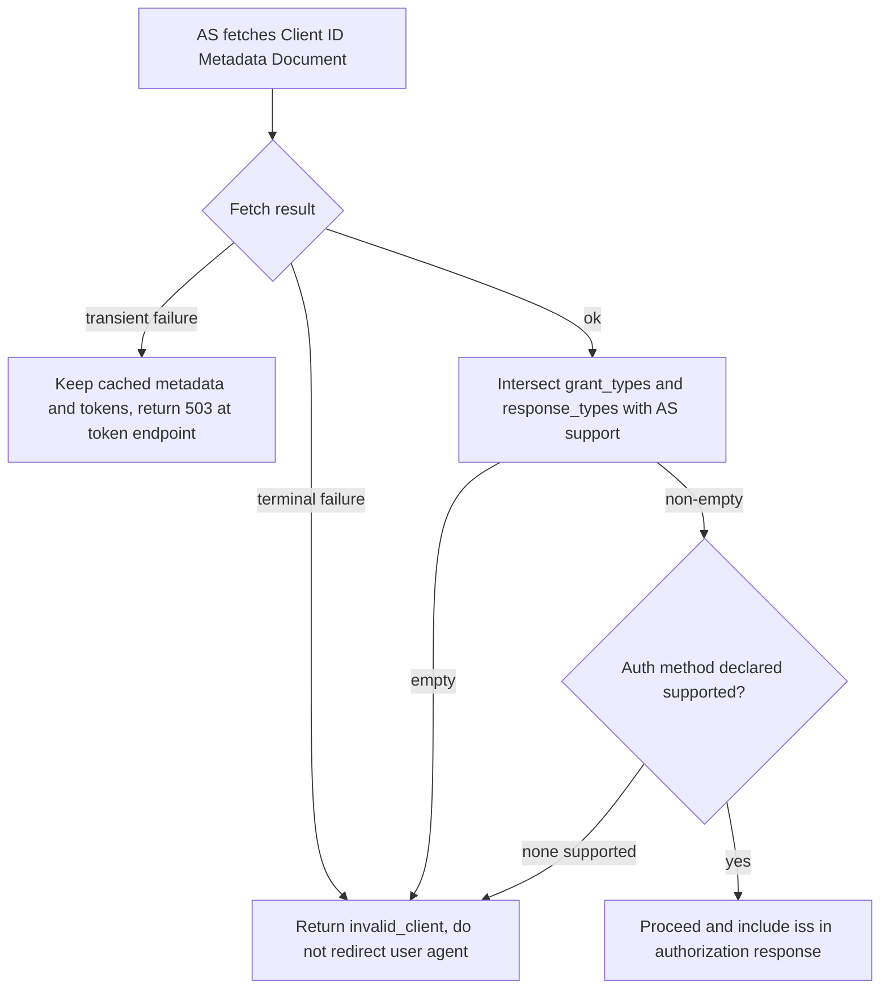
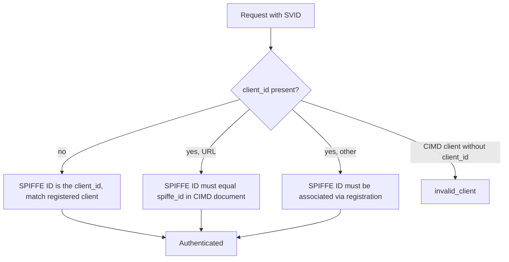
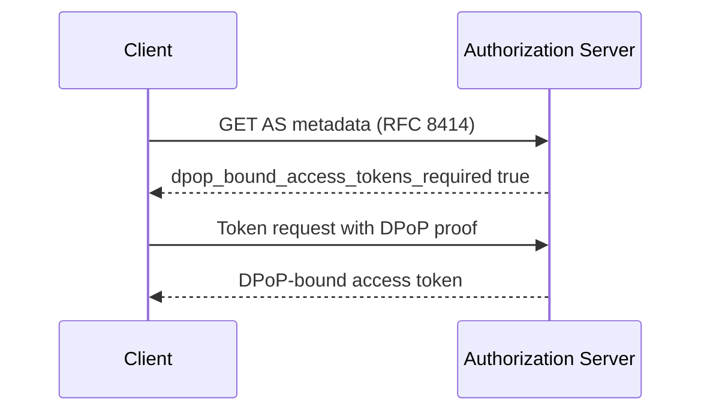

# OAuth WG Daily Report - 2026-11-03

- generated_at_utc: `2026-11-03T23:26:01+00:00`
- snapshot_date: `2026-11-03`

<!-- insights:start -->
## Briefing

> The SD-JWT VC IESG ballot is the main news: Mike Bishop's DISCUSS says the draft overrides RFC 7800 without an Updates tag, and the editor is leaning toward adding Updates: 7800. Separately, the AAT, asor and AAuth threads continue.

_Updated 2026-11-03T23:27:50+00:00. Machine-drafted from the sources linked below, which stay authoritative._

### In short, CIMD -03 turns client authentication, fetch-failure handling and URL restrictions into explicit normative rules

`draft-revision` · `substantive` · first seen 2026-11-03 · [draft-ietf-oauth-client-id-metadata-document-03: OAuth Client ID Metadata Document](https://author-tools.ietf.org/iddiff?url1=draft-ietf-oauth-client-id-metadata-document-02&url2=draft-ietf-oauth-client-id-metadata-document-03)

The Client Identifier URL must now have a path other than "/", and clients SHOULD normalize it because the AS MUST NOT. Client authentication gets its own section: shared-secret methods are barred, token_endpoint_auth_methods_supported is preferred over token_endpoint_auth_method, the default is none, and an AS that supports none of the declared methods rejects with invalid_client. The AS MUST intersect grant_types and response_types with what it supports and reject on an empty intersection, and the authorization response MUST carry iss (RFC 9207). Discovery failures are split into transient (no discarding cached metadata or refresh tokens, 503 at the token endpoint) and terminal (a client_id mismatch SHOULD invalidate refresh tokens). Also added: functional versus informative URI properties, a ban on deriving document contents from untrusted input, cache bounds, an Accept header recommendation and extra security sections. The diff is truncated, so later sections were not seen.

**Use cases**

- An MCP authorization server accepting unregistered clients by URL needs to implement the grant_types/response_types intersection and iss in responses.
- A hosted client publishing one metadata document to many AS can list \["none","private_key_jwt"\] and rely on the defined selection and rejection behaviour.
- An AS operator must decide how cached metadata and refresh tokens are treated when a client's metadata host is briefly down.

**Related in other tracks**

- `ietf-wimse` / `draft-ietf-wimse-workload-creds`: Not tied to this item directly; SPIFFE client auth -03, which builds on CIMD, uses WIMSE workload credentials.

### In short, SPIFFE client auth -03 makes client_id optional and defines how an SVID's SPIFFE ID maps to a client

`draft-revision` · `substantive` · first seen 2026-11-03 · [draft-ietf-oauth-spiffe-client-auth-03: OAuth SPIFFE Client Authentication](https://author-tools.ietf.org/iddiff?url1=draft-ietf-oauth-spiffe-client-auth-02&url2=draft-ietf-oauth-spiffe-client-auth-03)

A new Client Identification section makes client_id optional for all three methods. If present, the SPIFFE ID must be authorized for that client: via the spiffe_id in a Client ID Metadata Document when client_id is a URL, otherwise via registration. If absent, the SPIFFE ID itself is the client_id, and CIMD clients MUST send client_id. For X509-SVID, the client verifies the server with its ordinary HTTPS trust anchors, while the AS validates the SVID only against the trust domain's own bundle, and MAY issue certificate-bound tokens. The WIT-SVID profile is identified by typ wit+jwt and replaces the client_id-to-sub rule of attestation-based client auth. Security considerations on JWT-SVID replay and trust bundles from CIMD were added, plus a Token Endpoint Authentication Methods IANA entry. The diff is truncated, so those later sections were not read.

**Use cases**

- A workload using an X509-SVID can call a token endpoint without sending client_id, since the SPIFFE ID in the certificate identifies it.
- A deployment identifying SPIFFE workloads by CIMD URL must send client_id and publish spiffe_id in its document.
- An AS supporting both attestation-based client auth and WIT-SVIDs must use spiffe_wit, not attest_jwt_client_auth, to signal WIT-SVID support.

**Related in other tracks**

- `ietf-wimse` / `draft-ietf-wimse-workload-creds`: The WIT-SVID is validated as a Workload Identity Token per this draft (Section 5.1.3 reference).

### Mike Bishop's DISCUSS on sd-jwt-vc-23 asks why the RFC 7800 override has no Updates tag; the editor proposes adding Updates: 7800

`mail` · `substantive` · first seen 2026-11-03 · [Mike Bishop's Discuss on draft-ietf-oauth-sd-jwt-vc-23: (with DISCUSS and COMMENT)](https://mailarchive.ietf.org/arch/msg/oauth/4HcuffVivoI7zlujPUWwVPff6y0/)

The single DISCUSS concerns Section 2.2.2.3. RFC 7800 requires a JWT with a cnf claim to also carry sub or iss, and the draft explicitly overrides that, yet it has no Updates tag. The editor says the note was added reluctantly and that most implementations already ignore the RFC 7800 rule. The editor offers to add Updates: 7800, and asks whether extra explanatory text is needed. The reply also answers the COMMENT items. It will reorder the Section 1.2 sentence, drop the MUST in 5.5.1.2.1, add an SVG reference, and rephrase the 7.6 MUST. It declines a distinct media type for the metadata documents and declines extra redirect wording in 4.3. PR #450 is where the edits are being made, but it has nothing for the DISCUSS yet. The message is truncated, so the nits are not covered.

**Use cases**

- An implementer issuing key-bound SD-JWT VCs without iss or sub needs to know whether the RFC 7800 relaxation is formally sanctioned.
- A verifier library that enforces the RFC 7800 sub/iss rule may need to relax it for SD-JWT VC.

### The AMR values draft moves to -03 with narrower values, while structured amr_details is tracked in a GitHub issue

`mail` · `substantive` · first seen 2026-11-03 · [Review of draft-skyfire-oauth-amr-values](https://mailarchive.ietf.org/arch/msg/oauth/JV5gcUNjiOMAwDbLU5dwZLIUb-4/)

Ankit Agarwal says discussion of `amr_details` and alignment with OpenID4AC moves to issue #11 of draft-skyfire-oauth-amr-values. Draft -03 keeps `amr` a flat array. It narrows broad values: `sna` is separate from `bg`, and `email` names only the channel. It also adds a section and appendices showing how values compose. The thread shows participants arguing that `amr` cannot express relationships between methods, for example that an OTP was delivered by email, and Frederik Krogsdal Jacobsen adds earlier OpenID4AC feedback and IIW notes. Karl McGuinness had pointed to the OIDC4AC `amr_details` object as overlapping work.

**Use cases**

- A relying party that consumes `amr` and needs to distinguish carrier-assisted phone verification from other background checks can use a separate `sna` value.

### In short, Mike Bishop's DISCUSS on sd-jwt-vc-23 asks why the RFC 7800 override has no Updates: tag

`mail` · `substantive` · first seen 2026-11-03 · [Mike Bishop's Discuss on draft-ietf-oauth-sd-jwt-vc-23: (with DISCUSS and COMMENT)](https://mailarchive.ietf.org/arch/msg/oauth/d49b8f7_xsSOXCgDit-a1p9-yvg/)

The single DISCUSS is about Section 2.2.2.3, which says the document explicitly overrides the RFC 7800 requirement that a JWT with cnf also carry sub or iss. Bishop points out that this changes RFC 7800 yet the document has no Updates: tag. His COMMENTs include a suggested distinct media type for the issuer metadata JSON, stating that the issuer check holds across redirects, dropping a MUST from SVG template selection, giving SVG structure a normative pointer, and replacing an untestable MUST in Section 7.6. The message also lists nits and is truncated.

**Use cases**

- Implementers of key-bound SD-JWT VCs without sub or iss should watch whether the override stays or the document gets an Updates: relationship.

### The Skyfire authors answer a security review of the KYAPay drafts with new revisions, including a REQUIRED tsi claim

`mail` · `substantive` · first seen 2026-11-03 · [Review of draft-skyfire-oauth-using-kyapay-tokens-01](https://mailarchive.ietf.org/arch/msg/oauth/q04QT1JhFmAAhDa__I840MmA7CE/)

Ankit Agarwal says Bhasker Allam's review is reflected in KYAPay Token -03 and Using KYAPay Tokens -02, with GitHub issue #8 mapping each point to a pull request. One change goes beyond the review: in the Token draft, `aud` now identifies the combination of identities the issuer holds for the Target, and `tsi` becomes REQUIRED. Onboarded recipients check `aud` and `tsi`, while other recipients check `tdm`, the Target's host. The quoted review raised that the signed but unencrypted JWT carries personal and payment data, that bot managers should not admit requests without challenge regardless of assurance, and that the token does not say which account it is for. The review text is truncated, so its remaining points are not covered here.

**Use cases**

- A bot manager or CDN deciding whether to admit agent traffic bearing a KYAPay token needs to know which claims to check.
- A service that has not onboarded with the issuer must rely on `tdm` rather than `aud` and `tsi`.

### In short, this PR separates functional URIs from informative URIs and says client_uri need not share the client_id origin

`pull-request` · `substantive` · first seen 2026-11-03 · [oauth-wg/draft-ietf-oauth-client-id-metadata-document#128: Added section distinguishing functional and informative URI properties](https://github.com/oauth-wg/draft-ietf-oauth-client-id-metadata-document/pull/128)

The PR adds a section distinguishing URI properties and clarifies that client_uri is not restricted to the origin of client_id or redirect_uris. The -03 diff shows the result: functional URIs such as client_id, redirect_uris and jwks_uri, versus informative ones such as client_uri, logo_uri, policy_uri and tos_uri. The AS MUST NOT require client_uri to be on the same origin as, or a prefix of, the client_id or redirect_uris. It closes issue #10.

**Use cases**

- An AS that currently rejects documents whose client_uri differs from the client_id origin must stop doing so.

### In short, this PR defines what an AS does when a CIMD client's grant_types or response_types are unsupported

`pull-request` · `substantive` · first seen 2026-11-03 · [oauth-wg/draft-ietf-oauth-client-id-metadata-document#129: Define AS behavior when certain CIMD client features are unsupported](https://github.com/oauth-wg/draft-ietf-oauth-client-id-metadata-document/pull/129)

The PR body says it covers one request from issue #71, the mismatch between the AS and a CIMD client over grant_types and response_types, and not the whole discussion. The matching text appears in the -03 diff, where the AS must intersect those fields with its own support and reject with invalid_client if the result is empty. The PR itself carries only a short description.

**Use cases**

- An AS that supports only authorization_code must decide what to do with a CIMD client declaring other grant types.

### In short, this PR requires pre-fetching and validating logo_uri before an AS shows a client logo

`pull-request` · `substantive` · first seen 2026-11-03 · [oauth-wg/draft-ietf-oauth-client-id-metadata-document#130: require pre-fetching logo_uri, added security considerations](https://github.com/oauth-wg/draft-ietf-oauth-client-id-metadata-document/pull/130)

Per the PR body, displaying a logo now requires pre-fetching logo_uri, serving it from a trusted server, and validating the image contents. It also adds a security consideration on how the client is presented to end-users. Both appear in the -03 table of contents as Displaying Logos to End-Users and Presentation of the Client to End-Users. It closes issue #19.

**Use cases**

- An AS consent screen that renders third-party logos must not hot-link the client's logo URL at display time.

### In short, a new draft adds dpop_bound_access_tokens_required to AS metadata so an AS can say it only issues DPoP-bound tokens

`mail` · `new-proposal` · first seen 2026-11-03 · [New Draft: OAuth Authorization Server Metadata Parameter for Requiring DPoP](https://mailarchive.ietf.org/arch/msg/oauth/2eUXC32rF86kjqriGMvRTPLZ6Cc/)

Emelia Smith announced draft-emelia-oauth-as-metadata-dpop-required. Review of the CIMD draft by Max Gerber showed that an AS had no way to signal that it always requires DPoP-bound access tokens, as this could only be signalled at the resource server level. The draft registers dpop_bound_access_tokens_required in RFC 8414 AS metadata. The author expects further changes and wants to discuss it briefly at IETF 127.

**Use cases**

- An MCP authorization server wanting clients to know up front that unbound tokens will never be issued.
- An AT Protocol authorization server signalling that DPoP-bound tokens are mandatory.

### In short, the KYAPay authors published revised versions of six drafts and ask for review

`mail` · `new-proposal` · first seen 2026-11-03 · [Updated versions of KYAPay specs incorporating review feedback](https://mailarchive.ietf.org/arch/msg/oauth/9DWXGEm4cPXCTMVyN9rVdxzd238/)

The announcement lists updated drafts: kyapay-token-03, using-kyapay-tokens-02, kyapay-token-exchange-02, amr-values-03, id-verification-03 and aml-methods-01. They say the updates address review feedback and contain substantive changes. The message does not describe what changed, so the content cannot be summarised further.

### A new OAuth-grant proposal for AI agents (draft-rosenberg-oauth-aauth-02) collides in name with Dick Hardt's AAuth, which is moving to an OpenID WG

`mail` · `new-proposal` · first seen 2026-11-03 · [New I-D on AAuth - a new OAuth grant flow for AI Agents](https://mailarchive.ietf.org/arch/msg/oauth/DlT9Bri0n6Y7rDc75zQfBhB3e70/)

Jonathan Rosenberg and Pat White submitted draft-rosenberg-oauth-aauth-02, an OAuth grant-flow approach to agent authorization. It follows interest at an interim meeting in a solution that is an OAuth extension rather than a new protocol. The draft includes a comparison with Dick Hardt's draft-hardt-oauth-aauth-protocol. Hardt replies that the comparison omits draft-hardt-aauth-r3, where the resource writes approval text. The resource token carries its r3_uri and r3_s256, and only the PS and AS can fetch the document. He treats the agent as adversarial, and he says two protocols named AAuth will confuse people. A follow-up says the proposal for an AAuth WG at the OpenID Foundation was accepted last Friday. The draft text itself is not in the material.

**Use cases**

- A team choosing between extending OAuth with a grant type and adopting a separate agent-authorization protocol would compare these two AAuth proposals.
- An authorization server vendor deciding whether to track the OpenID AAuth WG or the OAuth WG for agent flows.

### Triage of the candidate queue

- **high** `draft-ietf-oauth-deferred-token-response`: -01 restructures the draft with substrate invariants, a new deferred_interactive mode and new editors; also cited as the answer to ID-JAG consent.
- **high** `draft-ietf-oauth-identity-assertion-authz-grant`: -06 adds new normative behaviour (client auth at IdP, invalid_request, mTLS binding, new metadata) and a large rewrite.
- **high** `draft-ietf-oauth-sd-jwt-vc`: It is in IESG review with an open DISCUSS (RFC 7800 override, possible Updates tag) and an active PR #450.
- **high** `draft-ietf-oauth-spiffe-client-auth`: -03 makes client_id optional, ties client identification to CIMD and adds replay and trust-bundle security text.
- **high** `draft-ietf-oauth-v2-1`: Seven new issues and 31 closed, several tagged ietf-127, including MUST vs SHOULD in §3.2.3 and invalid_client.
- **low** `draft-ietf-oauth-client-id-metadata-document`: It is only mentioned as the origin of the new DPoP-required metadata draft, with no change to the draft itself.
- **low** `draft-ietf-oauth-delegate-sd-jwt`: PR #14 adds a worked example and generator, so implementers can check their output against it.
- **low** `draft-ietf-oauth-transaction-tokens`: Only a new implementation-report issue (#373) with one comment; no text change.

<!-- insights:end -->

## Top Priorities

| Rank | Draft | Score | Updated | Key State | Repo |
|---|---|---:|---|---|---|
| 1 | `draft-ietf-oauth-sd-jwt-vc` | 125 | 2026-10-31T18:37:09Z | Active, Expert Reviews OK | `oauth-sd-jwt-vc` |
| 2 | `draft-ietf-oauth-status-list` | 90 | 2026-11-03T19:29:28Z | Active, RFC-Ed-Ack | `draft-ietf-oauth-status-list` |
| 3 | `draft-ietf-oauth-rfc7523bis` | 90 | 2026-11-03T19:25:31Z | Active, RFC-Ed-Ack | `draft-ietf-oauth-rfc7523bis` |
| 4 | `draft-ietf-oauth-client-id-metadata-document` | 90 | 2026-11-02T22:02:56Z | Active, I-D Exists | `draft-ietf-oauth-client-id-metadata-document` |
| 5 | `draft-ietf-oauth-identity-assertion-authz-grant` | 90 | 2026-10-31T00:32:39Z | Active, I-D Exists | `oauth-identity-assertion-authz-grant` |
| 6 | `draft-ietf-oauth-deferred-token-response` | 83 | 2026-10-31T16:12:16Z | Active, I-D Exists | `oauth-deferred-token-response` |
| 7 | `draft-ietf-oauth-v2-1` | 83 | 2026-10-31T04:16:32Z | Active, I-D Exists | `oauth-v2-1` |
| 8 | `draft-ietf-oauth-delegate-sd-jwt` | 76 | 2026-10-30T12:38:29Z | Active, I-D Exists | `oauth-delegate-sd-jwt` |
| 9 | `draft-ietf-oauth-rfc8725bis` | 65 | 2026-08-31T18:37:20Z | Active, No IANA Actions | `draft-ietf-oauth-rfc8725bis` |
| 10 | `draft-ietf-oauth-identity-chaining` | 65 | 2026-08-21T20:25:31Z | Active, RFC-Ed-Ack | `oauth-identity-chaining` |

## Active Drafts

| Draft | Rev | Updated | States |
|---|---:|---|---|
| `draft-ietf-oauth-status-list` | 21 | 2026-11-03T19:29:28Z | Active, RFC-Ed-Ack, Expert Reviews OK |
| `draft-ietf-oauth-rfc7523bis` | 11 | 2026-11-03T19:25:31Z | Active, RFC-Ed-Ack, Expert Reviews OK |
| `draft-ietf-oauth-client-id-metadata-document` | 03 | 2026-11-02T22:02:56Z | Active, I-D Exists, WG Document |
| `draft-ietf-oauth-spiffe-client-auth` | 03 | 2026-11-02T17:35:55Z | Active, I-D Exists, WG Document |
| `draft-ietf-oauth-sd-jwt-vc` | 23 | 2026-10-31T18:37:09Z | Active, Expert Reviews OK, Version Changed - Review Needed |
| `draft-ietf-oauth-deferred-token-response` | 01 | 2026-10-31T16:12:16Z | Active, I-D Exists, WG Document |
| `draft-ietf-oauth-v2-1` | 17 | 2026-10-31T04:16:32Z | Active, I-D Exists, WG Document |
| `draft-ietf-oauth-identity-assertion-authz-grant` | 06 | 2026-10-31T00:32:39Z | Active, I-D Exists, WG Document |
| `draft-ietf-oauth-delegate-sd-jwt` | 00 | 2026-10-30T12:38:29Z | Active, I-D Exists, WG Document |
| `draft-ietf-oauth-attestation-based-client-auth` | 12 | 2026-10-18T17:33:02Z | Active, I-D Exists, WG Consensus: Waiting for Write-Up |
| `draft-ietf-oauth-rfc8725bis` | 10 | 2026-08-31T18:37:20Z | Active, No IANA Actions, IANA OK - No Actions Needed |
| `draft-ietf-oauth-first-party-apps` | 04 | 2026-08-26T14:40:16Z | Active, I-D Exists, WG Consensus: Waiting for Write-Up |
| `draft-ietf-oauth-rar-metadata-remediation` | 00 | 2026-08-23T20:29:29Z | Active, I-D Exists, WG Document |
| `draft-ietf-oauth-identity-chaining` | 17 | 2026-08-21T20:25:31Z | Active, RFC-Ed-Ack, Expert Reviews OK |
| `draft-ietf-oauth-transaction-tokens` | 11 | 2026-08-21T11:57:16Z | Active, I-D Exists, WG Consensus: Waiting for Write-Up |

## Repo Watch

| Repo | Pushed | Open Issues |
|---|---|---:|
| `oauth-wg/oauth-sd-jwt-vc` | 2026-11-03T23:09:22Z | 1 |
| `oauth-wg/oauth-delegate-sd-jwt` | 2026-11-03T00:23:39Z | 12 |
| `oauth-wg/oauth-v2-1` | 2026-11-03T00:12:15Z | 12 |
| `oauth-wg/oauth-spiffe-client-authentication` | 2026-11-03T00:08:49Z | 6 |
| `oauth-wg/oauth-deferred-token-response` | 2026-11-03T00:06:25Z | 23 |
| `oauth-wg/draft-ietf-oauth-client-id-metadata-document` | 2026-11-03T00:00:38Z | 33 |
| `oauth-wg/oauth-transaction-tokens` | 2026-11-01T00:20:49Z | 2 |
| `oauth-wg/oauth-identity-assertion-authz-grant` | 2026-11-01T00:03:15Z | 32 |
| `oauth-wg/draft-ietf-oauth-attestation-based-client-auth` | 2026-10-13T06:13:11Z | 0 |
| `oauth-wg/oauth-selective-disclosure-jwt` | 2026-10-04T13:50:37Z | 0 |
| `oauth-wg/oauth-cross-device-security` | 2026-08-27T14:45:11Z | 0 |
| `oauth-wg/oauth-browser-based-apps` | 2026-08-27T14:43:00Z | 0 |

## Recent Pull Requests

- `oauth-wg/oauth-sd-jwt-vc#450` Mike Bishop's ballot  (2026-11-03T23:08:48Z)
- `oauth-wg/draft-ietf-oauth-client-id-metadata-document#29` Improve documentation for development usage and expiration of clients (2026-11-02T22:24:32Z)
- `oauth-wg/draft-ietf-oauth-client-id-metadata-document#129` Define AS behavior when certain CIMD client features are unsupported (2026-11-02T21:51:56Z)
- `oauth-wg/draft-ietf-oauth-client-id-metadata-document#130` require pre-fetching logo_uri, added security considerations (2026-11-02T21:51:14Z)
- `oauth-wg/draft-ietf-oauth-client-id-metadata-document#128` Added section distinguishing functional and informative URI properties (2026-11-02T21:47:50Z)
- `oauth-wg/draft-ietf-oauth-client-id-metadata-document#99` Add Client Authentication section (2026-11-02T20:27:59Z)
- `oauth-wg/oauth-spiffe-client-authentication#69` Fix render issues, move profiling specs to normative and prepare for -03 submission (2026-11-02T17:27:23Z)
- `oauth-wg/oauth-spiffe-client-authentication#66` Refactor client_id usage and examples in draft (2026-11-02T17:10:33Z)
- `oauth-wg/oauth-spiffe-client-authentication#65` Update trust model and bundle endpoint configuration (2026-11-02T15:38:03Z)
- `oauth-wg/oauth-spiffe-client-authentication#68` Address Nits (2026-11-02T13:28:36Z)

## Recent Issues

- `oauth-wg/draft-ietf-oauth-client-id-metadata-document#121` Security Considerations: persisted/remembered authorization decisions should respect resource-indicator scoping (2026-11-02T22:22:58Z)
- `oauth-wg/draft-ietf-oauth-client-id-metadata-document#79` Review from Justin Richer (2026-11-02T22:22:55Z)
- `oauth-wg/draft-ietf-oauth-client-id-metadata-document#30` Client metadata retrieval can be abused to make server issued requests (2026-11-02T22:22:51Z)
- `oauth-wg/draft-ietf-oauth-client-id-metadata-document#100` Clarify behaviour of `token_endpoint_auth_method` of `"private_key_jwt"` when `jwks` and `jwks_uri` are missing (2026-11-02T22:19:11Z)
- `oauth-wg/draft-ietf-oauth-client-id-metadata-document#96` token_endpoint_auth_methods_supported  and revocation_endpoint_auth_methods_supported (2026-11-02T22:18:51Z)
- `oauth-wg/draft-ietf-oauth-client-id-metadata-document#92` Provide guidance on omission of `token_endpoint_auth_method` field (2026-11-02T22:18:16Z)
- `oauth-wg/draft-ietf-oauth-client-id-metadata-document#71` Define AS behavior when CIMD contains unsupported metadata values (2026-11-02T21:56:56Z)
- `oauth-wg/draft-ietf-oauth-client-id-metadata-document#85` Be more prescriptive about how the AS should return errors (2026-11-02T21:56:08Z)
- `oauth-wg/draft-ietf-oauth-client-id-metadata-document#126` Move 9.5.1. Consistency of Client Metadata to Section 4 (2026-11-02T21:50:00Z)
- `oauth-wg/draft-ietf-oauth-client-id-metadata-document#86` Disallow the root path `/` as a CIMD URL (2026-11-02T21:43:55Z)

## Organization Events

- `2026-11-02T09:14:43Z` PushEvent `oauth-wg/oauth-spiffe-client-authentication` 
- `2026-11-03T22:04:28Z` PullRequestEvent `oauth-wg/oauth-sd-jwt-vc` opened
- `2026-11-02T09:50:29Z` PushEvent `oauth-wg/oauth-spiffe-client-authentication` 
- `2026-11-02T10:00:38Z` PushEvent `oauth-wg/oauth-spiffe-client-authentication` 
- `2026-11-02T09:50:07Z` PushEvent `oauth-wg/oauth-spiffe-client-authentication` 
- `2026-11-02T09:44:57Z` PushEvent `oauth-wg/oauth-spiffe-client-authentication` 
- `2026-11-02T09:42:20Z` PushEvent `oauth-wg/oauth-spiffe-client-authentication` 
- `2026-11-02T09:44:48Z` DeleteEvent `oauth-wg/oauth-spiffe-client-authentication` 
- `2026-11-02T09:38:33Z` PushEvent `oauth-wg/oauth-spiffe-client-authentication` 
- `2026-11-02T09:38:10Z` PushEvent `oauth-wg/oauth-spiffe-client-authentication` 
- `2026-11-02T09:14:25Z` PushEvent `oauth-wg/oauth-spiffe-client-authentication` 
- `2026-11-02T09:47:12Z` PushEvent `oauth-wg/oauth-spiffe-client-authentication` 
- `2026-11-02T09:30:24Z` PushEvent `oauth-wg/oauth-spiffe-client-authentication` 
- `2026-11-02T09:30:16Z` PushEvent `oauth-wg/oauth-spiffe-client-authentication` 
- `2026-11-02T09:14:14Z` PushEvent `oauth-wg/oauth-spiffe-client-authentication` 
- `2026-11-01T21:56:54Z` PushEvent `oauth-wg/draft-ietf-oauth-client-id-metadata-document` 
- `2026-11-01T21:52:39Z` PushEvent `oauth-wg/draft-ietf-oauth-client-id-metadata-document` 
- `2026-11-01T21:57:20Z` PushEvent `oauth-wg/draft-ietf-oauth-client-id-metadata-document` 
- `2026-11-01T19:50:02Z` PushEvent `oauth-wg/oauth-spiffe-client-authentication` 
- `2026-11-01T19:58:53Z` PushEvent `oauth-wg/oauth-spiffe-client-authentication` 

## Mailarchive Signals

- weekly_digest_count: `0`
- [OAUTH-WG] Re: Roman Danyliw's No Objection on draft-ietf-oauth-sd-jwt-vc-23: (with COMMENT) - https://mailarchive.ietf.org/arch/msg/oauth/N7UVvD7olY2CRvYjtZmOxVqRx84/
- [OAUTH-WG] Re: Mike Bishop's Discuss on draft-ietf-oauth-sd-jwt-vc-23: (with DISCUSS and COMMENT) - https://mailarchive.ietf.org/arch/msg/oauth/4HcuffVivoI7zlujPUWwVPff6y0/
- [OAUTH-WG] Re: [WIMSE] Re: Implementation report: attenuating delegation chains for agents (draft-niyikiza-oauth-attenuating-agent-tokens, draft-asor-wimse-agent-delegation-chain) - https://mailarchive.ietf.org/arch/msg/oauth/dh5UWFQUjXkDtKzo7SrFUNArxZo/
- [OAUTH-WG] Re: AAT -02 announcement - https://mailarchive.ietf.org/arch/msg/oauth/37iXdAM1CHnz4IWePz63h7i5jBI/
- [OAUTH-WG] Re: New I-D on AAuth - a new OAuth grant flow for AI Agents - https://mailarchive.ietf.org/arch/msg/oauth/DlT9Bri0n6Y7rDc75zQfBhB3e70/
- [OAUTH-WG] Re: [WIMSE] Re: Implementation report: attenuating delegation chains for agents (draft-niyikiza-oauth-attenuating-agent-tokens, draft-asor-wimse-agent-delegation-chain) - https://mailarchive.ietf.org/arch/msg/oauth/hPz5sj57HdTkXvIPCE9ReL2IRwU/
- [OAUTH-WG] Roman Danyliw's No Objection on draft-ietf-oauth-sd-jwt-vc-23: (with COMMENT) - https://mailarchive.ietf.org/arch/msg/oauth/H3PdLKLFCWrfshWVT1MCzRePDak/
- [OAUTH-WG] Re: Re：I-D Action: draft-ietf-oauth-deferred-token-response-01.txt - https://mailarchive.ietf.org/arch/msg/oauth/hv_39SnAhdF_1AZHh_QeKpopMds/

## Next Actions

1. Evaluate the top 3 items in `Top Priorities` as weekly deep-dive candidates.
2. Separately track comment deadlines for `In Last Call` / `In WG Last Call` drafts.
3. For repos with a sudden spike in activity, create a scaffold in `deep-dives/` to capture key discussion points.
