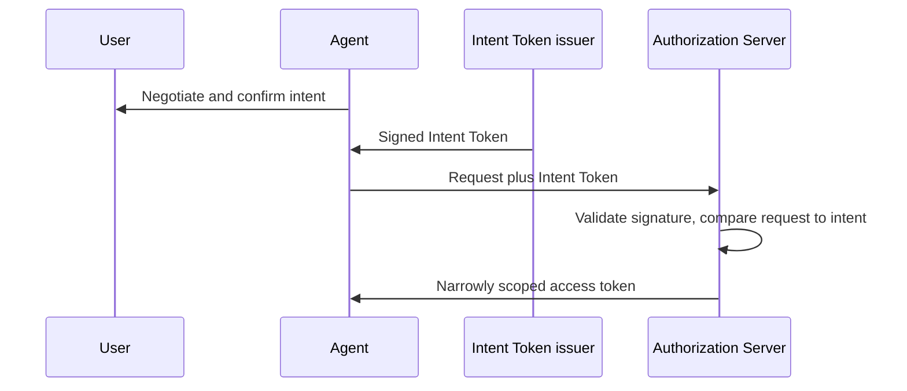
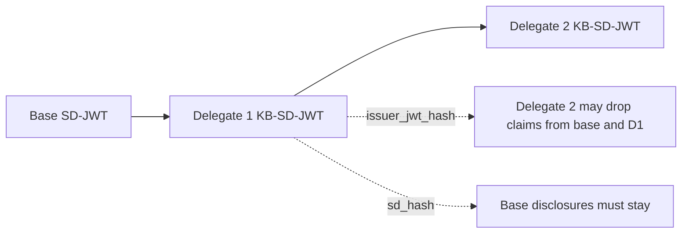

# OAuth WG Daily Report - 2026-11-05

- generated_at_utc: `2026-11-05T19:59:53+00:00`
- snapshot_date: `2026-11-05`

<!-- insights:start -->
## Briefing

> draft-ietf-oauth-sd-jwt-vc-24 was published during IESG review. It formally updates RFC 7800 so cnf no longer needs sub or iss, and it tightens issuer-identification rules for x5c and iss. Mike Bishop cleared his DISCUSS, and Éric Vyncke's DISCUSS on BCP 14 keywords is still being worked in PR #454.

_Updated 2026-11-05T20:01:33+00:00. Machine-drafted from the sources linked below, which stay authoritative._

### This revision makes SD-JWT VC formally update RFC 7800 and tightens how the issuer is identified

`draft-revision` · `substantive` · first seen 2026-11-05 · [draft-ietf-oauth-sd-jwt-vc-24: SD-JWT-based Verifiable Digital Credentials (SD-JWT VC)](https://author-tools.ietf.org/iddiff?url1=draft-ietf-oauth-sd-jwt-vc-23&url2=draft-ietf-oauth-sd-jwt-vc-24)

-24 adds 'Updates: 7800 (if approved)' and a new section 2.2.2.3.1 saying the RFC 7800 requirement that a JWT with cnf also carry sub or iss is nullified, not just overridden, and applies to SD-JWT VCs, SD-JWTs and JWTs generally. For key discovery, an x5c chain must be validated per RFC 7515 and RFC 5280 against a policy-permitted trust anchor (inclusion in x5c does not make a certificate an anchor). An iss claim is not authenticated by the x5c mechanism, and issuers SHOULD NOT include an unbound iss. Recipients MUST NOT treat inputs of other mechanisms as identifying the issuer unless policy binds them, and the security considerations now spell this out. Lowercasing scheme and host in iss is RECOMMENDED. Other changes are wording: some MAY/MUST became 'can', and RFC 5280 and SVG references were added. The appendix examples were also regenerated, and the mailing list (item 2) reports this regeneration was a mistake.

**Use cases**

- A verifier that accepts credentials with both an HTTPS iss and an x5c header must now decide by policy which mechanism identifies the issuer, and must not trust an unbound iss.
- A wallet or issuer producing key-bound SD-JWT VCs without sub or iss can now cite a formal update to RFC 7800 rather than an override.

**Related in other tracks**

- `openid` / `openid/OpenID4VP`: OpenID4VP presents SD-JWT VC credentials, so issuer identification rules affect verifiers there.

### sd-jwt-vc will add "Updates: 7800" and lowercase-normalize iss scheme and host to resolve Mike Bishop's DISCUSS

`mail` · `substantive` · first seen 2026-11-05 · [Mike Bishop's Discuss on draft-ietf-oauth-sd-jwt-vc-23: (with DISCUSS and COMMENT)](https://mailarchive.ietf.org/arch/msg/oauth/hSDZBQ75YQ4MiQdZcYXAxauEQOs/)

Bishop's DISCUSS points out that the draft overrides the RFC 7800 requirement that a JWT with cnf also carry sub or iss, without an Updates tag. Brian Campbell added "Updates: 7800 (if approved)" with explanatory text to PR #450, and Bishop says that approach addresses the DISCUSS. Bishop also notes that a "case-sensitive URL" for iss conflicts with RFC 3986, where scheme and host are case-insensitive. Campbell then added a sentence about lowercasing scheme and host to PR #450, to be merged and published near the submission cutoff. The thread is truncated.

**Use cases**

- Implementers of key-bound SD-JWT VCs without sub or iss, who can now rely on RFC 7800 being formally updated.
- Verifiers comparing iss values, who need consistent normalization of scheme and host.

### Éric Vyncke blocked -23 with a DISCUSS asking why two SHOULDs are not MUSTs

`mail` · `discussion` · first seen 2026-11-05 · [Éric Vyncke's Discuss on draft-ietf-oauth-sd-jwt-vc-23: (with DISCUSS and COMMENT)](https://mailarchive.ietf.org/arch/msg/oauth/Jq-oFheO82BciSZUIkv2hjpc1WI/)

Vyncke's DISCUSS questions the SHOULD in Section 2.2.2.2 on treating an SD-JWT VC as being of a type listed in aka_vcts, and the SHOULD in Section 2.4 on checking status when present. He asks for guidance on when to bypass each and the consequences, citing the IESG statement on BCP 14 usage. Non-blocking comments second Bishop's DISCUSS on the RFC 7800 update and suggest replacing the normative RFC 6890 reference in Section 7.1 with the IANA IPv4 and IPv6 special-purpose registries.

**Use cases**

- Verifiers deciding whether status checks are mandatory could see the status SHOULD tightened or explained before publication.

### A thread on using SD-JWT VC mandates for invoicing agents explains when to choose sd_hash or issuer_jwt_hash in Delegate SD-JWT

`mail` · `discussion` · first seen 2026-11-05 · [Feedback request: SD-JWT VC as mandates for invoicing agents](https://mailarchive.ietf.org/arch/msg/oauth/Qguh52h8Jv00QvGc4miq8aAwZzY/)

Gareth Oliver explained that issuer_jwt_hash in the KB-JWT lets the holder allow a delegate to change what is disclosed from the preceding SD-JWT. That allows a chain such as base invoice, then narrowed invoice, then further narrowed invoice, where later delegates can drop claims from earlier links. sd_hash is for cases like a user credential at the base, where the holder wants downstream delegates unable to remove disclosures so verifiers can see which user delegated. He is unsure whether partial enforcement is needed and said the delegate-sd-jwt draft is being updated, with a roadmap at IETF. Carlos will rebuild his invoicing proposal on Delegate SD-JWT for -01.

**Use cases**

- A buyer's wallet delegating an invoice to sub-agents must choose issuer_jwt_hash to let them hide the parent mandate's purchasing policy from counterparties.
- A service passing a user credential downstream can use sd_hash so verifiers always see the user's disclosures.

**Related in other tracks**

- `ietf-wimse` / `draft-hulea-wimse-agent-mandate`: Also addresses verifiable mandates for agents across domains, an overlapping delegation use case.

### Mike Bishop moved to No Objection on -24, keeping two non-blocking comments

`mail` · `discussion` · first seen 2026-11-05 · [Mike Bishop's No Objection on draft-ietf-oauth-sd-jwt-vc-24: (with COMMENT)](https://mailarchive.ietf.org/arch/msg/oauth/SnO92JvcAcpugLZExKJEkY5t0ac/)

Bishop's ballot on -24 is No Objection, noting that -24 added the Updates: 7800 tag and fixed most of his comments. He retains non-blocking comments for the record. The first suggests a distinct media type rather than application/json for the JWT VC Issuer Metadata (Section 4.2) and Type Metadata (5.3.1), so the server can assert the document's role. The second suggests Section 4.3 state that the issuer in the response must match the JWT's iss even after a redirect, regardless of who served it.

**Use cases**

- Implementers of issuer metadata fetching should already validate that the returned issuer matches the JWT iss even across redirects.

### Mahesh Jethanandani's No Objection on sd-jwt-vc-23 raises RFC 7800, SSRF allow-list and x5c/iss consistency points

`mail` · `discussion` · first seen 2026-11-05 · [Mahesh Jethanandani's No Objection on draft-ietf-oauth-sd-jwt-vc-23: (with COMMENT)](https://mailarchive.ietf.org/arch/msg/oauth/bGFDNfQvdE1DvdJ3e_NUEkY7oG4/)

Mahesh supports Mike's DISCUSS: RFC 7800 Section 3 has a plain MUST for sub or iss, so overriding it needs an Updates relationship or rewording. He asks that the Section 7.1 URL validation, which forbids private and internal addresses, allow locally configured allow-lists for closed enterprise deployments. He also notes Section 2.5 says iss need not match the x5c certificate while Section 7.3 says the relationship is critical. Brian Campbell replies that the DISCUSS is nearly resolved, PR #451 covers the x509 and https issuer comments and PR #452 others. The message is truncated.

**Use cases**

- Enterprise or closed-ecosystem verifiers fetching issuer and type metadata from internal hosts.
- Implementers verifying credentials that carry both an HTTPS iss and an x5c chain.

### Reviewer proposes that an AS advertise supported intent types via metadata, like Authority Metadata does for scopes

`mail` · `discussion` · first seen 2026-11-05 · [回复: 回复: Follow-up on OAuth Interim Discussion: New Draft "Agent Intent Token" for Review](https://mailarchive.ietf.org/arch/msg/oauth/eU4eBAFONfRVBWTNarvtszxJKRI/)

Yuan Ni accepts the author's direction of a small set of common intent fields with extensions. Yuan then suggests the AS advertise the intent types it supports in OAuth metadata, with references to field definitions, similar to draft-zehavi-oauth-authority-metadata for scopes and authorization details types. The Intent Token issuer could then build intent objects the AS understands. This is an initial thought, not a text change.

**Use cases**

- Deployments where several AS products must interpret intent objects from different agent frameworks.
- Intent Token issuers that need to know the accepted intent fields before signing.

### Agent Intent Token authors respond to a review and file an issue for AS-side discovery of intent types

`mail` · `discussion` · first seen 2026-11-05 · [回复: Follow-up on OAuth Interim Discussion: New Draft "Agent Intent Token" for Review (2 new messages)](https://mailarchive.ietf.org/arch/msg/oauth/ilZ30bU7n7Sc7lQNtg-kRgiQI04/)

Meiling Chen thanks Yuan Ni for the suggestion to add discovery of supported intent types and opens Issue #6 in the Maisy-ML/Agent-Intent-Token repository to track it, inviting Yuan to help refine it. The quoted thread shows the draft (draft-chen-oauth-agent-intent-token-00): a signed intent object, confirmed by the user, that an agent presents to the AS so the AS can compare later requests against the original intent. The message is a thread digest with some truncation.

**Use cases**

- An AS operator evaluating how agent-supplied user intent could be checked against later authorization requests.
- An agent platform deciding how its intent issuer learns which intent types an AS understands.

**Related in other tracks**

- `ietf-wimse` / `draft-hulea-wimse-agent-mandate`: Also proposes verifiable, signed statements of what an agent is authorized to do on a principal's behalf.

### Two agenda requests for IETF 127: a competing cross-domain transaction token design and a batch delegation draft

`mail` · `discussion` · first seen 2026-11-05 · [OAuth IETF 127 Call for Agenda Items (2 new messages)](https://mailarchive.ietf.org/arch/msg/oauth/jfRVNFlragKJJ_nY22tCF9RUU8Y/)

In reply to the chairs' call for agenda items, Yuan asked for five minutes in the joint WIMSE/OAuth session to present draft-liu-oauth-cross-domain-txn-token, a different approach to the same use case as the Cross-Domain Transaction Tokens item already on the agenda (discussed in tt_xdomain issue #17). Yuan also asked for ten minutes in the OAuth session for draft-ni-oauth-batch-authorization-delegation, which addresses delegating authority to multiple agents when a task is split, following Problem 3 from the 19 October interim. The call notes a draft cutoff of 2 November 2026.

**Use cases**

- Teams building cross-domain workload or agent calls should watch whether the two transaction token approaches converge.
- Agent platforms splitting tasks across sub-agents may follow the batch delegation proposal.

**Related in other tracks**

- `ietf-wimse` / `draft-ietf-wimse-wpt`: The joint session targets topics spanning workload and OAuth work such as transaction tokens.

### Mike Bishop's DISCUSS on the RFC 7800 override was resolved by adding Updates: 7800, and he flagged wrong examples in -24

`mail` · `discussion` · first seen 2026-11-05 · [Mike Bishop's Discuss on draft-ietf-oauth-sd-jwt-vc-23: (with DISCUSS and COMMENT) (2 new messages)](https://mailarchive.ietf.org/arch/msg/oauth/vblvH5VSHxX_2iXUV_n26xyQt2A/)

Bishop's DISCUSS objected that the draft overrides a requirement in RFC 7800 without an Updates tag. Brian Campbell added 'Updates: 7800 (if approved)' with explanatory text in PR #450, plus a sentence on lowercasing scheme and host for iss. Bishop confirmed the PR would address the DISCUSS and, after -24 appeared, said he had cleared it. He also noted that the Appendix A examples in -24 use typ vc+sd-jwt, contrary to Section 2.2.1, and that A.1's content changed. Campbell replied that this was his mistake from building the XML locally instead of with the normal GitHub Actions tooling. The thread was truncated, so other DISCUSS points are not visible.

**Use cases**

- Implementers copying test vectors from -24 Appendix A should not rely on them until corrected, since the typ header is wrong.

### Thread on using Delegate SD-JWT for invoicing-agent mandates clarifies when to use issuer_jwt_hash versus sd_hash

`mail` · `discussion` · first seen 2026-11-05 · [Feedback request: SD-JWT VC as mandates for invoicing agents (2 new messages)](https://mailarchive.ietf.org/arch/msg/oauth/xl9Ft9J7xv1wq9-BG1yDV6AWiO4/)

Gareth explains that issuer_jwt_hash in the KB-JWT lets a delegate holder change what is disclosed from the preceding SD-JWT, so a chain such as Invoice to narrowed invoice to further narrowed invoice can drop claims from both the delegate and base SD-JWTs. If the base is a User Credential, using sd_hash forbids removing those disclosures, so verifiers can always identify the user. Gareth is unsure whether a generic partial policy, requiring certain disclosures to stay, is needed. Blake replies that for invoicing the business issues the mandate, so principal can stay plain and limits selectively disclosable, making a partial policy unnecessary.

**Use cases**

- A buyer's wallet delegating narrowed invoice mandates to agents without revealing internal purchasing limits to counterparties.
- A user-credential-rooted delegation where verifiers must always see which user delegated.

**Related in other tracks**

- `ietf-wimse` / `draft-hulea-wimse-agent-mandate`: Also covers verifiable mandates for agents acting across domains, a competing or complementary approach.

### Charles Eckel's No Objection ballot on sd-jwt-vc-23 asks for lowercase keywords and a stricter svg_id character set

`mail` · `editorial` · first seen 2026-11-05 · [Charles Eckel's No Objection on draft-ietf-oauth-sd-jwt-vc-23: (with COMMENT) (2 new messages)](https://mailarchive.ietf.org/arch/msg/oauth/-XTToR0epFjLtoYB-XfkOUVcjps/)

Eckel supports Mike Bishop's DISCUSS on the RFC 7800 sub/iss override. His comments: change MAY to lowercase "can" in Sections 2.2, 2.2.2.5 and 5.3.3, where no protocol-level option is meant. He also asks whether "alphanumeric" for svg_id is specific enough, suggesting ASCII A-Z, a-z, 0-9 and underscore, and a statement on case-sensitivity. The editor replies that PR #453 fixes the keywords and that alphanumeric is probably specific enough.

### Triage of the candidate queue

- **high** `draft-ietf-oauth-attestation-based-client-auth`: A detailed critical review of -12 questions its structure and DPoP/RFC 7521 reuse.
- **high** `draft-ietf-oauth-deferred-token-response`: -01 restructures the draft with substrate invariants, a new deferred_interactive mode and new editors; also cited as the answer to ID-JAG consent.
- **high** `draft-ietf-oauth-delegate-sd-jwt`: Authors explained the sd_hash vs issuer_jwt_hash design and are preparing an updated version with a roadmap at IETF 127.
- **high** `draft-ietf-oauth-identity-assertion-authz-grant`: -06 adds new normative behaviour (client auth at IdP, invalid_request, mTLS binding, new metadata) and a large rewrite.
- **high** `draft-ietf-oauth-sd-jwt-vc`: -24 published with Updates: 7800 and new issuer-identification rules while IESG DISCUSS items remain open.
- **high** `draft-ietf-oauth-spiffe-client-auth`: -03 makes client_id optional, ties client identification to CIMD and adds replay and trust-bundle security text.
- **high** `draft-ietf-oauth-v2-1`: Seven new issues and 31 closed, several tagged ietf-127, including MUST vs SHOULD in §3.2.3 and invalid_client.
- **low** `draft-ietf-oauth-client-id-metadata-document`: It is only mentioned as the origin of the new DPoP-required metadata draft, with no change to the draft itself.
- **low** `draft-ietf-oauth-transaction-tokens`: Only the agenda request for a competing cross-domain approach mentioned it, with no text change.

<!-- insights:end -->

## Top Priorities

| Rank | Draft | Score | Updated | Key State | Repo |
|---|---|---:|---|---|---|
| 1 | `draft-ietf-oauth-sd-jwt-vc` | 125 | 2026-11-05T15:19:21Z | Active, Expert Reviews OK | `oauth-sd-jwt-vc` |
| 2 | `draft-ietf-oauth-status-list` | 90 | 2026-11-03T19:29:28Z | Active, RFC-Ed-Ack | `draft-ietf-oauth-status-list` |
| 3 | `draft-ietf-oauth-rfc7523bis` | 90 | 2026-11-03T19:25:31Z | Active, RFC-Ed-Ack | `draft-ietf-oauth-rfc7523bis` |
| 4 | `draft-ietf-oauth-client-id-metadata-document` | 90 | 2026-11-02T22:02:56Z | Active, I-D Exists | `draft-ietf-oauth-client-id-metadata-document` |
| 5 | `draft-ietf-oauth-identity-assertion-authz-grant` | 83 | 2026-10-31T00:32:39Z | Active, I-D Exists | `oauth-identity-assertion-authz-grant` |
| 6 | `draft-ietf-oauth-v2-1` | 76 | 2026-10-31T04:16:32Z | Active, I-D Exists | `oauth-v2-1` |
| 7 | `draft-ietf-oauth-delegate-sd-jwt` | 76 | 2026-10-30T12:38:29Z | Active, I-D Exists | `oauth-delegate-sd-jwt` |
| 8 | `draft-ietf-oauth-deferred-token-response` | 68 | 2026-10-31T16:12:16Z | Active, I-D Exists | `oauth-deferred-token-response` |
| 9 | `draft-ietf-oauth-rfc8725bis` | 65 | 2026-08-31T18:37:20Z | Active, No IANA Actions | `draft-ietf-oauth-rfc8725bis` |
| 10 | `draft-ietf-oauth-identity-chaining` | 65 | 2026-08-21T20:25:31Z | Active, RFC-Ed-Ack | `oauth-identity-chaining` |

## Active Drafts

| Draft | Rev | Updated | States |
|---|---:|---|---|
| `draft-ietf-oauth-sd-jwt-vc` | 24 | 2026-11-05T15:19:21Z | Active, Expert Reviews OK, Version Changed - Review Needed |
| `draft-ietf-oauth-status-list` | 21 | 2026-11-03T19:29:28Z | Active, RFC-Ed-Ack, Expert Reviews OK |
| `draft-ietf-oauth-rfc7523bis` | 11 | 2026-11-03T19:25:31Z | Active, RFC-Ed-Ack, Expert Reviews OK |
| `draft-ietf-oauth-client-id-metadata-document` | 03 | 2026-11-02T22:02:56Z | Active, I-D Exists, WG Document |
| `draft-ietf-oauth-spiffe-client-auth` | 03 | 2026-11-02T17:35:55Z | Active, I-D Exists, WG Document |
| `draft-ietf-oauth-deferred-token-response` | 01 | 2026-10-31T16:12:16Z | Active, I-D Exists, WG Document |
| `draft-ietf-oauth-v2-1` | 17 | 2026-10-31T04:16:32Z | Active, I-D Exists, WG Document |
| `draft-ietf-oauth-identity-assertion-authz-grant` | 06 | 2026-10-31T00:32:39Z | Active, I-D Exists, WG Document |
| `draft-ietf-oauth-delegate-sd-jwt` | 00 | 2026-10-30T12:38:29Z | Active, I-D Exists, WG Document |
| `draft-ietf-oauth-attestation-based-client-auth` | 12 | 2026-10-18T17:33:02Z | Active, I-D Exists, WG Consensus: Waiting for Write-Up |
| `draft-ietf-oauth-rfc8725bis` | 10 | 2026-08-31T18:37:20Z | Active, No IANA Actions, IANA OK - No Actions Needed |
| `draft-ietf-oauth-first-party-apps` | 04 | 2026-08-26T14:40:16Z | Active, I-D Exists, WG Consensus: Waiting for Write-Up |
| `draft-ietf-oauth-rar-metadata-remediation` | 00 | 2026-08-23T20:29:29Z | Active, I-D Exists, WG Document |
| `draft-ietf-oauth-identity-chaining` | 17 | 2026-08-21T20:25:31Z | Active, RFC-Ed-Ack, Expert Reviews OK |
| `draft-ietf-oauth-transaction-tokens` | 11 | 2026-08-21T11:57:16Z | Active, I-D Exists, WG Consensus: Waiting for Write-Up |

## Repo Watch

| Repo | Pushed | Open Issues |
|---|---|---:|
| `oauth-wg/oauth-sd-jwt-vc` | 2026-11-05T18:53:54Z | 1 |
| `oauth-wg/oauth-v2-1` | 2026-11-05T00:12:30Z | 12 |
| `oauth-wg/oauth-delegate-sd-jwt` | 2026-11-03T00:23:39Z | 12 |
| `oauth-wg/oauth-spiffe-client-authentication` | 2026-11-03T00:08:49Z | 6 |
| `oauth-wg/oauth-deferred-token-response` | 2026-11-03T00:06:25Z | 23 |
| `oauth-wg/draft-ietf-oauth-client-id-metadata-document` | 2026-11-03T00:00:38Z | 33 |
| `oauth-wg/oauth-transaction-tokens` | 2026-11-01T00:20:49Z | 2 |
| `oauth-wg/oauth-identity-assertion-authz-grant` | 2026-11-01T00:03:15Z | 32 |
| `oauth-wg/draft-ietf-oauth-attestation-based-client-auth` | 2026-10-13T06:13:11Z | 0 |
| `oauth-wg/oauth-selective-disclosure-jwt` | 2026-10-04T13:50:37Z | 0 |
| `oauth-wg/oauth-cross-device-security` | 2026-08-27T14:45:11Z | 0 |
| `oauth-wg/oauth-browser-based-apps` | 2026-08-27T14:43:00Z | 0 |

## Recent Pull Requests

- `oauth-wg/oauth-sd-jwt-vc#454` Vyncke discuss (2026-11-05T18:55:30Z)
- `oauth-wg/oauth-v2-1#268` Supporting OAuth 2.0 and OAuth 2.1 clients concurrently (2026-11-05T17:29:48Z)
- `oauth-wg/oauth-sd-jwt-vc#451` Issuer key discovery: policy selects the mechanism, inputs of other mechanisms do not identify the Issuer (2026-11-05T01:36:36Z)
- `oauth-wg/oauth-sd-jwt-vc#453` some keyword fixes for Charles Eckel's No Objection on draft-ietf-oauth-sd-jwt-vc-23: (with COMMENT) (2026-11-05T01:14:57Z)
- `oauth-wg/oauth-sd-jwt-vc#452` some other items from Mahesh Jethanandani ballot (2026-11-04T23:10:46Z)
- `oauth-wg/oauth-sd-jwt-vc#450` Mike Bishop's ballot  (2026-11-04T22:54:01Z)
- `oauth-wg/draft-ietf-oauth-client-id-metadata-document#29` Improve documentation for development usage and expiration of clients (2026-11-02T22:24:32Z)
- `oauth-wg/draft-ietf-oauth-client-id-metadata-document#129` Define AS behavior when certain CIMD client features are unsupported (2026-11-02T21:51:56Z)
- `oauth-wg/draft-ietf-oauth-client-id-metadata-document#130` require pre-fetching logo_uri, added security considerations (2026-11-02T21:51:14Z)
- `oauth-wg/draft-ietf-oauth-client-id-metadata-document#128` Added section distinguishing functional and informative URI properties (2026-11-02T21:47:50Z)

## Recent Issues

- `oauth-wg/draft-ietf-oauth-client-id-metadata-document#112` Add Security Consideration section for Fetching Client Metadata (2026-11-05T16:57:34Z)
- `oauth-wg/draft-ietf-oauth-client-id-metadata-document#121` Security Considerations: persisted/remembered authorization decisions should respect resource-indicator scoping (2026-11-02T22:22:58Z)
- `oauth-wg/draft-ietf-oauth-client-id-metadata-document#79` Review from Justin Richer (2026-11-02T22:22:55Z)
- `oauth-wg/draft-ietf-oauth-client-id-metadata-document#30` Client metadata retrieval can be abused to make server issued requests (2026-11-02T22:22:51Z)
- `oauth-wg/draft-ietf-oauth-client-id-metadata-document#100` Clarify behaviour of `token_endpoint_auth_method` of `"private_key_jwt"` when `jwks` and `jwks_uri` are missing (2026-11-02T22:19:11Z)
- `oauth-wg/draft-ietf-oauth-client-id-metadata-document#96` token_endpoint_auth_methods_supported  and revocation_endpoint_auth_methods_supported (2026-11-02T22:18:51Z)
- `oauth-wg/draft-ietf-oauth-client-id-metadata-document#92` Provide guidance on omission of `token_endpoint_auth_method` field (2026-11-02T22:18:16Z)
- `oauth-wg/draft-ietf-oauth-client-id-metadata-document#71` Define AS behavior when CIMD contains unsupported metadata values (2026-11-02T21:56:56Z)
- `oauth-wg/draft-ietf-oauth-client-id-metadata-document#85` Be more prescriptive about how the AS should return errors (2026-11-02T21:56:08Z)
- `oauth-wg/draft-ietf-oauth-client-id-metadata-document#126` Move 9.5.1. Consistency of Client Metadata to Section 4 (2026-11-02T21:50:00Z)

## Organization Events

- `2026-11-05T18:53:16Z` CreateEvent `oauth-wg/oauth-sd-jwt-vc` 
- `2026-11-05T18:55:29Z` PullRequestEvent `oauth-wg/oauth-sd-jwt-vc` opened
- `2026-11-04T19:19:20Z` PushEvent `oauth-wg/oauth-sd-jwt-vc` 
- `2026-11-05T17:29:48Z` IssueCommentEvent `oauth-wg/oauth-v2-1` Supporting OAuth 2.0 and OAuth 2.1 clients concurrently
- `2026-11-05T16:57:34Z` IssueCommentEvent `oauth-wg/draft-ietf-oauth-client-id-metadata-document` Add Security Consideration section for Fetching Client Metadata
- `2026-11-05T16:42:17Z` IssueCommentEvent `oauth-wg/draft-ietf-oauth-client-id-metadata-document` Add Security Consideration section for Fetching Client Metadata
- `2026-11-04T19:18:48Z` PushEvent `oauth-wg/oauth-sd-jwt-vc` 
- `2026-11-04T16:42:45Z` PushEvent `oauth-wg/oauth-sd-jwt-vc` 
- `2026-11-04T23:10:48Z` PushEvent `oauth-wg/oauth-sd-jwt-vc` 
- `2026-11-04T20:11:33Z` PushEvent `oauth-wg/oauth-sd-jwt-vc` 
- `2026-11-04T16:58:38Z` PushEvent `oauth-wg/oauth-sd-jwt-vc` 
- `2026-11-05T01:37:12Z` PushEvent `oauth-wg/oauth-sd-jwt-vc` 
- `2026-11-03T00:23:40Z` PushEvent `oauth-wg/oauth-delegate-sd-jwt` 
- `2026-11-05T01:38:08Z` ReleaseEvent `oauth-wg/oauth-sd-jwt-vc` published
- `2026-11-05T01:36:36Z` PullRequestEvent `oauth-wg/oauth-sd-jwt-vc` merged
- `2026-11-05T01:14:58Z` PushEvent `oauth-wg/oauth-sd-jwt-vc` 
- `2026-11-05T01:14:56Z` PullRequestEvent `oauth-wg/oauth-sd-jwt-vc` merged
- `2026-11-04T23:50:15Z` IssueCommentEvent `oauth-wg/oauth-v2-1` Supporting OAuth 2.0 and OAuth 2.1 clients concurrently
- `2026-11-04T23:10:46Z` PullRequestEvent `oauth-wg/oauth-sd-jwt-vc` merged
- `2026-11-04T23:02:07Z` PullRequestEvent `oauth-wg/oauth-sd-jwt-vc` opened

## Mailarchive Signals

- weekly_digest_count: `0`
- [OAUTH-WG] Re: Mike Bishop's Discuss on draft-ietf-oauth-sd-jwt-vc-23: (with DISCUSS and COMMENT) - https://mailarchive.ietf.org/arch/msg/oauth/vblvH5VSHxX_2iXUV_n26xyQt2A/
- [OAUTH-WG] Re: Mike Bishop's Discuss on draft-ietf-oauth-sd-jwt-vc-23: (with DISCUSS and COMMENT) - https://mailarchive.ietf.org/arch/msg/oauth/8ozjEMfSbejCP2InvsfVHlZGi_Y/
- [OAUTH-WG] Mike Bishop's No Objection on draft-ietf-oauth-sd-jwt-vc-24: (with COMMENT) - https://mailarchive.ietf.org/arch/msg/oauth/SnO92JvcAcpugLZExKJEkY5t0ac/
- [OAUTH-WG] I-D Action: draft-ietf-oauth-sd-jwt-vc-24.txt - https://mailarchive.ietf.org/arch/msg/oauth/zwMBibsKL81-3AS7UVLvXpc2_NU/
- [OAUTH-WG] Re: Charles Eckel's No Objection on draft-ietf-oauth-sd-jwt-vc-23: (with COMMENT) - https://mailarchive.ietf.org/arch/msg/oauth/iF4rmUNJrV794fM4cxaEbM49ebQ/
- [OAUTH-WG] Re: Feedback request: SD-JWT VC as mandates for invoicing agents - https://mailarchive.ietf.org/arch/msg/oauth/Qguh52h8Jv00QvGc4miq8aAwZzY/
- [OAUTH-WG] Éric Vyncke's Discuss on draft-ietf-oauth-sd-jwt-vc-23: (with DISCUSS and COMMENT) - https://mailarchive.ietf.org/arch/msg/oauth/Jq-oFheO82BciSZUIkv2hjpc1WI/
- [OAUTH-WG] Re: OAuth IETF 127 Call for Agenda Items - https://mailarchive.ietf.org/arch/msg/oauth/jfRVNFlragKJJ_nY22tCF9RUU8Y/

## Next Actions

1. Evaluate the top 3 items in `Top Priorities` as weekly deep-dive candidates.
2. Separately track comment deadlines for `In Last Call` / `In WG Last Call` drafts.
3. For repos with a sudden spike in activity, create a scaffold in `deep-dives/` to capture key discussion points.
