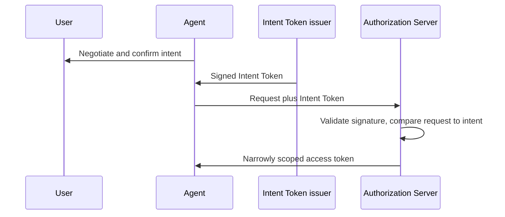
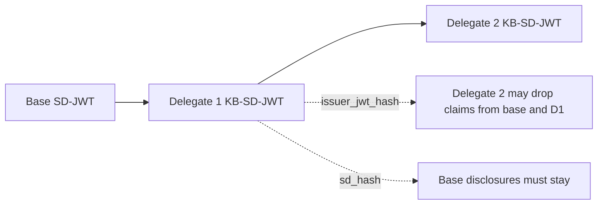
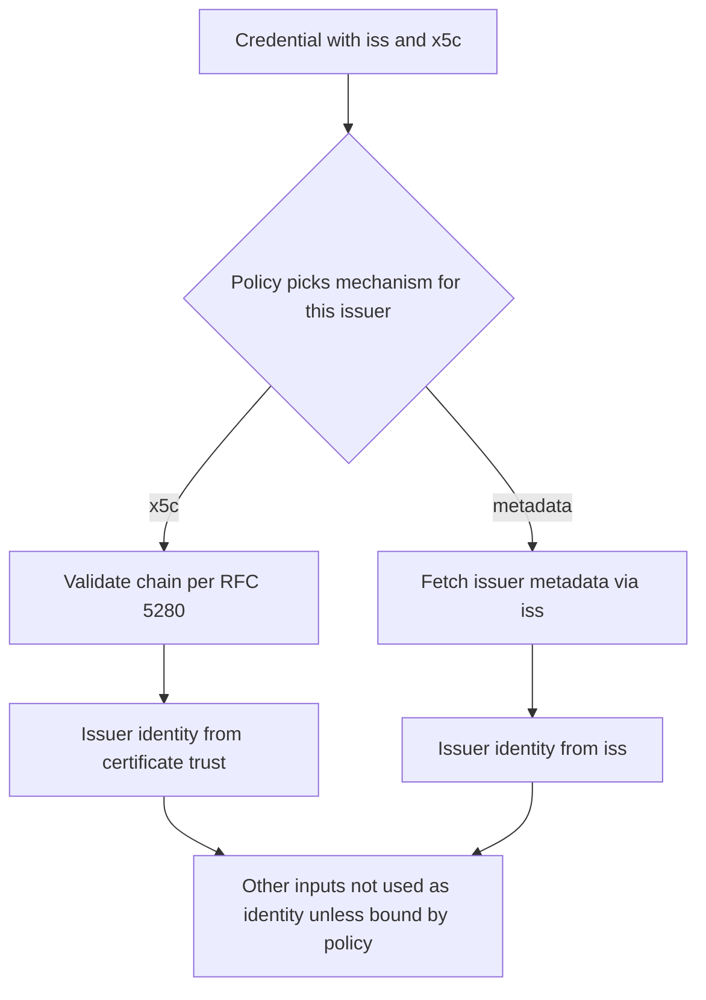
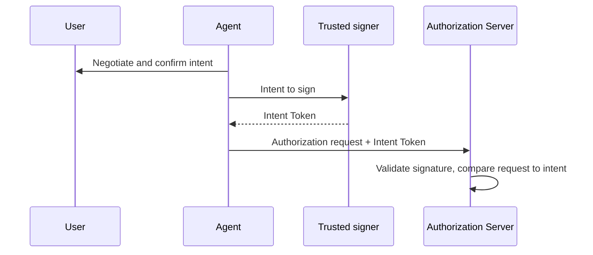

# OAuth WG Daily Report - 2026-11-05

- generated_at_utc: `2026-11-05T06:52:28+00:00`
- snapshot_date: `2026-11-05`

<!-- insights:start -->
## Briefing

> draft-ietf-oauth-sd-jwt-vc is in IESG review. Mike Bishop's DISCUSS on overriding the RFC 7800 sub/iss MUST is being resolved by adding "Updates: 7800", and further ballot-comment PRs are open. Separately, the new Agent Intent Token draft got its first list feedback.

_Updated 2026-11-05T06:53:56+00:00. Machine-drafted from the sources linked below, which stay authoritative._

### sd-jwt-vc will add "Updates: 7800" and lowercase-normalize iss scheme and host to resolve Mike Bishop's DISCUSS

`mail` · `substantive` · first seen 2026-11-05 · [Mike Bishop's Discuss on draft-ietf-oauth-sd-jwt-vc-23: (with DISCUSS and COMMENT)](https://mailarchive.ietf.org/arch/msg/oauth/hSDZBQ75YQ4MiQdZcYXAxauEQOs/)

Bishop's DISCUSS points out that the draft overrides the RFC 7800 requirement that a JWT with cnf also carry sub or iss, without an Updates tag. Brian Campbell added "Updates: 7800 (if approved)" with explanatory text to PR #450, and Bishop says that approach addresses the DISCUSS. Bishop also notes that a "case-sensitive URL" for iss conflicts with RFC 3986, where scheme and host are case-insensitive. Campbell then added a sentence about lowercasing scheme and host to PR #450, to be merged and published near the submission cutoff. The thread is truncated.

**Use cases**

- Implementers of key-bound SD-JWT VCs without sub or iss, who can now rely on RFC 7800 being formally updated.
- Verifiers comparing iss values, who need consistent normalization of scheme and host.

### Mahesh Jethanandani's No Objection on sd-jwt-vc-23 raises RFC 7800, SSRF allow-list and x5c/iss consistency points

`mail` · `discussion` · first seen 2026-11-05 · [Mahesh Jethanandani's No Objection on draft-ietf-oauth-sd-jwt-vc-23: (with COMMENT)](https://mailarchive.ietf.org/arch/msg/oauth/bGFDNfQvdE1DvdJ3e_NUEkY7oG4/)

Mahesh supports Mike's DISCUSS: RFC 7800 Section 3 has a plain MUST for sub or iss, so overriding it needs an Updates relationship or rewording. He asks that the Section 7.1 URL validation, which forbids private and internal addresses, allow locally configured allow-lists for closed enterprise deployments. He also notes Section 2.5 says iss need not match the x5c certificate while Section 7.3 says the relationship is critical. Brian Campbell replies that the DISCUSS is nearly resolved, PR #451 covers the x509 and https issuer comments and PR #452 others. The message is truncated.

**Use cases**

- Enterprise or closed-ecosystem verifiers fetching issuer and type metadata from internal hosts.
- Implementers verifying credentials that carry both an HTTPS iss and an x5c chain.

### Reviewer proposes that an AS advertise supported intent types via metadata, like Authority Metadata does for scopes

`mail` · `discussion` · first seen 2026-11-05 · [回复: 回复: Follow-up on OAuth Interim Discussion: New Draft "Agent Intent Token" for Review](https://mailarchive.ietf.org/arch/msg/oauth/eU4eBAFONfRVBWTNarvtszxJKRI/)

Yuan Ni accepts the author's direction of a small set of common intent fields with extensions. Yuan then suggests the AS advertise the intent types it supports in OAuth metadata, with references to field definitions, similar to draft-zehavi-oauth-authority-metadata for scopes and authorization details types. The Intent Token issuer could then build intent objects the AS understands. This is an initial thought, not a text change.

**Use cases**

- Deployments where several AS products must interpret intent objects from different agent frameworks.
- Intent Token issuers that need to know the accepted intent fields before signing.

### Agent Intent Token authors respond to a review and file an issue for AS-side discovery of intent types

`mail` · `discussion` · first seen 2026-11-05 · [回复: Follow-up on OAuth Interim Discussion: New Draft "Agent Intent Token" for Review (2 new messages)](https://mailarchive.ietf.org/arch/msg/oauth/ilZ30bU7n7Sc7lQNtg-kRgiQI04/)

Meiling Chen thanks Yuan Ni for the suggestion to add discovery of supported intent types and opens Issue #6 in the Maisy-ML/Agent-Intent-Token repository to track it, inviting Yuan to help refine it. The quoted thread shows the draft (draft-chen-oauth-agent-intent-token-00): a signed intent object, confirmed by the user, that an agent presents to the AS so the AS can compare later requests against the original intent. The message is a thread digest with some truncation.

**Use cases**

- An AS operator evaluating how agent-supplied user intent could be checked against later authorization requests.
- An agent platform deciding how its intent issuer learns which intent types an AS understands.

**Related in other tracks**

- `ietf-wimse` / `draft-hulea-wimse-agent-mandate`: Also proposes verifiable, signed statements of what an agent is authorized to do on a principal's behalf.

### Thread on using Delegate SD-JWT for invoicing-agent mandates clarifies when to use issuer_jwt_hash versus sd_hash

`mail` · `discussion` · first seen 2026-11-05 · [Feedback request: SD-JWT VC as mandates for invoicing agents (2 new messages)](https://mailarchive.ietf.org/arch/msg/oauth/xl9Ft9J7xv1wq9-BG1yDV6AWiO4/)

Gareth explains that issuer_jwt_hash in the KB-JWT lets a delegate holder change what is disclosed from the preceding SD-JWT, so a chain such as Invoice to narrowed invoice to further narrowed invoice can drop claims from both the delegate and base SD-JWTs. If the base is a User Credential, using sd_hash forbids removing those disclosures, so verifiers can always identify the user. Gareth is unsure whether a generic partial policy, requiring certain disclosures to stay, is needed. Blake replies that for invoicing the business issues the mandate, so principal can stay plain and limits selectively disclosable, making a partial policy unnecessary.

**Use cases**

- A buyer's wallet delegating narrowed invoice mandates to agents without revealing internal purchasing limits to counterparties.
- A user-credential-rooted delegation where verifiers must always see which user delegated.

**Related in other tracks**

- `ietf-wimse` / `draft-hulea-wimse-agent-mandate`: Also covers verifiable mandates for agents acting across domains, a competing or complementary approach.

### Charles Eckel's No Objection ballot on sd-jwt-vc-23 asks for lowercase keywords and a stricter svg_id character set

`mail` · `editorial` · first seen 2026-11-05 · [Charles Eckel's No Objection on draft-ietf-oauth-sd-jwt-vc-23: (with COMMENT) (2 new messages)](https://mailarchive.ietf.org/arch/msg/oauth/-XTToR0epFjLtoYB-XfkOUVcjps/)

Eckel supports Mike Bishop's DISCUSS on the RFC 7800 sub/iss override. His comments: change MAY to lowercase "can" in Sections 2.2, 2.2.2.5 and 5.3.3, where no protocol-level option is meant. He also asks whether "alphanumeric" for svg_id is specific enough, suggesting ASCII A-Z, a-z, 0-9 and underscore, and a statement on case-sensitivity. The editor replies that PR #453 fixes the keywords and that alphanumeric is probably specific enough.

### PR #453 fixes over-eager BCP 14 keywords in sd-jwt-vc following Charles Eckel's ballot comments

`pull-request` · `editorial` · first seen 2026-11-05 · [oauth-wg/oauth-sd-jwt-vc#453: some keyword fixes for Charles Eckel's No Objection on draft-ietf-oauth-sd-jwt-vc-23: (with COMMENT)](https://github.com/oauth-wg/oauth-sd-jwt-vc/pull/453)

The PR body only links to Eckel's ballot email, and the title describes keyword fixes. The diff is not in the material, so exact edits are unknown. The linked ballot suggests MAY to can in Sections 2.2, 2.2.2.5 and 5.3.3.

### PR #452 addresses further comments from Mahesh Jethanandani's ballot on sd-jwt-vc

`pull-request` · `routine` · first seen 2026-11-05 · [oauth-wg/oauth-sd-jwt-vc#452: some other items from Mahesh Jethanandani ballot](https://github.com/oauth-wg/oauth-sd-jwt-vc/pull/452)

The PR body only links to a mailing-list message and mentions PR #451. No diff or description of the changes is provided, so the content cannot be stated.

### In short, this PR says the issuer identity comes from the chosen key-discovery mechanism, not from other inputs in the credential

`pull-request` · `substantive` · first seen 2026-11-04 · [oauth-wg/oauth-sd-jwt-vc#451: Issuer key discovery: policy selects the mechanism, inputs of other mechanisms do not identify the Issuer](https://github.com/oauth-wg/oauth-sd-jwt-vc/pull/451)

The PR responds to Mahesh's ballot comment on sections 2.5 and 7.3, endorsed by Roman. A credential may carry inputs for several issuer key discovery mechanisms, such as iss and x5c. Policy picks the mechanism per issuer, and the issuer identity is what that mechanism establishes. Inputs for other mechanisms MUST NOT be treated as the issuer identity unless policy binds them and the recipient checked that. For x5c, chain validation follows RFC 7515 4.1.6 and RFC 5280, a cert is not a trust anchor merely by appearing in x5c, a verifier MAY reject an unbound iss, and issuers SHOULD NOT include iss without a binding. Section 7.3 now speaks of the issuer rather than the iss value. There is no precedence rule and no MUST reject, to avoid invalidating existing credentials. RFC 5280 becomes normative.

**Use cases**

- A verifier accepting SD-JWT VCs under a shared CA or trusted list must not take the payload iss as the issuer just because the x5c chain validates.
- An issuer that publishes metadata and also includes x5c should avoid including an iss that is not bound to the certificate.

### A reader asks whether the new Agent Intent Token draft will fix the intent format per deployment or define common fields

`mail` · `discussion` · first seen 2026-11-04 · [回复: Follow-up on OAuth Interim Discussion: New Draft "Agent Intent Token" for Review](https://mailarchive.ietf.org/arch/msg/oauth/RSYbXENasc79M4rSSodWbrbNWFU/)

This reply, from Yuan, is on Meiling Chen's announcement of draft-chen-oauth-agent-intent-token-00. The draft proposes a signed object, such as a JWT, that records the user's confirmed intent. An agent would carry it to the authorization server, which validates the signature and compares later requests with the recorded intent. Yuan asks about Section 3.3: an AP2 SDK example uses a natural_language_description field plus shopping-specific fields, so will the issuer and AS agree on the intent format per deployment, or is a small common set of extensible fields planned? No answer is in the material. The quoted announcement is partly garbled and truncated.

**Use cases**

- An authorization server for AI agents that wants to check a request against the user's confirmed intent would need a defined intent format to do so.

### In short, the sd-jwt-vc DISCUSS on overriding RFC 7800 is to be resolved by marking the draft as updating RFC 7800

`mail` · `discussion` · first seen 2026-11-04 · [Mike Bishop's Discuss on draft-ietf-oauth-sd-jwt-vc-23: (with DISCUSS and COMMENT) (2 new messages)](https://mailarchive.ietf.org/arch/msg/oauth/XfEeU9P3FttCr9d8a2ncUFtTxLA/)

Mike Bishop's DISCUSS on draft-ietf-oauth-sd-jwt-vc-23 objects that the draft says it overrides the RFC 7800 requirement that a JWT with a cnf claim also carry sub or iss, but has no Updates tag. Brian Campbell proposed adding 'Updates: 7800 (if approved)' with explanatory text, and added it to PR #450. Bishop replied that the PR would address the DISCUSS and that the text need only say the requirement is removed rather than overridden. Campbell also answered several COMMENT items: he agreed to reorder a sentence in 1.2, drop a MUST in 5.5.1.2.1, and add a reference for SVG structure. He declined a distinct media type for metadata and extra redirect wording in 4.3. On the case-sensitive iss URL point, Bishop noted that RFC 7519 StringOrURI is already compared as a case-sensitive string. The material is truncated, so the remaining comments are not covered.

**Use cases**

- An implementer of key-bound SD-JWT VCs that carry neither sub nor iss can rely on the draft formally relaxing the RFC 7800 requirement.
- An issuer or verifier comparing iss values should do plain string comparison, as RFC 7519 StringOrURI defines, not URL normalization.

### A reviewer criticises the attestation-based client authentication draft as overcomplicated and argues for reuse of RFC 7521 and DPoP

`mail` · `discussion` · first seen 2026-11-04 · [Draft -12 of Attestation-Based Client Authentication incorporating WGLC feedback](https://mailarchive.ietf.org/arch/msg/oauth/bV406I0e4J58dKORo8v1EsLOBM4/)

In a reply on the -12 draft thread (which the title says incorporates WGLC feedback), Erin says she has significant misgivings. She calls the Section 5.2 paragraph about dpop_jkt confusing, since dpop_jkt is sent at the authorization endpoint and makes a DPoP proof at the token endpoint mandatory. She argues the draft mixes client authentication to the AS with client authentication to the RS, and that the latter should be its own token type. She suggests building on RFC 7521 client_assertion or allowing two DPoP headers. She lists open problems: a fifth client authentication option (the OAuth-Client-Assertion header) with no rule for multiple methods, no signal to the client that the token is bound, unclear binding to a specific assertion or key, and no introspection or JWT access token profile extension. She also warns about non-interoperable option sprawl.

**Use cases**

- An AS implementer would need to decide how to handle requests that carry several client authentication signals, which the draft does not specify.
- A deployer weighing wallet or app attestation for client authentication should expect the binding and token-type questions to be debated further.

### Triage of the candidate queue

- **high** `draft-ietf-oauth-attestation-based-client-auth`: A detailed critical review of -12 questions its structure and DPoP/RFC 7521 reuse.
- **high** `draft-ietf-oauth-deferred-token-response`: -01 restructures the draft with substrate invariants, a new deferred_interactive mode and new editors; also cited as the answer to ID-JAG consent.
- **high** `draft-ietf-oauth-delegate-sd-jwt`: List discussion clarifies issuer_jwt_hash versus sd_hash, with an updated version and roadmap planned for IETF.
- **high** `draft-ietf-oauth-identity-assertion-authz-grant`: -06 adds new normative behaviour (client auth at IdP, invalid_request, mTLS binding, new metadata) and a large rewrite.
- **high** `draft-ietf-oauth-sd-jwt-vc`: In IESG review with a DISCUSS being resolved via Updates: 7800, iss normalization and several ballot-driven PRs.
- **high** `draft-ietf-oauth-spiffe-client-auth`: -03 makes client_id optional, ties client identification to CIMD and adds replay and trust-bundle security text.
- **high** `draft-ietf-oauth-v2-1`: Seven new issues and 31 closed, several tagged ietf-127, including MUST vs SHOULD in §3.2.3 and invalid_client.
- **low** `draft-ietf-oauth-client-id-metadata-document`: It is only mentioned as the origin of the new DPoP-required metadata draft, with no change to the draft itself.
- **low** `draft-ietf-oauth-transaction-tokens`: Only a new implementation-report issue (#373) with one comment; no text change.

<!-- insights:end -->

## Top Priorities

| Rank | Draft | Score | Updated | Key State | Repo |
|---|---|---:|---|---|---|
| 1 | `draft-ietf-oauth-sd-jwt-vc` | 125 | 2026-11-04T20:03:51Z | Active, Expert Reviews OK | `oauth-sd-jwt-vc` |
| 2 | `draft-ietf-oauth-status-list` | 90 | 2026-11-03T19:29:28Z | Active, RFC-Ed-Ack | `draft-ietf-oauth-status-list` |
| 3 | `draft-ietf-oauth-rfc7523bis` | 90 | 2026-11-03T19:25:31Z | Active, RFC-Ed-Ack | `draft-ietf-oauth-rfc7523bis` |
| 4 | `draft-ietf-oauth-client-id-metadata-document` | 90 | 2026-11-02T22:02:56Z | Active, I-D Exists | `draft-ietf-oauth-client-id-metadata-document` |
| 5 | `draft-ietf-oauth-identity-assertion-authz-grant` | 83 | 2026-10-31T00:32:39Z | Active, I-D Exists | `oauth-identity-assertion-authz-grant` |
| 6 | `draft-ietf-oauth-v2-1` | 76 | 2026-10-31T04:16:32Z | Active, I-D Exists | `oauth-v2-1` |
| 7 | `draft-ietf-oauth-delegate-sd-jwt` | 76 | 2026-10-30T12:38:29Z | Active, I-D Exists | `oauth-delegate-sd-jwt` |
| 8 | `draft-ietf-oauth-deferred-token-response` | 68 | 2026-10-31T16:12:16Z | Active, I-D Exists | `oauth-deferred-token-response` |
| 9 | `draft-ietf-oauth-rfc8725bis` | 65 | 2026-08-31T18:37:20Z | Active, No IANA Actions | `draft-ietf-oauth-rfc8725bis` |
| 10 | `draft-ietf-oauth-identity-chaining` | 65 | 2026-08-21T20:25:31Z | Active, RFC-Ed-Ack | `oauth-identity-chaining` |

## Active Drafts

| Draft | Rev | Updated | States |
|---|---:|---|---|
| `draft-ietf-oauth-sd-jwt-vc` | 23 | 2026-11-04T20:03:51Z | Active, Expert Reviews OK, IANA OK - Actions Needed |
| `draft-ietf-oauth-status-list` | 21 | 2026-11-03T19:29:28Z | Active, RFC-Ed-Ack, Expert Reviews OK |
| `draft-ietf-oauth-rfc7523bis` | 11 | 2026-11-03T19:25:31Z | Active, RFC-Ed-Ack, Expert Reviews OK |
| `draft-ietf-oauth-client-id-metadata-document` | 03 | 2026-11-02T22:02:56Z | Active, I-D Exists, WG Document |
| `draft-ietf-oauth-spiffe-client-auth` | 03 | 2026-11-02T17:35:55Z | Active, I-D Exists, WG Document |
| `draft-ietf-oauth-deferred-token-response` | 01 | 2026-10-31T16:12:16Z | Active, I-D Exists, WG Document |
| `draft-ietf-oauth-v2-1` | 17 | 2026-10-31T04:16:32Z | Active, I-D Exists, WG Document |
| `draft-ietf-oauth-identity-assertion-authz-grant` | 06 | 2026-10-31T00:32:39Z | Active, I-D Exists, WG Document |
| `draft-ietf-oauth-delegate-sd-jwt` | 00 | 2026-10-30T12:38:29Z | Active, I-D Exists, WG Document |
| `draft-ietf-oauth-attestation-based-client-auth` | 12 | 2026-10-18T17:33:02Z | Active, I-D Exists, WG Consensus: Waiting for Write-Up |
| `draft-ietf-oauth-rfc8725bis` | 10 | 2026-08-31T18:37:20Z | Active, No IANA Actions, IANA OK - No Actions Needed |
| `draft-ietf-oauth-first-party-apps` | 04 | 2026-08-26T14:40:16Z | Active, I-D Exists, WG Consensus: Waiting for Write-Up |
| `draft-ietf-oauth-rar-metadata-remediation` | 00 | 2026-08-23T20:29:29Z | Active, I-D Exists, WG Document |
| `draft-ietf-oauth-identity-chaining` | 17 | 2026-08-21T20:25:31Z | Active, RFC-Ed-Ack, Expert Reviews OK |
| `draft-ietf-oauth-transaction-tokens` | 11 | 2026-08-21T11:57:16Z | Active, I-D Exists, WG Consensus: Waiting for Write-Up |

## Repo Watch

| Repo | Pushed | Open Issues |
|---|---|---:|
| `oauth-wg/oauth-sd-jwt-vc` | 2026-11-05T01:38:39Z | 0 |
| `oauth-wg/oauth-v2-1` | 2026-11-05T00:12:30Z | 12 |
| `oauth-wg/oauth-delegate-sd-jwt` | 2026-11-03T00:23:39Z | 12 |
| `oauth-wg/oauth-spiffe-client-authentication` | 2026-11-03T00:08:49Z | 6 |
| `oauth-wg/oauth-deferred-token-response` | 2026-11-03T00:06:25Z | 23 |
| `oauth-wg/draft-ietf-oauth-client-id-metadata-document` | 2026-11-03T00:00:38Z | 33 |
| `oauth-wg/oauth-transaction-tokens` | 2026-11-01T00:20:49Z | 2 |
| `oauth-wg/oauth-identity-assertion-authz-grant` | 2026-11-01T00:03:15Z | 32 |
| `oauth-wg/draft-ietf-oauth-attestation-based-client-auth` | 2026-10-13T06:13:11Z | 0 |
| `oauth-wg/oauth-selective-disclosure-jwt` | 2026-10-04T13:50:37Z | 0 |
| `oauth-wg/oauth-cross-device-security` | 2026-08-27T14:45:11Z | 0 |
| `oauth-wg/oauth-browser-based-apps` | 2026-08-27T14:43:00Z | 0 |

## Recent Pull Requests

- `oauth-wg/oauth-sd-jwt-vc#451` Issuer key discovery: policy selects the mechanism, inputs of other mechanisms do not identify the Issuer (2026-11-05T01:36:36Z)
- `oauth-wg/oauth-sd-jwt-vc#453` some keyword fixes for Charles Eckel's No Objection on draft-ietf-oauth-sd-jwt-vc-23: (with COMMENT) (2026-11-05T01:14:57Z)
- `oauth-wg/oauth-v2-1#268` Supporting OAuth 2.0 and OAuth 2.1 clients concurrently (2026-11-04T23:50:15Z)
- `oauth-wg/oauth-sd-jwt-vc#452` some other items from Mahesh Jethanandani ballot (2026-11-04T23:10:46Z)
- `oauth-wg/oauth-sd-jwt-vc#450` Mike Bishop's ballot  (2026-11-04T22:54:01Z)
- `oauth-wg/draft-ietf-oauth-client-id-metadata-document#29` Improve documentation for development usage and expiration of clients (2026-11-02T22:24:32Z)
- `oauth-wg/draft-ietf-oauth-client-id-metadata-document#129` Define AS behavior when certain CIMD client features are unsupported (2026-11-02T21:51:56Z)
- `oauth-wg/draft-ietf-oauth-client-id-metadata-document#130` require pre-fetching logo_uri, added security considerations (2026-11-02T21:51:14Z)
- `oauth-wg/draft-ietf-oauth-client-id-metadata-document#128` Added section distinguishing functional and informative URI properties (2026-11-02T21:47:50Z)
- `oauth-wg/draft-ietf-oauth-client-id-metadata-document#99` Add Client Authentication section (2026-11-02T20:27:59Z)

## Recent Issues

- `oauth-wg/draft-ietf-oauth-client-id-metadata-document#121` Security Considerations: persisted/remembered authorization decisions should respect resource-indicator scoping (2026-11-02T22:22:58Z)
- `oauth-wg/draft-ietf-oauth-client-id-metadata-document#79` Review from Justin Richer (2026-11-02T22:22:55Z)
- `oauth-wg/draft-ietf-oauth-client-id-metadata-document#30` Client metadata retrieval can be abused to make server issued requests (2026-11-02T22:22:51Z)
- `oauth-wg/draft-ietf-oauth-client-id-metadata-document#100` Clarify behaviour of `token_endpoint_auth_method` of `"private_key_jwt"` when `jwks` and `jwks_uri` are missing (2026-11-02T22:19:11Z)
- `oauth-wg/draft-ietf-oauth-client-id-metadata-document#96` token_endpoint_auth_methods_supported  and revocation_endpoint_auth_methods_supported (2026-11-02T22:18:51Z)
- `oauth-wg/draft-ietf-oauth-client-id-metadata-document#92` Provide guidance on omission of `token_endpoint_auth_method` field (2026-11-02T22:18:16Z)
- `oauth-wg/draft-ietf-oauth-client-id-metadata-document#71` Define AS behavior when CIMD contains unsupported metadata values (2026-11-02T21:56:56Z)
- `oauth-wg/draft-ietf-oauth-client-id-metadata-document#85` Be more prescriptive about how the AS should return errors (2026-11-02T21:56:08Z)
- `oauth-wg/draft-ietf-oauth-client-id-metadata-document#126` Move 9.5.1. Consistency of Client Metadata to Section 4 (2026-11-02T21:50:00Z)
- `oauth-wg/draft-ietf-oauth-client-id-metadata-document#86` Disallow the root path `/` as a CIMD URL (2026-11-02T21:43:55Z)

## Organization Events

- `2026-11-04T16:58:38Z` PushEvent `oauth-wg/oauth-sd-jwt-vc` 
- `2026-11-05T01:37:12Z` PushEvent `oauth-wg/oauth-sd-jwt-vc` 
- `2026-11-03T00:23:40Z` PushEvent `oauth-wg/oauth-delegate-sd-jwt` 
- `2026-11-05T01:38:08Z` ReleaseEvent `oauth-wg/oauth-sd-jwt-vc` published
- `2026-11-05T01:36:36Z` PullRequestEvent `oauth-wg/oauth-sd-jwt-vc` merged
- `2026-11-05T01:14:58Z` PushEvent `oauth-wg/oauth-sd-jwt-vc` 
- `2026-11-05T01:14:56Z` PullRequestEvent `oauth-wg/oauth-sd-jwt-vc` merged
- `2026-11-04T23:50:15Z` IssueCommentEvent `oauth-wg/oauth-v2-1` Supporting OAuth 2.0 and OAuth 2.1 clients concurrently
- `2026-11-04T23:10:46Z` PullRequestEvent `oauth-wg/oauth-sd-jwt-vc` merged
- `2026-11-04T23:02:07Z` PullRequestEvent `oauth-wg/oauth-sd-jwt-vc` opened
- `2026-11-04T22:54:02Z` PushEvent `oauth-wg/oauth-sd-jwt-vc` 
- `2026-11-02T21:56:07Z` PushEvent `oauth-wg/draft-ietf-oauth-client-id-metadata-document` 
- `2026-11-04T22:54:01Z` PullRequestEvent `oauth-wg/oauth-sd-jwt-vc` merged
- `2026-11-02T21:43:50Z` PushEvent `oauth-wg/draft-ietf-oauth-client-id-metadata-document` 
- `2026-11-02T21:16:24Z` CreateEvent `oauth-wg/draft-ietf-oauth-client-id-metadata-document` 
- `2026-11-02T21:58:51Z` PushEvent `oauth-wg/draft-ietf-oauth-client-id-metadata-document` 
- `2026-11-04T21:10:14Z` PullRequestEvent `oauth-wg/oauth-sd-jwt-vc` opened
- `2026-11-02T21:41:03Z` PushEvent `oauth-wg/draft-ietf-oauth-client-id-metadata-document` 
- `2026-11-04T20:39:21Z` PullRequestReviewEvent `oauth-wg/oauth-sd-jwt-vc` created
- `2026-11-02T21:40:47Z` DeleteEvent `oauth-wg/draft-ietf-oauth-client-id-metadata-document` 

## Mailarchive Signals

- weekly_digest_count: `0`
- [OAUTH-WG] Re: 回复: Follow-up on OAuth Interim Discussion: New Draft "Agent Intent Token" for Review - https://mailarchive.ietf.org/arch/msg/oauth/ilZ30bU7n7Sc7lQNtg-kRgiQI04/
- [OAUTH-WG] 回复: 回复: Follow-up on OAuth Interim Discussion: New Draft "Agent Intent Token" for Review - https://mailarchive.ietf.org/arch/msg/oauth/eU4eBAFONfRVBWTNarvtszxJKRI/
- [OAUTH-WG] Re: 回复: Follow-up on OAuth Interim Discussion: New Draft "Agent Intent Token" for Review - https://mailarchive.ietf.org/arch/msg/oauth/rJHZHZq2HZgMy0rOBynr-zKsStU/
- [OAUTH-WG] Re: Charles Eckel's No Objection on draft-ietf-oauth-sd-jwt-vc-23: (with COMMENT) - https://mailarchive.ietf.org/arch/msg/oauth/-XTToR0epFjLtoYB-XfkOUVcjps/
- [OAUTH-WG] Re: Feedback request: SD-JWT VC as mandates for invoicing agents - https://mailarchive.ietf.org/arch/msg/oauth/xl9Ft9J7xv1wq9-BG1yDV6AWiO4/
- [OAUTH-WG] Charles Eckel's No Objection on draft-ietf-oauth-sd-jwt-vc-23: (with COMMENT) - https://mailarchive.ietf.org/arch/msg/oauth/h0Erp-t-X8pu3UFKthrUl2Ttf2k/
- [OAUTH-WG] Re: Mahesh Jethanandani's No Objection on draft-ietf-oauth-sd-jwt-vc-23: (with COMMENT) - https://mailarchive.ietf.org/arch/msg/oauth/bGFDNfQvdE1DvdJ3e_NUEkY7oG4/
- [OAUTH-WG] Re: Mike Bishop's Discuss on draft-ietf-oauth-sd-jwt-vc-23: (with DISCUSS and COMMENT) - https://mailarchive.ietf.org/arch/msg/oauth/hSDZBQ75YQ4MiQdZcYXAxauEQOs/

## Next Actions

1. Evaluate the top 3 items in `Top Priorities` as weekly deep-dive candidates.
2. Separately track comment deadlines for `In Last Call` / `In WG Last Call` drafts.
3. For repos with a sudden spike in activity, create a scaffold in `deep-dives/` to capture key discussion points.
