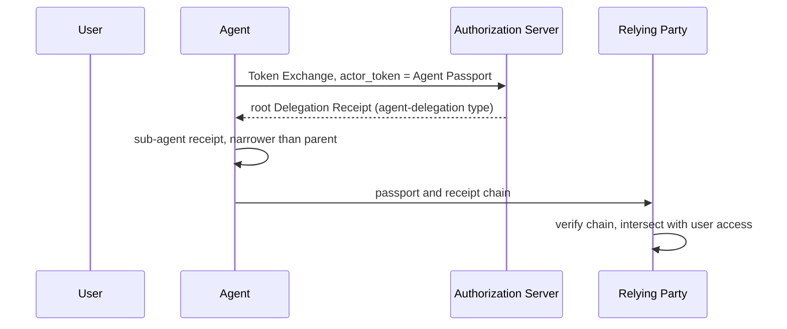

# OAuth WG Daily Report - 2026-11-06

- generated_at_utc: `2026-11-06T06:51:44+00:00`
- snapshot_date: `2026-11-06`

<!-- insights:start -->
## Briefing

> draft-ietf-oauth-sd-jwt-vc-25 was published in answer to Éric Vyncke's DISCUSS: it turns the type-matching SHOULD into plain prose and spells out the risk of skipping the status check. The rest of the run is new AI-agent drafts and Skyfire AMR/KYAPay review threads.

_Updated 2026-11-06T06:53:13+00:00. Machine-drafted from the sources linked below, which stay authoritative._

### A new individual draft defines Agent Passports and Delegation Receipts, issued through Token Exchange

`mail` · `new-proposal` · first seen 2026-11-06 · [New draft: Agent Passports and Delegation Receipts (draft-le-agent-passport-00)](https://mailarchive.ietf.org/arch/msg/oauth/5vpjfYjnk2eV2IT2Kqn-UnIhspc/)

draft-le-agent-passport-00 defines two signed objects. An Agent Passport is a JWT that binds an agent's key (cnf) to the accountable organisation and to a digest of its build. Delegation Receipts form a chain from a user through agents and sub-agents. Each step is key-bound and can only narrow the one before, and the relying party verifies the chain and intersects it with the user's own access. Root receipts are obtained with RFC 8693 Token Exchange, using the passport as actor token and a new requested_token_type urn:ietf:params:oauth:token-type:agent-delegation. Status uses the Token Status List draft. The open question is whether grants should be an RFC 9396 authorization_details type. The author mentions a side meeting at IETF 127 and an IPR disclosure, and says the draft complements draft-klrc-aiagent-auth and AAuth.

**Use cases**

- An authorisation server that already supports RAR and wants to issue agent delegation grants as authorization_details
- A relying party that must check, across organisations, that a sub-agent's authority is a subset of the user's

**Related in other tracks**

- `openid` / `openid/aauth`: The author says the draft is meant to complement AAuth.

### Rob Zagarella's implementer review of the Skyfire amr-values and id-verification drafts produced issues on bg, idv_time and overlap with RFC 8176

`mail` · `discussion` · first seen 2026-11-06 · [Implementer review of draft-skyfire-oauth-amr-values-01 and draft-skyfire-oauth-id-verification-01](https://mailarchive.ietf.org/arch/msg/oauth/M4Uyhdqn_YtaeFSEIX63kx6ay0o/)

Ankit reports that two of Rob's points are now issues: splitting the combined bg value into a device-identifier issue and a geo-location issue, and what idv_time should mean for verification time. The quoted review asks for a note per new amr value saying whether it specialises, extends or is disjoint from an existing RFC 8176 value (for example face and facliv), and asks that facliv be defined. Rob later agrees that ISO/IEC 30107-3 does not formally define passive versus active liveness and suggests facliv simply mean facial liveness was performed, leaving finer distinctions to a profile. Mike Jones says overlap is normal among amr values, removes call in PR #7 and opened issue #8 for the clarifications. The material is truncated.

**Use cases**

- An implementer that records a facial match plus an active liveness challenge and has to choose which amr values to emit

### The IESG ballot on sd-jwt-vc-23 questions two SHOULDs, and the authors answer that they will soften one and explain the other

`mail` · `discussion` · first seen 2026-11-06 · [Éric Vyncke's Discuss on draft-ietf-oauth-sd-jwt-vc-23: (with DISCUSS and COMMENT)](https://mailarchive.ietf.org/arch/msg/oauth/Nuj5rCPT4ntMHnV1yZdKyWGaWTs/)

Éric Vyncke entered a DISCUSS on -23. He asks why type matching (Section 2.2.2.2) and status checking (Section 2.4) are not MUSTs, and notes that the type-matching SHOULD is not really an interoperability requirement under BCP 14. An author replied that the type-matching text was added late, was meant to help layers above such as DCQL and OpenID4VP, and would be better without BCP 14 language. For status, the author said a verifier may be offline and that more text will cover the consequences of not checking. Vyncke's comments also second a DISCUSS about a missing formal update of RFC 7800 and suggest replacing the normative reference to RFC 6890 with the IANA IPv4 and IPv6 special-purpose registries. The -25 diff acts on the first two points.

**Use cases**

- A wallet or verifier library that matches credential types via aka_vcts and needs to know whether the rule is a protocol requirement
- A verifier that may be offline and has to decide how to handle a credential with a status claim

### Review points on the Skyfire KYAPay drafts are now tracked as GitHub issues

`mail` · `discussion` · first seen 2026-11-06 · [Review of draft-skyfire-oauth-kyapay-*](https://mailarchive.ietf.org/arch/msg/oauth/UsmI2yL5sspN4GY--aQIsGIIdoU/)

Ankit lists the open points from Jean Diaconu's review as issues: how separate KYA and PAY tokens in one request relate (the token draft says they refer to the same initiator only when both iss and sub are equal), a Human-in-the-Loop option for a site to ask for recent human confirmation, and the AML methods draft's vendor-page references and false, stale or sensitive assertions. The quoted thread shows Mike Jones answering the review: PR #49 clarifies aid and sti and mentions jti and short lifetimes against replay, an issue tracks the unclear verifier description, and the token-exchange example is being reworked. The quoted text is truncated.

### The amr-values thread argues over the broad bg value, separate sna, and a structured amr_details claim

`mail` · `discussion` · first seen 2026-11-06 · [Review of draft-skyfire-oauth-amr-values](https://mailarchive.ietf.org/arch/msg/oauth/iIq9497aU0Zlq2xv1BnmBnDX1hQ/)

Ankit says Bjorn Hjelm's points are now issues: device identifier as its own value (issue 14) and geo-location treated as context rather than authentication (issue 15). In the quoted thread Bjorn argues that bg is no different from sna, which he says is a misleading term for Number Verify, and that device recognition is too vague. Shankar supports registering sna separately because bg is too broad, and proposes an optional amr_details companion claim with method, channel and mechanism so that relationships such as an OTP delivered by email can be expressed, leaving amr unchanged. Mike Jones objected to changing the structure or ordering semantics of amr without working group discussion. PR #9 and PR #10 (a new mdc value for synced passkeys) are up. The material is truncated.

**Use cases**

- A mobile-first service that uses phone numbers as account identifiers and needs to tell carrier-assisted verification apart from other background checks

### The -25 revision drops the BCP 14 SHOULD on type matching, adds a status-check risk note and regenerates the examples

`draft-revision` · `editorial` · first seen 2026-11-06 · [draft-ietf-oauth-sd-jwt-vc-25: SD-JWT-based Verifiable Digital Credentials (SD-JWT VC)](https://author-tools.ietf.org/iddiff?url1=draft-ietf-oauth-sd-jwt-vc-24&url2=draft-ietf-oauth-sd-jwt-vc-25)

The type-matching text no longer uses SHOULD: a Holder or Verifier now "treats" an SD-JWT VC as being of a given type if the type is the vct value or in aka_vcts. The status-check text keeps SHOULD but adds that a Verifier that does not check status cannot detect revocation or suspension and accepts that risk under its policy. The examples were rewritten: the typ in the example headers changed from vc+sd-jwt to dc+sd-jwt, the PID example now uses a fictional "Ændgard" issuer with a urn:example:eudi:pid:aendgard:1 vct and extra claims (sex, age_in_years, portrait and others), and the signatures and hashes were recomputed. The rest of the diff shows only table-of-contents page numbers and whitespace, and the material is truncated.

### A mailing list for an AAuth working group has been opened at the OpenID Foundation

`mail` · `routine` · first seen 2026-11-06 · [AAuth working group at OpenID foundation](https://mailarchive.ietf.org/arch/msg/oauth/WJpNueNQRESJbSsW15stezsMDFQ/)

A short message tells those interested in AAuth about the openid-specs-aauth mailing list at the OpenID Foundation. It says the foundation is still provisioning the rest of the new working group's infrastructure. The message has no technical content.

**Related in other tracks**

- `openid` / `openid/aauth`: The OpenID repository for the AAuth work that this list serves.

### This revision makes SD-JWT VC formally update RFC 7800 and tightens how the issuer is identified

`draft-revision` · `substantive` · first seen 2026-11-05 · [draft-ietf-oauth-sd-jwt-vc-24: SD-JWT-based Verifiable Digital Credentials (SD-JWT VC)](https://author-tools.ietf.org/iddiff?url1=draft-ietf-oauth-sd-jwt-vc-23&url2=draft-ietf-oauth-sd-jwt-vc-24)

-24 adds 'Updates: 7800 (if approved)' and a new section 2.2.2.3.1 saying the RFC 7800 requirement that a JWT with cnf also carry sub or iss is nullified, not just overridden, and applies to SD-JWT VCs, SD-JWTs and JWTs generally. For key discovery, an x5c chain must be validated per RFC 7515 and RFC 5280 against a policy-permitted trust anchor (inclusion in x5c does not make a certificate an anchor). An iss claim is not authenticated by the x5c mechanism, and issuers SHOULD NOT include an unbound iss. Recipients MUST NOT treat inputs of other mechanisms as identifying the issuer unless policy binds them, and the security considerations now spell this out. Lowercasing scheme and host in iss is RECOMMENDED. Other changes are wording: some MAY/MUST became 'can', and RFC 5280 and SVG references were added. The appendix examples were also regenerated, and the mailing list (item 2) reports this regeneration was a mistake.

**Use cases**

- A verifier that accepts credentials with both an HTTPS iss and an x5c header must now decide by policy which mechanism identifies the issuer, and must not trust an unbound iss.
- A wallet or issuer producing key-bound SD-JWT VCs without sub or iss can now cite a formal update to RFC 7800 rather than an override.

**Related in other tracks**

- `openid` / `openid/OpenID4VP`: OpenID4VP presents SD-JWT VC credentials, so issuer identification rules affect verifiers there.

### sd-jwt-vc will add "Updates: 7800" and lowercase-normalize iss scheme and host to resolve Mike Bishop's DISCUSS

`mail` · `substantive` · first seen 2026-11-05 · [Mike Bishop's Discuss on draft-ietf-oauth-sd-jwt-vc-23: (with DISCUSS and COMMENT)](https://mailarchive.ietf.org/arch/msg/oauth/hSDZBQ75YQ4MiQdZcYXAxauEQOs/)

Bishop's DISCUSS points out that the draft overrides the RFC 7800 requirement that a JWT with cnf also carry sub or iss, without an Updates tag. Brian Campbell added "Updates: 7800 (if approved)" with explanatory text to PR #450, and Bishop says that approach addresses the DISCUSS. Bishop also notes that a "case-sensitive URL" for iss conflicts with RFC 3986, where scheme and host are case-insensitive. Campbell then added a sentence about lowercasing scheme and host to PR #450, to be merged and published near the submission cutoff. The thread is truncated.

**Use cases**

- Implementers of key-bound SD-JWT VCs without sub or iss, who can now rely on RFC 7800 being formally updated.
- Verifiers comparing iss values, who need consistent normalization of scheme and host.

### Éric Vyncke blocked -23 with a DISCUSS asking why two SHOULDs are not MUSTs

`mail` · `discussion` · first seen 2026-11-05 · [Éric Vyncke's Discuss on draft-ietf-oauth-sd-jwt-vc-23: (with DISCUSS and COMMENT)](https://mailarchive.ietf.org/arch/msg/oauth/Jq-oFheO82BciSZUIkv2hjpc1WI/)

Vyncke's DISCUSS questions the SHOULD in Section 2.2.2.2 on treating an SD-JWT VC as being of a type listed in aka_vcts, and the SHOULD in Section 2.4 on checking status when present. He asks for guidance on when to bypass each and the consequences, citing the IESG statement on BCP 14 usage. Non-blocking comments second Bishop's DISCUSS on the RFC 7800 update and suggest replacing the normative RFC 6890 reference in Section 7.1 with the IANA IPv4 and IPv6 special-purpose registries.

**Use cases**

- Verifiers deciding whether status checks are mandatory could see the status SHOULD tightened or explained before publication.

### A thread on using SD-JWT VC mandates for invoicing agents explains when to choose sd_hash or issuer_jwt_hash in Delegate SD-JWT

`mail` · `discussion` · first seen 2026-11-05 · [Feedback request: SD-JWT VC as mandates for invoicing agents](https://mailarchive.ietf.org/arch/msg/oauth/Qguh52h8Jv00QvGc4miq8aAwZzY/)

Gareth Oliver explained that issuer_jwt_hash in the KB-JWT lets the holder allow a delegate to change what is disclosed from the preceding SD-JWT. That allows a chain such as base invoice, then narrowed invoice, then further narrowed invoice, where later delegates can drop claims from earlier links. sd_hash is for cases like a user credential at the base, where the holder wants downstream delegates unable to remove disclosures so verifiers can see which user delegated. He is unsure whether partial enforcement is needed and said the delegate-sd-jwt draft is being updated, with a roadmap at IETF. Carlos will rebuild his invoicing proposal on Delegate SD-JWT for -01.

**Use cases**

- A buyer's wallet delegating an invoice to sub-agents must choose issuer_jwt_hash to let them hide the parent mandate's purchasing policy from counterparties.
- A service passing a user credential downstream can use sd_hash so verifiers always see the user's disclosures.

**Related in other tracks**

- `ietf-wimse` / `draft-hulea-wimse-agent-mandate`: Also addresses verifiable mandates for agents across domains, an overlapping delegation use case.

### Mike Bishop moved to No Objection on -24, keeping two non-blocking comments

`mail` · `discussion` · first seen 2026-11-05 · [Mike Bishop's No Objection on draft-ietf-oauth-sd-jwt-vc-24: (with COMMENT)](https://mailarchive.ietf.org/arch/msg/oauth/SnO92JvcAcpugLZExKJEkY5t0ac/)

Bishop's ballot on -24 is No Objection, noting that -24 added the Updates: 7800 tag and fixed most of his comments. He retains non-blocking comments for the record. The first suggests a distinct media type rather than application/json for the JWT VC Issuer Metadata (Section 4.2) and Type Metadata (5.3.1), so the server can assert the document's role. The second suggests Section 4.3 state that the issuer in the response must match the JWT's iss even after a redirect, regardless of who served it.

**Use cases**

- Implementers of issuer metadata fetching should already validate that the returned issuer matches the JWT iss even across redirects.

### Triage of the candidate queue

- **high** `draft-ietf-oauth-attestation-based-client-auth`: A detailed critical review of -12 questions its structure and DPoP/RFC 7521 reuse.
- **high** `draft-ietf-oauth-deferred-token-response`: -01 restructures the draft with substrate invariants, a new deferred_interactive mode and new editors; also cited as the answer to ID-JAG consent.
- **high** `draft-ietf-oauth-delegate-sd-jwt`: Authors explained the sd_hash vs issuer_jwt_hash design and are preparing an updated version with a roadmap at IETF 127.
- **high** `draft-ietf-oauth-identity-assertion-authz-grant`: -06 adds new normative behaviour (client auth at IdP, invalid_request, mTLS binding, new metadata) and a large rewrite.
- **high** `draft-ietf-oauth-sd-jwt-vc`: -25 published in response to an IESG DISCUSS, with normative wording changes on type matching and status checking.
- **high** `draft-ietf-oauth-spiffe-client-auth`: -03 makes client_id optional, ties client identification to CIMD and adds replay and trust-bundle security text.
- **high** `draft-ietf-oauth-v2-1`: Seven new issues and 31 closed, several tagged ietf-127, including MUST vs SHOULD in §3.2.3 and invalid_client.
- **low** `draft-ietf-oauth-client-id-metadata-document`: It is only mentioned as the origin of the new DPoP-required metadata draft, with no change to the draft itself.
- **low** `draft-ietf-oauth-transaction-tokens`: Only the agenda request for a competing cross-domain approach mentioned it, with no text change.

<!-- insights:end -->

## Top Priorities

| Rank | Draft | Score | Updated | Key State | Repo |
|---|---|---:|---|---|---|
| 1 | `draft-ietf-oauth-sd-jwt-vc` | 125 | 2026-11-05T23:41:14Z | Active, Expert Reviews OK | `oauth-sd-jwt-vc` |
| 2 | `draft-ietf-oauth-status-list` | 90 | 2026-11-03T19:29:28Z | Active, RFC-Ed-Ack | `draft-ietf-oauth-status-list` |
| 3 | `draft-ietf-oauth-rfc7523bis` | 90 | 2026-11-03T19:25:31Z | Active, RFC-Ed-Ack | `draft-ietf-oauth-rfc7523bis` |
| 4 | `draft-ietf-oauth-client-id-metadata-document` | 90 | 2026-11-02T22:02:56Z | Active, I-D Exists | `draft-ietf-oauth-client-id-metadata-document` |
| 5 | `draft-ietf-oauth-identity-assertion-authz-grant` | 83 | 2026-10-31T00:32:39Z | Active, I-D Exists | `oauth-identity-assertion-authz-grant` |
| 6 | `draft-ietf-oauth-v2-1` | 76 | 2026-10-31T04:16:32Z | Active, I-D Exists | `oauth-v2-1` |
| 7 | `draft-ietf-oauth-delegate-sd-jwt` | 76 | 2026-10-30T12:38:29Z | Active, I-D Exists | `oauth-delegate-sd-jwt` |
| 8 | `draft-ietf-oauth-deferred-token-response` | 68 | 2026-10-31T16:12:16Z | Active, I-D Exists | `oauth-deferred-token-response` |
| 9 | `draft-ietf-oauth-rfc8725bis` | 65 | 2026-08-31T18:37:20Z | Active, No IANA Actions | `draft-ietf-oauth-rfc8725bis` |
| 10 | `draft-ietf-oauth-identity-chaining` | 65 | 2026-08-21T20:25:31Z | Active, RFC-Ed-Ack | `oauth-identity-chaining` |

## Active Drafts

| Draft | Rev | Updated | States |
|---|---:|---|---|
| `draft-ietf-oauth-sd-jwt-vc` | 25 | 2026-11-05T23:41:14Z | Active, Expert Reviews OK, Version Changed - Review Needed |
| `draft-ietf-oauth-status-list` | 21 | 2026-11-03T19:29:28Z | Active, RFC-Ed-Ack, Expert Reviews OK |
| `draft-ietf-oauth-rfc7523bis` | 11 | 2026-11-03T19:25:31Z | Active, RFC-Ed-Ack, Expert Reviews OK |
| `draft-ietf-oauth-client-id-metadata-document` | 03 | 2026-11-02T22:02:56Z | Active, I-D Exists, WG Document |
| `draft-ietf-oauth-spiffe-client-auth` | 03 | 2026-11-02T17:35:55Z | Active, I-D Exists, WG Document |
| `draft-ietf-oauth-deferred-token-response` | 01 | 2026-10-31T16:12:16Z | Active, I-D Exists, WG Document |
| `draft-ietf-oauth-v2-1` | 17 | 2026-10-31T04:16:32Z | Active, I-D Exists, WG Document |
| `draft-ietf-oauth-identity-assertion-authz-grant` | 06 | 2026-10-31T00:32:39Z | Active, I-D Exists, WG Document |
| `draft-ietf-oauth-delegate-sd-jwt` | 00 | 2026-10-30T12:38:29Z | Active, I-D Exists, WG Document |
| `draft-ietf-oauth-attestation-based-client-auth` | 12 | 2026-10-18T17:33:02Z | Active, I-D Exists, WG Consensus: Waiting for Write-Up |
| `draft-ietf-oauth-rfc8725bis` | 10 | 2026-08-31T18:37:20Z | Active, No IANA Actions, IANA OK - No Actions Needed |
| `draft-ietf-oauth-first-party-apps` | 04 | 2026-08-26T14:40:16Z | Active, I-D Exists, WG Consensus: Waiting for Write-Up |
| `draft-ietf-oauth-rar-metadata-remediation` | 00 | 2026-08-23T20:29:29Z | Active, I-D Exists, WG Document |
| `draft-ietf-oauth-identity-chaining` | 17 | 2026-08-21T20:25:31Z | Active, RFC-Ed-Ack, Expert Reviews OK |
| `draft-ietf-oauth-transaction-tokens` | 11 | 2026-08-21T11:57:16Z | Active, I-D Exists, WG Consensus: Waiting for Write-Up |

## Repo Watch

| Repo | Pushed | Open Issues |
|---|---|---:|
| `oauth-wg/oauth-sd-jwt-vc` | 2026-11-05T20:18:48Z | 0 |
| `oauth-wg/oauth-v2-1` | 2026-11-05T00:12:30Z | 12 |
| `oauth-wg/oauth-delegate-sd-jwt` | 2026-11-03T00:23:39Z | 12 |
| `oauth-wg/oauth-spiffe-client-authentication` | 2026-11-03T00:08:49Z | 6 |
| `oauth-wg/oauth-deferred-token-response` | 2026-11-03T00:06:25Z | 23 |
| `oauth-wg/draft-ietf-oauth-client-id-metadata-document` | 2026-11-03T00:00:38Z | 33 |
| `oauth-wg/oauth-transaction-tokens` | 2026-11-01T00:20:49Z | 2 |
| `oauth-wg/oauth-identity-assertion-authz-grant` | 2026-11-01T00:03:15Z | 32 |
| `oauth-wg/draft-ietf-oauth-attestation-based-client-auth` | 2026-10-13T06:13:11Z | 0 |
| `oauth-wg/oauth-selective-disclosure-jwt` | 2026-10-04T13:50:37Z | 0 |
| `oauth-wg/oauth-cross-device-security` | 2026-08-27T14:45:11Z | 0 |
| `oauth-wg/oauth-browser-based-apps` | 2026-08-27T14:43:00Z | 0 |

## Recent Pull Requests

- `oauth-wg/oauth-v2-1#268` Supporting OAuth 2.0 and OAuth 2.1 clients concurrently (2026-11-05T22:36:53Z)
- `oauth-wg/oauth-sd-jwt-vc#454` Vyncke discuss (2026-11-05T20:18:13Z)
- `oauth-wg/oauth-sd-jwt-vc#451` Issuer key discovery: policy selects the mechanism, inputs of other mechanisms do not identify the Issuer (2026-11-05T01:36:36Z)
- `oauth-wg/oauth-sd-jwt-vc#453` some keyword fixes for Charles Eckel's No Objection on draft-ietf-oauth-sd-jwt-vc-23: (with COMMENT) (2026-11-05T01:14:57Z)
- `oauth-wg/oauth-sd-jwt-vc#452` some other items from Mahesh Jethanandani ballot (2026-11-04T23:10:46Z)
- `oauth-wg/oauth-sd-jwt-vc#450` Mike Bishop's ballot  (2026-11-04T22:54:01Z)
- `oauth-wg/draft-ietf-oauth-client-id-metadata-document#29` Improve documentation for development usage and expiration of clients (2026-11-02T22:24:32Z)
- `oauth-wg/draft-ietf-oauth-client-id-metadata-document#129` Define AS behavior when certain CIMD client features are unsupported (2026-11-02T21:51:56Z)
- `oauth-wg/draft-ietf-oauth-client-id-metadata-document#130` require pre-fetching logo_uri, added security considerations (2026-11-02T21:51:14Z)
- `oauth-wg/draft-ietf-oauth-client-id-metadata-document#128` Added section distinguishing functional and informative URI properties (2026-11-02T21:47:50Z)

## Recent Issues

- `oauth-wg/draft-ietf-oauth-client-id-metadata-document#78` Can AS optionally provide `iss` when fetching client_id? (2026-11-06T00:55:31Z)
- `oauth-wg/draft-ietf-oauth-client-id-metadata-document#112` Add Security Consideration section for Fetching Client Metadata (2026-11-05T16:57:34Z)
- `oauth-wg/draft-ietf-oauth-client-id-metadata-document#121` Security Considerations: persisted/remembered authorization decisions should respect resource-indicator scoping (2026-11-02T22:22:58Z)
- `oauth-wg/draft-ietf-oauth-client-id-metadata-document#79` Review from Justin Richer (2026-11-02T22:22:55Z)
- `oauth-wg/draft-ietf-oauth-client-id-metadata-document#30` Client metadata retrieval can be abused to make server issued requests (2026-11-02T22:22:51Z)
- `oauth-wg/draft-ietf-oauth-client-id-metadata-document#100` Clarify behaviour of `token_endpoint_auth_method` of `"private_key_jwt"` when `jwks` and `jwks_uri` are missing (2026-11-02T22:19:11Z)
- `oauth-wg/draft-ietf-oauth-client-id-metadata-document#96` token_endpoint_auth_methods_supported  and revocation_endpoint_auth_methods_supported (2026-11-02T22:18:51Z)
- `oauth-wg/draft-ietf-oauth-client-id-metadata-document#92` Provide guidance on omission of `token_endpoint_auth_method` field (2026-11-02T22:18:16Z)
- `oauth-wg/draft-ietf-oauth-client-id-metadata-document#71` Define AS behavior when CIMD contains unsupported metadata values (2026-11-02T21:56:56Z)
- `oauth-wg/draft-ietf-oauth-client-id-metadata-document#85` Be more prescriptive about how the AS should return errors (2026-11-02T21:56:08Z)

## Organization Events

- `2026-11-05T01:36:37Z` PushEvent `oauth-wg/oauth-sd-jwt-vc` 
- `2026-11-05T01:38:39Z` PushEvent `oauth-wg/oauth-sd-jwt-vc` 
- `2026-11-03T22:54:24Z` PushEvent `oauth-wg/oauth-sd-jwt-vc` 
- `2026-11-06T00:55:31Z` IssueCommentEvent `oauth-wg/draft-ietf-oauth-client-id-metadata-document` Can AS optionally provide `iss` when fetching client_id?
- `2026-11-05T22:36:53Z` IssueCommentEvent `oauth-wg/oauth-v2-1` Supporting OAuth 2.0 and OAuth 2.1 clients concurrently
- `2026-11-05T23:17:45Z` IssueCommentEvent `oauth-wg/draft-ietf-oauth-client-id-metadata-document` Can AS optionally provide `iss` when fetching client_id?
- `2026-11-04T23:11:28Z` PushEvent `oauth-wg/oauth-sd-jwt-vc` 
- `2026-11-04T23:08:43Z` PushEvent `oauth-wg/oauth-sd-jwt-vc` 
- `2026-11-05T20:17:04Z` PushEvent `oauth-wg/oauth-sd-jwt-vc` 
- `2026-11-05T20:18:48Z` PushEvent `oauth-wg/oauth-sd-jwt-vc` 
- `2026-11-05T20:18:13Z` PullRequestEvent `oauth-wg/oauth-sd-jwt-vc` merged
- `2026-11-05T20:15:55Z` PullRequestReviewEvent `oauth-wg/oauth-sd-jwt-vc` created
- `2026-11-05T18:53:16Z` CreateEvent `oauth-wg/oauth-sd-jwt-vc` 
- `2026-11-05T18:55:29Z` PullRequestEvent `oauth-wg/oauth-sd-jwt-vc` opened
- `2026-11-04T19:19:20Z` PushEvent `oauth-wg/oauth-sd-jwt-vc` 
- `2026-11-05T17:29:48Z` IssueCommentEvent `oauth-wg/oauth-v2-1` Supporting OAuth 2.0 and OAuth 2.1 clients concurrently
- `2026-11-05T16:57:34Z` IssueCommentEvent `oauth-wg/draft-ietf-oauth-client-id-metadata-document` Add Security Consideration section for Fetching Client Metadata
- `2026-11-05T16:42:17Z` IssueCommentEvent `oauth-wg/draft-ietf-oauth-client-id-metadata-document` Add Security Consideration section for Fetching Client Metadata
- `2026-11-04T19:18:48Z` PushEvent `oauth-wg/oauth-sd-jwt-vc` 
- `2026-11-04T16:42:45Z` PushEvent `oauth-wg/oauth-sd-jwt-vc` 

## Mailarchive Signals

- weekly_digest_count: `0`
- [OAUTH-WG] New draft: Agent Passports and Delegation Receipts (draft-le-agent-passport-00) - https://mailarchive.ietf.org/arch/msg/oauth/5vpjfYjnk2eV2IT2Kqn-UnIhspc/
- [OAUTH-WG] Re: Review of draft-skyfire-oauth-kyapay-* - https://mailarchive.ietf.org/arch/msg/oauth/UsmI2yL5sspN4GY--aQIsGIIdoU/
- [OAUTH-WG] I-D Action: draft-ietf-oauth-sd-jwt-vc-25.txt - https://mailarchive.ietf.org/arch/msg/oauth/qiK2LuL0oauXI8DLSkTJoMHoGIw/
- [OAUTH-WG] Re: Implementer review of draft-skyfire-oauth-amr-values-01 and draft-skyfire-oauth-id-verification-01 - https://mailarchive.ietf.org/arch/msg/oauth/M4Uyhdqn_YtaeFSEIX63kx6ay0o/
- [OAUTH-WG] Re: Review of draft-skyfire-oauth-amr-values - https://mailarchive.ietf.org/arch/msg/oauth/iIq9497aU0Zlq2xv1BnmBnDX1hQ/
- [OAUTH-WG] AAuth working group at OpenID foundation - https://mailarchive.ietf.org/arch/msg/oauth/WJpNueNQRESJbSsW15stezsMDFQ/
- [OAUTH-WG] Re: Éric Vyncke's Discuss on draft-ietf-oauth-sd-jwt-vc-23: (with DISCUSS and COMMENT) - https://mailarchive.ietf.org/arch/msg/oauth/Nuj5rCPT4ntMHnV1yZdKyWGaWTs/
- [OAUTH-WG] Re: Mike Bishop's Discuss on draft-ietf-oauth-sd-jwt-vc-23: (with DISCUSS and COMMENT) - https://mailarchive.ietf.org/arch/msg/oauth/vblvH5VSHxX_2iXUV_n26xyQt2A/

## Next Actions

1. Evaluate the top 3 items in `Top Priorities` as weekly deep-dive candidates.
2. Separately track comment deadlines for `In Last Call` / `In WG Last Call` drafts.
3. For repos with a sudden spike in activity, create a scaffold in `deep-dives/` to capture key discussion points.
