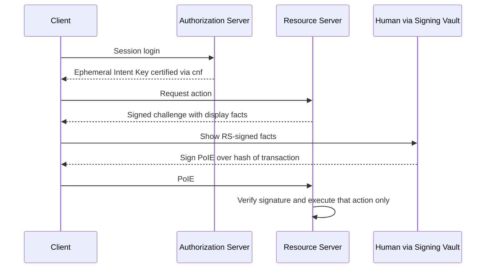
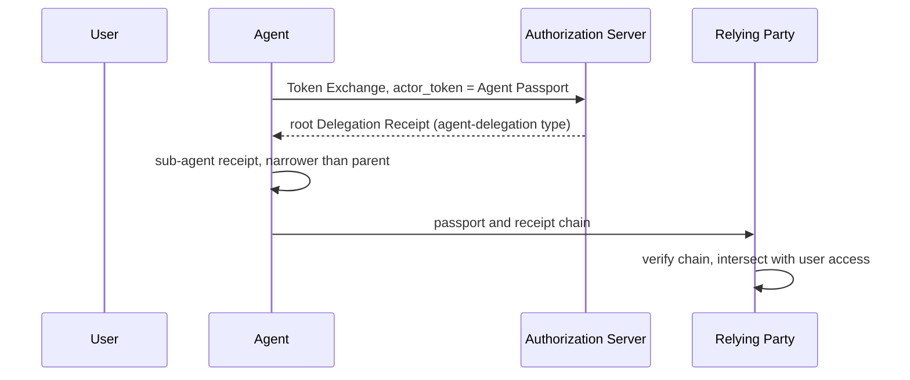

# OAuth WG Daily Report - 2026-11-07

- generated_at_utc: `2026-11-07T13:06:39+00:00`
- snapshot_date: `2026-11-07`

<!-- insights:start -->
## Briefing

> A new individual draft, draft-williams-oauth-poi-core-00, proposes a human-signed, per-transaction approval that goes straight to the Resource Server instead of raising the agent's token scope. Two list threads on agent delegation (Cred -02 and AAT -02) are still working out one meaning for del_max_depth and a freshness bound for revocation.

_Updated 2026-11-07T06:03:19+00:00. Machine-drafted from the sources linked below, which stay authoritative._

### A new draft proposes that a human signs a hash of the exact transaction, and the Resource Server checks it without involving the Authorization Server

`mail` · `new-proposal` · first seen 2026-11-07 · [New Draft: draft-williams-oauth-poi-core-00 (Proof-of-Intent Core)](https://mailarchive.ietf.org/arch/msg/oauth/FD4LLf6MJkGO-7gEassAblQJD90/)

draft-williams-oauth-poi-core-00 introduces Proof-of-Intent. The human signs a Proof-of-Intent Envelope (PoIE) that commits to the SHA-256 hash of the transaction parameters, canonicalised with RFC 8785 JCS. The Resource Server (RS) verifies the signature and executes only that action. At session login the Authorization Server (AS) certifies a short-lived Ephemeral Intent Key through an RFC 7800 cnf claim. After that the client signs the RS's challenge locally, so the AS is not on the live path. A client-side Signing Vault shows the RS-signed display facts to the user. The RS picks one of three assurance tiers: session key proof of possession, platform biometrics, or FIDO2 cross-platform hardware tokens. The author contrasts this with draft-rosenberg-oauth-aauth, where approval produces a broader-scope access token through the AS. A companion draft covers multi-hop escalation and concurrency, and a reference implementation is linked.

**Use cases**

- An agent that pays an invoice, where the user must approve one exact payee and amount and the agent must not keep a reusable elevated token.
- A Resource Server that wants to check high-consequence approvals offline, without calling the AS on each transaction.
- A deployment that requires a hardware-backed WebAuthn approval for high-value agent actions.

**Related in other tracks**

- `ietf-wimse` / `draft-hulea-wimse-agent-mandate`: Both address verifiable human authorization for agent actions, but the material does not show a direct link, so this is a topical pointer.

### A reviewer asks that the Cred delegation draft keep user approval evidence separate from the root and define what a verifier sees for suspended delegations

`mail` · `discussion` · first seen 2026-11-07 · [draft-sweeney-wimse-credential-delegation-02](https://mailarchive.ietf.org/arch/msg/oauth/L2gMfUEpsEtu7r9bHmWQ9uerlOk/)

The message quotes Kieran Sweeney's announcement of draft-sweeney-wimse-credential-delegation-02 and adds Rob Zagarella's reply. In the quoted announcement, a Delegation Server (DS) holds deposited credentials and agents exercise them by proxy under a delegation token. The -02 changes include a sub-delegation exchange, rank order carried in the token, and cumulative bounds in a delegation_constraints claim (max_lifetime, max_subtree) with the DS as single writer. It also adopts the agent_delegation format from draft-asor-wimse-agent-delegation-chain for tokens verified away from the DS, and states that revocation is invalidation, not closure, with a 1-hour token cap. Zagarella's reply makes two points. For a user-minted root in -03, keep who minted it separate from evidence that a natural person approved it, recorded as method and assurance only (such as amr values) and never biometric data. For Section 7, say what a verifier sees for actions taken while a delegation was suspended, and whether a restored delegation is the same grant or a new one.

**Use cases**

- A Delegation Server operator who must let a verifier outside the DS tell whether a real person approved a user-minted root.
- A verifier comparing a revocation or suspension decision for an action taken just before a delegation was restored.

**Related in other tracks**

- `ietf-wimse` / `draft-sweeney-wimse-credential-delegation`: The draft under discussion is the one being reviewed in this thread.
- `ietf-wimse` / `draft-asor-wimse-agent-delegation-chain`: Cred -02 adopts its agent_delegation format unchanged for tokens verified away from the DS.

### The AAT, Cred and Asor authors agree del_max_depth should have one meaning, and a reviewer asks the comparison to cover digest-bound leaf constraints

`mail` · `discussion` · first seen 2026-11-07 · [AAT -02 announcement](https://mailarchive.ietf.org/arch/msg/oauth/sNzggu7MhnF8lEATmAi6g-F8Nv0/)

This is a thread, not an announcement, and the fetched text is truncated. Quoted messages show a one-hop difference in del_max_depth. Under a root with del_max_depth 8, AAT accepts a leaf at del_depth 8 (test vector J.10.f) while the Asor -03 text rejects it. Niki Aimable Niyikiza adds a second difference: if a holder delegates with del_max_depth 2, AAT rejects a token at depth 3, while Asor checks depth only against the root's 8. Niyikiza wants the shared definition to keep the holder's cap, and Rob Zagarella agrees, since otherwise a holder cannot narrow its own onward delegation. Sweeney leans toward the Asor registry entry but cares more about reconciled vectors. Sweeney and Niyikiza also agree that the companion document for AAT Section 9.8 should state how fresh an enforcement point's revocation state must be. Zagarella asks that the planned constraint comparison record whether each draft can bind a leaf to a digest of the exact request, and that the freshness bound be stated in the same terms as Cred -02 Section 7.

**Use cases**

- An implementer of AAT or Asor delegation chains who needs depth-limit behaviour to be the same across libraries.
- A deployment where each approval must bind to one exact action, such as one payee and amount, and the chain must show it sits inside the broader grant.

**Related in other tracks**

- `ietf-wimse` / `draft-asor-wimse-agent-delegation-chain`: Its del_max_depth semantics and registry entry are the point of disagreement with AAT.
- `ietf-wimse` / `draft-sweeney-wimse-credential-delegation`: Cred -02 Sections 5.5 and 7 are cited for depth semantics and the revocation freshness bound.

### A new individual draft defines Agent Passports and Delegation Receipts, issued through Token Exchange

`mail` · `new-proposal` · first seen 2026-11-06 · [New draft: Agent Passports and Delegation Receipts (draft-le-agent-passport-00)](https://mailarchive.ietf.org/arch/msg/oauth/5vpjfYjnk2eV2IT2Kqn-UnIhspc/)

draft-le-agent-passport-00 defines two signed objects. An Agent Passport is a JWT that binds an agent's key (cnf) to the accountable organisation and to a digest of its build. Delegation Receipts form a chain from a user through agents and sub-agents. Each step is key-bound and can only narrow the one before, and the relying party verifies the chain and intersects it with the user's own access. Root receipts are obtained with RFC 8693 Token Exchange, using the passport as actor token and a new requested_token_type urn:ietf:params:oauth:token-type:agent-delegation. Status uses the Token Status List draft. The open question is whether grants should be an RFC 9396 authorization_details type. The author mentions a side meeting at IETF 127 and an IPR disclosure, and says the draft complements draft-klrc-aiagent-auth and AAuth.

**Use cases**

- An authorisation server that already supports RAR and wants to issue agent delegation grants as authorization_details
- A relying party that must check, across organisations, that a sub-agent's authority is a subset of the user's

**Related in other tracks**

- `openid` / `openid/aauth`: The author says the draft is meant to complement AAuth.

### Rob Zagarella's implementer review of the Skyfire amr-values and id-verification drafts produced issues on bg, idv_time and overlap with RFC 8176

`mail` · `discussion` · first seen 2026-11-06 · [Implementer review of draft-skyfire-oauth-amr-values-01 and draft-skyfire-oauth-id-verification-01](https://mailarchive.ietf.org/arch/msg/oauth/M4Uyhdqn_YtaeFSEIX63kx6ay0o/)

Ankit reports that two of Rob's points are now issues: splitting the combined bg value into a device-identifier issue and a geo-location issue, and what idv_time should mean for verification time. The quoted review asks for a note per new amr value saying whether it specialises, extends or is disjoint from an existing RFC 8176 value (for example face and facliv), and asks that facliv be defined. Rob later agrees that ISO/IEC 30107-3 does not formally define passive versus active liveness and suggests facliv simply mean facial liveness was performed, leaving finer distinctions to a profile. Mike Jones says overlap is normal among amr values, removes call in PR #7 and opened issue #8 for the clarifications. The material is truncated.

**Use cases**

- An implementer that records a facial match plus an active liveness challenge and has to choose which amr values to emit

### The IESG ballot on sd-jwt-vc-23 questions two SHOULDs, and the authors answer that they will soften one and explain the other

`mail` · `discussion` · first seen 2026-11-06 · [Éric Vyncke's Discuss on draft-ietf-oauth-sd-jwt-vc-23: (with DISCUSS and COMMENT)](https://mailarchive.ietf.org/arch/msg/oauth/Nuj5rCPT4ntMHnV1yZdKyWGaWTs/)

Éric Vyncke entered a DISCUSS on -23. He asks why type matching (Section 2.2.2.2) and status checking (Section 2.4) are not MUSTs, and notes that the type-matching SHOULD is not really an interoperability requirement under BCP 14. An author replied that the type-matching text was added late, was meant to help layers above such as DCQL and OpenID4VP, and would be better without BCP 14 language. For status, the author said a verifier may be offline and that more text will cover the consequences of not checking. Vyncke's comments also second a DISCUSS about a missing formal update of RFC 7800 and suggest replacing the normative reference to RFC 6890 with the IANA IPv4 and IPv6 special-purpose registries. The -25 diff acts on the first two points.

**Use cases**

- A wallet or verifier library that matches credential types via aka_vcts and needs to know whether the rule is a protocol requirement
- A verifier that may be offline and has to decide how to handle a credential with a status claim

### Review points on the Skyfire KYAPay drafts are now tracked as GitHub issues

`mail` · `discussion` · first seen 2026-11-06 · [Review of draft-skyfire-oauth-kyapay-*](https://mailarchive.ietf.org/arch/msg/oauth/UsmI2yL5sspN4GY--aQIsGIIdoU/)

Ankit lists the open points from Jean Diaconu's review as issues: how separate KYA and PAY tokens in one request relate (the token draft says they refer to the same initiator only when both iss and sub are equal), a Human-in-the-Loop option for a site to ask for recent human confirmation, and the AML methods draft's vendor-page references and false, stale or sensitive assertions. The quoted thread shows Mike Jones answering the review: PR #49 clarifies aid and sti and mentions jti and short lifetimes against replay, an issue tracks the unclear verifier description, and the token-exchange example is being reworked. The quoted text is truncated.

### The amr-values thread argues over the broad bg value, separate sna, and a structured amr_details claim

`mail` · `discussion` · first seen 2026-11-06 · [Review of draft-skyfire-oauth-amr-values](https://mailarchive.ietf.org/arch/msg/oauth/iIq9497aU0Zlq2xv1BnmBnDX1hQ/)

Ankit says Bjorn Hjelm's points are now issues: device identifier as its own value (issue 14) and geo-location treated as context rather than authentication (issue 15). In the quoted thread Bjorn argues that bg is no different from sna, which he says is a misleading term for Number Verify, and that device recognition is too vague. Shankar supports registering sna separately because bg is too broad, and proposes an optional amr_details companion claim with method, channel and mechanism so that relationships such as an OTP delivered by email can be expressed, leaving amr unchanged. Mike Jones objected to changing the structure or ordering semantics of amr without working group discussion. PR #9 and PR #10 (a new mdc value for synced passkeys) are up. The material is truncated.

**Use cases**

- A mobile-first service that uses phone numbers as account identifiers and needs to tell carrier-assisted verification apart from other background checks

### The -25 revision drops the BCP 14 SHOULD on type matching, adds a status-check risk note and regenerates the examples

`draft-revision` · `editorial` · first seen 2026-11-06 · [draft-ietf-oauth-sd-jwt-vc-25: SD-JWT-based Verifiable Digital Credentials (SD-JWT VC)](https://author-tools.ietf.org/iddiff?url1=draft-ietf-oauth-sd-jwt-vc-24&url2=draft-ietf-oauth-sd-jwt-vc-25)

The type-matching text no longer uses SHOULD: a Holder or Verifier now "treats" an SD-JWT VC as being of a given type if the type is the vct value or in aka_vcts. The status-check text keeps SHOULD but adds that a Verifier that does not check status cannot detect revocation or suspension and accepts that risk under its policy. The examples were rewritten: the typ in the example headers changed from vc+sd-jwt to dc+sd-jwt, the PID example now uses a fictional "Ændgard" issuer with a urn:example:eudi:pid:aendgard:1 vct and extra claims (sex, age_in_years, portrait and others), and the signatures and hashes were recomputed. The rest of the diff shows only table-of-contents page numbers and whitespace, and the material is truncated.

### The -26 revision of SD-JWT VC only swaps an RFC 6890 reference for the IANA registries and drops a duplicate sentence

`draft-revision` · `editorial` · first seen 2026-11-06 · [draft-ietf-oauth-sd-jwt-vc-26: SD-JWT-based Verifiable Digital Credentials (SD-JWT VC)](https://author-tools.ietf.org/iddiff?url1=draft-ietf-oauth-sd-jwt-vc-25&url2=draft-ietf-oauth-sd-jwt-vc-26)

Two textual changes, both tied to Éric Vyncke's review. The SSRF considerations now cite the IANA IPv4 and IPv6 Special-Purpose Address Registries instead of RFC 6890, and the RFC 6890 reference entry is removed. In Section 2.2.2.2 the sentence saying Holders and Verifiers can treat the SD-JWT VC as a credential of the vct and aka_vcts types is removed. The other diff hunks only change dates, expiry and whitespace in the document history. The history lists no change in requirements.

### This PR replaces the RFC 6890 reference with the two IANA special-purpose address registries, as an IESG ballot comment asked

`pull-request` · `editorial` · first seen 2026-11-06 · [oauth-wg/oauth-sd-jwt-vc#455: Cite the IANA special-purpose address registries instead of RFC 6890 (Éric Vyncke's ballot comment)](https://github.com/oauth-wg/oauth-sd-jwt-vc/pull/455)

It addresses a non-blocking comment in Éric Vyncke's ballot on -23. Section 7.1 now points to the IANA IPv4 and IPv6 registries as informative references, and the RFC 6890 reference is dropped. The PR says the registries are the maintained source of the address ranges and of the globally reachable property, and that the requirements do not change. It adds a -26 history entry.

### This PR removes a sentence in Section 2.2.2.2 that repeated the one before it

`pull-request` · `editorial` · first seen 2026-11-06 · [oauth-wg/oauth-sd-jwt-vc#456: Remove a duplicate sentence in Section 2.2.2.2](https://github.com/oauth-wg/oauth-sd-jwt-vc/pull/456)

After the type matching rule was added in #454, the older sentence saying Holders and Verifiers can treat the SD-JWT VC as a credential of these types only repeated the previous sentence. The PR removes it and says the meaning is unchanged. It is stacked on #455 so the history entry sits under the same -26 heading.

### Triage of the candidate queue

- **high** `draft-ietf-oauth-attestation-based-client-auth`: A detailed critical review of -12 questions its structure and DPoP/RFC 7521 reuse.
- **high** `draft-ietf-oauth-deferred-token-response`: -01 restructures the draft with substrate invariants, a new deferred_interactive mode and new editors; also cited as the answer to ID-JAG consent.
- **high** `draft-ietf-oauth-delegate-sd-jwt`: Authors explained the sd_hash vs issuer_jwt_hash design and are preparing an updated version with a roadmap at IETF 127.
- **high** `draft-ietf-oauth-identity-assertion-authz-grant`: -06 adds new normative behaviour (client auth at IdP, invalid_request, mTLS binding, new metadata) and a large rewrite.
- **high** `draft-ietf-oauth-spiffe-client-auth`: -03 makes client_id optional, ties client identification to CIMD and adds replay and trust-bundle security text.
- **high** `draft-ietf-oauth-v2-1`: Seven new issues and 31 closed, several tagged ietf-127, including MUST vs SHOULD in §3.2.3 and invalid_client.
- **low** `draft-ietf-oauth-client-id-metadata-document`: It is only mentioned as the origin of the new DPoP-required metadata draft, with no change to the draft itself.
- **low** `draft-ietf-oauth-sd-jwt-vc`: Revision -26 only makes editorial changes in response to IESG ballot comments, so there is no new substance to dive into.
- **low** `draft-ietf-oauth-transaction-tokens`: Only the agenda request for a competing cross-domain approach mentioned it, with no text change.

<!-- insights:end -->

## Top Priorities

| Rank | Draft | Score | Updated | Key State | Repo |
|---|---|---:|---|---|---|
| 1 | `draft-ietf-oauth-sd-jwt-vc` | 125 | 2026-11-06T19:07:22Z | Active, Expert Reviews OK | `oauth-sd-jwt-vc` |
| 2 | `draft-ietf-oauth-rfc8725bis` | 90 | 2026-11-06T22:32:52Z | Active, No IANA Actions | `draft-ietf-oauth-rfc8725bis` |
| 3 | `draft-ietf-oauth-status-list` | 90 | 2026-11-03T19:29:28Z | Active, RFC-Ed-Ack | `draft-ietf-oauth-status-list` |
| 4 | `draft-ietf-oauth-rfc7523bis` | 90 | 2026-11-03T19:25:31Z | Active, RFC-Ed-Ack | `draft-ietf-oauth-rfc7523bis` |
| 5 | `draft-ietf-oauth-client-id-metadata-document` | 83 | 2026-11-02T22:02:56Z | Active, I-D Exists | `draft-ietf-oauth-client-id-metadata-document` |
| 6 | `draft-ietf-oauth-identity-assertion-authz-grant` | 83 | 2026-10-31T00:32:39Z | Active, I-D Exists | `oauth-identity-assertion-authz-grant` |
| 7 | `draft-ietf-oauth-v2-1` | 76 | 2026-10-31T04:16:32Z | Active, I-D Exists | `oauth-v2-1` |
| 8 | `draft-ietf-oauth-deferred-token-response` | 68 | 2026-10-31T16:12:16Z | Active, I-D Exists | `oauth-deferred-token-response` |
| 9 | `draft-ietf-oauth-delegate-sd-jwt` | 66 | 2026-10-30T12:38:29Z | Active, I-D Exists | `oauth-delegate-sd-jwt` |
| 10 | `draft-ietf-oauth-identity-chaining` | 65 | 2026-08-21T20:25:31Z | Active, RFC-Ed-Ack | `oauth-identity-chaining` |

## Active Drafts

| Draft | Rev | Updated | States |
|---|---:|---|---|
| `draft-ietf-oauth-rfc8725bis` | 10 | 2026-11-06T22:32:52Z | Active, No IANA Actions, IANA OK - No Actions Needed |
| `draft-ietf-oauth-sd-jwt-vc` | 26 | 2026-11-06T19:07:22Z | Active, Expert Reviews OK, Version Changed - Review Needed |
| `draft-ietf-oauth-status-list` | 21 | 2026-11-03T19:29:28Z | Active, RFC-Ed-Ack, Expert Reviews OK |
| `draft-ietf-oauth-rfc7523bis` | 11 | 2026-11-03T19:25:31Z | Active, RFC-Ed-Ack, Expert Reviews OK |
| `draft-ietf-oauth-client-id-metadata-document` | 03 | 2026-11-02T22:02:56Z | Active, I-D Exists, WG Document |
| `draft-ietf-oauth-spiffe-client-auth` | 03 | 2026-11-02T17:35:55Z | Active, I-D Exists, WG Document |
| `draft-ietf-oauth-deferred-token-response` | 01 | 2026-10-31T16:12:16Z | Active, I-D Exists, WG Document |
| `draft-ietf-oauth-v2-1` | 17 | 2026-10-31T04:16:32Z | Active, I-D Exists, WG Document |
| `draft-ietf-oauth-identity-assertion-authz-grant` | 06 | 2026-10-31T00:32:39Z | Active, I-D Exists, WG Document |
| `draft-ietf-oauth-delegate-sd-jwt` | 00 | 2026-10-30T12:38:29Z | Active, I-D Exists, WG Document |
| `draft-ietf-oauth-attestation-based-client-auth` | 12 | 2026-10-18T17:33:02Z | Active, I-D Exists, WG Consensus: Waiting for Write-Up |
| `draft-ietf-oauth-first-party-apps` | 04 | 2026-08-26T14:40:16Z | Active, I-D Exists, WG Consensus: Waiting for Write-Up |
| `draft-ietf-oauth-rar-metadata-remediation` | 00 | 2026-08-23T20:29:29Z | Active, I-D Exists, WG Document |
| `draft-ietf-oauth-identity-chaining` | 17 | 2026-08-21T20:25:31Z | Active, RFC-Ed-Ack, Expert Reviews OK |
| `draft-ietf-oauth-transaction-tokens` | 11 | 2026-08-21T11:57:16Z | Active, I-D Exists, WG Consensus: Waiting for Write-Up |

## Repo Watch

| Repo | Pushed | Open Issues |
|---|---|---:|
| `oauth-wg/oauth-sd-jwt-vc` | 2026-11-06T17:18:33Z | 0 |
| `oauth-wg/oauth-v2-1` | 2026-11-05T00:12:30Z | 12 |
| `oauth-wg/oauth-delegate-sd-jwt` | 2026-11-03T00:23:39Z | 12 |
| `oauth-wg/oauth-spiffe-client-authentication` | 2026-11-03T00:08:49Z | 7 |
| `oauth-wg/oauth-deferred-token-response` | 2026-11-03T00:06:25Z | 23 |
| `oauth-wg/draft-ietf-oauth-client-id-metadata-document` | 2026-11-03T00:00:38Z | 33 |
| `oauth-wg/oauth-transaction-tokens` | 2026-11-01T00:20:49Z | 2 |
| `oauth-wg/oauth-identity-assertion-authz-grant` | 2026-11-01T00:03:15Z | 34 |
| `oauth-wg/draft-ietf-oauth-attestation-based-client-auth` | 2026-10-13T06:13:11Z | 0 |
| `oauth-wg/oauth-selective-disclosure-jwt` | 2026-10-04T13:50:37Z | 0 |
| `oauth-wg/oauth-cross-device-security` | 2026-08-27T14:45:11Z | 0 |
| `oauth-wg/oauth-browser-based-apps` | 2026-08-27T14:43:00Z | 0 |

## Recent Pull Requests

- `oauth-wg/oauth-sd-jwt-vc#455` Cite the IANA special-purpose address registries instead of RFC 6890 (Éric Vyncke's ballot comment) (2026-11-06T17:17:55Z)
- `oauth-wg/oauth-sd-jwt-vc#456` Remove a duplicate sentence in Section 2.2.2.2 (2026-11-06T17:16:56Z)
- `oauth-wg/oauth-spiffe-client-authentication#70` Add token_endpoint_auth_methods_supported to the CIMD example (2026-11-06T14:11:43Z)
- `oauth-wg/oauth-v2-1#268` Supporting OAuth 2.0 and OAuth 2.1 clients concurrently (2026-11-05T22:36:53Z)
- `oauth-wg/oauth-sd-jwt-vc#454` Vyncke discuss (2026-11-05T20:18:13Z)
- `oauth-wg/oauth-sd-jwt-vc#451` Issuer key discovery: policy selects the mechanism, inputs of other mechanisms do not identify the Issuer (2026-11-05T01:36:36Z)
- `oauth-wg/oauth-sd-jwt-vc#453` some keyword fixes for Charles Eckel's No Objection on draft-ietf-oauth-sd-jwt-vc-23: (with COMMENT) (2026-11-05T01:14:57Z)
- `oauth-wg/oauth-sd-jwt-vc#452` some other items from Mahesh Jethanandani ballot (2026-11-04T23:10:46Z)
- `oauth-wg/oauth-sd-jwt-vc#450` Mike Bishop's ballot  (2026-11-04T22:54:01Z)
- `oauth-wg/draft-ietf-oauth-client-id-metadata-document#29` Improve documentation for development usage and expiration of clients (2026-11-02T22:24:32Z)

## Recent Issues

- `oauth-wg/draft-ietf-oauth-client-id-metadata-document#78` Can AS optionally provide `iss` when fetching client_id? (2026-11-06T20:51:32Z)
- `oauth-wg/oauth-identity-assertion-authz-grant#160` Sender-constrained ID-JAG should not replace required client authentication (2026-11-06T18:00:32Z)
- `oauth-wg/oauth-identity-assertion-authz-grant#159` Sections 7.2 and 8 require jwt-bearer but omit jwt-dpop (2026-11-06T18:00:31Z)
- `oauth-wg/draft-ietf-oauth-client-id-metadata-document#112` Add Security Consideration section for Fetching Client Metadata (2026-11-05T16:57:34Z)
- `oauth-wg/draft-ietf-oauth-client-id-metadata-document#121` Security Considerations: persisted/remembered authorization decisions should respect resource-indicator scoping (2026-11-02T22:22:58Z)
- `oauth-wg/draft-ietf-oauth-client-id-metadata-document#79` Review from Justin Richer (2026-11-02T22:22:55Z)
- `oauth-wg/draft-ietf-oauth-client-id-metadata-document#30` Client metadata retrieval can be abused to make server issued requests (2026-11-02T22:22:51Z)
- `oauth-wg/draft-ietf-oauth-client-id-metadata-document#100` Clarify behaviour of `token_endpoint_auth_method` of `"private_key_jwt"` when `jwks` and `jwks_uri` are missing (2026-11-02T22:19:11Z)
- `oauth-wg/draft-ietf-oauth-client-id-metadata-document#96` token_endpoint_auth_methods_supported  and revocation_endpoint_auth_methods_supported (2026-11-02T22:18:51Z)
- `oauth-wg/draft-ietf-oauth-client-id-metadata-document#92` Provide guidance on omission of `token_endpoint_auth_method` field (2026-11-02T22:18:16Z)

## Organization Events

- `2026-11-05T20:16:22Z` PushEvent `oauth-wg/oauth-sd-jwt-vc` 
- `2026-11-05T18:53:54Z` PushEvent `oauth-wg/oauth-sd-jwt-vc` 
- `2026-11-06T17:16:57Z` PushEvent `oauth-wg/oauth-sd-jwt-vc` 
- `2026-11-06T17:18:34Z` PushEvent `oauth-wg/oauth-sd-jwt-vc` 
- `2026-11-06T17:17:56Z` PushEvent `oauth-wg/oauth-sd-jwt-vc` 
- `2026-11-06T17:17:31Z` PushEvent `oauth-wg/oauth-sd-jwt-vc` 
- `2026-11-06T14:37:51Z` PushEvent `oauth-wg/oauth-sd-jwt-vc` 
- `2026-11-06T14:37:12Z` PushEvent `oauth-wg/oauth-sd-jwt-vc` 
- `2026-11-06T14:12:58Z` PushEvent `oauth-wg/oauth-sd-jwt-vc` 
- `2026-11-06T14:07:25Z` PushEvent `oauth-wg/oauth-sd-jwt-vc` 
- `2026-11-06T10:16:35Z` CreateEvent `oauth-wg/oauth-sd-jwt-vc` 
- `2026-11-06T14:06:49Z` PushEvent `oauth-wg/oauth-sd-jwt-vc` 
- `2026-11-06T10:26:09Z` PushEvent `oauth-wg/oauth-sd-jwt-vc` 
- `2026-11-06T10:25:28Z` PushEvent `oauth-wg/oauth-sd-jwt-vc` 
- `2026-11-06T19:17:52Z` IssueCommentEvent `oauth-wg/draft-ietf-oauth-client-id-metadata-document` Can AS optionally provide `iss` when fetching client_id?
- `2026-11-06T18:26:16Z` IssueCommentEvent `oauth-wg/draft-ietf-oauth-client-id-metadata-document` Can AS optionally provide `iss` when fetching client_id?
- `2026-11-06T18:11:40Z` IssueCommentEvent `oauth-wg/draft-ietf-oauth-client-id-metadata-document` Can AS optionally provide `iss` when fetching client_id?
- `2026-11-06T18:00:33Z` IssuesEvent `oauth-wg/oauth-identity-assertion-authz-grant` Sender-constrained ID-JAG should not replace required client authentication
- `2026-11-06T18:00:32Z` IssuesEvent `oauth-wg/oauth-identity-assertion-authz-grant` Sections 7.2 and 8 require jwt-bearer but omit jwt-dpop
- `2026-11-06T17:17:55Z` PullRequestEvent `oauth-wg/oauth-sd-jwt-vc` merged

## Mailarchive Signals

- weekly_digest_count: `0`
- [OAUTH-WG] Re: [WIMSE] draft-sweeney-wimse-credential-delegation-02 - https://mailarchive.ietf.org/arch/msg/oauth/L2gMfUEpsEtu7r9bHmWQ9uerlOk/
- [OAUTH-WG] Re: AAT -02 announcement - https://mailarchive.ietf.org/arch/msg/oauth/sNzggu7MhnF8lEATmAi6g-F8Nv0/
- [OAUTH-WG] New Draft: draft-williams-oauth-poi-core-00 (Proof-of-Intent Core) - https://mailarchive.ietf.org/arch/msg/oauth/FD4LLf6MJkGO-7gEassAblQJD90/
- [OAUTH-WG] I-D Action: draft-ietf-oauth-sd-jwt-vc-26.txt - https://mailarchive.ietf.org/arch/msg/oauth/WAjn7jVWFUq5sW-LSCiaxVTzaKU/
- [OAUTH-WG] New draft: Agent Passports and Delegation Receipts (draft-le-agent-passport-00) - https://mailarchive.ietf.org/arch/msg/oauth/5vpjfYjnk2eV2IT2Kqn-UnIhspc/
- [OAUTH-WG] Re: Review of draft-skyfire-oauth-kyapay-* - https://mailarchive.ietf.org/arch/msg/oauth/UsmI2yL5sspN4GY--aQIsGIIdoU/
- [OAUTH-WG] I-D Action: draft-ietf-oauth-sd-jwt-vc-25.txt - https://mailarchive.ietf.org/arch/msg/oauth/qiK2LuL0oauXI8DLSkTJoMHoGIw/
- [OAUTH-WG] Re: Implementer review of draft-skyfire-oauth-amr-values-01 and draft-skyfire-oauth-id-verification-01 - https://mailarchive.ietf.org/arch/msg/oauth/M4Uyhdqn_YtaeFSEIX63kx6ay0o/

## Next Actions

1. Evaluate the top 3 items in `Top Priorities` as weekly deep-dive candidates.
2. Separately track comment deadlines for `In Last Call` / `In WG Last Call` drafts.
3. For repos with a sudden spike in activity, create a scaffold in `deep-dives/` to capture key discussion points.
