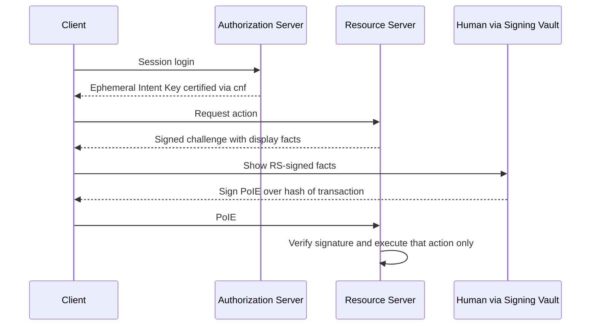
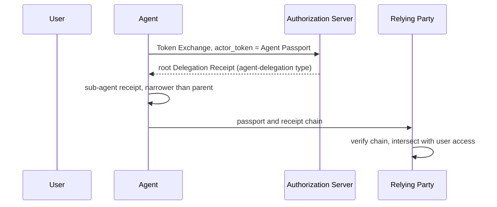

# OAuth WG Daily Report - 2026-11-08

- generated_at_utc: `2026-11-08T22:09:30+00:00`
- snapshot_date: `2026-11-08`

<!-- insights:start -->
## Briefing

> The weekly GitHub digest shows a cleanup of the client-id-metadata-document issue tracker: 11 issues closed, 1 opened. mcguinness also filed two new issues against the ID-JAG draft. No draft text is included, so this is activity only.

_Updated 2026-11-08T22:10:15+00:00. Machine-drafted from the sources linked below, which stay authoritative._

### Weekly digest: big issue cleanup on the client-id-metadata-document draft, two new ID-JAG issues, and several sd-jwt-vc PRs

`mail` · `discussion` · first seen 2026-11-08 · [Weekly github digest (OAuth Activity Summary)](https://mailarchive.ietf.org/arch/msg/oauth/CAJtRQ9c4tUCaB70TUVbzBvEejk/)

The digest lists GitHub activity only, with no spec text. In draft-ietf-oauth-client-id-metadata-document, 11 issues were closed, including those on token_endpoint_auth_method with private_key_jwt (#100), guidance on omitting token_endpoint_auth_method (#92), unsupported metadata values (#71), AS error returns (#85), disallowing the root path as a URL (#86) and data URIs for logo_uri (#19). One new issue (#131) says the response_types intersection rejects otherwise usable token-endpoint grants. Three PRs were opened, and PR #99 (Add Client Authentication section) got a comment. For oauth-identity-assertion-authz-grant, mcguinness opened #160 (sender-constrained ID-JAG should not replace required client authentication) and #159 (sections 7.2 and 8 require jwt-bearer but omit jwt-dpop). oauth-sd-jwt-vc got 7 new PRs, and PR #450 (Mike Bishop's ballot) got a comment. oauth-v2-1 PR #268 (supporting OAuth 2.0 and 2.1 clients concurrently) got 3 comments. oauth-transaction-tokens got 1 new PR. The digest does not show the reasons for the closures or the content of the PRs.

**Use cases**

- An authorization server implementing client ID metadata documents wants to know whether the client authentication and response_types handling rules are still changing.
- An implementer of the ID-JAG grant who plans to use DPoP should watch #159 and #160 on the jwt-dpop gap and on client authentication.

### A reply on the Proof-of-Intent Core draft suggests carrying a PSEA token as its attestation

`mail` · `discussion` · first seen 2026-11-08 · [New Draft: draft-williams-oauth-poi-core-00 (Proof-of-Intent Core)](https://mailarchive.ietf.org/arch/msg/oauth/JAOcNgwRIJuiIxUVCIy2iSJMQIg/)

The message is addressed to the author of draft-williams-oauth-poi-core-00 (the thread is titled as the new draft announcement). The sender says the attestation in PoI Core is close to the token defined in draft-yossif-psea, an EAT profile in RATS. In PSEA, the approver's enrolled authenticator signs, after user verification, over the SHA-256 of the RFC 8785 form of the exact action parameters. The sender cites 31 public conformance cases and one independent verifier. PSEA does not cover how the resource server requests approval or how the client key is certified, which PoI Core does define. The sender therefore proposes that the PoIE carry a PSEA token as its attestation and asks whether the author is open to checking the fit. The draft text itself is not in the material, so nothing more about PoI Core is claimed.

**Use cases**

- A resource server that wants user-verified approval of one exact action (for example a payment) and must choose between a bespoke attestation format and an existing EAT profile.
- An implementer building a verifier who wants shared conformance cases rather than a draft-specific attestation format.

### A PR adds the required req_wl claim to the JWT Claims registry entries in the Transaction Tokens draft

`pull-request` · `editorial` · first seen 2026-11-08 · [oauth-wg/oauth-transaction-tokens#374: Register the req_wl claim in the JWT Claims registry](https://github.com/oauth-wg/oauth-transaction-tokens/pull/374)

The contributor noticed that req_wl is a REQUIRED claim but is missing from the JWT Claims Registry Contents in the IANA section, where only tctx and rctx are listed. The PR adds the registration. It is an IANA considerations fix and does not change the token format or processing.

### The chair posted a link to the draft OAuth WG agenda for the San Francisco meeting and asked for comments

`mail` · `routine` · first seen 2026-11-08 · [OAuth WG Draft Agenda for San Francisco](https://mailarchive.ietf.org/arch/msg/oauth/H_h0W8yp2srlIk_-UN01zYkH1MI/)

Rifaat posted a short message linking to the draft agenda for the OAuth WG session in San Francisco (datatracker agenda-127-oauth) and asked participants to send questions or comments. The message itself lists no agenda items, so which drafts will be discussed cannot be determined from this material.

### RFC 10070 is published: it updates RFCs 7521, 7522, 7523 and 9126 on audience values in assertion-based client authentication and grants

`mail` · `substantive` · first seen 2026-11-07 · [RFC 10070 on Updates to OAuth 2.0 JSON Web Token (JWT) Client Authentication and Assertion-Based Authorization Grants](https://mailarchive.ietf.org/arch/msg/oauth/p2R-7159NVo7lsuhVAm3CAyLEYU/)

The RFC Editor announced RFC 10070, a Proposed Standard by Jones, Campbell, Mortimore and Skokan, built from draft-ietf-oauth-rfc7523bis-11. It updates RFC 7523, 7521, 7522 and 9126 regarding the treatment of audience values in OAuth 2.0 client assertion authentication and assertion-based authorization grants, to address a security vulnerability in the earlier audience requirements. The announcement does not give the new audience rules, so the exact required values are not shown in this material.

**Use cases**

- An authorization server that accepts private_key_jwt client assertions or JWT bearer grants and needs to review which audience values it accepts.
- A client library that builds client assertions and must check which audience value it places in them.

### A new draft proposes that a human signs a hash of the exact transaction, and the Resource Server checks it without involving the Authorization Server

`mail` · `new-proposal` · first seen 2026-11-07 · [New Draft: draft-williams-oauth-poi-core-00 (Proof-of-Intent Core)](https://mailarchive.ietf.org/arch/msg/oauth/FD4LLf6MJkGO-7gEassAblQJD90/)

draft-williams-oauth-poi-core-00 introduces Proof-of-Intent. The human signs a Proof-of-Intent Envelope (PoIE) that commits to the SHA-256 hash of the transaction parameters, canonicalised with RFC 8785 JCS. The Resource Server (RS) verifies the signature and executes only that action. At session login the Authorization Server (AS) certifies a short-lived Ephemeral Intent Key through an RFC 7800 cnf claim. After that the client signs the RS's challenge locally, so the AS is not on the live path. A client-side Signing Vault shows the RS-signed display facts to the user. The RS picks one of three assurance tiers: session key proof of possession, platform biometrics, or FIDO2 cross-platform hardware tokens. The author contrasts this with draft-rosenberg-oauth-aauth, where approval produces a broader-scope access token through the AS. A companion draft covers multi-hop escalation and concurrency, and a reference implementation is linked.

**Use cases**

- An agent that pays an invoice, where the user must approve one exact payee and amount and the agent must not keep a reusable elevated token.
- A Resource Server that wants to check high-consequence approvals offline, without calling the AS on each transaction.
- A deployment that requires a hardware-backed WebAuthn approval for high-value agent actions.

**Related in other tracks**

- `ietf-wimse` / `draft-hulea-wimse-agent-mandate`: Both address verifiable human authorization for agent actions, but the material does not show a direct link, so this is a topical pointer.

### A gateway vendor supports WG adoption of the Identity Continuation Assertion draft (-02) and backs two open issues

`mail` · `discussion` · first seen 2026-11-07 · [New I-D: Identity Continuation Assertion for OAuth 2.0 Token Exchange (request for review)](https://mailarchive.ietf.org/arch/msg/oauth/IdojKDr32WDsE5FLAVxhBppZppU/)

A Runlayer engineer, who runs an MCP gateway between agent hosts and upstream APIs, supports working-group adoption of -02 for deployments needing IdP-authorized continuation across service boundaries. They back issue #145: the error response (§5.5.6, §6.3) should distinguish rate, fan-out, hop-count and actor-lineage depth failures so clients can pick a recovery action. They find the accepting-domain trust boundary reasonable for a gateway whose RAS also acts as CAI (§8.1). They also support an IdP-enforced bound on source-hop age (#142), provided it allows scheduled continuation from durable roots. No draft text changed in this message.

**Use cases**

- An MCP gateway that must tell agent clients whether to back off, reduce fan-out or re-authenticate after a continuation is refused.
- A deployment that runs scheduled agent jobs from a long-lived root and needs a hop-age limit that does not break them.

### A reviewer asks that the Cred delegation draft keep user approval evidence separate from the root and define what a verifier sees for suspended delegations

`mail` · `discussion` · first seen 2026-11-07 · [draft-sweeney-wimse-credential-delegation-02](https://mailarchive.ietf.org/arch/msg/oauth/L2gMfUEpsEtu7r9bHmWQ9uerlOk/)

The message quotes Kieran Sweeney's announcement of draft-sweeney-wimse-credential-delegation-02 and adds Rob Zagarella's reply. In the quoted announcement, a Delegation Server (DS) holds deposited credentials and agents exercise them by proxy under a delegation token. The -02 changes include a sub-delegation exchange, rank order carried in the token, and cumulative bounds in a delegation_constraints claim (max_lifetime, max_subtree) with the DS as single writer. It also adopts the agent_delegation format from draft-asor-wimse-agent-delegation-chain for tokens verified away from the DS, and states that revocation is invalidation, not closure, with a 1-hour token cap. Zagarella's reply makes two points. For a user-minted root in -03, keep who minted it separate from evidence that a natural person approved it, recorded as method and assurance only (such as amr values) and never biometric data. For Section 7, say what a verifier sees for actions taken while a delegation was suspended, and whether a restored delegation is the same grant or a new one.

**Use cases**

- A Delegation Server operator who must let a verifier outside the DS tell whether a real person approved a user-minted root.
- A verifier comparing a revocation or suspension decision for an action taken just before a delegation was restored.

**Related in other tracks**

- `ietf-wimse` / `draft-sweeney-wimse-credential-delegation`: The draft under discussion is the one being reviewed in this thread.
- `ietf-wimse` / `draft-asor-wimse-agent-delegation-chain`: Cred -02 adopts its agent_delegation format unchanged for tokens verified away from the DS.

### The AAT, Cred and Asor authors agree del_max_depth should have one meaning, and a reviewer asks the comparison to cover digest-bound leaf constraints

`mail` · `discussion` · first seen 2026-11-07 · [AAT -02 announcement](https://mailarchive.ietf.org/arch/msg/oauth/sNzggu7MhnF8lEATmAi6g-F8Nv0/)

This is a thread, not an announcement, and the fetched text is truncated. Quoted messages show a one-hop difference in del_max_depth. Under a root with del_max_depth 8, AAT accepts a leaf at del_depth 8 (test vector J.10.f) while the Asor -03 text rejects it. Niki Aimable Niyikiza adds a second difference: if a holder delegates with del_max_depth 2, AAT rejects a token at depth 3, while Asor checks depth only against the root's 8. Niyikiza wants the shared definition to keep the holder's cap, and Rob Zagarella agrees, since otherwise a holder cannot narrow its own onward delegation. Sweeney leans toward the Asor registry entry but cares more about reconciled vectors. Sweeney and Niyikiza also agree that the companion document for AAT Section 9.8 should state how fresh an enforcement point's revocation state must be. Zagarella asks that the planned constraint comparison record whether each draft can bind a leaf to a digest of the exact request, and that the freshness bound be stated in the same terms as Cred -02 Section 7.

**Use cases**

- An implementer of AAT or Asor delegation chains who needs depth-limit behaviour to be the same across libraries.
- A deployment where each approval must bind to one exact action, such as one payee and amount, and the chain must show it sits inside the broader grant.

**Related in other tracks**

- `ietf-wimse` / `draft-asor-wimse-agent-delegation-chain`: Its del_max_depth semantics and registry entry are the point of disagreement with AAT.
- `ietf-wimse` / `draft-sweeney-wimse-credential-delegation`: Cred -02 Sections 5.5 and 7 are cited for depth semantics and the revocation freshness bound.

### A new individual draft defines Agent Passports and Delegation Receipts, issued through Token Exchange

`mail` · `new-proposal` · first seen 2026-11-06 · [New draft: Agent Passports and Delegation Receipts (draft-le-agent-passport-00)](https://mailarchive.ietf.org/arch/msg/oauth/5vpjfYjnk2eV2IT2Kqn-UnIhspc/)

draft-le-agent-passport-00 defines two signed objects. An Agent Passport is a JWT that binds an agent's key (cnf) to the accountable organisation and to a digest of its build. Delegation Receipts form a chain from a user through agents and sub-agents. Each step is key-bound and can only narrow the one before, and the relying party verifies the chain and intersects it with the user's own access. Root receipts are obtained with RFC 8693 Token Exchange, using the passport as actor token and a new requested_token_type urn:ietf:params:oauth:token-type:agent-delegation. Status uses the Token Status List draft. The open question is whether grants should be an RFC 9396 authorization_details type. The author mentions a side meeting at IETF 127 and an IPR disclosure, and says the draft complements draft-klrc-aiagent-auth and AAuth.

**Use cases**

- An authorisation server that already supports RAR and wants to issue agent delegation grants as authorization_details
- A relying party that must check, across organisations, that a sub-agent's authority is a subset of the user's

**Related in other tracks**

- `openid` / `openid/aauth`: The author says the draft is meant to complement AAuth.

### Rob Zagarella's implementer review of the Skyfire amr-values and id-verification drafts produced issues on bg, idv_time and overlap with RFC 8176

`mail` · `discussion` · first seen 2026-11-06 · [Implementer review of draft-skyfire-oauth-amr-values-01 and draft-skyfire-oauth-id-verification-01](https://mailarchive.ietf.org/arch/msg/oauth/M4Uyhdqn_YtaeFSEIX63kx6ay0o/)

Ankit reports that two of Rob's points are now issues: splitting the combined bg value into a device-identifier issue and a geo-location issue, and what idv_time should mean for verification time. The quoted review asks for a note per new amr value saying whether it specialises, extends or is disjoint from an existing RFC 8176 value (for example face and facliv), and asks that facliv be defined. Rob later agrees that ISO/IEC 30107-3 does not formally define passive versus active liveness and suggests facliv simply mean facial liveness was performed, leaving finer distinctions to a profile. Mike Jones says overlap is normal among amr values, removes call in PR #7 and opened issue #8 for the clarifications. The material is truncated.

**Use cases**

- An implementer that records a facial match plus an active liveness challenge and has to choose which amr values to emit

### The IESG ballot on sd-jwt-vc-23 questions two SHOULDs, and the authors answer that they will soften one and explain the other

`mail` · `discussion` · first seen 2026-11-06 · [Éric Vyncke's Discuss on draft-ietf-oauth-sd-jwt-vc-23: (with DISCUSS and COMMENT)](https://mailarchive.ietf.org/arch/msg/oauth/Nuj5rCPT4ntMHnV1yZdKyWGaWTs/)

Éric Vyncke entered a DISCUSS on -23. He asks why type matching (Section 2.2.2.2) and status checking (Section 2.4) are not MUSTs, and notes that the type-matching SHOULD is not really an interoperability requirement under BCP 14. An author replied that the type-matching text was added late, was meant to help layers above such as DCQL and OpenID4VP, and would be better without BCP 14 language. For status, the author said a verifier may be offline and that more text will cover the consequences of not checking. Vyncke's comments also second a DISCUSS about a missing formal update of RFC 7800 and suggest replacing the normative reference to RFC 6890 with the IANA IPv4 and IPv6 special-purpose registries. The -25 diff acts on the first two points.

**Use cases**

- A wallet or verifier library that matches credential types via aka_vcts and needs to know whether the rule is a protocol requirement
- A verifier that may be offline and has to decide how to handle a credential with a status claim

### Triage of the candidate queue

- **high** `draft-ietf-oauth-attestation-based-client-auth`: A detailed critical review of -12 questions its structure and DPoP/RFC 7521 reuse.
- **high** `draft-ietf-oauth-client-id-metadata-document`: 11 issues closed and a new response_types issue (#131) this week, with PRs adding a Client Authentication section.
- **high** `draft-ietf-oauth-deferred-token-response`: -01 restructures the draft with substrate invariants, a new deferred_interactive mode and new editors; also cited as the answer to ID-JAG consent.
- **high** `draft-ietf-oauth-delegate-sd-jwt`: Authors explained the sd_hash vs issuer_jwt_hash design and are preparing an updated version with a roadmap at IETF 127.
- **high** `draft-ietf-oauth-identity-assertion-authz-grant`: Two new issues (#159, #160) on jwt-dpop and client authentication point to open design questions.
- **high** `draft-ietf-oauth-spiffe-client-auth`: -03 makes client_id optional, ties client identification to CIMD and adds replay and trust-bundle security text.
- **high** `draft-ietf-oauth-v2-1`: Seven new issues and 31 closed, several tagged ietf-127, including MUST vs SHOULD in §3.2.3 and invalid_client.
- **low** `draft-ietf-oauth-sd-jwt-vc`: Revision -26 only makes editorial changes in response to IESG ballot comments, so there is no new substance to dive into.
- **low** `draft-ietf-oauth-transaction-tokens`: PR #374 fixes a missing IANA registration for the required req_wl claim, a small editorial fix.

<!-- insights:end -->

## Top Priorities

| Rank | Draft | Score | Updated | Key State | Repo |
|---|---|---:|---|---|---|
| 1 | `draft-ietf-oauth-sd-jwt-vc` | 125 | 2026-11-06T19:07:22Z | Active, Expert Reviews OK | `oauth-sd-jwt-vc` |
| 2 | `draft-ietf-oauth-rfc8725bis` | 90 | 2026-11-06T22:32:52Z | Active, No IANA Actions | `draft-ietf-oauth-rfc8725bis` |
| 3 | `draft-ietf-oauth-status-list` | 83 | 2026-11-03T19:29:28Z | Active, RFC-Ed-Ack | `draft-ietf-oauth-status-list` |
| 4 | `draft-ietf-oauth-client-id-metadata-document` | 83 | 2026-11-02T22:02:56Z | Active, I-D Exists | `draft-ietf-oauth-client-id-metadata-document` |
| 5 | `draft-ietf-oauth-identity-assertion-authz-grant` | 73 | 2026-10-31T00:32:39Z | Active, I-D Exists | `oauth-identity-assertion-authz-grant` |
| 6 | `draft-ietf-oauth-v2-1` | 66 | 2026-10-31T04:16:32Z | Active, I-D Exists | `oauth-v2-1` |
| 7 | `draft-ietf-oauth-identity-chaining` | 65 | 2026-08-21T20:25:31Z | Active, RFC-Ed-Ack | `oauth-identity-chaining` |
| 8 | `draft-ietf-oauth-delegate-sd-jwt` | 64 | 2026-10-30T12:38:29Z | Active, I-D Exists | `oauth-delegate-sd-jwt` |
| 9 | `draft-ietf-oauth-transaction-tokens` | 64 | 2026-08-21T11:57:16Z | Active, I-D Exists | `oauth-transaction-tokens` |
| 10 | `draft-ietf-oauth-deferred-token-response` | 58 | 2026-10-31T16:12:16Z | Active, I-D Exists | `oauth-deferred-token-response` |

## Active Drafts

| Draft | Rev | Updated | States |
|---|---:|---|---|
| `draft-ietf-oauth-rfc8725bis` | 10 | 2026-11-06T22:32:52Z | Active, No IANA Actions, IANA OK - No Actions Needed |
| `draft-ietf-oauth-sd-jwt-vc` | 26 | 2026-11-06T19:07:22Z | Active, Expert Reviews OK, Version Changed - Review Needed |
| `draft-ietf-oauth-status-list` | 21 | 2026-11-03T19:29:28Z | Active, RFC-Ed-Ack, Expert Reviews OK |
| `draft-ietf-oauth-client-id-metadata-document` | 03 | 2026-11-02T22:02:56Z | Active, I-D Exists, WG Document |
| `draft-ietf-oauth-spiffe-client-auth` | 03 | 2026-11-02T17:35:55Z | Active, I-D Exists, WG Document |
| `draft-ietf-oauth-deferred-token-response` | 01 | 2026-10-31T16:12:16Z | Active, I-D Exists, WG Document |
| `draft-ietf-oauth-v2-1` | 17 | 2026-10-31T04:16:32Z | Active, I-D Exists, WG Document |
| `draft-ietf-oauth-identity-assertion-authz-grant` | 06 | 2026-10-31T00:32:39Z | Active, I-D Exists, WG Document |
| `draft-ietf-oauth-delegate-sd-jwt` | 00 | 2026-10-30T12:38:29Z | Active, I-D Exists, WG Document |
| `draft-ietf-oauth-attestation-based-client-auth` | 12 | 2026-10-18T17:33:02Z | Active, I-D Exists, WG Consensus: Waiting for Write-Up |
| `draft-ietf-oauth-first-party-apps` | 04 | 2026-08-26T14:40:16Z | Active, I-D Exists, WG Consensus: Waiting for Write-Up |
| `draft-ietf-oauth-rar-metadata-remediation` | 00 | 2026-08-23T20:29:29Z | Active, I-D Exists, WG Document |
| `draft-ietf-oauth-identity-chaining` | 17 | 2026-08-21T20:25:31Z | Active, RFC-Ed-Ack, Expert Reviews OK |
| `draft-ietf-oauth-transaction-tokens` | 11 | 2026-08-21T11:57:16Z | Active, I-D Exists, WG Consensus: Waiting for Write-Up |
| `draft-ietf-oauth-refresh-token-expiration` | 03 | 2026-07-06T17:53:06Z | Active, I-D Exists, WG Document |

## Repo Watch

| Repo | Pushed | Open Issues |
|---|---|---:|
| `oauth-wg/oauth-sd-jwt-vc` | 2026-11-08T00:34:03Z | 0 |
| `oauth-wg/oauth-v2-1` | 2026-11-08T00:14:14Z | 12 |
| `oauth-wg/oauth-spiffe-client-authentication` | 2026-11-08T00:10:21Z | 7 |
| `oauth-wg/oauth-identity-assertion-authz-grant` | 2026-11-08T00:03:02Z | 35 |
| `oauth-wg/draft-ietf-oauth-client-id-metadata-document` | 2026-11-08T00:00:45Z | 34 |
| `oauth-wg/oauth-delegate-sd-jwt` | 2026-11-03T00:23:39Z | 12 |
| `oauth-wg/oauth-deferred-token-response` | 2026-11-03T00:06:25Z | 23 |
| `oauth-wg/oauth-transaction-tokens` | 2026-11-01T00:20:49Z | 3 |
| `oauth-wg/draft-ietf-oauth-attestation-based-client-auth` | 2026-10-13T06:13:11Z | 0 |
| `oauth-wg/oauth-selective-disclosure-jwt` | 2026-10-04T13:50:37Z | 0 |
| `oauth-wg/oauth-cross-device-security` | 2026-08-27T14:45:11Z | 0 |
| `oauth-wg/oauth-browser-based-apps` | 2026-08-27T14:43:00Z | 0 |

## Recent Pull Requests

- `oauth-wg/oauth-transaction-tokens#374` Register the req_wl claim in the JWT Claims registry (2026-11-08T12:34:29Z)
- `oauth-wg/draft-ietf-oauth-client-id-metadata-document#130` require pre-fetching logo_uri, added security considerations (2026-11-08T11:39:21Z)
- `oauth-wg/oauth-sd-jwt-vc#455` Cite the IANA special-purpose address registries instead of RFC 6890 (Éric Vyncke's ballot comment) (2026-11-06T17:17:55Z)
- `oauth-wg/oauth-sd-jwt-vc#456` Remove a duplicate sentence in Section 2.2.2.2 (2026-11-06T17:16:56Z)
- `oauth-wg/oauth-spiffe-client-authentication#70` Add token_endpoint_auth_methods_supported to the CIMD example (2026-11-06T14:11:43Z)
- `oauth-wg/oauth-v2-1#268` Supporting OAuth 2.0 and OAuth 2.1 clients concurrently (2026-11-05T22:36:53Z)
- `oauth-wg/oauth-sd-jwt-vc#454` Vyncke discuss (2026-11-05T20:18:13Z)
- `oauth-wg/oauth-sd-jwt-vc#451` Issuer key discovery: policy selects the mechanism, inputs of other mechanisms do not identify the Issuer (2026-11-05T01:36:36Z)
- `oauth-wg/oauth-sd-jwt-vc#453` some keyword fixes for Charles Eckel's No Objection on draft-ietf-oauth-sd-jwt-vc-23: (with COMMENT) (2026-11-05T01:14:57Z)
- `oauth-wg/oauth-sd-jwt-vc#452` some other items from Mahesh Jethanandani ballot (2026-11-04T23:10:46Z)

## Recent Issues

- `oauth-wg/oauth-identity-assertion-authz-grant#161` §4.3.3 Processing Rules: "SAML Audience matches the client_id" is incompatible with §4.5's required Audience→Client ID mapping (2026-11-08T14:59:29Z)
- `oauth-wg/draft-ietf-oauth-client-id-metadata-document#131` `response_types` intersection rejects otherwise usable token-endpoint grants (2026-11-08T05:46:36Z)
- `oauth-wg/draft-ietf-oauth-client-id-metadata-document#78` Can AS optionally provide `iss` when fetching client_id? (2026-11-06T20:51:32Z)
- `oauth-wg/oauth-identity-assertion-authz-grant#160` Sender-constrained ID-JAG should not replace required client authentication (2026-11-06T18:00:32Z)
- `oauth-wg/oauth-identity-assertion-authz-grant#159` Sections 7.2 and 8 require jwt-bearer but omit jwt-dpop (2026-11-06T18:00:31Z)
- `oauth-wg/draft-ietf-oauth-client-id-metadata-document#112` Add Security Consideration section for Fetching Client Metadata (2026-11-05T16:57:34Z)
- `oauth-wg/draft-ietf-oauth-client-id-metadata-document#121` Security Considerations: persisted/remembered authorization decisions should respect resource-indicator scoping (2026-11-02T22:22:58Z)
- `oauth-wg/draft-ietf-oauth-client-id-metadata-document#79` Review from Justin Richer (2026-11-02T22:22:55Z)
- `oauth-wg/draft-ietf-oauth-client-id-metadata-document#30` Client metadata retrieval can be abused to make server issued requests (2026-11-02T22:22:51Z)
- `oauth-wg/draft-ietf-oauth-client-id-metadata-document#100` Clarify behaviour of `token_endpoint_auth_method` of `"private_key_jwt"` when `jwks` and `jwks_uri` are missing (2026-11-02T22:19:11Z)

## Organization Events

- `2026-11-08T14:59:29Z` IssuesEvent `oauth-wg/oauth-identity-assertion-authz-grant` §4.3.3 Processing Rules: "SAML Audience matches the client_id" is incompatible with §4.5's required Audience→Client ID mapping
- `2026-11-08T00:34:04Z` PushEvent `oauth-wg/oauth-sd-jwt-vc` 
- `2026-11-08T00:14:14Z` PushEvent `oauth-wg/oauth-v2-1` 
- `2026-11-08T12:34:29Z` PullRequestEvent `oauth-wg/oauth-transaction-tokens` opened
- `2026-11-08T12:26:46Z` ForkEvent `oauth-wg/oauth-transaction-tokens` forked
- `2026-11-08T11:39:23Z` PullRequestReviewEvent `oauth-wg/draft-ietf-oauth-client-id-metadata-document` created
- `2026-11-08T11:38:41Z` ForkEvent `oauth-wg/draft-ietf-oauth-client-id-metadata-document` forked
- `2026-11-08T05:46:36Z` IssuesEvent `oauth-wg/draft-ietf-oauth-client-id-metadata-document` `response_types` intersection rejects otherwise usable token-endpoint grants
- `2026-11-06T14:12:25Z` CreateEvent `oauth-wg/oauth-sd-jwt-vc` 
- `2026-11-08T00:00:46Z` PushEvent `oauth-wg/draft-ietf-oauth-client-id-metadata-document` 
- `2026-11-05T20:16:22Z` PushEvent `oauth-wg/oauth-sd-jwt-vc` 
- `2026-11-05T18:53:54Z` PushEvent `oauth-wg/oauth-sd-jwt-vc` 
- `2026-11-06T17:16:57Z` PushEvent `oauth-wg/oauth-sd-jwt-vc` 
- `2026-11-06T17:18:34Z` PushEvent `oauth-wg/oauth-sd-jwt-vc` 
- `2026-11-06T17:17:56Z` PushEvent `oauth-wg/oauth-sd-jwt-vc` 
- `2026-11-06T17:17:31Z` PushEvent `oauth-wg/oauth-sd-jwt-vc` 
- `2026-11-06T14:37:51Z` PushEvent `oauth-wg/oauth-sd-jwt-vc` 
- `2026-11-06T14:37:12Z` PushEvent `oauth-wg/oauth-sd-jwt-vc` 
- `2026-11-06T14:12:58Z` PushEvent `oauth-wg/oauth-sd-jwt-vc` 
- `2026-11-06T14:07:25Z` PushEvent `oauth-wg/oauth-sd-jwt-vc` 

## Mailarchive Signals

- weekly_digest_count: `1`
- [OAUTH-WG] Weekly github digest (OAuth Activity Summary) - https://mailarchive.ietf.org/arch/msg/oauth/CAJtRQ9c4tUCaB70TUVbzBvEejk/
- [OAUTH-WG] Re: New Draft: draft-williams-oauth-poi-core-00 (Proof-of-Intent Core) - https://mailarchive.ietf.org/arch/msg/oauth/JAOcNgwRIJuiIxUVCIy2iSJMQIg/
- [OAUTH-WG] OAuth WG Draft Agenda for San Francisco - https://mailarchive.ietf.org/arch/msg/oauth/H_h0W8yp2srlIk_-UN01zYkH1MI/
- [OAUTH-WG] Re: New I-D: Identity Continuation Assertion for OAuth 2.0 Token Exchange (request for review) - https://mailarchive.ietf.org/arch/msg/oauth/IdojKDr32WDsE5FLAVxhBppZppU/
- [OAUTH-WG] RFC 10070 on Updates to OAuth 2.0 JSON Web Token (JWT) Client Authentication and Assertion-Based Authorization Grants - https://mailarchive.ietf.org/arch/msg/oauth/p2R-7159NVo7lsuhVAm3CAyLEYU/
- [OAUTH-WG] Re: [WIMSE] draft-sweeney-wimse-credential-delegation-02 - https://mailarchive.ietf.org/arch/msg/oauth/L2gMfUEpsEtu7r9bHmWQ9uerlOk/
- [OAUTH-WG] Re: AAT -02 announcement - https://mailarchive.ietf.org/arch/msg/oauth/sNzggu7MhnF8lEATmAi6g-F8Nv0/
- [OAUTH-WG] New Draft: draft-williams-oauth-poi-core-00 (Proof-of-Intent Core) - https://mailarchive.ietf.org/arch/msg/oauth/FD4LLf6MJkGO-7gEassAblQJD90/

## Next Actions

1. Evaluate the top 3 items in `Top Priorities` as weekly deep-dive candidates.
2. Separately track comment deadlines for `In Last Call` / `In WG Last Call` drafts.
3. For repos with a sudden spike in activity, create a scaffold in `deep-dives/` to capture key discussion points.
