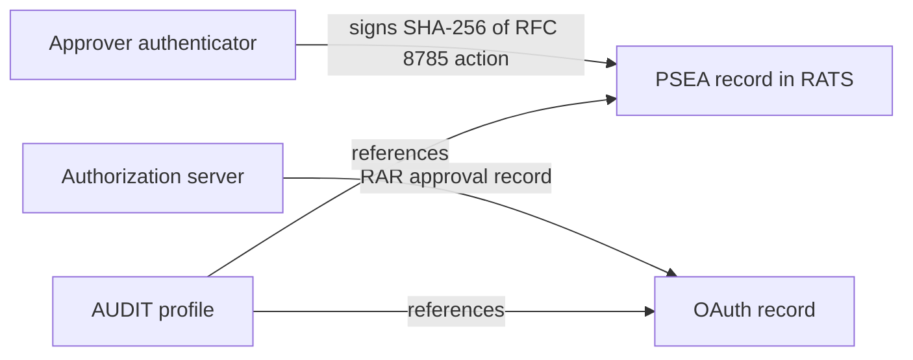
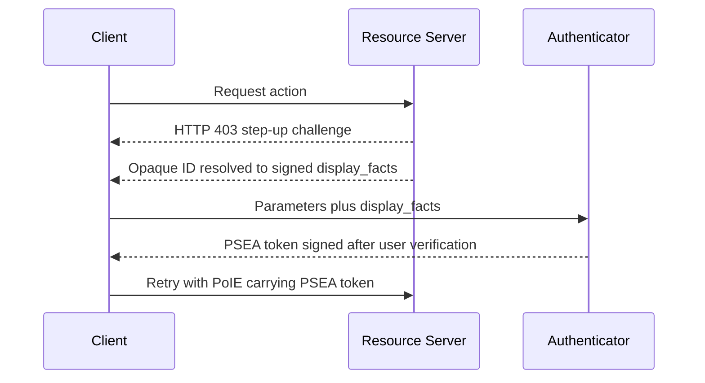
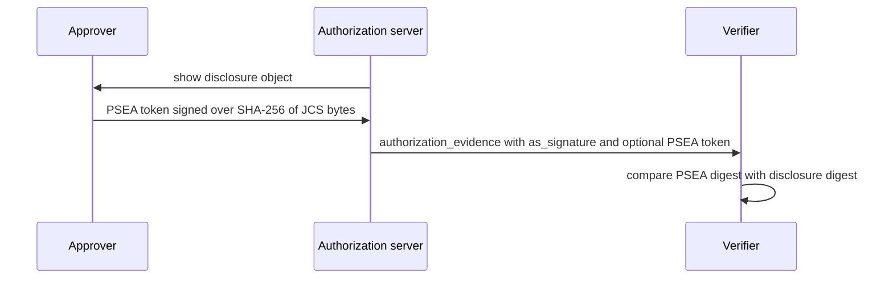

# OAuth WG Daily Report - 2026-11-10

- generated_at_utc: `2026-11-10T07:23:02+00:00`
- snapshot_date: `2026-11-10`

<!-- insights:start -->
## Briefing

> One mailing-list message this run, with no draft text changes. It suggests splitting audit records between OAuth (the AS's record of an approval) and RATS (the approver's own signature), with the proposed AUDIT effort profiling how a record references both.

_Updated 2026-11-10T07:23:46+00:00. Machine-drafted from the sources linked below, which stay authoritative._

### A list post proposes keeping the AS approval record in OAuth and the approver's signature in RATS, with AUDIT profiling the link

`mail` · `discussion` · first seen 2026-11-10 · [OAUTH record formats &amp; the AUDIT BoF](https://mailarchive.ietf.org/arch/msg/oauth/eF1vdEFtTTEe1AWPPIWHswsKezM/)

Replying to Henk, Mohamad points to draft-yossif-psea, an EAT profile in RATS. In it the approver's enrolled authenticator signs, after user verification, over the SHA-256 of the RFC 8785 canonical form of the action. One independent verifier reproduces the published cases. He says it is meant to be cited, not embedded. He notes that draft-liu-oauth-authorization-evidence records the AS's view of the approval in RAR and recommends approver-side signatures in section 9.4, and that Konrad Gruszka's decision receipts leave that signature open. He proposes the split Mirja described for vCon: the AS record in OAuth, the approver's signature in RATS, and AUDIT profiling how a record references both. This is a discussion post only, and no draft text changed. Only the quoted part of the message is available, so Henk's original question is not visible.

**Use cases**

- A deployer who needs audit evidence of a human approval for a high-risk action, where the AS logs its own view and a separate user-signed record exists.
- An implementer of RAR-based approval flows who wants to know whether approver-side signatures will be specified in OAuth or referenced from RATS.

### This PR makes the types of an SD-JWT VC exactly those the Issuer asserts in vct and aka_vcts, and drops the extends-based matching

`pull-request` · `substantive` · first seen 2026-11-09 · [oauth-wg/oauth-sd-jwt-vc#457: Clarify that the types of an SD-JWT VC are those asserted in vct and aka_vcts](https://github.com/oauth-wg/oauth-sd-jwt-vc/pull/457)

Since -25, Section 2.2.2.2 says a credential is of a type if it is the vct value or listed in aka_vcts. The PR removes two leftovers in Section 5.4: a MAY that let a Consumer also match types through the extends property of Type Metadata, and a SHOULD that the vct type extend each type in aka_vcts, which cannot hold for unrelated types since a type can extend only one other. extends now only determines which Type Metadata is inherited. Section 5.4 points to the recommendation in 2.2.2.2 to list extended types in aka_vcts, and Section 7.7 now says aka_vcts types are asserted by the Issuer like the vct type, with the MUST NOT unchanged. The PR says there is no new requirement, that OpenID4VP 1.1 already matches vct_values on vct and aka_vcts, and that ISO/IEC 18013-5 will cite a dated draft at the end of November.

**Use cases**

- A verifier matching vct_values must not infer extra types from Type Metadata extends, so results do not depend on which side fetched metadata.
- An Issuer whose credential type extends a parent type that verifiers request should list that parent in aka_vcts.
- An ISO/IEC 18013-5 mdoc profile that delegates type matching to this document.

**Related in other tracks**

- `openid` / `openid/OpenID4VP`: The PR states OpenID4VP 1.1 already matches vct_values on vct and aka_vcts and treats type extension as out of band knowledge.

### In short, the PoI Core author agrees to let the Proof-of-Intent Envelope carry a PSEA token as its device-bound attestation

`mail` · `new-proposal` · first seen 2026-11-09 · [New Draft: draft-williams-oauth-poi-core-00 (Proof-of-Intent Core)](https://mailarchive.ietf.org/arch/msg/oauth/0Pv9TvfR3IVh92IfjOTnzUZr1Ng/)

This message is Paul Williams's reply in the thread about the new draft draft-williams-oauth-poi-core-00. Mohamad Khalil Yossif had suggested that the attestation in PoI Core is close to draft-yossif-psea, an EAT profile in RATS in which the enrolled authenticator signs, after user verification, over the SHA-256 of the RFC 8785 form of the action parameters. Paul agrees the two are complementary. The PoIE attestation block would be extensible by media type, with PSEA as the primary profile for device-bound Tier 2 and Tier 3 assertions, while Tier 1 in-memory Web Crypto session keys stay decoupled from hardware enclaves. He describes the split: PSEA handles the device-bound signature, PoI Core defines the two-phase challenge flow (HTTP 403 with step-up negotiation) and Tier 1 browser keys via IdP certification and PoP chaining, and display integrity is handled by the Resource Server resolving opaque IDs into signed display_facts. He proposes testing an application/psea+jwt token in the PoIE node assertion schema and asks for a sample token from the conformance suite. Nothing is specified yet; this is an early alignment discussion.

**Use cases**

- A resource server that needs a human to approve a specific high-value action and wants a signed proof tied to the exact parameters shown to the user.
- A deployer weighing browser-only session keys against hardware-backed authenticators for different approval risk levels (Tier 1 versus Tier 2 and 3).

### A proposal to add an optional approver-signed PSEA token to authorization_evidence, so the person's own key covers what the AS says it showed

`mail` · `new-proposal` · first seen 2026-11-09 · [draft-liu-oauth-authorization-evidence-02: an approver-side signature for 9.4](https://mailarchive.ietf.org/arch/msg/oauth/bfpR7SKa2oUmlJ0GLfNwLhyC_m8/)

Mohamad comments on draft-liu-oauth-authorization-evidence-02. Section 9.4 says as_signature proves only that the AS recorded an approval, and that deployments needing more SHOULD add approver-side signatures. He cites a case reported on the AUDIT list where a server signed text the person was never shown and still passed the -02 checks. He suggests draft-yossif-psea, an EAT profile in RATS in which the approver's enrolled authenticator signs, after user verification, over the SHA-256 of RFC 8785 bytes. If those bytes are the disclosure object's JCS form, a verifier can compare the digest with the disclosure's. This would not close 9.5, since PSEA leaves trusted display out of scope. He offers proposed text and a worked example against Appendix B.

**Use cases**

- A deployment where a human approval of an agent action must be provable against a compromised or careless authorization server.
- Auditors checking that the text a person approved matches the recorded disclosure.

**Related in other tracks**

- `ietf-wimse` / `draft-munoz-wimse-authorization-evidence`: Also defines signed authorization-evidence records for agent actions, though the message does not reference it.

### The AAT thread is converging on one del_max_depth meaning, with a comparison of three delegation-chain drafts due before IETF 127

`mail` · `discussion` · first seen 2026-11-09 · [AAT -02 announcement](https://mailarchive.ietf.org/arch/msg/oauth/GM_oPEx2T7s6WgXQgtQOv7AsXqA/)

Participants discuss aligning AAT, the Asor agent_delegation format and Cred -02 (a Delegation Server design). Niki argues that a holder who sets a smaller del_max_depth than the root (root 8, holder 2) should cap everything below it, so a token at depth 3 is rejected, whereas Asor checks depth only against the root's 8. Kieran notes that a leaf at del_depth equal to the root maximum is accepted by AAT (J.10.f) but rejected under Asor semantics, and wants the test vectors reconciled. Rob agrees the cap should stay and asks the comparison to record whether each draft can bind a leaf to a digest of the exact request. Kieran and Rob both want the companion document for AAT Section 9.8 to state a revocation freshness bound, ideally in terms comparable to Cred -02 Section 7. Niki confirms the comparison and a side meeting. The thread is truncated in the source, so earlier messages are only partly visible.

**Use cases**

- Implementers of delegation-chain verifiers who must decide whether a leaf at the root maximum depth is valid.
- Deployers who need a human approval to bind to one exact action inside a broader delegated grant.
- Enforcement points that must state how fresh their revocation state has to be.

**Related in other tracks**

- `ietf-wimse` / `draft-asor-wimse-agent-delegation-chain`: Its agent_delegation format and del_max_depth registry entry are the semantics being compared with AAT.
- `ietf-wimse` / `draft-sweeney-wimse-credential-delegation`: Cred -02 is discussed for its Delegation Server ledger and revocation limits, and it adopts the Asor format unchanged for tokens verified away from the DS.

### The AUDIT BoF proponents ask whether the OAuth WG will define record formats for authorization state that AUDIT could reuse

`mail` · `discussion` · first seen 2026-11-09 · [OAUTH record formats &amp; the AUDIT BoF](https://mailarchive.ietf.org/arch/msg/oauth/gcLkOg4kdUT_OAP1T3tSnKoDWGA/)

Henk, writing for the AUDIT BoF proponents, notes that the OAuth WG rechartered to include authorization and delegation of autonomous agents, which fits the AUDIT BoF at IETF 127. They ask whether the WG plans tangible record formats that an AUDIT WG could reuse, and say the BoF stance is to reuse as many existing record formats as possible. They invite cross-review and feedback from the WG experts. No answer is included and no text changed.

**Use cases**

- Authors of agent authorization drafts who want their records usable for auditing who authorized which action.

### A reply on draft-williams-oauth-poi-core-00 supplies a sample PSEA token and two schema details, but the message is thin

`mail` · `routine` · first seen 2026-11-09 · [New Draft: draft-williams-oauth-poi-core-00 (Proof-of-Intent Core)](https://mailarchive.ietf.org/arch/msg/oauth/TBcBJFPZ9FOUaegDVgM2Lyg82MY/)

The message is a reply from Mohamad to Paul, with the subject announcing draft-williams-oauth-poi-core-00 but no text of that draft in the file. It attaches a -03 baseline token produced and verified with a reference verifier, with action payload, RFC 8785 bytes, op, tier, iss, aud and the enrolled public key, stated to be a test key and not a conformance vector. It notes the media type is application/psea+jwt while the protected-header typ is psea-proof+jwt, and that the token is valid for 300 seconds from iat. The 31 conformance cases are in the psea-spec repository. What draft-williams-oauth-poi-core-00 defines cannot be determined from this file.

### A side meeting on Attenuating Authorization Tokens is set for IETF 127 on Monday 16 November

`mail` · `routine` · first seen 2026-11-09 · [IETF 127 side meeting: Attenuating Authorization Tokens, Monday 11:15](https://mailarchive.ietf.org/arch/msg/oauth/UMe0spt0IDpINAbNX19Ss-r5Dcc/)

Niki Aimable Niyikiza announces a side meeting on Monday 16 November, 11:15 to 12:15 PST in Continental 7, also on Webex. The agenda covers implementation experience, integrations with HTTP APIs, MCP, A2A and agent frameworks, what belongs in the core document versus profiles, and alignment with related delegation chain drafts in OAuth and WIMSE, including common test vectors. This is an announcement only and contains no technical change.

### In short, the Secdir reviewer rates draft-ietf-oauth-sd-jwt-vc-26 as Ready, with all earlier concerns resolved

`mail` · `routine` · first seen 2026-11-09 · [draft-ietf-oauth-sd-jwt-vc-26 telechat Secdir review](https://mailarchive.ietf.org/arch/msg/oauth/hh3_9z2RzgF3LPcvuGhNWy7IuIA/)

Ionuț Mihalcea posted the Secdir telechat review of draft-ietf-oauth-sd-jwt-vc-26 with the result Ready. It updates the review of -19, and the reviewer says all issues raised there were resolved or explained by the authors. The message contains no new technical findings and no text change.

### Weekly digest: big issue cleanup on the client-id-metadata-document draft, two new ID-JAG issues, and several sd-jwt-vc PRs

`mail` · `discussion` · first seen 2026-11-08 · [Weekly github digest (OAuth Activity Summary)](https://mailarchive.ietf.org/arch/msg/oauth/CAJtRQ9c4tUCaB70TUVbzBvEejk/)

The digest lists GitHub activity only, with no spec text. In draft-ietf-oauth-client-id-metadata-document, 11 issues were closed, including those on token_endpoint_auth_method with private_key_jwt (#100), guidance on omitting token_endpoint_auth_method (#92), unsupported metadata values (#71), AS error returns (#85), disallowing the root path as a URL (#86) and data URIs for logo_uri (#19). One new issue (#131) says the response_types intersection rejects otherwise usable token-endpoint grants. Three PRs were opened, and PR #99 (Add Client Authentication section) got a comment. For oauth-identity-assertion-authz-grant, mcguinness opened #160 (sender-constrained ID-JAG should not replace required client authentication) and #159 (sections 7.2 and 8 require jwt-bearer but omit jwt-dpop). oauth-sd-jwt-vc got 7 new PRs, and PR #450 (Mike Bishop's ballot) got a comment. oauth-v2-1 PR #268 (supporting OAuth 2.0 and 2.1 clients concurrently) got 3 comments. oauth-transaction-tokens got 1 new PR. The digest does not show the reasons for the closures or the content of the PRs.

**Use cases**

- An authorization server implementing client ID metadata documents wants to know whether the client authentication and response_types handling rules are still changing.
- An implementer of the ID-JAG grant who plans to use DPoP should watch #159 and #160 on the jwt-dpop gap and on client authentication.

### A reply on the Proof-of-Intent Core draft suggests carrying a PSEA token as its attestation

`mail` · `discussion` · first seen 2026-11-08 · [New Draft: draft-williams-oauth-poi-core-00 (Proof-of-Intent Core)](https://mailarchive.ietf.org/arch/msg/oauth/JAOcNgwRIJuiIxUVCIy2iSJMQIg/)

The message is addressed to the author of draft-williams-oauth-poi-core-00 (the thread is titled as the new draft announcement). The sender says the attestation in PoI Core is close to the token defined in draft-yossif-psea, an EAT profile in RATS. In PSEA, the approver's enrolled authenticator signs, after user verification, over the SHA-256 of the RFC 8785 form of the exact action parameters. The sender cites 31 public conformance cases and one independent verifier. PSEA does not cover how the resource server requests approval or how the client key is certified, which PoI Core does define. The sender therefore proposes that the PoIE carry a PSEA token as its attestation and asks whether the author is open to checking the fit. The draft text itself is not in the material, so nothing more about PoI Core is claimed.

**Use cases**

- A resource server that wants user-verified approval of one exact action (for example a payment) and must choose between a bespoke attestation format and an existing EAT profile.
- An implementer building a verifier who wants shared conformance cases rather than a draft-specific attestation format.

### A PR adds the required req_wl claim to the JWT Claims registry entries in the Transaction Tokens draft

`pull-request` · `editorial` · first seen 2026-11-08 · [oauth-wg/oauth-transaction-tokens#374: Register the req_wl claim in the JWT Claims registry](https://github.com/oauth-wg/oauth-transaction-tokens/pull/374)

The contributor noticed that req_wl is a REQUIRED claim but is missing from the JWT Claims Registry Contents in the IANA section, where only tctx and rctx are listed. The PR adds the registration. It is an IANA considerations fix and does not change the token format or processing.

### Triage of the candidate queue

- **high** `draft-ietf-oauth-attestation-based-client-auth`: A detailed critical review of -12 questions its structure and DPoP/RFC 7521 reuse.
- **high** `draft-ietf-oauth-client-id-metadata-document`: 11 issues closed and a new response_types issue (#131) this week, with PRs adding a Client Authentication section.
- **high** `draft-ietf-oauth-delegate-sd-jwt`: Authors explained the sd_hash vs issuer_jwt_hash design and are preparing an updated version with a roadmap at IETF 127.
- **high** `draft-ietf-oauth-identity-assertion-authz-grant`: Two new issues (#159, #160) on jwt-dpop and client authentication point to open design questions.
- **high** `draft-ietf-oauth-sd-jwt-vc`: PR #457 changes how credential types are matched (vct and aka_vcts only, no extends matching), with ISO/IEC 18013-5 about to cite a dated draft.
- **high** `draft-ietf-oauth-spiffe-client-auth`: -03 makes client_id optional, ties client identification to CIMD and adds replay and trust-bundle security text.
- **low** `draft-ietf-oauth-transaction-tokens`: PR #374 fixes a missing IANA registration for the required req_wl claim, a small editorial fix.

<!-- insights:end -->

## Top Priorities

| Rank | Draft | Score | Updated | Key State | Repo |
|---|---|---:|---|---|---|
| 1 | `draft-ietf-oauth-sd-jwt-vc` | 125 | 2026-11-06T19:07:22Z | Active, Expert Reviews OK | `oauth-sd-jwt-vc` |
| 2 | `draft-ietf-oauth-rfc8725bis` | 90 | 2026-11-06T22:32:52Z | Active, No IANA Actions | `draft-ietf-oauth-rfc8725bis` |
| 3 | `draft-ietf-oauth-status-list` | 83 | 2026-11-03T19:29:28Z | Active, RFC-Ed-Ack | `draft-ietf-oauth-status-list` |
| 4 | `draft-ietf-oauth-client-id-metadata-document` | 83 | 2026-11-02T22:02:56Z | Active, I-D Exists | `draft-ietf-oauth-client-id-metadata-document` |
| 5 | `draft-ietf-oauth-identity-assertion-authz-grant` | 73 | 2026-10-31T00:32:39Z | Active, I-D Exists | `oauth-identity-assertion-authz-grant` |
| 6 | `draft-ietf-oauth-v2-1` | 66 | 2026-10-31T04:16:32Z | Active, I-D Exists | `oauth-v2-1` |
| 7 | `draft-ietf-oauth-identity-chaining` | 65 | 2026-08-21T20:25:31Z | Active, RFC-Ed-Ack | `oauth-identity-chaining` |
| 8 | `draft-ietf-oauth-delegate-sd-jwt` | 64 | 2026-10-30T12:38:29Z | Active, I-D Exists | `oauth-delegate-sd-jwt` |
| 9 | `draft-ietf-oauth-transaction-tokens` | 64 | 2026-08-21T11:57:16Z | Active, I-D Exists | `oauth-transaction-tokens` |
| 10 | `draft-ietf-oauth-deferred-token-response` | 58 | 2026-10-31T16:12:16Z | Active, I-D Exists | `oauth-deferred-token-response` |

## Active Drafts

| Draft | Rev | Updated | States |
|---|---:|---|---|
| `draft-ietf-oauth-rfc8725bis` | 10 | 2026-11-06T22:32:52Z | Active, No IANA Actions, IANA OK - No Actions Needed |
| `draft-ietf-oauth-sd-jwt-vc` | 26 | 2026-11-06T19:07:22Z | Active, Expert Reviews OK, Version Changed - Review Needed |
| `draft-ietf-oauth-status-list` | 21 | 2026-11-03T19:29:28Z | Active, RFC-Ed-Ack, Expert Reviews OK |
| `draft-ietf-oauth-client-id-metadata-document` | 03 | 2026-11-02T22:02:56Z | Active, I-D Exists, WG Document |
| `draft-ietf-oauth-spiffe-client-auth` | 03 | 2026-11-02T17:35:55Z | Active, I-D Exists, WG Document |
| `draft-ietf-oauth-deferred-token-response` | 01 | 2026-10-31T16:12:16Z | Active, I-D Exists, WG Document |
| `draft-ietf-oauth-v2-1` | 17 | 2026-10-31T04:16:32Z | Active, I-D Exists, WG Document |
| `draft-ietf-oauth-identity-assertion-authz-grant` | 06 | 2026-10-31T00:32:39Z | Active, I-D Exists, WG Document |
| `draft-ietf-oauth-delegate-sd-jwt` | 00 | 2026-10-30T12:38:29Z | Active, I-D Exists, WG Document |
| `draft-ietf-oauth-attestation-based-client-auth` | 12 | 2026-10-18T17:33:02Z | Active, I-D Exists, WG Consensus: Waiting for Write-Up |
| `draft-ietf-oauth-first-party-apps` | 04 | 2026-08-26T14:40:16Z | Active, I-D Exists, WG Consensus: Waiting for Write-Up |
| `draft-ietf-oauth-rar-metadata-remediation` | 00 | 2026-08-23T20:29:29Z | Active, I-D Exists, WG Document |
| `draft-ietf-oauth-identity-chaining` | 17 | 2026-08-21T20:25:31Z | Active, RFC-Ed-Ack, Expert Reviews OK |
| `draft-ietf-oauth-transaction-tokens` | 11 | 2026-08-21T11:57:16Z | Active, I-D Exists, WG Consensus: Waiting for Write-Up |
| `draft-ietf-oauth-refresh-token-expiration` | 03 | 2026-07-06T17:53:06Z | Active, I-D Exists, WG Document |

## Repo Watch

| Repo | Pushed | Open Issues |
|---|---|---:|
| `oauth-wg/oauth-sd-jwt-vc` | 2026-11-10T00:29:38Z | 1 |
| `oauth-wg/oauth-transaction-tokens` | 2026-11-10T00:15:51Z | 3 |
| `oauth-wg/oauth-identity-assertion-authz-grant` | 2026-11-10T00:02:45Z | 33 |
| `oauth-wg/draft-ietf-oauth-client-id-metadata-document` | 2026-11-10T00:00:39Z | 34 |
| `oauth-wg/oauth-v2-1` | 2026-11-08T00:14:14Z | 12 |
| `oauth-wg/oauth-spiffe-client-authentication` | 2026-11-08T00:10:21Z | 7 |
| `oauth-wg/oauth-delegate-sd-jwt` | 2026-11-03T00:23:39Z | 12 |
| `oauth-wg/oauth-deferred-token-response` | 2026-11-03T00:06:25Z | 23 |
| `oauth-wg/draft-ietf-oauth-attestation-based-client-auth` | 2026-10-13T06:13:11Z | 0 |
| `oauth-wg/oauth-selective-disclosure-jwt` | 2026-10-04T13:50:37Z | 0 |
| `oauth-wg/oauth-cross-device-security` | 2026-08-27T14:45:11Z | 0 |
| `oauth-wg/oauth-browser-based-apps` | 2026-08-27T14:43:00Z | 0 |

## Recent Pull Requests

- `oauth-wg/oauth-sd-jwt-vc#457` Clarify that the types of an SD-JWT VC are those asserted in vct and aka_vcts (2026-11-09T21:08:02Z)
- `oauth-wg/oauth-identity-assertion-authz-grant#158` Fix the client authentication target in the Token Exchange section (2026-11-09T20:09:45Z)
- `oauth-wg/oauth-transaction-tokens#374` Register the req_wl claim in the JWT Claims registry (2026-11-08T12:34:29Z)
- `oauth-wg/draft-ietf-oauth-client-id-metadata-document#130` require pre-fetching logo_uri, added security considerations (2026-11-08T11:39:21Z)
- `oauth-wg/oauth-sd-jwt-vc#455` Cite the IANA special-purpose address registries instead of RFC 6890 (Éric Vyncke's ballot comment) (2026-11-06T17:17:55Z)
- `oauth-wg/oauth-sd-jwt-vc#456` Remove a duplicate sentence in Section 2.2.2.2 (2026-11-06T17:16:56Z)
- `oauth-wg/oauth-spiffe-client-authentication#70` Add token_endpoint_auth_methods_supported to the CIMD example (2026-11-06T14:11:43Z)
- `oauth-wg/oauth-v2-1#268` Supporting OAuth 2.0 and OAuth 2.1 clients concurrently (2026-11-05T22:36:53Z)
- `oauth-wg/oauth-sd-jwt-vc#454` Vyncke discuss (2026-11-05T20:18:13Z)
- `oauth-wg/oauth-sd-jwt-vc#451` Issuer key discovery: policy selects the mechanism, inputs of other mechanisms do not identify the Issuer (2026-11-05T01:36:36Z)

## Recent Issues

- `oauth-wg/draft-ietf-oauth-client-id-metadata-document#112` Add Security Consideration section for Fetching Client Metadata (2026-11-10T04:21:31Z)
- `oauth-wg/draft-ietf-oauth-client-id-metadata-document#78` Can AS optionally provide `iss` when fetching client_id? (2026-11-10T01:56:52Z)
- `oauth-wg/oauth-identity-assertion-authz-grant#121` Carry an optional client metadata digest so the IdP can vouch for the client's CIMD (JIT provisioning at the RAS) (2026-11-09T21:36:43Z)
- `oauth-wg/draft-ietf-oauth-client-id-metadata-document#71` Define AS behavior when CIMD contains unsupported metadata values (2026-11-09T08:34:03Z)
- `oauth-wg/oauth-identity-assertion-authz-grant#161` §4.3.3 Processing Rules: "SAML Audience matches the client_id" is incompatible with §4.5's required Audience→Client ID mapping (2026-11-08T14:59:29Z)
- `oauth-wg/draft-ietf-oauth-client-id-metadata-document#131` `response_types` intersection rejects otherwise usable token-endpoint grants (2026-11-08T05:46:36Z)
- `oauth-wg/oauth-identity-assertion-authz-grant#160` Sender-constrained ID-JAG should not replace required client authentication (2026-11-06T18:00:32Z)
- `oauth-wg/oauth-identity-assertion-authz-grant#159` Sections 7.2 and 8 require jwt-bearer but omit jwt-dpop (2026-11-06T18:00:31Z)
- `oauth-wg/draft-ietf-oauth-client-id-metadata-document#121` Security Considerations: persisted/remembered authorization decisions should respect resource-indicator scoping (2026-11-02T22:22:58Z)
- `oauth-wg/draft-ietf-oauth-client-id-metadata-document#79` Review from Justin Richer (2026-11-02T22:22:55Z)

## Organization Events

- `2026-11-09T20:09:46Z` PushEvent `oauth-wg/oauth-identity-assertion-authz-grant` 
- `2026-11-09T20:10:18Z` PushEvent `oauth-wg/oauth-identity-assertion-authz-grant` 
- `2026-11-10T04:17:51Z` IssueCommentEvent `oauth-wg/draft-ietf-oauth-client-id-metadata-document` Add Security Consideration section for Fetching Client Metadata
- `2026-11-10T03:57:50Z` IssueCommentEvent `oauth-wg/draft-ietf-oauth-client-id-metadata-document` Add Security Consideration section for Fetching Client Metadata
- `2026-11-10T01:56:52Z` IssueCommentEvent `oauth-wg/draft-ietf-oauth-client-id-metadata-document` Can AS optionally provide `iss` when fetching client_id?
- `2026-11-09T14:44:35Z` PushEvent `oauth-wg/oauth-sd-jwt-vc` 
- `2026-11-09T13:35:22Z` PushEvent `oauth-wg/oauth-sd-jwt-vc` 
- `2026-11-09T13:27:50Z` PushEvent `oauth-wg/oauth-sd-jwt-vc` 
- `2026-11-09T22:14:22Z` IssueCommentEvent `oauth-wg/draft-ietf-oauth-client-id-metadata-document` Can AS optionally provide `iss` when fetching client_id?
- `2026-11-09T22:01:18Z` IssueCommentEvent `oauth-wg/draft-ietf-oauth-client-id-metadata-document` Can AS optionally provide `iss` when fetching client_id?
- `2026-11-09T21:36:43Z` IssuesEvent `oauth-wg/oauth-identity-assertion-authz-grant` Carry an optional client metadata digest so the IdP can vouch for the client's CIMD (JIT provisioning at the RAS)
- `2026-11-09T21:36:35Z` IssueCommentEvent `oauth-wg/oauth-identity-assertion-authz-grant` Carry an optional client metadata digest so the IdP can vouch for the client's CIMD (JIT provisioning at the RAS)
- `2026-11-09T20:32:32Z` PullRequestReviewEvent `oauth-wg/oauth-sd-jwt-vc` created
- `2026-11-09T20:09:45Z` PullRequestEvent `oauth-wg/oauth-identity-assertion-authz-grant` merged
- `2026-11-09T14:45:14Z` PushEvent `oauth-wg/oauth-sd-jwt-vc` 
- `2026-11-09T19:08:50Z` PullRequestReviewEvent `oauth-wg/oauth-sd-jwt-vc` created
- `2026-11-09T16:59:03Z` IssueCommentEvent `oauth-wg/oauth-sd-jwt-vc` Clarify that the types of an SD-JWT VC are those asserted in vct and aka_vcts
- `2026-11-08T00:10:22Z` PushEvent `oauth-wg/oauth-spiffe-client-authentication` 
- `2026-11-09T15:52:19Z` PullRequestReviewEvent `oauth-wg/oauth-sd-jwt-vc` created
- `2026-11-08T00:03:02Z` PushEvent `oauth-wg/oauth-identity-assertion-authz-grant` 

## Mailarchive Signals

- weekly_digest_count: `1`
- [OAUTH-WG] Re: [Audit] OAUTH record formats & the AUDIT BoF - https://mailarchive.ietf.org/arch/msg/oauth/eF1vdEFtTTEe1AWPPIWHswsKezM/
- [OAUTH-WG] Re: I-D Action: draft-ietf-oauth-client-id-metadata-document-03.txt - https://mailarchive.ietf.org/arch/msg/oauth/VGYXFHqx9gft63TPdmVtAUaYkLU/
- [OAUTH-WG] Re: AAT -02 announcement - https://mailarchive.ietf.org/arch/msg/oauth/GM_oPEx2T7s6WgXQgtQOv7AsXqA/
- [OAUTH-WG] IETF 127 side meeting: Attenuating Authorization Tokens, Monday 11:15 - https://mailarchive.ietf.org/arch/msg/oauth/UMe0spt0IDpINAbNX19Ss-r5Dcc/
- [OAUTH-WG] OAUTH record formats & the AUDIT BoF - https://mailarchive.ietf.org/arch/msg/oauth/gcLkOg4kdUT_OAP1T3tSnKoDWGA/
- [OAUTH-WG] draft-liu-oauth-authorization-evidence-02: an approver-side signature for 9.4 - https://mailarchive.ietf.org/arch/msg/oauth/bfpR7SKa2oUmlJ0GLfNwLhyC_m8/
- [OAUTH-WG] Re: New Draft: draft-williams-oauth-poi-core-00 (Proof-of-Intent Core) - https://mailarchive.ietf.org/arch/msg/oauth/TBcBJFPZ9FOUaegDVgM2Lyg82MY/
- [OAUTH-WG] Re: New Draft: draft-williams-oauth-poi-core-00 (Proof-of-Intent Core) - https://mailarchive.ietf.org/arch/msg/oauth/0Pv9TvfR3IVh92IfjOTnzUZr1Ng/

## Next Actions

1. Evaluate the top 3 items in `Top Priorities` as weekly deep-dive candidates.
2. Separately track comment deadlines for `In Last Call` / `In WG Last Call` drafts.
3. For repos with a sudden spike in activity, create a scaffold in `deep-dives/` to capture key discussion points.
