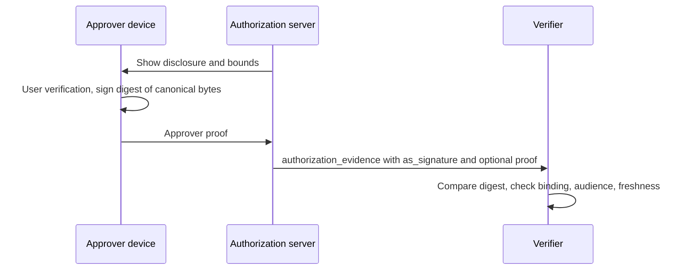
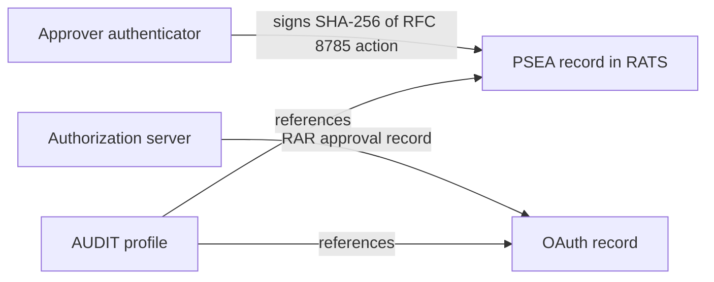

# OAuth WG Daily Report - 2026-11-12

- generated_at_utc: `2026-11-12T07:14:59+00:00`
- snapshot_date: `2026-11-12`

<!-- insights:start -->
## Briefing

> No draft text changed in this run. The two list messages are an IETF 127 slide-upload reminder and a thread on how to compare the AAT-02 draft with PSEA-based approval proofs.

_Updated 2026-11-12T07:16:09+00:00. Machine-drafted from the sources linked below, which stay authoritative._

### AAT-02 thread: compare leaves that carry an action binding apart from leaves that cite a separate approval proof, and record shared replay state

`mail` · `discussion` · first seen 2026-11-12 · [AAT -02 announcement (2 new messages)](https://mailarchive.ietf.org/arch/msg/oauth/WixDZ1_uCFhHcyVW7y0ao-hXWpQ/)

Mohamad Yossif argues that a chain leaf need not express the binding to one exact request itself. It can carry the digest of, or cite by jti, a separate proof. He describes draft-yossif-psea-03 as a proof signed by the approver's enrolled device over the SHA-256 of the request in RFC 8785 form, which a verifier refuses on replay. He suggests the comparison list "not expressible in the token" and "expressible by reference" as two entries. Iman agrees, would keep the action identifier, approval jti and proof reference distinct, and notes that conformance case DR-C7 only checks a second presentation to the same verifier. Iman proposes a new test presenting one proof through two leaves at two enforcement points and checking that at most one finalization succeeds, which separate local replay caches would not show. The thread contains no draft text change.

**Use cases**

- Authors of an agent authorization token who must decide whether per-request approval is carried in the token or referenced from an external proof.
- Deployers running several enforcement points in one verification domain who must decide whether replay state has to be shared across them.

### The chairs ask presenters to upload slides for the IETF 127 OAuth session and the joint WIMSE session

`mail` · `routine` · first seen 2026-11-12 · [OAuth Sessions Slides](https://mailarchive.ietf.org/arch/msg/oauth/QBkjvseqmO0KYRwP5ArCI19GlDM/)

Rifaat asks presenters to upload slides as soon as possible. One link is for the OAuth sessions at IETF 127 and another is for the shared session with WIMSE. The message has no technical content.

### Kieran answers review comments on credential-delegation -02: cumulative budgets need a single writer, and -02 says nothing on suspension or restoration

`mail` · `discussion` · first seen 2026-11-11 · [draft-sweeney-wimse-credential-delegation-02](https://mailarchive.ietf.org/arch/msg/oauth/HgHlAofjYWaRfRhhN5v3-jqmw48/)

Kieran replies to Caleb and Rob. He accepts Caleb's points 1, 4 and 6 (the remap for a user-issued token, depth-0 values, and 'user-issued'). On how a user-issued root composes with the chain format, he and Rafael still need to agree, and Caleb's jti-as-root shape is a concrete proposal. A mode marker per cumulative key is planned for -03. He cautions that a cumulative budget needs a single writer that sees every exercise, so a tally held at each verifier bounds the total per verifier only, as Section 5.5 already says. -02 names no status mechanism for tokens the DS did not issue, and Section 7 says only that an offline verifier learns of revocation through whatever status mechanism it consults. He values Rob's split between who issued the root and evidence that a person approved it. Section 7 covers revocation only, nothing on suspension or restoration, and the 1-hour cap bounds exposure without closing it.

**Use cases**

- A deployer relying on per-verifier tallies who needs to know that a cumulative limit is not enforced across separate verifiers.
- A verifier of delegation tokens issued elsewhere that has to choose a status mechanism because -02 names none.

**Related in other tracks**

- `ietf-wimse` / `draft-sweeney-wimse-credential-delegation`: This is the draft whose -02 text is being discussed.

### Delegation-chain drafts to be compared at a 16 Nov side meeting; the lowest del_max_depth on the path is the effective limit

`mail` · `discussion` · first seen 2026-11-11 · [AAT -02 announcement](https://mailarchive.ietf.org/arch/msg/oauth/Nk-LW0yXArpzKDtHhnMrpiC31Fw/)

Kieran agrees with Niki and Rob that a child token's del_max_depth below its parent's is a narrowing a verifier should honor, so the effective maximum at any hop is the lowest value on the path. He says this is a separate question from the leaf being at the maximum and should be decided separately. He accepts an exact-request row in the comparison: his -02 checks each call at the DS against the operations in the token but cannot bind a leaf to a digest of one request, so the entry would be 'not expressible in the token'. He also agrees to state the 9.8 freshness bound in the terms of -02 Section 7, and asks that the -02 entry for tokens verified away from the DS be treated as provisional because Section 5.5 takes its chain format by reference. The quoted message from Niki announces a side meeting on Monday 16 November, 11:15-12:15 PST in Continental 7 and on Webex, with alignment across delegation-chain drafts as a topic.

**Use cases**

- An implementer of a delegation-chain verifier deciding how to compute the effective depth limit when child tokens narrow del_max_depth.
- An author or reviewer comparing the chain drafts who wants to attend the 16 November side meeting.

**Related in other tracks**

- `ietf-wimse` / `draft-sweeney-wimse-credential-delegation`: The -02 text Kieran describes (Sections 5.5, 7) is this draft.
- `ietf-wimse` / `draft-asor-wimse-agent-delegation-chain`: Item 3 names asor as one of the drafts with its own per-constraint subsumption rule.

### Kieran replies on draft-le-agent-passport-00: shared limits need one counter, and RAR could carry root receipts

`mail` · `discussion` · first seen 2026-11-11 · [New draft: Agent Passports and Delegation Receipts (draft-le-agent-passport-00)](https://mailarchive.ietf.org/arch/msg/oauth/bdZNYx7-PNM1utAtW6X1mNjGVxk/)

The message is a reply to Ben on two open items of the new Agent Passports and Delegation Receipts draft; only Kieran's reply is in the material, not the draft itself. On shared limit accounting between relying parties, he says a cumulative limit needs a single writer that sees every exercise. Separate RPs cannot hold the total, so either the receipt names one RP or a party in the call path keeps the running total. On RAR, he agrees authorization_details can be used for grants, so an AS that already does RAR can issue root receipts. He suggests first lining up the subsumption rule per constraint type, since asor, AAT and Hulea each have their own, and says Niki has offered to compare them before IETF 127.

**Use cases**

- An AS that already supports RAR and wants to issue root delegation receipts using authorization_details.
- A designer of a multi-RP agent system who must decide where a shared spending or call limit is counted.

**Related in other tracks**

- `ietf-wimse` / `draft-hulea-wimse-agent-mandate`: Named as one of the drafts with its own subsumption rule.
- `ietf-wimse` / `draft-asor-wimse-agent-delegation-chain`: Named as one of the drafts with its own subsumption rule.

### In short, the list is discussing what an optional approver-side signature in authorization-evidence should have to prove, before any mechanism is picked

`mail` · `discussion` · first seen 2026-11-11 · [draft-liu-oauth-authorization-evidence-02: an approver-side signature for 9.4](https://mailarchive.ietf.org/arch/msg/oauth/bkPyMtzoqpZhgI1RuttdKJ9RZNE/)

Mohamad Khalil Yossif argued that the as_signature in Section 9.4 only proves the AS recorded an approval, not that the approver made it. They proposed draft-yossif-psea (an EAT profile in RATS, signing the SHA-256 of RFC 8785 bytes after user verification) as one way to produce the approver's signature, carried in an optional member of authorization_evidence. They noted it would not close 9.5, since trusted display stays out of scope. The author, Dapeng, replied that the draft deliberately leaves the mechanism open and could add requirements or reference existing IETF work, but that the priority is WG convergence on the problem statement and evidence model. Iman then listed what a signed approver statement should cover: purpose, decision, exact disclosure bytes or canonical digest, approved authority bounds and the approval occurrence. They also asked for a trusted approver-to-credential binding, audience and freshness checks, and an explicit signed-byte boundary to avoid a circular dependency with the AS-signed record. They suggested test cases and said a valid signature with unestablished display provenance should be reported as a separate result. No draft text changed.

**Use cases**

- An AS that records user approvals for agent actions and needs a way to show the approval came from the person, not only from the AS's own record.
- A verifier that must distinguish a valid approver signature from proof of what the person actually saw on screen.

**Related in other tracks**

- `ietf-wimse` / `draft-munoz-wimse-authorization-evidence`: Also about signed authorization-evidence records for agent actions, but the mail does not reference it, so the link is by topic.

### A contributor proposes a mechanism-free requirements list for an approver-side signature in section 9.4 of draft-liu-oauth-authorization-evidence-02

`mail` · `discussion` · first seen 2026-11-11 · [draft-liu-oauth-authorization-evidence-02: an approver-side signature for 9.4](https://mailarchive.ietf.org/arch/msg/oauth/dpTduyNNrzmM3tl_v15aiapVm74/)

Mohamad asks to be added to the GitHub repository (account MohamadKhalilYossif) and agrees that requirements should come first. For 9.4 he proposes a short normative list that any approver-side signature must meet, naming no mechanism: it covers the exact disclosure bytes or their digest, it is made by a credential bound to the approver at enrollment, and it identifies the approval it belongs to. Existing work, PSEA included, would then be an informative reference. He will send this as a pull request rather than on the list. This is a proposal in a message, not yet text in the draft.

**Use cases**

- An implementer of human-approval flows for agent actions who wants to know what an approver signature must cover.
- A reviewer who wants to follow or contribute to the draft's requirements via pull request.

**Related in other tracks**

- `ietf-wimse` / `draft-munoz-wimse-authorization-evidence`: Similar topic of signed authorization evidence, but the material does not link the two, so this is only a pointer to compare.

### In oauth-delegate-sd-jwt, cnf, exp, nbf and the other security claims move out of delegate_payload into the base KB-SD-JWT payload, with defined semantics

`pull-request` · `substantive` · first seen 2026-11-10 · [oauth-wg/oauth-delegate-sd-jwt#15: Move security claims to base KB-SD-JWT payload and define claim semantics](https://github.com/oauth-wg/oauth-delegate-sd-jwt/pull/15)

PR #15, which fixes #3 and #10, moves the security and validity claims (cnf, exp, nbf and so on) out of delegate_payload into the base KB-SD-JWT payload. Standard JWT and SD-JWT libraries can then evaluate them without first unpacking the delegate payload. When several delegate_payload entries are present, they share the base KB-SD-JWT's security claims. The PR also adds a section defining how cnf, iat, exp, nbf, aud, nonce, sd_hash and issuer_jwt_hash are interpreted when a KB-SD-JWT is delegated to a new Delegate Holder, versus how subsequent Delegate Holders and Verifiers interpret them, and updates the Verification section to match. Only the PR description was available, not the diff.

**Use cases**

- A library implementer who wants existing SD-JWT KB verification to check cnf and expiry on a delegated presentation without delegate-specific unpacking.
- An agent that re-delegates a credential to another holder and needs the audience and nonce semantics to be unambiguous.

### The authorization-evidence draft author says -02 deliberately leaves approver-side signatures open and wants WG agreement on the evidence model first

`mail` · `discussion` · first seen 2026-11-10 · [回复：draft-liu-oauth-authorization-evidence-02: an approver-side signature for 9.4](https://mailarchive.ietf.org/arch/msg/oauth/GmKE3c79_SYg6u67lPViOq2L_Eo/)

Mohamad Khalil Yossif had pointed out that Section 9.4 of draft-liu-oauth-authorization-evidence-02 says the as_signature proves only that the AS recorded an approval, not that the approver made it. He proposed that draft-yossif-psea, an EAT profile in which the approver's authenticator signs the SHA-256 of the RFC 8785 (JCS) bytes of the disclosure object, be carried in an optional authorization_evidence member. He noted this does not close Section 9.5, because trusted display stays out of scope. The author, Dapeng, replied that Section 9.4 only makes a recommendation and deliberately leaves the mechanism open. The draft could later specify requirements or reference existing IETF work. For now the priority is WG convergence on the problem statement and evidence model, and he offered to add Mohamad to the GitHub repository. No draft text changed.

**Use cases**

- An AS that records user approvals for agent actions and needs to show later that the person, not only the server, approved them.
- A verifier that wants to compare an approver-signed digest against the disclosure object recorded by the AS.

**Related in other tracks**

- `ietf-wimse` / `draft-munoz-wimse-authorization-evidence`: Also defines signed authorization-evidence records for agent actions, so it addresses the same problem space.

### The AUDIT BoF organiser asked if OAuth will produce reusable authorization record formats, and one participant repeatedly objected to the AUDIT WG

`mail` · `discussion` · first seen 2026-11-10 · [OAUTH record formats &amp; the AUDIT BoF (4 new messages)](https://mailarchive.ietf.org/arch/msg/oauth/_-ahqOZnJXf_i_DSW7lV0Ecl81Q/)

Henk Birkholz wrote that the OAuth WG has rechartered to cover authorization and delegation of autonomous agents. He asked whether it plans tangible record or log artifact formats the proposed AUDIT WG could reuse, and said the BoF at IETF 127 aims to reuse as many existing formats as possible. Heime.Jorgen objected repeatedly, arguing that post-hoc records without pre-effect binding invite replay and TOCTOU attacks, and that the charter fails RFC 5434 criteria. They asked for extensibility slots for pre-effect seals and execution nonces. Mirja Kuehlewind replied that the objection was noted and need not be repeated. No OAuth WG member answered Henk's question in this material, and no draft text is involved.

**Use cases**

- Authors of agent authorization or delegation drafts who may be asked to make their records usable as audit evidence.

**Related in other tracks**

- `ietf-wimse` / `draft-munoz-wimse-authorization-evidence`: Signed authorization-evidence records for agent actions are the kind of record format the AUDIT BoF asks about.

### A list post proposes keeping the AS approval record in OAuth and the approver's signature in RATS, with AUDIT profiling the link

`mail` · `discussion` · first seen 2026-11-10 · [OAUTH record formats &amp; the AUDIT BoF](https://mailarchive.ietf.org/arch/msg/oauth/eF1vdEFtTTEe1AWPPIWHswsKezM/)

Replying to Henk, Mohamad points to draft-yossif-psea, an EAT profile in RATS. In it the approver's enrolled authenticator signs, after user verification, over the SHA-256 of the RFC 8785 canonical form of the action. One independent verifier reproduces the published cases. He says it is meant to be cited, not embedded. He notes that draft-liu-oauth-authorization-evidence records the AS's view of the approval in RAR and recommends approver-side signatures in section 9.4, and that Konrad Gruszka's decision receipts leave that signature open. He proposes the split Mirja described for vCon: the AS record in OAuth, the approver's signature in RATS, and AUDIT profiling how a record references both. This is a discussion post only, and no draft text changed. Only the quoted part of the message is available, so Henk's original question is not visible.

**Use cases**

- A deployer who needs audit evidence of a human approval for a high-risk action, where the AS logs its own view and a separate user-signed record exists.
- An implementer of RAR-based approval flows who wants to know whether approver-side signatures will be specified in OAuth or referenced from RATS.

### Chairs and presenters declined a co-presenting slot for a competing cross-domain transaction token draft in the IETF 127 joint session

`mail` · `routine` · first seen 2026-11-10 · [OAuth IETF 127 Call for Agenda Items](https://mailarchive.ietf.org/arch/msg/oauth/kIBSOEWMsXmmvZy9Vh7EJBJrzV4/)

The thread is the IETF 127 call for agenda items. The OAuth chairs requested two two-hour slots plus a joint WIMSE/OAuth session, and the Internet-Draft cut-off was 2 November 2026. Yuan (Huawei) asked for five minutes in the joint session to present draft-liu-oauth-cross-domain-txn-token, an alternative to the Cross-Domain Transaction Tokens item already on the agenda. Sean O'Dell replied, after talking with Pieter and George, that Yuan is welcome to ask questions but co-presenting is not an option at this time. The two approaches are being compared in issue #17 of gffletch/tt_xdomain. No technical content changed.

### Triage of the candidate queue

- **high** `draft-ietf-oauth-client-id-metadata-document`: 11 issues closed and a new response_types issue (#131) this week, with PRs adding a Client Authentication section.
- **high** `draft-ietf-oauth-delegate-sd-jwt`: PR #15 restructures where security claims live in the KB-SD-JWT and defines their delegation semantics.
- **high** `draft-ietf-oauth-identity-assertion-authz-grant`: Two new issues (#159, #160) on jwt-dpop and client authentication point to open design questions.
- **high** `draft-ietf-oauth-sd-jwt-vc`: PR #457 changes how credential types are matched (vct and aka_vcts only, no extends matching), with ISO/IEC 18013-5 about to cite a dated draft.
- **low** `draft-ietf-oauth-transaction-tokens`: PR #374 fixes a missing IANA registration for the required req_wl claim, a small editorial fix.

<!-- insights:end -->

## Top Priorities

| Rank | Draft | Score | Updated | Key State | Repo |
|---|---|---:|---|---|---|
| 1 | `draft-ietf-oauth-sd-jwt-vc` | 118 | 2026-11-06T19:07:22Z | Active, Expert Reviews OK | `oauth-sd-jwt-vc` |
| 2 | `draft-ietf-oauth-identity-chaining` | 90 | 2026-11-12T02:07:35Z | Active, RFC-Ed-Ack | `oauth-identity-chaining` |
| 3 | `draft-ietf-oauth-rfc8725bis` | 83 | 2026-11-06T22:32:52Z | Active, No IANA Actions | `draft-ietf-oauth-rfc8725bis` |
| 4 | `draft-ietf-oauth-status-list` | 73 | 2026-11-03T19:29:28Z | Active, RFC-Ed-Ack | `draft-ietf-oauth-status-list` |
| 5 | `draft-ietf-oauth-client-id-metadata-document` | 73 | 2026-11-02T22:02:56Z | Active, I-D Exists | `draft-ietf-oauth-client-id-metadata-document` |
| 6 | `draft-ietf-oauth-identity-assertion-authz-grant` | 73 | 2026-10-31T00:32:39Z | Active, I-D Exists | `oauth-identity-assertion-authz-grant` |
| 7 | `draft-ietf-oauth-v2-1` | 66 | 2026-10-31T04:16:32Z | Active, I-D Exists | `oauth-v2-1` |
| 8 | `draft-ietf-oauth-delegate-sd-jwt` | 66 | 2026-10-30T12:38:29Z | Active, I-D Exists | `oauth-delegate-sd-jwt` |
| 9 | `draft-ietf-oauth-transaction-tokens` | 64 | 2026-08-21T11:57:16Z | Active, I-D Exists | `oauth-transaction-tokens` |
| 10 | `draft-ietf-oauth-attestation-based-client-auth` | 58 | 2026-10-18T17:33:02Z | Active, I-D Exists | `draft-ietf-oauth-attestation-based-client-auth` |

## Active Drafts

| Draft | Rev | Updated | States |
|---|---:|---|---|
| `draft-ietf-oauth-identity-chaining` | 17 | 2026-11-12T02:07:35Z | Active, RFC-Ed-Ack, Expert Reviews OK |
| `draft-ietf-oauth-rfc8725bis` | 10 | 2026-11-06T22:32:52Z | Active, No IANA Actions, IANA OK - No Actions Needed |
| `draft-ietf-oauth-sd-jwt-vc` | 26 | 2026-11-06T19:07:22Z | Active, Expert Reviews OK, Version Changed - Review Needed |
| `draft-ietf-oauth-status-list` | 21 | 2026-11-03T19:29:28Z | Active, RFC-Ed-Ack, Expert Reviews OK |
| `draft-ietf-oauth-client-id-metadata-document` | 03 | 2026-11-02T22:02:56Z | Active, I-D Exists, WG Document |
| `draft-ietf-oauth-spiffe-client-auth` | 03 | 2026-11-02T17:35:55Z | Active, I-D Exists, WG Document |
| `draft-ietf-oauth-deferred-token-response` | 01 | 2026-10-31T16:12:16Z | Active, I-D Exists, WG Document |
| `draft-ietf-oauth-v2-1` | 17 | 2026-10-31T04:16:32Z | Active, I-D Exists, WG Document |
| `draft-ietf-oauth-identity-assertion-authz-grant` | 06 | 2026-10-31T00:32:39Z | Active, I-D Exists, WG Document |
| `draft-ietf-oauth-delegate-sd-jwt` | 00 | 2026-10-30T12:38:29Z | Active, I-D Exists, WG Document |
| `draft-ietf-oauth-attestation-based-client-auth` | 12 | 2026-10-18T17:33:02Z | Active, I-D Exists, WG Consensus: Waiting for Write-Up |
| `draft-ietf-oauth-first-party-apps` | 04 | 2026-08-26T14:40:16Z | Active, I-D Exists, WG Consensus: Waiting for Write-Up |
| `draft-ietf-oauth-rar-metadata-remediation` | 00 | 2026-08-23T20:29:29Z | Active, I-D Exists, WG Document |
| `draft-ietf-oauth-transaction-tokens` | 11 | 2026-08-21T11:57:16Z | Active, I-D Exists, WG Consensus: Waiting for Write-Up |
| `draft-ietf-oauth-refresh-token-expiration` | 03 | 2026-07-06T17:53:06Z | Active, I-D Exists, WG Document |

## Repo Watch

| Repo | Pushed | Open Issues |
|---|---|---:|
| `oauth-wg/oauth-delegate-sd-jwt` | 2026-11-12T00:25:03Z | 13 |
| `oauth-wg/draft-ietf-oauth-client-id-metadata-document` | 2026-11-12T00:00:50Z | 34 |
| `oauth-wg/oauth-sd-jwt-vc` | 2026-11-10T00:29:38Z | 1 |
| `oauth-wg/oauth-transaction-tokens` | 2026-11-10T00:15:51Z | 3 |
| `oauth-wg/oauth-identity-assertion-authz-grant` | 2026-11-10T00:02:45Z | 33 |
| `oauth-wg/oauth-v2-1` | 2026-11-08T00:14:14Z | 12 |
| `oauth-wg/oauth-spiffe-client-authentication` | 2026-11-08T00:10:21Z | 7 |
| `oauth-wg/oauth-deferred-token-response` | 2026-11-03T00:06:25Z | 23 |
| `oauth-wg/draft-ietf-oauth-attestation-based-client-auth` | 2026-10-13T06:13:11Z | 0 |
| `oauth-wg/oauth-selective-disclosure-jwt` | 2026-10-04T13:50:37Z | 0 |
| `oauth-wg/oauth-cross-device-security` | 2026-08-27T14:45:11Z | 0 |
| `oauth-wg/oauth-browser-based-apps` | 2026-08-27T14:43:00Z | 0 |

## Recent Pull Requests

- `oauth-wg/oauth-delegate-sd-jwt#14` doc(examples)-Add worked dSD-JWT example with generator (2026-11-10T22:09:36Z)
- `oauth-wg/oauth-delegate-sd-jwt#15` Move security claims to base KB-SD-JWT payload and define claim semantics (2026-11-10T18:25:40Z)
- `oauth-wg/oauth-sd-jwt-vc#457` Clarify that the types of an SD-JWT VC are those asserted in vct and aka_vcts (2026-11-09T21:08:02Z)
- `oauth-wg/oauth-identity-assertion-authz-grant#158` Fix the client authentication target in the Token Exchange section (2026-11-09T20:09:45Z)
- `oauth-wg/oauth-transaction-tokens#374` Register the req_wl claim in the JWT Claims registry (2026-11-08T12:34:29Z)
- `oauth-wg/draft-ietf-oauth-client-id-metadata-document#130` require pre-fetching logo_uri, added security considerations (2026-11-08T11:39:21Z)
- `oauth-wg/oauth-sd-jwt-vc#455` Cite the IANA special-purpose address registries instead of RFC 6890 (Éric Vyncke's ballot comment) (2026-11-06T17:17:55Z)
- `oauth-wg/oauth-sd-jwt-vc#456` Remove a duplicate sentence in Section 2.2.2.2 (2026-11-06T17:16:56Z)
- `oauth-wg/oauth-spiffe-client-authentication#70` Add token_endpoint_auth_methods_supported to the CIMD example (2026-11-06T14:11:43Z)
- `oauth-wg/oauth-v2-1#268` Supporting OAuth 2.0 and OAuth 2.1 clients concurrently (2026-11-05T22:36:53Z)

## Recent Issues

- `oauth-wg/draft-ietf-oauth-client-id-metadata-document#112` Add Security Consideration section for Fetching Client Metadata (2026-11-10T17:18:02Z)
- `oauth-wg/draft-ietf-oauth-client-id-metadata-document#78` Can AS optionally provide `iss` when fetching client_id? (2026-11-10T01:56:52Z)
- `oauth-wg/oauth-identity-assertion-authz-grant#121` Carry an optional client metadata digest so the IdP can vouch for the client's CIMD (JIT provisioning at the RAS) (2026-11-09T21:36:43Z)
- `oauth-wg/draft-ietf-oauth-client-id-metadata-document#71` Define AS behavior when CIMD contains unsupported metadata values (2026-11-09T08:34:03Z)
- `oauth-wg/oauth-identity-assertion-authz-grant#161` §4.3.3 Processing Rules: "SAML Audience matches the client_id" is incompatible with §4.5's required Audience→Client ID mapping (2026-11-08T14:59:29Z)
- `oauth-wg/draft-ietf-oauth-client-id-metadata-document#131` `response_types` intersection rejects otherwise usable token-endpoint grants (2026-11-08T05:46:36Z)
- `oauth-wg/oauth-identity-assertion-authz-grant#160` Sender-constrained ID-JAG should not replace required client authentication (2026-11-06T18:00:32Z)
- `oauth-wg/oauth-identity-assertion-authz-grant#159` Sections 7.2 and 8 require jwt-bearer but omit jwt-dpop (2026-11-06T18:00:31Z)
- `oauth-wg/draft-ietf-oauth-client-id-metadata-document#121` Security Considerations: persisted/remembered authorization decisions should respect resource-indicator scoping (2026-11-02T22:22:58Z)
- `oauth-wg/draft-ietf-oauth-client-id-metadata-document#79` Review from Justin Richer (2026-11-02T22:22:55Z)

## Organization Events

- `2026-11-09T12:57:15Z` PushEvent `oauth-wg/oauth-sd-jwt-vc` 
- `2026-11-09T13:27:08Z` PushEvent `oauth-wg/oauth-sd-jwt-vc` 
- `2026-11-09T12:56:33Z` CreateEvent `oauth-wg/oauth-sd-jwt-vc` 
- `2026-11-10T00:02:45Z` PushEvent `oauth-wg/oauth-identity-assertion-authz-grant` 
- `2026-11-10T00:00:39Z` PushEvent `oauth-wg/draft-ietf-oauth-client-id-metadata-document` 
- `2026-11-10T22:09:36Z` IssueCommentEvent `oauth-wg/oauth-delegate-sd-jwt` doc(examples)-Add worked dSD-JWT example with generator
- `2026-11-10T17:18:02Z` IssueCommentEvent `oauth-wg/draft-ietf-oauth-client-id-metadata-document` Add Security Consideration section for Fetching Client Metadata
- `2026-11-10T16:56:06Z` IssueCommentEvent `oauth-wg/draft-ietf-oauth-client-id-metadata-document` Add Security Consideration section for Fetching Client Metadata
- `2026-11-10T18:28:44Z` IssueCommentEvent `oauth-wg/oauth-delegate-sd-jwt` feat-OID4VP-Transaction-Data-type
- `2026-11-10T18:25:40Z` PullRequestEvent `oauth-wg/oauth-delegate-sd-jwt` opened
- `2026-11-09T13:35:58Z` PushEvent `oauth-wg/oauth-sd-jwt-vc` 
- `2026-11-10T00:29:39Z` PushEvent `oauth-wg/oauth-sd-jwt-vc` 
- `2026-11-09T20:09:46Z` PushEvent `oauth-wg/oauth-identity-assertion-authz-grant` 
- `2026-11-09T20:10:18Z` PushEvent `oauth-wg/oauth-identity-assertion-authz-grant` 
- `2026-11-10T04:17:51Z` IssueCommentEvent `oauth-wg/draft-ietf-oauth-client-id-metadata-document` Add Security Consideration section for Fetching Client Metadata
- `2026-11-10T03:57:50Z` IssueCommentEvent `oauth-wg/draft-ietf-oauth-client-id-metadata-document` Add Security Consideration section for Fetching Client Metadata
- `2026-11-10T01:56:52Z` IssueCommentEvent `oauth-wg/draft-ietf-oauth-client-id-metadata-document` Can AS optionally provide `iss` when fetching client_id?
- `2026-11-09T14:44:35Z` PushEvent `oauth-wg/oauth-sd-jwt-vc` 
- `2026-11-09T13:35:22Z` PushEvent `oauth-wg/oauth-sd-jwt-vc` 
- `2026-11-09T13:27:50Z` PushEvent `oauth-wg/oauth-sd-jwt-vc` 

## Mailarchive Signals

- weekly_digest_count: `1`
- [OAUTH-WG] OAuth Sessions Slides - https://mailarchive.ietf.org/arch/msg/oauth/QBkjvseqmO0KYRwP5ArCI19GlDM/
- [OAUTH-WG] Re: AAT -02 announcement - https://mailarchive.ietf.org/arch/msg/oauth/WixDZ1_uCFhHcyVW7y0ao-hXWpQ/
- [OAUTH-WG] Re: AAT -02 announcement - https://mailarchive.ietf.org/arch/msg/oauth/d22SjX1U5o1P_IBcorNEo4p7lJw/
- [OAUTH-WG] Re: AAT -02 announcement - https://mailarchive.ietf.org/arch/msg/oauth/Nk-LW0yXArpzKDtHhnMrpiC31Fw/
- [OAUTH-WG] Re: [WIMSE] draft-sweeney-wimse-credential-delegation-02 - https://mailarchive.ietf.org/arch/msg/oauth/HgHlAofjYWaRfRhhN5v3-jqmw48/
- [OAUTH-WG] Re: New draft: Agent Passports and Delegation Receipts (draft-le-agent-passport-00) - https://mailarchive.ietf.org/arch/msg/oauth/bdZNYx7-PNM1utAtW6X1mNjGVxk/
- [OAUTH-WG] Re: draft-liu-oauth-authorization-evidence-02: an approver-side signature for 9.4 - https://mailarchive.ietf.org/arch/msg/oauth/dpTduyNNrzmM3tl_v15aiapVm74/
- [OAUTH-WG] Re: draft-liu-oauth-authorization-evidence-02: an approver-side signature for 9.4 - https://mailarchive.ietf.org/arch/msg/oauth/bkPyMtzoqpZhgI1RuttdKJ9RZNE/

## Next Actions

1. Evaluate the top 3 items in `Top Priorities` as weekly deep-dive candidates.
2. Separately track comment deadlines for `In Last Call` / `In WG Last Call` drafts.
3. For repos with a sudden spike in activity, create a scaffold in `deep-dives/` to capture key discussion points.
