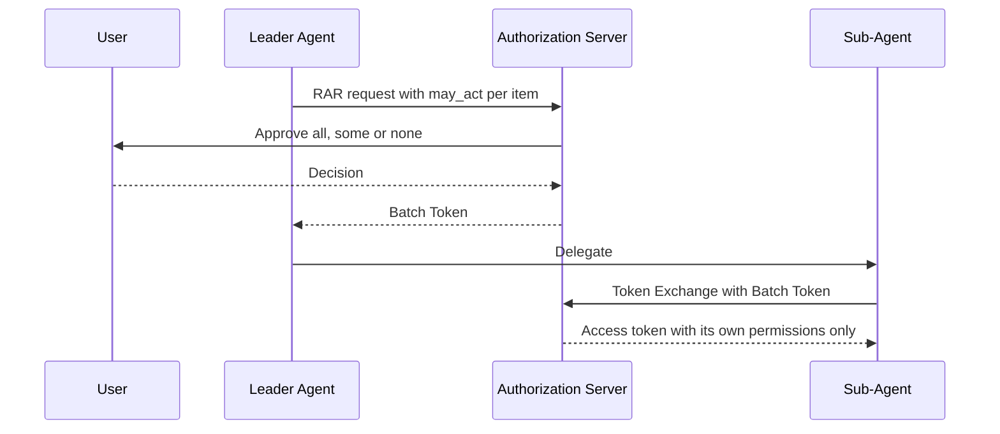

# OAuth WG Daily Report - 2026-11-16

- generated_at_utc: `2026-11-16T06:34:32+00:00`
- snapshot_date: `2026-11-16`

<!-- insights:start -->
## Briefing

> A quiet run: the only item is a wording PR on the deferred token response draft that simplifies the definition of the deferral code. No protocol behaviour changed.

_Updated 2026-11-16T06:35:17+00:00. Machine-drafted from the sources linked below, which stay authoritative._

### In short, this PR rewrites the definition of the deferral code to focus on its purpose and lifecycle

`pull-request` · `editorial` · first seen 2026-11-16 · [oauth-wg/oauth-deferred-token-response#82: Simplify definition of deferral code parameter](https://github.com/oauth-wg/oauth-deferred-token-response/pull/82)

The PR reworks the Section 2 definition of the deferral code. The author found the existing text confusing: it never says the code is used to obtain a token, yet it includes a fragment about the revocation endpoint. The PR simplifies the definition around its intended purpose and lifecycle. The source gives only the PR description, not the diff, so the exact new wording is unknown. It appears to be an editorial change.

### A hackathon team shows a batch authorization demo that uses RAR and token exchange, with may_act per authorization item to split permissions between sub-agents

`mail` · `new-proposal` · first seen 2026-11-15 · [IETF 127 Hackathon: Batch Authorization Delegation Demo](https://mailarchive.ietf.org/arch/msg/oauth/awq69VLm0U5Cb0ohVKXLg5LLLDY/)

The authors announce an individual draft (draft-ni-oauth-batch-authorization-delegation) and a working demo from the IETF 127 Hackathon. A leader agent requests permissions for several sub-agents in one batch, and the user approves them together, selects some, or rejects all. The draft combines OAuth RAR and Token Exchange and adds a may_act field to each authorization_details item to name the sub-agent allowed to use it. Each sub-agent then exchanges the batch token for its own access token containing only its assigned permissions. The demo has a personal assistant coordinating calendar and email agents. The authors ask for review and contributions.

**Use cases**

- An orchestrator agent that needs calendar and email permissions can ask for both in one consent prompt instead of one prompt per agent.
- A deployer who wants each sub-agent token limited to its own permissions can use the per-item may_act binding.

**Related in other tracks**

- `ietf-wimse` / `draft-asor-wimse-agent-delegation-chain`: Also addresses delegation to AI agent chains, though the message does not reference it.

### Weekly GitHub digest: a rule conflict reported in the identity assertion grant, CIMD discussion, and two open PRs

`mail` · `discussion` · first seen 2026-11-15 · [Weekly github digest (OAuth Activity Summary)](https://mailarchive.ietf.org/arch/msg/oauth/1__U02DObNtvWmF2Is4p9-j5qH8/)

For oauth-identity-assertion-authz-grant, issue #161 was opened saying that the §4.3.3 processing rule (SAML Audience matches the client_id) conflicts with the Audience to Client ID mapping required in §4.5. Issue #121 (optional client metadata digest so the IdP can vouch for the client's CIMD) got one comment from mcguinness and was closed. For client-id-metadata-document, #112 (security considerations for fetching client metadata) and #78 (whether the AS may provide iss when fetching the client_id) drew 7 comments in total, both tagged ietf-127. In oauth-sd-jwt-vc a PR was submitted and #457 (clarify that the types of an SD-JWT VC are those asserted in vct and aka_vcts) got a comment. In oauth-v2-1, PR #273 (restrict access token values to the token68 syntax) received 2 comments. The digest contains only titles and counts, so the outcomes are not visible.

**Use cases**

- An implementer of the identity assertion authorization grant who maps SAML Audience values to client IDs should watch #161 before fixing the processing rules.
- A client-ID-metadata-document implementer can follow #78 and #112 for the iss and fetch-security outcomes expected around IETF 127.

### A list member asks how a retained KYAPay token can be verified months later when the issuer key may no longer be published

`mail` · `discussion` · first seen 2026-11-15 · [KYAPay: verifying a retained token later](https://mailarchive.ietf.org/arch/msg/oauth/Rkn-L9TK6x2wtWhLhcA3H9CHr9Y/)

Francesco Marinoni Moretto notes that the KYAPay Using draft (Section 4.2) says recipients may retain a token for audit or dispute resolution and re-verify it later, and the token draft's editor's copy now allows retention. Section 6.4 already says exp is checked against the time the request was received. The gap is the verification key: Section 8.10 only asks issuers to keep superseded keys for the maximum token lifetime after rotation, which may not cover a chargeback months later. He proposes stating the receipt-time rule in the token draft's validation section, and having either recipients keep the key they used or issuers keep retired keys for a stated period. He also asks whether disputes are meant to rely on the issuer's own record through jti and verification_id. No answer is included.

**Use cases**

- A payment recipient handling a chargeback long after a token expired needs the original issuer key to re-verify it.
- An issuer planning key rotation needs to know how long retired keys must stay published.

### IANA's pre-meeting review asks the deferred-token-response authors to clarify two registry details

`mail` · `routine` · first seen 2026-11-14 · [Early review: draft-ietf-oauth-deferred-token-response-01 (IETF 127)](https://mailarchive.ietf.org/arch/msg/oauth/FmOt_z3_BXJBWtpSdLxxtPV6wMs/)

IANA sent its routine pre-IETF 127 review of draft-ietf-oauth-deferred-token-response-01. It asks the authors to say whether the new registry in Section 13.2 belongs in an existing registry group or a new one. It also asks for the full registry name, as it should appear on the IANA website, for Section 13.4. No protocol behaviour or wire format is discussed.

### Triage of the candidate queue

- **high** `draft-ietf-oauth-client-id-metadata-document`: Issues #78 and #112 drew 7 comments and are tagged ietf-127.
- **high** `draft-ietf-oauth-delegate-sd-jwt`: PR #15 restructures where security claims live in the KB-SD-JWT and defines their delegation semantics.
- **high** `draft-ietf-oauth-identity-assertion-authz-grant`: New issue #161 reports a conflict between the §4.3.3 and §4.5 rules, and #121 was closed this week.
- **high** `draft-ietf-oauth-sd-jwt-vc`: PR #457 changes how credential types are matched (vct and aka_vcts only, no extends matching), with ISO/IEC 18013-5 about to cite a dated draft.

<!-- insights:end -->

## Top Priorities

| Rank | Draft | Score | Updated | Key State | Repo |
|---|---|---:|---|---|---|
| 1 | `draft-ietf-oauth-sd-jwt-vc` | 108 | 2026-11-06T19:07:22Z | Active, Expert Reviews OK | `oauth-sd-jwt-vc` |
| 2 | `draft-ietf-oauth-status-list` | 90 | 2026-11-12T21:31:43Z | Active, RFC-Ed-Ack | `draft-ietf-oauth-status-list` |
| 3 | `draft-ietf-oauth-identity-chaining` | 83 | 2026-11-12T02:07:35Z | Active, RFC-Ed-Ack | `oauth-identity-chaining` |
| 4 | `draft-ietf-oauth-rfc8725bis` | 73 | 2026-11-06T22:32:52Z | Active, No IANA Actions | `draft-ietf-oauth-rfc8725bis` |
| 5 | `draft-ietf-oauth-client-id-metadata-document` | 73 | 2026-11-02T22:02:56Z | Active, I-D Exists | `draft-ietf-oauth-client-id-metadata-document` |
| 6 | `draft-ietf-oauth-identity-assertion-authz-grant` | 73 | 2026-10-31T00:32:39Z | Active, I-D Exists | `oauth-identity-assertion-authz-grant` |
| 7 | `draft-ietf-oauth-v2-1` | 66 | 2026-10-31T04:16:32Z | Active, I-D Exists | `oauth-v2-1` |
| 8 | `draft-ietf-oauth-delegate-sd-jwt` | 66 | 2026-10-30T12:38:29Z | Active, I-D Exists | `oauth-delegate-sd-jwt` |
| 9 | `draft-ietf-oauth-transaction-tokens` | 62 | 2026-08-21T11:57:16Z | Active, I-D Exists | `oauth-transaction-tokens` |
| 10 | `draft-ietf-oauth-attestation-based-client-auth` | 58 | 2026-10-18T17:33:02Z | Active, I-D Exists | `draft-ietf-oauth-attestation-based-client-auth` |

## Active Drafts

| Draft | Rev | Updated | States |
|---|---:|---|---|
| `draft-ietf-oauth-status-list` | 21 | 2026-11-12T21:31:43Z | Active, RFC-Ed-Ack, Expert Reviews OK |
| `draft-ietf-oauth-identity-chaining` | 17 | 2026-11-12T02:07:35Z | Active, RFC-Ed-Ack, Expert Reviews OK |
| `draft-ietf-oauth-rfc8725bis` | 10 | 2026-11-06T22:32:52Z | Active, No IANA Actions, IANA OK - No Actions Needed |
| `draft-ietf-oauth-sd-jwt-vc` | 26 | 2026-11-06T19:07:22Z | Active, Expert Reviews OK, Version Changed - Review Needed |
| `draft-ietf-oauth-client-id-metadata-document` | 03 | 2026-11-02T22:02:56Z | Active, I-D Exists, WG Document |
| `draft-ietf-oauth-spiffe-client-auth` | 03 | 2026-11-02T17:35:55Z | Active, I-D Exists, WG Document |
| `draft-ietf-oauth-deferred-token-response` | 01 | 2026-10-31T16:12:16Z | Active, I-D Exists, WG Document |
| `draft-ietf-oauth-v2-1` | 17 | 2026-10-31T04:16:32Z | Active, I-D Exists, WG Document |
| `draft-ietf-oauth-identity-assertion-authz-grant` | 06 | 2026-10-31T00:32:39Z | Active, I-D Exists, WG Document |
| `draft-ietf-oauth-delegate-sd-jwt` | 00 | 2026-10-30T12:38:29Z | Active, I-D Exists, WG Document |
| `draft-ietf-oauth-attestation-based-client-auth` | 12 | 2026-10-18T17:33:02Z | Active, I-D Exists, WG Consensus: Waiting for Write-Up |
| `draft-ietf-oauth-first-party-apps` | 04 | 2026-08-26T14:40:16Z | Active, I-D Exists, WG Consensus: Waiting for Write-Up |
| `draft-ietf-oauth-rar-metadata-remediation` | 00 | 2026-08-23T20:29:29Z | Active, I-D Exists, WG Document |
| `draft-ietf-oauth-transaction-tokens` | 11 | 2026-08-21T11:57:16Z | Active, I-D Exists, WG Consensus: Waiting for Write-Up |
| `draft-ietf-oauth-refresh-token-expiration` | 03 | 2026-07-06T17:53:06Z | Active, I-D Exists, WG Document |

## Repo Watch

| Repo | Pushed | Open Issues |
|---|---|---:|
| `oauth-wg/oauth-deferred-token-response` | 2026-11-16T01:55:59Z | 25 |
| `oauth-wg/oauth-sd-jwt-vc` | 2026-11-15T00:34:25Z | 1 |
| `oauth-wg/oauth-delegate-sd-jwt` | 2026-11-15T00:27:00Z | 13 |
| `oauth-wg/oauth-v2-1` | 2026-11-15T00:13:50Z | 13 |
| `oauth-wg/draft-ietf-oauth-client-id-metadata-document` | 2026-11-12T00:00:50Z | 34 |
| `oauth-wg/oauth-transaction-tokens` | 2026-11-10T00:15:51Z | 3 |
| `oauth-wg/oauth-identity-assertion-authz-grant` | 2026-11-10T00:02:45Z | 33 |
| `oauth-wg/oauth-spiffe-client-authentication` | 2026-11-08T00:10:21Z | 7 |
| `oauth-wg/draft-ietf-oauth-attestation-based-client-auth` | 2026-10-13T06:13:11Z | 0 |
| `oauth-wg/oauth-selective-disclosure-jwt` | 2026-10-04T13:50:37Z | 0 |
| `oauth-wg/oauth-cross-device-security` | 2026-08-27T14:45:11Z | 0 |
| `oauth-wg/oauth-browser-based-apps` | 2026-08-27T14:43:00Z | 0 |

## Recent Pull Requests

- `oauth-wg/oauth-deferred-token-response#82` Simplify definition of deferral code parameter (2026-11-16T01:58:41Z)
- `oauth-wg/oauth-v2-1#283` move Dick and Torsten to the acknowledgements (2026-11-16T00:23:04Z)
- `oauth-wg/oauth-v2-1#282` Change refresh token risk assessment requirement to MUST (2026-11-14T19:20:40Z)
- `oauth-wg/oauth-v2-1#273` Restrict access token values to the token68 syntax (2026-11-14T19:17:08Z)
- `oauth-wg/oauth-delegate-sd-jwt#14` doc(examples)-Add worked dSD-JWT example with generator (2026-11-14T07:08:51Z)
- `oauth-wg/oauth-sd-jwt-vc#457` Clarify that the types of an SD-JWT VC are those asserted in vct and aka_vcts (2026-11-13T18:31:59Z)
- `oauth-wg/oauth-delegate-sd-jwt#15` Move security claims to base KB-SD-JWT payload and define claim semantics (2026-11-10T18:25:40Z)
- `oauth-wg/oauth-identity-assertion-authz-grant#158` Fix the client authentication target in the Token Exchange section (2026-11-09T20:09:45Z)
- `oauth-wg/oauth-transaction-tokens#374` Register the req_wl claim in the JWT Claims registry (2026-11-08T12:34:29Z)
- `oauth-wg/draft-ietf-oauth-client-id-metadata-document#130` require pre-fetching logo_uri, added security considerations (2026-11-08T11:39:21Z)

## Recent Issues

- `oauth-wg/oauth-deferred-token-response#81` Fix IANA-related issues (2026-11-16T01:42:45Z)
- `oauth-wg/oauth-identity-assertion-authz-grant#145` Access token lifetime relative to the ID-JAG (2026-11-15T21:52:32Z)
- `oauth-wg/oauth-identity-assertion-authz-grant#160` Sender-constrained ID-JAG should not replace required client authentication (2026-11-15T21:52:31Z)
- `oauth-wg/oauth-identity-assertion-authz-grant#142` Profile the `resource` parameter in the ID-JAG access token request (2026-11-15T17:50:59Z)
- `oauth-wg/oauth-identity-assertion-authz-grant#159` Sections 7.2 and 8 require jwt-bearer but omit jwt-dpop (2026-11-15T17:50:57Z)
- `oauth-wg/oauth-delegate-sd-jwt#8` Place requirements, or clarify that constraints can only narrow across the chain (2026-11-14T00:26:19Z)
- `oauth-wg/draft-ietf-oauth-client-id-metadata-document#112` Add Security Consideration section for Fetching Client Metadata (2026-11-10T17:18:02Z)
- `oauth-wg/draft-ietf-oauth-client-id-metadata-document#78` Can AS optionally provide `iss` when fetching client_id? (2026-11-10T01:56:52Z)
- `oauth-wg/oauth-identity-assertion-authz-grant#121` Carry an optional client metadata digest so the IdP can vouch for the client's CIMD (JIT provisioning at the RAS) (2026-11-09T21:36:43Z)
- `oauth-wg/draft-ietf-oauth-client-id-metadata-document#71` Define AS behavior when CIMD contains unsupported metadata values (2026-11-09T08:34:03Z)

## Organization Events

- `2026-11-16T01:58:41Z` PullRequestEvent `oauth-wg/oauth-deferred-token-response` opened
- `2026-11-16T01:42:46Z` IssuesEvent `oauth-wg/oauth-deferred-token-response` Fix IANA-related issues
- `2026-11-16T01:42:46Z` IssuesEvent `oauth-wg/oauth-deferred-token-response` Fix IANA-related issues
- `2026-11-16T01:13:45Z` WatchEvent `oauth-wg/draft-ietf-oauth-client-id-metadata-document` started
- `2026-11-16T00:23:04Z` IssueCommentEvent `oauth-wg/oauth-v2-1` move Dick and Torsten to the acknowledgements
- `2026-11-15T21:52:32Z` IssueCommentEvent `oauth-wg/oauth-identity-assertion-authz-grant` Access token lifetime relative to the ID-JAG
- `2026-11-15T21:52:31Z` IssueCommentEvent `oauth-wg/oauth-identity-assertion-authz-grant` Sender-constrained ID-JAG should not replace required client authentication
- `2026-11-15T17:50:58Z` IssueCommentEvent `oauth-wg/oauth-identity-assertion-authz-grant` Profile the `resource` parameter in the ID-JAG access token request
- `2026-11-15T17:50:57Z` IssueCommentEvent `oauth-wg/oauth-identity-assertion-authz-grant` Sections 7.2 and 8 require jwt-bearer but omit jwt-dpop
- `2026-11-15T02:19:51Z` WatchEvent `oauth-wg/oauth-transaction-tokens` started
- `2026-11-14T23:41:16Z` PushEvent `oauth-wg/oauth-deferred-token-response` 
- `2026-11-14T23:40:53Z` PushEvent `oauth-wg/oauth-deferred-token-response` 
- `2026-11-14T19:20:42Z` PullRequestReviewEvent `oauth-wg/oauth-v2-1` created
- `2026-11-14T19:20:40Z` PullRequestReviewCommentEvent `oauth-wg/oauth-v2-1` created
- `2026-11-14T19:17:10Z` PullRequestReviewEvent `oauth-wg/oauth-v2-1` created
- `2026-11-14T19:16:59Z` IssueCommentEvent `oauth-wg/oauth-v2-1` Restrict access token values to the token68 syntax
- `2026-11-14T07:04:24Z` IssueCommentEvent `oauth-wg/oauth-delegate-sd-jwt` doc(examples)-Add worked dSD-JWT example with generator
- `2026-11-14T00:26:19Z` IssueCommentEvent `oauth-wg/oauth-delegate-sd-jwt` Place requirements, or clarify that constraints can only narrow across the chain
- `2026-11-12T00:25:04Z` PushEvent `oauth-wg/oauth-delegate-sd-jwt` 
- `2026-11-13T17:43:53Z` PullRequestReviewEvent `oauth-wg/oauth-sd-jwt-vc` created

## Mailarchive Signals

- weekly_digest_count: `2`
- [OAUTH-WG] Weekly github digest (OAuth Activity Summary) - https://mailarchive.ietf.org/arch/msg/oauth/1__U02DObNtvWmF2Is4p9-j5qH8/
- [OAUTH-WG] IETF 127 Hackathon: Batch Authorization Delegation Demo - https://mailarchive.ietf.org/arch/msg/oauth/awq69VLm0U5Cb0ohVKXLg5LLLDY/
- [OAUTH-WG] KYAPay: verifying a retained token later - https://mailarchive.ietf.org/arch/msg/oauth/Rkn-L9TK6x2wtWhLhcA3H9CHr9Y/
- [OAUTH-WG] [IANA #1497049] Early review: draft-ietf-oauth-deferred-token-response-01 (IETF 127) - https://mailarchive.ietf.org/arch/msg/oauth/FmOt_z3_BXJBWtpSdLxxtPV6wMs/
- [OAUTH-WG] Re: New draft: Agent Passports and Delegation Receipts (draft-le-agent-passport-00) - https://mailarchive.ietf.org/arch/msg/oauth/J309gZABiOnSsvebrwYUWTi1Aow/
- [OAUTH-WG] Re: New draft: Agent Passports and Delegation Receipts (draft-le-agent-passport-00) - https://mailarchive.ietf.org/arch/msg/oauth/mdtFuxpJJbwf9uxsRgXqg-YB7TA/
- [OAUTH-WG] OAuth Sessions Slides - https://mailarchive.ietf.org/arch/msg/oauth/QBkjvseqmO0KYRwP5ArCI19GlDM/
- [OAUTH-WG] Re: AAT -02 announcement - https://mailarchive.ietf.org/arch/msg/oauth/WixDZ1_uCFhHcyVW7y0ao-hXWpQ/

## Next Actions

1. Evaluate the top 3 items in `Top Priorities` as weekly deep-dive candidates.
2. Separately track comment deadlines for `In Last Call` / `In WG Last Call` drafts.
3. For repos with a sudden spike in activity, create a scaffold in `deep-dives/` to capture key discussion points.
