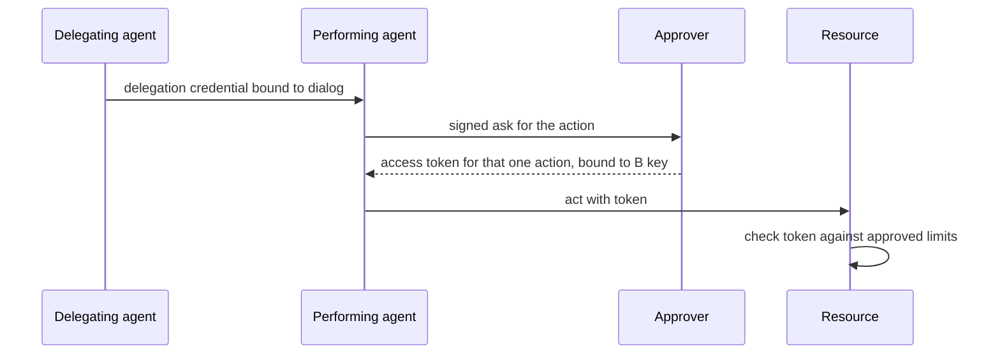
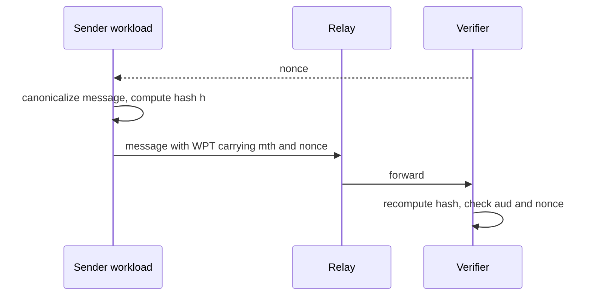
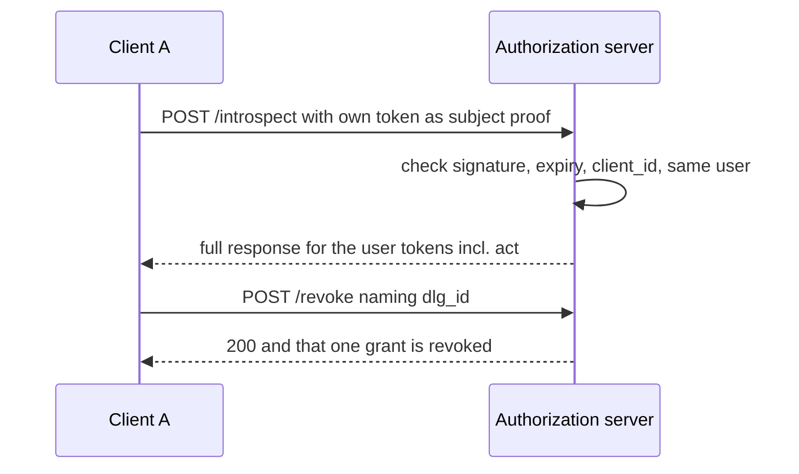
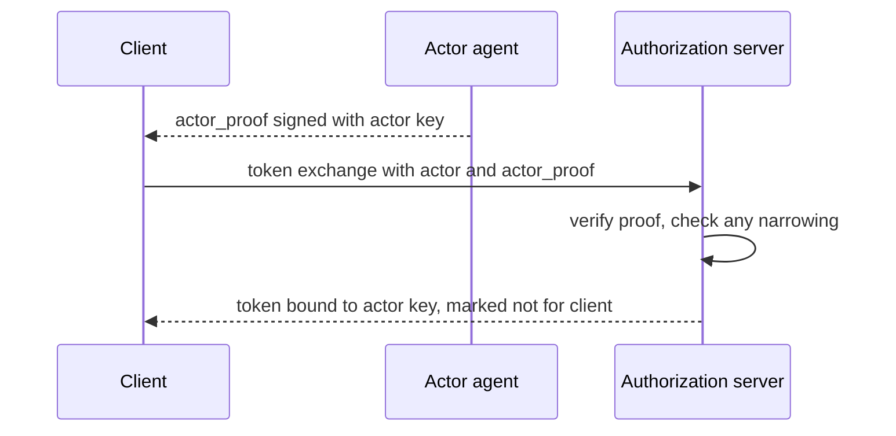
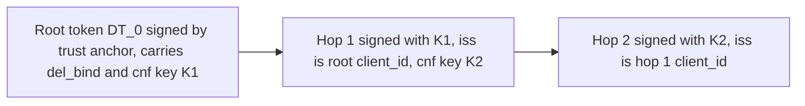
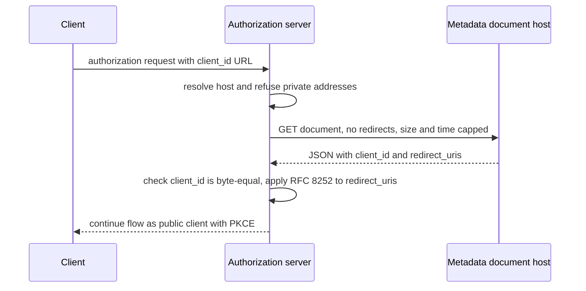
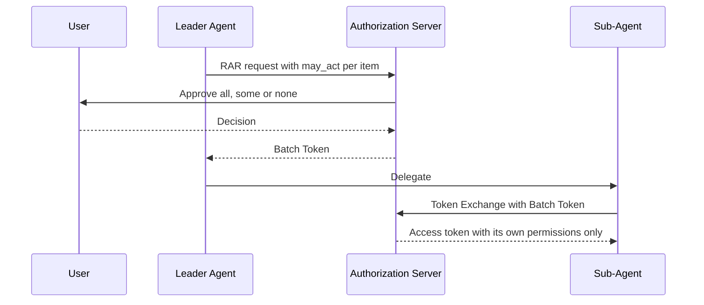

# OAuth WG Daily Report - 2026-11-16

- generated_at_utc: `2026-11-16T22:07:44+00:00`
- snapshot_date: `2026-11-16`

<!-- insights:start -->
## Briefing

> The only text change to an adopted draft is draft-ietf-oauth-sd-jwt-vc-27, which now says an SD-JWT VC's types come only from the issuer's vct and aka_vcts claims, not from Type Metadata extends. The rest of the run is mostly new individual drafts on agent delegation and a field report on client-id-metadata-document.

_Updated 2026-11-16T22:09:25+00:00. Machine-drafted from the sources linked below, which stay authoritative._

### SD-JWT VC -27 says a credential's types come only from vct and aka_vcts, never from Type Metadata extends

`draft-revision` · `substantive` · first seen 2026-11-16 · [draft-ietf-oauth-sd-jwt-vc-27: SD-JWT-based Verifiable Digital Credentials (SD-JWT VC)](https://author-tools.ietf.org/iddiff?url1=draft-ietf-oauth-sd-jwt-vc-26&url2=draft-ietf-oauth-sd-jwt-vc-27)

The draft removes the earlier idea that a consumer MAY use types reached through extends when matching types, and removes the SHOULD that the vct type extend types listed in aka_vcts. It now states that the types of an SD-JWT VC are those the Issuer asserts in vct and aka_vcts, while extends only determines which Type Metadata is inherited. Type Metadata is optional, so type matching in issuance and presentation protocols relies on vct and aka_vcts. The security text for aka_vcts is reworded to say these types are asserted like the vct type, and the MUST NOT treat them as proof of issuer authorization stays. Example signatures and iat values were regenerated, and the expiry date moved.

**Use cases**

- A verifier that matches requested credential types must stop expanding the received vct through Type Metadata extends and check only vct and aka_vcts.
- An issuer whose vct type extends other types should list those types in aka_vcts if it wants them to match, since extends no longer adds them.

### A new draft, PACE Authorization, covers delegation, asking and approval for one action between agents using existing OAuth and WIMSE credentials

`mail` · `new-proposal` · first seen 2026-11-16 · [New draft: PACE Authorization: delegation and action approval for agent dialogs:](https://mailarchive.ietf.org/arch/msg/oauth/ALY4dNyHGE97WD8kZ0bKPYxwtOk/)

The authors split the authority part out of the core PACE draft as draft-nandakumar-agentproto-pace-authz. It describes four steps: a delegation credential bound to the dialog it opens (possibly Actor Profile tokens, Transaction Tokens or delegator-bound chains), a signed request when an agent hits an action needing approval, an approver issuing an access token for that one action bound to the performing agent's key, and the resource checking the token against the approved limits, such as a payment amount. Revoking a delegation ends dependent dialogs. The mail text is partly truncated, so details of the exchange and CIBA steps are unclear. They ask for feedback on whether the security properties cover agent flows.

**Use cases**

- An agent that must get a human or approver sign-off before making a payment and then perform only that payment.
- A deployer choosing between Actor Profile tokens, Transaction Tokens and delegation chains for agent-to-agent delegation.

**Related in other tracks**

- `ietf-wimse` / `draft-reddy-wimse-oauth-dialog-binding`: Also binds agent dialogs to credentials, but the mail does not reference it, so the link is topical only.

### A new draft adds an mth claim that ties a WIMSE Workload Proof Token to the content of the message it accompanies, on HTTP or other transports

`mail` · `new-proposal` · first seen 2026-11-16 · [New draft: Message Binding for Workload Proof Tokens](https://mailarchive.ietf.org/arch/msg/oauth/He6VhuaZ4OQbuanyfzxMKjkaBOA/)

draft-nandakumar-wimse-wpt-message-binding addresses that a WPT covers who is calling and where but not the request content, and relies on jti and short lifetime against replay. It defines an mth claim of the form {"p": profile, "h": hash} computed under a named canonicalization profile, so a WPT cannot be moved to another message undetected. It describes carrying a WPT outside HTTP, with aud naming the receiver, and a nonce echoing a verifier-supplied value for freshness. A registry of canonicalization profiles starts with JSON messages without the credential member. It targets Media over QUIC, WebSocket and JSON-RPC protocols such as A2A and MCP, and notes mth can also be used in an SD-JWT Key Binding JWT. HTTP Message Signatures remain the choice for protecting header fields.

**Use cases**

- Agent traffic over WebSocket or Media over QUIC through relays that terminate TLS, where a proof could otherwise be replayed on another message.
- MCP or A2A JSON-RPC calls where the proof should cover the body and survive JSON re-serialization.

**Related in other tracks**

- `ietf-wimse` / `draft-ietf-wimse-wpt`: The draft extends the WIMSE Workload Proof Token with message binding.

### A new individual draft lets a client that holds a token for a user introspect and revoke that user's other grants, such as connected AI agents

`mail` · `new-proposal` · first seen 2026-11-16 · [New Internet-Draft: OAuth 2.0 Subject-Proof Callers for Token Introspection and Revocation](https://mailarchive.ietf.org/arch/msg/oauth/YAF9uJPEYv_O3UnckcVcEJ0zLDA/)

draft-radusch-oauth-subject-proof defines a third kind of caller for RFC 7662 and RFC 7009: a client presenting a token the AS issued to that same client for the same end user. The AS verifies the proof's signature, expiry, revocation state, client_id match with the authenticated caller, and same-user match. At /introspect the caller gets the full response for that user's tokens including act; at /revoke it names one grant by dlg_id (or act.sub as fallback) and the AS revokes exactly that grant. Public clients get nothing by default. The author reports a deployed implementation behind flags, and asks whether to reuse the RFC 8693 subject_token parameters, whether to rely on dlg_id from draft-mcguinness-oauth-actor-profile, and whether the WG has interest.

**Use cases**

- A web app that shows a user their connected AI agents and offers a per-agent disconnect button.
- An AS operator who wants client-initiated revocation of one delegated grant without an admin-wide global revocation.

### A new draft extends Token Exchange so a client can get a token bound to another agent's key, with that agent's signed consent

`mail` · `new-proposal` · first seen 2026-11-16 · [New draft: OAuth 2.0 Token Exchange with Actor-Bound Tokens:](https://mailarchive.ietf.org/arch/msg/oauth/r4KE4aYluE03Z7oQel0WMVgisgY/)

draft-nandakumar-oauth-actor-bound-token-exchange adds an actor and an actor_proof to the RFC 8693 request. The named actor signs a short proof, optionally listing what it agreed to, and never contacts the AS. The AS binds the issued token to the actor's key and tells the client the token is not for it. If an approver narrows the request, such as a lower amount, the AS checks it only narrows what the actor agreed to. Resource servers are unchanged, and without actor_proof the request is plain RFC 8693. The author says the same binding works for assertions such as an ID-JAG and for tokens issued after CIBA approval.

**Use cases**

- An approver agent that must obtain a token usable only by the agent that will perform the approved action.
- A flow where an approver lowers a payment amount and the AS must check it stays within what the performing agent agreed to.

### A new draft binds each hop of an agent delegation chain to the key of the previous hop, and a reviewer asks for audit rules on pseudonym resolution

`mail` · `new-proposal` · first seen 2026-11-16 · [New draft: Delegator-Bound Delegation Chains for AI Agents: (2 new messages)](https://mailarchive.ietf.org/arch/msg/oauth/y_IZYbPS71qPIJl8Jgxr2IyEfRE/)

The thread has two messages. The authors announce draft-nandakumar-wimse-delegator-bound-chains, which extends the Delegation Tokens of draft-asor-wimse-agent-delegation-chain: each token is signed with the key named in the previous token's cnf and its iss is the previous client_id, so only the root needs a trust anchor. A del_bind claim in the root enables this for the whole chain. It also adds a per-chain pseudonym for the person, cycle detection, audience attenuation and context binding. They ask whether binding belongs in the base draft, whether it fits the Actor Profile as a companion, and about using one key for both signing and proof of possession. A reviewer, Marc, supports a flag in the base draft and suggests stating when the DT_0 issuer resolves a pseudonym and to whom, with a log of resolutions, and that withdrawing a principal means revoking every DT_0 with the bound measured from the issuer's decision.

**Use cases**

- Agents in different organisations delegating directly to each other, with no AS to vouch for each hop.
- A verifier that must prove which delegator issued each hop of an agent chain offline.

**Related in other tracks**

- `ietf-wimse` / `draft-asor-wimse-agent-delegation-chain`: The new draft extends the Delegation Tokens defined here.

### An AS operator reports seven practical gaps after running Client ID Metadata Documents with native apps and MCP clients

`mail` · `discussion` · first seen 2026-11-16 · [Implementation report:draft-ietf-oauth-client-id-metadata-document at an AS serving native apps and MCP clients](https://mailarchive.ietf.org/arch/msg/oauth/OcZJg8cvTfnRnjcCDxnTlqgFbkA/)

The author runs an OAuth 2.1 authorization server that advertises client_id_metadata_document_supported and has completed the full flow with a native app and Claude Code. They suggest the draft say client_id must be byte-for-byte equal with no normalisation, and note that a native app needs one document per AS host. They list SSRF defences they found necessary: refuse private, loopback and link-local addresses after resolution, refuse redirects, cap body size (64 KiB) and time (5 s), and require HTTPS with a path. They also propose clamping cache lifetimes both ways, allowing an AS to restrict such clients to public clients with PKCE, applying RFC 8252 rules to the document's redirect_uris, and ignoring any scope member in the document. These are suggestions for the draft's text, not agreed changes.

**Use cases**

- An AS that accepts MCP clients with no prior registration needs the SSRF and cache limits listed here before fetching client_id URLs.
- A multi-region or multi-tenant AS serving one native app must plan a metadata document per issuer host.

### Hackathon participants report Tamarin models showing RFC 9207, RFC 8707 and DPoP are each needed for agent toolchains, and that TTL alone is not enough

`mail` · `discussion` · first seen 2026-11-16 · [Formal verification of OAuth 2.0 profiles in delegated agent toolchains (IETF 127 Hackathon)](https://mailarchive.ietf.org/arch/msg/oauth/eWA8NJCX_ywNbSGnN1qvHJ3UASw/)

The authors built 9 symbolic Tamarin Prover models (376 CI checks) of OAuth profiles for MCP-style agent toolchains and delegated payments. By their ablation results, dropping RFC 9207 lets an adversarial tool AS redirect authorization codes, and dropping RFC 8707 lets tokens for one resource server be replayed against others. Pure bearer tokens fail when tool output leaks authorization headers, whereas DPoP with RFC 9396 prevents replay without the key. In a UPI Circle-style delegation model, they conclude that TTL expiry is insufficient and synchronous revocation checks at the resource server are needed. Models and a paper are linked; these are the authors' own claims, not independently reviewed here.

**Use cases**

- A team building MCP agents that discover tools and authorization servers dynamically can use the models to see which mitigations they cannot skip.
- A payments deployer deciding whether short token lifetimes are enough or online revocation checks are required.

### In short, this PR rewrites the definition of the deferral code to focus on its purpose and lifecycle

`pull-request` · `editorial` · first seen 2026-11-16 · [oauth-wg/oauth-deferred-token-response#82: Simplify definition of deferral code parameter](https://github.com/oauth-wg/oauth-deferred-token-response/pull/82)

The PR reworks the Section 2 definition of the deferral code. The author found the existing text confusing: it never says the code is used to obtain a token, yet it includes a fragment about the revocation endpoint. The PR simplifies the definition around its intended purpose and lifecycle. The source gives only the PR description, not the diff, so the exact new wording is unknown. It appears to be an editorial change.

### A hackathon team shows a batch authorization demo that uses RAR and token exchange, with may_act per authorization item to split permissions between sub-agents

`mail` · `new-proposal` · first seen 2026-11-15 · [IETF 127 Hackathon: Batch Authorization Delegation Demo](https://mailarchive.ietf.org/arch/msg/oauth/awq69VLm0U5Cb0ohVKXLg5LLLDY/)

The authors announce an individual draft (draft-ni-oauth-batch-authorization-delegation) and a working demo from the IETF 127 Hackathon. A leader agent requests permissions for several sub-agents in one batch, and the user approves them together, selects some, or rejects all. The draft combines OAuth RAR and Token Exchange and adds a may_act field to each authorization_details item to name the sub-agent allowed to use it. Each sub-agent then exchanges the batch token for its own access token containing only its assigned permissions. The demo has a personal assistant coordinating calendar and email agents. The authors ask for review and contributions.

**Use cases**

- An orchestrator agent that needs calendar and email permissions can ask for both in one consent prompt instead of one prompt per agent.
- A deployer who wants each sub-agent token limited to its own permissions can use the per-item may_act binding.

**Related in other tracks**

- `ietf-wimse` / `draft-asor-wimse-agent-delegation-chain`: Also addresses delegation to AI agent chains, though the message does not reference it.

### Weekly GitHub digest: a rule conflict reported in the identity assertion grant, CIMD discussion, and two open PRs

`mail` · `discussion` · first seen 2026-11-15 · [Weekly github digest (OAuth Activity Summary)](https://mailarchive.ietf.org/arch/msg/oauth/1__U02DObNtvWmF2Is4p9-j5qH8/)

For oauth-identity-assertion-authz-grant, issue #161 was opened saying that the §4.3.3 processing rule (SAML Audience matches the client_id) conflicts with the Audience to Client ID mapping required in §4.5. Issue #121 (optional client metadata digest so the IdP can vouch for the client's CIMD) got one comment from mcguinness and was closed. For client-id-metadata-document, #112 (security considerations for fetching client metadata) and #78 (whether the AS may provide iss when fetching the client_id) drew 7 comments in total, both tagged ietf-127. In oauth-sd-jwt-vc a PR was submitted and #457 (clarify that the types of an SD-JWT VC are those asserted in vct and aka_vcts) got a comment. In oauth-v2-1, PR #273 (restrict access token values to the token68 syntax) received 2 comments. The digest contains only titles and counts, so the outcomes are not visible.

**Use cases**

- An implementer of the identity assertion authorization grant who maps SAML Audience values to client IDs should watch #161 before fixing the processing rules.
- A client-ID-metadata-document implementer can follow #78 and #112 for the iss and fetch-security outcomes expected around IETF 127.

### A list member asks how a retained KYAPay token can be verified months later when the issuer key may no longer be published

`mail` · `discussion` · first seen 2026-11-15 · [KYAPay: verifying a retained token later](https://mailarchive.ietf.org/arch/msg/oauth/Rkn-L9TK6x2wtWhLhcA3H9CHr9Y/)

Francesco Marinoni Moretto notes that the KYAPay Using draft (Section 4.2) says recipients may retain a token for audit or dispute resolution and re-verify it later, and the token draft's editor's copy now allows retention. Section 6.4 already says exp is checked against the time the request was received. The gap is the verification key: Section 8.10 only asks issuers to keep superseded keys for the maximum token lifetime after rotation, which may not cover a chargeback months later. He proposes stating the receipt-time rule in the token draft's validation section, and having either recipients keep the key they used or issuers keep retired keys for a stated period. He also asks whether disputes are meant to rely on the issuer's own record through jti and verification_id. No answer is included.

**Use cases**

- A payment recipient handling a chargeback long after a token expired needs the original issuer key to re-verify it.
- An issuer planning key rotation needs to know how long retired keys must stay published.

### Triage of the candidate queue

- **high** `draft-ietf-oauth-client-id-metadata-document`: A deployment report proposes seven text changes, including SSRF limits, cache clamping and public-client restriction.
- **high** `draft-ietf-oauth-delegate-sd-jwt`: PR #15 restructures where security claims live in the KB-SD-JWT and defines their delegation semantics.
- **high** `draft-ietf-oauth-identity-assertion-authz-grant`: New issue #161 reports a conflict between the §4.3.3 and §4.5 rules, and #121 was closed this week.
- **high** `draft-ietf-oauth-sd-jwt-vc`: -27 changes how type matching works: types come only from vct and aka_vcts, and extends no longer adds types.

<!-- insights:end -->

## Top Priorities

| Rank | Draft | Score | Updated | Key State | Repo |
|---|---|---:|---|---|---|
| 1 | `draft-ietf-oauth-sd-jwt-vc` | 125 | 2026-11-16T10:45:13Z | Active, Expert Reviews OK | `oauth-sd-jwt-vc` |
| 2 | `draft-ietf-oauth-status-list` | 83 | 2026-11-12T21:31:43Z | Active, RFC-Ed-Ack | `draft-ietf-oauth-status-list` |
| 3 | `draft-ietf-oauth-identity-chaining` | 83 | 2026-11-12T02:07:35Z | Active, RFC-Ed-Ack | `oauth-identity-chaining` |
| 4 | `draft-ietf-oauth-rfc8725bis` | 73 | 2026-11-06T22:32:52Z | Active, No IANA Actions | `draft-ietf-oauth-rfc8725bis` |
| 5 | `draft-ietf-oauth-client-id-metadata-document` | 73 | 2026-11-02T22:02:56Z | Active, I-D Exists | `draft-ietf-oauth-client-id-metadata-document` |
| 6 | `draft-ietf-oauth-identity-assertion-authz-grant` | 73 | 2026-10-31T00:32:39Z | Active, I-D Exists | `oauth-identity-assertion-authz-grant` |
| 7 | `draft-ietf-oauth-v2-1` | 66 | 2026-10-31T04:16:32Z | Active, I-D Exists | `oauth-v2-1` |
| 8 | `draft-ietf-oauth-delegate-sd-jwt` | 66 | 2026-10-30T12:38:29Z | Active, I-D Exists | `oauth-delegate-sd-jwt` |
| 9 | `draft-ietf-oauth-transaction-tokens` | 62 | 2026-08-21T11:57:16Z | Active, I-D Exists | `oauth-transaction-tokens` |
| 10 | `draft-ietf-oauth-attestation-based-client-auth` | 58 | 2026-10-18T17:33:02Z | Active, I-D Exists | `draft-ietf-oauth-attestation-based-client-auth` |

## Active Drafts

| Draft | Rev | Updated | States |
|---|---:|---|---|
| `draft-ietf-oauth-sd-jwt-vc` | 27 | 2026-11-16T10:45:13Z | Active, Expert Reviews OK, Version Changed - Review Needed |
| `draft-ietf-oauth-status-list` | 21 | 2026-11-12T21:31:43Z | Active, RFC-Ed-Ack, Expert Reviews OK |
| `draft-ietf-oauth-identity-chaining` | 17 | 2026-11-12T02:07:35Z | Active, RFC-Ed-Ack, Expert Reviews OK |
| `draft-ietf-oauth-rfc8725bis` | 10 | 2026-11-06T22:32:52Z | Active, No IANA Actions, IANA OK - No Actions Needed |
| `draft-ietf-oauth-client-id-metadata-document` | 03 | 2026-11-02T22:02:56Z | Active, I-D Exists, WG Document |
| `draft-ietf-oauth-spiffe-client-auth` | 03 | 2026-11-02T17:35:55Z | Active, I-D Exists, WG Document |
| `draft-ietf-oauth-deferred-token-response` | 01 | 2026-10-31T16:12:16Z | Active, I-D Exists, WG Document |
| `draft-ietf-oauth-v2-1` | 17 | 2026-10-31T04:16:32Z | Active, I-D Exists, WG Document |
| `draft-ietf-oauth-identity-assertion-authz-grant` | 06 | 2026-10-31T00:32:39Z | Active, I-D Exists, WG Document |
| `draft-ietf-oauth-delegate-sd-jwt` | 00 | 2026-10-30T12:38:29Z | Active, I-D Exists, WG Document |
| `draft-ietf-oauth-attestation-based-client-auth` | 12 | 2026-10-18T17:33:02Z | Active, I-D Exists, WG Consensus: Waiting for Write-Up |
| `draft-ietf-oauth-first-party-apps` | 04 | 2026-08-26T14:40:16Z | Active, I-D Exists, WG Consensus: Waiting for Write-Up |
| `draft-ietf-oauth-rar-metadata-remediation` | 00 | 2026-08-23T20:29:29Z | Active, I-D Exists, WG Document |
| `draft-ietf-oauth-transaction-tokens` | 11 | 2026-08-21T11:57:16Z | Active, I-D Exists, WG Consensus: Waiting for Write-Up |
| `draft-ietf-oauth-refresh-token-expiration` | 03 | 2026-07-06T17:53:06Z | Active, I-D Exists, WG Document |

## Repo Watch

| Repo | Pushed | Open Issues |
|---|---|---:|
| `oauth-wg/oauth-sd-jwt-vc` | 2026-11-16T10:44:18Z | 0 |
| `oauth-wg/oauth-deferred-token-response` | 2026-11-16T01:55:59Z | 25 |
| `oauth-wg/oauth-delegate-sd-jwt` | 2026-11-15T00:27:00Z | 13 |
| `oauth-wg/oauth-v2-1` | 2026-11-15T00:13:50Z | 13 |
| `oauth-wg/draft-ietf-oauth-client-id-metadata-document` | 2026-11-12T00:00:50Z | 34 |
| `oauth-wg/oauth-transaction-tokens` | 2026-11-10T00:15:51Z | 3 |
| `oauth-wg/oauth-identity-assertion-authz-grant` | 2026-11-10T00:02:45Z | 33 |
| `oauth-wg/oauth-spiffe-client-authentication` | 2026-11-08T00:10:21Z | 7 |
| `oauth-wg/draft-ietf-oauth-attestation-based-client-auth` | 2026-10-13T06:13:11Z | 0 |
| `oauth-wg/oauth-selective-disclosure-jwt` | 2026-10-04T13:50:37Z | 0 |
| `oauth-wg/oauth-cross-device-security` | 2026-08-27T14:45:11Z | 0 |
| `oauth-wg/oauth-browser-based-apps` | 2026-08-27T14:43:00Z | 0 |

## Recent Pull Requests

- `oauth-wg/oauth-sd-jwt-vc#457` Clarify that the types of an SD-JWT VC are those asserted in vct and aka_vcts (2026-11-16T10:37:06Z)
- `oauth-wg/oauth-deferred-token-response#82` Simplify definition of deferral code parameter (2026-11-16T01:58:41Z)
- `oauth-wg/oauth-v2-1#283` move Dick and Torsten to the acknowledgements (2026-11-16T00:23:04Z)
- `oauth-wg/oauth-v2-1#282` Change refresh token risk assessment requirement to MUST (2026-11-14T19:20:40Z)
- `oauth-wg/oauth-v2-1#273` Restrict access token values to the token68 syntax (2026-11-14T19:17:08Z)
- `oauth-wg/oauth-delegate-sd-jwt#14` doc(examples)-Add worked dSD-JWT example with generator (2026-11-14T07:08:51Z)
- `oauth-wg/oauth-delegate-sd-jwt#15` Move security claims to base KB-SD-JWT payload and define claim semantics (2026-11-10T18:25:40Z)
- `oauth-wg/oauth-identity-assertion-authz-grant#158` Fix the client authentication target in the Token Exchange section (2026-11-09T20:09:45Z)
- `oauth-wg/oauth-transaction-tokens#374` Register the req_wl claim in the JWT Claims registry (2026-11-08T12:34:29Z)
- `oauth-wg/draft-ietf-oauth-client-id-metadata-document#130` require pre-fetching logo_uri, added security considerations (2026-11-08T11:39:21Z)

## Recent Issues

- `oauth-wg/oauth-delegate-sd-jwt#8` Place requirements, or clarify that constraints can only narrow across the chain (2026-11-16T18:31:18Z)
- `oauth-wg/oauth-deferred-token-response#81` Fix IANA-related issues (2026-11-16T01:42:45Z)
- `oauth-wg/oauth-identity-assertion-authz-grant#145` Access token lifetime relative to the ID-JAG (2026-11-15T21:52:32Z)
- `oauth-wg/oauth-identity-assertion-authz-grant#160` Sender-constrained ID-JAG should not replace required client authentication (2026-11-15T21:52:31Z)
- `oauth-wg/oauth-identity-assertion-authz-grant#142` Profile the `resource` parameter in the ID-JAG access token request (2026-11-15T17:50:59Z)
- `oauth-wg/oauth-identity-assertion-authz-grant#159` Sections 7.2 and 8 require jwt-bearer but omit jwt-dpop (2026-11-15T17:50:57Z)
- `oauth-wg/draft-ietf-oauth-client-id-metadata-document#112` Add Security Consideration section for Fetching Client Metadata (2026-11-10T17:18:02Z)
- `oauth-wg/draft-ietf-oauth-client-id-metadata-document#78` Can AS optionally provide `iss` when fetching client_id? (2026-11-10T01:56:52Z)
- `oauth-wg/oauth-identity-assertion-authz-grant#121` Carry an optional client metadata digest so the IdP can vouch for the client's CIMD (JIT provisioning at the RAS) (2026-11-09T21:36:43Z)
- `oauth-wg/draft-ietf-oauth-client-id-metadata-document#71` Define AS behavior when CIMD contains unsupported metadata values (2026-11-09T08:34:03Z)

## Organization Events

- `2026-11-16T18:31:18Z` IssueCommentEvent `oauth-wg/oauth-delegate-sd-jwt` Place requirements, or clarify that constraints can only narrow across the chain
- `2026-11-16T10:43:48Z` ReleaseEvent `oauth-wg/oauth-sd-jwt-vc` published
- `2026-11-16T10:36:57Z` PullRequestEvent `oauth-wg/oauth-sd-jwt-vc` merged
- `2026-11-15T00:27:00Z` PushEvent `oauth-wg/oauth-delegate-sd-jwt` 
- `2026-11-16T01:58:41Z` PullRequestEvent `oauth-wg/oauth-deferred-token-response` opened
- `2026-11-16T01:42:46Z` IssuesEvent `oauth-wg/oauth-deferred-token-response` Fix IANA-related issues
- `2026-11-16T01:42:46Z` IssuesEvent `oauth-wg/oauth-deferred-token-response` Fix IANA-related issues
- `2026-11-16T01:13:45Z` WatchEvent `oauth-wg/draft-ietf-oauth-client-id-metadata-document` started
- `2026-11-16T00:23:04Z` IssueCommentEvent `oauth-wg/oauth-v2-1` move Dick and Torsten to the acknowledgements
- `2026-11-15T21:52:32Z` IssueCommentEvent `oauth-wg/oauth-identity-assertion-authz-grant` Access token lifetime relative to the ID-JAG
- `2026-11-15T21:52:31Z` IssueCommentEvent `oauth-wg/oauth-identity-assertion-authz-grant` Sender-constrained ID-JAG should not replace required client authentication
- `2026-11-15T17:50:58Z` IssueCommentEvent `oauth-wg/oauth-identity-assertion-authz-grant` Profile the `resource` parameter in the ID-JAG access token request
- `2026-11-15T17:50:57Z` IssueCommentEvent `oauth-wg/oauth-identity-assertion-authz-grant` Sections 7.2 and 8 require jwt-bearer but omit jwt-dpop
- `2026-11-15T02:19:51Z` WatchEvent `oauth-wg/oauth-transaction-tokens` started
- `2026-11-14T23:41:16Z` PushEvent `oauth-wg/oauth-deferred-token-response` 
- `2026-11-14T23:40:53Z` PushEvent `oauth-wg/oauth-deferred-token-response` 
- `2026-11-14T19:20:42Z` PullRequestReviewEvent `oauth-wg/oauth-v2-1` created
- `2026-11-14T19:20:40Z` PullRequestReviewCommentEvent `oauth-wg/oauth-v2-1` created
- `2026-11-14T19:17:10Z` PullRequestReviewEvent `oauth-wg/oauth-v2-1` created
- `2026-11-14T19:16:59Z` IssueCommentEvent `oauth-wg/oauth-v2-1` Restrict access token values to the token68 syntax

## Mailarchive Signals

- weekly_digest_count: `2`
- [OAUTH-WG] Implementation report:draft-ietf-oauth-client-id-metadata-document at an AS serving native apps and MCP clients - https://mailarchive.ietf.org/arch/msg/oauth/OcZJg8cvTfnRnjcCDxnTlqgFbkA/
- [OAUTH-WG] Re: [WIMSE] New draft: Delegator-Bound Delegation Chains for AI Agents: - https://mailarchive.ietf.org/arch/msg/oauth/y_IZYbPS71qPIJl8Jgxr2IyEfRE/
- [OAUTH-WG] New draft: PACE Authorization: delegation and action approval for agent dialogs: - https://mailarchive.ietf.org/arch/msg/oauth/ALY4dNyHGE97WD8kZ0bKPYxwtOk/
- [OAUTH-WG] New Internet-Draft: OAuth 2.0 Subject-Proof Callers for Token Introspection and Revocation - https://mailarchive.ietf.org/arch/msg/oauth/YAF9uJPEYv_O3UnckcVcEJ0zLDA/
- [OAUTH-WG] New draft: OAuth 2.0 Token Exchange with Actor-Bound Tokens: - https://mailarchive.ietf.org/arch/msg/oauth/r4KE4aYluE03Z7oQel0WMVgisgY/
- [OAUTH-WG] New draft: Delegator-Bound Delegation Chains for AI Agents: - https://mailarchive.ietf.org/arch/msg/oauth/gJbHrAzvlr8XxL_7Ea3gBZjimkA/
- [OAUTH-WG] New draft: Message Binding for Workload Proof Tokens - https://mailarchive.ietf.org/arch/msg/oauth/He6VhuaZ4OQbuanyfzxMKjkaBOA/
- [OAUTH-WG] Formal verification of OAuth 2.0 profiles in delegated agent toolchains (IETF 127 Hackathon) - https://mailarchive.ietf.org/arch/msg/oauth/eWA8NJCX_ywNbSGnN1qvHJ3UASw/

## Next Actions

1. Evaluate the top 3 items in `Top Priorities` as weekly deep-dive candidates.
2. Separately track comment deadlines for `In Last Call` / `In WG Last Call` drafts.
3. For repos with a sudden spike in activity, create a scaffold in `deep-dives/` to capture key discussion points.
