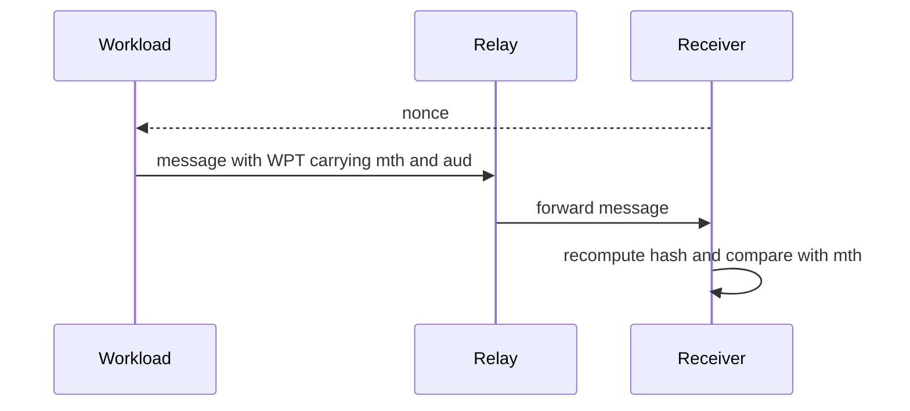
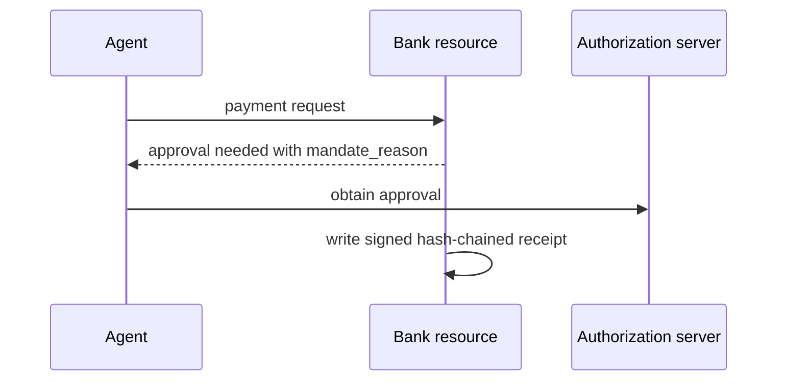
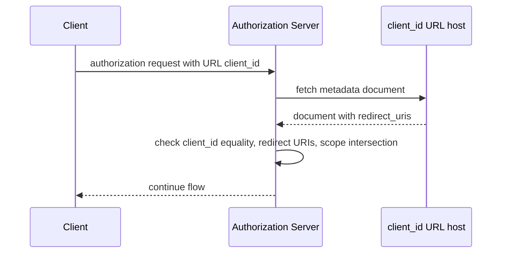
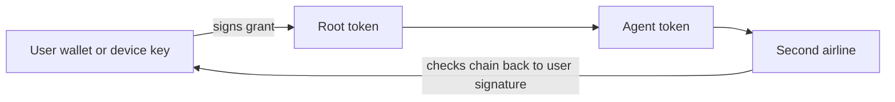
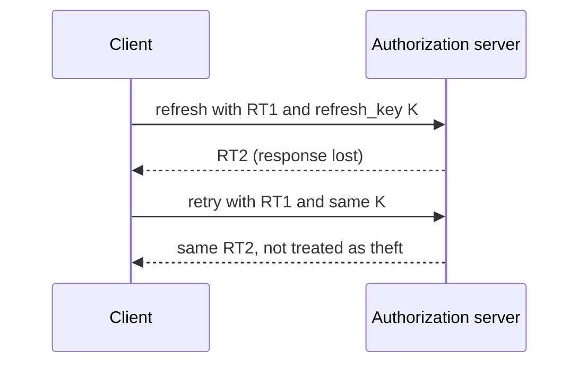
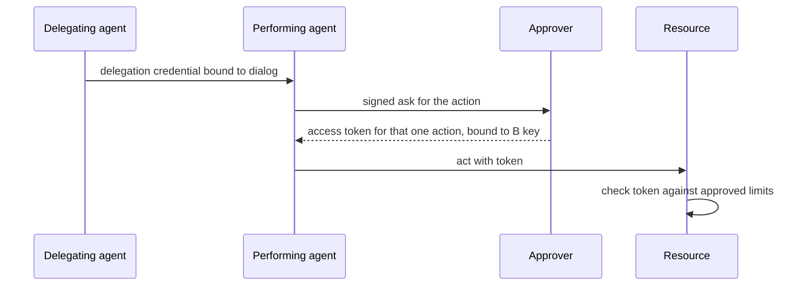
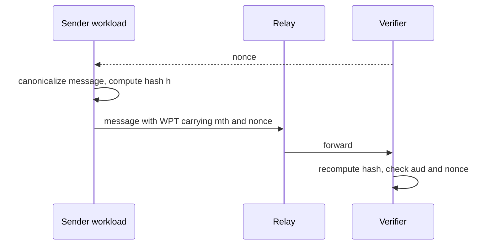
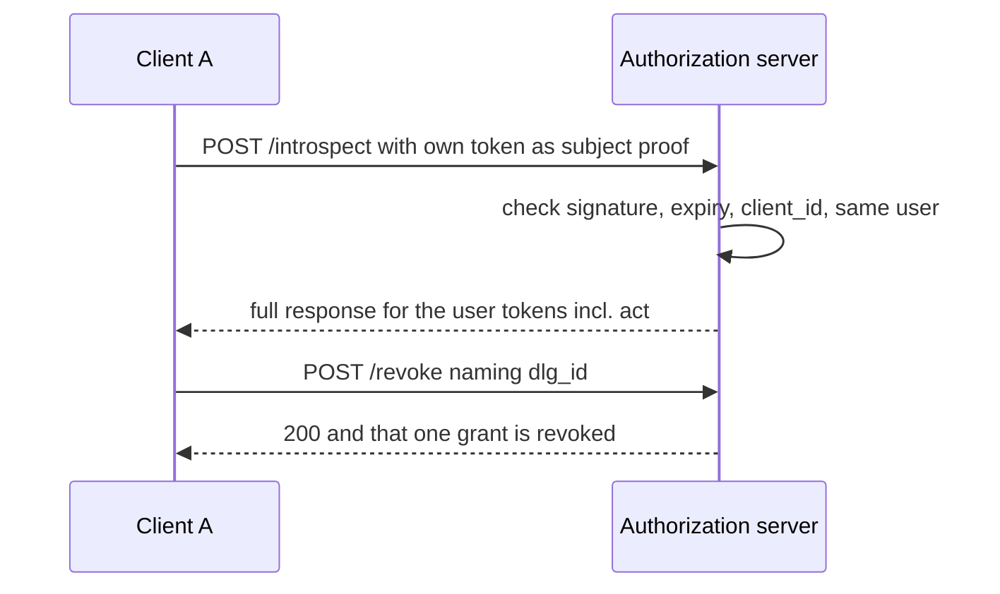

# OAuth WG Daily Report - 2026-11-17

- generated_at_utc: `2026-11-17T20:58:16+00:00`
- snapshot_date: `2026-11-17`

<!-- insights:start -->
## Briefing

> Agent-authorization drafts dominate the list: the PACE thread debates having the user sign the delegated grant itself, and a new RAR payment-mandate draft was posted. A mailmaint profile's refresh_key proposal also drew pushback. Nothing in the core specs changed beyond a citation fix in OAuth 2.1.

_Updated 2026-11-17T20:59:40+00:00. Machine-drafted from the sources linked below, which stay authoritative._

### A new WIMSE draft adds an mth claim so a Workload Proof Token commits to the message content, and a reviewer asks about gateways rewriting Host

`mail` · `new-proposal` · first seen 2026-11-17 · [New draft: Message Binding for Workload Proof Tokens](https://mailarchive.ietf.org/arch/msg/oauth/5ZaI7imNuZdOVt1g7cASCJWx_Lc/)

Suhas Nandakumar and Cullen posted draft-nandakumar-wimse-wpt-message-binding, which adds an mth claim ({"p": profile, "h": hash}) so a WPT is bound to message content under a named canonicalization profile, with a registry of profiles. It also defines carrying a WPT inside messages on non-HTTP transports such as Media over QUIC and WebSocket, with aud naming the receiver, a verifier-supplied nonce for freshness, use on HTTP requests for JSON-RPC protocols such as A2A and MCP, and use in an SD-JWT Key Binding JWT. In the reply shown, Shameer Thaha describes a similar request-digest approach in their drafts, which hashes method, path and query, and body digest but omits scheme and authority because gateways rewrite them. They ask whether mth on HTTP covers the authority and whether their HTTP form could be a registry profile.

**Use cases**

- Agents exchanging JSON-RPC (A2A, MCP) through gateways that terminate TLS and may rewrite Host.
- Workloads using WebSocket or Media over QUIC where no HTTP request exists to bind a proof to.
- Systems that need the caller's and receiver's records of a request to commit to the same value.

**Related in other tracks**

- `ietf-wimse` / `draft-nandakumar-wimse-wpt-message-binding`: The draft under discussion.
- `ietf-wimse` / `draft-ietf-wimse-wpt`: The WPT that mth extends.
- `ietf-wimse` / `draft-thaha-wimse-agent-evidence-binding`: Reviewer's draft with a comparable request-digest binding.

### A new individual draft proposes that OIDC metadata publish supported JWT signing algorithms and let clients request one, to ease PQC adoption

`mail` · `new-proposal` · first seen 2026-11-17 · [Submitted new I-D proposal regarding OIDC crypto agility improvement](https://mailarchive.ietf.org/arch/msg/oauth/Y6RNjJVYx4DVyPbMWZX6EmA-424/)

Breno announced draft-demedeiros-oidc-crypto-agility. It would let OIDC authorization metadata publish the supported JWT signing algorithms and let the client request one of them in the authorization request. It also adds a parameter to filter algorithms out of the published key sets at the jwks URI. The stated motivation is to reduce friction for adopting new algorithms, particularly post-quantum cryptography in open federation contexts. The message is only an announcement, and no detailed mechanism is in the material.

**Use cases**

- An OpenID Provider in open federation that needs to add post-quantum signature algorithms without breaking existing relying parties.
- A relying party that wants to choose which signing algorithm it receives.

### A new individual draft defines RAR types for agent payment mandates, machine-readable approval reasons and hash-chained receipts

`mail` · `new-proposal` · first seen 2026-11-17 · [New draft: RAR profile for agent payment mandates, approval reasons and receipts (draft-craig-oauth-rar-payment-mandates-00)](https://mailarchive.ietf.org/arch/msg/oauth/kAGQP9CSb_3d3Cg7eWq2GYBkrvU/)

Richard Craig posted draft-craig-oauth-rar-payment-mandates-00. It defines two RFC 9396 authorization details types, payment_mandate (payees, per-payment and per-period limits, approval mode) and single_payment, plus an ordered set of reasons a payment falls outside a mandate (such as new_recipient or over_period_limit). A resource conveys the reason through a mandate_reason claim in draft-rosomakho-oauth-txn-challenge or an approval_required error. Each decision gets a signed, hash-chained receipt, with personal data kept as salted commitments outside the chain so it can be erased. The author asks for review of the reason set and whether it belongs in an IANA registry, composition with the transaction challenge, and the receipt format. A proof of concept is referenced.

**Use cases**

- A bank letting an AI agent pay named payees within per-payment and per-period limits.
- A resource server that must tell a client why a payment needs human approval.
- A deployer who needs an auditable decision record that can still honour data-erasure requests.

### An AS operator's implementation report on Client ID Metadata Documents gets editor replies. Most points are withdrawn, and a few possible additions remain

`mail` · `discussion` · first seen 2026-11-17 · [Implementation report:draft-ietf-oauth-client-id-metadata-document at an AS serving native apps and MCP clients (3 new messages)](https://mailarchive.ietf.org/arch/msg/oauth/Gg-XRhIkKakzC1ay6QhKkRimrw8/)

Sean MacGuire runs an OAuth 2.1 AS used by MCP clients and a native app. They listed seven observations, and Emelia (an author or editor) answered each. Sean withdrew point 1 (client_id comparison is already simple string comparison per RFC 3986 section 6.2.1) and point 2 (one document per AS host was their own choice). Point 5 (restricting client authentication methods) is covered by the new Client Authentication section. Sean will file an issue on cache bounds (point 4). On SSRF (point 3), they suggest adding DNS rebinding and a fetch timeout. Emelia says rebinding is covered by the referenced OWASP cheat sheet, so restating it is open. On point 6, the draft does not reference RFC 8252, and a pointer for native clients may help. On point 7, Emelia says the AS should read the document's scope and intersect it with what it is willing to grant. Sean's AS ignores that member and says that if this is the intent, nothing needs adding. No draft text changed. The source was truncated.

**Use cases**

- An AS that accepts MCP clients and native apps by URL-based client IDs and must harden its metadata fetcher against SSRF and DNS rebinding.
- A deployer deciding whether to bound the AS-side cache of client metadata documents, or to limit metadata-document clients to public clients.
- A native app that publishes redirect URIs in its document and the AS that must apply RFC 8252 rules to that list.

### In the PACE thread, the author proposes letting the user confirm a delegation grant itself, and others raise device-key signing and cross-booking limits

`mail` · `discussion` · first seen 2026-11-17 · [New draft: PACE Authorization: delegation and action approval for agent dialogs: (3 new messages)](https://mailarchive.ietf.org/arch/msg/oauth/cMK4l6ZzO4AG6ugan-I-Rs3QDvA/)

Suhas (the PACE author) answers Blake's point that nothing in a delegation chain is signed by the principal. For the next revision they propose that the principal confirms the grant once at setup (for example up to $800, aisle seat, until 9am), with the confirmation carried in the root token down the chain. Three options are listed: a wallet-signed SD-JWT credential (strongest), the user's own identity provider, or today's behaviour where the agent platform's authorization server asserts it. Mohamad Yossif suggests a device-bound key enrolled earlier as another way to get the user's signature, verifiable offline. Niki Niyikiza notes that delegator-bound chains would let the wallet sign the root, and points out that the same grant used with a second airline could be spent twice because no one tracks the total, asking the draft to say who does. No draft text changed; this is feedback on a proposal.

**Use cases**

- An agent booking travel under a standing spending limit, where a second vendor must verify the user really approved the limit.
- A verifier deciding whether to accept a bank-issued wallet credential or an IdP assertion as proof of principal consent.
- An implementer of delegation chains deciding who enforces cumulative limits across several recipients.

**Related in other tracks**

- `ietf-wimse` / `draft-reddy-wimse-oauth-dialog-binding`: Binds agent dialogs to WIMSE and OAuth credentials, the same agent-dialog setting as PACE.
- `ietf-wimse` / `draft-nandakumar-wimse-delegator-bound-chains`: The thread says wallet-signed roots work with delegator-bound chains.

### A reviewer asks whether the first hop of a PACE delegation chain could be signed with the user's own key, so a later verifier can tell the user set the limit

`mail` · `discussion` · first seen 2026-11-17 · [New draft: PACE Authorization: delegation and action approval for agent dialogs:](https://mailarchive.ietf.org/arch/msg/oauth/mtGdBEyIMgDdrP7RnK89AVpcuRM/)

Blake replies to the authors of the PACE Authorization draft (addressed to Suhas and Cullen) with a scenario: a user tells an agent to book a flight with an aisle seat for at most $800, and the agent later rebooks with a second airline. Section 3.3 lets the second airline check that no hop raised the $800 limit. But section 6 says the agent's approval shows only that the agent agreed. Blake asks whether the first hop could be signed with the user's own key from section 6.3, so the second airline can tell the user set the limit. This is a question, with no answer or text change. The draft text itself is not in the material.

**Use cases**

- An agent re-delegating a user's constrained task, such as a booking with a price cap, to a second service that must tell who set the constraint.
- A verifier of a delegation chain that must tell user-originated limits from limits the agent set.

### Review of the mailmaint native-client OAuth profile questions its new username response parameter and refresh_key mechanism

`mail` · `discussion` · first seen 2026-11-17 · [mailmaint's OAuth Profile for Native Clients of Open Protocols (2 new messages)](https://mailarchive.ietf.org/arch/msg/oauth/rRj4i-InS933_FYxNW0hySitSyY/)

Neil Jenkins asked for OAuth WG review of draft-ietf-mailmaint-oauth-public-07, a profile for email and calendar clients to authenticate to arbitrary servers without preregistration. It adds three elements: a username token-response property, a refresh_key token-request parameter that lets a client retry a lost refresh without being treated as token theft (changing RFC 9700 section 4.14.2), and an Interoperable OAuth Scopes Registry. A reviewer asks why not use the OIDC email scope or an ID token, and what happens if the username changes. They also call refresh_key complicated and a security regression, since the AS must store literal refresh tokens for an unbounded time, and suggest requiring or recommending DPoP instead of rotation. Feedback is directed to the mailmaint list.

**Use cases**

- A mail or calendar client that must work with servers it has never been registered with.
- An authorization server operator weighing refresh token reuse detection against recovery from lost responses.
- A server vendor who would register scopes in a shared interoperable scopes registry.

**Related in other tracks**

- `openid` / `openid/native-sso`: Both concern native client OAuth behaviour, though the material does not link them directly.

### A pull request fixes the Basic scheme reference in OAuth 2.1 to point at RFC 7617 instead of RFC 9110 Section 11

`pull-request` · `editorial` · first seen 2026-11-17 · [oauth-wg/oauth-v2-1#284: Cite RFC 7617 for the Basic authentication scheme](https://github.com/oauth-wg/oauth-v2-1/pull/284)

Section 2.4.1 says the Basic scheme is defined in Section 11 of HTTP, but that section is the general authentication framework. The PR changes the reference to Section 2 of RFC 7617, which the document already cites in the Bearer section. It is a citation fix with no protocol change.

### SD-JWT VC -27 says a credential's types come only from vct and aka_vcts, never from Type Metadata extends

`draft-revision` · `substantive` · first seen 2026-11-16 · [draft-ietf-oauth-sd-jwt-vc-27: SD-JWT-based Verifiable Digital Credentials (SD-JWT VC)](https://author-tools.ietf.org/iddiff?url1=draft-ietf-oauth-sd-jwt-vc-26&url2=draft-ietf-oauth-sd-jwt-vc-27)

The draft removes the earlier idea that a consumer MAY use types reached through extends when matching types, and removes the SHOULD that the vct type extend types listed in aka_vcts. It now states that the types of an SD-JWT VC are those the Issuer asserts in vct and aka_vcts, while extends only determines which Type Metadata is inherited. Type Metadata is optional, so type matching in issuance and presentation protocols relies on vct and aka_vcts. The security text for aka_vcts is reworded to say these types are asserted like the vct type, and the MUST NOT treat them as proof of issuer authorization stays. Example signatures and iat values were regenerated, and the expiry date moved.

**Use cases**

- A verifier that matches requested credential types must stop expanding the received vct through Type Metadata extends and check only vct and aka_vcts.
- An issuer whose vct type extends other types should list those types in aka_vcts if it wants them to match, since extends no longer adds them.

### A new draft, PACE Authorization, covers delegation, asking and approval for one action between agents using existing OAuth and WIMSE credentials

`mail` · `new-proposal` · first seen 2026-11-16 · [New draft: PACE Authorization: delegation and action approval for agent dialogs:](https://mailarchive.ietf.org/arch/msg/oauth/ALY4dNyHGE97WD8kZ0bKPYxwtOk/)

The authors split the authority part out of the core PACE draft as draft-nandakumar-agentproto-pace-authz. It describes four steps: a delegation credential bound to the dialog it opens (possibly Actor Profile tokens, Transaction Tokens or delegator-bound chains), a signed request when an agent hits an action needing approval, an approver issuing an access token for that one action bound to the performing agent's key, and the resource checking the token against the approved limits, such as a payment amount. Revoking a delegation ends dependent dialogs. The mail text is partly truncated, so details of the exchange and CIBA steps are unclear. They ask for feedback on whether the security properties cover agent flows.

**Use cases**

- An agent that must get a human or approver sign-off before making a payment and then perform only that payment.
- A deployer choosing between Actor Profile tokens, Transaction Tokens and delegation chains for agent-to-agent delegation.

**Related in other tracks**

- `ietf-wimse` / `draft-reddy-wimse-oauth-dialog-binding`: Also binds agent dialogs to credentials, but the mail does not reference it, so the link is topical only.

### A new draft adds an mth claim that ties a WIMSE Workload Proof Token to the content of the message it accompanies, on HTTP or other transports

`mail` · `new-proposal` · first seen 2026-11-16 · [New draft: Message Binding for Workload Proof Tokens](https://mailarchive.ietf.org/arch/msg/oauth/He6VhuaZ4OQbuanyfzxMKjkaBOA/)

draft-nandakumar-wimse-wpt-message-binding addresses that a WPT covers who is calling and where but not the request content, and relies on jti and short lifetime against replay. It defines an mth claim of the form {"p": profile, "h": hash} computed under a named canonicalization profile, so a WPT cannot be moved to another message undetected. It describes carrying a WPT outside HTTP, with aud naming the receiver, and a nonce echoing a verifier-supplied value for freshness. A registry of canonicalization profiles starts with JSON messages without the credential member. It targets Media over QUIC, WebSocket and JSON-RPC protocols such as A2A and MCP, and notes mth can also be used in an SD-JWT Key Binding JWT. HTTP Message Signatures remain the choice for protecting header fields.

**Use cases**

- Agent traffic over WebSocket or Media over QUIC through relays that terminate TLS, where a proof could otherwise be replayed on another message.
- MCP or A2A JSON-RPC calls where the proof should cover the body and survive JSON re-serialization.

**Related in other tracks**

- `ietf-wimse` / `draft-ietf-wimse-wpt`: The draft extends the WIMSE Workload Proof Token with message binding.

### A new individual draft lets a client that holds a token for a user introspect and revoke that user's other grants, such as connected AI agents

`mail` · `new-proposal` · first seen 2026-11-16 · [New Internet-Draft: OAuth 2.0 Subject-Proof Callers for Token Introspection and Revocation](https://mailarchive.ietf.org/arch/msg/oauth/YAF9uJPEYv_O3UnckcVcEJ0zLDA/)

draft-radusch-oauth-subject-proof defines a third kind of caller for RFC 7662 and RFC 7009: a client presenting a token the AS issued to that same client for the same end user. The AS verifies the proof's signature, expiry, revocation state, client_id match with the authenticated caller, and same-user match. At /introspect the caller gets the full response for that user's tokens including act; at /revoke it names one grant by dlg_id (or act.sub as fallback) and the AS revokes exactly that grant. Public clients get nothing by default. The author reports a deployed implementation behind flags, and asks whether to reuse the RFC 8693 subject_token parameters, whether to rely on dlg_id from draft-mcguinness-oauth-actor-profile, and whether the WG has interest.

**Use cases**

- A web app that shows a user their connected AI agents and offers a per-agent disconnect button.
- An AS operator who wants client-initiated revocation of one delegated grant without an admin-wide global revocation.

### Triage of the candidate queue

- **high** `draft-ietf-oauth-client-id-metadata-document`: Fresh implementation report with editor replies. It raises possible additions on SSRF/DNS rebinding, cache bounds, RFC 8252 and scope handling.
- **high** `draft-ietf-oauth-delegate-sd-jwt`: PR #15 restructures where security claims live in the KB-SD-JWT and defines their delegation semantics.
- **high** `draft-ietf-oauth-identity-assertion-authz-grant`: New issue #161 reports a conflict between the §4.3.3 and §4.5 rules, and #121 was closed this week.
- **high** `draft-ietf-oauth-sd-jwt-vc`: -27 changes how type matching works: types come only from vct and aka_vcts, and extends no longer adds types.
- **low** `draft-ietf-oauth-v2-1`: Only a citation fix (PR 284) landed; no protocol change.

<!-- insights:end -->

## Top Priorities

| Rank | Draft | Score | Updated | Key State | Repo |
|---|---|---:|---|---|---|
| 1 | `draft-ietf-oauth-sd-jwt-vc` | 125 | 2026-11-16T10:45:13Z | Active, Expert Reviews OK | `oauth-sd-jwt-vc` |
| 2 | `draft-ietf-oauth-rfc8725bis` | 90 | 2026-11-17T15:06:04Z | Active, No IANA Actions | `draft-ietf-oauth-rfc8725bis` |
| 3 | `draft-ietf-oauth-status-list` | 83 | 2026-11-12T21:31:43Z | Active, RFC-Ed-Ack | `draft-ietf-oauth-status-list` |
| 4 | `draft-ietf-oauth-identity-chaining` | 83 | 2026-11-12T02:07:35Z | Active, RFC-Ed-Ack | `oauth-identity-chaining` |
| 5 | `draft-ietf-oauth-client-id-metadata-document` | 73 | 2026-11-02T22:02:56Z | Active, I-D Exists | `draft-ietf-oauth-client-id-metadata-document` |
| 6 | `draft-ietf-oauth-identity-assertion-authz-grant` | 73 | 2026-10-31T00:32:39Z | Active, I-D Exists | `oauth-identity-assertion-authz-grant` |
| 7 | `draft-ietf-oauth-v2-1` | 66 | 2026-10-31T04:16:32Z | Active, I-D Exists | `oauth-v2-1` |
| 8 | `draft-ietf-oauth-delegate-sd-jwt` | 66 | 2026-10-30T12:38:29Z | Active, I-D Exists | `oauth-delegate-sd-jwt` |
| 9 | `draft-ietf-oauth-transaction-tokens` | 62 | 2026-08-21T11:57:16Z | Active, I-D Exists | `oauth-transaction-tokens` |
| 10 | `draft-ietf-oauth-deferred-token-response` | 58 | 2026-10-31T16:12:16Z | Active, I-D Exists | `oauth-deferred-token-response` |

## Active Drafts

| Draft | Rev | Updated | States |
|---|---:|---|---|
| `draft-ietf-oauth-rfc8725bis` | 10 | 2026-11-17T15:06:04Z | Active, No IANA Actions, IANA OK - No Actions Needed |
| `draft-ietf-oauth-sd-jwt-vc` | 27 | 2026-11-16T10:45:13Z | Active, Expert Reviews OK, Version Changed - Review Needed |
| `draft-ietf-oauth-status-list` | 21 | 2026-11-12T21:31:43Z | Active, RFC-Ed-Ack, Expert Reviews OK |
| `draft-ietf-oauth-identity-chaining` | 17 | 2026-11-12T02:07:35Z | Active, RFC-Ed-Ack, Expert Reviews OK |
| `draft-ietf-oauth-client-id-metadata-document` | 03 | 2026-11-02T22:02:56Z | Active, I-D Exists, WG Document |
| `draft-ietf-oauth-spiffe-client-auth` | 03 | 2026-11-02T17:35:55Z | Active, I-D Exists, WG Document |
| `draft-ietf-oauth-deferred-token-response` | 01 | 2026-10-31T16:12:16Z | Active, I-D Exists, WG Document |
| `draft-ietf-oauth-v2-1` | 17 | 2026-10-31T04:16:32Z | Active, I-D Exists, WG Document |
| `draft-ietf-oauth-identity-assertion-authz-grant` | 06 | 2026-10-31T00:32:39Z | Active, I-D Exists, WG Document |
| `draft-ietf-oauth-delegate-sd-jwt` | 00 | 2026-10-30T12:38:29Z | Active, I-D Exists, WG Document |
| `draft-ietf-oauth-attestation-based-client-auth` | 12 | 2026-10-18T17:33:02Z | Active, I-D Exists, WG Consensus: Waiting for Write-Up |
| `draft-ietf-oauth-first-party-apps` | 04 | 2026-08-26T14:40:16Z | Active, I-D Exists, WG Consensus: Waiting for Write-Up |
| `draft-ietf-oauth-rar-metadata-remediation` | 00 | 2026-08-23T20:29:29Z | Active, I-D Exists, WG Document |
| `draft-ietf-oauth-transaction-tokens` | 11 | 2026-08-21T11:57:16Z | Active, I-D Exists, WG Consensus: Waiting for Write-Up |
| `draft-ietf-oauth-refresh-token-expiration` | 03 | 2026-07-06T17:53:06Z | Active, I-D Exists, WG Document |

## Repo Watch

| Repo | Pushed | Open Issues |
|---|---|---:|
| `oauth-wg/oauth-sd-jwt-vc` | 2026-11-17T00:31:32Z | 0 |
| `oauth-wg/oauth-delegate-sd-jwt` | 2026-11-17T00:25:08Z | 13 |
| `oauth-wg/oauth-v2-1` | 2026-11-17T00:12:16Z | 14 |
| `oauth-wg/oauth-deferred-token-response` | 2026-11-17T00:06:15Z | 25 |
| `oauth-wg/oauth-identity-assertion-authz-grant` | 2026-11-17T00:02:49Z | 33 |
| `oauth-wg/draft-ietf-oauth-client-id-metadata-document` | 2026-11-12T00:00:50Z | 34 |
| `oauth-wg/oauth-transaction-tokens` | 2026-11-10T00:15:51Z | 3 |
| `oauth-wg/oauth-spiffe-client-authentication` | 2026-11-08T00:10:21Z | 7 |
| `oauth-wg/draft-ietf-oauth-attestation-based-client-auth` | 2026-10-13T06:13:11Z | 0 |
| `oauth-wg/oauth-selective-disclosure-jwt` | 2026-10-04T13:50:37Z | 0 |
| `oauth-wg/oauth-cross-device-security` | 2026-08-27T14:45:11Z | 0 |
| `oauth-wg/oauth-browser-based-apps` | 2026-08-27T14:43:00Z | 0 |

## Recent Pull Requests

- `oauth-wg/oauth-v2-1#284` Cite RFC 7617 for the Basic authentication scheme (2026-11-17T10:06:57Z)
- `oauth-wg/oauth-v2-1#268` Supporting OAuth 2.0 and OAuth 2.1 clients concurrently (2026-11-17T07:24:42Z)
- `oauth-wg/oauth-v2-1#283` move Dick and Torsten to the acknowledgements (2026-11-16T23:29:56Z)
- `oauth-wg/oauth-sd-jwt-vc#457` Clarify that the types of an SD-JWT VC are those asserted in vct and aka_vcts (2026-11-16T10:37:06Z)
- `oauth-wg/oauth-deferred-token-response#82` Simplify definition of deferral code parameter (2026-11-16T01:58:41Z)
- `oauth-wg/oauth-v2-1#282` Change refresh token risk assessment requirement to MUST (2026-11-14T19:20:40Z)
- `oauth-wg/oauth-v2-1#273` Restrict access token values to the token68 syntax (2026-11-14T19:17:08Z)
- `oauth-wg/oauth-delegate-sd-jwt#14` doc(examples)-Add worked dSD-JWT example with generator (2026-11-14T07:08:51Z)
- `oauth-wg/oauth-delegate-sd-jwt#15` Move security claims to base KB-SD-JWT payload and define claim semantics (2026-11-10T18:25:40Z)
- `oauth-wg/oauth-identity-assertion-authz-grant#158` Fix the client authentication target in the Token Exchange section (2026-11-09T20:09:45Z)

## Recent Issues

- `oauth-wg/oauth-delegate-sd-jwt#8` Place requirements, or clarify that constraints can only narrow across the chain (2026-11-17T03:30:10Z)
- `oauth-wg/oauth-deferred-token-response#81` Fix IANA-related issues (2026-11-16T01:42:45Z)
- `oauth-wg/oauth-identity-assertion-authz-grant#145` Access token lifetime relative to the ID-JAG (2026-11-15T21:52:32Z)
- `oauth-wg/oauth-identity-assertion-authz-grant#160` Sender-constrained ID-JAG should not replace required client authentication (2026-11-15T21:52:31Z)
- `oauth-wg/oauth-identity-assertion-authz-grant#142` Profile the `resource` parameter in the ID-JAG access token request (2026-11-15T17:50:59Z)
- `oauth-wg/oauth-identity-assertion-authz-grant#159` Sections 7.2 and 8 require jwt-bearer but omit jwt-dpop (2026-11-15T17:50:57Z)
- `oauth-wg/draft-ietf-oauth-client-id-metadata-document#112` Add Security Consideration section for Fetching Client Metadata (2026-11-10T17:18:02Z)
- `oauth-wg/draft-ietf-oauth-client-id-metadata-document#78` Can AS optionally provide `iss` when fetching client_id? (2026-11-10T01:56:52Z)
- `oauth-wg/oauth-identity-assertion-authz-grant#121` Carry an optional client metadata digest so the IdP can vouch for the client's CIMD (JIT provisioning at the RAS) (2026-11-09T21:36:43Z)
- `oauth-wg/draft-ietf-oauth-client-id-metadata-document#71` Define AS behavior when CIMD contains unsupported metadata values (2026-11-09T08:34:03Z)

## Organization Events

- `2026-11-17T00:25:08Z` PushEvent `oauth-wg/oauth-delegate-sd-jwt` 
- `2026-11-16T01:56:00Z` PushEvent `oauth-wg/oauth-deferred-token-response` 
- `2026-11-17T10:06:57Z` PullRequestEvent `oauth-wg/oauth-v2-1` opened
- `2026-11-17T10:05:12Z` ForkEvent `oauth-wg/oauth-v2-1` forked
- `2026-11-17T00:31:33Z` PushEvent `oauth-wg/oauth-sd-jwt-vc` 
- `2026-11-05T22:36:53Z` PullRequestEvent `oauth-wg/oauth-v2-1` labeled
- `2026-11-16T10:44:19Z` PushEvent `oauth-wg/oauth-sd-jwt-vc` 
- `2026-11-17T03:30:10Z` IssueCommentEvent `oauth-wg/oauth-delegate-sd-jwt` Place requirements, or clarify that constraints can only narrow across the chain
- `2026-11-16T18:31:18Z` IssueCommentEvent `oauth-wg/oauth-delegate-sd-jwt` Place requirements, or clarify that constraints can only narrow across the chain
- `2026-11-16T10:43:48Z` ReleaseEvent `oauth-wg/oauth-sd-jwt-vc` published
- `2026-11-16T10:36:57Z` PullRequestEvent `oauth-wg/oauth-sd-jwt-vc` merged
- `2026-11-15T00:27:00Z` PushEvent `oauth-wg/oauth-delegate-sd-jwt` 
- `2026-11-16T01:58:41Z` PullRequestEvent `oauth-wg/oauth-deferred-token-response` opened
- `2026-11-16T01:42:46Z` IssuesEvent `oauth-wg/oauth-deferred-token-response` Fix IANA-related issues
- `2026-11-16T01:42:46Z` IssuesEvent `oauth-wg/oauth-deferred-token-response` Fix IANA-related issues
- `2026-11-16T01:13:45Z` WatchEvent `oauth-wg/draft-ietf-oauth-client-id-metadata-document` started
- `2026-11-16T00:23:04Z` IssueCommentEvent `oauth-wg/oauth-v2-1` move Dick and Torsten to the acknowledgements
- `2026-11-15T21:52:32Z` IssueCommentEvent `oauth-wg/oauth-identity-assertion-authz-grant` Access token lifetime relative to the ID-JAG
- `2026-11-15T21:52:31Z` IssueCommentEvent `oauth-wg/oauth-identity-assertion-authz-grant` Sender-constrained ID-JAG should not replace required client authentication
- `2026-11-15T17:50:58Z` IssueCommentEvent `oauth-wg/oauth-identity-assertion-authz-grant` Profile the `resource` parameter in the ID-JAG access token request

## Mailarchive Signals

- weekly_digest_count: `1`
- [OAUTH-WG] Re: [WIMSE] Re: New draft: PACE Authorization: delegation and action approval for agent dialogs: - https://mailarchive.ietf.org/arch/msg/oauth/cMK4l6ZzO4AG6ugan-I-Rs3QDvA/
- [OAUTH-WG] Re: [WIMSE] Re: New draft: PACE Authorization: delegation and action approval for agent dialogs: - https://mailarchive.ietf.org/arch/msg/oauth/LkHyzjLR8PW3QTZpmgIodjjGaXI/
- [OAUTH-WG] Re: mailmaint's OAuth Profile for Native Clients of Open Protocols - https://mailarchive.ietf.org/arch/msg/oauth/rRj4i-InS933_FYxNW0hySitSyY/
- [OAUTH-WG] mailmaint's OAuth Profile for Native Clients of Open Protocols - https://mailarchive.ietf.org/arch/msg/oauth/B_itLmK8guedc2GI2RXdIpuZfvY/
- [OAUTH-WG] New draft: RAR profile for agent payment mandates, approval reasons and receipts (draft-craig-oauth-rar-payment-mandates-00) - https://mailarchive.ietf.org/arch/msg/oauth/kAGQP9CSb_3d3Cg7eWq2GYBkrvU/
- [OAUTH-WG] Re: [WIMSE] New draft: Message Binding for Workload Proof Tokens - https://mailarchive.ietf.org/arch/msg/oauth/5ZaI7imNuZdOVt1g7cASCJWx_Lc/
- [OAUTH-WG] Re: [WIMSE] Re: New draft: PACE Authorization: delegation and action approval for agent dialogs: - https://mailarchive.ietf.org/arch/msg/oauth/kdsZ9brh52rTwAuHnLkhHnXj730/
- [OAUTH-WG] Re: New draft: PACE Authorization: delegation and action approval for agent dialogs: - https://mailarchive.ietf.org/arch/msg/oauth/mtGdBEyIMgDdrP7RnK89AVpcuRM/

## Next Actions

1. Evaluate the top 3 items in `Top Priorities` as weekly deep-dive candidates.
2. Separately track comment deadlines for `In Last Call` / `In WG Last Call` drafts.
3. For repos with a sudden spike in activity, create a scaffold in `deep-dives/` to capture key discussion points.
