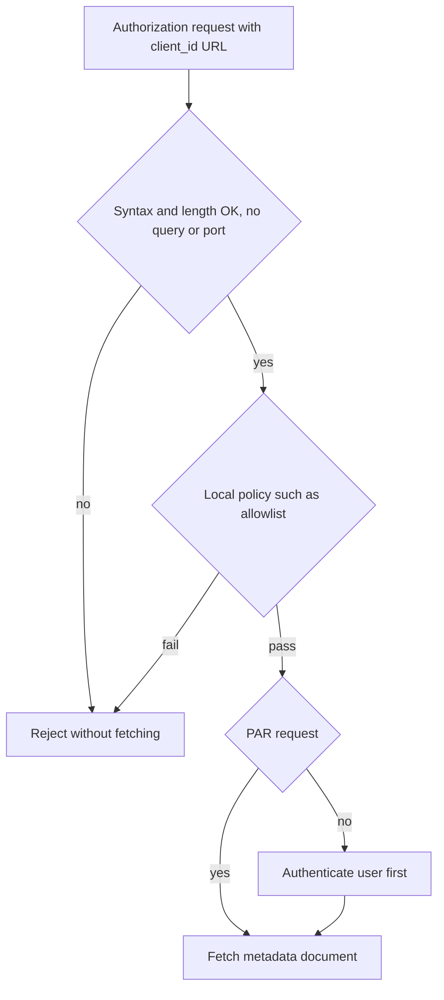
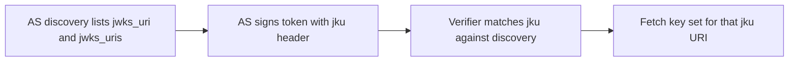
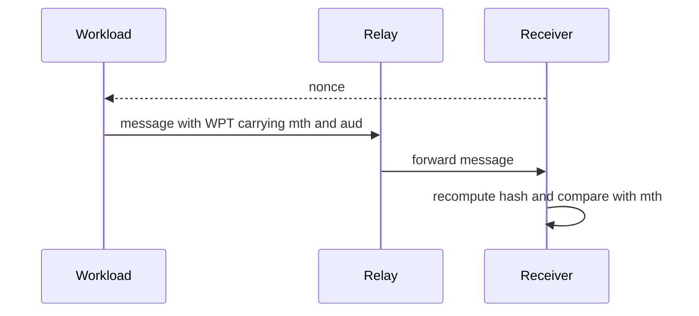
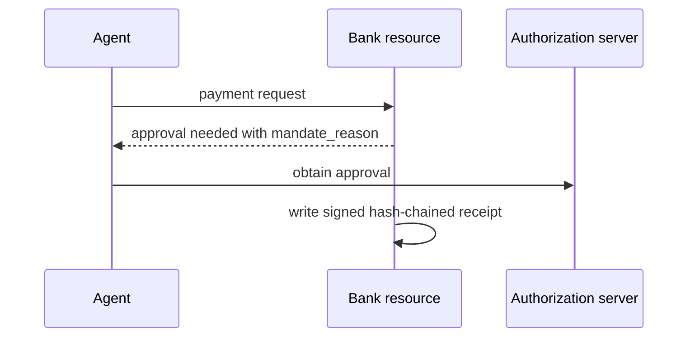
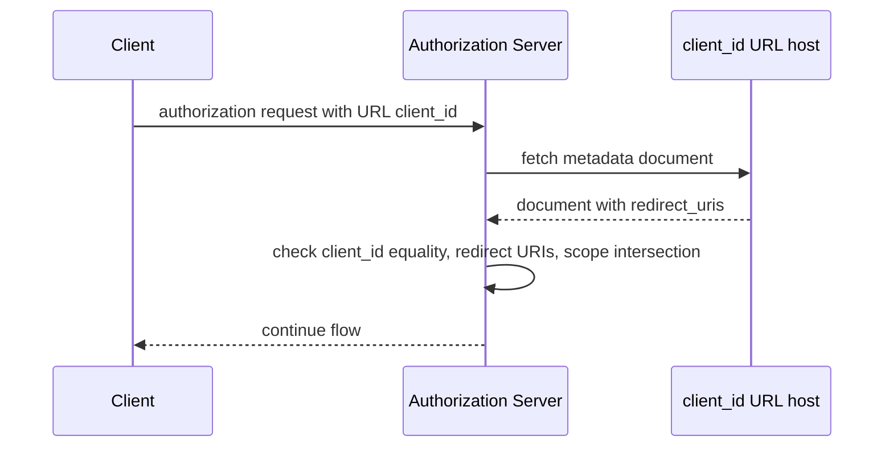
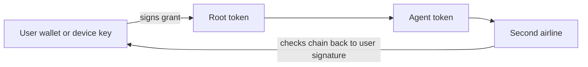

# OAuth WG Daily Report - 2026-11-18

- generated_at_utc: `2026-11-18T20:35:53+00:00`
- snapshot_date: `2026-11-18`

<!-- insights:start -->
## Briefing

> The busiest thread is the new draft-demedeiros-oidc-crypto-agility proposal. Filip Skokan says it breaks servers that already use JOSE algorithm agility correctly, and he sketches non-breaking alternatives based on jku or a jkuqs header. Nothing substantive changed in a WG draft text this run.

_Updated 2026-11-18T20:37:07+00:00. Machine-drafted from the sources linked below, which stay authoritative._

### A pull request would make CIMD authorization servers validate Client Identifier URLs before fetching and limit who can trigger a fetch

`pull-request` · `substantive` · first seen 2026-11-18 · [oauth-wg/draft-ietf-oauth-client-id-metadata-document#132: Add pre-fetch validation and fetch-triggering guidance (#112)](https://github.com/oauth-wg/draft-ietf-oauth-client-id-metadata-document/pull/132)

The PR changes Client Identifier URL rules: a query component goes from SHOULD NOT to MUST NOT, a port goes from MAY to MUST NOT, and a maximum length of 2048 octets is added. The AS must reject and not fetch a URL that fails these rules, and should reject non-normalized URLs to blunt cache and rate-limit evasion. Syntax checks and local policy such as a domain allowlist must run before any network request, and a client authentication JWT should be checked for being well-formed first. A new security section says non-PAR flows should defer the fetch until after user authentication, PAR cannot because RFC 9126 requires request authentication, and rate limits should be layered per IP, per user and per host. The PR body flags the port ban as a proposal that may break development setups. The body is truncated, so the rest of the discussion is not visible.

**Use cases**

- An authorization server that accepts URL-based client IDs and must avoid being used as a fetch proxy or flooded by crafted URLs.
- An MCP deployment that uses CIMD and runs test authorization servers or CIMD services on non-default ports.

### A reply on the new PACE Authorization draft discusses what a delegation root should record, such as the user's passkey tap and the grant shown

`mail` · `discussion` · first seen 2026-11-18 · [New draft: PACE Authorization: delegation and action approval for agent dialogs:](https://mailarchive.ietf.org/arch/msg/oauth/QDDL1q1ZVcuUAEiB_tUwEM8DPnE/)

This is a short reply from Blake to Suhas, not the draft announcement itself, so the draft text is not available. Blake says that without a wallet they would choose option 2. They argue it only beats option 3 if the root records the passkey tap at their own provider, when it happened, and the grant they were looking at. They note ID tokens already say when and how someone signed in, so the next revision would need to tie the grant to that same moment. Two open points remain: Niki's case of one grant spent at two airlines, and wallet trust. The options themselves are not described in this file.

**Use cases**

- An agent books travel on a user's behalf and the verifier needs evidence of what the user approved and when.
- A deployer wants to stop one approval from being reused with several relying parties.

**Related in other tracks**

- `ietf-wimse` / `draft-reddy-wimse-oauth-dialog-binding`: Both concern binding agent dialogs and delegation to OAuth credentials, but this item does not name that draft.

### Reviewers push back on the new OIDC crypto agility draft and float jku-based or query-string alternatives for selecting key types

`mail` · `discussion` · first seen 2026-11-18 · [Submitted new I-D proposal regarding OIDC crypto agility improvement (4 new messages)](https://mailarchive.ietf.org/arch/msg/oauth/UwVKZ7yQZhs7baTJmQdzZEKIpME/)

Breno de Medeiros announced draft-demedeiros-oidc-crypto-agility. It lets OIDC metadata publish supported JWT signing algorithms and lets the client request one in the authorization request. It also adds a parameter to filter algorithms in the published key set, to ease PQC adoption in open federation. Filip Skokan objects that it breaks servers, clients and RSs that already use the existing agility mechanisms correctly, and that the real problem is faulty client software. He prefers out-of-band client opt-in and sketches two non-breaking options. One is `jwks_uris` in discovery plus a `jku` header matched against it. The other is a `jkuqs` header that replaces the query string of `jwks_uri`, gated by a discovery flag. He notes ID Tokens currently say SHOULD NOT use `jku`. Warren Parad asks whether a parameter would open a downgrade path, and Skokan replies that advertising non-PQ algorithms leaves that option open anyway. Frederik points to the overlapping OpenID AB/Connect issue on PQ OpenID Connect (openid/connect#2153) and invites Breno to join that WG.

**Use cases**

- An AS operator planning PQC signing keys who must avoid breaking clients that only handle RS256 keys in jwks_uri.
- A library maintainer who verifies ID Tokens or JWT access tokens and would need to handle a jku header or jkuqs profile safely.
- A deployer weighing per-client or per-redirect_uri opt-in against a new authorization request parameter.

### The author of the native-clients profile for open protocols defends its username response parameter and refresh_key against review feedback

`mail` · `discussion` · first seen 2026-11-18 · [mailmaint's OAuth Profile for Native Clients of Open Protocols](https://mailarchive.ietf.org/arch/msg/oauth/kZ2o-_Nzvrq7do-K973oaTWPqK0/)

Replying to a reviewer (Nick), the author explains why the profile adds a token-response `username` parameter instead of using the OIDC `email` scope. The profile should not require OIDC, a username is not necessarily an email address, `preferred_username` is not guaranteed unique or stable, and email may not be in the ID token when an access token is issued. The author agrees to relax the rule that the username must stay the same, so a client can update its account label, and to add a maximum length for `refresh_key`. The author argues `refresh_key` needs only one extra string per authorization, and that a generation counter plus MAC avoids storing old refresh tokens. The author declines to mandate DPoP in place of refresh token rotation. DPoP does not work with non-HTTP protocols, it raises the adoption bar, and without hardware-backed keys it does not stop an attacker who copies device storage.

**Use cases**

- An email, calendar or contacts server on plain OAuth (no OIDC) that wants native clients to move off username/password.
- A client for IMAP, SMTP or CalDAV that needs the account name from the token response to label the account.
- An AS deciding between refresh token rotation and DPoP-bound refresh tokens on devices without non-extractable key storage.

### A pull request adds RFC 10027 references on consent phishing and cross-device flows to OAuth 2.1 and updates the Device Authorization Grant security text

`pull-request` · `editorial` · first seen 2026-11-18 · [oauth-wg/oauth-v2-1#286: Add RFC 10027 references and update security sections](https://github.com/oauth-wg/oauth-v2-1/pull/286)

The PR body says it adds references to RFC 10027 on consent phishing and cross-device flows and updates the security considerations for the Device Authorization Grant. It refers to issue #285. The material gives no diff or text, so the exact wording changes are not visible.

### Éric Vyncke moved to No Objection on draft-ietf-oauth-sd-jwt-vc-27 after his earlier DISCUSS was resolved

`mail` · `routine` · first seen 2026-11-18 · [Éric Vyncke's No Objection on draft-ietf-oauth-sd-jwt-vc-27: (with COMMENT)](https://mailarchive.ietf.org/arch/msg/oauth/HzIZORPP2bIS3r0rQBFjja8tIXY/)

This is an IESG ballot notice. Vyncke says all issues from the earlier DISCUSS are solved. They trust the authors and the responsible AD to have checked the remaining SHOULD and RECOMMENDED uses. There is no text change in this message.

### A new WIMSE draft adds an mth claim so a Workload Proof Token commits to the message content, and a reviewer asks about gateways rewriting Host

`mail` · `new-proposal` · first seen 2026-11-17 · [New draft: Message Binding for Workload Proof Tokens](https://mailarchive.ietf.org/arch/msg/oauth/5ZaI7imNuZdOVt1g7cASCJWx_Lc/)

Suhas Nandakumar and Cullen posted draft-nandakumar-wimse-wpt-message-binding, which adds an mth claim ({"p": profile, "h": hash}) so a WPT is bound to message content under a named canonicalization profile, with a registry of profiles. It also defines carrying a WPT inside messages on non-HTTP transports such as Media over QUIC and WebSocket, with aud naming the receiver, a verifier-supplied nonce for freshness, use on HTTP requests for JSON-RPC protocols such as A2A and MCP, and use in an SD-JWT Key Binding JWT. In the reply shown, Shameer Thaha describes a similar request-digest approach in their drafts, which hashes method, path and query, and body digest but omits scheme and authority because gateways rewrite them. They ask whether mth on HTTP covers the authority and whether their HTTP form could be a registry profile.

**Use cases**

- Agents exchanging JSON-RPC (A2A, MCP) through gateways that terminate TLS and may rewrite Host.
- Workloads using WebSocket or Media over QUIC where no HTTP request exists to bind a proof to.
- Systems that need the caller's and receiver's records of a request to commit to the same value.

**Related in other tracks**

- `ietf-wimse` / `draft-nandakumar-wimse-wpt-message-binding`: The draft under discussion.
- `ietf-wimse` / `draft-ietf-wimse-wpt`: The WPT that mth extends.
- `ietf-wimse` / `draft-thaha-wimse-agent-evidence-binding`: Reviewer's draft with a comparable request-digest binding.

### A new individual draft proposes that OIDC metadata publish supported JWT signing algorithms and let clients request one, to ease PQC adoption

`mail` · `new-proposal` · first seen 2026-11-17 · [Submitted new I-D proposal regarding OIDC crypto agility improvement](https://mailarchive.ietf.org/arch/msg/oauth/Y6RNjJVYx4DVyPbMWZX6EmA-424/)

Breno announced draft-demedeiros-oidc-crypto-agility. It would let OIDC authorization metadata publish the supported JWT signing algorithms and let the client request one of them in the authorization request. It also adds a parameter to filter algorithms out of the published key sets at the jwks URI. The stated motivation is to reduce friction for adopting new algorithms, particularly post-quantum cryptography in open federation contexts. The message is only an announcement, and no detailed mechanism is in the material.

**Use cases**

- An OpenID Provider in open federation that needs to add post-quantum signature algorithms without breaking existing relying parties.
- A relying party that wants to choose which signing algorithm it receives.

### A new individual draft defines RAR types for agent payment mandates, machine-readable approval reasons and hash-chained receipts

`mail` · `new-proposal` · first seen 2026-11-17 · [New draft: RAR profile for agent payment mandates, approval reasons and receipts (draft-craig-oauth-rar-payment-mandates-00)](https://mailarchive.ietf.org/arch/msg/oauth/kAGQP9CSb_3d3Cg7eWq2GYBkrvU/)

Richard Craig posted draft-craig-oauth-rar-payment-mandates-00. It defines two RFC 9396 authorization details types, payment_mandate (payees, per-payment and per-period limits, approval mode) and single_payment, plus an ordered set of reasons a payment falls outside a mandate (such as new_recipient or over_period_limit). A resource conveys the reason through a mandate_reason claim in draft-rosomakho-oauth-txn-challenge or an approval_required error. Each decision gets a signed, hash-chained receipt, with personal data kept as salted commitments outside the chain so it can be erased. The author asks for review of the reason set and whether it belongs in an IANA registry, composition with the transaction challenge, and the receipt format. A proof of concept is referenced.

**Use cases**

- A bank letting an AI agent pay named payees within per-payment and per-period limits.
- A resource server that must tell a client why a payment needs human approval.
- A deployer who needs an auditable decision record that can still honour data-erasure requests.

### An AS operator's implementation report on Client ID Metadata Documents gets editor replies. Most points are withdrawn, and a few possible additions remain

`mail` · `discussion` · first seen 2026-11-17 · [Implementation report:draft-ietf-oauth-client-id-metadata-document at an AS serving native apps and MCP clients (3 new messages)](https://mailarchive.ietf.org/arch/msg/oauth/Gg-XRhIkKakzC1ay6QhKkRimrw8/)

Sean MacGuire runs an OAuth 2.1 AS used by MCP clients and a native app. They listed seven observations, and Emelia (an author or editor) answered each. Sean withdrew point 1 (client_id comparison is already simple string comparison per RFC 3986 section 6.2.1) and point 2 (one document per AS host was their own choice). Point 5 (restricting client authentication methods) is covered by the new Client Authentication section. Sean will file an issue on cache bounds (point 4). On SSRF (point 3), they suggest adding DNS rebinding and a fetch timeout. Emelia says rebinding is covered by the referenced OWASP cheat sheet, so restating it is open. On point 6, the draft does not reference RFC 8252, and a pointer for native clients may help. On point 7, Emelia says the AS should read the document's scope and intersect it with what it is willing to grant. Sean's AS ignores that member and says that if this is the intent, nothing needs adding. No draft text changed. The source was truncated.

**Use cases**

- An AS that accepts MCP clients and native apps by URL-based client IDs and must harden its metadata fetcher against SSRF and DNS rebinding.
- A deployer deciding whether to bound the AS-side cache of client metadata documents, or to limit metadata-document clients to public clients.
- A native app that publishes redirect URIs in its document and the AS that must apply RFC 8252 rules to that list.

### In the PACE thread, the author proposes letting the user confirm a delegation grant itself, and others raise device-key signing and cross-booking limits

`mail` · `discussion` · first seen 2026-11-17 · [New draft: PACE Authorization: delegation and action approval for agent dialogs: (3 new messages)](https://mailarchive.ietf.org/arch/msg/oauth/cMK4l6ZzO4AG6ugan-I-Rs3QDvA/)

Suhas (the PACE author) answers Blake's point that nothing in a delegation chain is signed by the principal. For the next revision they propose that the principal confirms the grant once at setup (for example up to $800, aisle seat, until 9am), with the confirmation carried in the root token down the chain. Three options are listed: a wallet-signed SD-JWT credential (strongest), the user's own identity provider, or today's behaviour where the agent platform's authorization server asserts it. Mohamad Yossif suggests a device-bound key enrolled earlier as another way to get the user's signature, verifiable offline. Niki Niyikiza notes that delegator-bound chains would let the wallet sign the root, and points out that the same grant used with a second airline could be spent twice because no one tracks the total, asking the draft to say who does. No draft text changed; this is feedback on a proposal.

**Use cases**

- An agent booking travel under a standing spending limit, where a second vendor must verify the user really approved the limit.
- A verifier deciding whether to accept a bank-issued wallet credential or an IdP assertion as proof of principal consent.
- An implementer of delegation chains deciding who enforces cumulative limits across several recipients.

**Related in other tracks**

- `ietf-wimse` / `draft-reddy-wimse-oauth-dialog-binding`: Binds agent dialogs to WIMSE and OAuth credentials, the same agent-dialog setting as PACE.
- `ietf-wimse` / `draft-nandakumar-wimse-delegator-bound-chains`: The thread says wallet-signed roots work with delegator-bound chains.

### A reviewer asks whether the first hop of a PACE delegation chain could be signed with the user's own key, so a later verifier can tell the user set the limit

`mail` · `discussion` · first seen 2026-11-17 · [New draft: PACE Authorization: delegation and action approval for agent dialogs:](https://mailarchive.ietf.org/arch/msg/oauth/mtGdBEyIMgDdrP7RnK89AVpcuRM/)

Blake replies to the authors of the PACE Authorization draft (addressed to Suhas and Cullen) with a scenario: a user tells an agent to book a flight with an aisle seat for at most $800, and the agent later rebooks with a second airline. Section 3.3 lets the second airline check that no hop raised the $800 limit. But section 6 says the agent's approval shows only that the agent agreed. Blake asks whether the first hop could be signed with the user's own key from section 6.3, so the second airline can tell the user set the limit. This is a question, with no answer or text change. The draft text itself is not in the material.

**Use cases**

- An agent re-delegating a user's constrained task, such as a booking with a price cap, to a second service that must tell who set the constraint.
- A verifier of a delegation chain that must tell user-originated limits from limits the agent set.

### Triage of the candidate queue

- **high** `draft-ietf-oauth-client-id-metadata-document`: PR #132 proposes new MUST-level URL and pre-fetch rules and fetch-triggering guidance.
- **high** `draft-ietf-oauth-identity-assertion-authz-grant`: New issue #161 reports a conflict between the §4.3.3 and §4.5 rules, and #121 was closed this week.

<!-- insights:end -->

## Top Priorities

| Rank | Draft | Score | Updated | Key State | Repo |
|---|---|---:|---|---|---|
| 1 | `draft-ietf-oauth-sd-jwt-vc` | 125 | 2026-11-16T10:45:13Z | Active, Expert Reviews OK | `oauth-sd-jwt-vc` |
| 2 | `draft-ietf-oauth-rfc8725bis` | 90 | 2026-11-17T15:06:04Z | Active, No IANA Actions | `draft-ietf-oauth-rfc8725bis` |
| 3 | `draft-ietf-oauth-status-list` | 83 | 2026-11-12T21:31:43Z | Active, RFC-Ed-Ack | `draft-ietf-oauth-status-list` |
| 4 | `draft-ietf-oauth-identity-chaining` | 83 | 2026-11-12T02:07:35Z | Active, RFC-Ed-Ack | `oauth-identity-chaining` |
| 5 | `draft-ietf-oauth-client-id-metadata-document` | 73 | 2026-11-02T22:02:56Z | Active, I-D Exists | `draft-ietf-oauth-client-id-metadata-document` |
| 6 | `draft-ietf-oauth-identity-assertion-authz-grant` | 73 | 2026-10-31T00:32:39Z | Active, I-D Exists | `oauth-identity-assertion-authz-grant` |
| 7 | `draft-ietf-oauth-deferred-token-response` | 66 | 2026-10-31T16:12:16Z | Active, I-D Exists | `oauth-deferred-token-response` |
| 8 | `draft-ietf-oauth-v2-1` | 66 | 2026-10-31T04:16:32Z | Active, I-D Exists | `oauth-v2-1` |
| 9 | `draft-ietf-oauth-delegate-sd-jwt` | 66 | 2026-10-30T12:38:29Z | Active, I-D Exists | `oauth-delegate-sd-jwt` |
| 10 | `draft-ietf-oauth-transaction-tokens` | 62 | 2026-08-21T11:57:16Z | Active, I-D Exists | `oauth-transaction-tokens` |

## Active Drafts

| Draft | Rev | Updated | States |
|---|---:|---|---|
| `draft-ietf-oauth-rfc8725bis` | 10 | 2026-11-17T15:06:04Z | Active, No IANA Actions, IANA OK - No Actions Needed |
| `draft-ietf-oauth-sd-jwt-vc` | 27 | 2026-11-16T10:45:13Z | Active, Expert Reviews OK, Version Changed - Review Needed |
| `draft-ietf-oauth-status-list` | 21 | 2026-11-12T21:31:43Z | Active, RFC-Ed-Ack, Expert Reviews OK |
| `draft-ietf-oauth-identity-chaining` | 17 | 2026-11-12T02:07:35Z | Active, RFC-Ed-Ack, Expert Reviews OK |
| `draft-ietf-oauth-client-id-metadata-document` | 03 | 2026-11-02T22:02:56Z | Active, I-D Exists, WG Document |
| `draft-ietf-oauth-spiffe-client-auth` | 03 | 2026-11-02T17:35:55Z | Active, I-D Exists, WG Document |
| `draft-ietf-oauth-deferred-token-response` | 01 | 2026-10-31T16:12:16Z | Active, I-D Exists, WG Document |
| `draft-ietf-oauth-v2-1` | 17 | 2026-10-31T04:16:32Z | Active, I-D Exists, WG Document |
| `draft-ietf-oauth-identity-assertion-authz-grant` | 06 | 2026-10-31T00:32:39Z | Active, I-D Exists, WG Document |
| `draft-ietf-oauth-delegate-sd-jwt` | 00 | 2026-10-30T12:38:29Z | Active, I-D Exists, WG Document |
| `draft-ietf-oauth-attestation-based-client-auth` | 12 | 2026-10-18T17:33:02Z | Active, I-D Exists, WG Consensus: Waiting for Write-Up |
| `draft-ietf-oauth-first-party-apps` | 04 | 2026-08-26T14:40:16Z | Active, I-D Exists, WG Consensus: Waiting for Write-Up |
| `draft-ietf-oauth-rar-metadata-remediation` | 00 | 2026-08-23T20:29:29Z | Active, I-D Exists, WG Document |
| `draft-ietf-oauth-transaction-tokens` | 11 | 2026-08-21T11:57:16Z | Active, I-D Exists, WG Consensus: Waiting for Write-Up |
| `draft-ietf-oauth-refresh-token-expiration` | 03 | 2026-07-06T17:53:06Z | Active, I-D Exists, WG Document |

## Repo Watch

| Repo | Pushed | Open Issues |
|---|---|---:|
| `oauth-wg/oauth-sd-jwt-vc` | 2026-11-17T00:31:32Z | 0 |
| `oauth-wg/oauth-delegate-sd-jwt` | 2026-11-17T00:25:08Z | 14 |
| `oauth-wg/oauth-v2-1` | 2026-11-17T00:12:16Z | 16 |
| `oauth-wg/oauth-deferred-token-response` | 2026-11-17T00:06:15Z | 25 |
| `oauth-wg/oauth-identity-assertion-authz-grant` | 2026-11-17T00:02:49Z | 33 |
| `oauth-wg/draft-ietf-oauth-client-id-metadata-document` | 2026-11-12T00:00:50Z | 35 |
| `oauth-wg/oauth-transaction-tokens` | 2026-11-10T00:15:51Z | 3 |
| `oauth-wg/oauth-spiffe-client-authentication` | 2026-11-08T00:10:21Z | 6 |
| `oauth-wg/draft-ietf-oauth-attestation-based-client-auth` | 2026-10-13T06:13:11Z | 0 |
| `oauth-wg/oauth-selective-disclosure-jwt` | 2026-10-04T13:50:37Z | 0 |
| `oauth-wg/oauth-cross-device-security` | 2026-08-27T14:45:11Z | 0 |
| `oauth-wg/oauth-browser-based-apps` | 2026-08-27T14:43:00Z | 0 |

## Recent Pull Requests

- `oauth-wg/oauth-v2-1#273` Restrict access token values to the token68 syntax (2026-11-18T19:43:34Z)
- `oauth-wg/oauth-identity-assertion-authz-grant#108` Add guidance on RAS-specific and private claims in the ID-JAG (2026-11-18T19:35:35Z)
- `oauth-wg/oauth-v2-1#286` Add RFC 10027 references and update security sections (2026-11-18T17:48:38Z)
- `oauth-wg/draft-ietf-oauth-client-id-metadata-document#132` Add pre-fetch validation and fetch-triggering guidance (#112) (2026-11-18T04:13:08Z)
- `oauth-wg/oauth-v2-1#284` Cite RFC 7617 for the Basic authentication scheme (2026-11-17T10:06:57Z)
- `oauth-wg/oauth-v2-1#268` Supporting OAuth 2.0 and OAuth 2.1 clients concurrently (2026-11-17T07:24:42Z)
- `oauth-wg/oauth-v2-1#283` move Dick and Torsten to the acknowledgements (2026-11-16T23:29:56Z)
- `oauth-wg/oauth-sd-jwt-vc#457` Clarify that the types of an SD-JWT VC are those asserted in vct and aka_vcts (2026-11-16T10:37:06Z)
- `oauth-wg/oauth-deferred-token-response#82` Simplify definition of deferral code parameter (2026-11-16T01:58:41Z)
- `oauth-wg/oauth-v2-1#282` Change refresh token risk assessment requirement to MUST (2026-11-14T19:20:40Z)

## Recent Issues

- `oauth-wg/oauth-spiffe-client-authentication#39` spiffe_wit should be independent of attestation-based client authentication (2026-11-18T20:22:43Z)
- `oauth-wg/oauth-spiffe-client-authentication#52` Should X.509 validation include all the leaf checks from the SPIFFE X.509 specification? (2026-11-18T20:18:54Z)
- `oauth-wg/oauth-deferred-token-response#46` Allow the preceding endpoint to return a deferred response directly, in addition to accepting an advance hint (2026-11-18T18:29:09Z)
- `oauth-wg/oauth-v2-1#266` Define invalid_client for Authorization Error Response (2026-11-18T18:09:46Z)
- `oauth-wg/oauth-v2-1#285` Add reference to RFC 10027 (2026-11-18T17:43:54Z)
- `oauth-wg/oauth-delegate-sd-jwt#16` issuer_jwt_hash leaves Issuer Disclosures unbound in the final presentation (2026-11-18T11:08:17Z)
- `oauth-wg/oauth-delegate-sd-jwt#8` Place requirements, or clarify that constraints can only narrow across the chain (2026-11-17T03:30:10Z)
- `oauth-wg/oauth-deferred-token-response#81` Fix IANA-related issues (2026-11-16T01:42:45Z)
- `oauth-wg/oauth-identity-assertion-authz-grant#145` Access token lifetime relative to the ID-JAG (2026-11-15T21:52:32Z)
- `oauth-wg/oauth-identity-assertion-authz-grant#160` Sender-constrained ID-JAG should not replace required client authentication (2026-11-15T21:52:31Z)

## Organization Events

- `2026-11-18T20:22:43Z` IssueCommentEvent `oauth-wg/oauth-spiffe-client-authentication` spiffe_wit should be independent of attestation-based client authentication
- `2026-11-18T20:18:54Z` IssueCommentEvent `oauth-wg/oauth-spiffe-client-authentication` Should X.509 validation include all the leaf checks from the SPIFFE X.509 specification?
- `2026-11-18T20:18:54Z` IssuesEvent `oauth-wg/oauth-spiffe-client-authentication` Should X.509 validation include all the leaf checks from the SPIFFE X.509 specification?
- `2026-11-18T19:43:36Z` PullRequestReviewEvent `oauth-wg/oauth-v2-1` created
- `2026-11-18T19:41:56Z` IssueCommentEvent `oauth-wg/oauth-v2-1` Restrict access token values to the token68 syntax
- `2026-11-18T19:30:27Z` IssueCommentEvent `oauth-wg/oauth-identity-assertion-authz-grant` Add guidance on RAS-specific and private claims in the ID-JAG
- `2026-11-18T18:29:09Z` IssueCommentEvent `oauth-wg/oauth-deferred-token-response` Allow the preceding endpoint to return a deferred response directly, in addition to accepting an advance hint
- `2026-11-18T18:17:30Z` PullRequestReviewEvent `oauth-wg/oauth-v2-1` created
- `2026-11-18T18:16:15Z` PullRequestReviewEvent `oauth-wg/oauth-v2-1` created
- `2026-11-18T18:09:40Z` IssueCommentEvent `oauth-wg/oauth-v2-1` Define invalid_client for Authorization Error Response
- `2026-11-18T17:48:38Z` PullRequestEvent `oauth-wg/oauth-v2-1` opened
- `2026-11-18T17:43:56Z` IssuesEvent `oauth-wg/oauth-v2-1` Add reference to RFC 10027
- `2026-11-18T17:24:28Z` PullRequestReviewEvent `oauth-wg/oauth-v2-1` created
- `2026-11-18T11:10:21Z` IssuesEvent `oauth-wg/oauth-delegate-sd-jwt` issuer_jwt_hash leaves Issuer Disclosures unbound in the final presentation
- `2026-11-17T00:06:16Z` PushEvent `oauth-wg/oauth-deferred-token-response` 
- `2026-11-18T03:41:27Z` PullRequestEvent `oauth-wg/draft-ietf-oauth-client-id-metadata-document` opened
- `2026-11-18T03:38:55Z` ForkEvent `oauth-wg/draft-ietf-oauth-client-id-metadata-document` forked
- `2026-11-17T00:25:08Z` PushEvent `oauth-wg/oauth-delegate-sd-jwt` 
- `2026-11-16T01:56:00Z` PushEvent `oauth-wg/oauth-deferred-token-response` 
- `2026-11-17T10:06:57Z` PullRequestEvent `oauth-wg/oauth-v2-1` opened

## Mailarchive Signals

- weekly_digest_count: `1`
- [OAUTH-WG] Re: mailmaint's OAuth Profile for Native Clients of Open Protocols - https://mailarchive.ietf.org/arch/msg/oauth/kZ2o-_Nzvrq7do-K973oaTWPqK0/
- [OAUTH-WG] Re: Submitted new I-D proposal regarding OIDC crypto agility improvement - https://mailarchive.ietf.org/arch/msg/oauth/UwVKZ7yQZhs7baTJmQdzZEKIpME/
- [OAUTH-WG] Re: Submitted new I-D proposal regarding OIDC crypto agility improvement - https://mailarchive.ietf.org/arch/msg/oauth/NTw7jPulC2pu6_mPeYb1EK3v0Ss/
- [OAUTH-WG] Re: Submitted new I-D proposal regarding OIDC crypto agility improvement - https://mailarchive.ietf.org/arch/msg/oauth/dy9ybxPP4LZoRUSjSblhcrlsQaM/
- [OAUTH-WG] Re: Submitted new I-D proposal regarding OIDC crypto agility improvement - https://mailarchive.ietf.org/arch/msg/oauth/DGhjGuik6yurNvlWMTjoxtM0OGY/
- [OAUTH-WG] Re: New draft: PACE Authorization: delegation and action approval for agent dialogs: - https://mailarchive.ietf.org/arch/msg/oauth/QDDL1q1ZVcuUAEiB_tUwEM8DPnE/
- [OAUTH-WG] Éric Vyncke's No Objection on draft-ietf-oauth-sd-jwt-vc-27: (with COMMENT) - https://mailarchive.ietf.org/arch/msg/oauth/HzIZORPP2bIS3r0rQBFjja8tIXY/
- [OAUTH-WG] Re: [WIMSE] Re: New draft: PACE Authorization: delegation and action approval for agent dialogs: - https://mailarchive.ietf.org/arch/msg/oauth/cMK4l6ZzO4AG6ugan-I-Rs3QDvA/

## Next Actions

1. Evaluate the top 3 items in `Top Priorities` as weekly deep-dive candidates.
2. Separately track comment deadlines for `In Last Call` / `In WG Last Call` drafts.
3. For repos with a sudden spike in activity, create a scaffold in `deep-dives/` to capture key discussion points.
