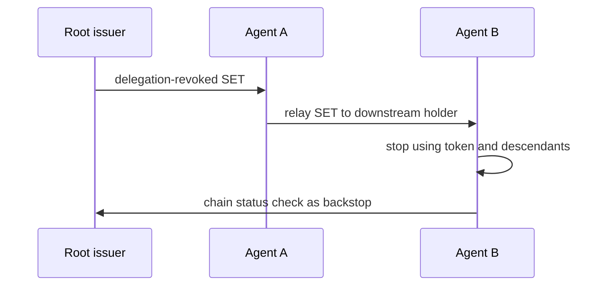
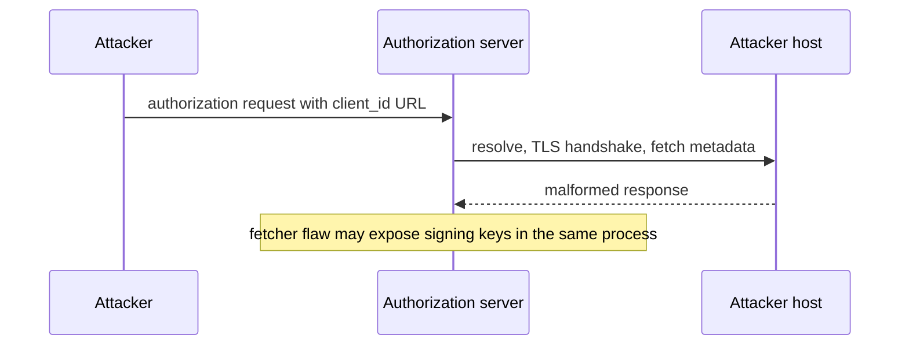

# OAuth WG Daily Report - 2026-11-20

- generated_at_utc: `2026-11-20T07:20:36+00:00`
- snapshot_date: `2026-11-20`

<!-- insights:start -->
## Briefing

> The most notable activity is mailing-list debate over agent delegation: the Actor Chain authors asked the chairs to compare three competing drafts before an adoption call, and two new agent drafts (PACE Authorization, delegation revocation) drew review comments. The first-party-apps draft is being renamed to "OAuth Authorization Challenge Endpoint", which is editorial.

_Updated 2026-11-20T07:21:47+00:00. Machine-drafted from the sources linked below, which stay authoritative._

### A new draft defines a delegation-revoked security event that revokes a token and all its descendants

`mail` · `new-proposal` · first seen 2026-11-20 · [New draft: Security Events for Revocation of Agent Delegations (2 new messages)](https://mailarchive.ietf.org/arch/msg/oauth/d4QcDFQ4Ays3NJUukHaknL8KIrk/)

Suhas Nandakumar and Cullen posted draft-nandakumar-oauth-delegation-revocation-00. It defines a delegation-revoked SET that revokes a token and every credential delegated below it. Each holder relays the event down the chain, and chain status checks act as the backstop if an event is lost. Marc replied with suggestions: state that only the root issuer or its designee can withdraw a principal across all chains, ask issuers to state a maximum publication delay so the Section 7 bound is measurable from revoked_at, and prefer Status List over token introspection for chain status because introspection reveals which tokens each verifier checks.

**Use cases**

- An operator who must cut off a sub-agent chain after revoking the first delegation.
- A verifier choosing between Status List and introspection to check chain status.

**Related in other tracks**

- `ietf-wimse` / `draft-nandakumar-wimse-delegator-bound-chains`: Same authors work on delegation chains, but the message does not link the two.

### A reviewer lists replay, crash-retry, WebAuthn and display edge cases in the new PACE Authorization draft

`mail` · `discussion` · first seen 2026-11-20 · [New draft: PACE Authorization: delegation and action approval for agent dialogs:](https://mailarchive.ietf.org/arch/msg/oauth/TmOI1beLEIAtzYbfslf4ldg-9M8/)

Suhas Nandakumar and Cullen announced draft-nandakumar-agentproto-pace-authz-00 on Nov 16. It covers delegating to an agent with a credential bound to a dialog, asking for approval via a signed check, approving through an access token for one action, and revoking a delegation to end dependent dialogs. Paul Williams replied with edge cases. Consumed jti values are kept only until exp, which leaves a replay window if verifiers accept clock skew. A resource server that crashes after consuming the approval token can see a retry with a new checkpoint_id and a duplicate effect. The WebAuthn check omits several validations, and the inline key should be matched against the enrolled key. He also suggests rendering pitfalls for Security Considerations and points to his Proof-of-Intent drafts for edits outside pre-declared bounds.

**Use cases**

- An implementer of human-approval flows for agent actions who needs idempotency and replay guidance.
- A resource server verifying WebAuthn-based approval confirmations.

**Related in other tracks**

- `ietf-wimse` / `draft-reddy-wimse-oauth-dialog-binding`: Also binds agent dialogs to credentials, but the message does not reference it.

### The Actor Chain authors ask the chairs to compare Actor Chain, Actor Profile and Delegation Chain before any adoption call

`mail` · `discussion` · first seen 2026-11-20 · [Comparing Actor Chain and Actor Profile before an adoption call](https://mailarchive.ietf.org/arch/msg/oauth/m_2hHS8OfrXxj1ISfKphVkAZyTo/)

After the IETF 127 joint OAuth/WIMSE session, the Actor Chain authors recommend their draft as the starting text for shared JWT access-token delegation rules. They argue the first WG draft should include recipient-specific actor disclosure at issuance, plus verification of the original actor proofs and AS acceptances. In their payment example, a gateway must verify the initiator's and connector's signed records while bank policy withholds the screening actor. They say Actor Profile would reject this because it requires retaining the screening actor, and that Delegation Chain signs that actor into both adjacent records, so both drafts would need extra rules. They also set out a dated timeline of their work and ask the chairs to explain how the IETF 127 agenda priorities applied to their slot request. They ask the chairs to invite all three author groups to compare the shared JWT rules, contributions and the gateway case, and to post a summary.

**Use cases**

- A WG member deciding which delegation draft to support in an adoption call.
- An authorization server that must chain actors but hide an intermediate actor from a downstream gateway.

**Related in other tracks**

- `ietf-wimse` / `draft-nandakumar-wimse-delegator-bound-chains`: Another delegation-chain proposal in the same agent-delegation space, though this message does not name it.

### The first-party-apps draft is being renamed to "OAuth Authorization Challenge Endpoint"

`pull-request` · `editorial` · first seen 2026-11-20 · [oauth-wg/oauth-first-party-apps#181: Rename draft to OAuth Authorization Challenge Endpoint](https://github.com/oauth-wg/oauth-first-party-apps/pull/181)

The PR renames the draft from "OAuth 2.0 for First-Party Applications" to "OAuth Authorization Challenge Endpoint". It updates the title, abbrev, the introduction's reference to the old name and the README heading. The file is renamed to draft-ietf-oauth-authorization-challenge-endpoint.md, with docname, links, .gitignore and CODEOWNERS updated. Repository links are unchanged and descriptive uses of "first-party applications" remain. Datatracker links will not resolve until the draft is submitted under the new name. No protocol change is described.

### A PR updates references to RFC10017 and RFC10027, but its body is empty

`pull-request` · `routine` · first seen 2026-11-20 · [oauth-wg/oauth-first-party-apps#180: updated references to RFC10017 and RFC10027](https://github.com/oauth-wg/oauth-first-party-apps/pull/180)

The PR title says references were updated to RFC10017 and RFC10027. The body is empty, so the material gives no further detail.

### The Native Clients profile will drop its `username` and `refresh_key` additions to reach last call

`mail` · `substantive` · first seen 2026-11-19 · [mailmaint's OAuth Profile for Native Clients of Open Protocols (2 new messages)](https://mailarchive.ietf.org/arch/msg/oauth/3SuQvGEjYQh4oFBhKyjcpPrqQmQ/)

Neil Jenkins said the authors will remove the token-response `username` parameter and the `refresh_key` mechanism to move the profile to last call, though they still think a refresh key solves a real refresh-rotation problem and suggest the working group might define something similar later. The preceding review exchange with Nick covered why `username` was proposed instead of OIDC `email` (no OIDC dependency, and a username is not an email) and an idea that ID token claims in the token response could be a separate draft. Nick questioned the storage needed to reproduce refresh tokens and argued for DPoP instead of rotation. Jenkins replied that DPoP does not work for non-HTTP protocols.

**Use cases**

- Mail, calendar and contacts clients using OAuth over non-HTTP protocols that planned to rely on `refresh_key` for safe refresh retries.
- AS operators weighing refresh-token rotation against DPoP-bound refresh tokens.

### New draft defines RAR types for agent payment mandates with ordered approval reasons and receipts, and a reviewer shares experience from a similar spec

`mail` · `new-proposal` · first seen 2026-11-19 · [New draft: RAR profile for agent payment mandates, approval reasons and receipts (draft-craig-oauth-rar-payment-mandates-00)](https://mailarchive.ietf.org/arch/msg/oauth/C7uOYIHSWX3He8gCW_nlcTW7ehc/)

Richard Craig posted draft-craig-oauth-rar-payment-mandates-00, defining two RFC 9396 types (payment_mandate and single_payment), an ordered set of reasons a payment falls outside a mandate, carriage of the reason via a mandate_reason claim in draft-rosomakho-oauth-txn-challenge or an approval_required error, and signed hash-chained receipts with personal data as salted commitments. It is meant to complement the transaction challenge draft. Markus from Home-Mandate replied with notes: make reason position part of any IANA registration, record intent before executing and mark crashes as outcome unknown, ask where the salt lives and whether low-entropy values can be guessed against commitments, and use signed checkpoints over the chain.

**Use cases**

- A bank issuing OAuth tokens that bound what an AI agent may pay, with per-payment and per-period limits.
- An implementer needing auditable approval-required decisions that can still honour erasure requests.

**Related in other tracks**

- `ietf-wimse` / `draft-hulea-wimse-agent-mandate`: Also defines verifiable mandates for agents, a related approach to bounding agent authority.

### A revised Transactional Access Tokens draft now aligns request and token format with RAR, after questions on why it isn't a RAR profile

`mail` · `new-proposal` · first seen 2026-11-19 · [Transactional Access Tokens](https://mailarchive.ietf.org/arch/msg/oauth/dcWgMjGDoGkntmYRCytdiLToTAw/)

Atul announced an updated draft-tulshi-oauth-transactional-access-tokens that aligns the request process and token format with RAR. This follows feedback from Jeff Lombardo, who asked why a new token is needed rather than a Transaction Profile for RAR or Txn-Tokens, and noted that RFC 9396 already lets the AS enrich authorization_details in token responses. Atul's stated position is that the token is optional for any AS, adds no endpoints, and that the AS is the TTS. He says Txn-Tokens propagate context within a trust domain, while a Txn-AT lets the AS convey context to a resource server, which may exchange it for a Txn-Token. The message is truncated, so the revised design is not visible here.

**Use cases**

- An AS operator wanting to convey transaction context to a resource server using RAR-style requests.
- A resource server with internal microservices that wants to turn an access token into a Txn-Token.

**Related in other tracks**

- `ietf-wimse` / `draft-ietf-wimse-workload-creds`: Both deal with propagating workload or transaction context across services, though the message does not cite it.

### Filip Skokan objects that the OIDC crypto agility proposal breaks working deployments, and the author will take it to the OpenID AB/Connect WG

`mail` · `discussion` · first seen 2026-11-19 · [Submitted new I-D proposal regarding OIDC crypto agility improvement (2 new messages)](https://mailarchive.ietf.org/arch/msg/oauth/4iitAU1eA-9Ih0d9XA8b5pybZPI/)

Breno de Medeiros' draft-demedeiros-oidc-crypto-agility lets OIDC metadata publish supported signing algorithms, lets the client request one in the authorization request, and filters algorithms in the jwks_uri, to ease PQC adoption. Filip Skokan argued it introduces breaking behaviour for correct implementations and that the real problem is faulty clients, suggesting opt-in or brownouts, a `jwks_uris` discovery array with `jku`, or a `jkuqs` header that replaces the jwks_uri query string. The author rejected `jku` as discouraged and said the existing approach is flawed because mixed key sets break crypto libraries. Frederik Krogsdal Jacobsen pointed to the OpenID PQ discussion (openid/connect issue 2153), and the author agreed to submit it to the OpenID AB/Connect WG.

**Use cases**

- OpenID Providers planning to publish post-quantum keys in jwks_uri without breaking existing RPs.
- Client library authors whose key import fails on mixed-algorithm JWKS.

**Related in other tracks**

- `openid` / `openid/connect`: The discussion was redirected to the OpenID AB/Connect WG, which already tracks PQ OpenID Connect.

### A list participant asks the author of the PACE Authorization draft to stop cross-posting and unquoted replies, and the thread also holds early design talk

`mail` · `discussion` · first seen 2026-11-19 · [New draft: PACE Authorization: delegation and action approval for agent dialogs:](https://mailarchive.ietf.org/arch/msg/oauth/I-gW4sVCdxBgnUTmAU_-GZGaSGM/)

The top message is a conduct complaint to Blake Morrison: multi-list posting is discouraged, replies lack quoted history, and the poster suspects an AI autoresponder. In the quoted message, Blake tells Suhas that without a wallet he prefers option 2. He says a root grant only beats option 3 if it carries the user's passkey tap at their own provider, its timing, and the grant shown at that moment, and that the next revision must tie the grant to that moment. He also notes that one grant spent at two airlines still needs an answer, as does wallet trust. The options themselves are not defined in this material.

**Related in other tracks**

- `ietf-wimse` / `draft-reddy-wimse-oauth-dialog-binding`: Same thread is cross-posted to the WIMSE list and concerns binding agent dialogs and grants to credentials, though the material does not name this draft.

### Debate over whether the CIMD draft must mandate isolating the AS's client-metadata fetcher before last call

`mail` · `discussion` · first seen 2026-11-19 · [CIMD Request Issues - Pat White comment from IETF 127 (4 new messages)](https://mailarchive.ietf.org/arch/msg/oauth/RFulmwwcjCE1Qyt4888AI8ypVg8/)

After the IETF 127 session, Patrick White argued that an AS fetching an attacker-chosen https client_id URL exposes its DNS resolver, TLS stack and HTTP parser to a single anonymous request, which could reach the process holding signing keys even when every SSRF check passes. He asked for MUST-level text (fetch in a component without access to signing keys or session secrets, restricted network, no real user agent, no credentials, unrelated proxy), or else removal of the feature. Shankar agreed, citing issue #112 and PR #115 (rate limiting), and proposed a third principle on isolation. Max Gerber countered that ASs already fetch untrusted client JWKS and IdP metadata URLs, so CIMD is not a new class of risk and SSRF considerations suffice. No draft text change yet.

**Use cases**

- An AS implementer adding CIMD support for MCP clients deciding whether to run metadata fetches in a sandboxed, key-less service.
- A library maintainer shipping a default CIMD fetcher who must choose between in-process fetching and an isolated worker.

**Related in other tracks**

- `openid` / `openid/aauth`: Patrick White raised the CIMD concern while presenting the AAuth proposal at the same session.

### A reviewer argues most CIMD fetch-hardening advice is out of scope for OAuth, apart from testable items like request headers

`mail` · `discussion` · first seen 2026-11-19 · [CIMD Request Issues - Pat White comment from IETF 127](https://mailarchive.ietf.org/arch/msg/oauth/fclB-M3AdRdUkDnNUWWYzmmjFTE/)

Replying to Patrick White's IETF 127 comment, Michael Sweet questions how a flaw in the DNS resolver, TLS stack or HTTP parser underneath an AS's fetch of an https client_id URL is an OAuth protocol problem. He says the spec can reference TLS/HTTP best practices but cannot mandate implementation architecture. He concedes that some measures, such as request headers, are straightforward, effective and testable, and could be normative. Using a proxy unrelated to the AS network location is, in his view, a configuration choice outside OAuth's scope and of doubtful effectiveness. White's position, as quoted, is that hardening guidance (no true user agent, no credentials, proxying) must be in the draft itself, not a later BCP.

**Use cases**

- An AS operator accepting arbitrary https client_id URLs deciding how much fetch hardening to build in beyond what the draft requires
- A CIMD implementer choosing which outbound request headers to send when fetching client metadata

### Triage of the candidate queue

- **high** `draft-ietf-oauth-client-id-metadata-document`: Active debate on whether fetch-hardening (headers, proxying) belongs normatively in the draft.
- **high** `draft-ietf-oauth-identity-assertion-authz-grant`: New issue #161 reports a conflict between the §4.3.3 and §4.5 rules, and #121 was closed this week.
- **low** `draft-ietf-oauth-status-list`: Only cited in list feedback as a preferred chain-status mechanism, with no change to the draft.
- **low** `draft-ietf-oauth-transaction-tokens`: Mentioned only as one possible delegation credential in the PACE draft announcement.
- **low** `draft-ietf-oauth-v2-1`: Only a minor reference error in section 7.13.1 was reported.

<!-- insights:end -->

## Top Priorities

| Rank | Draft | Score | Updated | Key State | Repo |
|---|---|---:|---|---|---|
| 1 | `draft-ietf-oauth-sd-jwt-vc` | 125 | 2026-11-16T10:45:13Z | Active, Expert Reviews OK | `oauth-sd-jwt-vc` |
| 2 | `draft-ietf-oauth-status-list` | 90 | 2026-11-19T02:42:34Z | Active, RFC-Ed-Ack | `draft-ietf-oauth-status-list` |
| 3 | `draft-ietf-oauth-rfc8725bis` | 90 | 2026-11-17T15:06:04Z | Active, No IANA Actions | `draft-ietf-oauth-rfc8725bis` |
| 4 | `draft-ietf-oauth-identity-chaining` | 73 | 2026-11-12T02:07:35Z | Active, RFC-Ed-Ack | `oauth-identity-chaining` |
| 5 | `draft-ietf-oauth-client-id-metadata-document` | 73 | 2026-11-02T22:02:56Z | Active, I-D Exists | `draft-ietf-oauth-client-id-metadata-document` |
| 6 | `draft-ietf-oauth-identity-assertion-authz-grant` | 73 | 2026-10-31T00:32:39Z | Active, I-D Exists | `oauth-identity-assertion-authz-grant` |
| 7 | `draft-ietf-oauth-first-party-apps` | 68 | 2026-08-26T14:40:16Z | Active, I-D Exists | `oauth-first-party-apps` |
| 8 | `draft-ietf-oauth-deferred-token-response` | 66 | 2026-10-31T16:12:16Z | Active, I-D Exists | `oauth-deferred-token-response` |
| 9 | `draft-ietf-oauth-v2-1` | 66 | 2026-10-31T04:16:32Z | Active, I-D Exists | `oauth-v2-1` |
| 10 | `draft-ietf-oauth-delegate-sd-jwt` | 66 | 2026-10-30T12:38:29Z | Active, I-D Exists | `oauth-delegate-sd-jwt` |

## Active Drafts

| Draft | Rev | Updated | States |
|---|---:|---|---|
| `draft-ietf-oauth-status-list` | 21 | 2026-11-19T02:42:34Z | Active, RFC-Ed-Ack, Expert Reviews OK |
| `draft-ietf-oauth-rfc8725bis` | 10 | 2026-11-17T15:06:04Z | Active, No IANA Actions, IANA OK - No Actions Needed |
| `draft-ietf-oauth-sd-jwt-vc` | 27 | 2026-11-16T10:45:13Z | Active, Expert Reviews OK, Version Changed - Review Needed |
| `draft-ietf-oauth-identity-chaining` | 17 | 2026-11-12T02:07:35Z | Active, RFC-Ed-Ack, Expert Reviews OK |
| `draft-ietf-oauth-client-id-metadata-document` | 03 | 2026-11-02T22:02:56Z | Active, I-D Exists, WG Document |
| `draft-ietf-oauth-spiffe-client-auth` | 03 | 2026-11-02T17:35:55Z | Active, I-D Exists, WG Document |
| `draft-ietf-oauth-deferred-token-response` | 01 | 2026-10-31T16:12:16Z | Active, I-D Exists, WG Document |
| `draft-ietf-oauth-v2-1` | 17 | 2026-10-31T04:16:32Z | Active, I-D Exists, WG Document |
| `draft-ietf-oauth-identity-assertion-authz-grant` | 06 | 2026-10-31T00:32:39Z | Active, I-D Exists, WG Document |
| `draft-ietf-oauth-delegate-sd-jwt` | 00 | 2026-10-30T12:38:29Z | Active, I-D Exists, WG Document |
| `draft-ietf-oauth-attestation-based-client-auth` | 12 | 2026-10-18T17:33:02Z | Active, I-D Exists, WG Consensus: Waiting for Write-Up |
| `draft-ietf-oauth-first-party-apps` | 04 | 2026-08-26T14:40:16Z | Active, I-D Exists, WG Consensus: Waiting for Write-Up |
| `draft-ietf-oauth-rar-metadata-remediation` | 00 | 2026-08-23T20:29:29Z | Active, I-D Exists, WG Document |
| `draft-ietf-oauth-transaction-tokens` | 11 | 2026-08-21T11:57:16Z | Active, I-D Exists, WG Consensus: Waiting for Write-Up |
| `draft-ietf-oauth-refresh-token-expiration` | 03 | 2026-07-06T17:53:06Z | Active, I-D Exists, WG Document |

## Repo Watch

| Repo | Pushed | Open Issues |
|---|---|---:|
| `oauth-wg/oauth-first-party-apps` | 2026-11-20T06:48:33Z | 7 |
| `oauth-wg/oauth-delegate-sd-jwt` | 2026-11-19T00:25:09Z | 14 |
| `oauth-wg/oauth-v2-1` | 2026-11-19T00:12:28Z | 16 |
| `oauth-wg/oauth-spiffe-client-authentication` | 2026-11-19T00:09:37Z | 6 |
| `oauth-wg/oauth-deferred-token-response` | 2026-11-19T00:06:27Z | 25 |
| `oauth-wg/oauth-identity-assertion-authz-grant` | 2026-11-19T00:02:50Z | 34 |
| `oauth-wg/draft-ietf-oauth-client-id-metadata-document` | 2026-11-19T00:00:41Z | 35 |
| `oauth-wg/oauth-sd-jwt-vc` | 2026-11-17T00:31:32Z | 0 |
| `oauth-wg/oauth-transaction-tokens` | 2026-11-10T00:15:51Z | 3 |
| `oauth-wg/draft-ietf-oauth-attestation-based-client-auth` | 2026-10-13T06:13:11Z | 0 |
| `oauth-wg/oauth-selective-disclosure-jwt` | 2026-10-04T13:50:37Z | 0 |
| `oauth-wg/oauth-cross-device-security` | 2026-08-27T14:45:11Z | 0 |

## Recent Pull Requests

- `oauth-wg/oauth-first-party-apps#181` Rename draft to OAuth Authorization Challenge Endpoint (2026-11-20T06:48:13Z)
- `oauth-wg/oauth-first-party-apps#180` updated references to RFC10017 and RFC10027 (2026-11-20T06:26:00Z)
- `oauth-wg/draft-ietf-oauth-client-id-metadata-document#132` Add pre-fetch validation and fetch-triggering guidance (#112) (2026-11-19T04:56:59Z)
- `oauth-wg/oauth-v2-1#286` Add RFC 10027 references and update security sections (2026-11-18T21:42:02Z)
- `oauth-wg/oauth-v2-1#273` Restrict access token values to the token68 syntax (2026-11-18T19:43:34Z)
- `oauth-wg/oauth-identity-assertion-authz-grant#108` Add guidance on RAS-specific and private claims in the ID-JAG (2026-11-18T19:35:35Z)
- `oauth-wg/oauth-v2-1#284` Cite RFC 7617 for the Basic authentication scheme (2026-11-17T10:06:57Z)
- `oauth-wg/oauth-v2-1#268` Supporting OAuth 2.0 and OAuth 2.1 clients concurrently (2026-11-17T07:24:42Z)
- `oauth-wg/oauth-v2-1#283` move Dick and Torsten to the acknowledgements (2026-11-16T23:29:56Z)
- `oauth-wg/oauth-sd-jwt-vc#457` Clarify that the types of an SD-JWT VC are those asserted in vct and aka_vcts (2026-11-16T10:37:06Z)

## Recent Issues

- `oauth-wg/oauth-identity-assertion-authz-grant#162` Profile for multi-hop delegation chaining (2026-11-18T22:32:52Z)
- `oauth-wg/oauth-spiffe-client-authentication#39` spiffe_wit should be independent of attestation-based client authentication (2026-11-18T20:22:43Z)
- `oauth-wg/oauth-spiffe-client-authentication#52` Should X.509 validation include all the leaf checks from the SPIFFE X.509 specification? (2026-11-18T20:18:54Z)
- `oauth-wg/oauth-deferred-token-response#46` Allow the preceding endpoint to return a deferred response directly, in addition to accepting an advance hint (2026-11-18T18:29:09Z)
- `oauth-wg/oauth-v2-1#266` Define invalid_client for Authorization Error Response (2026-11-18T18:09:46Z)
- `oauth-wg/oauth-v2-1#285` Add reference to RFC 10027 (2026-11-18T17:43:54Z)
- `oauth-wg/oauth-delegate-sd-jwt#16` issuer_jwt_hash leaves Issuer Disclosures unbound in the final presentation (2026-11-18T11:08:17Z)
- `oauth-wg/oauth-delegate-sd-jwt#8` Place requirements, or clarify that constraints can only narrow across the chain (2026-11-17T03:30:10Z)
- `oauth-wg/oauth-deferred-token-response#81` Fix IANA-related issues (2026-11-16T01:42:45Z)
- `oauth-wg/oauth-identity-assertion-authz-grant#145` Access token lifetime relative to the ID-JAG (2026-11-15T21:52:32Z)

## Organization Events

- `2026-11-20T06:48:13Z` PullRequestEvent `oauth-wg/oauth-first-party-apps` opened
- `2026-11-20T06:25:57Z` PullRequestEvent `oauth-wg/oauth-first-party-apps` merged
- `2026-11-20T06:01:43Z` PullRequestEvent `oauth-wg/oauth-first-party-apps` opened
- `2026-11-19T00:09:37Z` PushEvent `oauth-wg/oauth-spiffe-client-authentication` 
- `2026-11-18T19:43:33Z` PullRequestReviewCommentEvent `oauth-wg/oauth-v2-1` created
- `2026-11-18T18:16:12Z` PullRequestReviewCommentEvent `oauth-wg/oauth-v2-1` created
- `2026-11-18T22:31:05Z` IssuesEvent `oauth-wg/oauth-identity-assertion-authz-grant` Profile for multi-hop delegation chaining
- `2026-11-18T17:27:54Z` IssueCommentEvent `oauth-wg/oauth-v2-1` Define invalid_client for Authorization Error Response
- `2026-11-18T20:22:43Z` IssueCommentEvent `oauth-wg/oauth-spiffe-client-authentication` spiffe_wit should be independent of attestation-based client authentication
- `2026-11-18T20:18:54Z` IssueCommentEvent `oauth-wg/oauth-spiffe-client-authentication` Should X.509 validation include all the leaf checks from the SPIFFE X.509 specification?
- `2026-11-18T20:18:54Z` IssuesEvent `oauth-wg/oauth-spiffe-client-authentication` Should X.509 validation include all the leaf checks from the SPIFFE X.509 specification?
- `2026-11-18T19:43:36Z` PullRequestReviewEvent `oauth-wg/oauth-v2-1` created
- `2026-11-18T19:41:56Z` IssueCommentEvent `oauth-wg/oauth-v2-1` Restrict access token values to the token68 syntax
- `2026-11-18T19:30:27Z` IssueCommentEvent `oauth-wg/oauth-identity-assertion-authz-grant` Add guidance on RAS-specific and private claims in the ID-JAG
- `2026-11-18T18:29:09Z` IssueCommentEvent `oauth-wg/oauth-deferred-token-response` Allow the preceding endpoint to return a deferred response directly, in addition to accepting an advance hint
- `2026-11-18T18:17:30Z` PullRequestReviewEvent `oauth-wg/oauth-v2-1` created
- `2026-11-18T18:16:15Z` PullRequestReviewEvent `oauth-wg/oauth-v2-1` created
- `2026-11-18T18:09:40Z` IssueCommentEvent `oauth-wg/oauth-v2-1` Define invalid_client for Authorization Error Response
- `2026-11-18T17:48:38Z` PullRequestEvent `oauth-wg/oauth-v2-1` opened
- `2026-11-18T17:43:56Z` IssuesEvent `oauth-wg/oauth-v2-1` Add reference to RFC 10027

## Mailarchive Signals

- weekly_digest_count: `0`
- [OAUTH-WG] Comparing Actor Chain and Actor Profile before an adoption call - https://mailarchive.ietf.org/arch/msg/oauth/m_2hHS8OfrXxj1ISfKphVkAZyTo/
- [OAUTH-WG] Re: New draft: PACE Authorization: delegation and action approval for agent dialogs: - https://mailarchive.ietf.org/arch/msg/oauth/TmOI1beLEIAtzYbfslf4ldg-9M8/
- [OAUTH-WG] Re: New draft: Security Events for Revocation of Agent Delegations - https://mailarchive.ietf.org/arch/msg/oauth/d4QcDFQ4Ays3NJUukHaknL8KIrk/
- [OAUTH-WG] New draft: Security Events for Revocation of Agent Delegations - https://mailarchive.ietf.org/arch/msg/oauth/9zseYmfMu258-V7ulre_B4QU_PE/
- [OAUTH-WG] Re: CIMD Request Issues - Pat White comment from IETF 127 - https://mailarchive.ietf.org/arch/msg/oauth/fclB-M3AdRdUkDnNUWWYzmmjFTE/
- [OAUTH-WG] Re: Transactional Access Tokens - https://mailarchive.ietf.org/arch/msg/oauth/ls5lsyM4Lg6Zaful23JI3bzDLdk/
- [OAUTH-WG] Possible incorrect reference in Section 7.13.1 of draft-ietf-oauth-v2-1 - https://mailarchive.ietf.org/arch/msg/oauth/sKLsD8nT9CNcvIldC_0An2bKQ2U/
- [OAUTH-WG] Re: Transactional Access Tokens - https://mailarchive.ietf.org/arch/msg/oauth/dcWgMjGDoGkntmYRCytdiLToTAw/

## Next Actions

1. Evaluate the top 3 items in `Top Priorities` as weekly deep-dive candidates.
2. Separately track comment deadlines for `In Last Call` / `In WG Last Call` drafts.
3. For repos with a sudden spike in activity, create a scaffold in `deep-dives/` to capture key discussion points.
