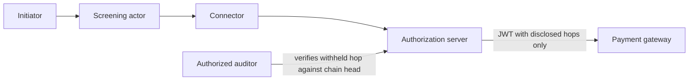
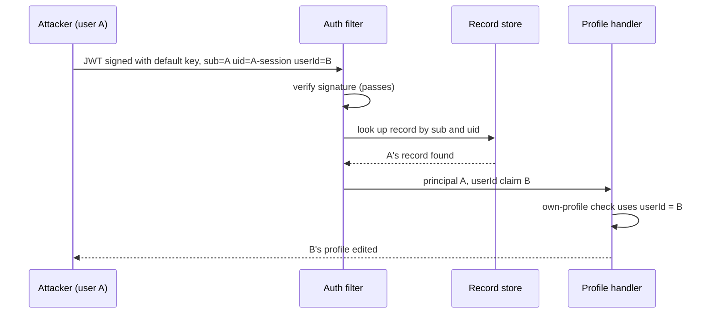
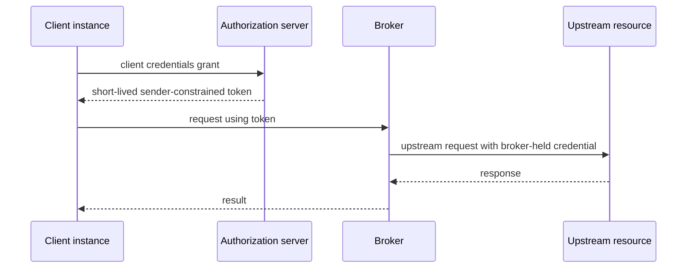
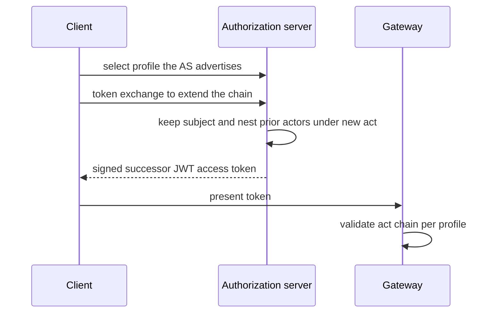

# OAuth WG Daily Report - 2026-11-22

- generated_at_utc: `2026-11-22T19:44:12+00:00`
- snapshot_date: `2026-11-22`

<!-- insights:start -->
## Briefing

> The main thread is the OAuth WG scope debate over which actor-delegation draft (Actor Profile or Actor Chain) to adopt first. Most voices favour a narrow base document, with subset disclosure as follow-on work. GitHub activity is mostly issues and PRs on the ID-JAG and client-id-metadata-document drafts. No draft text is reported as changed in this material.

_Updated 2026-11-22T19:45:37+00:00. Machine-drafted from the sources linked below, which stay authoritative._

### A proposed change would make a query component in Client Identifier URLs a MUST NOT instead of a SHOULD NOT

`pull-request` · `substantive` · first seen 2026-11-22 · [oauth-wg/draft-ietf-oauth-client-id-metadata-document#134: Require Client Identifier URLs MUST NOT contain a query component (#112)](https://github.com/oauth-wg/draft-ietf-oauth-client-id-metadata-document/pull/134)

The PR changes the draft so that a Client Identifier URL must not contain a query string. Today the draft only says it should not. The author says this matches the existing rule that the Client ID Metadata Document must not be built from query input. It is one of three stand-alone PRs related to issue #112, alongside #132 (fetch-gating) and #135 (port ban).

**Use cases**

- An authorization server that fetches client metadata can reject client_id URLs with a query component outright.
- A client that today uses a query string in its client_id URL would need to change it.

### A proposed change would ban ports in Client Identifier URLs in the client-id-metadata-document draft

`pull-request` · `substantive` · first seen 2026-11-22 · [oauth-wg/draft-ietf-oauth-client-id-metadata-document#135: Disallow port component in Client Identifier URLs (#112)](https://github.com/oauth-wg/draft-ietf-oauth-client-id-metadata-document/pull/135)

The PR changes the draft so that a Client Identifier URL must not include a port. The draft currently allows one. The string-comparison example no longer uses :443 and uses a trailing slash instead. The author flags that this may break local testing such as https://localhost:8443/... and other non-default ports, and says the WG might prefer a should-not, or a must-not with a development exception. It is one of three stand-alone PRs related to issue #112.

**Use cases**

- A client developer testing against a local authorization server on a non-default port would no longer be able to use a conforming Client Identifier URL.
- An authorization server implementer deciding how strictly to validate client_id URLs.

### The WG is debating the scope of a first delegation draft: Actor Chain with selective disclosure, or a narrow Actor Profile

`mail` · `discussion` · first seen 2026-11-22 · [Comparing Actor Chain and Actor Profile before an adoption call (3 new messages)](https://mailarchive.ietf.org/arch/msg/oauth/F0EM1153dNyFHn5TmphTpvkCQWg/)

A. Prasad (Actor Chain) recommends Actor Chain as the starting text for JWT access-token delegation rules. The recommendation rests on recipient-specific disclosure: a gateway can get a JWT with the inherited screening actor omitted, and an authorized auditor holding the full originals can verify the withheld step against the chain head. Prasad claims Actor Profile must carry such an actor forward, and that handing over a Liu Delegation Chain record discloses the identifier. Karl McGuinness (Actor Profile) prefers a concise, narrowly scoped base covering actor identification, chain representation and propagation, with provenance proofs and selective disclosure as separate profiles as long as the base does not preclude them. Pieter Kasselman supports the narrow scope. Mark Atwood suggests per-recipient disclosure should be a requirement, with hash-linked hops so a withheld hop is still provable. One of Prasad's messages is truncated in the material, so the full argument is not captured. No adoption decision appears.

**Use cases**

- An API gateway that must authorize a request without seeing internal screening or intermediary hops that belong to another trust domain.
- Regulated workflows such as payments, healthcare referrals or insurance claims, where an auditor must later verify a hop the recipient was never shown.
- A WG participant deciding whether to support adoption of Actor Chain or Actor Profile, and how big the first document should be.

**Related in other tracks**

- `ietf-wimse` / `draft-asor-wimse-agent-delegation-chain`: Also concerns verifiable delegation chains for agents, but the material does not link it to this thread.

### WG members argue over whether Actor Profile or Actor Chain should be the starting text for delegation actor rules, and how narrow it should be

`mail` · `discussion` · first seen 2026-11-22 · [Comparing Actor Chain and Actor Profile before an adoption call (2 new messages)](https://mailarchive.ietf.org/arch/msg/oauth/wKasJd4xdw1SPeOxe3dV13xRmf4/)

Following IETF 127, A. Prasad recommends Actor Chain as the starting text, saying its declared-full profile already covers issuer-asserted actor history in nested act. The first WG draft, they argue, should also allow optional subset disclosure (declared-subset and verified-subset) for need-to-know cases such as a gateway. Karl McGuinness and Pieter Kasselman favour a narrow base document on actor identification, chain representation and propagation, with provenance and selective disclosure as follow-on profiles. Ilja Radusch, running actor-profile -01 at depth 1, lists what a first document must fix: the act shape (iss + sub, enforcement on act.sub), identical act preservation across refresh, and a grant-level identifier (dlg_id, actor-profile PR #34). They support a narrow document if the chain-preservation rule lets a later subset profile relax it by an explicit signal. The message is truncated in the source, and no adoption decision is recorded.

**Use cases**

- An AS issuing delegated-agent tokens that must keep act intact across refresh-token use.
- A gateway that forwards an agent request and should disclose only the actors the next hop needs.
- A resource server that lists or revokes a user's delegations and needs a stable per-grant key.

**Related in other tracks**

- `ietf-wimse` / `draft-nandakumar-wimse-delegator-bound-chains`: Another delegation-chain design for AI agents, in the same space as the actor chain proposals, though this thread does not cite it.

### A researcher asks whether the JWT BCP should say that every claim identifying the user must match the server-side authentication record

`mail` · `discussion` · first seen 2026-11-22 · [User identity checks for JWTs with server-side authentication records](https://mailarchive.ietf.org/arch/msg/oauth/xmpncNcNsIielhtQDosnhixJ-78/)

A Fudan University researcher describes two forgery cases, in ELADMIN and Mainflux, where a JWT signed with a default key passed the signature and server-side record checks, yet a different claim (userId in ELADMIN) made a downstream handler act as another account. Both projects merged fixes: ELADMIN compares the full presented JWT with the one stored at login and drops the shared key, and Mainflux requires a configured secret and checks that the record belongs to the account in the JWT. The author argues that §3.8 of the BCP does not say how a checked record should constrain all claims used to identify the user. They propose a short implementation note and ask whether the existing text covers this, noting that rfc8725bis-10 is already in the RFC Editor queue. No reply is included in the material.

**Use cases**

- A Spring or Express app that authenticates with a JWT plus a Redis session record and reads a user ID claim in a downstream handler.
- An IoT or admin platform that ships a default signing key and must decide how claims are bound to a stored session.

### A reader suggests rewording the OAuth 2.1 introduction example so the authorization server is clearly the bank's

`mail` · `editorial` · first seen 2026-11-22 · [Minor Suggestion draft-ietf-oauth-v2-1-17](https://mailarchive.ietf.org/arch/msg/oauth/DeIh3KO9kryIhbfCqcFyvk1drr8/)

The author says that in the draft-ietf-oauth-v2-1-17 introduction, the phrase "authenticates directly with their financial institution's server (authorization server)" could be read as a component of the financial management service (client). They suggest replacing it with "banking institution's server", or alternatively an example using a personal finance service and "their bank's server". This is a wording-only suggestion with no protocol change, and no replies are included.

### A contact-detail update for an author of the first-party-apps draft

`pull-request` · `editorial` · first seen 2026-11-22 · [oauth-wg/oauth-first-party-apps#182: Update contact details for Pieter Kasselman](https://github.com/oauth-wg/oauth-first-party-apps/pull/182)

The PR changes Pieter Kasselman's email contact and updates the document history. There is no protocol change.

### Weekly GitHub digest: new issues and PRs on OAuth 2.1, ID-JAG, client-id-metadata-document and deferred-token-response

`mail` · `routine` · first seen 2026-11-22 · [Weekly github digest (OAuth Activity Summary)](https://mailarchive.ietf.org/arch/msg/oauth/NQbH3WYKgr_X1TJL9C4MNJKqUrQ/)

The digest lists new issues and PRs but no merged text. In oauth-v2-1, issue #285 asks to add a reference to RFC 10027, and #266 (define invalid_client for the authorization error response, tagged ietf-127) got two comments. In the ID-JAG repo, a new issue (#162) proposes a profile for multi-hop delegation chaining, and four existing issues (#142, #145, #159, #160) got comments, covering the resource parameter, access token lifetime, jwt-dpop vs jwt-bearer in Sections 7.2 and 8, and sender-constrained ID-JAG vs client authentication. In client-id-metadata-document, issue #133 proposes applying the minimum effective cache duration regardless of directives, as is done for the maximum (§6.2), and PR #132 (pre-fetch validation and fetch-triggering guidance) drew five comments. In deferred-token-response, issue #46 asks whether the preceding endpoint may return a deferred response directly. The digest gives only titles, not the contents of these issues.

### The IETF created a non-WG mailing list called LEAK on automated rotation of API keys

`mail` · `routine` · first seen 2026-11-22 · [New Non-WG Mailing List: leak (Limit Exposure of API Keys)](https://mailarchive.ietf.org/arch/msg/oauth/b20jw_GKDd4TT_s2WQxjhE3WB98/)

Lisa Dusseault forwarded the Secretariat announcement of a new non-WG list, leak@ietf.org (Limit Exposure of API Keys), in the ART area. Its stated purpose is to discuss automated rotation of API keys as harm mitigation, and to give guidance and fill gaps so the long tail of API servers can move to safer options. She posted it for people on the OAuth list who may not follow ietf-announce. No drafts or protocol text are involved.

### A new individual draft has a broker hold the OAuth grant while short-lived client instances get sender-constrained tokens

`mail` · `new-proposal` · first seen 2026-11-21 · [New individual draft: OAuth Brokered Authorization: Grant Custody for Short-Lived Client Instances](https://mailarchive.ietf.org/arch/msg/oauth/ZWix6YIyFguohCBkLI88We0zAPw/)

Kieran Sweeney posted draft-sweeney-oauth-brokered-authorization-00 for deployments where many short-lived client instances act under one authorization. A broker is the single durable OAuth client of the upstream resource: it holds the grant and the upstream credential and makes each upstream request itself. The AS records the authorization against the client, not any instance. Each instance gets a short-lived, sender-constrained access token through the client credentials grant and never holds a grant, refresh token or upstream credential. Feedback is requested on the Section 11 open issues: restricting a brokered authorization to some instances (by attester, tenant or resource-owner condition) and evidence of each upstream request that someone other than the broker can check.

**Use cases**

- Ephemeral agent or job instances that call an upstream API on a user's behalf without any of them holding a refresh token.
- A platform that wants one revocable grant per client rather than per short-lived instance.

### An implementer's review of the Client ID Metadata Document draft ends with one issue on cache-lifetime wording and a few open suggestions

`mail` · `discussion` · first seen 2026-11-21 · [Implementation report:draft-ietf-oauth-client-id-metadata-document at an AS serving native apps and MCP clients](https://mailarchive.ietf.org/arch/msg/oauth/7v7AHvCv5o_7x7nWWHA62k7Qipw/)

In a follow-up to an implementation report, Sean MacGuire withdrew several earlier points (RFC 3986 §6.2.1 string comparison already covers URL comparison, and the per-host documents were a deployment choice, not a draft requirement). Sean will open an issue for item 4: -03 §6.2 applies the minimum cache lifetime only when none is otherwise indicated, so no-store and max-age=0 fall outside it, and the issue proposes the same 'regardless' wording the maximum already has. Remaining suggestions: mention DNS rebinding (the address check must hold for the address actually connected to) and a fetch timeout in the fetch-safety text, and add a pointer to RFC 8252 for native clients, since redirect_uris is where the AS learns a native scheme. Emelia noted the OWASP SSRF cheat sheet already covers DNS rebinding, and said the AS should read the document's scope and intersect it with what it is willing to grant.

**Use cases**

- An AS operator fetching client metadata documents who wants to know how no-store or max-age=0 responses should be cached under -03 §6.2.
- An implementer hardening the metadata-document fetcher against SSRF, including DNS rebinding and timeouts.
- A native-app vendor publishing a metadata document whose redirect_uris use private-use URI schemes.

### The Actor Chain authors reply to Actor Profile and recommend their draft as the WG's starting text for delegation in JWT access tokens

`mail` · `discussion` · first seen 2026-11-21 · [Comparing Actor Chain and Actor Profile before an adoption call](https://mailarchive.ietf.org/arch/msg/oauth/J7ih2WjufFDRkrWdwNdHpQiAh-M/)

Prasad, for the Actor Chain coauthors, says its declared-full profile already gives the simple issuer-asserted baseline Karl describes: the AS keeps the subject, nests prior actors under the new actor's issuer-qualified act entry and signs the successor token. On the bank-gateway example (show initiator and connector, hide a screening service), he argues Actor Profile requires carrying forward an actor already named in the inbound act, so the exchange would be rejected, and a disclosure extension would have to allow omission; Actor Chain's declared-subset permits it, and verified-subset can add original signed requests and AS acceptances. Actor Chain has six profiles (two assurance choices times three disclosure choices) selected by the client from those the AS advertises. They report independent Python and Node.js validators agreeing on accept and reject tests, and recommend Actor Chain as the starting text, led by a concise declared-full section. Quoted earlier messages show Karl wanting a base without provenance proofs or selective disclosure, with provenance as a later profile, and Ramki agreeing to test that compatibility. The message is truncated.

**Use cases**

- An AI-agent gateway that must give a downstream service an actor history while keeping an internal screening service private.
- A deployer choosing between an issuer-asserted act chain and one backed by actor-signed proofs.
- A WG participant weighing which draft to adopt as the base for JWT access-token delegation.

### Triage of the candidate queue

- **high** `draft-ietf-oauth-identity-assertion-authz-grant`: Five issues were opened or commented on in one week (#142, #145, #159, #160, #162), including multi-hop delegation chaining.
- **low** `draft-ietf-oauth-rfc8725bis`: A thread asks for a clarification, but the draft is already in the RFC Editor queue, so changes are unlikely.
- **low** `draft-ietf-oauth-status-list`: Only cited in list feedback as a preferred chain-status mechanism, with no change to the draft.
- **low** `draft-ietf-oauth-transaction-tokens`: Mentioned only as one possible delegation credential in the PACE draft announcement.
- **low** `draft-ietf-oauth-v2-1`: Only a minor reference error in section 7.13.1 was reported.

<!-- insights:end -->

## Top Priorities

| Rank | Draft | Score | Updated | Key State | Repo |
|---|---|---:|---|---|---|
| 1 | `draft-ietf-oauth-sd-jwt-vc` | 112 | 2026-11-16T10:45:13Z | Active, Expert Reviews OK | `oauth-sd-jwt-vc` |
| 2 | `draft-ietf-oauth-status-list` | 90 | 2026-11-19T02:42:34Z | Active, RFC-Ed-Ack | `draft-ietf-oauth-status-list` |
| 3 | `draft-ietf-oauth-rfc8725bis` | 83 | 2026-11-17T15:06:04Z | Active, No IANA Actions | `draft-ietf-oauth-rfc8725bis` |
| 4 | `draft-ietf-oauth-first-party-apps` | 80 | 2026-08-26T14:40:16Z | Active, I-D Exists | `oauth-first-party-apps` |
| 5 | `draft-ietf-oauth-identity-chaining` | 75 | 2026-11-12T02:07:35Z | Active, RFC-Ed-Ack | `oauth-identity-chaining` |
| 6 | `draft-ietf-oauth-client-id-metadata-document` | 73 | 2026-11-02T22:02:56Z | Active, I-D Exists | `draft-ietf-oauth-client-id-metadata-document` |
| 7 | `draft-ietf-oauth-identity-assertion-authz-grant` | 73 | 2026-10-31T00:32:39Z | Active, I-D Exists | `oauth-identity-assertion-authz-grant` |
| 8 | `draft-ietf-oauth-deferred-token-response` | 66 | 2026-10-31T16:12:16Z | Active, I-D Exists | `oauth-deferred-token-response` |
| 9 | `draft-ietf-oauth-v2-1` | 66 | 2026-10-31T04:16:32Z | Active, I-D Exists | `oauth-v2-1` |
| 10 | `draft-ietf-oauth-delegate-sd-jwt` | 66 | 2026-10-30T12:38:29Z | Active, I-D Exists | `oauth-delegate-sd-jwt` |

## Active Drafts

| Draft | Rev | Updated | States |
|---|---:|---|---|
| `draft-ietf-oauth-status-list` | 21 | 2026-11-19T02:42:34Z | Active, RFC-Ed-Ack, Expert Reviews OK |
| `draft-ietf-oauth-rfc8725bis` | 10 | 2026-11-17T15:06:04Z | Active, No IANA Actions, IANA OK - No Actions Needed |
| `draft-ietf-oauth-sd-jwt-vc` | 27 | 2026-11-16T10:45:13Z | Active, Expert Reviews OK, Version Changed - Review Needed |
| `draft-ietf-oauth-identity-chaining` | 17 | 2026-11-12T02:07:35Z | Active, RFC-Ed-Ack, Expert Reviews OK |
| `draft-ietf-oauth-client-id-metadata-document` | 03 | 2026-11-02T22:02:56Z | Active, I-D Exists, WG Document |
| `draft-ietf-oauth-spiffe-client-auth` | 03 | 2026-11-02T17:35:55Z | Active, I-D Exists, WG Document |
| `draft-ietf-oauth-deferred-token-response` | 01 | 2026-10-31T16:12:16Z | Active, I-D Exists, WG Document |
| `draft-ietf-oauth-v2-1` | 17 | 2026-10-31T04:16:32Z | Active, I-D Exists, WG Document |
| `draft-ietf-oauth-identity-assertion-authz-grant` | 06 | 2026-10-31T00:32:39Z | Active, I-D Exists, WG Document |
| `draft-ietf-oauth-delegate-sd-jwt` | 00 | 2026-10-30T12:38:29Z | Active, I-D Exists, WG Document |
| `draft-ietf-oauth-attestation-based-client-auth` | 12 | 2026-10-18T17:33:02Z | Active, I-D Exists, WG Consensus: Waiting for Write-Up |
| `draft-ietf-oauth-first-party-apps` | 04 | 2026-08-26T14:40:16Z | Active, I-D Exists, WG Consensus: Waiting for Write-Up |
| `draft-ietf-oauth-rar-metadata-remediation` | 00 | 2026-08-23T20:29:29Z | Active, I-D Exists, WG Document |
| `draft-ietf-oauth-transaction-tokens` | 11 | 2026-08-21T11:57:16Z | Active, I-D Exists, WG Consensus: Waiting for Write-Up |
| `draft-ietf-oauth-refresh-token-expiration` | 03 | 2026-07-06T17:53:06Z | Active, I-D Exists, WG Document |

## Repo Watch

| Repo | Pushed | Open Issues |
|---|---|---:|
| `oauth-wg/oauth-identity-assertion-authz-grant` | 2026-11-22T00:02:50Z | 34 |
| `oauth-wg/draft-ietf-oauth-client-id-metadata-document` | 2026-11-22T00:00:40Z | 38 |
| `oauth-wg/oauth-first-party-apps` | 2026-11-21T15:17:38Z | 7 |
| `oauth-wg/oauth-delegate-sd-jwt` | 2026-11-19T00:25:09Z | 14 |
| `oauth-wg/oauth-v2-1` | 2026-11-19T00:12:28Z | 16 |
| `oauth-wg/oauth-spiffe-client-authentication` | 2026-11-19T00:09:37Z | 6 |
| `oauth-wg/oauth-deferred-token-response` | 2026-11-19T00:06:27Z | 25 |
| `oauth-wg/oauth-sd-jwt-vc` | 2026-11-17T00:31:32Z | 0 |
| `oauth-wg/oauth-transaction-tokens` | 2026-11-10T00:15:51Z | 3 |
| `oauth-wg/draft-ietf-oauth-attestation-based-client-auth` | 2026-10-13T06:13:11Z | 0 |
| `oauth-wg/oauth-selective-disclosure-jwt` | 2026-10-04T13:50:37Z | 0 |
| `oauth-wg/oauth-cross-device-security` | 2026-08-27T14:45:11Z | 0 |

## Recent Pull Requests

- `oauth-wg/draft-ietf-oauth-client-id-metadata-document#135` Disallow port component in Client Identifier URLs (#112) (2026-11-21T15:52:33Z)
- `oauth-wg/draft-ietf-oauth-client-id-metadata-document#134` Require Client Identifier URLs MUST NOT contain a query component (#112) (2026-11-21T15:52:31Z)
- `oauth-wg/draft-ietf-oauth-client-id-metadata-document#132` Add pre-fetch validation and fetch-triggering guidance (#112) (2026-11-21T15:41:17Z)
- `oauth-wg/oauth-first-party-apps#182` Update contact details for Pieter Kasselman (2026-11-21T15:17:16Z)
- `oauth-wg/oauth-first-party-apps#181` Rename draft to OAuth Authorization Challenge Endpoint (2026-11-21T07:46:53Z)
- `oauth-wg/oauth-identity-assertion-authz-grant#108` Add guidance on RAS-specific and private claims in the ID-JAG (2026-11-20T17:45:42Z)
- `oauth-wg/oauth-first-party-apps#180` updated references to RFC10017 and RFC10027 (2026-11-20T06:26:00Z)
- `oauth-wg/oauth-v2-1#286` Add RFC 10027 references and update security sections (2026-11-18T21:42:02Z)
- `oauth-wg/oauth-v2-1#273` Restrict access token values to the token68 syntax (2026-11-18T19:43:34Z)
- `oauth-wg/oauth-v2-1#284` Cite RFC 7617 for the Basic authentication scheme (2026-11-17T10:06:57Z)

## Recent Issues

- `oauth-wg/draft-ietf-oauth-client-id-metadata-document#133` §6.2: apply the minimum effective cache duration regardless of directives, as the maximum is (2026-11-20T23:44:57Z)
- `oauth-wg/draft-ietf-oauth-client-id-metadata-document#52` Add Security sub-section of DOS risks (2026-11-20T23:37:58Z)
- `oauth-wg/oauth-identity-assertion-authz-grant#162` Profile for multi-hop delegation chaining (2026-11-18T22:32:52Z)
- `oauth-wg/oauth-spiffe-client-authentication#39` spiffe_wit should be independent of attestation-based client authentication (2026-11-18T20:22:43Z)
- `oauth-wg/oauth-spiffe-client-authentication#52` Should X.509 validation include all the leaf checks from the SPIFFE X.509 specification? (2026-11-18T20:18:54Z)
- `oauth-wg/oauth-deferred-token-response#46` Allow the preceding endpoint to return a deferred response directly, in addition to accepting an advance hint (2026-11-18T18:29:09Z)
- `oauth-wg/oauth-v2-1#266` Define invalid_client for Authorization Error Response (2026-11-18T18:09:46Z)
- `oauth-wg/oauth-v2-1#285` Add reference to RFC 10027 (2026-11-18T17:43:54Z)
- `oauth-wg/oauth-delegate-sd-jwt#16` issuer_jwt_hash leaves Issuer Disclosures unbound in the final presentation (2026-11-18T11:08:17Z)
- `oauth-wg/oauth-delegate-sd-jwt#8` Place requirements, or clarify that constraints can only narrow across the chain (2026-11-17T03:30:10Z)

## Organization Events

- `2026-11-20T06:25:58Z` PushEvent `oauth-wg/oauth-first-party-apps` 
- `2026-11-20T06:26:24Z` PushEvent `oauth-wg/oauth-first-party-apps` 
- `2026-11-20T06:48:12Z` CreateEvent `oauth-wg/oauth-first-party-apps` 
- `2026-11-22T00:02:51Z` PushEvent `oauth-wg/oauth-identity-assertion-authz-grant` 
- `2026-11-21T16:36:37Z` WatchEvent `oauth-wg/oauth-first-party-apps` started
- `2026-11-21T15:17:17Z` PushEvent `oauth-wg/oauth-first-party-apps` 
- `2026-11-21T15:36:38Z` IssueCommentEvent `oauth-wg/draft-ietf-oauth-client-id-metadata-document` Add pre-fetch validation and fetch-triggering guidance (#112)
- `2026-11-21T15:36:34Z` PullRequestEvent `oauth-wg/draft-ietf-oauth-client-id-metadata-document` opened
- `2026-11-21T15:36:30Z` PullRequestEvent `oauth-wg/draft-ietf-oauth-client-id-metadata-document` opened
- `2026-11-21T15:36:16Z` IssueCommentEvent `oauth-wg/draft-ietf-oauth-client-id-metadata-document` Add pre-fetch validation and fetch-triggering guidance (#112)
- `2026-11-21T15:36:15Z` IssueCommentEvent `oauth-wg/draft-ietf-oauth-client-id-metadata-document` Add pre-fetch validation and fetch-triggering guidance (#112)
- `2026-11-21T15:17:16Z` PullRequestEvent `oauth-wg/oauth-first-party-apps` merged
- `2026-11-21T15:17:09Z` PullRequestReviewEvent `oauth-wg/oauth-first-party-apps` created
- `2026-11-21T07:49:45Z` PushEvent `oauth-wg/oauth-first-party-apps` 
- `2026-11-21T07:50:12Z` PullRequestEvent `oauth-wg/oauth-first-party-apps` opened
- `2026-11-21T07:46:54Z` PullRequestReviewEvent `oauth-wg/oauth-first-party-apps` created
- `2026-11-21T06:05:08Z` ForkEvent `oauth-wg/oauth-identity-chaining` forked
- `2026-11-20T23:44:57Z` IssueCommentEvent `oauth-wg/draft-ietf-oauth-client-id-metadata-document` §6.2: apply the minimum effective cache duration regardless of directives, as the maximum is
- `2026-11-20T23:41:46Z` IssueCommentEvent `oauth-wg/draft-ietf-oauth-client-id-metadata-document` Add pre-fetch validation and fetch-triggering guidance (#112)
- `2026-11-20T23:37:58Z` IssueCommentEvent `oauth-wg/draft-ietf-oauth-client-id-metadata-document` Add Security sub-section of DOS risks

## Mailarchive Signals

- weekly_digest_count: `1`
- [OAUTH-WG] Weekly github digest (OAuth Activity Summary) - https://mailarchive.ietf.org/arch/msg/oauth/NQbH3WYKgr_X1TJL9C4MNJKqUrQ/
- [OAUTH-WG] [JWT BCP §3.8] User identity checks for JWTs with server-side authentication records - https://mailarchive.ietf.org/arch/msg/oauth/xmpncNcNsIielhtQDosnhixJ-78/
- [OAUTH-WG] Re: Comparing Actor Chain and Actor Profile before an adoption call - https://mailarchive.ietf.org/arch/msg/oauth/wKasJd4xdw1SPeOxe3dV13xRmf4/
- [OAUTH-WG] Re: Comparing Actor Chain and Actor Profile before an adoption call - https://mailarchive.ietf.org/arch/msg/oauth/5FIucSywoIMIRV1Ze8hMBybiRzs/
- [OAUTH-WG] Re: Comparing Actor Chain and Actor Profile before an adoption call - https://mailarchive.ietf.org/arch/msg/oauth/F0EM1153dNyFHn5TmphTpvkCQWg/
- [OAUTH-WG] Fwd: New Non-WG Mailing List: leak (Limit Exposure of API Keys) - https://mailarchive.ietf.org/arch/msg/oauth/b20jw_GKDd4TT_s2WQxjhE3WB98/
- [OAUTH-WG] Re: Comparing Actor Chain and Actor Profile before an adoption call - https://mailarchive.ietf.org/arch/msg/oauth/_5ZSCkG9zV22WAAIeE-QZauY6-Y/
- [OAUTH-WG] Re: Comparing Actor Chain and Actor Profile before an adoption call - https://mailarchive.ietf.org/arch/msg/oauth/oY1e05yIaUOCHizqStcRNk5QUn8/

## Next Actions

1. Evaluate the top 3 items in `Top Priorities` as weekly deep-dive candidates.
2. Separately track comment deadlines for `In Last Call` / `In WG Last Call` drafts.
3. For repos with a sudden spike in activity, create a scaffold in `deep-dives/` to capture key discussion points.
