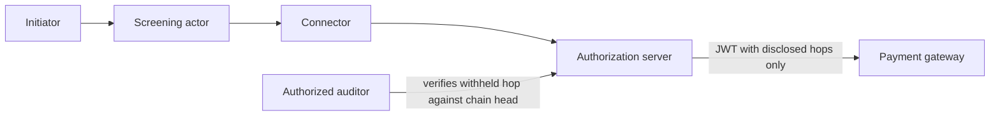
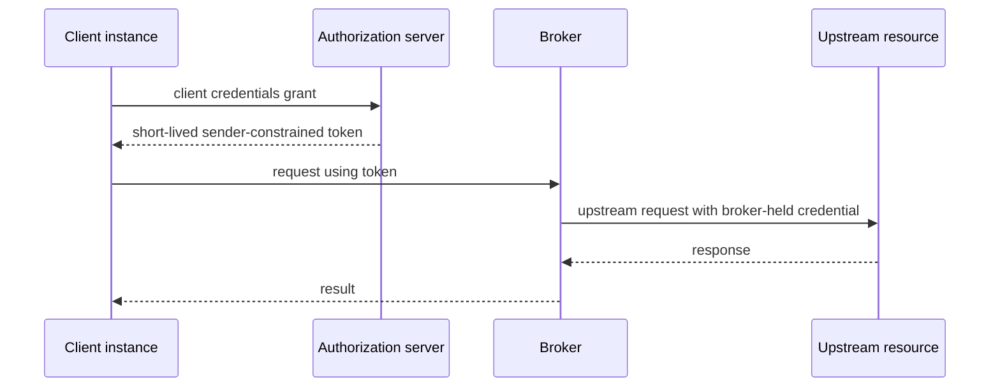
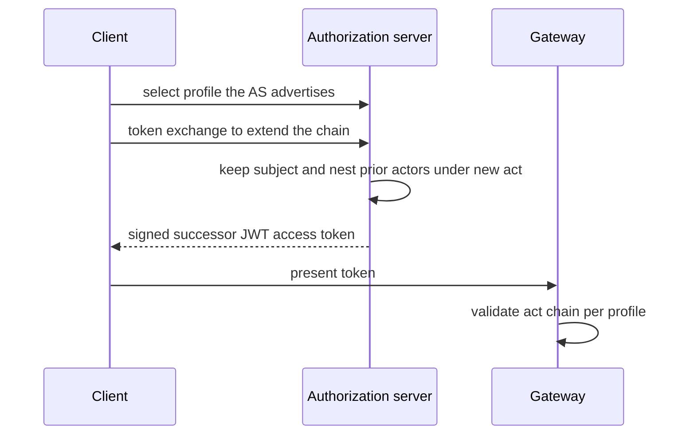
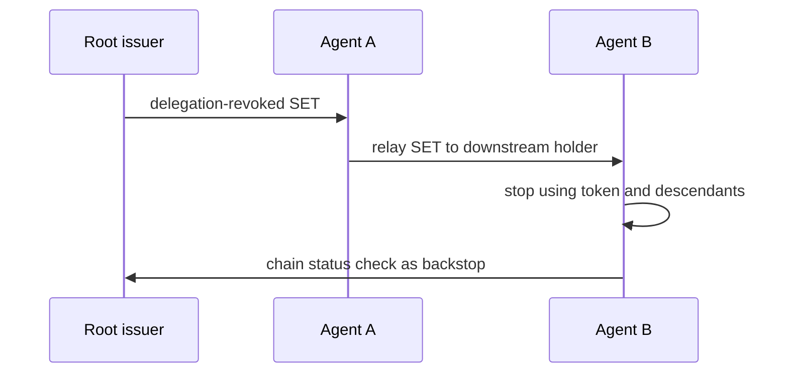

# OAuth WG Daily Report - 2026-11-22

- generated_at_utc: `2026-11-22T06:53:49+00:00`
- snapshot_date: `2026-11-22`

<!-- insights:start -->
## Briefing

> The main activity is a mailing-list debate on adopting OAuth Actor Chain or Actor Profile for delegation: Actor Chain's authors want per-recipient disclosure in the first draft, while Karl McGuinness and Pieter Kasselman favour a narrow base. Two PRs would tighten Client Identifier URL rules.

_Updated 2026-11-22T06:55:19+00:00. Machine-drafted from the sources linked below, which stay authoritative._

### A proposed change would make a query component in Client Identifier URLs a MUST NOT instead of a SHOULD NOT

`pull-request` · `substantive` · first seen 2026-11-22 · [oauth-wg/draft-ietf-oauth-client-id-metadata-document#134: Require Client Identifier URLs MUST NOT contain a query component (#112)](https://github.com/oauth-wg/draft-ietf-oauth-client-id-metadata-document/pull/134)

The PR changes the draft so that a Client Identifier URL must not contain a query string. Today the draft only says it should not. The author says this matches the existing rule that the Client ID Metadata Document must not be built from query input. It is one of three stand-alone PRs related to issue #112, alongside #132 (fetch-gating) and #135 (port ban).

**Use cases**

- An authorization server that fetches client metadata can reject client_id URLs with a query component outright.
- A client that today uses a query string in its client_id URL would need to change it.

### A proposed change would ban ports in Client Identifier URLs in the client-id-metadata-document draft

`pull-request` · `substantive` · first seen 2026-11-22 · [oauth-wg/draft-ietf-oauth-client-id-metadata-document#135: Disallow port component in Client Identifier URLs (#112)](https://github.com/oauth-wg/draft-ietf-oauth-client-id-metadata-document/pull/135)

The PR changes the draft so that a Client Identifier URL must not include a port. The draft currently allows one. The string-comparison example no longer uses :443 and uses a trailing slash instead. The author flags that this may break local testing such as https://localhost:8443/... and other non-default ports, and says the WG might prefer a should-not, or a must-not with a development exception. It is one of three stand-alone PRs related to issue #112.

**Use cases**

- A client developer testing against a local authorization server on a non-default port would no longer be able to use a conforming Client Identifier URL.
- An authorization server implementer deciding how strictly to validate client_id URLs.

### The WG is debating the scope of a first delegation draft: Actor Chain with selective disclosure, or a narrow Actor Profile

`mail` · `discussion` · first seen 2026-11-22 · [Comparing Actor Chain and Actor Profile before an adoption call (3 new messages)](https://mailarchive.ietf.org/arch/msg/oauth/F0EM1153dNyFHn5TmphTpvkCQWg/)

A. Prasad (Actor Chain) recommends Actor Chain as the starting text for JWT access-token delegation rules. The recommendation rests on recipient-specific disclosure: a gateway can get a JWT with the inherited screening actor omitted, and an authorized auditor holding the full originals can verify the withheld step against the chain head. Prasad claims Actor Profile must carry such an actor forward, and that handing over a Liu Delegation Chain record discloses the identifier. Karl McGuinness (Actor Profile) prefers a concise, narrowly scoped base covering actor identification, chain representation and propagation, with provenance proofs and selective disclosure as separate profiles as long as the base does not preclude them. Pieter Kasselman supports the narrow scope. Mark Atwood suggests per-recipient disclosure should be a requirement, with hash-linked hops so a withheld hop is still provable. One of Prasad's messages is truncated in the material, so the full argument is not captured. No adoption decision appears.

**Use cases**

- An API gateway that must authorize a request without seeing internal screening or intermediary hops that belong to another trust domain.
- Regulated workflows such as payments, healthcare referrals or insurance claims, where an auditor must later verify a hop the recipient was never shown.
- A WG participant deciding whether to support adoption of Actor Chain or Actor Profile, and how big the first document should be.

**Related in other tracks**

- `ietf-wimse` / `draft-asor-wimse-agent-delegation-chain`: Also concerns verifiable delegation chains for agents, but the material does not link it to this thread.

### A contact-detail update for an author of the first-party-apps draft

`pull-request` · `editorial` · first seen 2026-11-22 · [oauth-wg/oauth-first-party-apps#182: Update contact details for Pieter Kasselman](https://github.com/oauth-wg/oauth-first-party-apps/pull/182)

The PR changes Pieter Kasselman's email contact and updates the document history. There is no protocol change.

### The IETF created a non-WG mailing list called LEAK on automated rotation of API keys

`mail` · `routine` · first seen 2026-11-22 · [New Non-WG Mailing List: leak (Limit Exposure of API Keys)](https://mailarchive.ietf.org/arch/msg/oauth/b20jw_GKDd4TT_s2WQxjhE3WB98/)

Lisa Dusseault forwarded the Secretariat announcement of a new non-WG list, leak@ietf.org (Limit Exposure of API Keys), in the ART area. Its stated purpose is to discuss automated rotation of API keys as harm mitigation, and to give guidance and fill gaps so the long tail of API servers can move to safer options. She posted it for people on the OAuth list who may not follow ietf-announce. No drafts or protocol text are involved.

### A new individual draft has a broker hold the OAuth grant while short-lived client instances get sender-constrained tokens

`mail` · `new-proposal` · first seen 2026-11-21 · [New individual draft: OAuth Brokered Authorization: Grant Custody for Short-Lived Client Instances](https://mailarchive.ietf.org/arch/msg/oauth/ZWix6YIyFguohCBkLI88We0zAPw/)

Kieran Sweeney posted draft-sweeney-oauth-brokered-authorization-00 for deployments where many short-lived client instances act under one authorization. A broker is the single durable OAuth client of the upstream resource: it holds the grant and the upstream credential and makes each upstream request itself. The AS records the authorization against the client, not any instance. Each instance gets a short-lived, sender-constrained access token through the client credentials grant and never holds a grant, refresh token or upstream credential. Feedback is requested on the Section 11 open issues: restricting a brokered authorization to some instances (by attester, tenant or resource-owner condition) and evidence of each upstream request that someone other than the broker can check.

**Use cases**

- Ephemeral agent or job instances that call an upstream API on a user's behalf without any of them holding a refresh token.
- A platform that wants one revocable grant per client rather than per short-lived instance.

### An implementer's review of the Client ID Metadata Document draft ends with one issue on cache-lifetime wording and a few open suggestions

`mail` · `discussion` · first seen 2026-11-21 · [Implementation report:draft-ietf-oauth-client-id-metadata-document at an AS serving native apps and MCP clients](https://mailarchive.ietf.org/arch/msg/oauth/7v7AHvCv5o_7x7nWWHA62k7Qipw/)

In a follow-up to an implementation report, Sean MacGuire withdrew several earlier points (RFC 3986 §6.2.1 string comparison already covers URL comparison, and the per-host documents were a deployment choice, not a draft requirement). Sean will open an issue for item 4: -03 §6.2 applies the minimum cache lifetime only when none is otherwise indicated, so no-store and max-age=0 fall outside it, and the issue proposes the same 'regardless' wording the maximum already has. Remaining suggestions: mention DNS rebinding (the address check must hold for the address actually connected to) and a fetch timeout in the fetch-safety text, and add a pointer to RFC 8252 for native clients, since redirect_uris is where the AS learns a native scheme. Emelia noted the OWASP SSRF cheat sheet already covers DNS rebinding, and said the AS should read the document's scope and intersect it with what it is willing to grant.

**Use cases**

- An AS operator fetching client metadata documents who wants to know how no-store or max-age=0 responses should be cached under -03 §6.2.
- An implementer hardening the metadata-document fetcher against SSRF, including DNS rebinding and timeouts.
- A native-app vendor publishing a metadata document whose redirect_uris use private-use URI schemes.

### The Actor Chain authors reply to Actor Profile and recommend their draft as the WG's starting text for delegation in JWT access tokens

`mail` · `discussion` · first seen 2026-11-21 · [Comparing Actor Chain and Actor Profile before an adoption call](https://mailarchive.ietf.org/arch/msg/oauth/J7ih2WjufFDRkrWdwNdHpQiAh-M/)

Prasad, for the Actor Chain coauthors, says its declared-full profile already gives the simple issuer-asserted baseline Karl describes: the AS keeps the subject, nests prior actors under the new actor's issuer-qualified act entry and signs the successor token. On the bank-gateway example (show initiator and connector, hide a screening service), he argues Actor Profile requires carrying forward an actor already named in the inbound act, so the exchange would be rejected, and a disclosure extension would have to allow omission; Actor Chain's declared-subset permits it, and verified-subset can add original signed requests and AS acceptances. Actor Chain has six profiles (two assurance choices times three disclosure choices) selected by the client from those the AS advertises. They report independent Python and Node.js validators agreeing on accept and reject tests, and recommend Actor Chain as the starting text, led by a concise declared-full section. Quoted earlier messages show Karl wanting a base without provenance proofs or selective disclosure, with provenance as a later profile, and Ramki agreeing to test that compatibility. The message is truncated.

**Use cases**

- An AI-agent gateway that must give a downstream service an actor history while keeping an internal screening service private.
- A deployer choosing between an issuer-asserted act chain and one backed by actor-signed proofs.
- A WG participant weighing which draft to adopt as the base for JWT access-token delegation.

### Mark questions whether per-server instance identifiers must expose every server to the attester, and asks for a Privacy Pass-style split

`mail` · `discussion` · first seen 2026-11-21 · [client-instance-id and client-attesters: attester visibility](https://mailarchive.ietf.org/arch/msg/oauth/ViWE0WzaIYlcnLPrdJrJDHYG7xg/)

Mark comments on two of Karl's drafts. On client-instance-id §10.3, scoping the instance identifier per server lets the attester see every server a client uses, while a single shared scope avoids that but lets the servers correlate the instance. He asks whether the tradeoff is forced, pointing to Privacy Pass (RFC 9576), which separates attestation from issuance. On client-attesters, he supports keeping publisher-authorized key selection (an open-source project naming its own attester in its CIMD) as a first-class path and keeping attestation optional, as §7.6 has it.

**Use cases**

- A client-attestation deployment where the attester should not learn which servers each app install talks to.
- An open-source client that wants to name its own attester in its CIMD rather than rely on a platform vendor.

### Mark argues that approval evidence for bounded work must survive the AS rewriting its own records, and suggests hash-linking

`mail` · `discussion` · first seen 2026-11-21 · [bounded-work: a requirement for the use-case discussion](https://mailarchive.ietf.org/arch/msg/oauth/toGYFb0xtz7_JfCBhAy5AEx-bSk/)

Replying in the bounded-work use-case discussion, Mark says that if approval evidence is meant to settle disputes it must hold up even when the AS, itself one of the parties, changes its records. In -00 the evidence is signed by the AS (4.1.3), which does not prevent the AS from later signing a different history, such as one without a withdrawal. He suggests hash-linking the approval and lifecycle records and giving the approver the latest hash. No draft text changes; this is a requirement proposed for the discussion.

**Use cases**

- A deployer who needs approval and withdrawal records that a user can use against the AS in a dispute.

### draft-williams-oauth-poi-core-01 adds consume-once admission, a typed attestation container and crash-recovery rules, and asks three design questions

`mail` · `substantive` · first seen 2026-11-20 · [Updated Draft: draft-williams-oauth-poi-core-01](https://mailarchive.ietf.org/arch/msg/oauth/oPkIewx8BZUug4DnwFAiC8TTwP0/)

The author posted -01 of the Proof of Intent draft and asked for feedback on three open questions. First, whether PoI errors should use 403 only and whether PoI-Challenge and PoI-Envelope should adopt RFC 8941 Structured Fields. Second, whether to keep the parameterized application/poi+jwt;kind=... or register distinct +jwt subtypes so libraries can match typ by plain string. Third, the wire bindings, namely how initial KCT issuance is parameterized at the token endpoint, how oversized envelopes coexist with an API request body, how the RS returns the CIR, and which schema format governs editable_schema. Changes in -01 separate stateless evidence verification from atomic consume-once admission that fails closed. They add attestation: {format, token} with an IANA registry and profiles. They also require display of every raw_params member. Receipts are scoped to admission evidence, intent_id stays stable across reapproval, and the draft defines intent_outcome_unknown (409) and intent_rejected (422). An Implementation Status section is added.

**Use cases**

- A team building human-approval flows for agent actions that must prove the approved parameters match what was executed.
- A resource server operator that needs replay-safe, consume-once admission of signed intent evidence, including during store outages.

### A new draft defines a delegation-revoked security event that revokes a token and all its descendants

`mail` · `new-proposal` · first seen 2026-11-20 · [New draft: Security Events for Revocation of Agent Delegations (2 new messages)](https://mailarchive.ietf.org/arch/msg/oauth/d4QcDFQ4Ays3NJUukHaknL8KIrk/)

Suhas Nandakumar and Cullen posted draft-nandakumar-oauth-delegation-revocation-00. It defines a delegation-revoked SET that revokes a token and every credential delegated below it. Each holder relays the event down the chain, and chain status checks act as the backstop if an event is lost. Marc replied with suggestions: state that only the root issuer or its designee can withdraw a principal across all chains, ask issuers to state a maximum publication delay so the Section 7 bound is measurable from revoked_at, and prefer Status List over token introspection for chain status because introspection reveals which tokens each verifier checks.

**Use cases**

- An operator who must cut off a sub-agent chain after revoking the first delegation.
- A verifier choosing between Status List and introspection to check chain status.

**Related in other tracks**

- `ietf-wimse` / `draft-nandakumar-wimse-delegator-bound-chains`: Same authors work on delegation chains, but the message does not link the two.

### Triage of the candidate queue

- **high** `draft-ietf-oauth-client-id-metadata-document`: Two open PRs (#134, #135) would tighten Client Identifier URL rules (no query, no port), with a WG question about local-testing exceptions.
- **high** `draft-ietf-oauth-identity-assertion-authz-grant`: New issue #161 reports a conflict between the §4.3.3 and §4.5 rules, and #121 was closed this week.
- **low** `draft-ietf-oauth-status-list`: Only cited in list feedback as a preferred chain-status mechanism, with no change to the draft.
- **low** `draft-ietf-oauth-transaction-tokens`: Mentioned only as one possible delegation credential in the PACE draft announcement.
- **low** `draft-ietf-oauth-v2-1`: Only a minor reference error in section 7.13.1 was reported.

<!-- insights:end -->

## Top Priorities

| Rank | Draft | Score | Updated | Key State | Repo |
|---|---|---:|---|---|---|
| 1 | `draft-ietf-oauth-sd-jwt-vc` | 112 | 2026-11-16T10:45:13Z | Active, Expert Reviews OK | `oauth-sd-jwt-vc` |
| 2 | `draft-ietf-oauth-status-list` | 90 | 2026-11-19T02:42:34Z | Active, RFC-Ed-Ack | `draft-ietf-oauth-status-list` |
| 3 | `draft-ietf-oauth-rfc8725bis` | 83 | 2026-11-17T15:06:04Z | Active, No IANA Actions | `draft-ietf-oauth-rfc8725bis` |
| 4 | `draft-ietf-oauth-first-party-apps` | 80 | 2026-08-26T14:40:16Z | Active, I-D Exists | `oauth-first-party-apps` |
| 5 | `draft-ietf-oauth-identity-chaining` | 75 | 2026-11-12T02:07:35Z | Active, RFC-Ed-Ack | `oauth-identity-chaining` |
| 6 | `draft-ietf-oauth-client-id-metadata-document` | 73 | 2026-11-02T22:02:56Z | Active, I-D Exists | `draft-ietf-oauth-client-id-metadata-document` |
| 7 | `draft-ietf-oauth-identity-assertion-authz-grant` | 73 | 2026-10-31T00:32:39Z | Active, I-D Exists | `oauth-identity-assertion-authz-grant` |
| 8 | `draft-ietf-oauth-deferred-token-response` | 66 | 2026-10-31T16:12:16Z | Active, I-D Exists | `oauth-deferred-token-response` |
| 9 | `draft-ietf-oauth-v2-1` | 66 | 2026-10-31T04:16:32Z | Active, I-D Exists | `oauth-v2-1` |
| 10 | `draft-ietf-oauth-delegate-sd-jwt` | 66 | 2026-10-30T12:38:29Z | Active, I-D Exists | `oauth-delegate-sd-jwt` |

## Active Drafts

| Draft | Rev | Updated | States |
|---|---:|---|---|
| `draft-ietf-oauth-status-list` | 21 | 2026-11-19T02:42:34Z | Active, RFC-Ed-Ack, Expert Reviews OK |
| `draft-ietf-oauth-rfc8725bis` | 10 | 2026-11-17T15:06:04Z | Active, No IANA Actions, IANA OK - No Actions Needed |
| `draft-ietf-oauth-sd-jwt-vc` | 27 | 2026-11-16T10:45:13Z | Active, Expert Reviews OK, Version Changed - Review Needed |
| `draft-ietf-oauth-identity-chaining` | 17 | 2026-11-12T02:07:35Z | Active, RFC-Ed-Ack, Expert Reviews OK |
| `draft-ietf-oauth-client-id-metadata-document` | 03 | 2026-11-02T22:02:56Z | Active, I-D Exists, WG Document |
| `draft-ietf-oauth-spiffe-client-auth` | 03 | 2026-11-02T17:35:55Z | Active, I-D Exists, WG Document |
| `draft-ietf-oauth-deferred-token-response` | 01 | 2026-10-31T16:12:16Z | Active, I-D Exists, WG Document |
| `draft-ietf-oauth-v2-1` | 17 | 2026-10-31T04:16:32Z | Active, I-D Exists, WG Document |
| `draft-ietf-oauth-identity-assertion-authz-grant` | 06 | 2026-10-31T00:32:39Z | Active, I-D Exists, WG Document |
| `draft-ietf-oauth-delegate-sd-jwt` | 00 | 2026-10-30T12:38:29Z | Active, I-D Exists, WG Document |
| `draft-ietf-oauth-attestation-based-client-auth` | 12 | 2026-10-18T17:33:02Z | Active, I-D Exists, WG Consensus: Waiting for Write-Up |
| `draft-ietf-oauth-first-party-apps` | 04 | 2026-08-26T14:40:16Z | Active, I-D Exists, WG Consensus: Waiting for Write-Up |
| `draft-ietf-oauth-rar-metadata-remediation` | 00 | 2026-08-23T20:29:29Z | Active, I-D Exists, WG Document |
| `draft-ietf-oauth-transaction-tokens` | 11 | 2026-08-21T11:57:16Z | Active, I-D Exists, WG Consensus: Waiting for Write-Up |
| `draft-ietf-oauth-refresh-token-expiration` | 03 | 2026-07-06T17:53:06Z | Active, I-D Exists, WG Document |

## Repo Watch

| Repo | Pushed | Open Issues |
|---|---|---:|
| `oauth-wg/oauth-identity-assertion-authz-grant` | 2026-11-22T00:02:50Z | 34 |
| `oauth-wg/draft-ietf-oauth-client-id-metadata-document` | 2026-11-22T00:00:40Z | 38 |
| `oauth-wg/oauth-first-party-apps` | 2026-11-21T15:17:38Z | 7 |
| `oauth-wg/oauth-delegate-sd-jwt` | 2026-11-19T00:25:09Z | 14 |
| `oauth-wg/oauth-v2-1` | 2026-11-19T00:12:28Z | 16 |
| `oauth-wg/oauth-spiffe-client-authentication` | 2026-11-19T00:09:37Z | 6 |
| `oauth-wg/oauth-deferred-token-response` | 2026-11-19T00:06:27Z | 25 |
| `oauth-wg/oauth-sd-jwt-vc` | 2026-11-17T00:31:32Z | 0 |
| `oauth-wg/oauth-transaction-tokens` | 2026-11-10T00:15:51Z | 3 |
| `oauth-wg/draft-ietf-oauth-attestation-based-client-auth` | 2026-10-13T06:13:11Z | 0 |
| `oauth-wg/oauth-selective-disclosure-jwt` | 2026-10-04T13:50:37Z | 0 |
| `oauth-wg/oauth-cross-device-security` | 2026-08-27T14:45:11Z | 0 |

## Recent Pull Requests

- `oauth-wg/draft-ietf-oauth-client-id-metadata-document#135` Disallow port component in Client Identifier URLs (#112) (2026-11-21T15:52:33Z)
- `oauth-wg/draft-ietf-oauth-client-id-metadata-document#134` Require Client Identifier URLs MUST NOT contain a query component (#112) (2026-11-21T15:52:31Z)
- `oauth-wg/draft-ietf-oauth-client-id-metadata-document#132` Add pre-fetch validation and fetch-triggering guidance (#112) (2026-11-21T15:41:17Z)
- `oauth-wg/oauth-first-party-apps#182` Update contact details for Pieter Kasselman (2026-11-21T15:17:16Z)
- `oauth-wg/oauth-first-party-apps#181` Rename draft to OAuth Authorization Challenge Endpoint (2026-11-21T07:46:53Z)
- `oauth-wg/oauth-identity-assertion-authz-grant#108` Add guidance on RAS-specific and private claims in the ID-JAG (2026-11-20T17:45:42Z)
- `oauth-wg/oauth-first-party-apps#180` updated references to RFC10017 and RFC10027 (2026-11-20T06:26:00Z)
- `oauth-wg/oauth-v2-1#286` Add RFC 10027 references and update security sections (2026-11-18T21:42:02Z)
- `oauth-wg/oauth-v2-1#273` Restrict access token values to the token68 syntax (2026-11-18T19:43:34Z)
- `oauth-wg/oauth-v2-1#284` Cite RFC 7617 for the Basic authentication scheme (2026-11-17T10:06:57Z)

## Recent Issues

- `oauth-wg/draft-ietf-oauth-client-id-metadata-document#133` §6.2: apply the minimum effective cache duration regardless of directives, as the maximum is (2026-11-20T23:44:57Z)
- `oauth-wg/draft-ietf-oauth-client-id-metadata-document#52` Add Security sub-section of DOS risks (2026-11-20T23:37:58Z)
- `oauth-wg/oauth-identity-assertion-authz-grant#162` Profile for multi-hop delegation chaining (2026-11-18T22:32:52Z)
- `oauth-wg/oauth-spiffe-client-authentication#39` spiffe_wit should be independent of attestation-based client authentication (2026-11-18T20:22:43Z)
- `oauth-wg/oauth-spiffe-client-authentication#52` Should X.509 validation include all the leaf checks from the SPIFFE X.509 specification? (2026-11-18T20:18:54Z)
- `oauth-wg/oauth-deferred-token-response#46` Allow the preceding endpoint to return a deferred response directly, in addition to accepting an advance hint (2026-11-18T18:29:09Z)
- `oauth-wg/oauth-v2-1#266` Define invalid_client for Authorization Error Response (2026-11-18T18:09:46Z)
- `oauth-wg/oauth-v2-1#285` Add reference to RFC 10027 (2026-11-18T17:43:54Z)
- `oauth-wg/oauth-delegate-sd-jwt#16` issuer_jwt_hash leaves Issuer Disclosures unbound in the final presentation (2026-11-18T11:08:17Z)
- `oauth-wg/oauth-delegate-sd-jwt#8` Place requirements, or clarify that constraints can only narrow across the chain (2026-11-17T03:30:10Z)

## Organization Events

- `2026-11-20T06:26:24Z` PushEvent `oauth-wg/oauth-first-party-apps` 
- `2026-11-20T06:48:12Z` CreateEvent `oauth-wg/oauth-first-party-apps` 
- `2026-11-22T00:02:51Z` PushEvent `oauth-wg/oauth-identity-assertion-authz-grant` 
- `2026-11-21T16:36:37Z` WatchEvent `oauth-wg/oauth-first-party-apps` started
- `2026-11-21T15:17:17Z` PushEvent `oauth-wg/oauth-first-party-apps` 
- `2026-11-21T15:36:38Z` IssueCommentEvent `oauth-wg/draft-ietf-oauth-client-id-metadata-document` Add pre-fetch validation and fetch-triggering guidance (#112)
- `2026-11-21T15:36:34Z` PullRequestEvent `oauth-wg/draft-ietf-oauth-client-id-metadata-document` opened
- `2026-11-21T15:36:30Z` PullRequestEvent `oauth-wg/draft-ietf-oauth-client-id-metadata-document` opened
- `2026-11-21T15:36:16Z` IssueCommentEvent `oauth-wg/draft-ietf-oauth-client-id-metadata-document` Add pre-fetch validation and fetch-triggering guidance (#112)
- `2026-11-21T15:36:15Z` IssueCommentEvent `oauth-wg/draft-ietf-oauth-client-id-metadata-document` Add pre-fetch validation and fetch-triggering guidance (#112)
- `2026-11-21T15:17:16Z` PullRequestEvent `oauth-wg/oauth-first-party-apps` merged
- `2026-11-21T15:17:09Z` PullRequestReviewEvent `oauth-wg/oauth-first-party-apps` created
- `2026-11-21T07:49:45Z` PushEvent `oauth-wg/oauth-first-party-apps` 
- `2026-11-21T07:50:12Z` PullRequestEvent `oauth-wg/oauth-first-party-apps` opened
- `2026-11-21T07:46:54Z` PullRequestReviewEvent `oauth-wg/oauth-first-party-apps` created
- `2026-11-21T06:05:08Z` ForkEvent `oauth-wg/oauth-identity-chaining` forked
- `2026-11-20T23:44:57Z` IssueCommentEvent `oauth-wg/draft-ietf-oauth-client-id-metadata-document` §6.2: apply the minimum effective cache duration regardless of directives, as the maximum is
- `2026-11-20T23:41:46Z` IssueCommentEvent `oauth-wg/draft-ietf-oauth-client-id-metadata-document` Add pre-fetch validation and fetch-triggering guidance (#112)
- `2026-11-20T23:37:58Z` IssueCommentEvent `oauth-wg/draft-ietf-oauth-client-id-metadata-document` Add Security sub-section of DOS risks
- `2026-11-20T22:46:01Z` IssueCommentEvent `oauth-wg/draft-ietf-oauth-client-id-metadata-document` Add pre-fetch validation and fetch-triggering guidance (#112)

## Mailarchive Signals

- weekly_digest_count: `0`
- [OAUTH-WG] Re: Comparing Actor Chain and Actor Profile before an adoption call - https://mailarchive.ietf.org/arch/msg/oauth/F0EM1153dNyFHn5TmphTpvkCQWg/
- [OAUTH-WG] Fwd: New Non-WG Mailing List: leak (Limit Exposure of API Keys) - https://mailarchive.ietf.org/arch/msg/oauth/b20jw_GKDd4TT_s2WQxjhE3WB98/
- [OAUTH-WG] Re: Comparing Actor Chain and Actor Profile before an adoption call - https://mailarchive.ietf.org/arch/msg/oauth/_5ZSCkG9zV22WAAIeE-QZauY6-Y/
- [OAUTH-WG] Re: Comparing Actor Chain and Actor Profile before an adoption call - https://mailarchive.ietf.org/arch/msg/oauth/oY1e05yIaUOCHizqStcRNk5QUn8/
- [OAUTH-WG] Re: Implementation report:draft-ietf-oauth-client-id-metadata-document at an AS serving native apps and MCP clients - https://mailarchive.ietf.org/arch/msg/oauth/7v7AHvCv5o_7x7nWWHA62k7Qipw/
- [OAUTH-WG] bounded-work: a requirement for the use-case discussion - https://mailarchive.ietf.org/arch/msg/oauth/toGYFb0xtz7_JfCBhAy5AEx-bSk/
- [OAUTH-WG] client-instance-id and client-attesters: attester visibility - https://mailarchive.ietf.org/arch/msg/oauth/ViWE0WzaIYlcnLPrdJrJDHYG7xg/
- [OAUTH-WG] Re: Comparing Actor Chain and Actor Profile before an adoption call - https://mailarchive.ietf.org/arch/msg/oauth/J7ih2WjufFDRkrWdwNdHpQiAh-M/

## Next Actions

1. Evaluate the top 3 items in `Top Priorities` as weekly deep-dive candidates.
2. Separately track comment deadlines for `In Last Call` / `In WG Last Call` drafts.
3. For repos with a sudden spike in activity, create a scaffold in `deep-dives/` to capture key discussion points.
