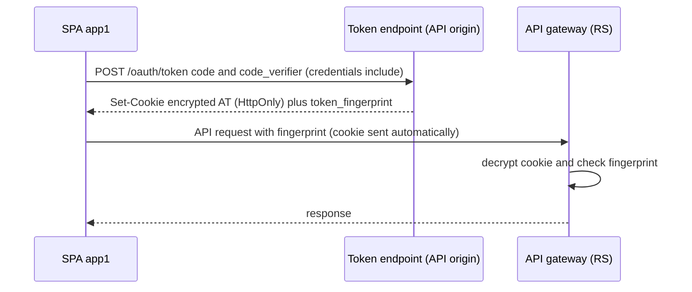
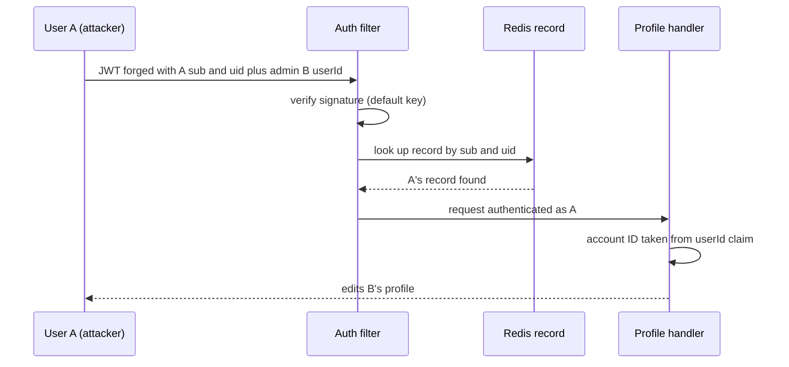

# OAuth WG Daily Report - 2026-11-24

- generated_at_utc: `2026-11-24T22:29:25+00:00`
- snapshot_date: `2026-11-24`

<!-- insights:start -->
## Briefing

> The most substantive thread is the CIMD author's pushback on did:cimd, a DID method built on Client ID Metadata Documents. The other two items are discussion only: an erratum proposing to retitle RFC 7662, and a request for a JWT BCP note on user identity checks, which arrived too late because the BCP update is in the RFC Editor queue.

_Updated 2026-11-24T22:30:27+00:00. Machine-drafted from the sources linked below, which stay authoritative._

### did:cimd, a DID method that treats a CIMD as a DID document, drew an objection from a CIMD author. The thread moved on to client instance identification

`mail` · `discussion` · first seen 2026-11-24 · [did:cimd: a DID method built on Client ID Metadata Documents (7 new messages)](https://mailarchive.ietf.org/arch/msg/oauth/4oYMm9G3tnjaTxRWWTclGutfKUo/)

Suhyeon Forten Lee announced did:cimd, a DID method in which the Client Identifier URL is the DID and the keys in `jwks` or `jwks_uri` are the verification keys. It is aimed at AI agents and registered in the W3C DID Extensions registry. Emelia Smith, speaking as one CIMD author, objected. A CIMD identifies client software, not an instance or a subject. The method adds semantics CIMD lacks, such as 410 Gone meaning deactivation. It profiles the outdated draft-02, and the name suggests an endorsement that does not exist. She asked for withdrawal or a rename. The author added a non-affiliation notice, will narrow the motivation and update to -03, but keeps the name. Richard Craig added points on key history, cache latency for deactivation and keyless platform clients. Emelia answered that key history belongs with the relying party, that CIMD keys should not sign action statements, and that client instances are the open topic from IETF 127. She pointed to draft-mcguinness-oauth-client-instance-id, which profiles Attestation-Based Client Authentication.

**Use cases**

- A relying party that records the resolved key and thumbprint at the time of each call, since the document is point-in-time.
- An agent platform that must separate the OAuth client_id (software) from per-customer agent instance identity.

**Related in other tracks**

- `ietf-wimse` / `draft-ietf-wimse-workload-creds`: Emelia names SPIFFE/WIMSE as the right place for workload identity, which CIMD leaves out of scope.

### A request to add a note on user identity checks to the JWT BCP came too late: the update is already in the RFC Editor queue

`mail` · `discussion` · first seen 2026-11-24 · [User identity checks for JWTs with server-side authentication records (2 new messages)](https://mailarchive.ietf.org/arch/msg/oauth/PFvyw7E9bzmIsmpHFVvOYakXNKY/)

A researcher reported forged-JWT cases in the ELADMIN application and asked for a note in JWT BCP section 3.8. The note would remind implementers to use the same validated user identity throughout request processing. In that case the authentication check used `sub` while the profile handler used `userId`. Emelia S. argued the RFCs already cover this: `sub` is the standard identity claim, and the real problems were a reused well-known signing key and several parallel non-standard claims. Michael Jones replied that the BCP update is already in the RFC Editor queue, so it is not a good time for additions. Emelia suggested filing a GitHub issue so that a future BCP update can consider it.

**Use cases**

- An application that checks `sub` at authentication but reads another claim such as `userId` downstream should use one validated identity throughout.

### Erratum 9331 asks to retitle RFC 7662 to 'Token Info Endpoint'. Two replies on the list oppose it

`mail` · `discussion` · first seen 2026-11-24 · [RFC7662 (9331)](https://mailarchive.ietf.org/arch/msg/oauth/Vpfb_RC3vqhvHw-EpoK9pLjSniQ/)

A Technical erratum (EID 9331, reported by Aaron Parecki) proposes changing the title of RFC 7662 from 'OAuth 2.0 Token Introspection' to 'OAuth 2.0 Token Info Endpoint'. The report argues that 'introspection' means examining one's own state, whereas the protected resource here queries the AS. It says the name confuses people when JWT access tokens are validated locally, and that it is consistent with the OpenID Connect UserInfo Endpoint. Justin Richer, the RFC's editor, says it should be rejected because the title is not an error: the AS is the one looking into its own state. A second participant agrees, saying a title change goes beyond the purpose of an erratum under the IESG errata statement. Nothing in the protocol would change.

### Someone proposes a cookie-bound access token pattern complementing RFC 10017 Section 6.3, keeping the API gateway as enforcement point

`mail` · `new-proposal` · first seen 2026-11-23 · [RFC 10017 (BCP 212): A cookie-bound token pattern complementing Section 6.3](https://mailarchive.ietf.org/arch/msg/oauth/BlDWJT4omhPgD-jVurnimmiBv1E/)

The author argues that the BFF recommendation in RFC 10017 moves enforcement away from the resource server: the gateway loses client IP, per-application distinction and one-to-one request mapping, which weakens rate limiting, quotas and anomaly detection. The proposed pattern keeps the SPA a public client using authorization code with PKCE. The token endpoint, served from the same origin as the API, returns the access token in an HttpOnly, SameSite=Strict cookie with a __Host-Http- prefix and a per-client name, encrypted with an AEAD whose key the AS and RS share. The SPA gets only a token fingerprint (for example base64url of SHA-256 of the access token, Option A). The gateway requires both the cookie and the fingerprint on each request, so one same-site SPA cannot use another's tokens. The pattern assumes the AS and API share an origin and that the site is not a public suffix. The message is truncated, so the second fingerprint option and the rest of the threat analysis are not visible.

**Use cases**

- Several first-party SPAs on sibling subdomains behind one API gateway that already does rate limiting and quotas.
- Teams that want tokens kept away from JavaScript without introducing a BFF proxy.

### Review of draft-craig-oauth-rar-payment-mandates-00 finds gaps in receipt outcomes, receipt timing and what is committed

`mail` · `new-proposal` · first seen 2026-11-23 · [New draft: RAR profile for agent payment mandates, approval reasons and receipts (draft-craig-oauth-rar-payment-mandates-00)](https://mailarchive.ietf.org/arch/msg/oauth/LGotP0K7zW1AD45o2Q6pBR2H3dE/)

The draft profiles RAR for agent payment mandates, approval reasons and signed receipts. Markus Mazurczak of Home-Mandate, who also maintains a payment implementation (Valet), reviewed it. He said §6 lists decision states (approved, completed, declined) that the `outcome` values in Table 2 do not cover, and Valet's `escalated` receipt is missing too. He asked that a decision and its receipt be stored together, and that an unknown outcome stay open until a new receipt with the same payment_id resolves it. He suggested a JCS digest of the granted authorization_details instead of mandate_version. He proposed committing payee and reference while leaving amount and currency in the clear, so limits can be checked. He asked the draft to say whether an approval covers every limit a payment breaks. He also asked how chain heads are published and signed, and for the salt and value encoding in §6.3, iss and iat given typ payment-receipt+jwt, time-zone changes, and foreign-currency payments. He said Home-Mandate will likely adopt something close to §6.3.

**Use cases**

- An institution that lets AI agents pay suppliers under standing limits needs auditable receipts that survive a crash between booking and logging.
- A privacy-sensitive payment log needs to erase one customer's payee data without breaking the signed chain.

### A researcher asks the WG to make the JWT BCP require that a checked server-side record match every claim used to identify the user

`mail` · `discussion` · first seen 2026-11-23 · [User identity checks for JWTs with server-side authentication records](https://mailarchive.ietf.org/arch/msg/oauth/1wKbrz0NwWgJgMxMMywsyRlwl5g/)

The thread shows a reply from Frederik Krogsdal Jacobsen to a researcher at Fudan University. The researcher described two bugs, both fixed upstream. In ELADMIN, the filter verified the JWT signature and looked up a Redis authentication record via sub and uid, but a downstream handler took the account ID from a separate userId claim. With the publicly known default signing key, a user could forge a token with their own sub/uid and an administrator's userId. ELADMIN's fix compares the full presented JWT with the token saved at login and removes the shared default key. Mainflux had a similar problem, fixed by requiring a signing secret and checking that the record exists, is valid and belongs to the account named in the JWT. The researcher suggests making this identity check explicit in the JWT BCP (rfc8725bis-10 Section 3.8). Jacobsen replied that the guidance can be stated shortly as using a consistent user identifier for authorization to prevent mix-ups, and had no strong opinion on whether it belongs in the BCP. The message is truncated, so the rest of the proposal is not visible.

**Use cases**

- A Spring or Redis-style app that verifies a JWT and a session record in middleware but reads account IDs from other claims in handlers.
- A product that ships a default JWT signing secret and needs to require deployer-supplied keys.
- Authors of the JWT BCP deciding whether Section 3.8 needs an explicit claim-to-record binding rule.

### A researcher asks for a JWT BCP §3.8 note on consistent user identity; one reviewer says the existing RFCs already cover it

`mail` · `discussion` · first seen 2026-11-23 · [User identity checks for JWTs with server-side authentication records (6 new messages)](https://mailarchive.ietf.org/arch/msg/oauth/8PlKFLCzRgbqHa_NjWvxeb71dOY/)

Gaosong Zhang reported token-forgery cases in ELADMIN and Mainflux. In ELADMIN the filter checked the Redis record via `sub` and `uid`, but a downstream handler took the account from `userId`. With the publicly known default signing key, a forged token let user A act as administrator B. Both projects merged fixes. He proposed a §3.8 sentence that every claim used to identify the user should resolve to the user tied to the server-side record. Emelia Smith said no BCP change is needed: the failures were a well-known signing key and redundant non-standard claims, and RFC 7519 and §§2.1 and 3.8 of RFC 8725 already cover them. She allowed that discouraging multiple identity claims might help. Frederik Krogsdal Jacobsen found the point reasonable, suggested shorter wording with 'user', and noted the revision may be too late. Zhang asked whether it could go in a future update.

**Use cases**

- An application that authenticates by JWT plus a server-side session record should derive the user from one claim (`sub`) and use it in every handler.
- Deployments should not ship a shared default signing key.

### An erratum asks to retitle RFC 7662 to 'Token Info Endpoint'; Justin Richer says reject it

`mail` · `discussion` · first seen 2026-11-23 · [RFC7662 (9331) (2 new messages)](https://mailarchive.ietf.org/arch/msg/oauth/NCaXa6__GYbA5C5pYj965VhEKNM/)

Erratum 9331, reported by Aaron Parecki, proposes changing the title of RFC 7662 from 'OAuth 2.0 Token Introspection' to 'OAuth 2.0 Token Info Endpoint'. The report argues that introspection means examining one's own state, while the protected resource here sends the token to the AS and reads the response. It says this causes confusion with self-contained JWT access tokens (RFC 9068). Justin Richer replied that it should be rejected: the AS is the implementor and is looking into its own store, so the title is not an error. No decision has been recorded.

### Authors of the actor-chain drafts reply on scope before a possible adoption call, offering to split out a core and run a virtual interop test

`mail` · `discussion` · first seen 2026-11-23 · [Comparing Actor Chain and Actor Profile before an adoption call](https://mailarchive.ietf.org/arch/msg/oauth/U9S3HdBaay8UO-IW07IFxgFd_Z0/)

Prasad replies to Ilja Radusch, who had argued for a narrow first document based on a deployed AS running actor-profile -01. Radusch listed what must be fixed for interop: the act shape (iss and sub, with the resource server enforcing only act.sub), identical act preserved on refresh, and a grant-level identifier (dlg_id). Radusch also asked that the chain-preservation rule let a later subset profile relax it with an explicit signal. Prasad says draft-mw-oauth-actor-chain-03 structures profiles on common rules, each supportable alone, and the declared-full profile could be extracted as a short core. Prasad argues that when agents choose their next hop at runtime, an AS that carries the full chain forward without enforcing the recipient's disclosure limit can expose actors beyond need-to-know. With declared-subset, the AS can issue a JWT that names the profile in actp and omits the restricted actor. The base should allow narrowing disclosure. Prasad also proposes a short virtual interop session once scope is agreed.

**Use cases**

- An AS that issues delegated-agent tokens and must decide whether to keep act unchanged across refresh and token exchange hops.
- A gateway forwarding agent calls to a third party that may see only part of the actor chain.

**Related in other tracks**

- `ietf-wimse` / `draft-asor-wimse-agent-delegation-chain`: Also addresses delegation chains for AI agents, but the thread does not reference it; listed as a competing design area.

### The author of a cookie-bound token pattern for RFC 10017 §6.3 dropped it after reviewers pointed to the BFF

`mail` · `discussion` · first seen 2026-11-23 · [RFC 10017 (BCP 212): A cookie-bound token pattern complementing Section 6.3 (6 new messages)](https://mailarchive.ietf.org/arch/msg/oauth/kyleXXNbXF1jsKM6iSTjr2Q6YkE/)

Frédéric Gilbert proposed a complement to the browser-based client pattern in §6.3 for public clients with no backend. Tokens would be delivered only in HttpOnly cookies, and the flow bound to the browser by an HttpOnly nonce cookie set at the authorization endpoint and required at the token endpoint. He argued this reduces scenario 5.1.3 (malicious code starting its own flow) to 5.1.4, at the cost of OAuth endpoints and the API sharing one origin. Frederik Krogsdal Jacobsen and Yaron Zehavi suggested keeping a BFF and passing risk context to the RS by SSF CAEP/RISC, a JWT on the side, forwarded headers, traceparent, or Origin-bound sessions. Philippe De Ryck questioned the same-origin layout and said a BFF is not a heavy lift. Gilbert concluded a gateway-hosted BFF achieves the same goals and said he will not pursue this as a general pattern.

**Use cases**

- An API gateway that is both AS and RS for several first-party SPAs wants the RS to keep client-IP and per-app visibility; the thread points to a gateway-hosted BFF with forwarded context instead.

### Replies to the actor-profile vs Actor Chain comparison mostly favour a narrow first document that fixes `act`, refresh preservation and a grant ID

`mail` · `discussion` · first seen 2026-11-23 · [Comparing Actor Chain and Actor Profile before an adoption call (3 new messages)](https://mailarchive.ietf.org/arch/msg/oauth/l6G7j1hHKd2R8wYMTvOZ71vinZU/)

Karl McGuinness argued for adopting a narrowly scoped actor profile, with provenance proofs and selective disclosure as follow-on profiles, as long as the base does not preclude them. A. Prasad (Actor Chain) had earlier recommended Actor Chain as the starting text and wanted recipient-specific actor disclosure in the first draft. Ilja Radusch, from a deployed AS, listed what the first document must fix for interop: the `act` shape (iss + sub, with the RS enforcing on act.sub), identical `act` on refreshed tokens (normative), and a grant-level identifier such as dlg_id from actor-profile PR #34. He asked that chain preservation be worded so a later subset profile can relax it with an explicit signal. Tania Aizenman (for the EAGF draft author) and Niki Niyikiza supported the grant identifier, and Niyikiza wanted it usable on tokens without `act`. Another participant also asked for a narrow, concise scope. No draft text changed. The adoption question is still open.

**Use cases**

- An AS issuing delegated-agent tokens must keep `act` identical across refresh-token use, or the record of who acted is lost.
- A resource server that lists or revokes a user's delegations needs a stable per-grant key, since act.sub collapses all grants of one agent client and jti changes on rotation.
- Agents extending a chain without the AS can group every token under one root identifier.

### A proposed change would make a query component in Client Identifier URLs a MUST NOT instead of a SHOULD NOT

`pull-request` · `substantive` · first seen 2026-11-22 · [oauth-wg/draft-ietf-oauth-client-id-metadata-document#134: Require Client Identifier URLs MUST NOT contain a query component (#112)](https://github.com/oauth-wg/draft-ietf-oauth-client-id-metadata-document/pull/134)

The PR changes the draft so that a Client Identifier URL must not contain a query string. Today the draft only says it should not. The author says this matches the existing rule that the Client ID Metadata Document must not be built from query input. It is one of three stand-alone PRs related to issue #112, alongside #132 (fetch-gating) and #135 (port ban).

**Use cases**

- An authorization server that fetches client metadata can reject client_id URLs with a query component outright.
- A client that today uses a query string in its client_id URL would need to change it.

### Triage of the candidate queue

- **high** `draft-ietf-oauth-client-id-metadata-document`: A CIMD author spelled out scope limits and new draft-03 text on client authentication in a live thread.
- **high** `draft-ietf-oauth-identity-assertion-authz-grant`: Five issues were opened or commented on in one week (#142, #145, #159, #160, #162), including multi-hop delegation chaining.
- **low** `draft-ietf-oauth-rfc8725bis`: The BCP update is in the RFC Editor queue, so new additions are closed.
- **low** `draft-ietf-oauth-status-list`: Only cited in list feedback as a preferred chain-status mechanism, with no change to the draft.
- **low** `draft-ietf-oauth-transaction-tokens`: Mentioned only as one possible delegation credential in the PACE draft announcement.
- **low** `draft-ietf-oauth-v2-1`: Only a minor reference error in section 7.13.1 was reported.

<!-- insights:end -->

## Top Priorities

| Rank | Draft | Score | Updated | Key State | Repo |
|---|---|---:|---|---|---|
| 1 | `draft-ietf-oauth-sd-jwt-vc` | 96 | 2026-11-16T10:45:13Z | Active, Expert Reviews OK | `oauth-sd-jwt-vc` |
| 2 | `draft-ietf-oauth-rfc8725bis` | 90 | 2026-11-23T21:38:46Z | Active, No IANA Actions | `draft-ietf-oauth-rfc8725bis` |
| 3 | `draft-ietf-oauth-status-list` | 85 | 2026-11-19T02:42:34Z | Active, RFC-Ed-Ack | `draft-ietf-oauth-status-list` |
| 4 | `draft-ietf-oauth-first-party-apps` | 80 | 2026-08-26T14:40:16Z | Active, I-D Exists | `oauth-first-party-apps` |
| 5 | `draft-ietf-oauth-identity-chaining` | 75 | 2026-11-12T02:07:35Z | Active, RFC-Ed-Ack | `oauth-identity-chaining` |
| 6 | `draft-ietf-oauth-client-id-metadata-document` | 73 | 2026-11-02T22:02:56Z | Active, I-D Exists | `draft-ietf-oauth-client-id-metadata-document` |
| 7 | `draft-ietf-oauth-identity-assertion-authz-grant` | 73 | 2026-10-31T00:32:39Z | Active, I-D Exists | `oauth-identity-assertion-authz-grant` |
| 8 | `draft-ietf-oauth-transaction-tokens` | 70 | 2026-08-21T11:57:16Z | Active, I-D Exists | `oauth-transaction-tokens` |
| 9 | `draft-ietf-oauth-deferred-token-response` | 66 | 2026-10-31T16:12:16Z | Active, I-D Exists | `oauth-deferred-token-response` |
| 10 | `draft-ietf-oauth-v2-1` | 66 | 2026-10-31T04:16:32Z | Active, I-D Exists | `oauth-v2-1` |

## Active Drafts

| Draft | Rev | Updated | States |
|---|---:|---|---|
| `draft-ietf-oauth-rfc8725bis` | 10 | 2026-11-23T21:38:46Z | Active, No IANA Actions, IANA OK - No Actions Needed |
| `draft-ietf-oauth-status-list` | 21 | 2026-11-19T02:42:34Z | Active, RFC-Ed-Ack, Expert Reviews OK |
| `draft-ietf-oauth-sd-jwt-vc` | 27 | 2026-11-16T10:45:13Z | Active, Expert Reviews OK, Version Changed - Review Needed |
| `draft-ietf-oauth-identity-chaining` | 17 | 2026-11-12T02:07:35Z | Active, RFC-Ed-Ack, Expert Reviews OK |
| `draft-ietf-oauth-client-id-metadata-document` | 03 | 2026-11-02T22:02:56Z | Active, I-D Exists, WG Document |
| `draft-ietf-oauth-spiffe-client-auth` | 03 | 2026-11-02T17:35:55Z | Active, I-D Exists, WG Document |
| `draft-ietf-oauth-deferred-token-response` | 01 | 2026-10-31T16:12:16Z | Active, I-D Exists, WG Document |
| `draft-ietf-oauth-v2-1` | 17 | 2026-10-31T04:16:32Z | Active, I-D Exists, WG Document |
| `draft-ietf-oauth-identity-assertion-authz-grant` | 06 | 2026-10-31T00:32:39Z | Active, I-D Exists, WG Document |
| `draft-ietf-oauth-delegate-sd-jwt` | 00 | 2026-10-30T12:38:29Z | Active, I-D Exists, WG Document |
| `draft-ietf-oauth-attestation-based-client-auth` | 12 | 2026-10-18T17:33:02Z | Active, I-D Exists, WG Consensus: Waiting for Write-Up |
| `draft-ietf-oauth-first-party-apps` | 04 | 2026-08-26T14:40:16Z | Active, I-D Exists, WG Consensus: Waiting for Write-Up |
| `draft-ietf-oauth-rar-metadata-remediation` | 00 | 2026-08-23T20:29:29Z | Active, I-D Exists, WG Document |
| `draft-ietf-oauth-transaction-tokens` | 11 | 2026-08-21T11:57:16Z | Active, I-D Exists, WG Consensus: Waiting for Write-Up |
| `draft-ietf-oauth-refresh-token-expiration` | 03 | 2026-07-06T17:53:06Z | Active, I-D Exists, WG Document |

## Repo Watch

| Repo | Pushed | Open Issues |
|---|---|---:|
| `oauth-wg/oauth-identity-assertion-authz-grant` | 2026-11-22T00:02:50Z | 34 |
| `oauth-wg/draft-ietf-oauth-client-id-metadata-document` | 2026-11-22T00:00:40Z | 38 |
| `oauth-wg/oauth-first-party-apps` | 2026-11-21T15:17:38Z | 7 |
| `oauth-wg/oauth-delegate-sd-jwt` | 2026-11-19T00:25:09Z | 14 |
| `oauth-wg/oauth-v2-1` | 2026-11-19T00:12:28Z | 16 |
| `oauth-wg/oauth-spiffe-client-authentication` | 2026-11-19T00:09:37Z | 6 |
| `oauth-wg/oauth-deferred-token-response` | 2026-11-19T00:06:27Z | 25 |
| `oauth-wg/oauth-sd-jwt-vc` | 2026-11-17T00:31:32Z | 0 |
| `oauth-wg/oauth-transaction-tokens` | 2026-11-10T00:15:51Z | 6 |
| `oauth-wg/draft-ietf-oauth-attestation-based-client-auth` | 2026-10-13T06:13:11Z | 0 |
| `oauth-wg/oauth-selective-disclosure-jwt` | 2026-10-04T13:50:37Z | 0 |
| `oauth-wg/oauth-cross-device-security` | 2026-08-27T14:45:11Z | 0 |

## Recent Pull Requests

- `oauth-wg/draft-ietf-oauth-client-id-metadata-document#135` Disallow port component in Client Identifier URLs (#112) (2026-11-21T15:52:33Z)
- `oauth-wg/draft-ietf-oauth-client-id-metadata-document#134` Require Client Identifier URLs MUST NOT contain a query component (#112) (2026-11-21T15:52:31Z)
- `oauth-wg/draft-ietf-oauth-client-id-metadata-document#132` Add pre-fetch validation and fetch-triggering guidance (#112) (2026-11-21T15:41:17Z)
- `oauth-wg/oauth-first-party-apps#182` Update contact details for Pieter Kasselman (2026-11-21T15:17:16Z)
- `oauth-wg/oauth-first-party-apps#181` Rename draft to OAuth Authorization Challenge Endpoint (2026-11-21T07:46:53Z)
- `oauth-wg/oauth-identity-assertion-authz-grant#108` Add guidance on RAS-specific and private claims in the ID-JAG (2026-11-20T17:45:42Z)
- `oauth-wg/oauth-first-party-apps#180` updated references to RFC10017 and RFC10027 (2026-11-20T06:26:00Z)
- `oauth-wg/oauth-v2-1#286` Add RFC 10027 references and update security sections (2026-11-18T21:42:02Z)
- `oauth-wg/oauth-v2-1#273` Restrict access token values to the token68 syntax (2026-11-18T19:43:34Z)
- `oauth-wg/oauth-v2-1#284` Cite RFC 7617 for the Basic authentication scheme (2026-11-17T10:06:57Z)

## Recent Issues

- `oauth-wg/oauth-transaction-tokens#375` No mandatory-to-implement signing algorithm (2026-11-24T15:16:11Z)
- `oauth-wg/oauth-transaction-tokens#377` typ: is application/txntoken+jwt accepted? (2026-11-24T15:07:21Z)
- `oauth-wg/oauth-transaction-tokens#376` aud as an array (2026-11-24T15:07:20Z)
- `oauth-wg/draft-ietf-oauth-client-id-metadata-document#133` §6.2: apply the minimum effective cache duration regardless of directives, as the maximum is (2026-11-20T23:44:57Z)
- `oauth-wg/draft-ietf-oauth-client-id-metadata-document#52` Add Security sub-section of DOS risks (2026-11-20T23:37:58Z)
- `oauth-wg/oauth-identity-assertion-authz-grant#162` Profile for multi-hop delegation chaining (2026-11-18T22:32:52Z)
- `oauth-wg/oauth-spiffe-client-authentication#39` spiffe_wit should be independent of attestation-based client authentication (2026-11-18T20:22:43Z)
- `oauth-wg/oauth-spiffe-client-authentication#52` Should X.509 validation include all the leaf checks from the SPIFFE X.509 specification? (2026-11-18T20:18:54Z)
- `oauth-wg/oauth-deferred-token-response#46` Allow the preceding endpoint to return a deferred response directly, in addition to accepting an advance hint (2026-11-18T18:29:09Z)
- `oauth-wg/oauth-v2-1#266` Define invalid_client for Authorization Error Response (2026-11-18T18:09:46Z)

## Organization Events

- `2026-11-24T15:53:13Z` IssuesEvent `oauth-wg/oauth-transaction-tokens` aud as an array
- `2026-11-24T15:09:35Z` IssuesEvent `oauth-wg/oauth-transaction-tokens` typ: is application/txntoken+jwt accepted?
- `2026-11-24T15:07:30Z` IssuesEvent `oauth-wg/oauth-transaction-tokens` No mandatory-to-implement signing algorithm
- `2026-11-23T07:08:56Z` WatchEvent `oauth-wg/draft-ietf-oauth-status-list` started
- `2026-11-23T05:36:10Z` WatchEvent `oauth-wg/oauth-v2-1` started
- `2026-11-22T00:00:41Z` PushEvent `oauth-wg/draft-ietf-oauth-client-id-metadata-document` 
- `2026-11-20T06:25:58Z` PushEvent `oauth-wg/oauth-first-party-apps` 
- `2026-11-20T06:26:24Z` PushEvent `oauth-wg/oauth-first-party-apps` 
- `2026-11-20T06:48:12Z` CreateEvent `oauth-wg/oauth-first-party-apps` 
- `2026-11-22T00:02:51Z` PushEvent `oauth-wg/oauth-identity-assertion-authz-grant` 
- `2026-11-21T16:36:37Z` WatchEvent `oauth-wg/oauth-first-party-apps` started
- `2026-11-21T15:17:17Z` PushEvent `oauth-wg/oauth-first-party-apps` 
- `2026-11-21T15:36:38Z` IssueCommentEvent `oauth-wg/draft-ietf-oauth-client-id-metadata-document` Add pre-fetch validation and fetch-triggering guidance (#112)
- `2026-11-21T15:36:34Z` PullRequestEvent `oauth-wg/draft-ietf-oauth-client-id-metadata-document` opened
- `2026-11-21T15:36:30Z` PullRequestEvent `oauth-wg/draft-ietf-oauth-client-id-metadata-document` opened
- `2026-11-21T15:36:16Z` IssueCommentEvent `oauth-wg/draft-ietf-oauth-client-id-metadata-document` Add pre-fetch validation and fetch-triggering guidance (#112)
- `2026-11-21T15:36:15Z` IssueCommentEvent `oauth-wg/draft-ietf-oauth-client-id-metadata-document` Add pre-fetch validation and fetch-triggering guidance (#112)
- `2026-11-21T15:17:16Z` PullRequestEvent `oauth-wg/oauth-first-party-apps` merged
- `2026-11-21T15:17:09Z` PullRequestReviewEvent `oauth-wg/oauth-first-party-apps` created
- `2026-11-21T07:49:45Z` PushEvent `oauth-wg/oauth-first-party-apps` 

## Mailarchive Signals

- weekly_digest_count: `1`
- [OAUTH-WG] Re: [Technical Errata Reported] RFC7662 (9331) - https://mailarchive.ietf.org/arch/msg/oauth/Vpfb_RC3vqhvHw-EpoK9pLjSniQ/
- [OAUTH-WG] Re: [JWT BCP §3.8] User identity checks for JWTs with server-side authentication records - https://mailarchive.ietf.org/arch/msg/oauth/PFvyw7E9bzmIsmpHFVvOYakXNKY/
- [OAUTH-WG] Re: [JWT BCP §3.8] User identity checks for JWTs with server-side authentication records - https://mailarchive.ietf.org/arch/msg/oauth/xVTw4OLrHnUI9QBzfcMr2Exz6h4/
- [OAUTH-WG] Re: did:cimd: a DID method built on Client ID Metadata Documents - https://mailarchive.ietf.org/arch/msg/oauth/4oYMm9G3tnjaTxRWWTclGutfKUo/
- [OAUTH-WG] Re: did:cimd: a DID method built on Client ID Metadata Documents - https://mailarchive.ietf.org/arch/msg/oauth/vSNSN0XJtGTjXTRDZa022Cgn2dg/
- [OAUTH-WG] Re: did:cimd: a DID method built on Client ID Metadata Documents - https://mailarchive.ietf.org/arch/msg/oauth/wlZuFBX4cabPaIwIpeTzHKispuM/
- [OAUTH-WG] Re: did:cimd: a DID method built on Client ID Metadata Documents - https://mailarchive.ietf.org/arch/msg/oauth/-fdNof7rOCsaY32N7zmst32Y5lI/
- [OAUTH-WG] Re: did:cimd: a DID method built on Client ID Metadata Documents - https://mailarchive.ietf.org/arch/msg/oauth/bzHEF3YZ2GHgrfOQrtBvKFZBPXc/

## Next Actions

1. Evaluate the top 3 items in `Top Priorities` as weekly deep-dive candidates.
2. Separately track comment deadlines for `In Last Call` / `In WG Last Call` drafts.
3. For repos with a sudden spike in activity, create a scaffold in `deep-dives/` to capture key discussion points.
