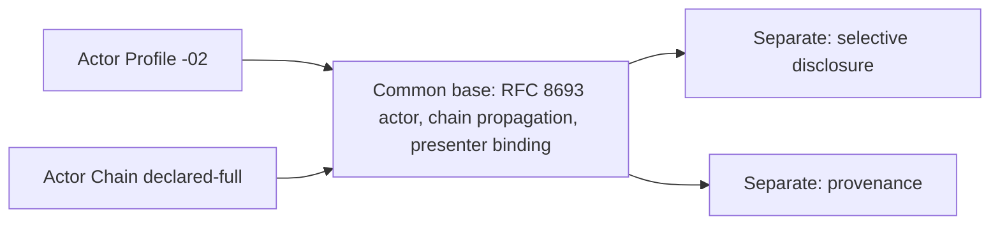

# OAuth WG Daily Report - 2026-11-27

- generated_at_utc: `2026-11-27T21:20:58+00:00`
- snapshot_date: `2026-11-27`

<!-- insights:start -->
## Briefing

> The only item is the OAuth list thread on which actor-delegation draft should be the base for a WG adoption call. Actor Profile -02 came out on Nov 26, and the open question is how a chain signals that it is incomplete. No draft text was adopted.

_Updated 2026-11-27T21:21:45+00:00. Machine-drafted from the sources linked below, which stay authoritative._

### The Actor Chain vs Actor Profile thread now centres on how a delegation chain signals that actors were omitted

`mail` · `discussion` · first seen 2026-11-27 · [Comparing Actor Chain and Actor Profile before an adoption call (4 new messages)](https://mailarchive.ietf.org/arch/msg/oauth/1u307Msd9GqpCZrZKpK6uVCPmjE/)

After Karl McGuinness published Actor Profile -02 and proposed a narrow common base (RFC 8693 actor representation, chain propagation, presenter binding, consistent semantics across token exchange, JWT assertion grants and refresh), three replies came in. Prasad (Actor Chain) argues for starting from Actor Chain, even with only declared-full, and for keeping a Subset option so the AS can enforce need-to-know. His example is that a path A→C and a path A→B→C can both show only A and C in act, so a marker confirming omission could reveal a confidential review. Jiahui Miao argues the base must define one reserved incompleteness signal in tokens and introspection (actors omitted, shown actors in order, nothing claimed about the omitted ones). They also want a rule that a recipient requiring a complete chain rejects a signalled-incomplete one. Ilja reports running code: keep the -02 §6.5 refresh rule (carry the recorded chain unchanged or reject), and reserve an opaque AS-assigned grant identifier (dlg_id, actor-profile PR #34) that also works on tokens without act. The material is truncated, so earlier messages are only partly visible.

**Use cases**

- An authorization server issuing delegated-agent tokens for multi-hop agent calls must decide whether to carry the full actor chain, a subset, or reject on omission.
- A resource server in a different domain that requires a complete actor path needs a defined way to tell a complete chain from a shortened one.
- A deployer who rotates refresh tokens for delegated agents needs the actor chain to stay unchanged across refresh so a client cannot shed its actor.

### The WG is narrowing Actor Chain and Actor Profile to a common base, with disagreement over whether selective disclosure belongs in it

`mail` · `discussion` · first seen 2026-11-27 · [Comparing Actor Chain and Actor Profile before an adoption call (2 new messages)](https://mailarchive.ietf.org/arch/msg/oauth/CE2Rc_HmBYFe6MGwSz8dzijXMyk/)

Prasad (Actor Chain) gave examples for why a downstream recipient should not always see the full actor history: a bank login hidden from a government service, a counseling service named in a shared messaging token, and an investigations service revealed in a hail-claim chain. They cite RFC 8693 §6 on minimum data and ask that the Subset profile advance in parallel if the WG starts with declared-full. Karl McGuinness then published Actor Profile -02 and agreed there is substantial overlap with declared-full. He proposed a common base: actor identification using RFC 8693, actor establishment and chain propagation, presenter binding with resource server validation, and consistent semantics across Token Exchange, JWT assertion grants and refresh. He would defer workflow bootstrap, mandatory workflow identifiers and profile selection, and Transaction Token and WIMSE integrations. Selective disclosure and provenance would advance separately, with -02 providing extension points. Brian Campbell earlier favoured a narrow, concise scope. The thread excerpt is truncated, so later replies are not covered.

**Use cases**

- An AS issuing delegated tokens for AI agents that choose their next hop at runtime and must decide how much actor history to put in the token.
- A deployer who needs a minimal interoperable actor claim format now and may add provenance or selective disclosure later.

**Related in other tracks**

- `ietf-wimse` / `draft-ietf-wimse-workload-creds`: The thread names WIMSE credential integrations as something the base would defer.

### draft-le-agent-passport-01 is posted, and a reviewer asks how a cumulative limit can cap use across several relying parties

`mail` · `discussion` · first seen 2026-11-27 · [draft-le-agent-passport-01 posted](https://mailarchive.ietf.org/arch/msg/oauth/EsU0fWkKUVr5AnUPxLLyVAPcVUw/)

Ben Le announced -01, which was cross-posted from the WIMSE list. The changes: revocation fails closed when no fresh status is available, with a stated bound on how long a withdrawn principal can still be relied on. A cumulative limit is counted by exactly one RP, and grants can be requested as a RAR authorization_details type. It adds transport and intermediary rules and lets a root receipt record how the person approved, including a WebAuthn assertion. It also adds a table mapping the draft to cross-organisation delegation requirements and a comparison with other attenuation formats. A public RP verifier is released under Apache-2.0. Errol Seymour's reply notes that a limit shared across RPs is not expressible, so an agent presenting one delegation at several RPs has no total cap, and asks whether a shared issuer, side counter or aggregate limit is planned. No answer is in the material.

**Use cases**

- Designers of cross-organisation agent delegation who need a spending or call cap that holds across several relying parties.
- Verifiers that must decide how to behave when revocation status cannot be fetched.

**Related in other tracks**

- `ietf-wimse` / `draft-reece-wimse-cross-org-delegation`: The -01 text includes a table mapping the draft to cross-organisation delegation requirements.

### draft-le-agent-passport -01 is posted, adding fail-closed revocation, RAR grants and a root receipt for human approval

`mail` · `substantive` · first seen 2026-11-26 · [draft-le-agent-passport-01 posted](https://mailarchive.ietf.org/arch/msg/oauth/7-JwnFXUEOPBTI_qr0Kkt6WuIYk/)

The author announced -01 of draft-le-agent-passport, which addresses review comments from both lists (the message does not name them). According to the announcement, revocation now fails closed when no fresh status is available, with a stated bound on how long a withdrawn principal can still be relied on. A cumulative limit is counted by exactly one relying party, and grants can be requested as a RAR authorization_details type. Transport and intermediary rules were added, with "@authority" always covered. A root receipt can record how the person approved the delegation, including a WebAuthn assertion, plus evidence about the principal. The draft also gains a table mapping it to the cross-organisation delegation requirements and a comparison with other attenuation formats. A relying-party verifier is published under Apache-2.0 with calls and responses for the IETF 127 hackathon scenarios. This summary rests on the announcement only, not on the draft text.

**Use cases**

- A relying party that accepts delegated agent credentials and must decide whether to deny when revocation status cannot be fetched.
- A deployment that needs a human's approval of a delegation (for example via WebAuthn) recorded in the root receipt.
- An implementer who wants to test against the published relying-party verifier.

**Related in other tracks**

- `ietf-wimse` / `draft-reece-wimse-cross-org-delegation`: The announcement says -01 includes a table mapping the draft to cross-organisation delegation requirements, which that draft's title suggests it covers.

### A reply on the new PACE Authorization draft asks Section 6.3 or 6.4 to say how a key was bound to the person

`mail` · `discussion` · first seen 2026-11-26 · [New draft: PACE Authorization: delegation and action approval for agent dialogs:](https://mailarchive.ietf.org/arch/msg/oauth/NIMesmkkywYwuZia_Hwgl8Pryjg/)

This is a short reply from Mohamad to Niki in the thread announcing the PACE Authorization draft (delegation and action approval for agent dialogs). Mohamad agrees that Section 6.3 lists the ways a verifier can trust a key. They argue that a second airline that never dealt with the user cannot use a key registered earlier with it, so it must rely on an issuer that vouches the key belongs to the person. In that case a device key enrolled elsewhere is in the same position as a wallet credential. Section 6.3 says whom the verifier trusts but not what that party checked when it bound the key to the person. Mohamad suggests one sentence in 6.3 or 6.4: the verifier's policy should also weigh how the key was bound to the principal. The draft text itself is not in the material, so only this comment is covered.

**Use cases**

- A verifier in an agent-to-agent booking flow that has never met the user and has to decide whether to trust a device key enrolled at another party.
- An implementer writing verifier policy for PACE-style delegation who needs to decide whether key binding assurance should affect approval decisions.

### A reviewer argues the OIDC crypto-agility draft should not partition keys by algorithm and that keyset contents, not metadata, should show supported algorithms

`mail` · `discussion` · first seen 2026-11-26 · [Submitted new I-D proposal regarding OIDC crypto agility improvement](https://mailarchive.ietf.org/arch/msg/oauth/QxAtDG5gjU5v40LT4nDtySxz6H8/)

Breno de Medeiros announced draft-demedeiros-oidc-crypto-agility. It lets OIDC metadata publish supported JWT signing algorithms and lets a client request one in the authorization request. It also adds a parameter to filter algorithms out of the published key set at the jwks URI. The stated aim is to ease adoption of new algorithms, particularly post-quantum ones, in open federation. A reviewer replies that this is interesting but has problems. Keys should not be partitioned by algorithm, because migration needs old and new keys to coexist for a transition period. They are suspicious of matching by security strength, since levels change and servers may move up or down. They agree the filter is at best a stop-gap, because broken clients must eventually be fixed. They call supported-algorithm metadata flawed, because clients read it once and then pin an algorithm. They propose treating the key set as the source of truth. They suggest the OpenID Foundation as the venue. The message is truncated, so the rest of the reviewer's points are missing.

**Use cases**

- An OP or AS operator planning a post-quantum signing migration who needs old and new keys to be published together during the transition.
- A client or resource server library author deciding whether to learn supported algorithms from metadata or from the JWK Set.

### The list is debating whether the first delegation document should be a narrow Actor Profile or Actor Chain with selective disclosure

`mail` · `discussion` · first seen 2026-11-26 · [Comparing Actor Chain and Actor Profile before an adoption call](https://mailarchive.ietf.org/arch/msg/oauth/SOdN3RzwSYutX-6jbHONpCn-wdw/)

The thread compares OAuth Actor Chain (draft-mw-oauth-actor-chain) with OAuth Actor Profile for Delegation (draft-mcguinness-oauth-actor-profile). Karl McGuinness argues for a concise base profile covering common actor identification, chain representation and propagation, with provenance proofs and selective disclosure as follow-on profiles, provided the base does not preclude them. Brian Campbell supports a narrower, concise scope. A. Prasad (Actor Chain) recommends Actor Chain as starting text, offers to extract just the declared-full profile, and wants optional Subset disclosure in the first document, arguing that carrying a full actor chain can expose restricted identities. Another participant asks for concrete privacy or regulatory requirements, saying they cannot picture software identity needing selective disclosure downstream. No text change or adoption decision is reported. The message is truncated, so later parts of the quoted thread were not read.

**Use cases**

- A WG participant deciding whether a first actor and delegation document must include selective disclosure.
- An authorization server operator who needs to represent a nested act chain in JWT access tokens and decide how much history to expose to each downstream resource.

**Related in other tracks**

- `ietf-wimse` / `draft-asor-wimse-agent-delegation-chain`: Also about delegation chains for AI agents, though the thread itself does not reference it.

### Actor Chain authors offer to start with one profile (declared-full) but want optional Subset disclosure in the first document

`mail` · `discussion` · first seen 2026-11-25 · [Comparing Actor Chain and Actor Profile before an adoption call](https://mailarchive.ietf.org/arch/msg/oauth/8LMcWd8U0N_1TAdzFyyrkewvRKo/)

This is a reply in the thread comparing Actor Chain (draft-mw-oauth-actor-chain) with Karl McGuinness's OAuth Actor Profile for Delegation, ahead of a possible adoption call. Quoted earlier messages show Karl favoring a narrowly scoped base profile (actor identification, chain representation, propagation), with provenance proofs and selective disclosure as follow-on profiles. Brian Campbell said he favors something narrow and concise. Prasad replies that Actor Chain has six profiles (Declared or Verified assurance crossed with Full, Subset or Actor-Only disclosure) on a shared issuance and validation model, and that the WG could extract declared-full as a start. They argue that when agents choose the next hop at runtime, carrying the full chain can expose restricted actor identities, so they want optional Subset in the first document, or advanced in parallel if the WG prefers a companion. The quoted part of the earlier message also claims Actor Chain predates Actor Profile on nested act exchange. No text change is involved, and the message is truncated.

**Use cases**

- An AS operator planning to support agent-to-agent token exchange needs to know whether the first standard will carry the full nested act history or allow per-recipient disclosure.
- A gateway that forwards tokens to downstream resources with differing need-to-know requirements cares whether Subset disclosure is in the base spec.

### Reviewers of did:cimd say key history, key purposes and agent instances belong outside a CIMD-derived DID

`mail` · `discussion` · first seen 2026-11-25 · [did:cimd: a DID method built on Client ID Metadata Documents](https://mailarchive.ietf.org/arch/msg/oauth/9o7F3tsHtIje5NB155EOlH3-BHU/)

In the did:cimd thread, Emelia Smith answered Richard Craig's review points. A CIMD is a point-in-time document, so key history should be kept by the relying party or authorization server in its own log. CIMD keys serve the client's interactions with the authorization server, so signing payment intents or other action statements needs separate keys, since reuse is cross-protocol key reuse. A client_id identifies client software shared by many users and agent instances, not one instance, and a credential subject can use the client_id URL directly with no DID. Craig agreed, noting his agents already use separate DPoP and signing keys, and asked for the IETF 127 client-instance discussion. The author, Suhyeon Forten Lee, agreed that the client_id URL is the better choice where a system can use it, as with SD-JWT VC, and will look at client instances. The message is truncated, so the original proposal is only partly visible.

**Use cases**

- An authorization server or relying party that must verify an agent's signature after key rotation, for example in a payment dispute, and so keeps its own copy of the key it saw.
- A credential scheme such as SD-JWT VC that wants an OAuth client's client_id URL as the credential subject without a DID.

### An erratum proposes retitling RFC 7662 to 'Token Info Endpoint', and WG participants say it should be rejected

`mail` · `discussion` · first seen 2026-11-25 · [RFC7662 (9331)](https://mailarchive.ietf.org/arch/msg/oauth/BIALaujaTXniHb7JbgMsA9q0TiU/)

Erratum 9331 on RFC 7662 argues that 'Introspection' misleads because the protected resource queries the authorization server instead of examining the token itself, and proposes the title 'OAuth 2.0 Token Info Endpoint'. Justin Richer, the RFC's editor, said it should be rejected, since the AS looks into its own state about the token and the title is not an error. Brian Campbell found the term confusing but said changing an RFC title goes beyond the purpose of an erratum, citing IESG errata processing guidance. Deb added it to her to-do list. No decision is recorded in the material.

### The JWT BCP update is in the RFC Editor queue, so a requested note on user identity checks will not be added now

`mail` · `discussion` · first seen 2026-11-25 · [User identity checks for JWTs with server-side authentication records](https://mailarchive.ietf.org/arch/msg/oauth/LSSDKZ7Sku2uoy58IDIpLumOQtM/)

Gaosong Zhang asked for a note in section 3.8 of the JWT BCP reminding implementers to use the same validated user identity throughout request processing. The case was ELADMIN, where authentication checked sub but a downstream handler used a userId claim. Emelia Smith argued the BCP already covers this: the sub claim (RFC 7519 section 4.1.2) is the one for the user's identity, and the problem was a well-known signing key plus duplicated non-standard claims. Michael Jones replied that the update is already in the RFC Editor queue, so this is not a good time for additions. Gaosong said they could open a GitHub issue for a future update.

**Use cases**

- An application that accepts JWTs and reads user identity from several claims, where checking sub in one place and a custom claim in another can cause mix-up bugs.

### Triage of the candidate queue

- **low** `draft-ietf-oauth-rfc8725bis`: The BCP update is in the RFC Editor queue and the WG has declined a requested addition, so little remains to cover as a work in progress.
- **low** `draft-ietf-oauth-status-list`: Only cited in list feedback as a preferred chain-status mechanism, with no change to the draft.
- **low** `draft-ietf-oauth-transaction-tokens`: The thread mentions Actor Profile covers Transaction Tokens, but no change to this draft is reported.

<!-- insights:end -->

## Top Priorities

| Rank | Draft | Score | Updated | Key State | Repo |
|---|---|---:|---|---|---|
| 1 | `draft-ietf-oauth-sd-jwt-vc` | 92 | 2026-11-16T10:45:13Z | Active, Expert Reviews OK | `oauth-sd-jwt-vc` |
| 2 | `draft-ietf-oauth-rfc8725bis` | 90 | 2026-11-23T21:38:46Z | Active, No IANA Actions | `draft-ietf-oauth-rfc8725bis` |
| 3 | `draft-ietf-oauth-first-party-apps` | 80 | 2026-08-26T14:40:16Z | Active, I-D Exists | `oauth-first-party-apps` |
| 4 | `draft-ietf-oauth-status-list` | 75 | 2026-11-19T02:42:34Z | Active, RFC-Ed-Ack | `draft-ietf-oauth-status-list` |
| 5 | `draft-ietf-oauth-identity-chaining` | 75 | 2026-11-12T02:07:35Z | Active, RFC-Ed-Ack | `oauth-identity-chaining` |
| 6 | `draft-ietf-oauth-client-id-metadata-document` | 73 | 2026-11-02T22:02:56Z | Active, I-D Exists | `draft-ietf-oauth-client-id-metadata-document` |
| 7 | `draft-ietf-oauth-identity-assertion-authz-grant` | 73 | 2026-10-31T00:32:39Z | Active, I-D Exists | `oauth-identity-assertion-authz-grant` |
| 8 | `draft-ietf-oauth-transaction-tokens` | 72 | 2026-08-21T11:57:16Z | Active, I-D Exists | `oauth-transaction-tokens` |
| 9 | `draft-ietf-oauth-deferred-token-response` | 66 | 2026-10-31T16:12:16Z | Active, I-D Exists | `oauth-deferred-token-response` |
| 10 | `draft-ietf-oauth-v2-1` | 66 | 2026-10-31T04:16:32Z | Active, I-D Exists | `oauth-v2-1` |

## Active Drafts

| Draft | Rev | Updated | States |
|---|---:|---|---|
| `draft-ietf-oauth-rfc8725bis` | 10 | 2026-11-23T21:38:46Z | Active, No IANA Actions, IANA OK - No Actions Needed |
| `draft-ietf-oauth-status-list` | 21 | 2026-11-19T02:42:34Z | Active, RFC-Ed-Ack, Expert Reviews OK |
| `draft-ietf-oauth-sd-jwt-vc` | 27 | 2026-11-16T10:45:13Z | Active, Expert Reviews OK, Version Changed - Review Needed |
| `draft-ietf-oauth-identity-chaining` | 17 | 2026-11-12T02:07:35Z | Active, RFC-Ed-Ack, Expert Reviews OK |
| `draft-ietf-oauth-client-id-metadata-document` | 03 | 2026-11-02T22:02:56Z | Active, I-D Exists, WG Document |
| `draft-ietf-oauth-spiffe-client-auth` | 03 | 2026-11-02T17:35:55Z | Active, I-D Exists, WG Document |
| `draft-ietf-oauth-deferred-token-response` | 01 | 2026-10-31T16:12:16Z | Active, I-D Exists, WG Document |
| `draft-ietf-oauth-v2-1` | 17 | 2026-10-31T04:16:32Z | Active, I-D Exists, WG Document |
| `draft-ietf-oauth-identity-assertion-authz-grant` | 06 | 2026-10-31T00:32:39Z | Active, I-D Exists, WG Document |
| `draft-ietf-oauth-delegate-sd-jwt` | 00 | 2026-10-30T12:38:29Z | Active, I-D Exists, WG Document |
| `draft-ietf-oauth-attestation-based-client-auth` | 12 | 2026-10-18T17:33:02Z | Active, I-D Exists, WG Consensus: Waiting for Write-Up |
| `draft-ietf-oauth-first-party-apps` | 04 | 2026-08-26T14:40:16Z | Active, I-D Exists, WG Consensus: Waiting for Write-Up |
| `draft-ietf-oauth-rar-metadata-remediation` | 00 | 2026-08-23T20:29:29Z | Active, I-D Exists, WG Document |
| `draft-ietf-oauth-transaction-tokens` | 11 | 2026-08-21T11:57:16Z | Active, I-D Exists, WG Consensus: Waiting for Write-Up |
| `draft-ietf-oauth-refresh-token-expiration` | 03 | 2026-07-06T17:53:06Z | Active, I-D Exists, WG Document |

## Repo Watch

| Repo | Pushed | Open Issues |
|---|---|---:|
| `oauth-wg/oauth-transaction-tokens` | 2026-11-26T00:16:27Z | 6 |
| `oauth-wg/oauth-identity-assertion-authz-grant` | 2026-11-22T00:02:50Z | 34 |
| `oauth-wg/draft-ietf-oauth-client-id-metadata-document` | 2026-11-22T00:00:40Z | 38 |
| `oauth-wg/oauth-first-party-apps` | 2026-11-21T15:17:38Z | 7 |
| `oauth-wg/oauth-delegate-sd-jwt` | 2026-11-19T00:25:09Z | 14 |
| `oauth-wg/oauth-v2-1` | 2026-11-19T00:12:28Z | 16 |
| `oauth-wg/oauth-spiffe-client-authentication` | 2026-11-19T00:09:37Z | 6 |
| `oauth-wg/oauth-deferred-token-response` | 2026-11-19T00:06:27Z | 25 |
| `oauth-wg/oauth-sd-jwt-vc` | 2026-11-17T00:31:32Z | 0 |
| `oauth-wg/draft-ietf-oauth-attestation-based-client-auth` | 2026-10-13T06:13:11Z | 0 |
| `oauth-wg/oauth-selective-disclosure-jwt` | 2026-10-04T13:50:37Z | 0 |
| `oauth-wg/oauth-cross-device-security` | 2026-08-27T14:45:11Z | 0 |

## Recent Pull Requests

- `oauth-wg/draft-ietf-oauth-client-id-metadata-document#135` Disallow port component in Client Identifier URLs (#112) (2026-11-21T15:52:33Z)
- `oauth-wg/draft-ietf-oauth-client-id-metadata-document#134` Require Client Identifier URLs MUST NOT contain a query component (#112) (2026-11-21T15:52:31Z)
- `oauth-wg/draft-ietf-oauth-client-id-metadata-document#132` Add pre-fetch validation and fetch-triggering guidance (#112) (2026-11-21T15:41:17Z)
- `oauth-wg/oauth-first-party-apps#182` Update contact details for Pieter Kasselman (2026-11-21T15:17:16Z)
- `oauth-wg/oauth-first-party-apps#181` Rename draft to OAuth Authorization Challenge Endpoint (2026-11-21T07:46:53Z)
- `oauth-wg/oauth-identity-assertion-authz-grant#108` Add guidance on RAS-specific and private claims in the ID-JAG (2026-11-20T17:45:42Z)
- `oauth-wg/oauth-first-party-apps#180` updated references to RFC10017 and RFC10027 (2026-11-20T06:26:00Z)
- `oauth-wg/oauth-v2-1#286` Add RFC 10027 references and update security sections (2026-11-18T21:42:02Z)
- `oauth-wg/oauth-v2-1#273` Restrict access token values to the token68 syntax (2026-11-18T19:43:34Z)
- `oauth-wg/oauth-v2-1#284` Cite RFC 7617 for the Basic authentication scheme (2026-11-17T10:06:57Z)

## Recent Issues

- `oauth-wg/oauth-transaction-tokens#375` No mandatory-to-implement signing algorithm (2026-11-24T15:16:11Z)
- `oauth-wg/oauth-transaction-tokens#377` typ: is application/txntoken+jwt accepted? (2026-11-24T15:07:21Z)
- `oauth-wg/oauth-transaction-tokens#376` aud as an array (2026-11-24T15:07:20Z)
- `oauth-wg/draft-ietf-oauth-client-id-metadata-document#133` §6.2: apply the minimum effective cache duration regardless of directives, as the maximum is (2026-11-20T23:44:57Z)
- `oauth-wg/draft-ietf-oauth-client-id-metadata-document#52` Add Security sub-section of DOS risks (2026-11-20T23:37:58Z)
- `oauth-wg/oauth-identity-assertion-authz-grant#162` Profile for multi-hop delegation chaining (2026-11-18T22:32:52Z)
- `oauth-wg/oauth-spiffe-client-authentication#39` spiffe_wit should be independent of attestation-based client authentication (2026-11-18T20:22:43Z)
- `oauth-wg/oauth-spiffe-client-authentication#52` Should X.509 validation include all the leaf checks from the SPIFFE X.509 specification? (2026-11-18T20:18:54Z)
- `oauth-wg/oauth-deferred-token-response#46` Allow the preceding endpoint to return a deferred response directly, in addition to accepting an advance hint (2026-11-18T18:29:09Z)
- `oauth-wg/oauth-v2-1#266` Define invalid_client for Authorization Error Response (2026-11-18T18:09:46Z)

## Organization Events

- `2026-11-27T19:54:44Z` WatchEvent `oauth-wg/draft-ietf-oauth-client-id-metadata-document` started
- `2026-11-26T00:16:27Z` PushEvent `oauth-wg/oauth-transaction-tokens` 
- `2026-11-24T15:53:13Z` IssuesEvent `oauth-wg/oauth-transaction-tokens` aud as an array
- `2026-11-24T15:09:35Z` IssuesEvent `oauth-wg/oauth-transaction-tokens` typ: is application/txntoken+jwt accepted?
- `2026-11-24T15:07:30Z` IssuesEvent `oauth-wg/oauth-transaction-tokens` No mandatory-to-implement signing algorithm
- `2026-11-23T07:08:56Z` WatchEvent `oauth-wg/draft-ietf-oauth-status-list` started
- `2026-11-23T05:36:10Z` WatchEvent `oauth-wg/oauth-v2-1` started
- `2026-11-22T00:00:41Z` PushEvent `oauth-wg/draft-ietf-oauth-client-id-metadata-document` 
- `2026-11-20T06:25:58Z` PushEvent `oauth-wg/oauth-first-party-apps` 
- `2026-11-20T06:26:24Z` PushEvent `oauth-wg/oauth-first-party-apps` 
- `2026-11-20T06:48:12Z` CreateEvent `oauth-wg/oauth-first-party-apps` 
- `2026-11-22T00:02:51Z` PushEvent `oauth-wg/oauth-identity-assertion-authz-grant` 
- `2026-11-21T16:36:37Z` WatchEvent `oauth-wg/oauth-first-party-apps` started
- `2026-11-21T15:17:17Z` PushEvent `oauth-wg/oauth-first-party-apps` 
- `2026-11-21T15:36:38Z` IssueCommentEvent `oauth-wg/draft-ietf-oauth-client-id-metadata-document` Add pre-fetch validation and fetch-triggering guidance (#112)
- `2026-11-21T15:36:34Z` PullRequestEvent `oauth-wg/draft-ietf-oauth-client-id-metadata-document` opened
- `2026-11-21T15:36:30Z` PullRequestEvent `oauth-wg/draft-ietf-oauth-client-id-metadata-document` opened
- `2026-11-21T15:36:16Z` IssueCommentEvent `oauth-wg/draft-ietf-oauth-client-id-metadata-document` Add pre-fetch validation and fetch-triggering guidance (#112)
- `2026-11-21T15:36:15Z` IssueCommentEvent `oauth-wg/draft-ietf-oauth-client-id-metadata-document` Add pre-fetch validation and fetch-triggering guidance (#112)
- `2026-11-21T15:17:16Z` PullRequestEvent `oauth-wg/oauth-first-party-apps` merged

## Mailarchive Signals

- weekly_digest_count: `0`
- [OAUTH-WG] Re: Comparing Actor Chain and Actor Profile before an adoption call - https://mailarchive.ietf.org/arch/msg/oauth/1u307Msd9GqpCZrZKpK6uVCPmjE/
- [OAUTH-WG] Re: Comparing Actor Chain and Actor Profile before an adoption call - https://mailarchive.ietf.org/arch/msg/oauth/uxtS33R_9F1tQf6qWwE9yYbrGPs/
- [OAUTH-WG] Re: Comparing Actor Chain and Actor Profile before an adoption call - https://mailarchive.ietf.org/arch/msg/oauth/fqLdnz6NWjBx-poAczi_w17niHw/
- [OAUTH-WG] Re: Comparing Actor Chain and Actor Profile before an adoption call - https://mailarchive.ietf.org/arch/msg/oauth/6jVL7ChHFtcb6PofpagmUdK6XIE/
- [OAUTH-WG] Re: Comparing Actor Chain and Actor Profile before an adoption call - https://mailarchive.ietf.org/arch/msg/oauth/CE2Rc_HmBYFe6MGwSz8dzijXMyk/
- [OAUTH-WG] Re: Comparing Actor Chain and Actor Profile before an adoption call - https://mailarchive.ietf.org/arch/msg/oauth/P_ZgI52CXxVK5vh8-VQ7jh7XKOI/
- [OAUTH-WG] Re: [WIMSE] draft-le-agent-passport-01 posted - https://mailarchive.ietf.org/arch/msg/oauth/EsU0fWkKUVr5AnUPxLLyVAPcVUw/
- [OAUTH-WG] Re: [WIMSE] Re: New draft: PACE Authorization: delegation and action approval for agent dialogs: - https://mailarchive.ietf.org/arch/msg/oauth/NIMesmkkywYwuZia_Hwgl8Pryjg/

## Next Actions

1. Evaluate the top 3 items in `Top Priorities` as weekly deep-dive candidates.
2. Separately track comment deadlines for `In Last Call` / `In WG Last Call` drafts.
3. For repos with a sudden spike in activity, create a scaffold in `deep-dives/` to capture key discussion points.
