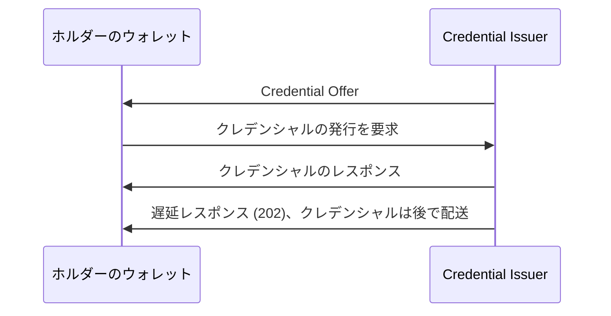

# Deep Dive: openid/OpenID4VCI

> 一言で言うと: OpenID4VCI は、ホルダーによるクレデンシャルの発行要求と、発行者による検証可能なクレデンシャルの発行を可能にする仕様であり、openid/OpenID4VCI リポジトリで策定されている。

## 概要

リポジトリの README は、この仕様を、ホルダーがクレデンシャルの発行を要求し、発行者が検証可能なクレデンシャルを発行できるようにするものと説明している。リポジトリには、master ブランチから自動的にビルドされる 3 つのワーキンググループドラフト、すなわちバージョン 1.0、バージョン 1.1、Server to Server (s2s) ドラフトがある。ステージされた資料は README と最近更新されたプルリクエストの一覧だけであり、これらのドラフトの本文は含まれていない。プルリクエストのタイトルからは、Credential Offer、トランザクションコードを伴う事前承認コードフロー、Nonce エンドポイントとプルーフタイプ、遅延発行、Credential Issuer Metadata、DPoP、Interactive Authorization フローといった語彙が見える。したがって本ディープダイブは、規範的なプロトコルではなく、作業の概形と進行方向を述べる。

## 仕組み

README にはプロトコルフローの説明がない。下の図は、README に名前のある当事者(ホルダーと発行者)と、プルリクエストのタイトルが示すステップだけを描いている。正確な順序、パラメーター、どのステップが任意かはドラフトで確認する必要がある。

1. 発行者はウォレットに Credential Offer を渡すことがある(プルリクエスト #759 は `issuer_redirect_uri` の追加を提案している)。
2. ウォレットが発行を要求する。#686(事前承認コードフローへの `invalid_tx_code`)と #678(Nonce エンドポイントの有無に応じたプルーフタイプの `nonce`)のタイトルから、トランザクションコードを伴う事前承認コードフローと、nonce を持つプルーフタイプが存在することがわかる。
3. 発行者がクレデンシャルを返す。#721(クレデンシャルレスポンス内のメタデータ)は、レスポンスがメタデータを運べることを示す。
4. クレデンシャルが準備できていない場合、発行者は 202 で応答でき、ウォレットは後で取得する(#722 は 202 の例を修正し、#816 は s2s ドラフトの遅延クレデンシャルに関する)。

## ユースケース

- ホルダー側を実装するウォレットベンダーは、Credential Issuer Metadata を公開する発行者からクレデンシャルを要求する必要がある(#775 は Credential Issuer Identifier からメタデータ URL を組み立てる方法に関する)。
- 即時に発行できない発行者は遅延発行を必要とし、202 レスポンスと遅延クレデンシャルの作業(#722、#816)が該当する。
- 発行中にエンドユーザーとやり取りする必要がある発行者は、Interactive Authorization フローに出会う(#736、#819、#781)。
- クレデンシャルをホルダーの鍵に束縛するデプロイ担当者は、プルーフタイプと、暗号鍵バインディングが不要であることを発行者がどう示すかの説明に出会う(#714、#678)。
- ウォレットを介さずサーバー間でクレデンシャルを発行するシステムは s2s ドラフトを参照することになる(#753、#809、#810)。ステージされた資料には、タイトル以外にそのドラフトの対象範囲は書かれていない。

## なぜ今重要か

- **きっかけ**: `subject.json` に理由は記載されていない(`ai_note` が空)。リポジトリは `openid` トラックの候補として選ばれた。
- **根拠**: プルリクエストの一覧は活発な作業を示す。オープンなプルリクエストは #819、#810、#816、#759、#678 であり、マージ済みの作業には最初の s2s ドラフト(#753)、クレデンシャルデータセットのバージョン(#472)、DPoP 使用時の `auth_session` の束縛(#803)がある。
- **想定される影響**: ウォレットと発行者の実装者は、Interactive Authorization のエラーレスポンスの名前付けや s2s のモデル名など、1.1 ドラフトでの変更を想定すべきである。どの変更がリリース済みバージョンに入っているかは、資料からはわからない。

## 変更点

資料に差分はないため、この節では最近のプルリクエストが導入するものをタイトルのみで列挙する。内容はステージされておらず、確認が必要である。

- マージ済み: OpenId4VCI-S2S の最初のドラフト(#753)、そのビルドルール(#799)、バージョン表の修正(#798)、Document の snake_case プロパティ(#809)。
- マージ済み: first party apps ドラフトの上に構築した Interactive Authorization(#736)、FPA draft-4 と揃えた HTTP レスポンスコード(#781)、衝突を防ぐための型の URN(#712)、一意な `request_uris` の必須化(#704)。
- マージ済み: 他の束縛メカニズムがあれば `auth_session` は任意(#706)、DPoP 使用時は束縛が必須(#803)、セッション内で最新の値とする明確化(#710)。並行セッションを `state` で束縛する(#797)。
- マージ済み: クレデンシャルデータセットのバージョン(#472)、クレデンシャルレスポンス内のメタデータ(#721)、`invalid_tx_code` エラー(#686)、メタデータ URL を組み立てる際の Credential Issuer Identifier 末尾の `/` の除去(#775)。
- オープン: Interactive Authorization のエラーレスポンスで `error_code` の代わりに `error`(#819)、s2s の識別子モデル名(#810)、s2s の遅延クレデンシャル(#816)、Credential Offer の `issuer_redirect_uri`(#759)、プルーフタイプの `nonce` の条件(#678)。
- マージされず閉じられたもの: Interactive Authorization フローで期待されるオリジンの代わりに期待される URL を使う案(#695)、クレデンシャルのエラーレスポンスの `redirect_uri`(#723)、JOSE を用いる VCDM 2 のクレデンシャルフォーマットプロファイル(#699)、IAE レスポンスのステータスコード要件(#716)。

タイトルから見える互換性の懸念: `error_code` から `error` への変更(#819)と s2s の名前変更(#809、#810)は、以前のドラフトの実装を壊す可能性があり、`/` の除去(#775)は発行者が提供すべきメタデータ URL を変える。これらが破壊的変更かどうかは資料に記載がない。

## 技術分析

ステージされた資料には仕様の節がないため、分析はプルリクエストのタイトルから示唆される範囲に限られ、節ではなくプルリクエストで参照する。

- **脅威モデル**: セッションの束縛が繰り返し現れるテーマである。DPoP 使用時の `auth_session` の束縛(#803)、`state` による並行セッションの束縛(#797)、一意な `request_uris`(#704)、期待される URL と期待されるオリジンの比較(#695、クローズ)。これらはセッション取り違えやリプレイに対する攻撃を示唆するが、資料は脅威を明示していない。
- **プロトコルフロー**: 名前が挙がっているフローは、Credential Offer、トランザクションコードを伴う事前承認コード、Nonce エンドポイントとプルーフタイプ、遅延発行、first party apps ドラフトの上に構築された Interactive Authorization フローである。
- **相互運用性への含意**: 複数のドラフト(1.0、1.1、s2s)が併存し、README は他のバージョンを <https://openid.net/sg/openid4vc/specifications/> に案内している。JOSE を用いる VCDM 2 のフォーマットプロファイル(#699)はクローズされたため、フォーマット対応は確認すべき点である。メタデータ URL の規則(#775)とエラーフィールド名(#819)は、2 つの実装が食い違いうる箇所である。

## 未解決の問題

- 各プルリクエストは規範的な本文をどう変えるのか。ステージされたのはタイトルだけである。
- Interactive Authorization のエラーレスポンスは `error` と `error_code` のどちらを使うのか(#819、オープン)。
- `issuer_redirect_uri` は Credential Offer に含めるべきか(#759、オープン)。含める場合のセキュリティ上の考慮事項は何か。
- Nonce エンドポイントが存在する場合としない場合があるとき、プルーフタイプで `nonce` はいつ必須か(#678、オープン)。
- s2s ドラフトで遅延発行はどう定義されるのか(#816、オープン)。s2s の識別子モデルはウォレット向けドラフトとどう関係するのか(#810)。
- 現時点で実装者向けに想定されているのは 1.0 と 1.1 のどちらか。README は両方をワーキンググループドラフトとして挙げており、明記していない。

## 実験

- [ ] 1.1 ワーキンググループドラフトと 1.0 ドラフトを取得し、エラーレスポンスと Credential Offer の定義を、オープンなプルリクエスト #819 と #759 に照らして差分確認する。
- [ ] README のコマンド(`docker run ... danielfett/markdown2rfc`)で 1.1 の HTML をビルドし、公開されているワーキンググループドラフトと一致することを確認する。
- [ ] Credential Issuer Identifier の末尾に `/` がある場合とない場合でウォレットを発行者のメタデータエンドポイントに対して実行し、双方がどのメタデータ URL を組み立てるかを確認する(#775)。

## 情報源

- <https://github.com/openid/OpenID4VCI>
- <https://openid.github.io/OpenID4VCI/openid-4-verifiable-credential-issuance-1_0-wg-draft.html>
- <https://openid.github.io/OpenID4VCI/openid-4-verifiable-credential-issuance-1_1-wg-draft.html>
- <https://openid.github.io/OpenID4VCI/openid-4-verifiable-credential-issuance-server-2-server-wg-draft.html>
- <https://openid.net/sg/openid4vc/specifications/>
