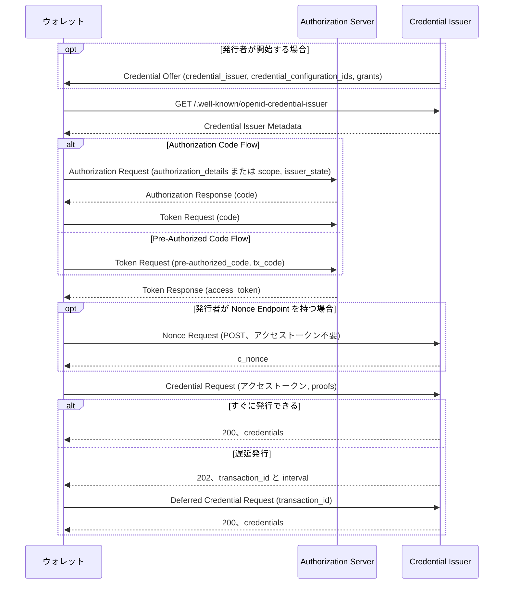

# ディープダイブ: OpenID for Verifiable Credential Issuance (openid/OpenID4VCI)

> 一言で言うと: OpenID4VCI は、ウォレットが Credential Issuer から Verifiable Credential を受け取るための、OAuth で保護された API である。1.0 は 2025 年 9 月から OpenID Final Specification で、openid/OpenID4VCI リポジトリでは現在、1.0 のエラッタ版ドラフト、Interactive Authorization を加えた 1.1 ドラフト、新しい Server to Server ドラフトの 3 つを編集している。

## 概要

OpenID4VCI は「Verifiable Credential を発行するための、OAuth で保護された API」を定める。対象のフォーマットは問わず、SD-JWT VC、ISO mdoc、W3C VCDM を含む(1.0 Section 1)。Credential Issuer は OAuth 2.0 の Resource Server として振る舞う。ウォレットは OAuth クライアントとして Authorization Server からアクセストークンを取り、それを使って Credential Endpoint を呼ぶ(1.0 Section 3.2)。OAuth への追加は、Pre-Authorized Code グラント、authorization details の `openid_credential` 型、`issuer_state` パラメーター、ウォレット側の `credential_offer_endpoint` である(1.0 Section 3.2)。

OpenID Foundation の会員投票で OpenID4VCI 1.0 は Final Specification として承認された。告知の日付は 2025 年 9 月 16 日で、賛成 102、反対 1、棄権 12 だった。リポジトリ(コミット `21ffd6c`、2026 年 10 月 27 日)には編集中のドラフトが 3 つあり、どれも OpenID Digital Credentials Protocols ワーキンググループのものである。

- `1.0/`: 「1.0 incorporating errata set 1」、リビジョン `-19`。Final からの変更は今のところ、Transaction Code の推測攻撃に関するセキュリティ上の考慮事項の追加と、メタデータ URL を組み立てる際に末尾の `/` を取り除く規則の復活の 2 点である(Document History)。
- `1.1/`: リビジョン `-01`。「1.0 Final と同じ本文」から始めて拡張している。最大の追加は Interactive Authorization(Section 6)で、OAuth 2.0 for First-Party Applications(FPA)のプロファイルである。この仕組みは Final の前に 1.0 ドラフトから外されたものを戻したものである(Document History)。
- `s2s/`: 「Server to Server」、リビジョン `-01`。Wallet Server と Issuer Server の間の API で、最初のドラフトは 2026 年 8 月 4 日にマージされた(#753)。

## 仕組み

図は Authorization Code Flow(1.0 Section 3.4)と Pre-Authorized Code Flow(Section 3.5)に、任意の Nonce Endpoint(Section 7)と遅延発行(Sections 8.3 と 9)を加えたものである。

1. 発行者が開始する場合、Credential Issuer は Credential Offer を値渡し(`credential_offer`)か参照渡し(`credential_offer_uri`)で送る。たとえば QR コードにする。中身は `credential_issuer` と `credential_configuration_ids`、任意で `grants` である(1.0 Sections 4.1 と 4.1.1)。ウォレットが開始する場合は Offer がない。
2. ウォレットは Credential Issuer Identifier のホストとパスの間に `/.well-known/openid-credential-issuer` を挟んだ URL から Credential Issuer Metadata を取得する(1.0 Section 12.2.2)。
3. Authorization Code Flow では、ウォレットは `openid_credential` 型の `authorization_details` かクレデンシャル用の `scope` を付けて Authorization Request を送り、Offer に `issuer_state` があればそれも付ける。受け取ったコードは Token Endpoint で交換する(Sections 5 と 6)。Pre-Authorized Code Flow では Authorization Endpoint を通らず、`pre-authorized_code` を送る。Offer が Transaction Code(`tx_code`)を求めていればそれも送る(Section 3.5)。
4. Credential Issuer が Nonce Endpoint を持っていれば、ウォレットはそこから `c_nonce` を取る。このエンドポイントは保護されたリソースではない。proof に `c_nonce` を求める発行者は、このエンドポイントを提供しなければならない(MUST)(Section 7)。
5. ウォレットはアクセストークンと、鍵バインディングが必要なら `proofs` を付けて Credential Request を送る(Section 8.2)。発行者は 200 で `credentials` を返す。すぐに発行できないときは、202 で `transaction_id` と `interval` を返さなければならない(MUST)(Section 8.3)。ウォレットはその `transaction_id` で、任意の Deferred Credential Endpoint に後から問い合わせる(Section 9)。

1.1 では、認可コードを得る 3 つ目の方法が加わる。ウォレットはブラウザを介さず、Authorization Challenge Endpoint(メタデータでは `authorization_challenge_endpoint`)を直接呼ぶ。Authorization Server は 403 で `insufficient_authorization` と `interaction_type_required` を返すことができ、プレゼンテーションを求める場合は `auth_session` と `openid4vp_request` も付ける。ウォレットは OpenID4VP で別のクレデンシャルを提示し、`auth_session` を付けて再送する。これをコードが返るまで繰り返す(1.1 Sections 6 から 6.2.1.1)。

## ユースケース

1.1 ドラフトの Appendix H は 6 つのユースケースを挙げる。同一端末での Credential Offer、エンドユーザーが事前に情報を提出したうえでの別端末での Offer、別端末かつ遅延発行、プレゼンテーション中にウォレットが開始する発行、その発行中にさらに別のクレデンシャルの提示を求められる場合、インストール直後にウォレットが開始する発行である。

- ホルダー側を実装するウォレットは、Sections 3 から 9 と、SD-JWT VC、mdoc、W3C VC 用の Appendix A の Credential Format Profiles に従う。
- 人手の審査が要る発行者は、`transaction_id` を返し、Deferred Credential Endpoint を用意する(Sections 8.3 と 9)。
- 発行前に別のクレデンシャルを確認したいが、利用者をブラウザに移したくない発行者は、1.1 の Interactive Authorization を使う(Section 6、`urn:openid:dcp:ia:openid4vp_presentation`)。
- クーポンやチケットのようなベアラー型クレデンシャルの発行者は `cryptographic_binding_methods_supported` を省き、その結果 `proof_types_supported` もなくなるので、ウォレットは `proofs` を送らない(1.1 Section 15.2、#714 で追加)。
- ウォレットアプリと発行者の間に自前のサーバーを置くウォレット提供者は、s2s ドラフトを使う。Wallet Server と Issuer Server は mTLS で相互認証し、Wallet Client が発行者向けに署名・暗号化したデータは Wallet Server からは見えない(s2s Abstract、Sections 4 と 5.1)。

## なぜ今重要か

- **きっかけ**: `subject.json` に理由はない(`ai_note` が空)。`openid` トラックで、まだディープダイブのない候補の先頭だった。
- **根拠**: 2026 年 6 月から 10 月にかけて、FPA を土台にした Interactive Authorization(#736、6 月 24 日)、最初の s2s ドラフト(#753、8 月 4 日)、Interactive Authorization のセッション束縛の規則(#706、#797、#803)、Credential Dataset のパラメーター(#472、10 月 15 日)がマージされた。オープンな #687 は、1.1 を Final にするまでの手順として、実装者向けドラフト、形式的なセキュリティ分析、WG ラストコールを挙げている。
- **想定される影響**: 今実装すべき版は 1.0 Final である。1.1 も追うウォレットと発行者は、通信内容が変わる箇所に備える必要がある。Interactive Authorization のエンドポイントとパラメーター、トークンエラーの `invalid_tx_code`、Credential Response の `credential_dataset_id` と `credential_dataset_tag` である。

## 変更点

以下はすべて、各プルリクエストの差分と `21ffd6c` 時点のドラフト本文で確認した。

- **1.0 エラッタ(`-19`)**: Section 12.2.2 に末尾の `/` の規則が戻った(#775、2026 年 9 月 28 日マージ)。Section 13.6.3「Transaction Code Guessing」も加わった。Transaction Code の失敗回数を制限すべきこと(SHOULD)と、コードが無効だと分かるエラーを返すべきこと(SHOULD)を定めている(#686)。
- **1.1、Interactive Authorization(Section 6)**: FPA のプロファイルとして作り直され、Authorization Challenge Endpoint を使う(#736)。応答は FPA draft -04 に合わせて 401 ではなく 403 Forbidden になった(#781)。インタラクション種別は `urn:openid:dcp:ia:openid4vp_presentation` や `urn:openid:dcp:ia:auth_via_web` のような URN である(#712)。`expected_origins` がある場合は、Authorization Challenge Endpoint から導いた Origin だけを含めなければならない(MUST)(Section 6.2.1.1)。期待する URL を使う案の #695 はクローズされた。
- **1.1、`auth_session`(Section 6.2.1)**: 「インタラクション種別が指定する場合に REQUIRED」となり、独自の種別はこれを必須にするか、リクエストを結び付ける別の方法を定めるかのどちらかにする(#706)。ウォレットは最後に受け取った値を送らなければならない(MUST)(#710)。DPoP を使う場合、AS は `auth_session` の値を DPoP 公開鍵と結び付けなければならない(MUST)(#803)。
- **1.1、`auth_via_web`(Section 6.2.1.2)**: ウォレットは `request_uri` の値を一度だけ使わなければならない(MUST)。AS は一回限りとして扱うべきだが(SHOULD)、再読み込みによる重複は受け入れてもよい(MAY)(#704)。並行セッションを持つウォレットは `state` を送らなければならない(MUST)(#797)。
- **1.1、Credential Response(Section 9.3)**: 任意の `credential_metadata`(#721)と、推奨の `credential_dataset_id` と `credential_dataset_tag` が加わった。後者によって、ウォレットは保存済みのクレデンシャルが置き換わったかを判断できる(#472、Section 15.4)。
- **1.1、Token Error Response(Section 7.3)**: Transaction Code の誤りには `invalid_tx_code` を返す。1.0 では `invalid_grant` である(1.0 Section 6.3、#686)。
- **1.0 と 1.1**: 202 の例が `202 OK` から `202 Accepted` に直った(#722)。鍵バインディングが不要な発行者は `cryptographic_binding_methods_supported` を省く(#714)。
- **s2s**: 最初のドラフト(#753)、ビルドルール(#799)、バージョン表の修正(#798)、全体の snake_case 化(#809、2026 年 10 月 27 日マージ)。
- **オープン**: Interaction Required Response の本文で `error_code` を `error` に直す(#819)。s2s の識別子モデルの名前変更で、Session Id を Wallet Id に、Credential Instance Id を Credential Id にする(#810)。s2s の遅延クレデンシャルで、Transaction Id と専用エンドポイントを加える(#816、#810 が前提)。Credential Offer の `issuer_redirect_uri` と、その許可リストになるメタデータ `expected_redirect_uris`(#759)。key attestation の `nonce` と `di_vp` の `challenge` の条件(#678)。
- **マージされずにクローズ**: #695(上記)、#699(JOSE を使う VCDM 2 のフォーマットプロファイル)、#716(IA の応答のステータスコード要件)、#723(#759 に置き換え)。

互換性について。#819 は 1 語の修正である。例と FPA draft -04 Section 5.2.2 はすでに `error` を使っているので、直すのは本文の記述で、通信内容は変わらない。s2s の名前変更(#809、#810)は JSON の名前を変えるが、s2s はまだリビジョンが 1 つしかなく、安定版もない。運用中の 1.0 発行者の挙動を変えるのは #775 である。Final の本文では `https://issuer.example.com/tenant/` は `.../.well-known/openid-credential-issuer/tenant/` になり、エラッタの本文では `.../tenant` になる。元になった issue(#744)は、これを「technically ... a breaking change」と書いている。

## 技術分析

- **脅威モデル**: 1.0 の Security Considerations は、Credential Offer の改ざん(Section 13.5)、Pre-Authorized Code のリプレイと Transaction Code のフィッシングや推測(Section 13.6)、`c_nonce` で防ぐ鍵 proof のリプレイ(Section 13.8)、アクセストークンの保護(Section 13.10)を扱う。ネイティブアプリのウォレットでは、送信者制約の方式として DPoP を推奨している(RECOMMENDED)(Section 13.2)。1.1 は Interactive Authorization 固有の脅威を 2 つ加える。1 つはセッション固定攻撃で、AS は OpenID4VP の `nonce` を `auth_session` と結び付けなければならない(MUST)(Section 6.2.1.4)。もう 1 つは、悪意のある AS が別の AS のプレゼンテーション要求を転送する攻撃で、`expected_origins` とプレゼンテーションの audience の束縛で防ぐ(Section 6.2.1.5)。
- **プロトコルフロー**: すべてのフォーマットに同じフローを使い、フォーマット固有の部分は Appendix A にまとめている。バッチ発行は複数の proof を付けた 1 回の Credential Request で、フォーマットとデータセットは同じで鍵だけが違うクレデンシャルを受け取る(1.0 Section 3.3.2)。proof の種類は `jwt`、`di_vp`、`attestation` である(Appendix F)。
- **相互運用性への含意**: 実装が食い違いうるのは、末尾が `/` の識別子のメタデータ URL(1.0 Final とエラッタの違い)、Transaction Code の誤りに返すトークンエラー(1.0 は `invalid_grant`、1.1 は `invalid_tx_code`)、key attestation に `nonce` を入れるかどうか(#678 がオープン)である。1.0 は Final になっていない依存仕様の版も固定している。SD-JWT VC -11、Attestation-Based Client Authentication -07、Token Status List -12、OpenID Federation -43 で、1.1 はこれに FPA -04 を加える(1.0 Section 14.7、1.1 Section 15.9)。

## 未解決の問題

- #775 のメタデータ URL の規則は 1.0 Final のエラッタとして公開されるのか。それまでの間、末尾が `/` の識別子を持つ発行者は両方の URL をどう提供すべきか。
- key attestation の `nonce` を WG はどう決着させるのか。#678 は 1.0 の本文で「at the Issuer's discretion」、1.1 の本文で「left to the Wallet」としている。
- #759 で、攻撃者が Credential Offer を書き換えられる前提のもと、`expected_redirect_uris` との一致だけでウォレットは `issuer_redirect_uri` を信頼してよいのか。
- s2s の遅延クレデンシャル(#816)は、現在の s2s ドラフトがすでに返す PENDING 状態とどう関係するのか。
- #687 が次の段階とする 1.1 の実装者向けドラフトはいつ出るのか。

## 実験

- [ ] 1.0 Final と `1.0/` のエラッタ版ドラフトをビルドして Sections 12.2.2 と 13.6 を比較し、エラッタの変更が Document History に書かれた 2 点だけであることを確かめる。
- [ ] 識別子が `https://<host>/tenant/` の発行者に対してウォレットを動かし、どのメタデータ URL を要求するかを記録する(1.0 Final と #775 の比較)。
- [ ] 1.0 に従う AS と 1.1 に従う AS に、誤った `tx_code` で Pre-Authorized Code の Token Request を送り、`invalid_grant` と `invalid_tx_code` のどちらが返るかを記録する。
- [ ] DPoP で束縛したクライアントで 1.1 Section 6.2.1.1 の Interactive Authorization の例をたどり、別の DPoP 鍵では同じ `auth_session` を使えないことを確かめる。

## 情報源

- <https://github.com/openid/OpenID4VCI>(コミット `21ffd6c74ca83a52eab78841c396619b9f91178c`)
- <https://openid.net/specs/openid-4-verifiable-credential-issuance-1_0-final.html>
- <https://openid.net/openid-for-verifiable-credential-issuance-1-final-specification-approved/>
- <https://openid.github.io/OpenID4VCI/openid-4-verifiable-credential-issuance-1_0-wg-draft.html>
- <https://openid.github.io/OpenID4VCI/openid-4-verifiable-credential-issuance-1_1-wg-draft.html>
- <https://openid.github.io/OpenID4VCI/openid-4-verifiable-credential-issuance-server-2-server-wg-draft.html>
- <https://openid.net/wg/digital-credentials-protocols/specifications/>
