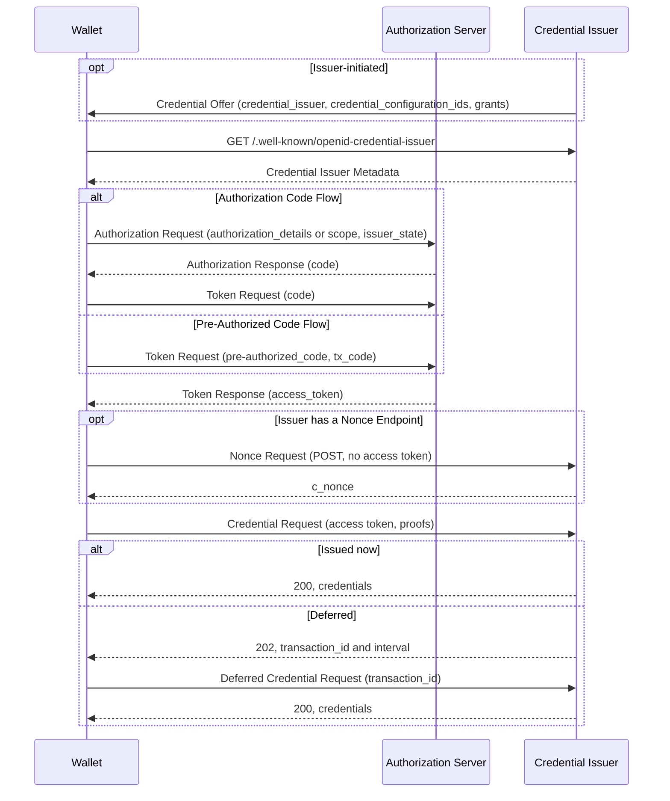

# Deep Dive: OpenID for Verifiable Credential Issuance (openid/OpenID4VCI)

> In one line: OpenID4VCI is an OAuth-protected API through which a Wallet obtains Verifiable Credentials from a Credential Issuer; 1.0 has been an OpenID Final Specification since September 2025, and the openid/OpenID4VCI repository now carries a 1.0 errata draft, a 1.1 draft that adds Interactive Authorization, and a new Server to Server draft.

## What this is

OpenID4VCI "defines an OAuth-protected API for the issuance of Verifiable Credentials" in any format, including SD-JWT VC, ISO mdoc and W3C VCDM (1.0 Section 1). The Credential Issuer acts as an OAuth 2.0 Resource Server; the Wallet is the OAuth client and gets an access token from an Authorization Server before calling the Credential Endpoint (1.0 Section 3.2). On top of OAuth it adds a Pre-Authorized Code grant, the `openid_credential` authorization details type, the `issuer_state` parameter and a Wallet `credential_offer_endpoint` (1.0 Section 3.2).

The OpenID Foundation membership approved OpenID4VCI 1.0 as a Final Specification; the announcement is dated 16 September 2025 (102 approve, 1 object, 12 abstain). The repository (commit `21ffd6c`, 27 October 2026) holds three editor's drafts, all in the OpenID Digital Credentials Protocols working group:

- `1.0/`: "1.0 incorporating errata set 1", revision `-19`. Its Document History lists two changes against the Final: a security consideration on Transaction Code guessing, and restoring the rule that removes a terminating `/` when forming the metadata URL. The git history of `1.0/` also shows smaller edits since the Final: the deferred `202` example's reason phrase (#722), a paragraph in Section 14.2 on credentials without key binding (#714), a typo fix (#731), and the errata title with a new Section 1.1 "Errata revisions" (#662).
- `1.1/`: revision `-01`, "created with same text as 1.0 Final" and then extended. The largest addition is Interactive Authorization (Section 6). Its text had been removed from the 1.0 draft before Final; 1.1 first restored it and later rebuilt it as a profile of OAuth 2.0 for First-Party Applications (FPA) (Document History, #736).
- `s2s/`: "Server to Server", revision `-01`, an API between a Wallet Server and an Issuer Server, first merged on 4 August 2026 (#753).

## How it works

The diagram follows the Authorization Code Flow (1.0 Section 3.4) and the Pre-Authorized Code Flow (Section 3.5), with the optional Nonce Endpoint (Section 7) and deferred issuance (Sections 8.3 and 9).

1. In the issuer-initiated variant, the Credential Issuer sends a Credential Offer, by value (`credential_offer`) or by reference (`credential_offer_uri`), for example as a QR code. It carries `credential_issuer`, `credential_configuration_ids` and optionally `grants` (1.0 Sections 4.1 and 4.1.1). In the wallet-initiated variant there is no offer.
2. The Wallet fetches the Credential Issuer Metadata by inserting `/.well-known/openid-credential-issuer` between the host and the path of the Credential Issuer Identifier (1.0 Section 12.2.2).
3. With the Authorization Code Flow, the Wallet sends an Authorization Request with `authorization_details` of type `openid_credential` or a credential `scope`, plus `issuer_state` if the offer contained one, and exchanges the code at the Token Endpoint (Sections 5 and 6). With the Pre-Authorized Code Flow, the Wallet skips the Authorization Endpoint and sends the `pre-authorized_code`, plus a Transaction Code (`tx_code`) if the offer required one (Section 3.5).
4. If the Credential Issuer has a Nonce Endpoint, the Wallet gets a `c_nonce` from it; the endpoint is not a protected resource. An issuer that requires `c_nonce` in proofs MUST offer this endpoint (Section 7).
5. The Wallet sends a Credential Request with the access token and, when key binding is required, `proofs` (Section 8.2). The issuer answers 200 with `credentials`, or, if it cannot issue immediately, MUST answer 202 with `transaction_id` and `interval` (Section 8.3). The Wallet then polls the optional Deferred Credential Endpoint with the `transaction_id` (Section 9).

1.1 adds a third way to get the authorization code. The Wallet calls the Authorization Challenge Endpoint (advertised as `authorization_challenge_endpoint`) directly instead of through a browser. The Authorization Server can answer 403 with `insufficient_authorization`, `interaction_type_required` and, for presentations, an `auth_session` and an `openid4vp_request`. The Wallet then presents another credential with OpenID4VP and resends with the `auth_session` until it gets a code (1.1 Sections 6 to 6.2.1.1).

## Use cases

The 1.1 draft lists six use cases in Appendix H: same-device Credential Offer, cross-device offer with information the End-User submitted beforehand, cross-device and deferred, wallet-initiated issuance during a presentation, the same with presentation of further credentials during issuance, and wallet-initiated issuance after installation.

- A Wallet implementing the holder side follows Sections 3 to 9 and the Credential Format Profiles in Appendix A for SD-JWT VC, mdoc and W3C VCs.
- An issuer that needs a manual review answers with a `transaction_id` and serves the Deferred Credential Endpoint (Sections 8.3 and 9).
- An issuer that wants to see another credential before issuing, without sending the user to a browser, uses Interactive Authorization in 1.1 (Section 6, `urn:openid:dcp:ia:openid4vp_presentation`).
- An issuer of bearer credentials, such as coupons or tickets, omits `cryptographic_binding_methods_supported`, and hence `proof_types_supported`, so the Wallet omits `proofs` (1.1 Section 15.2, from #714).
- A Wallet Provider that runs its own server between the Wallet app and the issuer would use the s2s draft. The Wallet Server and Issuer Server authenticate with mTLS, and data the Wallet Client signs and encrypts to the issuer stays hidden from the Wallet Server (s2s Abstract and Sections 4, 5.1 and 5.5).

## Why This Matters Now

- **Trigger**: `subject.json` gives no reason (`ai_note` is empty); the repository was the top `openid` candidate without a deep dive.
- **Source evidence**: Between June and October 2026 the repository merged Interactive Authorization on FPA (#736, 24 June), the first s2s draft (#753, 4 August), session-binding rules for Interactive Authorization (#706, #797, #803) and the Credential Dataset parameters (#472, 15 October). #687 (open) is a personal suggestion for the path to 1.1 Final: start the WG last call for an implementer's draft and a formal security analysis in parallel, then a WG last call for Final.
- **Expected impact**: 1.0 Final is the version to implement today. Wallets and issuers that also follow 1.1 should expect wire-visible changes: the Interactive Authorization endpoint and parameters, a new `invalid_tx_code` token error, and `credential_dataset_id` and `credential_dataset_tag` in the Credential Response.

## What Changed

Every item below was checked against the pull request diff and the current draft text at `21ffd6c`.

- **1.0 errata (`-19`)**: the terminating `/` rule is back in Section 12.2.2 (#775, merged 28 September 2026), and Section 13.6.3 "Transaction Code Guessing" was added. It says the AS SHOULD limit failed Transaction Code attempts and SHOULD return an error that says the code is invalid (#686).
- **1.1, Interactive Authorization (Section 6)**: rebuilt as a profile of FPA, with the Authorization Challenge Endpoint (#736). It answers 403 Forbidden rather than 401, in line with FPA draft -04 (#781). Interaction types are URNs (#712), now named `urn:openid:dcp:ia:openid4vp_presentation` and `urn:openid:dcp:ia:auth_via_web` (#736). If `expected_origins` is present, it MUST contain only the derived Origin of the Authorization Challenge Endpoint (Section 6.2.1.1). #695, which would have used an expected URL instead, was closed.
- **1.1, `auth_session` (Section 6.2.1)**: the key is "REQUIRED if specified by the interaction type", and a custom type must either require it or define another way to link requests (#706). The Wallet MUST send the most recently received value; #710 scoped this to the ongoing authorization request sequence. With DPoP, the AS MUST associate the `auth_session` value with the DPoP public key (#803).
- **1.1, `auth_via_web` (Section 6.2.1.2)**: the Wallet MUST use a `request_uri` value only once, and the AS SHOULD treat it as one-time but MAY accept a reload (#704). A Wallet with concurrent sessions MUST send `state` (#797).
- **1.1, Credential Response (Section 9.3)**: an OPTIONAL `credential_metadata` (#721) and RECOMMENDED `credential_dataset_id` and `credential_dataset_tag`, so a Wallet can tell when stored credentials are superseded (#472; Section 15.4).
- **1.1, Token Error Response (Section 7.3)**: a wrong Transaction Code now gives `invalid_tx_code`. In 1.0 it is `invalid_grant` (1.0 Section 6.3; #686).
- **1.0 and 1.1**: the 202 example now reads `202 Accepted` instead of `202 OK` (#722). An issuer that does not need key binding omits `cryptographic_binding_methods_supported` (#714).
- **s2s**: first draft (#753), build rules (#799), a fixed versioning table (#798) and snake_case properties throughout (#809, merged 27 October 2026).
- **Open**: `error` instead of `error_code` in the Interaction Required Response text (#819); renames in the s2s identifier model, with Session Id becoming Wallet Id and Credential Instance Id becoming Credential Id (#810); deferred credentials in s2s with a Transaction Id and a dedicated endpoint (#816, built on #810); `issuer_redirect_uri` in the Credential Offer with an `expected_redirect_uris` metadata allow-list (#759); and the conditions for `nonce` in key attestations and the `di_vp` `challenge` (#678).
- **Closed without merge**: #695 (above), #699 (VCDM 2 with JOSE format profile), #716 (status code requirement for the IA response) and #723, which #759 replaces.

Compatibility. #819 changes one word: the examples and FPA draft -04 Section 5.2.2 already use `error`, so it fixes the prose and not the wire format. The s2s renames (#809, #810) change JSON names, but s2s has only one revision and no stable version. #775 is the one that changes behavior for deployed 1.0 issuers. The Final text has no terminating `/` rule (#744 calls it "silent"), so read literally `https://issuer.example.com/tenant/` maps to `.../.well-known/openid-credential-issuer/tenant/`; under the errata text it maps to `.../tenant`. The issue behind it (#744) calls this "technically ... a breaking change".

## Technical Analysis

- **Threat model**: The 1.0 Security Considerations cover Credential Offer tampering (Section 13.5), Pre-Authorized Code replay and Transaction Code phishing and guessing (Section 13.6), key proof replay, countered by `c_nonce` (Section 13.8), and access-token protection (Section 13.10). For native-app Wallets, DPoP is RECOMMENDED as the sender-constraining mechanism (Section 13.2). 1.1 adds two threats specific to Interactive Authorization. The first is session fixation: the AS MUST bind the OpenID4VP `nonce` to the `auth_session` (Section 6.2.1.4). The second is a malicious AS forwarding another AS's presentation request, which `expected_origins` and the audience binding of the presentation address (Section 6.2.1.5).
- **Protocol flow**: One flow for all formats, with the format-specific parts confined to Appendix A. Batch issuance is one Credential Request with several proofs, giving credentials with the same format and dataset but different keys (1.0 Section 3.3.2). Proof types are `jwt`, `di_vp` and `attestation` (Appendix F).
- **Interop implications**: Implementations can diverge on the metadata URL for identifiers ending in `/` (1.0 Final versus errata), on the token error for a wrong Transaction Code (`invalid_grant` in 1.0, `invalid_tx_code` in 1.1), and on whether a Wallet sends a `nonce` in a key attestation (#678 open). 1.0 also pins pre-final dependencies: SD-JWT VC -11, Attestation-Based Client Authentication -07, Token Status List -12 and OpenID Federation -43, and 1.1 adds FPA -04 (1.0 Section 14.7, 1.1 Section 15.9).

## Open Questions

- Will #775's metadata URL rule be published as errata to 1.0 Final, and how should an issuer whose identifier ends in `/` serve both URLs in the meantime?
- How will the WG settle `nonce` in key attestations? #678 says "at the Issuer's discretion" in its 1.0 text and "left to the Wallet" in its 1.1 text.
- In #759, can a Wallet trust `issuer_redirect_uri` with only the `expected_redirect_uris` match, given that an attacker can modify a Credential Offer?
- How will deferred credentials in s2s (#816) relate to the PENDING state the current s2s draft already returns?
- When does 1.1 reach an implementer's draft, which #687 treats as the next step?

## Experiments

- [ ] Build 1.0 Final and the `1.0/` errata draft and diff them in full, to see whether anything beyond the Document History items and #722, #714, #731 and #662 changed.
- [ ] Run a Wallet against an issuer whose identifier is `https://<host>/tenant/` and record which metadata URL it requests (1.0 Final versus #775).
- [ ] Send a Pre-Authorized Code Token Request with a wrong `tx_code` to an AS that follows 1.0 and one that follows 1.1, and record `invalid_grant` versus `invalid_tx_code`.
- [ ] Walk the Interactive Authorization example in 1.1 Section 6.2.1.1 with a DPoP-bound client and check that a second DPoP key cannot reuse the `auth_session`.

## Sources

- <https://github.com/openid/OpenID4VCI> (commit `21ffd6c74ca83a52eab78841c396619b9f91178c`)
- <https://openid.net/specs/openid-4-verifiable-credential-issuance-1_0-final.html>
- <https://openid.net/openid-for-verifiable-credential-issuance-1-final-specification-approved/>
- <https://openid.github.io/OpenID4VCI/openid-4-verifiable-credential-issuance-1_0-wg-draft.html>
- <https://openid.github.io/OpenID4VCI/openid-4-verifiable-credential-issuance-1_1-wg-draft.html>
- <https://openid.github.io/OpenID4VCI/openid-4-verifiable-credential-issuance-server-2-server-wg-draft.html>
- <https://openid.net/wg/digital-credentials-protocols/specifications/>
