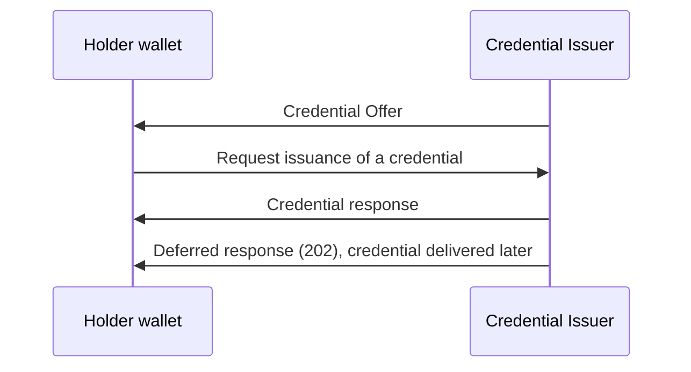

# Deep Dive: openid/OpenID4VCI

> In one line: OpenID4VCI is the specification that lets holders request issuance of credentials and lets issuers issue verifiable credentials, developed in the openid/OpenID4VCI repository.

## What this is

The repository README describes the specification as one that allows holders to request issuance of credentials and issuers to issue verifiable credentials. The repository holds three working group drafts that are built automatically from the master branch: version 1.0, version 1.1 and a Server to Server (s2s) draft. The staged material is only the README and a list of recently updated pull requests, so it does not contain the text of any of these drafts. The pull request titles show the vocabulary in play: Credential Offer, a pre-authorized code flow with a transaction code, a Nonce endpoint and proof types, deferred issuance, Credential Issuer Metadata, DPoP, and an Interactive Authorization flow. This deep dive therefore describes the shape of the work and where it is moving, not the normative protocol.

## How it works

The README does not describe the protocol flow. The diagram below shows only the parties named in the README (holder and issuer) and the steps that pull request titles name. The exact order, parameters and which steps are optional must be checked against the drafts.

1. The issuer may hand the wallet a Credential Offer (pull request #759 proposes adding `issuer_redirect_uri` to it).
2. The wallet requests issuance. The titles of #686 (`invalid_tx_code` for the pre-authz code flow) and #678 (`nonce` in proof types depending on a Nonce endpoint) show that a pre-authorized code flow with a transaction code and proof types with a nonce exist.
3. The issuer returns the credential. #721 (metadata in credential response) shows the response can carry metadata.
4. If the credential is not ready, the issuer can answer with a 202 and the wallet fetches it later (#722 fixes a 202 example, #816 concerns the deferred credential in the s2s draft).

## Use cases

- A wallet vendor implementing the holder side needs to request credentials from issuers that publish Credential Issuer Metadata (#775 concerns how the metadata URL is formed from the Credential Issuer Identifier).
- An issuer that cannot issue immediately needs deferred issuance, covered by the 202 response and the deferred credential work (#722, #816).
- An issuer that needs to interact with the end user during issuance meets the Interactive Authorization flow (#736, #819, #781).
- A deployer that binds credentials to a holder key meets proof types and the explanation of how an issuer indicates that cryptographic key binding is not required (#714, #678).
- A system that issues credentials server to server, without a wallet in the middle, would look at the s2s draft (#753, #809, #810); the staged material does not say what that draft covers beyond its title.

## Why This Matters Now

- **Trigger**: `subject.json` gives no reason (`ai_note` is empty); the repository was selected as a candidate on the `openid` track.
- **Source evidence**: The pull request list shows active work: open pull requests #819, #810, #816, #759 and #678, and merged work such as the first s2s draft (#753), a credential dataset version (#472) and DPoP binding of `auth_session` (#803).
- **Expected impact**: Implementers of wallets and issuers should expect changes in the 1.1 draft, including error response naming for Interactive Authorization and the s2s model names. The material does not say which changes are in a released version.

## What Changed

The material has no diff, so this section lists what the recent pull requests introduce, as titles only. Their content was not staged and must be checked.

- Merged: first draft of OpenId4VCI-S2S (#753), build rules for it (#799), a versioning table fix (#798) and snake_case properties for Document (#809).
- Merged: Interactive Authorization built on top of the first party apps draft (#736), HTTP response codes aligned with FPA draft-4 (#781), URNs for types to prevent collisions (#712), unique `request_uris` required (#704).
- Merged: `auth_session` is optional if another binding mechanism exists (#706), must be bound if DPoP is used (#803), and the most recent value in a session is clarified (#710). `state` must bind concurrent sessions (#797).
- Merged: credential dataset version (#472), metadata in the credential response (#721), `invalid_tx_code` error (#686), removal of a terminating `/` from the Credential Issuer Identifier when forming the metadata URL (#775).
- Open: `error` instead of `error_code` in the Interactive Authorization error response (#819), identifier model names in s2s (#810), deferred credential in s2s (#816), `issuer_redirect_uri` in Credential Offer (#759), `nonce` conditions in proof types (#678).
- Closed without merge: expected URL instead of expected origins for the Interactive Authorization flow (#695), `redirect_uri` in credential error responses (#723), a VCDM 2 with JOSE format profile (#699), a status code requirement for the IAE response (#716).

Compatibility concerns visible from titles: renaming `error_code` to `error` (#819) and the s2s renames (#809, #810) would break implementations of earlier drafts, and the `/` removal (#775) changes the metadata URL an issuer must serve. Whether any of these is breaking is not stated.

## Technical Analysis

The staged material has no spec sections, so the analysis is limited to what the pull request titles imply and is cited by pull request, not by section.

- **Threat model**: Session binding is a recurring theme: `auth_session` binding with DPoP (#803), binding concurrent sessions with `state` (#797), unique `request_uris` (#704) and expected URL versus expected origins (#695, closed). These point to attacks on session mix-up or replay, but the material does not state the threats.
- **Protocol flow**: Flows named are Credential Offer, pre-authorized code with a transaction code, Nonce endpoint with proof types, deferred issuance, and an Interactive Authorization flow built on the first party apps draft.
- **Interop implications**: Several drafts coexist (1.0, 1.1, s2s), and the README points to other versions at <https://openid.net/sg/openid4vc/specifications/>. The credential format profile for VCDM 2 with JOSE (#699) was closed, so format support is a point to check. The metadata URL rule (#775) and error field naming (#819) are places where two implementations can diverge.

## Open Questions

- What does each pull request change in the normative text? Only titles were staged.
- Is the Interactive Authorization error response to use `error` or `error_code` (#819, open)?
- Should `issuer_redirect_uri` be part of the Credential Offer (#759, open), and what security considerations come with it?
- When is `nonce` required in proof types, given a Nonce endpoint may or may not exist (#678, open)?
- How is deferred issuance defined in the s2s draft (#816, open), and how do the s2s identifier models relate to the wallet-facing drafts (#810)?
- Which of 1.0 and 1.1 is intended for implementers today? The README lists both as working group drafts and does not say.

## Experiments

- [ ] Fetch the 1.1 working group draft and the 1.0 draft and diff the error response and Credential Offer definitions against the open pull requests #819 and #759.
- [ ] Build the 1.1 HTML with the command in the README (`docker run ... danielfett/markdown2rfc`) and confirm it matches the published working group draft.
- [ ] Run a wallet against an issuer metadata endpoint with and without a trailing `/` in the Credential Issuer Identifier and check which metadata URL each side forms (#775).

## Sources

- <https://github.com/openid/OpenID4VCI>
- <https://openid.github.io/OpenID4VCI/openid-4-verifiable-credential-issuance-1_0-wg-draft.html>
- <https://openid.github.io/OpenID4VCI/openid-4-verifiable-credential-issuance-1_1-wg-draft.html>
- <https://openid.github.io/OpenID4VCI/openid-4-verifiable-credential-issuance-server-2-server-wg-draft.html>
- <https://openid.net/sg/openid4vc/specifications/>
