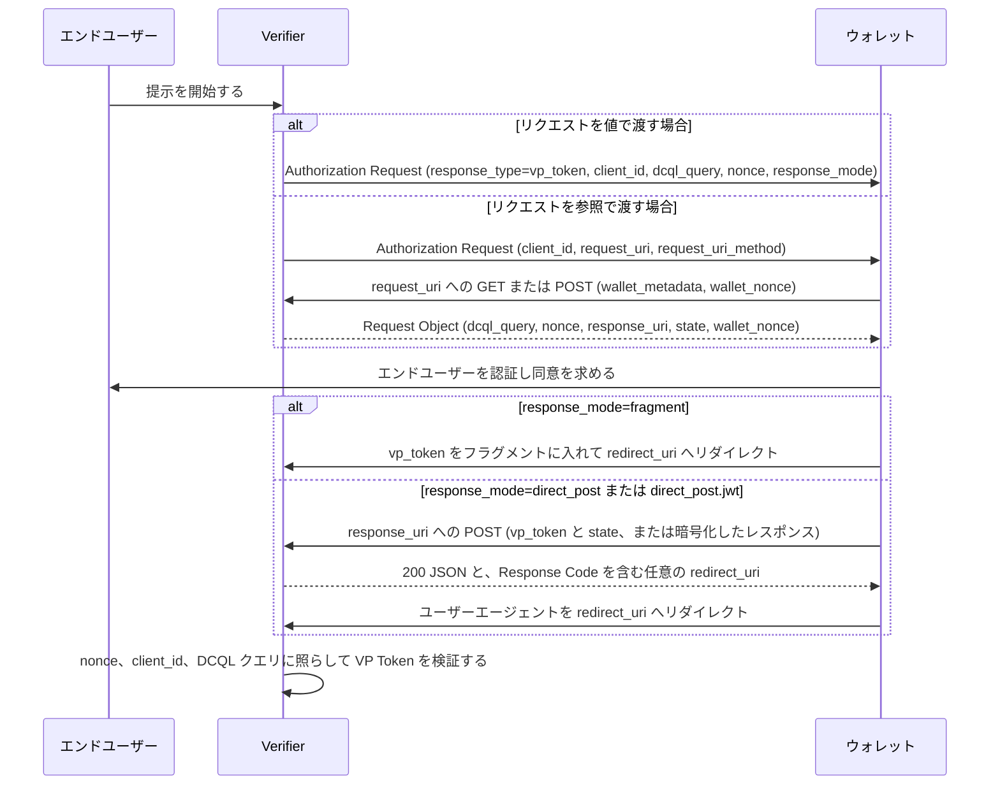

# ディープダイブ: OpenID for Verifiable Presentations (openid/OpenID4VP)

> 一言で言うと: OpenID4VP は OAuth 2.0 の拡張で、OAuth クライアントとして振る舞う Verifier が DCQL クエリでウォレットにクレデンシャルを要求し、`vp_token` に入った Presentation を受け取る。1.0 は 2025 年 7 月から OpenID Final Specification で、openid/OpenID4VP リポジトリでは現在、1.0 のエラッタ版ドラフトと 1.1 ドラフトを編集している。

## 概要

OpenID4VP は「OAuth 2.0 の上で、クレデンシャルの Presentation を要求し受け渡す仕組み」を定める。フォーマットは問わず、W3C VCDM、ISO mdoc、SD-JWT VC を含む(1.0 Section 1)。Verifier は「OAuth 2.0 クライアントの特殊な場合」であり、ウォレットは Holder がクレデンシャルと鍵を受け取り、保管し、提示し、管理するために使う実体である(Section 2)。中心となる拡張は Response Type `vp_token` で、やり取りの結果はアクセストークンではなく、1 つ以上の Presentation を含む VP Token になる(Section 3)。Section 4 はほかの追加点を挙げている。Digital Credentials Query Language(DCQL)とその `dcql_query` パラメーター、`vp_token` レスポンスパラメーター、Response Type の `vp_token` と `vp_token id_token`、Response Mode の `direct_post`、Client Identifier Prefix、Digital Credentials API(DC API)上での利用である。Section 3 は、この仕様が「相互運用のためにプロファイルを必要とするフレームワーク」だとも述べている。

OpenID Foundation は OpenID4VP 1.0 を OpenID Final Specification として承認した。告知の日付は 2025 年 7 月 10 日である(`data/landscape-sources.json`)。Final の本文はリビジョン `-30` で、リポジトリでは `1.0-final` タグが付いている。リポジトリ(コミット `66f5ff9`、2026 年 11 月 11 日)には、OpenID Digital Credentials Protocols ワーキンググループの編集中ドラフトが 2 つある。

- `1.0/`: 「OpenID for Verifiable Presentations 1.0 incorporating errata set 1」、リビジョン `-31`。Document History は Final からの変更を 26 件挙げており、空の VP Token の禁止から `age_over_NN` の照合規則まで含む(「変更点」を参照)。これはドラフトで、エラッタとしてはまだ承認されていない。
- `1.1/`: リビジョン `-01`。同じ変更に加え、1.1 だけの変更がいくつかある。暗号化レスポンス用の HPKE の `session_info` 構造(1.1 Section 8.3.1、#703)、エコシステムは VP Token をアクセストークンとして使ってはならない(MUST NOT)という規則(1.1 Section 14.6、#702)、DC API でのアプリケーション Origin についてのプラットフォームへの要件(1.1 Section A.5.1、#761)、より厳密な `vct_values` と `doctype_value` の照合(1.1 Section B.3.5 と B.2.3、#744)である。

以下の節番号は、「エラッタ」(`1.0/` のドラフト)または「1.1」と書いたもの以外は 1.0 Final のものである。2 つのドラフトでは、Section 14.x と B.2.5 以降の番号が Final と違う。

## 仕組み

図は Same Device Flow と Cross Device Flow(Section 3.1、3.2)に、Request URI、Response Mode `direct_post`、Verifier へのリダイレクト(Section 5.10、8.2)を加えたものである。DC API の場合は手順のあとで説明する。

1. Verifier は Authorization Request を、URL パラメーターとして、値で渡す Request Object(`request`)として、または参照(`request_uri`)として送る(Section 5.4)。Request Object は JAR(RFC 9101)に従う。Verifier は `typ` ヘッダーを `oauth-authz-req+jwt` にしなければならず(MUST)、ウォレットはそれがない Request Object を処理してはならない(MUST NOT)(Section 5)。`client_id`、`nonce`、`response_mode` は REQUIRED で(Section 5.2)、`dcql_query` か、DCQL クエリの別名になる `scope` 値のどちらか一方だけがなければならない(MUST)(Section 5.1、5.5)。`request_uri_method=post` の場合、ウォレットは自分の `wallet_metadata` と `wallet_nonce` を Request URI に POST する。返ってきた Request Object にその `wallet_nonce` がない場合、または `client_id` が URL のものと違う場合、ウォレットはリクエストの処理を打ち切らなければならない(MUST)(Section 5.10、5.10.1)。
2. ウォレットは Client Identifier Prefix から Verifier を識別する。これは `client_id` の最初の `:` より前の部分である(Section 5.9.1)。`:` がなければ、通常の OAuth と同じく事前登録されたクライアントとして扱う(Section 5.9.2)。Section 5.9.3 は下の表のプレフィックスを定める。署名が要るプレフィックスを使うには、Verifier は秘密鍵を安全に保管できなければならず(MUST)、ネイティブアプリの設計を変える必要が出ることもある。
3. ウォレットは DCQL クエリを評価する(Section 6)。`credentials` は Credential Query の空でない配列である。各 Credential Query は `id`、`format`、REQUIRED の `meta` オブジェクト(たとえば SD-JWT VC なら `vct_values`、mdoc なら `doctype_value`)を持ち、任意で claims path pointer を使う `claims`、`claim_sets`、`multiple`(既定値 `false`)、`trusted_authorities`(`aki`、`etsi_tl`、`openid_federation`)、`require_cryptographic_holder_binding`(既定値 `true`)を持つ(Section 6.1 から 6.3)。`credential_sets` はクレデンシャル同士の選択肢を表す(Section 6.2)。ウォレットは選ばれていない選択的開示可能なクレームを送ってはならず(MUST NOT)、任意でないクレデンシャルをすべて渡せない場合は 1 つも返してはならない(MUST NOT)(Section 6.4、6.4.2)。
4. ウォレットは VP Token を返す。VP Token は JSON オブジェクトで、キーは Credential Query の `id`、値は Presentation の配列である。`multiple` が `true` でない限り要素はちょうど 1 つで、一致するものがない任意のクエリにはエントリを置かない(Section 8.1)。`response_type=vp_token` なら Authorization Response で、`vp_token id_token` なら Self-Issued ID Token(SIOPv2、Appendix C)と一緒に、`code` なら Token Response で返す(Section 8)。既定の Response Mode は `fragment` である(Section 5.6)。`direct_post` では、ウォレットは `response_uri` に POST する。`redirect_uri` も含むリクエストには `invalid_request` エラーを返さなければならない(MUST)(Section 8.2)。`direct_post.jwt` と `dc_api.jwt` は、レスポンスを暗号化した JWT に包む。JWE の `alg` は Verifier の `jwks` から選んだ鍵の `alg` と同じでなければならず(MUST)、`enc` は `encrypted_response_enc_values_supported` から選び、既定値は `A128GCM` である(Section 8.3、8.3.1)。
5. Verifier は VP Token を検証する(Section 8.6)。すべての Verifiable Presentation は Verifier の Client Identifier とリクエストの `nonce` に結び付いていなければならず(MUST)、正しい `nonce` を持たない Presentation が 1 つでもあれば、Verifier はレスポンスを拒否しなければならない(MUST)(Section 14.1.2)。Verifier は DCQL の制約の強制をウォレットに頼ってはならず(MUST NOT)(Section 14.9)、`values` による照合はベストエフォートで、セキュリティ上の確認に使ってはならない(MUST NOT)(Section 6.4.1)。

Section 5.9.3 が定める Client Identifier Prefix:

| プレフィックス | 元の Client Identifier | リクエストの署名 | Verifier メタデータの取得元 |
| --- | --- | --- | --- |
| (なし) | 事前登録されたクライアント | 登録内容に従う | 登録または帯域外(Section 5.9.2) |
| `redirect_uri` | Redirect URI または Response URI | 署名できない | `client_metadata` |
| `openid_federation` | OpenID Federation の Entity Identifier | OpenID Federation に従う | Trust Chain。`client_metadata` は無視しなければならない(MUST) |
| `decentralized_identifier` | DID | DID Document の鍵で署名しなければならない(MUST)。鍵は `kid` で示す | 鍵以外は `client_metadata` |
| `verifier_attestation` | Verifier Attestation JWT の `sub` | その `cnf` の鍵で署名しなければならない(MUST)。JWT は `jwt` JOSE ヘッダーに入れる | 鍵以外は `client_metadata` |
| `x509_san_dns` | `x5c` のリーフ証明書の `dNSName` SAN に一致する DNS 名 | 署名しなければならない(MUST)。ウォレットはチェーンを検証しなければならない(MUST) | 鍵以外は `client_metadata` |
| `x509_hash` | `x5c` のリーフ証明書の DER の SHA-256 を base64url にしたもの | 署名しなければならない(MUST)。ウォレットはチェーンを検証しなければならない(MUST) | 鍵以外は `client_metadata` |
| `origin` | DC API 用に予約 | ウォレットはリクエスト中のこのプレフィックスを受け入れてはならない(MUST NOT) | なし |

エラッタ版ドラフトと 1.1 は、プレフィックスごとの「公開鍵以外の Verifier メタデータはすべて `client_metadata` パラメーターから取得しなければならない」という文を削り、セキュリティ上の考慮事項に「Source of Verifier Metadata」の節を加えた(エラッタ Section 14.12、#735)。そこでは、`client_metadata` から得た Verifier 名は「表示に適さない」こと、信頼できる取得元のデータが優先されることを述べている。

DC API(Appendix A)では、リクエストはリダイレクトではなくブラウザーや OS を経由する。プロトコル識別子は `openid4vp-v1-unsigned`、`openid4vp-v1-signed`、`openid4vp-v1-multisigned` のいずれかである(Section A.1)。署名なしのリクエストは `client_id` を省き、ウォレットはそれがあっても無視しなければならない(MUST)。署名付きのリクエストは `client_id` と `expected_origins` を含まなければならず(MUST)、プラットフォームが渡した Origin がどれにも一致しなければ、ウォレットはエラーを返さなければならない(MUST)。そのエラーは `invalid_request` であるべきである(SHOULD)(Section A.2)。Response Mode は `dc_api` か `dc_api.jwt` で、`state` は定義されていない。Presentation の audience は、署名付きリクエストの場合も含め、`origin:` に Origin を続けたものでなければならない(MUST)(Section A.4)。DC API では、プレフィックスの規則に従ってリクエストの署名を検証するかどうかはウォレットの裁量である(Section 5.9.3)。複数署名のリクエストは JWS JSON Serialization を使い、各署名の protected header に `client_id` と `verifier_info` を入れる。これにより 1 つのリクエストで複数のトラストフレームワークに対応できる(Section A.3.2.2)。

## ユースケース

- Response Mode `fragment` を使った同一デバイスでのリダイレクトによる提示と、`request_uri` と `direct_post` を使った QR コードからの別デバイスでの提示(Section 3.1、3.2、5.7)。
- DC API を使ったブラウザーやネイティブアプリでの提示。プラットフォームが Verifier の Origin をウォレットに伝える(Appendix A)。
- 映画のチケットや、クレームに結び付いた卒業証明書のような、Cryptographic Holder Binding のないクレデンシャルの提示(`require_cryptographic_holder_binding: false`)。この場合 Verifier は、DC API を使うとき以外は、128 ビット以上のエントロピーを持つ新しい `state` を使わなければならない(MUST)(Section 5.3)。
- 支払いや適格電子署名のような取引の承認。`transaction_data` を、クレデンシャルの所持を証明する鍵で署名する(Section 5.1、8.4)。
- mDL による年齢確認。エラッタ版ドラフトと 1.1 では、要求された `age_over_NN` 要素を持たない mDL のウォレットは、ISO 18013-5 の規則に従って別の `age_over_NN` 要素を返せる(エラッタと 1.1 の Section B.2.5、#800)。
- 登録証明書や決済サービス事業者としての役割のような Verifier についての証明を `verifier_info` で渡す(Section 5.11)。
- `response_type=code` を使い、同じ Authorization Server からのアクセストークンと一緒に提示を受ける(Section 1、8)。

## なぜ今重要か

- **きっかけ**: OpenID4VP は、`tracks/openid/data/normalized/candidates.json` でディープダイブのない `openid` の候補の 2 番目だった(スコア 18.0)。`tracks/openid/data/normalized/insights.json` の日次ブリーフィングは、#800(ブランチ `718-age-over-nn`)のマージを差分なしで記録していた。
- **根拠**: #800 は 2026 年 11 月 11 日にマージされ、先頭コミット `66f5ff9` になっている。2026 年 5 月から 11 月にかけて、WG はエラッタ `-31` を構成する明確化をマージした。VP Token のエンコードとエラー(#745、#782、#783、#790)、Request URI の扱い(#788、#798)、メタデータ(#735、#801、#802)、DC API の Origin(#719)、nonce のエントロピー(#722)である。オープンなプルリクエストが 5 件残っている(#726、#803、#804、#808、#809。「変更点」を参照)。
- **想定される影響**: 今実装して試験すべき版は 1.0 Final である。エラッタ版ドラフトは、相手から通信上で見える挙動を変える。たとえば `redirect_uri` プレフィックスでの `alg: none` の Request Object、空の VP Token の禁止、mdoc のレスポンスで別の `age_over_NN` 要素が返ることである。1.1 はさらに HPKE 暗号化とより厳密な型の照合を加える。

## 変更点

各項目は、プルリクエストの変更ファイル一覧と差分、および `66f5ff9` 時点のドラフト本文で確認した。

- **エラッタ版ドラフトと 1.1 の両方にマージ済み**:
  - `age_over_NN`(#800、2026 年 11 月 11 日マージ。1.0 の本文は 2026 年 10 月 25 日に追加)。新しい節「Data Element Selection Rules」(エラッタ Section B.2.5)によると、mdoc に要求されたデータ要素がない場合、ウォレットはドキュメント型の選択規則を適用すべきである(SHOULD)。`age_over_NN` なら ISO 18013-5 Section 7.2.5 の規則である。選ばれた要素は `claims`、`claim_sets`、`values` の評価では要求されたクレームとして扱われ、自分自身の識別子で返される。Verifier は要求したものと違う識別子を受け取る準備をしておくべきである(SHOULD)。claims path pointer の処理もこれに合わせて変わった(エラッタ Section 7、7.2.1)。PR の議論で WG は MUST ではなく SHOULD を維持し、1.0 と 1.1 の挙動をそろえるために 1.0 のエラッタにも入れることで合意した。
  - 打ち切りとエラー(#790): ウォレットがリクエストの処理を打ち切るときは、どんなレスポンスも返してはならない(MUST NOT)。真正なリクエストを得ておらず、信頼できる送り先がないためである(エラッタ Section 5.10.1)。`transaction_data` に対応しないウォレットは VP Token を返してはならず(MUST NOT)、返すレスポンスは `invalid_transaction_data` の新しいケースを使うべきで(SHOULD)、代わりにフローを取り消してもよい(MAY)(エラッタ Section 8.4、8.5)。Final は「エラーを返さなければならない(MUST)」とだけ書いていた。
  - VP Token: 空であってはならず、空のオブジェクトでエラーを表してはならない(MUST NOT)(#745、エラッタ Section 8、8.1)。SD-JWT VC の Presentation はコンパクト形式の SD-JWT または SD-JWT+KB で、JWS JSON Serialization を使ってはならない(MUST NOT)(#782、エラッタ Section B.3.6)。Holder Binding なしで要求された W3C VC は、Verifiable Presentation に包まずにそのまま VP Token に入れる(#783、エラッタ Section B.1)。
  - Request URI: Request Object は署名するが、`redirect_uri` のように署名なしのリクエストを求めるプレフィックスでは `alg: none` を使う(#788、エラッタ Section 5.10.1)。`request_uri_method=post` に対応しないウォレット、またはそれ以外の未知の値を受け取ったウォレットは、GET に戻らなければならない(MUST)。Final は JAR で続けてもよい(MAY)と書いていた(#798、エラッタ Section 5)。
  - メタデータ: 「Source of Verifier Metadata」の節と、プレフィックスごとの `client_metadata` の文の削除(#735、エラッタ Section 14.12)。`invalid_request` は、Verifier の `vp_formats_supported` にないフォーマットを `dcql_query` が要求した場合も含むようになった(#801、エラッタ Section 8.5)。`encrypted_response_enc_values_supported` はほかの Verifier メタデータと並べて記載された(#802、エラッタ Section 11.1)。
  - 小さな明確化: `nonce` は 128 ビット以上のエントロピーを持つべきである(SHOULD)。これは Verifier への SHOULD で、ウォレット側の確認はない(#722、エラッタ Section 5.2)。`state` は OPTIONAL から RECOMMENDED になった(#734、エラッタ Section 5.2)。`expected_origins` は Origin と単純な文字列比較で照合し、例から末尾の `/` が消えた(#719、エラッタ Section A.2)。`intent_to_retain` がない場合は何も表明しないことを意味する(#730、エラッタ Section B.2.4)。`origin` プレフィックスの相互参照が直った(#775)。`invalid_request` の例が古いプレフィックス名 `https` ではなく `openid_federation` を使うようになった(#776、エラッタ Section 8.5)。`ldp_vc` の例が直った(#787)。
  - 信頼できない入力: ウォレットはすべてのリクエストを信頼できない入力として扱わなければならず(MUST)、Authorization Request とそこに含まれる DCQL クエリを検証しなければならない(MUST)(1.1 は #748、1.0 は #759 で反映。エラッタ Section 14.13、1.1 Section 14.14)。
- **1.1 だけにマージ済み**: `vct_values` と `doctype_value` の照合(#744)。クレデンシャルは `vct_values` にある型でなければならず(MUST)、照合は `vct`、`aka_vcts`、帯域外の情報で行うことが RECOMMENDED である。Final の「継承した型のクレデンシャルを返してもよい(MAY)」という文はなくなった(1.1 Section B.3.5)。mdoc の `docType` は `doctype_value` と一致しなければならない(MUST)(1.1 Section B.2.3)。プラットフォーム固有のアプリケーション Origin は衝突しにくく、アプリケーションごとに一意でなければならない(#761、1.1 Section A.5.1)。HPKE の `session_info`(#703)、`encrypted_response_enc_values_supported` の HPKE 例外(#698)、VP Token の乱用についての規則(#702)も 1.1 だけである。
- **オープン**:
  - #803 は #744 の照合の文を 1.0 のエラッタに入れる。
  - #808 は、処理できない `transaction_data` があっても要求全体を失敗させず、それに関わる Credential Query を満たせないものとして扱うようにし、「参照されたクレデンシャルのうち 1 つだけを使う」という MUST を外す(両方の版、issue #794)。
  - #809 は Section 5.4 の例を直す(1.1 だけ)。この例は署名付きと説明されているのに、署名できない `redirect_uri` プレフィックスを使っており(Section 5.9.3)、`https//` という誤字があり、REQUIRED の `response_mode` もない。
  - #726 は issue #659 を直す。Section 13.4 は SD-JWT VC draft -09 を指定しているが、出力された規範参照は -10 を指している。クレデンシャルは draft 9 以降に一致しなければならず(MUST)、RFC に一致すべきである(SHOULD)とする案である。
  - #804 は「Selectively Disclosable Claim」をフォーマットごとに定義する(1.1 だけ、issue #717)。
- **マージされずにクローズ**: #647「Security Checks on the DCQL Query」は 2025 年 6 月 25 日に、分割前の `openid-4-verifiable-presentations-1_0.md` に対して出された。DC API のセキュリティ分析から、DCQL のインジェクション(CWE-943)についての考慮事項を提案していた。WG は DCQL だけでなくリクエストの JSON 全体を対象にするよう求めた。議長は 2026 年 6 月 18 日にこれをクローズした。作成者のコントリビューション契約がなく、1 年間進展がなかったためで、エディターの 1 人が一般化した版を書くことになった。それが #748(「Fixes the concerns raised in #647」、2026 年 7 月 9 日マージ)と、1.0 向けの #759 である。

互換性。Final の本文に従う実装とエラッタの本文に従う実装は、次の点で食い違いうる。`redirect_uri` の Request URI レスポンスが `alg: none` でよいか(#788)、未知の `request_uri_method` をウォレットがどう扱うか(#798)、空の VP Token がありうるか(#745)、mdoc のレスポンスが別の `age_over_NN` 識別子を含みうるか(#800)。1.0 のウォレットは要求された `vct` を継承したクレデンシャルを返してもよい(MAY)が、1.1 の Verifier は `vct`、`aka_vcts`、帯域外の情報だけで照合する。#803 が 1.0 をそろえるまでこの差は残る。

## 技術分析

- **脅威モデル**: リプレイは、各 Verifiable Presentation を Client Identifier と `nonce` に結び付けることで防ぐ(Section 14.1.2)。DC API では Client Identifier の代わりに Origin を使う(Section A.5)。`direct_post` はレスポンスが帯域外でデバイスを離れるため、セッション固定攻撃を受けうる。Response URI は返す `redirect_uri` に新しい Response Code を入れ、フロントエンドにそれを提示させなければならない(MUST)。ただし別デバイスの場合には効かない(Section 14.2)。ウォレットは Response URI からの漏えいを防がなければならず(MUST)、Verifier がレスポンスを取り出す内部インターフェースは保護しなければならない(MUST)(Section 14.3)。ほかに、署名のない暗号化レスポンスは攻撃者に差し替えられうること(Section 14.5)、プレフィックスを含む完全な Client Identifier を常に使うこと(Section 14.8)、DCQL の強制をウォレットに任せないこと(Section 14.9)を扱っている。エラッタ版ドラフトは、Request URI と Response URI への通信で HTTP リダイレクトに従わないこと(SHOULD、エラッタ Section 14.8、#753)、`client_metadata` から得た名前を表示しないこと(エラッタ Section 14.12)、リクエストを信頼できない入力として解析すること(エラッタ Section 14.13)を加えた。DC API と組み合わせた OpenID4VP の分析を含む、形式的なセキュリティ分析も引用している(エラッタ Section 14.1、A.5)。
- **プロトコルの流れ**: プレフィックスが、リクエストに署名するか、鍵をどこから得るか、メタデータをどこから得るかを決める。そのためウォレットにはプレフィックスごとの処理経路が要り、さらに署名なしの `redirect_uri` の経路と、署名の検証が任意になる DC API の経路が要る。エラーは、Verifier に返すもの(Section 8.5)と、ウォレットが黙って打ち切るもの(エラッタ Section 5.10.1)に分かれる。プライバシー上の考慮事項は、ウォレットはエンドユーザーとのやり取りなしにプロトコルエラーを返すべきでなく、値の照合や発行者の選択を含むリクエストでは同意の前に返すべきでない(SHOULD NOT)と付け加えている。Final はこれを DC API の項目に置き(Section 15.9.2)、エラッタ版ドラフトはすべての呼び出し方法に適用している(エラッタ Section 15.9)。
- **相互運用の懸念**: OpenID4VP は相互運用のためにプロファイルを必要とする(Section 3)。Final 前の依存仕様は版が固定されている。OpenID Federation -43、SIOPv2 -13、SD-JWT -22、SD-JWT VC -09、Fully-Specified Algorithms -13 である(Section 13.4)。SD-JWT VC の不整合は #726 で扱っている。SD-JWT VC と mdoc の型の照合は、#803 がマージされるまで 1.0 と 1.1 で違う。`age_over_NN` の規則は両側とも SHOULD なので、相手によって挙動が違っても仕様には反しない。

## 未解決の問題

- `1.0/` のドラフトはいつエラッタセット 1 として承認されるか。#803、#808、#726 はそこに入るか。
- #808 は #790 が明確化したばかりの `transaction_data` の規則を置き換えるのか。処理できない transaction data が Credential Query を満たせなくするだけになるなら、`invalid_transaction_data` には何が残るのか。
- `age_over_18` を要求して `age_over_19` を受け取った Verifier は、ウォレットが ISO 18013-5 の規則を使ったことをどう記録すべきか。規則は SHOULD である(エラッタ Section B.2.5)。
- #804 の Selectively Disclosable Claim の定義は、ウォレットが mdoc の `DeviceSigned` 構造に含めてよいものを変えるか。
- DC API では署名の検証はウォレットの裁量である(Section 5.9.3)。どのプロファイルがそれを必須にするか。

## 実験

- [ ] 1.0 Final(タグ `1.0-final`)と `1.0/` のエラッタ版ドラフトをビルドし、出力された本文の差分を取って、Document History が規範的な変更をすべて挙げているか確かめる。
- [ ] `age_over_21` しか持たない mDL のウォレットに `age_over_18` の要求を送り、どの要素が返るか、Verifier がそれを受け入れるかを記録する(エラッタ Section B.2.5)。
- [ ] 同じリクエストを `request_uri_method=post` と、`put` のような未知の値で送り、ウォレットが POST するか、GET に戻るか、`invalid_request_uri_method` を返すかを記録する(Section 5.1、#798)。
- [ ] Request URI と Response URI に HTTP 307 のリダイレクトを返させ、ウォレットがそれに従うかを記録する。エラッタの本文は、従うべきでなく(SHOULD NOT)、エラーとして扱うべきである(SHOULD)としている(エラッタ Section 14.8、#753)。
- [ ] ウォレットと Verifier を OpenID4VP 向けの OpenID 適合性テストにかける(Section 14.7)。

## 情報源

- <https://github.com/openid/OpenID4VP>(コミット `66f5ff93130128d1662cc60fcd79185ffe0a2d30`、タグ `1.0-final`)
- <https://openid.net/specs/openid-4-verifiable-presentations-1_0-final.html>
- <https://openid.net/openid-for-verifiable-presentations-1-0-final-specification-approved/>
- <https://openid.github.io/OpenID4VP/openid-4-verifiable-presentations-1_0-wg-draft.html>
- <https://openid.github.io/OpenID4VP/openid-4-verifiable-presentations-1_1-wg-draft.html>
- <https://github.com/openid/OpenID4VP/pull/800>
- <https://github.com/openid/OpenID4VP/pull/647>
- <https://github.com/openid/OpenID4VP/pull/748>
- <https://openid.net/certification/conformance-testing-for-openid-for-verifiable-presentations/>
