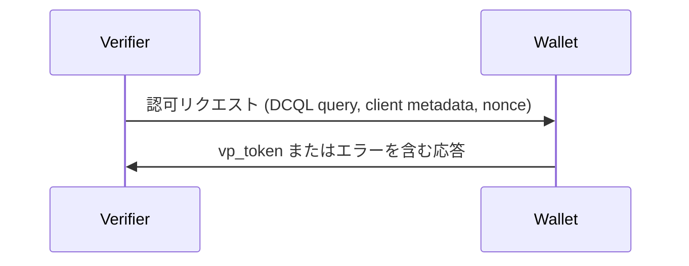

# Deep Dive: openid/OpenID4VP

> 一言で言うと: OpenID for Verifiable Presentations のワーキンググループのリポジトリであり、検証者がウォレットにクレデンシャルを要求して `vp_token` を受け取る仕組みを扱い、1.0 と 1.1 のドラフトの両方を main ブランチからビルドしている。

## 概要

入力資料はリポジトリの README と最近更新されたプルリクエストの一覧である。仕様本文は含まれていないため、以下の仕組みは README とプルリクエストの題名だけから推測している。

このリポジトリは 1.0 ドラフトと 1.1 ドラフトの二つを持ち、どちらも main ブランチから自動でビルドされる（README を参照）。プルリクエストの題名には、Verifier、Wallet、DCQL query、`vp_token`（VP Token）、署名付き Request Object、client metadata、Client Identifier Prefix、direct post 応答、Digital Credentials API（DC API）が現れる。これらの題名から、検証者が欲しいクレデンシャルを記述した要求を送り、応答でプレゼンテーションを受け取るプロトコルであると読み取れる。

資料には、要求の構文、応答の構文、信頼モデルの説明がない。これらは仕様本文で確認する必要がある。

## 仕組み

図には、プルリクエストの題名に現れる当事者とメッセージだけを示している。具体的なトランスポートの選択肢やメッセージの内容は資料にない。

1. 検証者がウォレットに要求を送る。題名には DCQL query（#647）、client metadata（#735、#802）、署名付き Request Object（#809）、Request URI の応答（#788）、JAR のフォールバック文言（#798）が現れる。
2. 要求は複数の経路でウォレットに届き得る。題名には direct post 要求（#734）と、プラットフォーム固有の origin を伴う DC API（#761、#719）が現れる。
3. ウォレットはプレゼンテーションを含む `vp_token` を返す。題名には、SD-JWT VC を `vp_token` で返すこと（#782）、Holder Binding のないクレデンシャルを直接返すこと（#783）、LDP VP の proof の例（#787）が現れる。
4. 失敗時にはウォレットがエラーを返す。題名には `invalid_request`（#801、#776）、terminate/reject/return の挙動（#790）、VP Token 内の空オブジェクトをエラーの合図にできないこと（#745）が現れる。

資料は、ウォレットが検証者をどう認証するか、また応答をどう暗号化するかについて、#802 の題名（"List encrypted_response_enc_values_supported in client metadata section"）以上のことを述べていない。

## ユースケース

- ウォレットの実装者が、SD-JWT VC のクレデンシャルや Holder Binding のないクレデンシャルについて、`vp_token` をどう構成すべきかを確認する（#782、#783）。
- 検証者の実装者が、署名付き Request Object、Request URI、Client Identifier Prefix を使う要求を作り、どれが署名なしでよいかを確認する（#788、#809、#775）。
- ブラウザやプラットフォームの開発者が DC API を統合し、origin の扱いとセキュリティ上の指針を確認する（#719、#761）。
- 適合性テストの作成者や運用者が、README がリンクしている、ウォレットと検証者向けの OpenID 適合性テストを使う。
- クレデンシャルの発行者や検証者のポリシー作成者が、クエリ内の `doctype` と `vct` の値の照合（#744、#803）と、新たに age_over_nn クレームの照合（#800）を扱う。

## なぜ今重要か

- **きっかけ**: `insights.md` の以前の概要が、PR #800（ブランチ 718-age-over-nn）のマージを記録していた。`subject.json` の `ai_note` は空である。
- **ソースの根拠**: README は #800 "Add support for age_over_nn claims matching" をクローズ済みかつマージ済みとして挙げており、ほかにも多数のマージ済みの明確化 PR（#801、#802、#790、#744、#798、#735 など）と、未マージの PR（#808、#809、#803、#726、#804）が並んでいる。
- **想定される影響**: 明確化の PR が多いことから、特にエラー処理、照合規則、セキュリティ指針について、相互運用性のために本文を引き締めている段階だと考えられる。資料は、これらの変更の最終的な効果を示していない。

## 変更点

- 仕様・文書の変更の要約: 資料に差分はなく、プルリクエストの題名だけがある。マージ済みの題名は、age_over_nn クレームの照合（#800）、検証者メタデータに対する `invalid_request`（#801）、client metadata 内の `encrypted_response_enc_values_supported`（#802）、未対応の `transaction_data` を含む terminate/reject/return の挙動（#790）、`vct` と `doctype` の照合（#744）、JAR のフォールバック文言（#798）、client metadata のセキュリティ考慮事項（#735）、SD-JWT VC の `vp_token` に関する規範的な文言（#782）、nonce のエントロピー（#722）を扱う。未マージの題名には、transaction data の緩和（#808）、Section 5.4 の署名付き Request Object の例（#809）、`doctype_value` と `vct_values` のさらなる明確化（#803）、1.0 final における SD-JWT VC の規範上のバージョン不整合（#726）、選択的開示可能なクレーム（#804）がある。
- 互換性・移行上の懸念: 資料は、どの変更が規範的か、どのバージョンに影響するかを述べていない。#803 は "add to 1.0" とし、#726 は "1.0 final" に触れているため、一部の変更は 1.1 だけでなく 1.0 の本文にも及ぶ可能性がある。#808（"Relax transaction data"）と #790（未対応の `transaction_data`）は、ウォレットの挙動を変え得る。レビュー担当者は各プルリクエストを読む必要がある。

## 技術分析

- 脅威モデルへの含意: 題名からは、信頼できない入力（#748、#759）、client metadata のパラメータ（#735）、DC API でのプラットフォーム固有の origin（#761）、nonce のエントロピー（#722）、direct post 要求とユーザーセッションの対応付け（#734）に重点があることが読み取れる。資料には、#809 の Section 5.4 を除き節番号がなく、脅威の説明もない。
- プロトコルフローへの含意: エラーの挙動が明示されつつあり（#790、#745、#801）、SD-JWT VC の `vp_token` での符号化が規範的に定義されつつある（#782）。要求が署名されるかどうかは Client Identifier Prefix に依存する（#788）ため、ウォレットは両方の場合を扱う必要がある。
- 相互運用上の懸念: 1.0 と 1.1 の二つのドラフトが並行して保守されているため、一方でマージした PR をもう一方にも反映する必要がある場合がある（#803 は明示的にそうしている）。`vct` と `doctype` の照合（#744、#803）および age_over_nn クレームの照合（#800）は、二つの実装の挙動が食い違い得る箇所である。

## 未解決の問い

- #800 は age_over_nn の照合として具体的に何を追加するのか。ウォレットは要求されたものと異なる age_over_nn クレームを返す必要があるのか。資料に差分はない。
- マージ済みの変更のうち、どれが 1.0 と 1.1 の両方に適用され、どれが 1.1 のみなのか。README は述べていない。
- #726（"Normative version inconsistency for SD-JWT VC in 1.0 final"）の状況はどうか。また、配備済みの 1.0 実装にどう影響するのか。
- #808 は transaction data の何を緩和するのか。また、#790 が定めた未対応の `transaction_data` の挙動とどう関係するのか。
- #804 は選択的開示可能なクレームの何を変えるのか。根拠は題名のみである。
- #647（"Security Checks on the DCQL Query"）はマージされずにクローズされた。資料は、その理由や、話題が別の場所に移ったかどうかを述べていない。

## 実験

- [ ] 実験 1: Section 5.4 の署名付き Request Object の例（#809 の対象）を、公開されている 1.0 と 1.1 のドラフトと照らして不整合を確認し、異なるフィールドを記録する。
- [ ] 実験 2: README がリンクしている OpenID 適合性テストに対してウォレットと検証者を実行し、エラー処理と SD-JWT VC の `vp_token` の符号化を扱うテストケースを記録する。
- [ ] 実験 3: `vct_values` と `doctype_value` の照合を複数の形で行う DCQL query を書き、#744 と #803 の後の本文に対して二つのウォレットの挙動を比較する。

## 出典

- [openid/OpenID4VP](https://github.com/openid/OpenID4VP)
- [1.0 WG draft](https://openid.github.io/OpenID4VP/openid-4-verifiable-presentations-1_0-wg-draft.html)
- [1.1 WG draft](https://openid.github.io/OpenID4VP/openid-4-verifiable-presentations-1_1-wg-draft.html)
- [Conformance testing](https://openid.net/certification/conformance-testing-for-openid-for-verifiable-presentations/)
