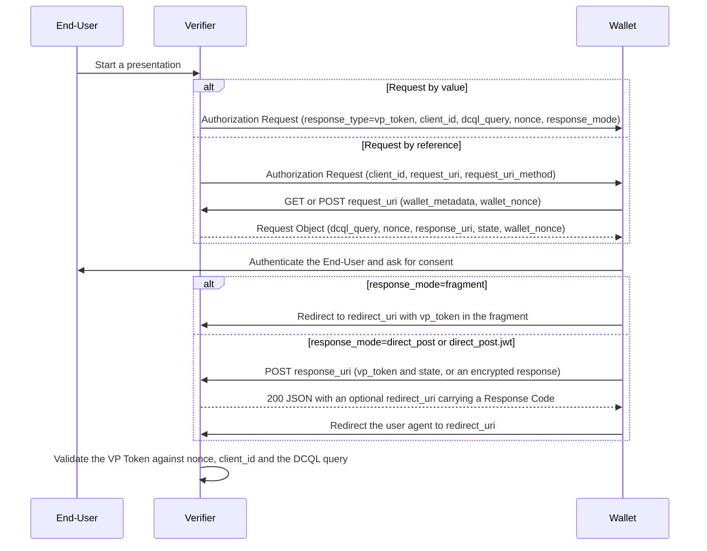

# Deep Dive: OpenID for Verifiable Presentations (openid/OpenID4VP)

> In one line: OpenID4VP extends OAuth 2.0 so that a Verifier, acting as an OAuth client, asks a Wallet for Credentials with a DCQL query and receives Presentations in a `vp_token`; 1.0 has been an OpenID Final Specification since July 2025, and the openid/OpenID4VP repository now carries a 1.0 errata draft and a 1.1 draft.

## What this is

OpenID4VP "defines a mechanism on top of OAuth 2.0 for requesting and delivering Presentations of Credentials" in any format, including W3C VCDM, ISO mdoc and SD-JWT VC (1.0 Section 1). The Verifier "is a specific case of an OAuth 2.0 Client", and the Wallet is the entity the Holder uses to receive, store, present and manage Credentials and keys (Section 2). The main extension is the Response Type `vp_token`: the result of the exchange is a VP Token with one or more Presentations instead of an Access Token (Section 3). Section 4 lists the other additions: the Digital Credentials Query Language (DCQL) and its `dcql_query` parameter, the `vp_token` response parameter, the Response Types `vp_token` and `vp_token id_token`, the Response Mode `direct_post`, Client Identifier Prefixes, and use over the Digital Credentials API (DC API). Section 3 also says the specification "is a framework that requires profiling to achieve interoperability".

The OpenID Foundation approved OpenID4VP 1.0 as an OpenID Final Specification; the announcement is dated 10 July 2025 (`data/landscape-sources.json`). The Final text is revision `-30`, tagged `1.0-final` in the repository. The repository (commit `66f5ff9`, 11 November 2026) holds two editor's drafts of the OpenID Digital Credentials Protocols working group:

- `1.0/`: "OpenID for Verifiable Presentations 1.0 incorporating errata set 1", revision `-31`. Its Document History lists 26 changes against the Final, from the empty-VP-Token rule to the `age_over_NN` matching rule (see What Changed). It is a draft and has not been approved as errata.
- `1.1/`: revision `-01`. It carries the same changes plus a few that are only in 1.1: an HPKE `session_info` structure for encrypted responses (1.1 Section 8.3.1, #703), a rule that ecosystems MUST NOT use the VP Token as an Access Token (1.1 Section 14.6, #702), platform requirements for application Origins on the DC API (1.1 Section A.5.1, #761), and stricter `vct_values` and `doctype_value` matching (1.1 Sections B.3.5 and B.2.3, #744).

Section numbers below are for 1.0 Final unless marked "errata" (the `1.0/` draft) or "1.1". The two drafts number Sections 14.x and B.2.5 onwards differently from the Final.

## How it works

The diagram follows the Same Device and Cross Device Flows (Sections 3.1 and 3.2) with the Request URI, the Response Mode `direct_post` and the redirect back to the Verifier (Sections 5.10 and 8.2). The DC API path is described after the steps.

1. The Verifier sends an Authorization Request with URL parameters, as a Request Object by value (`request`), or by reference (`request_uri`) (Section 5.4). Request Objects follow JAR (RFC 9101): Verifiers MUST set the `typ` header to `oauth-authz-req+jwt`, and Wallets MUST NOT process a Request Object without it (Section 5). `client_id`, `nonce` and `response_mode` are REQUIRED (Section 5.2), and exactly one of `dcql_query` or a `scope` value that aliases a DCQL query MUST be present (Sections 5.1 and 5.5). With `request_uri_method=post`, the Wallet POSTs its `wallet_metadata` and a `wallet_nonce` to the Request URI. If the returned Request Object lacks that `wallet_nonce`, or if its `client_id` differs from the one in the URL, the Wallet MUST terminate request processing (Sections 5.10 and 5.10.1).
2. The Wallet identifies the Verifier from the Client Identifier Prefix, the text before the first `:` in `client_id` (Section 5.9.1). Without a `:` the client is pre-registered, as in plain OAuth (Section 5.9.2). Section 5.9.3 defines the prefixes in the table below. To use any prefix that needs signing, Verifiers MUST be able to store private keys securely, which may change the design of native apps.
3. The Wallet evaluates the DCQL query (Section 6). `credentials` is a non-empty array of Credential Queries, each with an `id`, a `format`, a REQUIRED `meta` object (for example `vct_values` for SD-JWT VC or `doctype_value` for mdoc), optional `claims` with claims path pointers, `claim_sets`, `multiple` (default `false`), `trusted_authorities` (`aki`, `etsi_tl` or `openid_federation`) and `require_cryptographic_holder_binding` (default `true`) (Sections 6.1 to 6.3). `credential_sets` expresses alternatives between Credentials (Section 6.2). The Wallet MUST NOT send selectively disclosable claims that were not selected, and if it cannot deliver all non-optional Credentials it MUST NOT return any (Sections 6.4 and 6.4.2).
4. The Wallet returns the VP Token. It is a JSON object whose keys are Credential Query `id` values and whose values are arrays of Presentations: exactly one unless `multiple` is `true`, and no entry for an optional query with no match (Section 8.1). With `response_type=vp_token` it comes in the Authorization Response, with `vp_token id_token` alongside a Self-Issued ID Token (SIOPv2, Appendix C), and with `code` in the Token Response (Section 8). The default Response Mode is `fragment` (Section 5.6). With `direct_post`, the Wallet POSTs to `response_uri`; a request that also carries `redirect_uri` MUST get an `invalid_request` error (Section 8.2). `direct_post.jwt` and `dc_api.jwt` wrap the response in an encrypted JWT. The JWE `alg` MUST equal the `alg` of the chosen key from the Verifier's `jwks`, and `enc` comes from `encrypted_response_enc_values_supported`, default `A128GCM` (Sections 8.3 and 8.3.1).
5. The Verifier validates the VP Token (Section 8.6). Every Verifiable Presentation MUST be bound to the Verifier's Client Identifier and the request's `nonce`, and the Verifier MUST reject the response if any Presentation lacks the correct `nonce` (Section 14.1.2). The Verifier MUST NOT rely on the Wallet to enforce the DCQL constraints (Section 14.9), and `values` matching is best effort and MUST NOT be used for security checks (Section 6.4.1).

Client Identifier Prefixes defined in Section 5.9.3:

| Prefix | Original Client Identifier | Request signing | Where Verifier metadata comes from |
| --- | --- | --- | --- |
| (none) | pre-registered client | as registered | registration or out of band (Section 5.9.2) |
| `redirect_uri` | the Redirect URI or Response URI | cannot be signed | `client_metadata` |
| `openid_federation` | an OpenID Federation Entity Identifier | per OpenID Federation | the Trust Chain; `client_metadata` MUST be ignored |
| `decentralized_identifier` | a DID | MUST be signed with a key from the DID Document, named by `kid` | `client_metadata`, except the key |
| `verifier_attestation` | the `sub` of a Verifier Attestation JWT | MUST be signed with the key in its `cnf`; the JWT goes in the `jwt` JOSE header | `client_metadata`, except the key |
| `x509_san_dns` | a DNS name matching a `dNSName` SAN of the leaf certificate in `x5c` | MUST be signed; the Wallet MUST validate the chain | `client_metadata`, except the key |
| `x509_hash` | base64url SHA-256 of the DER leaf certificate in `x5c` | MUST be signed; the Wallet MUST validate the chain | `client_metadata`, except the key |
| `origin` | reserved for the DC API | the Wallet MUST NOT accept it in requests | none |

The errata draft and 1.1 drop the per-prefix sentences "All Verifier metadata other than the public key MUST be obtained from the `client_metadata` parameter" and add a Security Considerations section, "Source of Verifier Metadata" (errata Section 14.12, #735). It says a Verifier name from `client_metadata` "is not suitable to display" and that trusted sources take precedence.

Over the DC API (Appendix A), the request goes through the browser or operating system instead of a redirect. The protocol identifier is `openid4vp-v1-unsigned`, `openid4vp-v1-signed` or `openid4vp-v1-multisigned` (Section A.1). Unsigned requests omit `client_id`, and the Wallet MUST ignore it if present. Signed requests MUST carry `client_id` and `expected_origins`, and the Wallet MUST return an error, which SHOULD be `invalid_request`, when the Origin supplied by the platform matches none of them (Section A.2). The Response Mode is `dc_api` or `dc_api.jwt`, and `state` is not defined. The audience of the Presentation MUST be `origin:` followed by the Origin, even for signed requests (Section A.4). Whether to validate the request signature under the prefix rules is at the Wallet's discretion over the DC API (Section 5.9.3). A multi-signed request uses the JWS JSON Serialization, with `client_id` and `verifier_info` in each signature's protected header, so one request can serve several trust frameworks (Section A.3.2.2).

## Use cases

- Same-device presentation by redirect with Response Mode `fragment`, and cross-device presentation from a QR code with `request_uri` and `direct_post` (Sections 3.1, 3.2 and 5.7).
- Presentation in a browser or native app through the DC API, where the platform tells the Wallet the Verifier's Origin (Appendix A).
- Presentation of Credentials without Cryptographic Holder Binding, such as a cinema ticket or a diploma bound to claims, with `require_cryptographic_holder_binding: false`. The Verifier MUST then use a fresh `state` with at least 128 bits of entropy, except over the DC API (Section 5.3).
- Transaction authorization, such as a payment or a Qualified Electronic Signature, where `transaction_data` is signed with the key that proves possession of the Credential (Sections 5.1 and 8.4).
- Age checks with an mDL. With the errata draft and 1.1, a Wallet whose mDL lacks the requested `age_over_NN` element can return a different `age_over_NN` element under ISO 18013-5 rules (errata and 1.1 Section B.2.5, #800).
- Verifier attestations such as a registration certificate or a payment service provider role, passed in `verifier_info` (Section 5.11).
- Presentation together with an Access Token from the same Authorization Server, using `response_type=code` (Sections 1 and 8).

## Why This Matters Now

- **Trigger**: OpenID4VP was the second `openid` candidate in `tracks/openid/data/normalized/candidates.json` (score 18.0) without a deep dive. The daily briefing in `tracks/openid/data/normalized/insights.json` recorded the merge of #800 (branch `718-age-over-nn`) without its diff.
- **Source evidence**: #800 merged on 11 November 2026 and is the head commit `66f5ff9`. Between May and November 2026 the WG merged the clarifications that make up errata `-31`: VP Token encoding and errors (#745, #782, #783, #790), Request URI handling (#788, #798), metadata (#735, #801, #802), DC API Origins (#719) and nonce entropy (#722). Five pull requests are still open (#726, #803, #804, #808, #809, see What Changed).
- **Expected impact**: 1.0 Final is the version to implement and test today. The errata draft changes behaviour a peer can see on the wire, for example `alg: none` Request Objects for the `redirect_uri` prefix, no empty VP Token, and a different `age_over_NN` element in an mdoc response. 1.1 adds HPKE encryption and stricter type matching on top.

## What Changed

Every item was checked against the pull request's file list and diff and against the drafts at `66f5ff9`.

- **Merged into both the errata draft and 1.1**:
  - `age_over_NN` (#800, merged 11 November 2026; the 1.0 text was added on 25 October 2026). A new section, "Data Element Selection Rules" (errata Section B.2.5), says that when an mdoc lacks the requested data element, the Wallet SHOULD apply the selection rule of the document type, for example ISO 18013-5 Section 7.2.5 for `age_over_NN`. The selected element counts as the requested claim for `claims`, `claim_sets` and `values`, and it is returned under its own identifier. Verifiers SHOULD be prepared for an identifier other than the one requested. Claims path pointer processing changed to match (errata Sections 7 and 7.2.1). In the PR discussion the WG kept SHOULD rather than MUST, and agreed it belongs in the 1.0 errata so that 1.0 and 1.1 behave the same.
  - Termination and errors (#790): when the Wallet terminates request processing, it MUST NOT return any response, because it has no authentic request and so no trusted endpoint (errata Section 5.10.1). A Wallet that does not support `transaction_data` MUST NOT return a VP Token; any response SHOULD use the new case of `invalid_transaction_data`, and it MAY cancel the flow instead (errata Sections 8.4 and 8.5). The Final said only "MUST return an error".
  - VP Token: it MUST NOT be empty, and an empty object MUST NOT signal an error (#745, errata Sections 8 and 8.1). SD-JWT VC Presentations are compact serialized SD-JWT or SD-JWT+KB, and the JWS JSON Serialization MUST NOT be used (#782, errata Section B.3.6). A W3C VC requested without Holder Binding goes directly into the VP Token, not wrapped in a Verifiable Presentation (#783, errata Section B.1).
  - Request URI: the Request Object is signed unless the prefix requires an unsigned request, as `redirect_uri` does, in which case it uses `alg: none` (#788, errata Section 5.10.1). A Wallet that does not support `request_uri_method=post`, or that sees any other unrecognized value, MUST fall back to GET; the Final said it MAY continue with JAR (#798, errata Section 5).
  - Metadata: the "Source of Verifier Metadata" section and the removal of the per-prefix `client_metadata` sentences (#735, errata Section 14.12). `invalid_request` also covers a `dcql_query` that asks for a format outside the Verifier's `vp_formats_supported` (#801, errata Section 8.5). `encrypted_response_enc_values_supported` is now listed with the other Verifier metadata (#802, errata Section 11.1).
  - Smaller clarifications: the `nonce` SHOULD carry at least 128 bits of entropy, a SHOULD on the Verifier with no Wallet-side check (#722, errata Section 5.2). `state` is RECOMMENDED instead of OPTIONAL (#734, errata Section 5.2). `expected_origins` is compared with the Origin by simple string comparison, and the examples lose their trailing `/` (#719, errata Section A.2). An absent `intent_to_retain` means no statement (#730, errata Section B.2.4). The `origin` prefix cross-reference was fixed (#775). The `invalid_request` example now names `openid_federation` instead of the old prefix name `https` (#776, errata Section 8.5). The `ldp_vc` example was fixed (#787).
  - Untrusted input: Wallets MUST treat all requests as untrusted and MUST validate the Authorization Request and its DCQL query (#748 in 1.1, mirrored to 1.0 by #759; errata Section 14.13, 1.1 Section 14.14).
- **Merged into 1.1 only**: `vct_values` and `doctype_value` matching (#744). A Credential MUST be of a type in `vct_values`, and matching is RECOMMENDED on `vct`, `aka_vcts` or out-of-band information; the Final's "MAY return Credentials that inherit" sentence is gone (1.1 Section B.3.5). The mdoc `docType` MUST equal `doctype_value` (1.1 Section B.2.3). Platform-specific application Origins must be collision resistant and unique per application (#761, 1.1 Section A.5.1). The HPKE `session_info` (#703), the HPKE exception for `encrypted_response_enc_values_supported` (#698) and the VP Token abuse rule (#702) are also 1.1 only.
- **Open**:
  - #803 brings #744's matching text to the 1.0 errata.
  - #808 would make unprocessable `transaction_data` only make its Credential Queries unsatisfiable, instead of failing the whole request, and would drop the "use only one of the referenced Credentials" MUST (both versions, issue #794).
  - #809 fixes the Section 5.4 example (1.1 only). It is described as signed but uses the `redirect_uri` prefix, which cannot be signed (Section 5.9.3), has the typo `https//` and lacks the REQUIRED `response_mode`.
  - #726 fixes issue #659: Section 13.4 pins SD-JWT VC draft -09, while the rendered normative reference points at -10. It would say a Credential MUST match draft 9 or later and SHOULD match the RFC.
  - #804 defines "Selectively Disclosable Claim" per format (1.1 only, issue #717).
- **Closed without merge**: #647, "Security Checks on the DCQL Query", opened on 25 June 2025 against the pre-split `openid-4-verifiable-presentations-1_0.md`. It proposed a DCQL injection (CWE-943) consideration from a security analysis of the DC API. The WG asked for the text to cover all request JSON, not only DCQL. The chair closed it on 18 June 2026 because there was no contribution agreement from the author and it had made no progress for a year, and an editor agreed to write a general version. That became #748 ("Fixes the concerns raised in #647"), merged on 9 July 2026, and #759 for 1.0.

Compatibility. A Wallet or Verifier on the Final text and one on the errata text can disagree on: whether a `redirect_uri` Request URI response may be `alg: none` (#788), what a Wallet does with an unknown `request_uri_method` (#798), whether an empty VP Token is possible (#745), and whether an mdoc response may carry a different `age_over_NN` identifier (#800). A 1.0 Wallet MAY return a Credential that inherits from a requested `vct`, while a 1.1 Verifier matches only `vct`, `aka_vcts` or out-of-band information, until #803 aligns 1.0.

## Technical Analysis

- **Threat model**: Replay is countered by binding each Verifiable Presentation to the Client Identifier and `nonce` (Section 14.1.2); over the DC API the Origin replaces the Client Identifier (Section A.5). `direct_post` is open to session fixation because the response leaves the device out of band. The Response URI MUST put a fresh Response Code in the `redirect_uri` it returns and MUST require the frontend to present it, which does not help across devices (Section 14.2). The Wallet MUST stop Response URI leakage, and the Verifier's internal interface for fetching responses MUST be protected (Section 14.3). Other considerations cover an encrypted but unsigned response that an attacker can replace (Section 14.5), always using the full Client Identifier with its prefix (Section 14.8), and never trusting the Wallet to enforce DCQL (Section 14.9). The errata draft adds: do not follow HTTP redirects on Request URI and Response URI calls, a SHOULD (errata Section 14.8, #753); do not display a name taken from `client_metadata` (errata Section 14.12); and parse requests as untrusted input (errata Section 14.13). It also cites formal security analyses, including one of OpenID4VP with the DC API (errata Sections 14.1 and A.5).
- **Protocol flow**: The prefix decides whether a request is signed, where the key comes from and where metadata comes from. A Wallet therefore needs one code path per prefix, plus the unsigned `redirect_uri` path and the DC API path where signature validation is optional. Errors split into those returned to the Verifier (Section 8.5) and those where the Wallet terminates silently (errata Section 5.10.1). The privacy considerations add that a Wallet SHOULD NOT return protocol errors without End-User interaction, or before consent when the request uses value matching or issuer selection. The Final puts this under the DC API (Section 15.9.2); the errata draft applies it to every invocation method (errata Section 15.9).
- **Interop concerns**: OpenID4VP needs a profile to interoperate (Section 3). Pre-final dependencies are pinned: OpenID Federation -43, SIOPv2 -13, SD-JWT -22, SD-JWT VC -09 and Fully-Specified Algorithms -13 (Section 13.4), with the SD-JWT VC inconsistency in #726. Type matching for SD-JWT VC and mdoc differs between 1.0 and 1.1 until #803 merges. The `age_over_NN` rule is a SHOULD on both sides, so peers can legitimately differ.

## Open Questions

- When will the `1.0/` draft be approved as errata set 1, and will #803, #808 and #726 be in it?
- Will #808 replace the `transaction_data` rule that #790 just clarified, and what is left of `invalid_transaction_data` if unprocessable transaction data only makes Credential Queries unsatisfiable?
- How should a Verifier that receives `age_over_19` for a request for `age_over_18` record that the Wallet used the ISO 18013-5 rule, given that the rule is a SHOULD (errata Section B.2.5)?
- Will #804's definition of Selectively Disclosable Claims change what a Wallet may include in an mdoc `DeviceSigned` structure?
- Over the DC API, signature validation is at the Wallet's discretion (Section 5.9.3). Which profiles make it mandatory?

## Experiments

- [ ] Build 1.0 Final (tag `1.0-final`) and the `1.0/` errata draft and diff the rendered text, to check that the Document History lists every normative change.
- [ ] Send an mDL request for `age_over_18` to a Wallet whose mDL holds only `age_over_21`, and record which element comes back and whether the Verifier accepts it (errata Section B.2.5).
- [ ] Send the same request with `request_uri_method=post` and with an unknown value such as `put`, and record whether the Wallet POSTs, falls back to GET, or returns `invalid_request_uri_method` (Section 5.1, #798).
- [ ] Have the Request URI and the Response URI answer with an HTTP 307 redirect, and record whether the Wallet follows it. The errata text says it SHOULD NOT and SHOULD treat it as an error (errata Section 14.8, #753).
- [ ] Run a Wallet and a Verifier against the OpenID conformance tests for OpenID4VP (Section 14.7).

## Sources

- <https://github.com/openid/OpenID4VP> (commit `66f5ff93130128d1662cc60fcd79185ffe0a2d30`; tag `1.0-final`)
- <https://openid.net/specs/openid-4-verifiable-presentations-1_0-final.html>
- <https://openid.net/openid-for-verifiable-presentations-1-0-final-specification-approved/>
- <https://openid.github.io/OpenID4VP/openid-4-verifiable-presentations-1_0-wg-draft.html>
- <https://openid.github.io/OpenID4VP/openid-4-verifiable-presentations-1_1-wg-draft.html>
- <https://github.com/openid/OpenID4VP/pull/800>
- <https://github.com/openid/OpenID4VP/pull/647>
- <https://github.com/openid/OpenID4VP/pull/748>
- <https://openid.net/certification/conformance-testing-for-openid-for-verifiable-presentations/>
