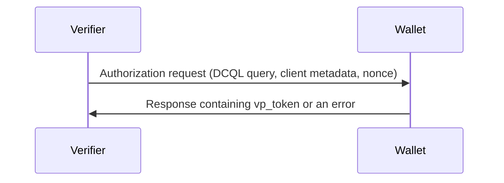

# Deep Dive: openid/OpenID4VP

> In one line: the working-group repository for OpenID for Verifiable Presentations, where a verifier asks a wallet for credentials and receives a `vp_token` back, with 1.0 and 1.1 drafts both built from the main branch.

## What this is

The staged material is the repository README plus a list of recently updated pull requests. It does not contain the specification text, so the mechanism below is inferred only from the README and the pull-request titles.

The repository holds two drafts: a 1.0 draft and a 1.1 draft, both built automatically from the main branch (see the README). The pull-request titles refer to a Verifier, a Wallet, a DCQL query, a `vp_token` (VP Token), a signed Request Object, client metadata, Client Identifier Prefixes, a direct post response and the Digital Credentials API (DC API). From these titles, the protocol appears to let a verifier send a request describing the credentials it wants and receive a presentation in the response.

The material does not describe the request syntax, the response syntax or the trust model. Those need to be checked against the specification itself.

## How it works

The diagram shows only the parties and messages that the pull-request titles name. The exact transport options and message contents are not in the material.

1. The verifier sends a request to the wallet. Titles mention a DCQL query (#647), client metadata (#735, #802), a signed Request Object (#809), a Request URI response (#788) and JAR fallback text (#798).
2. The request can reach the wallet through different channels. Titles mention a direct post request (#734) and the DC API with platform-specific origins (#761, #719).
3. The wallet returns a `vp_token` that carries presentations. Titles mention SD-JWT VC being returned in `vp_token` (#782), a credential without Holder Binding being returned directly (#783) and an LDP VP proof example (#787).
4. On failure the wallet returns an error. Titles mention `invalid_request` (#801, #776), terminate/reject/return behaviour (#790) and that an empty object in a VP Token cannot signal an error (#745).

The material does not say how the wallet authenticates the verifier or how the response is encrypted beyond the title of #802 ("List encrypted_response_enc_values_supported in client metadata section").

## Use cases

- A wallet implementer checks how a `vp_token` must be built for SD-JWT VC credentials and for credentials without Holder Binding (#782, #783).
- A verifier implementer builds requests that use a signed Request Object, a Request URI or a Client Identifier Prefix, and checks which of them may be unsigned (#788, #809, #775).
- A browser or platform developer integrates the DC API and needs the origin handling and security guidance (#719, #761).
- A conformance-test author or deployer uses the OpenID conformance tests for wallets and verifiers that the README links.
- A credential issuer or verifier policy author matches `doctype` and `vct` values in queries (#744, #803) and, newly, age_over_nn claims (#800).

## Why This Matters Now

- **Trigger**: the earlier briefing in `insights.md` noted that PR #800 (branch 718-age-over-nn) was merged. `subject.json` has no `ai_note`.
- **Source evidence**: the README lists #800 "Add support for age_over_nn claims matching" as closed and merged, together with many merged clarification pull requests (#801, #802, #790, #744, #798, #735 and others) and open ones (#808, #809, #803, #726, #804).
- **Expected impact**: the volume of clarifications suggests the text is still being tightened for interoperability, especially around error handling, matching rules and security guidance. The material does not show the final effect of any of these changes.

## What Changed

- Spec/document change summary: the material has no diff, only pull-request titles. Merged titles cover age_over_nn claims matching (#800), `invalid_request` for verifier metadata (#801), `encrypted_response_enc_values_supported` in client metadata (#802), terminate/reject/return behaviour including unsupported `transaction_data` (#790), `vct` and `doctype` matching (#744), JAR fallback text (#798), client metadata security considerations (#735), `vp_token` normative text for SD-JWT VC (#782) and nonce entropy (#722). Open titles include relaxing transaction data (#808), the signed Request Object example in Section 5.4 (#809), further `doctype_value` and `vct_values` clarification (#803), an SD-JWT VC version inconsistency in 1.0 final (#726) and selectively disclosable claims (#804).
- Compatibility or migration concerns: the material does not state which changes are normative or which versions they affect. #803 says "add to 1.0", and #726 mentions "1.0 final", so some changes may touch the 1.0 text and not only 1.1. #808 ("Relax transaction data") and #790 (unsupported `transaction_data`) could change wallet behaviour. A reviewer should read the pull requests.

## Technical Analysis

- Threat model implications: the titles show a focus on untrusted input (#748, #759), client metadata parameters (#735), platform-specific origins with the DC API (#761), nonce entropy (#722) and matching a direct post request to the user session (#734). The material gives no section numbers for these, except Section 5.4 in #809, and no threat descriptions.
- Protocol flow implications: error behaviour is being made explicit (#790, #745, #801), and the encoding of `vp_token` for SD-JWT VC is being defined normatively (#782). Whether the request is signed depends on the Client Identifier Prefix (#788), which means a wallet must handle both cases.
- Interop concerns: two drafts (1.0 and 1.1) are maintained in parallel, so a pull request merged in one may need to be mirrored in the other (#803 does this explicitly). Matching of `vct` and `doctype` (#744, #803) and of age_over_nn claims (#800) are places where two implementations could differ.

## Open Questions

- What exactly does #800 add for age_over_nn matching, and does a wallet have to return a different age_over_nn claim than the one requested? The material has no diff.
- Which of the merged changes apply to both 1.0 and 1.1, and which only to 1.1? The README does not say.
- What is the status of #726 ("Normative version inconsistency for SD-JWT VC in 1.0 final") and how would it change a deployed 1.0 implementation?
- What does #808 relax in transaction data, and how does it interact with the unsupported `transaction_data` behaviour set by #790?
- What does #804 change about selectively disclosable claims? The title is the only evidence.
- #647 ("Security Checks on the DCQL Query") was closed without merge. The material does not say why or whether the topic moved elsewhere.

## Experiments

- [ ] Lab 1: take the signed Request Object example in Section 5.4 (the subject of #809) and check it against the published 1.0 and 1.1 drafts for inconsistencies, then record which fields differ.
- [ ] Lab 2: run a wallet and a verifier against the OpenID conformance tests linked from the README and note which test cases cover error handling and `vp_token` encoding for SD-JWT VC.
- [ ] Lab 3: write DCQL queries with `vct_values` and `doctype_value` matching a credential in several ways, and compare the behaviour of two wallets against the text after #744 and #803.

## Sources

- [openid/OpenID4VP](https://github.com/openid/OpenID4VP)
- [1.0 WG draft](https://openid.github.io/OpenID4VP/openid-4-verifiable-presentations-1_0-wg-draft.html)
- [1.1 WG draft](https://openid.github.io/OpenID4VP/openid-4-verifiable-presentations-1_1-wg-draft.html)
- [Conformance testing](https://openid.net/certification/conformance-testing-for-openid-for-verifiable-presentations/)
