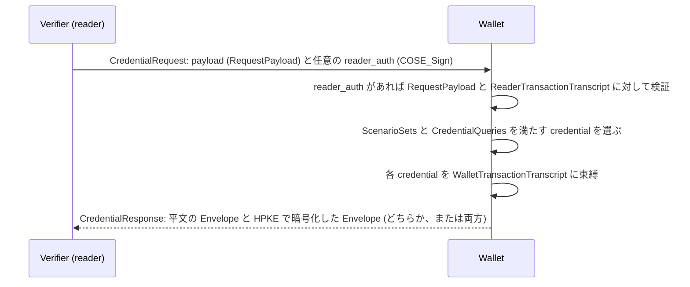

# Deep Dive: openid/dchp

> 一言で言うと: OpenID Foundation の Digital Credentials Harmonized Presentation (DCHP) Working Group が ISO/IEC JTC 1/SC 17 WG 10 と共同で書いている、CBOR でエンコードする credential の要求・応答プロトコルである。ISO/IEC 18013-5 と OpenID for Verifiable Presentations を一本化し、ISO mdoc と SD-JWT VC を対面でもオンラインでも提示できるようにするのが狙い。

## 概要

- リポジトリにある仕様は `draft/digital-credentials-harmonized-presentation.md` の 1 本だけで、`main` が更新されるたびに Editor's Copy として公開される。README は、この版は「承認された Working Group Draft ではない」と明記している。このページは `main` のコミット `4ddd238` (2026 年 11 月 9 日) を読んでおり、その Document History は「-00」である。
- Foreword によれば、本文は ISO/IEC JTC 1/SC 17 WG 10 のメンバーと OpenID Foundation の Digital Credentials Protocols (DCP) Working Group のメンバーが共同で作っている。出発点は初期提案 (pull request #29、2026 年 8 月 16 日マージ) である。中核の各節 (Credential Request、Response Encryption、Reader Authentication、Transaction Transcript、Credential Response) の冒頭には「まだワーキンググループの合意がない」という注記があり、issue #24 から #28 で追跡されている。
- メッセージはすべて小さな整数をキーとする CBOR map で、CDDL で定義されている。`credential_types` のようなフィールド名は本文と CDDL の上のラベルで、ワイヤーには載らない。2026 年 11 月 5 日、ワーキンググループは大文字小文字を直す pull request #83 を「map のキーは整数なので」編集上の変更と判断し、このことを確認している。
- verifier は `CredentialRequest` を送る。欲しい credential を `CredentialQueries` で指定し、それを AND/OR の組み合わせを持つ `ScenarioSets` にまとめる。wallet は `CredentialResponse` を返す。中身は平文の envelope、暗号化された envelope、またはその両方である。
- 中核部分は credential 形式に依存しない。pull request #57 (2026 年 11 月 9 日マージ) 以降、形式に固有の事項はすべて「credential format definition」に置かれる。文書には附属書として ISO mdoc (`mso_mdoc`) と SD-JWT VC (`dc+sd-jwt`) の 2 つがある。
- Scope、用語、略語、value matching、transaction data、SD-JWT VC の `path`、mdoc の `SessionTranscript` に transcript をどう入れるかは、まだ「To be completed」である。

## 仕組み

1. verifier は `RequestPayload` を作る。中身は `ScenarioSets` (キー 1)、`CredentialQueries` (キー 2)、`encryption_context` (キー 3。ISO/IEC 18013-5 のセッション暗号を使うときは省く)、任意の `additional_encryption_contexts` (キー 4) である。`CredentialRequest` は、CBOR エンコードした payload をバイト列として `payload` (キー 1) に入れ、任意で `reader_auth` (キー 2) を付ける。`reader_auth` は `COSE_Sign` で、detached payload は `RequestPayload` のバイト列と transaction transcript である (Credential Request 節、Reader Authentication 節)。
2. 双方が transaction transcript を組み立てる。決定的エンコーディング (RFC 8949 Section 4.2) の CBOR map で、`RequestPayload` バイト列の SHA-256 と `ChannelBinding` を持つ。`ChannelBinding` は、セッションがどう始まったか (QR、NFC、OpenID4VP の `request_uri` か `client_id`、Digital Credentials API の origin) と、どの伝送路を使っているかを記録する (Transaction Transcript 節)。
3. wallet が credential を選ぶ。各 `CredentialQuery` には `credential_format`、受け付ける `credential_types` の配列、データ要素の辞書、連言標準形 (AND の OR の AND) の `requested_elements` がある。`ScenarioSet` は `combinations` を並べ、wallet はそのうち 1 つの組み合わせに含まれる credential をすべて提示する。
4. 提示する各 credential は `WalletTransactionTranscript` に束縛される。これは reader 側の transcript に、そのクエリの `encryption_ref` を加えたものである。mdoc では、署名または MAC して `DeviceAuth` を作る `SessionTranscript` の中に埋め込む。SD-JWT VC では、その SHA-256 を KB-JWT の `nonce` に使う (各形式の附属書)。
5. セッション層の暗号がない場合 (本文は Digital Credentials API とスキームによる起動を挙げる)、応答の暗号化は必須で、量子耐性でない用途には HPKE を使う。`encrypted` の各要素は `COSE_Encrypt` で、復号すると `Envelope` になる。`encryption_ref` を使えばクエリごとに別の鍵を指定できる (Response Encryption 節)。
6. `Envelope` は、要求と同じ整数 `CredentialRef` をキーにした `credentials` プールと、満たした `ScenarioRef` ごとにそれを満たす `CredentialRef` を並べた `scenarios` map を持つ (Credential Response 節)。

## ユースケース

- ISO/IEC 18013-5 の近接提示と OpenID4VP のオンライン提示の両方に対応している wallet が、要求・応答のモデルを 1 つにまとめたい場合。transcript の `ChannelBinding` には、18013-5 の QR と NFC による engagement、BLE と NFC の伝送路、OpenID4VP、Digital Credentials API のフィールドがそろっている。
- 年齢確認のような同じ目的に対して mDL と SD-JWT VC のどちらでも受け付ける verifier。1 つの `ScenarioSet` に 2 つの組み合わせを書けば表せる。
- 「姓、かつ (18 歳以上 または 生年月日)」を 1 つのクエリで要求する verifier。`requested_elements` の論理木で書ける。
- 1 つの応答の中で、身分証明の credential はあるバックエンドへ、決済の credential は別のバックエンドへ送る構成。`encryption_ref` と `additional_encryption_contexts` を使う (本文の「Multi-Key Routing」の例)。
- 特定の発行者だけを信頼し、その鍵識別子を `issuer_identifiers.x509_ref` に並べる verifier。wallet は、mdoc の `x5chain` または SD-JWT の `x5c` ヘッダーにある証明書の Authority Key Identifier と突き合わせる。

## なぜ今重要か

- **Trigger**: radar の注記は「4 日間で 23 コミット、フィールド名の変更と credential_types の配列化を含む」だった。`main` で見ると、rebase マージされた 2 つの pull request で計 31 コミットが入っている。#61 (8 コミット、2026 年 11 月 4 日) が `credential_type` を配列にし、#57 (23 コミット、2026 年 11 月 9 日) が形式固有の事項を附属書に移した。23 コミットは #57 だけのもので、書かれたのは 9 月 7 日から 10 月 22 日にかけてである。
- **Source evidence**: pull request #57 の説明とコミット (`ce98c33` から `4ddd238`)、pull request #61 (head は `f669188`、issue #46 を close)。issue #72 は「Digital Credentials Harmonized Presentation 1.0 - Draft 00」の公開を提案しているが、2026 年 11 月 4 日の issue へのコメントは、pull request がもっと入ってから「1〜2 か月ほど」後に再検討するとしている。公開に必要な Security Considerations のプレースホルダーと Notices 附属書は、未マージの pull request #85 が追加する。
- **Expected impact**: Editor's Copy から実装している人は、フィールド単位の変更を追い続ける必要がある。未マージの pull request #77 は応答の `credentials` プールを map から配列に変え、#76 は `ChannelBinding` のキー番号を振り直す。中核の節にはまだ合意がなく、ワイヤー形式は安定していない。

## 変更点

- Spec/document change summary:
  - pull request #61: `credential_type` (キー 2、`tstr`) が `credential_types` (キー 2、`[ + tstr ]`) になった。n 個の type を持つクエリは n 個のクエリとして処理し、それを参照する組み合わせも同じように展開する。issue #46 はこれを、近い関係にある type (同じ type の新しい版など) 向けの「主にサイズの最適化」と説明している。
  - pull request #57: 新しい「Credential Formats」節が、credential format definition が定めるべき 10 項目を挙げる。`format_extensions` と `CredentialItem.data` は CDDL の socket (`$formatExtensions`、`$CredentialData`) になり、定義のなかった `ZkDocument` と `zkFormatExtensions` は消えた。`CredentialItem.format` は `credential_format` に改名された。pull request は「map のキーは変わらないのでエンコーディングは変わらない」と書いている。SD-JWT VC の形式識別子は `vc+sd-jwt` から `dc+sd-jwt` に変わった。ISO/IEC 18013-5、RFC 5280、RFC 7515、RFC 9901、draft-ietf-oauth-sd-jwt-vc が規範的参照になった。
  - pull request #57 で入った新しい規則: `credential_types` の照合は大文字小文字を区別する。mdoc の要素を issuer-signed にするか device-signed にするかは、MSO の `KeyAuthorizations` の範囲内で wallet が決める。要素の定義が認める場合 (`age_over_NN`) は、wallet は代わりの要素を返してよい。発行者識別子は Authority Key Identifier の `keyIdentifier` と照合する。鍵に束縛されていない mdoc と、KB-JWT のない SD-JWT VC を返してよいのは、`support_no_cryptographic_binding` が `true` のときだけである。
- Compatibility or migration concerns:
  - ワイヤーに現れる変更は 2 つある。`CredentialQuery` のキー 2 の型が文字列から配列に変わったことと、SD-JWT VC の `credential_format` の値が `vc+sd-jwt` から `dc+sd-jwt` に変わったことである。`format` から `credential_format` への改名や、#83 のような大文字小文字の修正は名前が変わるだけである。
  - 未マージの pull request #81 は、`reader_auth` を `verifier_auth` に、`ReaderTransactionTranscript` を `VerifierTransactionTranscript` に改名する。これも名前だけの変更である。

## 技術分析

- Threat model implications: リプレイ対策の中心は transcript である。要求のハッシュと、engagement または起動のチャネルを、reader の署名、応答の暗号化、credential 自体の束縛のすべてに入れることで、「あるセッションのメッセージを別のセッションで再利用できない」ようにしている。Security Considerations 節はまだ存在しない (未マージの pull request #85 が「To be completed」として追加する)。Reader Authentication 節は、reader の鍵をどう伝えるかをまだ定めていない。未マージの pull request #65 は、`COSE_Signature` の protected header に X.509 の `x5chain` (RFC 9360) を入れることを求める。`support_no_cryptographic_binding` を使えば、verifier は holder binding のない credential を受け入れられる。両附属書とも、束縛なしの場合をこのフラグに結び付けている。
- Protocol flow implications: 応答の暗号化が必須になるのはセッション層の暗号がない場合だけなので、同じメッセージ形式が 18013-5 の BLE/NFC セッションでも Digital Credentials API でも動く。mdoc で `WalletTransactionTranscript` から `SessionTranscript` を導く方法は「to be completed」である (issue #10)。KB-JWT の `nonce` の文字列エンコーディングと `aud` の値も同じく未定なので、どちらの形式の束縛もまだ最後まで実装できない。
- Interop concerns:
  - `main` では本文と CDDL で整数キーが食い違っている。`ChannelBinding` の engagement フィールドは本文の表では 8 個で、`oidc4vp_request_uri` が 6、`oidc4vp_client_id` が 7、`dc_api_origin` が 8 である。CDDL では 7 個で、この 3 つが 5、6、7 になっている。伝送路フィールドも違い、本文は `ble_gatt` と整数の `ble_l2cap`、CDDL は `ble_uuid`、map 値の `ble_l2cap`、キー 12〜15 を持つ。issue #75 がこれらを挙げ、未マージの pull request #76 が修正する。#76 は CDDL を本文の番号に合わせ (キー 5 に `cce_handover` を追加)、`oidc4vp_*` を `openid4vp_*` に、`nfcv2` を `cce` に改名する。
  - 応答の暗号化に使う transcript について、本文の記述が割れている。transcript の説明の箇条書きと CDDL のコメントは `ReaderTransactionTranscript` を応答の暗号化に使うとし、「Use in Protocol Operations」の表は `WalletTransactionTranscript` を HPKE の info パラメータとしている。
  - 未マージの pull request #77 は、`credentials` map を `CredentialItem` の配列に置き換え、各要素に新しい `query_refs` フィールド (キー 3) を足し、`CredentialRef` を `QueryRef` に改名する。これで 1 つの credential を重複させずに複数のクエリへの回答にでき、`allow_multiple` が立っていれば 1 つのクエリに複数の credential を返せる。
  - 本文は決定的 CBOR を「このプロトコル全体で」必須としているが、RFC 8949 Section 4.2 に軽く触れているだけである。未マージの pull request #64 は専用の節を追加する。RFC 8949 Section 4.2.1 の core deterministic encoding を使い、NaN と無限大を禁じ、transcript は送信されないので双方がそれぞれエンコードする、と注記する。

## 未解決の問い

- 文書をどう公開するか。issue #13 によれば、ISO/IEC の成果物は Publicly Available Specification (PAS) か、Partner Standards Development Organization (PSDO) の枠組みで出る。ソースファイルには、`Internet-Draft` のヘッダーはツールのための足場で、IETF 文書であるという主張ではない、という注記がある。OpenID の WG Draft -00 (issue #72) は 2026 年 11 月 4 日に先送りされた。
- ISO/IEC 18013-5 第 2 版との関係は、編集者注 2 か所からしか読み取れない。`issuer_identifiers` は「第 2 版で定義中の `IssuerIdentifiers` 構造と同じ規則」であり、鍵に束縛されていない mdoc の記述は「DIS 投票向けに提案された変更に従う」(issue #56)。18013-5 の改訂について、リポジトリはこれ以上何も述べていない。
- SD-JWT VC の `path`。issue #52 は、`[ + tstr ]` では配列の要素を指せないと指摘している。2026 年 11 月 5 日、ワーキンググループは `[ + tstr / int / null / bool / bstr ]` への拡張に「異論なし」とし、11 月 9 日には pull request を書くという申し出があった。2026 年 11 月 11 日時点で該当する pull request は出ていない。
- `vct` のクエリが継承した type にも一致するか (issue #53)、X.509 を使わない SD-JWT VC 発行者をどう要求するか、両形式の value matching (issue #9) と transaction data (issue #4)。
- 未マージの pull request #64、#65、#74、#76、#77、#81、#83、#85 のどれが、どういう形で入るか。

## 実験

- [ ] Lab 1: `main` の要求 CDDL を取り出し、2 つのシナリオ (年齢確認のために mdoc または SD-JWT VC) を持つ要求を CDDL ツールで検証する。次に同じ要求を本文の表に従ってエンコードし、整数キーが食い違う箇所をすべて洗い出す (`ChannelBinding` で食い違うはず)。
- [ ] Lab 2: Digital Credentials API のセッションについて `ReaderTransactionTranscript` を 2 つの CBOR ライブラリで決定的エンコーディングを有効にして作り、バイト列と SHA-256 が一致するか確かめる。
- [ ] Lab 3: pull request #77 の head と `main` からそれぞれ Editor's Copy を作り直し、2 つのクエリを満たす credential を 1 つ含む応答を両方の定義でエンコードして、ワイヤー上で何が変わるかを見る。

## 参考資料

- <https://github.com/openid/dchp> (README、`4ddd238` 時点の `draft/digital-credentials-harmonized-presentation.md`)
- <https://openid.github.io/dchp/digital-credentials-harmonized-presentation-editors-copy.html>
- Pull requests: <https://github.com/openid/dchp/pull/57>、<https://github.com/openid/dchp/pull/61>、<https://github.com/openid/dchp/pull/64>、<https://github.com/openid/dchp/pull/65>、<https://github.com/openid/dchp/pull/76>、<https://github.com/openid/dchp/pull/77>、<https://github.com/openid/dchp/pull/81>、<https://github.com/openid/dchp/pull/83>、<https://github.com/openid/dchp/pull/85>
- Issues: <https://github.com/openid/dchp/issues/13>、<https://github.com/openid/dchp/issues/52>、<https://github.com/openid/dchp/issues/56>、<https://github.com/openid/dchp/issues/72>、<https://github.com/openid/dchp/issues/75>
- <https://openid.net/wg/digital-credentials-harmonized-presentation-working-group/>
