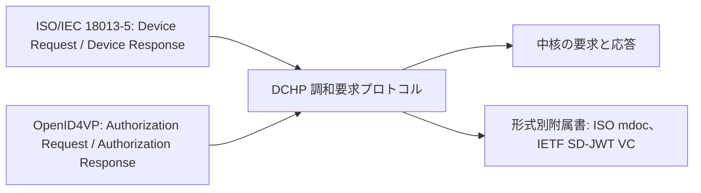

# Deep Dive: openid/dchp

> 一言で言うと: Digital Credentials Harmonized Presentation ワーキンググループは、ISO/IEC 18013-5 と OpenID for Verifiable Presentations を統合し、対面とオンラインの両方で使える単一の credential 要求プロトコルを作成している。

## 概要

ISO/IEC 18013-5（Device Request / Device Response）と OpenID for Verifiable Presentations（Authorization Request / Authorization Response）は、credential の提示に対して異なるアプローチをとっている。DCHP Working Group は、ISO/IEC JTC 1/SC 17（WG10）と OpenID Foundation の Digital Credentials Protocols（DCP）Working Group による共同の取り組みを支え、両者を調和させる。README が述べる目標は、対面とオンラインの提示、および ISO mdoc と IETF SD-JWT VC を含む複数の credential 形式の共存に対応する、調和された digital credentials 要求プロトコルの技術仕様である。リポジトリには仕様の原稿が `draft/` にあり、`main` ブランチへの変更のたびに Editor's Copy がそこから構築される。README は、この版が承認された Working Group Draft ではないと述べている。提供された資料には README と pull request の題名しか含まれないため、メッセージ形式や正確なプロトコルフローはここでは説明できない。

## 仕組み

提供された資料には仕様本文が含まれないため、図は README が述べる内容だけを示す。すなわち、2 つの既存プロトコルが 1 つの要求プロトコルに調和され、形式固有の詳細は形式別の附属書に移された（pull request #57）。

1. 入力となる 2 つのプロトコル、ISO/IEC 18013-5 と OpenID for Verifiable Presentations は、異なる要求メッセージと応答メッセージを定義している。
2. ワーキンググループは、対面とオンラインの両方の提示に対応する、調和された単一の要求プロトコルを開発している。
3. pull request #57（マージ済み）は、credential 形式固有の詳細を形式別附属書に移した。これは中核と附属書という構成を示唆するが、マージされた本文は提供されていない。
4. pull request #77、#76 と README の題名は、中核にクエリ、credential、credential response があることを示唆するが、正確な構造は示されていない。

## ユースケース

- 現在 ISO 18013-5 の近接提示と OpenID4VP のオンライン提示の両方に対応しており、解析すべき要求形式を 1 つにしたいウォレット実装者。
- 1 つの要求で ISO mdoc または IETF SD-JWT VC の credential を求める必要がある検証者。
- 2 つのプロトコルの整合を保つ必要がある、ISO/IEC JTC 1/SC 17 または DCP Working Group の仕様作成者。
- reader authentication の X.509 証明書の要件を知る必要がある対面リーダーの実装者（pull request #65）。
- 要求に対する安定した CBOR エンコーディングを必要とするライブラリの保守者（pull request #64、deterministic CBOR encoding）。

## なぜ今重要か

- **Trigger**: 4 日間で 23 件のコミットがあり、フィールド名の変更と credential_types の配列化を含む。
- **Source evidence**: README は pull request #61（make credential_type an array、マージ済み）と pull request #57（credential 形式固有の詳細を形式別附属書に移動、マージ済み）を挙げ、さらに大文字小文字、用語、CDDL と本文の整合性、Security Considerations のプレースホルダーに関する未マージの pull request を挙げている。`insights.md` の以前の概要は CredentialItem.format から credential_format への名称変更も挙げるが、これはコミット題名に基づくもので、提供された資料では確認できない。
- **Expected impact**: 初期の Editor's Copy に従った実装者は、フィールド名と形の破壊的変更を見込むべきである。提供された資料は、仕様が安定しているとは述べていない。

## 変更点

- Spec/document change summary: 提供された資料に差分はなく、pull request の題名のみである。マージ済み: #61 は credential_type を配列にし、#57 は形式固有の詳細を形式別附属書に移した。未マージ: #64 deterministic CBOR encoding、#77 Credential Response における 1 クエリ複数 credential と 1 credential 複数クエリ、#74 M、O、C の略語、#76 CDDL と本文の不整合、#81 verifier 用語、#65 reader authentication の X.509 証明書ヘッダー、#83 要素名の大文字小文字、#85 Security Considerations のプレースホルダーと Notices 附属書。23 件のコミットは `insights.md` のコミット題名でのみ説明されており、これは以前の機械出力であるため、手がかりとしてのみ用いた。
- Compatibility or migration concerns: フィールドの配列化と名称変更は、以前の Editor's Copy を実装したものにとって破壊的変更である。複数の pull request（#83、#82、#73、#59）は CredentialQuery や scenario_sets などの名前の大文字小文字を扱っており、要素が直列化される場合はワイヤー上の名前に影響する。どの名前がワイヤー上に現れるかは、提供された資料に示されていない。

## 技術分析

- Threat model implications: README に脅威モデルはない。pull request #85 は Security Considerations のプレースホルダーを追加するだけであり、セキュリティ本文はまだ書かれていない。pull request #65（reader authentication の X.509 証明書ヘッダー）と、`insights.md` にある暗号的バインディングへの言及は、検証者認証と保持者バインディングが対象範囲にあることを示すが、その設計は提供された資料にない。
- Protocol flow implications: README は入力として ISO の Device Request / Device Response と OpenID4VP の Authorization Request / Authorization Response を挙げている。pull request #77 は、1 つの応答が 1 クエリに対する複数 credential と、1 credential に対する複数クエリを運べる必要があることを示し、ウォレットが結果を照合して返す方法に影響する。トランスポートとフローの詳細は提供されていない。
- Interop concerns: ISO mdoc と IETF SD-JWT VC の共存は、各形式が独自の附属書を必要とすることを意味する。また、エンコードされたデータに対して署名やハッシュを計算する場合、deterministic CBOR encoding（pull request #64）が重要になる。CDDL と本文の不整合に関する未マージの pull request（#76）は、規範本文と CDDL が食い違っていたことを示唆するため、実装者はどちらか一方だけに頼るべきではない。

## 未解決の問い

- リポジトリの README は、成果物がどのように公開されるか、また OpenID Foundation の仕様が ISO/IEC 18013-5 の改訂とどのように関係するかを述べていない。
- セキュリティ考慮事項はプレースホルダーにすぎない（pull request #85。#84 はクローズされた）。
- 1 クエリ複数 credential と 1 credential 複数クエリ（pull request #77）が受け入れられるか、またどのような形になるかは未解決である。
- deterministic CBOR encoding（pull request #64）と reader authentication の証明書ヘッダー（pull request #65）は未解決である。
- SD-JWT VC のパスの意味論は、`insights.md` によれば issue #52 に先送りされた。これは提供された資料では確認できない。

## 実験

- [ ] Lab 1: pull request #61 の前後の 2 つのコミットで `draft/` から Editor's Copy を構築し、credential_type フィールドを比較して、スキーマの差異を正確に列挙する。
- [ ] Lab 2: ISO mdoc と SD-JWT VC の credential を求める 1 つの要求を書き、中核本文と 2 つの附属書から作ったパーサーがそれを受理するか確認する。
- [ ] Lab 3: pull request #76 が述べる不整合について、Editor's Copy の CDDL と本文を、サンプルメッセージと CDDL 検証ツールで照合する。

## 参考資料

- <https://github.com/openid/dchp>
- <https://openid.github.io/dchp/digital-credentials-harmonized-presentation-editors-copy.html>
- <https://openid.net/wg/digital-credentials-harmonized-presentation-working-group/>
