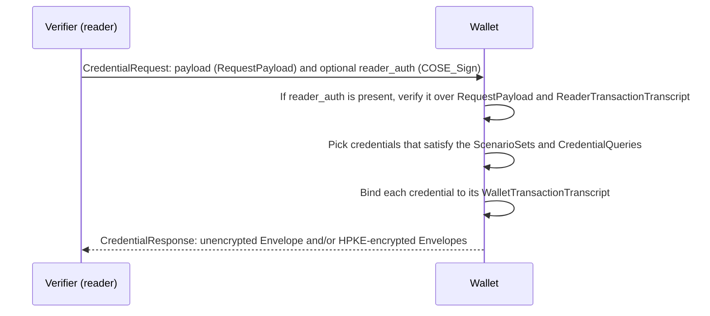

# Deep Dive: openid/dchp

> In one line: the OpenID Foundation's Digital Credentials Harmonized Presentation (DCHP) Working Group is writing one CBOR-encoded credential request and response protocol, jointly with ISO/IEC JTC 1/SC 17 WG 10, meant to bring ISO/IEC 18013-5 and OpenID for Verifiable Presentations together for in-person and online presentation of ISO mdoc and SD-JWT VC credentials.

## What this is

- The repository holds one specification, `draft/digital-credentials-harmonized-presentation.md`, published as the Editor's Copy on every change to `main`. The README says the copy "is not an approved Working Group Draft". This deep dive reads `main` at commit `4ddd238` (9 November 2026), whose Document History is "-00".
- The Foreword says the text "has been jointly developed by members of ISO/IEC JTC 1/SC 17 WG 10 and members of the OpenID Foundation Digital Credentials Protocols (DCP) Working Group". The text came from an initial contribution (pull request #29, merged 16 August 2026). Each core clause (Credential Request, Response Encryption, Reader Authentication, Transaction Transcript, Credential Response) opens with a note that it "does not yet have working group consensus", tracked in issues #24 to #28.
- Every message is a CBOR map with small integer keys, defined in CDDL. Field names such as `credential_types` are labels in the text and the CDDL, not wire content. The working group said so on 5 November 2026 when it classed the casing pull request #83 as editorial "since map keys are ints".
- The verifier sends a `CredentialRequest`. It names the credentials it wants as `CredentialQueries` and groups them into `ScenarioSets`, each with AND/OR combinations. The wallet answers with a `CredentialResponse` holding a plaintext envelope, encrypted envelopes, or both.
- The core is format-agnostic. Since pull request #57 (merged 9 November 2026), everything specific to a credential format sits in a "credential format definition". The document has two, as annexes: ISO mdoc (`mso_mdoc`) and SD-JWT VC (`dc+sd-jwt`).
- Scope, terms, abbreviations, value matching, transaction data, the SD-JWT VC `path`, and how the transcript enters the mdoc `SessionTranscript` are still "To be completed".

## How it works

1. The verifier builds a `RequestPayload`: `ScenarioSets` (key 1), `CredentialQueries` (key 2), an `encryption_context` (key 3, absent when ISO/IEC 18013-5 session encryption is used) and optional `additional_encryption_contexts` (key 4). The `CredentialRequest` carries the CBOR-encoded payload as a byte string (`payload`, key 1) and an optional `reader_auth` (key 2), a `COSE_Sign` with a detached payload of the `RequestPayload` bytes and the transaction transcript (Credential Request and Reader Authentication clauses).
2. Both sides construct a transaction transcript. It is a CBOR map, encoded deterministically (RFC 8949 Section 4.2), holding the SHA-256 hash of the `RequestPayload` bytes and a `ChannelBinding` that records how the session started (QR, NFC, OpenID4VP `request_uri` or `client_id`, or the Digital Credentials API origin) and which transport carries it (Transaction Transcript clause).
3. The wallet chooses credentials. Each `CredentialQuery` gives `credential_format`, an array of acceptable `credential_types`, a dictionary of data elements and a `requested_elements` tree in conjunctive normal form (AND of OR of AND). A `ScenarioSet` lists `combinations`: the wallet must present every credential in one combination.
4. Each presented credential is bound to a `WalletTransactionTranscript`, which adds the query's `encryption_ref`. For mdoc it is embedded in the `SessionTranscript` that is signed or MACed to produce `DeviceAuth`. For SD-JWT VC, its SHA-256 hash becomes the KB-JWT `nonce` (the format annexes).
5. Without session-layer encryption (the text names the Digital Credentials API and scheme-based invocation) response encryption is mandatory, with HPKE for non-post-quantum use. Each `encrypted` item is a `COSE_Encrypt` that decrypts to an `Envelope`. Different queries can point at different keys through `encryption_ref` (Response Encryption clause).
6. An `Envelope` has a `credentials` pool keyed by the same integer `CredentialRef` used in the request, and a `scenarios` map from each satisfied `ScenarioRef` to the `CredentialRef`s that satisfy it (Credential Response clause).

## Use cases

- A wallet that today supports both ISO/IEC 18013-5 proximity presentation and OpenID4VP online presentation, and wants one request and response model. The transcript's `ChannelBinding` has fields for 18013-5 QR and NFC engagement, for BLE and NFC transports, for OpenID4VP and for the Digital Credentials API.
- A verifier that accepts either an mDL or an SD-JWT VC for the same purpose, for example age verification, and expresses that with one `ScenarioSet` and two combinations.
- A verifier that asks for "family name and (age over 18 or birth date)" in one query through the `requested_elements` logic tree.
- A deployment that sends an identity credential to one backend and a payment credential to another inside one response, using `encryption_ref` and `additional_encryption_contexts` (the "Multi-Key Routing" example in the text).
- A verifier that trusts only certain issuers and lists their key identifiers in `issuer_identifiers.x509_ref`. The wallet matches them against the Authority Key Identifier of a certificate in the mdoc `x5chain` or the SD-JWT `x5c` header.

## Why This Matters Now

- **Trigger**: the radar note was "23 commits in four days, including a field rename and credential_types becoming an array". On `main`, 31 commits landed in two rebase-merged pull requests: #61 (8 commits, 4 November 2026) made `credential_type` an array, and #57 (23 commits, 9 November 2026) moved format details into annexes. The 23 commits are #57 alone; they were written between 7 September and 22 October.
- **Source evidence**: pull request #57's description and commits (`ce98c33` to `4ddd238`); pull request #61 (merge head `f669188`, closes issue #46). Issue #72 proposes publishing "Digital Credentials Harmonized Presentation 1.0 - Draft 00". A comment on the issue on 4 November 2026 says it will be revisited "in approx. 1-2 months", once more pull requests are in. Open pull request #85 adds the Security Considerations placeholder and Notices appendix that publication needs.
- **Expected impact**: anyone implementing from the Editor's Copy has to follow field-by-field changes. Open pull request #77 would change the response `credentials` pool from a map to an array, and #76 would renumber `ChannelBinding` keys. The core clauses still lack consensus, so the wire format is not stable.

## What Changed

- Spec/document change summary:
  - Pull request #61: `credential_type` (key 2, `tstr`) became `credential_types` (key 2, `[ + tstr ]`). A query with n types is processed as n queries, and every combination that references it is expanded the same way. Issue #46 calls it "mainly a size optimization" for closely related types, such as newer versions of one type.
  - Pull request #57: a new "Credential Formats" clause lists ten things a credential format definition must specify. `format_extensions` and `CredentialItem.data` became CDDL sockets (`$formatExtensions`, `$CredentialData`), and the undefined `ZkDocument` and `zkFormatExtensions` were dropped. `CredentialItem.format` was renamed `credential_format`; the pull request notes the "map key [is] unchanged, so no change to the encoding". The SD-JWT VC format identifier changed from `vc+sd-jwt` to `dc+sd-jwt`. ISO/IEC 18013-5, RFC 5280, RFC 7515, RFC 9901 and draft-ietf-oauth-sd-jwt-vc became normative references.
  - New rules in pull request #57: `credential_types` matching is case-sensitive. For mdoc, the wallet decides whether an element is issuer-signed or device-signed, within the MSO `KeyAuthorizations`. A wallet may return a substitute element where the element's definition allows it (`age_over_NN`). Issuer identifiers match the `keyIdentifier` of the Authority Key Identifier. A non-key-bound mdoc, and an SD-JWT VC without a KB-JWT, may be returned only when `support_no_cryptographic_binding` is `true`.
- Compatibility or migration concerns:
  - Wire-visible changes: key 2 of `CredentialQuery` changed type from text string to array, and the SD-JWT VC `credential_format` value changed from `vc+sd-jwt` to `dc+sd-jwt`. The `format` to `credential_format` rename and casing fixes such as #83 change names only.
  - Pull request #81 (open) would rename `reader_auth` to `verifier_auth` and `ReaderTransactionTranscript` to `VerifierTransactionTranscript`, again names only.

## Technical Analysis

- Threat model implications: the transcript is the anti-replay mechanism. It binds the request hash and the engagement or invocation channel into the reader signature, the response encryption and the credential's own binding, so "messages from one session cannot be replayed in another". The Security Considerations clause does not exist yet (open pull request #85 adds "To be completed"). Reader authentication says nothing yet about how the reader's key is conveyed. Open pull request #65 would require an X.509 `x5chain` in the protected header of the `COSE_Signature` (RFC 9360). `support_no_cryptographic_binding` lets a verifier accept credentials without holder binding; both annexes tie the "no binding" case to that flag.
- Protocol flow implications: response encryption is mandatory only without session-layer encryption, so the same message format runs over 18013-5 BLE/NFC sessions and over the Digital Credentials API. The mdoc mapping from `WalletTransactionTranscript` to `SessionTranscript` is "to be completed" (issue #10). So are the string encoding of the KB-JWT `nonce` and the KB-JWT `aud` value. Neither format binding can be implemented end to end yet.
- Interop concerns:
  - On `main` the prose and the CDDL disagree on integer keys. In `ChannelBinding`, the prose table has 8 engagement fields, with `oidc4vp_request_uri` at 6, `oidc4vp_client_id` at 7 and `dc_api_origin` at 8. The CDDL has 7, with those three at 5, 6 and 7. The transmission fields also differ: the prose has `ble_gatt` and an integer `ble_l2cap`, while the CDDL has `ble_uuid`, a map-valued `ble_l2cap` and keys 12 to 15. Issue #75 lists these and open pull request #76 fixes them. It renumbers the CDDL to match the prose (adding `cce_handover` at 5) and renames `oidc4vp_*` to `openid4vp_*` and `nfcv2` to `cce`.
  - The text gives two answers for the response encryption transcript. The transcript list and the CDDL comment say the `ReaderTransactionTranscript` is used for response encryption. The "Use in Protocol Operations" table says the `WalletTransactionTranscript` is the HPKE info parameter.
  - Open pull request #77 would replace the `credentials` map with an array of `CredentialItem`s, each with a new `query_refs` field (key 3), and rename `CredentialRef` to `QueryRef`. One credential could then answer several queries without duplication, and one query could get several credentials when `allow_multiple` is set.
  - The text requires deterministic CBOR "throughout this protocol" but only cites RFC 8949 Section 4.2 in passing. Open pull request #64 adds a dedicated clause: RFC 8949 Section 4.2.1 core deterministic encoding, no NaN or infinities, and a note that the transcripts are never transmitted, so each side encodes them on its own.

## Open Questions

- How the document will be published. Issue #13 says the ISO/IEC deliverable will be either a Publicly Available Specification or a Partner Standards Development Organization (PSDO) publication, and the source file notes that its `Internet-Draft` header is toolchain scaffolding, not a claim that this is an IETF document. Issue #72 (an OpenID WG Draft -00) was deferred on 4 November 2026.
- How the text relates to the second edition of ISO/IEC 18013-5 is visible only in two editor's notes. `issuer_identifiers` is "the same rule as the `IssuerIdentifiers` structure being defined in the second edition", and the non-key-bound mdoc text "follows the changes proposed for its DIS ballot" (issue #56). The repository says nothing else about the 18013-5 revision.
- The SD-JWT VC `path`. Issue #52 notes that `[ + tstr ]` cannot address array elements. On 5 November 2026 the working group had "no objection" to widening it to `[ + tstr / int / null / bool / bstr ]`, and on 9 November a pull request was offered. None was open on 11 November 2026.
- Whether a `vct` query also matches inheriting types (issue #53), how SD-JWT VC issuers without X.509 are requested, and value matching (issue #9) and transaction data (issue #4) for both formats.
- Which of the open pull requests #64, #65, #74, #76, #77, #81, #83 and #85 land, and in what form.

## Experiments

- [ ] Lab 1: Take the request CDDL from `main` and validate a two-scenario request (mdoc OR SD-JWT VC for age verification) with a CDDL tool. Then encode the same request against the prose tables and list every integer key that differs (expected: `ChannelBinding`).
- [ ] Lab 2: Build a `ReaderTransactionTranscript` for a Digital Credentials API session in two CBOR libraries, with deterministic encoding on, and check that the bytes and the SHA-256 match.
- [ ] Lab 3: Rebuild the Editor's Copy from the head of pull request #77 and from `main`, and encode one response with a credential that satisfies two queries under each, to see what moves on the wire.

## Sources

- <https://github.com/openid/dchp> (README; `draft/digital-credentials-harmonized-presentation.md` at `4ddd238`)
- <https://openid.github.io/dchp/digital-credentials-harmonized-presentation-editors-copy.html>
- Pull requests: <https://github.com/openid/dchp/pull/57>, <https://github.com/openid/dchp/pull/61>, <https://github.com/openid/dchp/pull/64>, <https://github.com/openid/dchp/pull/65>, <https://github.com/openid/dchp/pull/76>, <https://github.com/openid/dchp/pull/77>, <https://github.com/openid/dchp/pull/81>, <https://github.com/openid/dchp/pull/83>, <https://github.com/openid/dchp/pull/85>
- Issues: <https://github.com/openid/dchp/issues/13>, <https://github.com/openid/dchp/issues/52>, <https://github.com/openid/dchp/issues/56>, <https://github.com/openid/dchp/issues/72>, <https://github.com/openid/dchp/issues/75>
- <https://openid.net/wg/digital-credentials-harmonized-presentation-working-group/>
