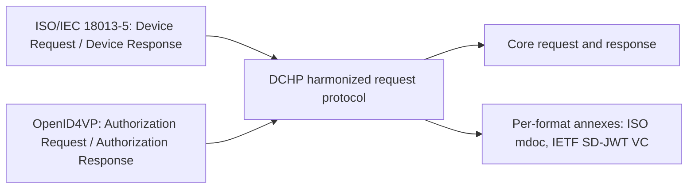

# Deep Dive: openid/dchp

> In one line: the Digital Credentials Harmonized Presentation working group is writing one credential request protocol that brings ISO/IEC 18013-5 and OpenID for Verifiable Presentations together for in-person and online use.

## What this is

ISO/IEC 18013-5 (Device Request / Device Response) and OpenID for Verifiable Presentations (Authorization Request / Authorization Response) take different approaches to credential presentation. The DCHP Working Group supports a joint initiative between ISO/IEC JTC 1/SC 17 (WG10) and the OpenID Foundation's Digital Credentials Protocols (DCP) Working Group to harmonize them. The goal stated in the README is a technical specification for a harmonized digital credentials request protocol that supports in-person and online presentation and the coexistence of multiple credential formats, including ISO mdoc and IETF SD-JWT VC. The repository holds the specification source in `draft/`, and an Editor's Copy is built from it on every change to `main`. The README states that this copy is not an approved Working Group Draft. The staged material contains only the README and a list of pull request titles, so the message formats and the exact protocol flow are not described here.

## How it works

The staged material does not include the specification text, so the diagram shows only what the README states: two existing protocols are being harmonized into one request protocol, with format-specific details moved into per-format annexes (pull request #57).

1. The two input protocols, ISO/IEC 18013-5 and OpenID for Verifiable Presentations, define different request and response messages.
2. The working group develops one harmonized request protocol that must serve both in-person and online presentation.
3. Pull request #57 (merged) moved credential format specific details into per-format annexes, which suggests a core plus annex structure. The merged text itself is not staged.
4. Pull requests #77 and #76 and the titles in the README suggest the core has queries, credentials and a credential response, but their exact structure is not shown.

## Use cases

- A wallet implementer who today supports both ISO 18013-5 proximity presentation and OpenID4VP online presentation and wants a single request format to parse.
- A verifier that needs to ask for either an ISO mdoc or an IETF SD-JWT VC credential with one request.
- A specification author in ISO/IEC JTC 1/SC 17 or the DCP Working Group who has to keep the two protocols aligned.
- An implementer of an in-person reader who needs to know the reader authentication X.509 certificate requirements (pull request #65).
- A library maintainer who needs a stable CBOR encoding for the request (pull request #64, deterministic CBOR encoding).

## Why This Matters Now

- **Trigger**: 23 commits in four days, including a field rename and credential_types becoming an array.
- **Source evidence**: The README lists pull request #61 (make credential_type an array, merged) and pull request #57 (move credential format specific details into per-format annexes, merged), along with open pull requests on casing, terminology, CDDL and prose consistency, and a Security Considerations placeholder. The earlier briefing in `insights.md` also names a rename of CredentialItem.format to credential_format, but that comes from commit titles and is not confirmed by the staged material.
- **Expected impact**: Implementers who followed early editor's copies should expect breaking changes in field names and shapes. Nothing in the staged material says the specification is stable.

## What Changed

- Spec/document change summary: The staged material has no diff, only pull request titles. Merged: #61 makes credential_type an array, and #57 moves format-specific details into per-format annexes. Open: #64 deterministic CBOR encoding, #77 multiple credentials per query and multiple queries per credential in the Credential Response, #74 abbreviations for M, O, C, #76 CDDL and prose inconsistencies, #81 verifier terminology, #65 reader authentication X.509 certificate header, #83 casing of elements, #85 Security Considerations placeholder and Notices appendix. The 23-commit burst itself is described only by commit titles in `insights.md`, which is earlier machine output and was used only as a pointer.
- Compatibility or migration concerns: Changing a field to an array and renaming fields are breaking changes for any implementation of earlier editor's copies. Several pull requests (#83, #82, #73, #59) concern casing of names such as CredentialQuery and scenario_sets, which affects wire names if the elements are serialized. The staged material does not say which names are on the wire.

## Technical Analysis

- Threat model implications: The README gives no threat model. Pull request #85 adds only a Security Considerations placeholder, so the security text is not yet written. Pull request #65 (reader authentication X.509 certificate header) and the mention of cryptographic binding in `insights.md` indicate that verifier authentication and holder binding are in scope, but the staged material does not show their design.
- Protocol flow implications: The README names ISO Device Request / Device Response and OpenID4VP Authorization Request / Authorization Response as the inputs. Pull request #77 indicates that one response must be able to carry several credentials for a query and several queries for a credential, which affects how a wallet matches and returns results. The transport and flow details are not staged.
- Interop concerns: The coexistence of ISO mdoc and IETF SD-JWT VC means each format needs its own annex, and a deterministic CBOR encoding (pull request #64) matters for any signature or hash computed over encoded data. Open pull requests on CDDL and prose inconsistencies (#76) suggest the normative text and the CDDL have disagreed, so implementers should not rely on only one of them.

## Open Questions

- The repository README does not state how the work will be published, or how an OpenID Foundation specification will relate to a revision of ISO/IEC 18013-5.
- Security considerations are only a placeholder (pull request #85, and #84 was closed).
- Whether multiple credentials per query and multiple queries per credential (pull request #77) will be accepted, and in what form, is open.
- Deterministic CBOR encoding (pull request #64) and the reader authentication certificate header (pull request #65) are unresolved.
- The meaning of the SD-JWT VC path semantics is, according to `insights.md`, deferred to issue #52. This is not confirmed by the staged material.

## Experiments

- [ ] Lab 1: Build the Editor's Copy from `draft/` at two commits before and after pull request #61 and compare the credential_type field, to list the exact schema difference.
- [ ] Lab 2: Write one request that asks for an ISO mdoc and an SD-JWT VC credential, and check that a parser written from the core text plus the two annexes accepts it.
- [ ] Lab 3: Check the CDDL in the Editor's Copy against its prose for the inconsistencies pull request #76 describes, using a CDDL validator on sample messages.

## Sources

- <https://github.com/openid/dchp>
- <https://openid.github.io/dchp/digital-credentials-harmonized-presentation-editors-copy.html>
- <https://openid.net/wg/digital-credentials-harmonized-presentation-working-group/>
