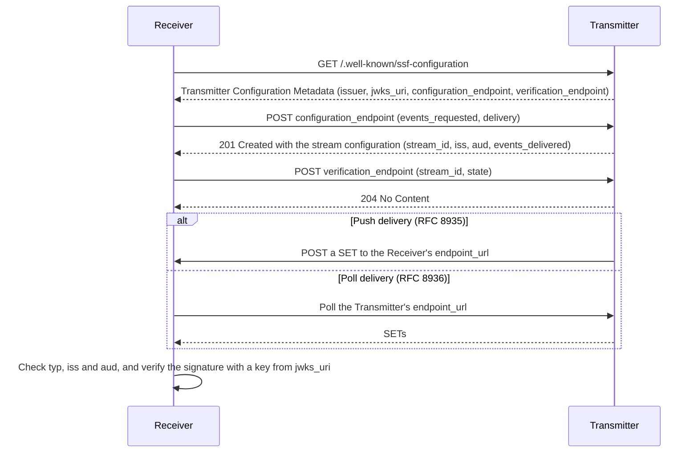

# Deep Dive: OpenID Shared Signals (openid/sharedsignals)

> 一言で言うと: Shared Signals ワーキンググループが SSF、CAEP、RISC（2025 年 9 月から OpenID Final Specification）と CAEP Interoperability Profile の草案を管理するリポジトリ。2026 年 11 月 13 日に作られた SSF 1.1 と CAEP 1.1 の草案は、まだ SSF の規則を何も変えていない。2026 年 11 月 17 日には #368 が、プロファイルにあった唯一のイベント署名の規則（RS256、2048 ビット鍵）を削除した。

## 概要

README はワーキンググループの目標を、関連し合う、または依存し合うシステムの間でセキュリティイベント、状態変化などのシグナルを共有することとしている。目的は、分散したサービス全体でアクセスを管理すること、侵害されたアカウントやデバイスなどのプリンシパルを足がかりに攻撃者が別のシステムへ進むのを防ぐこと、ユーザー、管理者、サービスプロバイダーがインシデントに連携して対応できるようにすることである。

リポジトリ（コミット `d8f89ab`、2026 年 11 月 17 日）の中身は次のとおり。

- `SSF_1.0/`、`CAEP_1.0/`、`RISC_1.0/`: 1.0 の本文。OpenID Foundation は 2025 年 9 月 2 日に、三つとも OpenID Final Specification として承認されたと発表した。公開版の日付は 2025 年 8 月 29 日である。README によれば、正誤表はこれらの文書に適用する。
- `SSF_1.1/`、`CAEP_1.1/`: #310（2026 年 11 月 13 日マージ）が 1.0 から作った開発中の草案。仕様ごとに版を分けて管理するため、RISC には 1.1 のフォルダーがない。
- `openid-caep-interoperability-profile-1_0.md`: CAEP Interoperability Profile 1.0。タイトルは "draft 01"。#343（2026 年 7 月 21 日）が OIDF 会員による 45 日間のレビューに向けて Draft-01 を用意した。Document History にはすでに "-02" の一覧があり、Risk Level Change のユースケースとイベント署名の削除（#368）が載っている。

SSF、CAEP、プロファイルは kramdown-rfc の Markdown（`.md`）で書かれている。XML（xml2rfc）で書かれているのは RISC 1.0 と三つの付属文書（`oauth-event-types-1_0`、`openid-risc-use-cases`、`subject-identifier-scenarios`）である。つまり README の "update one of the xml files" が当てはまるのは RISC だけで、Makefile は `kramdown-rfc2629` で `.md` を `.xml` に変換し、`xml2rfc` で HTML と TXT を作る。ワークフロー `build-everything.yml` はプルリクエストごとに全文書を生成し、`main` への push で GitHub Pages に公開する。README が HTML と TXT をコミットしないと書いているのはこのためである。

SSF 自体は "a profile for Security Event Tokens"（RFC 8417）である。Abstract には、SET（RFC 8417）、SET のための Subject Identifier（RFC 9493）、push 配送（RFC 8935）、poll 配送（RFC 8936）を直接プロファイルするとある。規範的参照には JWT（RFC 7519）と JWK（RFC 7517）も入っているが、JWS（RFC 7515）は入っていない。CAEP と RISC は、SSF の SET で運ぶイベント型を定義する。

## 仕組み

以下の節番号は SSF 1.0 Final のもの。`d8f89ab` 時点の SSF 1.1 草案は本文も節番号も同じである。

1. Receiver は Issuer の URL に `/.well-known/ssf-configuration` を差し込んで Transmitter Configuration Metadata を取得する（7.2 節）。`issuer` は REQUIRED で、Transmitter が出す SET の `iss` と同じでなければならない（MUST）。`jwks_uri` は OPTIONAL だが、Transmitter が JWT に署名するつもりなら指定しなければならない（MUST、7.1 節）。既存の RISC Transmitter は `/.well-known/risc-configuration` を使い続けてもよい（MAY、7.2.2 節）。
2. Receiver はイベントを受け取る前に、Configuration Endpoint への POST で Event Stream を作らなければならない（MUST）。Transmitter はストリーム設定を付けて `201 Created` を返し、Receiver はその `iss` が発見した Issuer と一致することを確認しなければならない（MUST）。リクエストに `delivery` がなければ、Transmitter は poll 配送とみなさなければならない（MUST、8.1.1.1 節）。Management API の実装は Transmitter にとって OPTIONAL だが RECOMMENDED で、そのエンドポイントは、ほかに信頼を確立する方法がない限り HTTP の認証と認可を使わなければならない（MUST、8 節）。
3. Receiver は Verification Endpoint への POST で Verification Event を要求でき、応答は `204 No Content` である。イベントの `sub_id` は `opaque` 形式で、`id` は `stream_id` である。返ってきた `state` が一致しなければ、Receiver は `invalid_state` エラーを返すべきである（SHOULD、8.1.4 節）。
4. イベントは、Receiver が設定した `endpoint_url` への push（6.1.1 節）か、Transmitter が提供する `endpoint_url` からの poll（6.1.2 節）で届く。
5. SSF の SET はすべて明示的な型付け（`typ` が `secevent+jwt`、4.1.1 節）を使わなければならない（MUST）。`sub` と `exp` のクレームは含めてはならない（MUST NOT、4.1.2 節と 4.1.7 節）。`iss` はストリーム設定と一致しなければならず、Receiver はそれを確認しなければならない（MUST、4.1.6 節）。署名鍵は `jwks_uri` から "can be obtained through"（取得できる）とされる（4.1.4 節）。SSF は SET への署名を必須にしておらず、署名アルゴリズムも指定していない。明示的な型付けの例のヘッダーは `HS256` になっている。

CAEP Interoperability Profile は、相互運用のためにこれを絞り込む（節番号は 2026 年 11 月 17 日に生成された草案のもの）。

- Transmitter のメタデータには `spec_version`（`1_0` 以上）、`delivery_methods_supported`、現在の署名鍵を返す `jwks_uri`、`configuration_endpoint`、`status_endpoint`、`verification_endpoint` を含めなければならない（MUST、2.3.1〜2.3.6 節）。
- Receiver は Transmitter の署名鍵を `jwks_uri` から取得しなければならず（MUST、2.4.2 節）、Stream Management API の呼び出しには OAuth 2.0 を使わなければならず（MUST、2.4.3 節）、すべてのサブジェクトがストリームに暗黙に追加されているとみなさなければならない（MUST、2.4.4 節）。
- サブジェクト形式 `email`、`iss_sub`、`opaque`（Verification イベントのみ）をサポートしなければならない（MUST、2.5 節）。`events` クレームにはイベントを一つだけ入れなければならない（MUST、2.7.1 節）。
- 認可サーバーはスコープ `ssf.manage` と `ssf.read` をサポートしなければならず（MUST、2.6.3 節）、有効期間 60 分以内のアクセストークンを発行するために client credentials グラントか authorization code グラントの少なくとも一方をサポートしなければならない（MUST、2.6.1 節）。
- 実装は 3 節のユースケース（Session Revocation / Logout、Credential Change、Device Compliance Change、Risk Level Change）の少なくとも一つをサポートしなければならない（MUST）。
- #368 以降、プロファイルにはイベントに署名しなければならないという規則も、使うアルゴリズムの規則もない。

## ユースケース

最初の項目はプロファイルから取ったもの。残りは読者を想定した例示で、仕様の本文にあるものではない。

- プロファイル自身のユースケース（3 節）: Transmitter が CAEP の `session-revoked`、`credential-change`、`device-compliance-change`、`risk-level-change` イベントを送り、Receiver がセッションを終了させたりアクセスを評価し直したりする。
- 例示: SSF 1.0 の実装者が、1.1 の作業が自分に関係するかを見るために 1.1 草案と 1.0 の差分を取る。`d8f89ab` 時点で違うのはタイトルと文書名だけである。
- 例示: プロファイルが求めていたので RS256 を決め打ちしていた Receiver が、#368 でその規則がなくなったあと、Transmitter ごとにアルゴリズムをどう合わせるかを決める。
- 例示: 貢献者が、次の草案の前に 1.1 への提案（#355、#367、#369）とプロファイルへの提案（#363、#366）を追う。

## なぜ今重要か

- **Trigger**: `tracks/openid/data/normalized/candidates.json`（2026-11-24 のスナップショット）で、openid/sharedsignals は deep dive のない `openid` の候補の中で最上位だった（3 位、スコア 14.4。上の OpenID4VCI と OpenID4VP には deep dive がある）。`tracks/openid/data/normalized/insights.json` には #368 "Drop event signatures" のマージが記録されていた。
- **Source evidence**: #310 が 1.1 の草案を作った（2026 年 11 月 13 日マージ）。#368（11 月 16 日作成、2026 年 11 月 17 日に 3 件の承認を得てマージ）の本文は "As discussed on the 11/10 call, dropping the requirement for event signatures" で、プロファイルの "All events MUST be signed using the `RS256` algorithm with a minimum of 2048-bit keys." の節を削除する。RS256 に固定せずに JWS 署名の要件を残す代案の #356 は、2026 年 11 月 16 日にマージされずにクローズされた。2026 年 11 月 26 日時点で、オープンなプルリクエストは 13 件ある。
- **Expected impact**: プロファイルに準拠する Transmitter は RS256 に縛られなくなり、プロファイルはイベントに署名すること自体も求めなくなった。それでも `jwks_uri` で署名鍵を提供することと、Receiver がそれを取得することは引き続き求めている（2.3.3 節と 2.4.2 節）。署名の取り決めはプロファイルの外で Transmitter と Receiver が合わせる必要がある。#355 は SSF 1.1 にアルゴリズムをネゴシエーションする仕組みを入れる提案だが、オープンのままで、どの草案にも入っていない。

## 変更点

- Spec/document change summary:
  - #310（2026 年 11 月 13 日マージ）は 1.0 の本文を変更せずに `SSF_1.0/`、`CAEP_1.0/`、`RISC_1.0/` へ移し、SSF と CAEP を `SSF_1.1/` と `CAEP_1.1/` に複製した。`d8f89ab` 時点で SSF 1.1 と 1.0 の違いはタイトルと `docname` だけである（固定の日付行は削られ、ビルド時に入る）。CAEP 1.1 はさらに、1.1 で追加・更新したイベントのためのベース URI `https://schemas.openid.net/secevent/caep/event-type/v1.1` を加え、"This spec does not deprecate 1.0 events" と書いている。先行する試みの #309 "Updated versions to 1.1 for next draft" は、2025 年 12 月 9 日にマージされずにクローズされた。
  - #368（2026 年 11 月 17 日マージ）が変更したのは CAEP Interoperability Profile だけである。"Event Signatures" の節（RS256、2048 ビットの規則）を削除し、Document History の "-02" に 1 行を加えた。SSF と CAEP には触れていない。
  - #356（2026 年 11 月 16 日にマージされずにクローズ、issue #350 への対応）は代わりに、RFC 8417 の 5.1 節に従う JWS 署名を必須にし、`none` を禁止し、相互にサポートするアルゴリズムを外部で取り決めることを求め、RSA 鍵の 2048 ビット以上は残す内容だった。
  - Draft-01 の期間にマージされたプロファイルの変更: device compliance change（#313、2026 年 1 月 7 日）、Receiver 要件（#315、2026 年 2 月 17 日）、OAuth の節（#325、2026 年 5 月 13 日）、OIDF レビュー用の Draft-01（#343、2026 年 7 月 21 日）、Risk Level Change のユースケース（#349、2026 年 9 月 1 日）。
- 2026 年 11 月 26 日時点のオープンな提案（どれもマージされていない）:

| PR | 対象 | 提案内容 |
| --- | --- | --- |
| #355 | SSF 1.1 | Transmitter メタデータに OPTIONAL の `set_signing_alg_values_supported`（`none` を含めない）、ストリームに Receiver が指定する `set_signing_alg` を追加。Receiver は `alg` が異なる SET を拒否しなければならない（MUST）。未サポートの値には `400`。RFC 7515 と RFC 7518 を規範的参照に追加 |
| #367 | SSF 1.1 | `ssf-configuration` と `jwks_uri` は CORS をサポートすべき（SHOULD）。認可が必要なエンドポイントはクロスオリジンのリクエストを許可すべきでない（SHOULD NOT） |
| #369 | SSF 1.1 | 送信側は値のない OPTIONAL のストリーム設定プロパティを `null` で送らず省略すべき（SHOULD）。受信側は `null` を省略と同じに扱わなければならない（MUST） |
| #366 | プロファイル 2.5 | `email` と `iss_sub` で組んだ Complex Subject Member（SSF 3.3 節）のサポートも必須（MUST）にする |
| #363 | プロファイル 2.3.1 | `/.well-known/ssf-configuration` のメタデータには `spec_version` が必須（MUST）。`1_0-ID1` の Receiver にも対応する Transmitter は、その版のメタデータを `/.well-known/sse-configuration` に置かなければならない（MUST） |
| #362 | SSF と CAEP | 複合サブジェクトに `agent` と `workload` のメンバーを、`risk-level-change` に AGENT と WORKLOAD のプリンシパルを追加。#310 が移動したリポジトリ直下の 1.0 ファイルに対する変更なので、GitHub はコンフリクトと表示している |
| #329 | CAEP 1.1 | device compliance change に `unmanaged` の値を追加。変更要求（changes requested）が付いている |

- Compatibility or migration concerns: 現在の SSF 1.1 は 1.0 と同じなので、1.1 が 1.0 の実装を壊す点はまだない。1.1 の互換性方針は README にも草案にも書かれていない。CAEP 1.1 は 1.0 のイベント型を引き続き有効としている。プロファイルが参照しているのは SSF 1.0 Final と CAEP 1.0 で、1.1 の草案ではない。

## 技術分析

- Threat model implications: SET の完全性は署名に依存するが、SSF は署名をデプロイメントに任せている（`jwks_uri` が必須になるのは "if the Transmitter intends to generate signed JWTs" の場合だけ、7.1 節）。このリポジトリでアルゴリズムを固定していたのはプロファイルの RS256 の規則だけで、それがなくなった。#355 が提案するセキュリティ上の考慮事項は、JWT ライブラリが扱えるアルゴリズムを何でも受け入れる Receiver はアルゴリズム置き換え攻撃にさらされると指摘している。#355 のようなものが入るまでは、Receiver が受け入れるアルゴリズムの許可リストはデプロイメントが決めることになる。
- Protocol flow implications: 1.1 の草案は流れを変えていない。#355 が提案どおりマージされれば、ストリーム作成に `set_signing_alg` が加わり、Receiver が省略したときは Transmitter がアルゴリズムを選んで返すことになる。変更後しばらくは、Receiver が自分で決めた期間に限り古いアルゴリズムを受け入れてもよい（MAY）。
- Interop concerns: プロファイルは今も `status_endpoint` を必須にしている（2.3.5 節）が、オープンな #314 はこの要件を外す提案である。サブジェクトのサポートは今のところ `email`、`iss_sub`、`opaque` で、#366 は複合サブジェクトを加える。#363 は SSF 1.0 と `1_0-ID1` のメタデータを二つの well-known パスに分ける。

## 未解決の問題

- #368 のあと、ワーキンググループはプロファイルでイベントの署名そのものを求めるつもりなのか。プロファイルは `jwks_uri` による署名鍵の提供を今も求めている（2.3.3 節と 2.4.2 節）。判断の経緯はプルリクエストではなく 2026 年 11 月 10 日の会議にある。
- #355 は SSF 1.1 に入るのか。後のプロファイルの草案は SSF 1.1 を参照するのか。
- SSF 1.1 が 1.0 から離れたとき、互換性の方針はどうなるのか。今はどこにも書かれていない。
- 1.0 の Final 本文は正誤表しか受け付けないので、#362 は `SSF_1.1/` と `CAEP_1.1/` に載せ直されるのか。
- Makefile の `all` ターゲットは、#310 が作っていない `1.1/` フォルダー（`1.1/openid-risc-1_1.html` など）を指したままで、ワークフローはファイルを個別に指定している。`all` は今も保守されているのか。

## 実験

- [ ] Lab 1: リポジトリをクローンし、`xml2rfc` と `kramdown-rfc` を入れて `make SSF_1.1/openid-sharedsignals-framework-1_1.html` と `make SSF_1.0/openid-sharedsignals-framework-1_0.html` を実行し、出力の差分を取る。一次資料から予想される結果は、タイトルと文書名だけが違うこと。
- [ ] Lab 2: #355 の head から SSF 1.1 をビルドし、`set_signing_alg` を指定した場合、省略した場合、未サポートの値を指定した場合の Create Stream を、8.1.1.1 節のエラー表と照らし合わせて確かめる。
- [ ] Lab 3（例示。仕様から導いたものではない）: Transmitter と Receiver の組を作り、同じ SET を RS256 署名、ES256 署名、署名なしで送り、プロファイルが RS256 を固定しなくなった今、どの Receiver がどれを受け入れるかを確かめる。

## 出典

- <https://github.com/openid/sharedsignals>（コミット `d8f89ab`）
- <https://openid.net/specs/openid-sharedsignals-framework-1_0-final.html>
- <https://openid.net/specs/openid-caep-1_0-final.html>
- <https://openid.net/specs/openid-risc-1_0-final.html>
- <https://openid.net/three-shared-signals-final-specifications-approved/>
- <https://openid.github.io/sharedsignals/SSF_1.1/openid-sharedsignals-framework-1_1.html>
- <https://openid.github.io/sharedsignals/openid-caep-interoperability-profile-1_0.html>
- <https://github.com/openid/sharedsignals/pull/310>
- <https://github.com/openid/sharedsignals/pull/355>
- <https://github.com/openid/sharedsignals/pull/356>
- <https://github.com/openid/sharedsignals/pull/368>
- <https://openid.net/wg/sharedsignals/>
